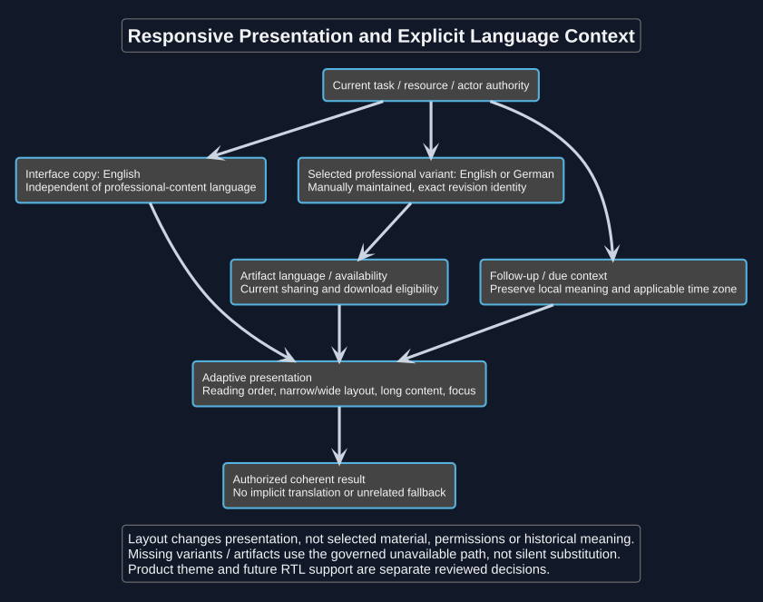

# 11. Responsive And Localization

[Previous: Accessibility](10-Accessibility.md) · [UI/UX Design introduction](01-Introduction.md) · [Next: Usability Testing](12-Usability-Testing.md)

Responsive behavior adapts presentation without changing the task, selected material, current authority or historical meaning. Localization preserves the distinction between English interface copy, manually maintained English/German professional content, artifact language and temporal context. This chapter specifies planned behavior, not a tested browser matrix or completed translation system.

## Responsive Layout

### 11.1 Content-driven Adaptation

Use layouts that respond to available space and actual content rather than assuming a device name determines capability. Preserve meaningful reading/focus order, visible state and access to essential actions. Exact breakpoints and container values require review with implemented content and the [Design System](07-Design-System.md).

| Surface | Wider layout | Narrower layout / enlargement |
| --- | --- | --- |
| Workspace shell | Persistent section navigation where useful | Compact operable navigation with current location and account context retained |
| Dashboard | Group task summaries in readable regions | Stack meaningful sections; preserve follow-up and main next actions |
| Draft editor | Content beside comparison/preview where space supports it | Prioritize editing/validation, then explicit access to comparison/preview and separate publication |
| Publication/share review | Candidate summary and settings grouped by purpose | Keep exact target and consequence before confirmation; do not bury selected materials |
| Private library | Clear item/variant groups and permitted actions | Readable cards/list with state, selection and references still understandable |
| Application history | Tracking and history can occupy distinct regions | Stack tracking and exact submitted-material history without conflating them |
| Recipient view | Focused readable presentation and eligible downloads | Reflow professional content and preserve permitted language/download choices |
| Repository tables/board | Useful two-dimensional context where justified | Understandable navigation plus suitable detail/list alternatives; keep issue identity and keyboard move |
| Dialog / feedback | Contextual review with clear actions | Fit available space and keep focus/errors/actions reachable without obscuring content |

Do not hide required cells, selected artifacts or consequential actions merely to fit. Avoid fixed text heights and truncation that conceals revision/language/error meaning. Sticky navigation/toolbars and overlays must not obscure focused controls or validation feedback.

### 11.2 Input, Focus and State

Pointer, keyboard and assistive input must retain meaningful access to the same permitted task. Provide a non-drag board action and avoid hover-only guidance. Navigation/panel changes preserve logical focus rather than leaving it in hidden content.

Viewport changes must not save, publish, submit, change language selection or repeat a consequential request. Preserve only the input/state the selected privacy policy safely supports. A responsive client-side state change cannot grant resource permission or bypass server validation.

Review loading, empty, invalid, denied, conflict, pending and unknown outcomes in narrow layouts, not only confirmed content. Long validation/status text must remain readable and associated with its task. See [Interaction and Feedback](09-Interaction-And-Feedback.md).

### 11.3 Accessibility Coordination

Use [Accessibility](10-Accessibility.md) for applicable reflow, enlargement, focus, target and contrast checks. A single mobile-width screenshot does not establish those criteria. Record actual viewport/zoom and input/assistive settings with observations.

Document any genuinely two-dimensional view and the applicable exception/alternative rather than assuming every table/board is exempt. Product theme selection is separate from dark-mode documentation diagrams; implemented themes require their own accessible combinations.

## Direction and Locale

### 11.4 Separate Language Contexts

| Context | Current direction | Required distinction |
| --- | --- | --- |
| Interface copy | English | Navigation/actions/errors do not silently switch when professional content language changes |
| Professional content | Explicit manually maintained English/German variants | Editing, preview, publication and retrieval identify the selected variant |
| Uploaded/generated artifact | Language/identity of the actual selected file or exact rendering input | Do not infer that an interface locale translates the document |
| Recipient presentation | Currently eligible selected publication/content | Viewer choice cannot expose unselected/private material |
| Temporal/number display | Relevant documented locale/time-zone context | Formatting must not alter stored meaning or operation identity |

Automatic translation remains outside MVP scope. Do not overwrite independently authored text or present a machine-generated counterpart as an existing maintained variant. Missing/incomplete content rules retain their governing requirement disposition.

English and German use left-to-right layout in the selected scope. Identify content language semantically where needed. Future RTL support requires explicit layout, component and complete-journey verification; it is not established by using generic alignment tokens.

### 11.5 Variant Selection and Missing Content

Show enough language/revision context for users to know which material they edit, publish, record or receive. A selected draft language does not automatically change a published revision or historical submission. Generated PDF uses the exact selected input; an existing uploaded PDF keeps its actual identity.

If a language/eligible artifact is unavailable, show the governed unavailable/incomplete state and a permitted next action. Do not silently substitute another-language PDF, unrelated publication or today's live resume. Any explicit fallback behavior must be defined by the owning contract and visibly distinguish what is actually being shown.

Recipient language options remain constrained by current sharing selection and authorization. A visible selector is not permission to enumerate private variants. Exact submitted materials remain historically bound even if the owner later changes the current publication or language preference.

### 11.6 Temporal and Number Meaning

Format follow-up/due information with its relevant local meaning and time-zone context. Keep date-only values distinct from instants; do not introduce a time-zone conversion that shifts a date-only obligation to another day. Preserve the owning database/API contract for storage and conversion.

Use unambiguous input guidance and validate on the server. Number formatting and units must not change quota, size or financial meaning. Identify size/limit units under the selected policy rather than guessing from a locale convention. Sorting/filtering should operate on the underlying intended values, not formatted strings.

UI business dates are functional content; documentary update dates are not required. Synthetic fixtures used during verification should cover relevant boundary cases without exposing private information.

## Responsive and Language Context Diagram

[PlantUML source](Diagrams/responsive-language-context.puml) · [PNG](Diagrams/responsive-language-context.png)

The diagram shows independent contexts that converge in a coherent presentation. It does not select a translation provider, locale framework, product theme, routing strategy or new storage model. Layout adaptation never relaxes current sharing or resource authority.

## Locale and Viewport Scenarios

| Scenario | Expected behavior / observation |
| --- | --- |
| Draft with long German professional text in English UI | Content wraps and remains editable; task labels stay English; selected language/revision is clear |
| Narrow editor with comparison/preview | Safe transition between regions, unchanged intent and reachable apply/save/separate publish actions |
| Enlarged multi-error form | Labels/errors/summary remain associated, readable and keyboard reachable |
| Publication review with many selected files | Exact selection and consequence remain inspectable before confirmation |
| Missing eligible PDF language | Accurate unavailable state; no silent cross-language or unrelated fallback |
| Recipient direct/alternate retrieval | Same current selection/authorization regardless of viewport or language presentation |
| Application history after publication change | Exact submitted variant/files remain identifiable and unchanged |
| Follow-up or issue due context | Correct date-only/instant semantics and applicable time-zone display from the owning contract |
| Narrow board / repository list | Stable resource identity, useful navigation and keyboard move without essential information loss |
| Resize while request is pending/unknown | No automatic mutation/retry and persistent safe outcome-resolution path |
| Focused control near sticky UI | Control and feedback remain usable in the actual viewport/zoom/input configuration |

These are planned checks, not observed findings. Do not invent a list of supported browsers/devices or a success result from document completion.

## Content and Component Handoff

For each affected screen, specify reading order, layout priorities, overflow/wrapping, navigation/panel behavior and consequential action placement. Record relevant interface/content/artifact language and temporal semantics. Provide long/missing/invalid examples and expected fallback policy rather than only ideal short text.

Use semantic reusable components under [Design System](07-Design-System.md) and [Screen Specifications](08-Screen-Specifications.md). Treat translated/professional content as data under its owner's rules; avoid duplicating independently mutable variants or deriving historical material from current preferences.

Keep source/prototype and implementation behavior synchronized. Actual runtime packages and compatible locale support are verified during setup/implementation; this chapter selects no additional dependency.

## Verification and Evidence

Record candidate/build, actor/grants, selected language/revision/artifacts, fixture meaning, browser/OS, viewport/zoom, input/assistive technology, expected/observed results and limitations. Combine automated checks where useful with manual reading order, focus, long-content and full-task observation.

Link issues and actual results through [UI/UX Traceability](14-Traceability.md) and the [RTM](../../02-Requirements-Engineering/03-Requirements-Traceability-Matrix/README.md). Use [Usability Testing](12-Usability-Testing.md) and [Development Handoff](13-Handoff-To-Development.md) for execution/handoff details. The [SRS](../../02-Requirements-Engineering/01-Software-Requirements-Specification/README.md) and [API specification](../03-Low-Level-Design/05-API-Specification.md) govern language/data meaning and authority.

A narrow/wide render, correct diagram background or readable example does not establish browser compatibility, accessibility conformance, approved fallback policy or passed runtime localization.
