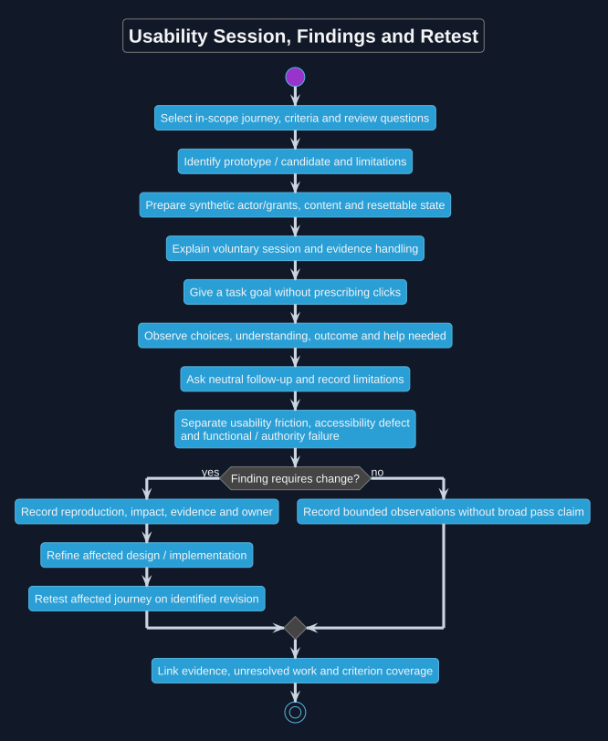

# 12. Usability Testing

[Previous: Responsive and Localization](11-Responsive-And-Localization.md) · [UI/UX Design introduction](01-Introduction.md) · [Next: Handoff to Development](13-Handoff-To-Development.md)

## Test Plan

Evaluate whether intended users can understand and complete the selected MVP journeys, recognize the actual result and recover safely. Test task meaning as well as control discoverability: draft apply, publication, PDF availability and actual submitted materials must remain distinguishable.

**Execution status:** no usability sessions or findings are recorded here. The scenarios, protocol and templates below are planned verification work. Static wireframes, rendered diagrams and documentation checks are not participant evidence or runtime passes.

### 12.1 Scope and Review Questions

| Role / journey | Review question |
| --- | --- |
| Invited account holder | Can the user enter the permitted workspace and understand expired/denied context? |
| Tailoring and publication | Can the user select a subset of source changes, preserve independent text and separately publish the intended material? |
| Employer/share recipient | Can the recipient find eligible selected content/downloads without confusing the view with owner workspace access? |
| Application tracking/history | Can the user distinguish editable tracking from exact recorded submission materials after later changes? |
| Repository collaborator | Can the user find permitted work, move an issue using the keyboard and understand conflict/denied/unavailable feedback? |
| Administrator | Can the actor identify the exact permitted account action and consequence without assuming unrestricted private access? |

Personal mail/calendar, advanced Sprints/review/releases, AI and user workflow/deployment execution remain deferred. Retained future-domain examples are not current MVP session tasks.

### 12.2 Test Artifact and Readiness

Choose the artifact appropriate to the question. A wireframe can support hierarchy/label discussion; a clickable prototype can support navigation observation within its simulated scope; an implemented candidate is required to verify real validation, authorization, persistence and integration.

Record the actual artifact/source revision and limitations before a session. Do not claim a static image supports unimplemented keyboard behavior or a mock response proves real Git, SMTP or recovery. Review [Wireframes and Prototypes](06-Wireframes-And-Prototypes.md) for current fidelity and pending interactive work.

Prepare synthetic accounts, resource grants, recipient links, distinct language variants and resettable data. Ensure intended normal/error states can be reached without modifying private production material. A recipient uses link-scoped context where account-free access is selected; do not invent a viewer product account requirement.

## Usability Session Protocol

### 12.3 Participants and Context

Use representative task/role experience when recruiting participants, and record relevant context without fictional demographics or unsupported expertise assumptions. Participant role and test account role are separate: synthetic accounts/data protect privacy, while observations come from real sessions when conducted.

Explain purpose, voluntary participation, stopping/pausing and what evidence will be retained. Obtain agreement before recording audio/video or identifiable feedback. Collect only necessary data and use non-identifying session references in shared records. No recruitment, contact or recording is performed by this documentation task.

Do not invent participant counts, success-rate targets or session-duration commitments. Resolve the actual study scope and any quantitative acceptance target through the governing criteria and available participants.

### 12.4 Session Steps

1. Identify artifact/candidate, task scope and known simulation/implementation limits.
2. Confirm intended actor/grants, resource versions and synthetic starting state.
3. Record browser/OS, viewport/zoom, input and assistive technology relevant to the review.
4. Give a goal-based task without prescribing navigation or revealing the intended button.
5. Observe choices, hesitation, recovery, outcome understanding and assistance needed; distinguish spontaneous completion from prompted completion.
6. Ask neutral follow-up about what the participant expected and believes happened.
7. Record evidence, limitations and unresolved issues; reset synthetic state for the next task.

Separate formative walkthrough from acceptance execution. Facilitator help can be useful evidence of friction, but it must not be hidden inside a claimed independent task success.

### 12.5 Planned Tasks

| Task prompt / fixture | Observe | Include an alternate path |
| --- | --- | --- |
| Tailor two materials with different independent text; apply one selected source change | Recognition of target, selected fields and preserved overrides | Stale comparison or invalid input |
| Preview and publish the intended language/revision | Separate save/apply/publish intent and exact candidate understanding | Cancel confirmation; missing usable artifact |
| Configure access and find the intended shared PDF as recipient | Selected scope, language, eligible download and owner/recipient separation | Disabled/changed link or missing eligible variant |
| Set application follow-up and retrieve actual prior material | Temporal context and distinction between current content and immutable history | Later profile edit/withdrawal; pending/incomplete capture |
| Find a repository issue and move its state without dragging | Repository/issue identity, keyboard controls and confirmed result | Stale issue or revoked grant |
| Resolve a delayed or unknown consequential result | Accurate understanding of pending/uncertain completion | Status lookup without blind duplicate write |
| Perform a selected administrative account action | Target/consequence understanding and bounded authority | Denied private-content path or changed account state |
| Complete relevant tasks at narrow/enlarged layout | Reachable controls/context, reading/focus order and readable errors | Long English/German content and dynamic feedback |

Prompts must not imply automatic employer delivery, named employer identity, universal Git authority or access to deferred features. Exact expected results come from [User Flows](05-User-Flows.md), [Screen Specifications](08-Screen-Specifications.md) and the owning contract.

## Session, Finding and Retest Flow

[PlantUML source](Diagrams/usability-session-cycle.puml) · [PNG](Diagrams/usability-session-cycle.png)

The flow shows planned evidence collection and correction. It does not claim sessions occurred or a redesign passed. A clean observation on one task/artifact cannot establish universal usability, security or accessibility.

## Measures and Observation Rules

| Observation | Record | Interpretation limit |
| --- | --- | --- |
| Completion | Actual end state and whether help was required | A participant's belief alone does not prove a remote/business effect |
| Understanding | What the participant thinks changed or is shared | Compare with the actual contract/result, not facilitator intent |
| Errors / backtracking | Task step, trigger, correction and consequence | Distinguish an interface misconception from a functional defect |
| Help / prompts | Assistance wording and point in the task | Do not report prompted completion as independent success |
| Time / repeated effort, if measured | Defined start/end and interruptions | No target or statistical conclusion without an agreed method/sample |
| Preference / quote | Voluntary exact feedback or clearly marked paraphrase | Individual preference is not a universal requirement |
| Accessibility difficulty | Input/assistive setup and reproducible barrier | Separate criterion assessment from subjective ease of use |

Record negative and ambiguous observations as well as successful completion. Avoid unsupported percentages, fabricated quotes or extrapolating from synthetic walkthroughs to real participant findings.

## Findings and Changes

**No findings have been recorded.** Use the following structure when evidence becomes available; these fields are a template, not populated session results.

| Finding field | Required content |
| --- | --- |
| Identifier / source | Existing issue/finding reference, session/task and affected criterion |
| Artifact/context | Candidate/prototype revision, actor/grants, resource/data version and client/input setup |
| Observation | Actual behavior, help needed and expected versus observed result |
| Impact | Blocked task, unsafe misunderstanding, recoverable friction or cosmetic preference with rationale |
| Classification | Usability issue, accessibility defect, functional/authorization failure or unresolved policy |
| Proposed response | Scoped design/implementation change and owning work item/owner |
| Retest | Changed revision, task/check, actual outcome and remaining limitation |
| Evidence handling | Permitted non-sensitive artifact location and access/retention under the chosen policy |

Prioritize impact using the actual task and affected users. Misunderstanding publication/sharing, losing work, inaccessible required actions or false completion can carry greater consequence than minor visual preference. Do not invent a risk score or accepted severity scale without the project's agreed method.

## 6. Verification and Handoff

This heading preserves the existing cross-document anchor. Combine observation with the relevant functional, integration and accessibility evidence; keep their conclusions distinct.

Manual keyboard, focus, screen-reader and reflow checks complement automated findings under [Accessibility](10-Accessibility.md). A successful participant task does not prove all applicable WCAG criteria. Real Git transport, current grants, protected delivery, exact historical bytes and recovery require the owning technical verification, not a simulated clickthrough.

For each execution, record exact criterion/case, artifact/build revision, client/OS, viewport/zoom, input/assistive setup, actor/grants, starting data/version, task steps, expected/observed result, assistance, evidence and limitations. Use a concrete tested client matrix rather than “current stable” as a timeless version label.

## Retest and Closure

After a change, rerun the affected task/check on an identifiable revision and inspect related shared components/journeys. Verify both the original problem and meaningful regression risks. Do not close a finding solely because copy or a wireframe changed.

Record whether the finding is resolved, remains reproducible, cannot yet be evaluated or has an explicitly accepted limitation under the relevant authority. Keep missing implementation, unresolved language/fallback policy and untested client/assistive coverage visible. Retest observations must be actual evidence rather than an expected result copied into an outcome field.

## Existing Design Records and References

The planned journey checks, evidence contract and session protocol above consolidate the existing record with selected MVP scope. Previously retained send/calendar, advanced Sprint/run/target examples remain deferred and are not acceptance obligations for current product flows.

Use the [SRS](../../02-Requirements-Engineering/01-Software-Requirements-Specification/README.md) and [RTM](../../02-Requirements-Engineering/03-Requirements-Traceability-Matrix/README.md) for criterion wording/disposition, [test strategy](../../05-Agile-Iterative-Development/02-Test-Strategy.md) for technical execution and [UI/UX Traceability](14-Traceability.md) / [Development Handoff](13-Handoff-To-Development.md) for implementation links.

Supporting analysis remains in [quality evaluation](../01-High-Level-Design/14-Appendices.md#design-record-06-design-quality-and-security-analysis-01-quality-attributes-and-design-trade-offs-md), [review/handoff](../01-High-Level-Design/14-Appendices.md#design-record-06-design-quality-and-security-analysis-05-design-review-traceability-and-handoff-md) and the [reference map](../01-High-Level-Design/14-Appendices.md#design-record-design-references-and-coverage-md). Their presence is not a completed study, accepted release or runtime pass.
