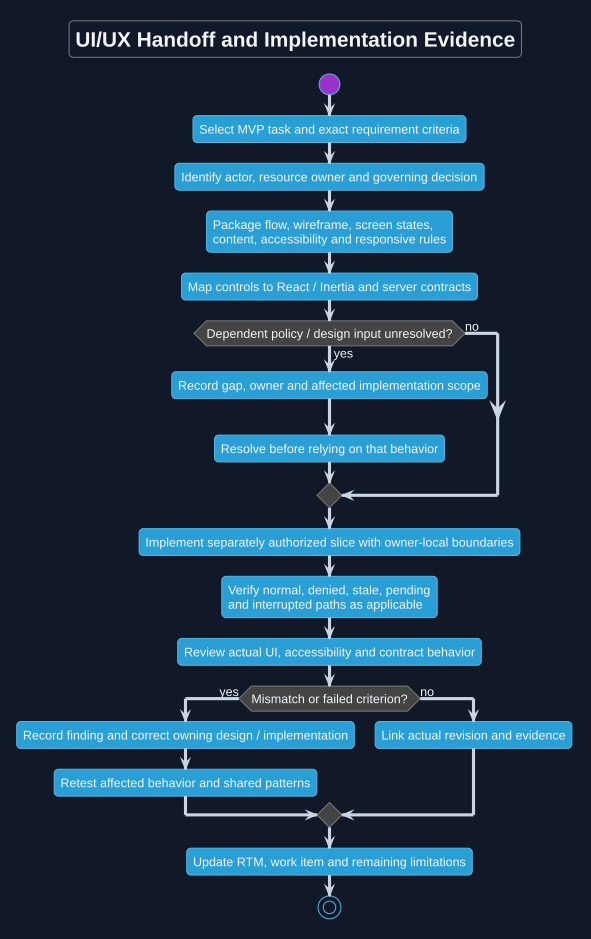

# 13. Handoff To Development

[Previous: Usability Testing](12-Usability-Testing.md) · [UI/UX Design introduction](01-Introduction.md) · [Next: Traceability](14-Traceability.md)

Handoff makes a selected user task implementable without changing its required meaning. It connects flows, layouts, component behavior and content/accessibility rules to the owning server operation and exact acceptance criteria. A mockup, diagram or handoff checklist is not an implemented screen or release approval.

Work within the selected MVP and [frontend ADR](../ADR/ADR-007-React-Inertia-Frontend.md): React/Inertia pages inside independent Laravel applications, server-owned validation/sessions/policies and trusted Blade PDF templates. Do not introduce a separate browser REST-authentication layer or merge Core/ProjectForge authority through shared UI reuse.

## Tokens and Assets

### 13.1 Visual Delivery Contract

| Deliverable | Required handoff information | Current treatment |
| --- | --- | --- |
| Semantic tokens | Purpose, actual value when selected, state/theme use and accessibility checks | [Design System](07-Design-System.md) defines proposed roles; production palette/font values remain unselected until reviewed |
| Typography | Selected family/weight, loading/licensing and long-content behavior | Record actual selection rather than inferring it from documentation diagrams |
| Layout | Content order, container/spacing relationships, overflow and narrow/wide priorities | [Wireframes](06-Wireframes-And-Prototypes.md) provide low-fidelity structure, not approved high-fidelity styling |
| Icons/images | Source/license, intended meaning, variants, alternatives and allowed use | Select with the affected screen; do not expose private library material as a public build asset |
| UML / wireframes | Editable dark-mode PlantUML source and matching SVG/PNG | Update source/render references together |
| Interactive prototype | Actual artifact/link, covered paths, simulated behavior and limitations | Remains pending until created/reviewed; do not invent a prototype URL or approval |

Record available artifacts and missing visual inputs explicitly. A behavior-ready slice may still need visual review; do not label arbitrary colors/fonts as approved merely to fill a handoff field. Conversely, an open brand palette does not reopen already selected business/architecture decisions.

## Component Mapping

### 13.2 Technical Responsibility Map

| UI responsibility | Implementation seam | Boundary to preserve |
| --- | --- | --- |
| Page shell/navigation | Receiving application's React/Inertia page/layout and Laravel routing | Current account/resource context and permitted discovery; separate application sessions |
| Form and validation | Semantic React controls plus server-validated use case | Client assistance does not replace current resource authority or business rules |
| Selected comparison/apply | Explicit presentation operation with current source/draft context | Preserve independent text and reject stale changes without silent overwrite |
| Publication review | Separate confirmed publication operation | Exact candidate/language/artifacts; save and PDF availability remain distinct |
| File/recipient view | Core sharing/files entry point and authorized delivery | Current policy on direct/alternate retrieval; no private path shortcut |
| Application history | Applications operation and protected exact-material references | Immutable submission history, independent of current publication |
| Repository/issue UI | ProjectForge scoped API/owning use case | Current entitlement, local grants, expected version and distinct Git transport authority |
| Status/recovery | Result mapping from owning operation and stable request identity | Truthful pending/conflict/unknown outcomes; no blind consequential repeat |
| PDF representation | Trusted Blade/Dompdf path in Core | Exact selected inputs and private output; separate document-accessibility assessment |

Map actual class, route and component names during implementation. Names in this design are responsibilities, not existing production files or runnable endpoints. Keep controllers/adapters, policy decisions, application services and persistence responsibilities aligned with [Detailed Module Design](../03-Low-Level-Design/03-Detailed-Module-Design.md).

### 13.3 Shared Components

For each control/pattern, specify semantic role, inputs, state variants, events/results, validation association, keyboard/focus behavior and responsive/content limits. Reuse visual contracts without duplicating business ownership or putting permission logic solely in React.

When changing a shared component, identify affected screens and retest meaningful states. A button's pending state prevents accidental activation; stable server request identity still protects repeated commands. A hidden control does not authorize direct requests.

## Handoff Checklist

### 13.4 Screen / Flow Package

| Field | Required content |
| --- | --- |
| Task / scope | Selected actor goal, MVP applicability and exact requirement/criterion references |
| Authority / entry | Owning application/component, actor/resource/action preconditions and safe denied/expired context |
| Current material | Resource identity, selected language/revision/files and distinction between mutable and historical records |
| Layout / content | Wireframe, reading order, labels, helper text, selection summary and permitted actions |
| Operation | Inputs, primary/secondary action, confirmation, expected version and request identity where required |
| States | Loading/empty, invalid, denied, conflict, pending/partial, unavailable, unknown and confirmed as applicable |
| Recovery | Preserved permitted input, current-state review and same-operation status/reconciliation behavior |
| Accessibility | Semantics, names, keyboard alternatives, focus transitions and relevant announcements |
| Responsive / locale | Narrow/wide priorities, overflow, long English/German content and temporal/variant meaning |
| Assets / tokens | Selected usable artifacts and explicit unselected/missing inputs |
| Verification | Planned case, expected outcome, actual revision/environment and evidence when executed |
| Follow-up | Open question, owner/work item, affected gate and required resolution |

Publication/submission packages identify the exact selected materials before confirmation. Recipient packages exclude owner navigation and private history. Repository packages distinguish issue permission from native Git credentials/grants. Deferred personal mail/calendar, advanced planning/review/releases and user execution screens are not introduced by a generic handoff template.

### 13.5 Server and Data Contract Check

Before implementing a screen action, confirm input shape, authorization, version/conflict behavior, local persistence, external effects and recorded result with the owner. Use the [API specification](../03-Low-Level-Design/05-API-Specification.md) and [Database Design](../03-Low-Level-Design/04-Database-Design.md) rather than inferring transaction or retry semantics from a wireframe.

A successful local save does not establish remote success, PDF usability or message delivery. Preserve separately committed outcomes and protected references while finalization remains uncertain. Exact submitted bytes must not be reconstructed from the current live resume. Current authority still applies on protected retries and direct retrieval.

## Handoff and Review Flow

[PlantUML source](Diagrams/development-handoff.puml) · [PNG](Diagrams/development-handoff.png)

An unresolved dependent policy/input must be resolved before implementation relies on that behavior. Independent work may proceed within settled scope. This flow does not require re-approval of selected decisions or authorize code/deployment work merely because documentation is complete.

## Design Review and Implementation Readiness

| Review question | Ready when | Keep open when |
| --- | --- | --- |
| Is the task meaning unambiguous? | Actor, target, consequence and separate outcomes are explicit | Save/publish/share/capture or authority boundaries remain confused |
| Are contracts implementable? | Owning input/result/conflict/retry rules are linked | A prototype assumes unsupported payload, rollback or fallback behavior |
| Can all required states be built? | Normal and relevant denied/stale/pending/unknown paths are specified | Only ideal success content exists |
| Are input and layout requirements known? | Keyboard/focus, semantics and narrow/long-content behavior are reviewable | Essential behavior depends solely on hover, drag, color or wide space |
| Are visual decisions honest? | Reviewed values/assets are linked and unselected choices are explicit | Pending mockups/tokens are described as approved |
| Can acceptance be checked? | Exact criteria and executable planned checks are identified | A screenshot or diagram is the only claimed evidence |

Use [Design Goals and Principles](02-Design-Goals-And-Principles.md), [Accessibility](10-Accessibility.md) and [Responsive and Localization](11-Responsive-And-Localization.md) for shared requirements. No readiness status is assigned to a real work item by this template.

## Implementation Review and Evidence

After a separately authorized implementation, inspect the actual screen behavior on the tested candidate. Verify normal actions and relevant invalid/denied/stale/concurrent/interrupted cases, not only visual resemblance. Record browser/input/assistive/viewport context, data versions and actual outcomes.

Check direct requests/current authorization, exact historical materials and real integration at their owning boundaries. Mocked UI success does not prove Git interoperability, SMTP delivery, private filesystem isolation or restoration. Keep usability observation distinct from accessibility criterion assessment and functional acceptance.

Attach actual source revision, case/result and evidence to the owning issue and [RTM](../../02-Requirements-Engineering/03-Requirements-Traceability-Matrix/README.md). Keep failed, blocked and unexecuted checks visible; do not copy expected behavior into an observed-result field.

## Change Handling and Closure

For a behavior/contract change, identify affected requirements, consumers, screens, data and shared patterns. Resolve consequential changes through the relevant ADR/decision authority, then update HLD/LLD, UI/UX, PlantUML artifacts and exact traces together. Reassess earlier evidence invalidated by code/configuration/dependency changes.

Use [Usability Testing](12-Usability-Testing.md) for findings/retest and [UI/UX Traceability](14-Traceability.md) for screen-level mappings. [Project Setup](../../05-Agile-Iterative-Development/01-Project-Setup.md) records actual environment commands; the [deployment plan](../../06-Deployment-Release/01-Deployment-Plan.md) and runbook govern separate release/operational gates.

Handoff is complete for a selected slice only when its required inputs and limitations are documented and the receiving implementation work is concrete. Product acceptance still requires actual evidence. This chapter creates no code, installed package, high-fidelity approval, runtime pass or deployment authorization.
