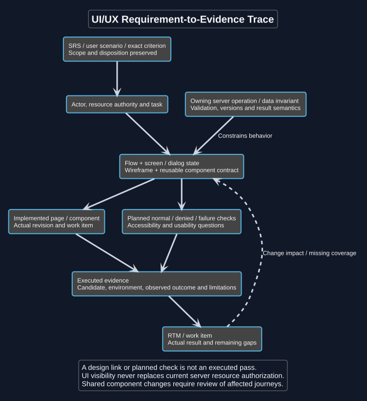

# 14. Traceability

[Previous: Handoff to Development](13-Handoff-To-Development.md) · [UI/UX Design introduction](01-Introduction.md) · [Next: Appendices](15-Appendices.md)

UI/UX traceability connects required user behavior to actor/task context, screens and states, reusable components, owning server contracts and verification evidence. The [SRS](../../02-Requirements-Engineering/01-Software-Requirements-Specification/README.md) owns requirement meaning; the [RTM](../../02-Requirements-Engineering/03-Requirements-Traceability-Matrix/README.md) owns individual criterion mappings, scope dispositions and actual results. This chapter provides an experience-level map without creating a competing criterion register.

## Requirements and User Stories → Screens

| Requirement area | Role / task | Screens and patterns | Required verification focus |
| --- | --- | --- | --- |
| Invited identity and current authority | Invited user enters permitted workspace; administrator performs selected account duties | Invitation, sign-in, recovery, return context and authorized administration | Valid/invalid/expired context, current grants, direct access and bounded feedback |
| Profiles and independent tailored content | Account holder maintains source and selectively updates a draft | Profile, material list, draft editor, comparison and selected apply | Explicit selection, independent text, current version and conflict recovery |
| Publication | Account holder previews and confirms exact material | Preview, publication review, material/language/revision context | Save versus publish distinction, cancellation and exact confirmed revision |
| Controlled sharing and media | Owner manages selected access; recipient retrieves eligible content | Private library, file/PDF state, share settings, recipient entry/view | Selected content, current link/viewer policy, direct delivery and unavailable variant |
| Manual applications and submitted history | Applicant updates tracking and records/retrieves actual materials | Application list/detail, follow-up, capture review and immutable history | Mutable tracking versus exact retained material, incomplete capture and preserved history |
| Repository collaboration | Collaborator browses permitted files/history and manages issues/basic Kanban | Repository list/detail, resolved revision, issue editor and keyboard board action | Current entitlement/local grants, stale issue, separate native Git credentials/authority |
| Accessible/compatible interaction | Applicable roles complete full tasks | Navigation, controls, dialogs, feedback, narrow/long-content states | Keyboard/focus, semantics, reflow, contrast and actual client/assistive configuration |
| Truthful completion and recovery | Actor understands what completed and the safe next step | Persistent invalid/conflict/pending/unavailable/unknown/confirmed patterns | No false success/rollback, safe input preservation and same-operation resolution |

The table identifies design areas, not exhaustive criterion coverage. Exact IDs and acceptance wording must be taken from the RTM and its linked register. A requirement may span several screens/owners, and a shared component may support several criteria.

Deferred personal mail/calendar, AI, advanced review/releases, general Sprints and user workflow/deployment execution remain excluded from MVP screen commitments. Preserve conditional/deferred dispositions rather than counting them as completed work.

## Trace Model

[PlantUML source](Diagrams/uiux-traceability.puml) · [PNG](Diagrams/uiux-traceability.png)

The diagram separates design coverage, implementation and execution evidence. The owning server/data contract constrains UI behavior. A prototype or drawn control does not prove authority enforcement, exact artifact preservation or a completed remote effect.

## Design Artifact Map

| Record | Trace responsibility |
| --- | --- |
| [Users](03-Users.md) | Role tasks and authority assumptions, distinct from observed research findings |
| [Information Architecture](04-Information-Architecture.md) | Authorized discovery, resource context and recipient/ProjectForge boundaries |
| [User Flows](05-User-Flows.md) | Intent, decision points, normal and alternative/recovery paths |
| [Wireframes and Prototypes](06-Wireframes-And-Prototypes.md) | Layout/state artifact and actual fidelity/interactive limitations |
| [Design System](07-Design-System.md) | Shared controls/tokens, semantic roles and reusable behavior |
| [Screen Specifications](08-Screen-Specifications.md) | Per-screen actor, content, actions, states and acceptance fields |
| [Interaction and Feedback](09-Interaction-And-Feedback.md) | Validation, confirmation, focus and accurate operation outcomes |
| [Accessibility](10-Accessibility.md) | Applicable criterion assessment and complete-journey evidence |
| [Responsive and Localization](11-Responsive-And-Localization.md) | Layout/input/variant/temporal behavior and tested configurations |
| [Usability Testing](12-Usability-Testing.md) | Real observation, assistance, findings and retest, separate from technical passes |
| [Development Handoff](13-Handoff-To-Development.md) | Concrete implementation package, contracts and open inputs |

Use local editable dark-mode PlantUML sources and matching renders for diagram references. Their successful rendering is artifact verification, not product acceptance.

## Criterion-level Record

For each selected criterion, record the following in the owning RTM/work item rather than duplicating its result across every screen document.

| Field | Required content |
| --- | --- |
| Source | Exact SRS/criterion identity, scope/disposition and relevant user scenario |
| Actor / authority | Role, account/grants, resource/action and starting access context |
| Experience provision | Exact flow, screen/dialog state and reusable pattern/component |
| Contract / invariant | Owning operation, selected data/language/revision, validation, expected version and result semantics |
| Implementation | Actual page/component/route when implemented, work item and source/build revision |
| Planned check | Prerequisites, fixture/data version, task/action and observable expected result |
| Execution | Actual candidate/environment, browser/input/assistive setup, observed result and evidence location |
| Gaps / follow-up | Failed, blocked, not executed, missing input or explicit limitation with owner/work reference |

Do not invent new acceptance IDs, silently change wording or promote proposed criteria to accepted status. A supplemental check must remain distinguishable from the source criterion it supports. One case supports several criteria only when its observations demonstrate each expected outcome.

## Cross-Cutting Experience Traces

### 14.1 Current Authority and Selected Visibility

Trace account/recipient/service/Git context through navigation, visible actions, direct entry and the owning resource policy. Verify both permitted and denied/changed-access behavior. Hiding a control or omitting a link does not establish direct-request authorization, and an administrator role does not imply unrestricted private access.

### 14.2 Exact Material and Historical Meaning

Trace selected profile changes to the independent draft and separately confirmed publication. For submission history, trace exact actual material to immutable event/protected bytes. Verify later edits, withdrawal, replacement and retry without silently resolving today's live content. A current preview and historical copy can reuse layout while retaining different data contracts.

### 14.3 Truthful Feedback and Remote Outcomes

Trace user intent through request identity, current authority, local/remote outcomes and safe next action. Check validation, stale versions, pending/partial/unavailable and lost-response uncertainty. A queue acknowledgment or optimistic UI change cannot prove publication, PDF availability, actual delivery or a ProjectForge commit.

### 14.4 Accessibility and Responsive/Language Context

Trace the complete task and its error states through semantics, focus, keyboard alternatives, announcements, long content and narrow/enlarged layout. Identify interface/content/artifact language and relevant temporal meaning. Separate actual accessibility findings from usability preferences and unsupported conformance claims.

## Verification Status and Evidence

| Condition | Reporting rule |
| --- | --- |
| Design/artifact available, implementation absent | Record design coverage while implementation remains pending |
| Planned case not executed | Retain not-executed/pending status; expected behavior is not a result |
| Actual check passes | Link candidate, configuration, observed outcome and supporting artifact for the exact criterion |
| Actual check fails | Record failure, impact and corrective work without hiding it behind visual completeness |
| Dependency blocks assessment | Name the dependency/owner and affected criterion/gate |
| Prototype simulates behavior | Record simulation scope; no claim of real authorization, Git, SMTP or persistence proof |
| Criterion is deferred/conditional | Preserve applicability and activation condition; do not count it as verified |
| Change invalidates evidence | Reassess affected coverage and obtain fresh checks before relying on prior conclusions |

No runtime or participant evidence is created by completing this chapter. Automated scans, diagram renders and static wireframes cannot alone establish whole-product usability/accessibility or operational readiness.

## Updating Screen Traceability

When a screen/dialog, shared component, token, policy, contract or environment changes:

1. Identify affected exact criteria and preserve their scope/disposition.
2. Follow actor/resource tasks through flows, screen states, shared components and owning operations.
3. Review authorization, material selection/history, validation, request identity and recovery consequences.
4. Update affected UI/UX, HLD/LLD, PlantUML source/renders and work-item references together.
5. Identify invalidated evidence and select proportionate normal, denied, stale, interrupted and accessibility/regression checks.
6. Record actual results and remaining gaps centrally in the RTM/work item.

Review reverse traces: a new screen/action without a governing task/requirement or justified supporting purpose may indicate scope creep. A criterion without a screen/contract owner or executable verification path remains a coverage gap. A shared control change can affect recipient views and independent applications even when only one page was edited.

## Review and Handoff

Before implementation, ensure the selected slice has an exact criterion, actor/resource authority, reviewable states, owning contract and planned checks. Before acceptance, attach actual implementation/revision evidence and make failed, blocked and unexecuted work explicit. Before release, include applicable quality/security/recovery gates beyond visual review.

Use the [HLD Traceability](../01-High-Level-Design/13-Traceability.md) and [Risks & Key Decisions](../01-High-Level-Design/12-Risks-And-Key-Decisions.md) for architecture impact, [Detailed Module Design](../03-Low-Level-Design/03-Detailed-Module-Design.md) / [API specification](../03-Low-Level-Design/05-API-Specification.md) for executable behavior and the [test strategy](../../05-Agile-Iterative-Development/02-Test-Strategy.md) for execution records.

A completed trace map is an aid to review, not a passed implementation, approved visual system, completed study or release decision.
