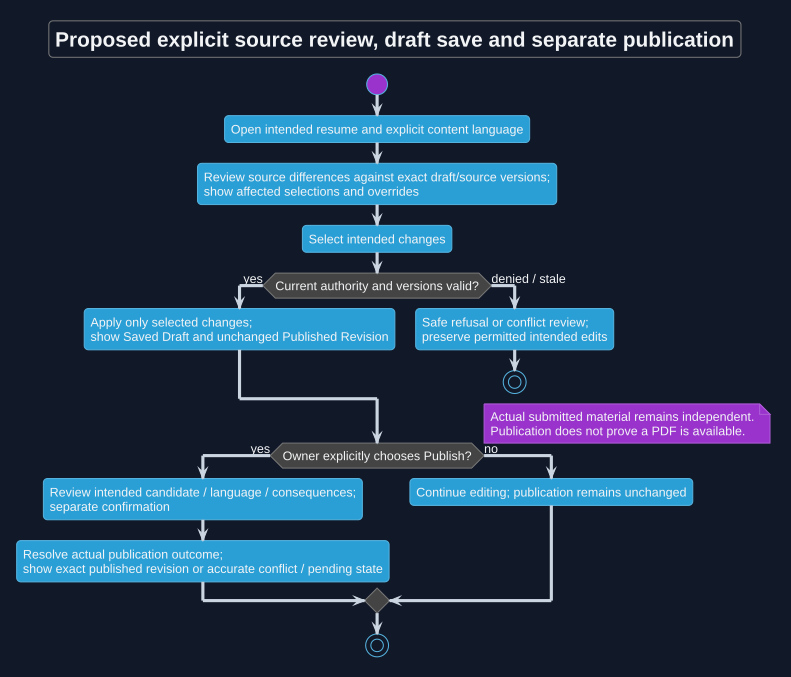
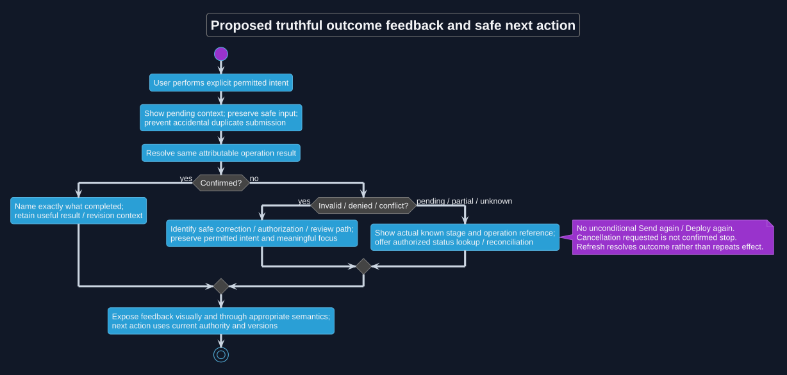

# 15. Appendices

[Previous: Traceability](14-Traceability.md) · [UI/UX Design introduction](01-Introduction.md)

This appendix collects canonical references, current UI/UX diagrams/wireframes and supporting interaction records. Use the owning chapter and governing requirement/contract for behavior and status. An artifact link does not establish implemented screens, approved branding, completed participant research or passed accessibility checks.

## Reference Guide

| Question | Governing record |
| --- | --- |
| What is in the MVP? | [Project charter](../../01-Project-Planning/01-Project-Charter.md#mvp-scope) and selected requirement dispositions |
| What behavior and terminology are required? | [SRS](../../02-Requirements-Engineering/01-Software-Requirements-Specification.md), including accepted update/publication policy and data definitions |
| Who performs the tasks? | [Users](03-Users.md); role profiles are requirements-derived, not fabricated research findings |
| How are tasks organized? | [Information Architecture](04-Information-Architecture.md) and [User Flows](05-User-Flows.md) |
| What is reviewable visually? | [Wireframes and Prototypes](06-Wireframes-And-Prototypes.md); low-fidelity artifacts are available, high-fidelity/interactive approval is not asserted |
| Which component and screen behavior applies? | [Design System](07-Design-System.md), [Screen Specifications](08-Screen-Specifications.md) and [Interaction and Feedback](09-Interaction-And-Feedback.md) |
| What must be verified inclusively? | [Accessibility](10-Accessibility.md) and [Responsive and Localization](11-Responsive-And-Localization.md) |
| Where are observations and implementation inputs recorded? | [Usability Testing](12-Usability-Testing.md) and [Handoff to Development](13-Handoff-To-Development.md) |
| Where is exact coverage/evidence? | [UI/UX Traceability](14-Traceability.md) and the [RTM](../../02-Requirements-Engineering/03-Requirements-Traceability-Matrix.md) |
| Which architecture and contracts constrain the UI? | [HLD](../01-High-Level-Design/01-Introduction.md), [Detailed Module Design](../03-Low-Level-Design/03-Detailed-Module-Design.md) and [API specification](../03-Low-Level-Design/05-API-Specification.md) |
| Which frontend choice is selected? | [Frontend ADR](../ADR/ADR-007-React-Inertia-Frontend.md): React/Inertia in independent Laravel applications, trusted Blade PDF path |

## Design Assets

All current diagram and wireframe entries below use editable PlantUML with dark rendered backgrounds. SVG is the document-view format; PNG supports image viewers. PlantUML Salt supplies structural wireframes, not running widgets or a chosen product theme.

| View | Owning chapter | Source | SVG | PNG |
| --- | --- | --- | --- | --- |
| Roles and principal tasks | [Chapter](03-Users.md) | [PlantUML](Diagrams/users-role-tasks.puml) | [SVG](Diagrams/users-role-tasks.svg) | [PNG](Diagrams/users-role-tasks.png) |
| Navigation and experience boundaries | [Chapter](04-Information-Architecture.md) | [PlantUML](Diagrams/information-architecture.puml) | [SVG](Diagrams/information-architecture.svg) | [PNG](Diagrams/information-architecture.png) |
| Tailor, save and publish | [Chapter](05-User-Flows.md) | [PlantUML](Diagrams/user-flow-publication.puml) | [SVG](Diagrams/user-flow-publication.svg) | [PNG](Diagrams/user-flow-publication.png) |
| Protected recipient viewing | [Chapter](05-User-Flows.md) | [PlantUML](Diagrams/user-flow-sharing.puml) | [SVG](Diagrams/user-flow-sharing.svg) | [PNG](Diagrams/user-flow-sharing.png) |
| Manual submission capture | [Chapter](05-User-Flows.md) | [PlantUML](Diagrams/user-flow-submission.puml) | [SVG](Diagrams/user-flow-submission.svg) | [PNG](Diagrams/user-flow-submission.png) |
| Repository issue/board interaction | [Chapter](05-User-Flows.md) | [PlantUML](Diagrams/user-flow-repository.puml) | [SVG](Diagrams/user-flow-repository.svg) | [PNG](Diagrams/user-flow-repository.png) |
| Dashboard wireframe | [Chapter](06-Wireframes-And-Prototypes.md) | [PlantUML](Diagrams/wireframe-dashboard.puml) | [SVG](Diagrams/wireframe-dashboard.svg) | [PNG](Diagrams/wireframe-dashboard.png) |
| Draft editor wireframe | [Chapter](06-Wireframes-And-Prototypes.md) | [PlantUML](Diagrams/wireframe-draft-editor.puml) | [SVG](Diagrams/wireframe-draft-editor.svg) | [PNG](Diagrams/wireframe-draft-editor.png) |
| Recipient wireframe | [Chapter](06-Wireframes-And-Prototypes.md) | [PlantUML](Diagrams/wireframe-recipient.puml) | [SVG](Diagrams/wireframe-recipient.svg) | [PNG](Diagrams/wireframe-recipient.png) |
| Application detail wireframe | [Chapter](06-Wireframes-And-Prototypes.md) | [PlantUML](Diagrams/wireframe-application.puml) | [SVG](Diagrams/wireframe-application.svg) | [PNG](Diagrams/wireframe-application.png) |
| Repository issue/board wireframe | [Chapter](06-Wireframes-And-Prototypes.md) | [PlantUML](Diagrams/wireframe-repository.puml) | [SVG](Diagrams/wireframe-repository.svg) | [PNG](Diagrams/wireframe-repository.png) |
| Design system responsibilities | [Chapter](07-Design-System.md) | [PlantUML](Diagrams/design-system-layers.puml) | [SVG](Diagrams/design-system-layers.svg) | [PNG](Diagrams/design-system-layers.png) |
| Screen outcomes and recovery | [Chapter](08-Screen-Specifications.md) | [PlantUML](Diagrams/screen-outcome-states.puml) | [SVG](Diagrams/screen-outcome-states.svg) | [PNG](Diagrams/screen-outcome-states.png) |
| Interaction feedback and safe action | [Chapter](09-Interaction-And-Feedback.md) | [PlantUML](Diagrams/interaction-feedback-route.puml) | [SVG](Diagrams/interaction-feedback-route.svg) | [PNG](Diagrams/interaction-feedback-route.png) |
| Accessibility review | [Chapter](10-Accessibility.md) | [PlantUML](Diagrams/accessibility-review.puml) | [SVG](Diagrams/accessibility-review.svg) | [PNG](Diagrams/accessibility-review.png) |
| Responsive/language contexts | [Chapter](11-Responsive-And-Localization.md) | [PlantUML](Diagrams/responsive-language-context.puml) | [SVG](Diagrams/responsive-language-context.svg) | [PNG](Diagrams/responsive-language-context.png) |
| Usability session and retest | [Chapter](12-Usability-Testing.md) | [PlantUML](Diagrams/usability-session-cycle.puml) | [SVG](Diagrams/usability-session-cycle.svg) | [PNG](Diagrams/usability-session-cycle.png) |
| Development handoff | [Chapter](13-Handoff-To-Development.md) | [PlantUML](Diagrams/development-handoff.puml) | [SVG](Diagrams/development-handoff.svg) | [PNG](Diagrams/development-handoff.png) |
| Requirement-to-evidence chain | [Chapter](14-Traceability.md) | [PlantUML](Diagrams/uiux-traceability.puml) | [SVG](Diagrams/uiux-traceability.svg) | [PNG](Diagrams/uiux-traceability.png) |


### Artifact Interpretation

The catalog includes conceptual navigation/state/dependency views, activity flows and low-fidelity layouts. Read each with its chapter's scope and limitations. Diagram arrows do not grant permission, and a drawn control does not implement validation, accessible operation or remote effects.

Current low-fidelity artifacts make content hierarchy and behavior reviewable. Production palette/fonts, exact token values, additional component-library selection and high-fidelity/interactive prototype approval remain explicit review inputs. Dark documentation styling does not resolve those product decisions.

## Existing Design Records

The original supporting interaction records remain available as local dark-mode PlantUML assets in the HLD appendix collection. These links replace light archived image embeds; their retained proposal/future-domain status remains unchanged.

### Explicit Source Apply and Separate Publication



[PlantUML source](../01-High-Level-Design/Diagrams/Appendix/ui-source-apply-publication.puml) · [PNG](../01-High-Level-Design/Diagrams/Appendix/ui-source-apply-publication.png)

Use [User Flows](05-User-Flows.md) for the current MVP journey. Source comparison/apply changes only the independent draft; publication remains separately confirmed. Exact actual submitted materials do not resolve solely through the current live resume.

### Outcome and Safe Recovery Record



[PlantUML source](../01-High-Level-Design/Diagrams/Appendix/ui-outcome-recovery-route.puml) · [PNG](../01-High-Level-Design/Diagrams/Appendix/ui-outcome-recovery-route.png)

Use [Interaction and Feedback](09-Interaction-And-Feedback.md) and [Screen Specifications](08-Screen-Specifications.md) for current result handling. Retained send/deployment examples are broader context, not MVP personal mail or user execution features. Unknown completion requires recorded-outcome resolution rather than blind repetition.

## Using the Reference Material

Current chapters refine the selected MVP. Retained diagrams supply rationale and examples without superseding the SRS, selected ADRs or owning contracts. Resolve contradictions against those sources before changing implementation; update affected chapters and exact traces together.

Keep private source/draft/publication/submission distinctions intact. Separate owner workspace and recipient access; preserve ProjectForge entitlement/local grants and native Git credentials. Do not infer permissions, automatic translation, delivery or rollback from a navigation arrow or visual status.

Prefer a link to the canonical shared view over copying it into conflicting variants. Preserve stable headings/anchors when consolidating material and update inbound links when moving an artifact. Keep original rationale available when a newer reviewed artifact supersedes it.

## Rendering and Dark-Mode Verification

From this chapter's directory, adjust the local JAR path and render an affected source:

```powershell
java -jar path/to/plantuml.jar -tsvg Diagrams/users-role-tasks.puml
java -jar path/to/plantuml.jar -tpng Diagrams/users-role-tasks.puml
```

Repeat for the relevant basename. Keep PlantUML/layout dependencies compatible with the actual rendering environment. Salt wireframes use reverse monochrome styling; inspect the rendered result rather than judging a single source color value in isolation.

Update source, SVG and PNG together. Verify dark background, readable labels/controls, unclipped content and usable layout. Check every embedded image, including retained references, rather than assuming source format or a theme declaration guarantees the result. Rendering checks verify documentation artifacts only.

## Evidence and Review Boundaries

| Artifact / result | What it supports | What it does not establish |
| --- | --- | --- |
| Navigation/flow diagram | Review of task organization and decision meaning | Working routes, permission enforcement or actual service effects |
| Static wireframe | Content order, controls and representative states | Interactive behavior, approved visual identity or accessibility conformance |
| Interactive prototype, when supplied | Observation of its actual implemented/simulated paths | Real persistence, Git interoperability, delivery or full contract compliance |
| Automated accessibility output | Findings for the executed rules/configuration | Complete WCAG or usability assessment |
| Real participant session | Recorded task observations in that setup | Universal user preference or every technical acceptance criterion |
| Candidate-specific functional check | Evidence for the exact observed operation/criterion | Unexecuted criteria or unchanged validity after a material configuration/code change |

Use synthetic content and permitted evidence handling. Exclude passwords, tokens, private professional material and host paths from shared screenshots/logs. Record actual revision, configuration, task, expected/observed result, limitations and follow-up. Planned cases remain distinct from executed outcomes.

## Appendix Maintenance and Handoff

When scope, behavior, tokens or a shared component changes, follow the affected requirement through screen/flow, owner contract and evidence. Update diagrams/wireframes and traceability references with the implementation work. Reassess previous results invalidated by the change.

Before claiming an artifact approved or a gate complete, link the actual review/verification record. Missing high-fidelity design, unresolved policy/client inputs and unexecuted usability/accessibility work remain visible. Add no documentary update dates or fictional findings.

Operational setup/release/recovery evidence remains in its owning SDLC records. Completing this appendix does not implement the product, execute participant sessions or authorize deployment.
