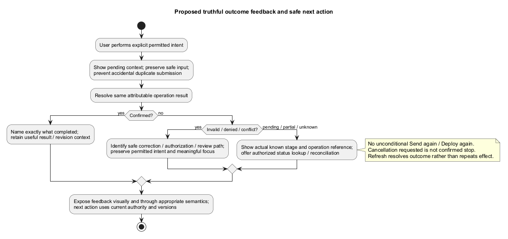
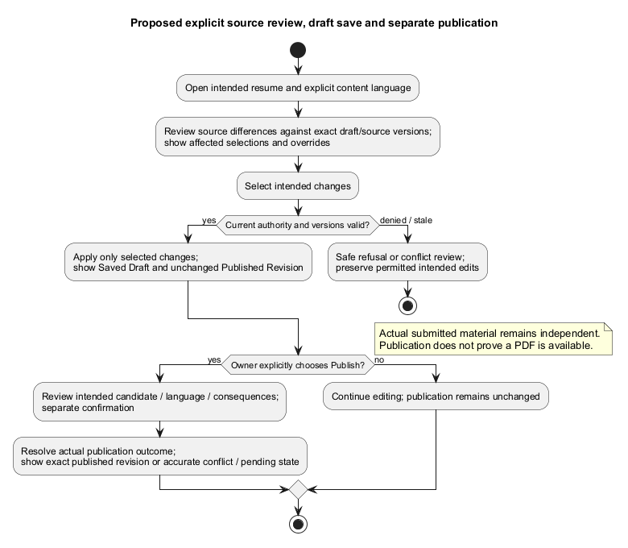

# 15. Appendices

[UI/UX Design index](02-UI-UX-Design.md)

Supporting diagrams and original design references are collected below.

## Existing Design Records

## Design assets

- 
- [ui-outcome-recovery-route.puml](https://github.com/Farhad-V/Web-Resumefolio/blob/1f2acaa351ac306cb57cbe4fe9742e8bd90720d9/docs/MVP/SDLC/04-system-design/06-design-quality-and-security-analysis/diagrams/ui-outcome-recovery-route.puml)
- [ui-outcome-recovery-route.svg](https://github.com/Farhad-V/Web-Resumefolio/blob/1f2acaa351ac306cb57cbe4fe9742e8bd90720d9/docs/MVP/SDLC/04-system-design/06-design-quality-and-security-analysis/diagrams/ui-outcome-recovery-route.svg)
- 
- [ui-source-apply-publication.puml](https://github.com/Farhad-V/Web-Resumefolio/blob/1f2acaa351ac306cb57cbe4fe9742e8bd90720d9/docs/MVP/SDLC/04-system-design/06-design-quality-and-security-analysis/diagrams/ui-source-apply-publication.puml)
- [ui-source-apply-publication.svg](https://github.com/Farhad-V/Web-Resumefolio/blob/1f2acaa351ac306cb57cbe4fe9742e8bd90720d9/docs/MVP/SDLC/04-system-design/06-design-quality-and-security-analysis/diagrams/ui-source-apply-publication.svg)
