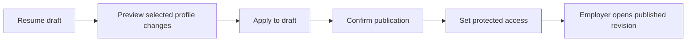
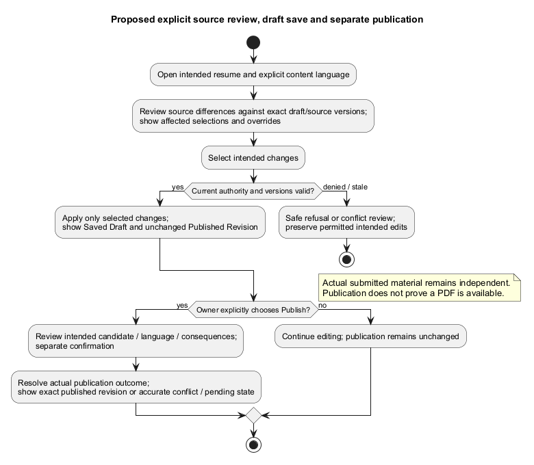
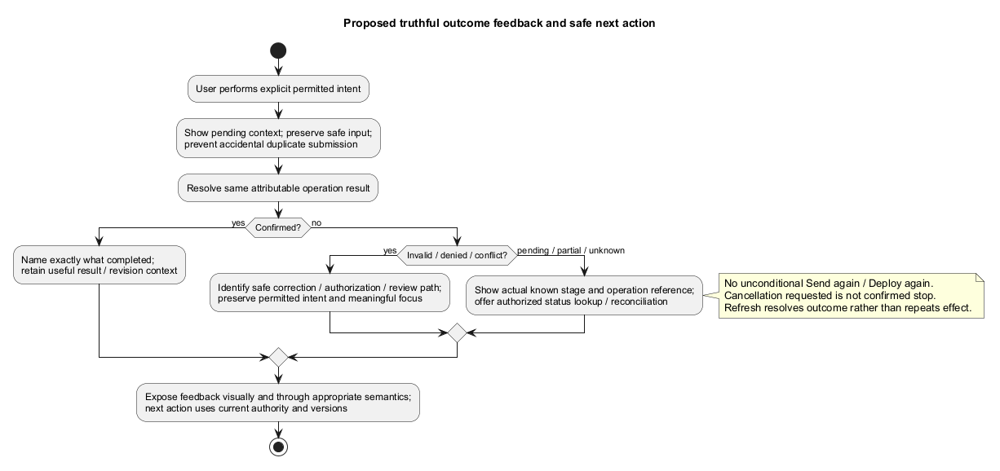

# UI/UX Design

[Software Design Document](../../System-design-guide.md#ui-ux-design)

## Screen and interaction scope

| Area | Design focus |
| --- | --- |
| Workspace | Show the sections and actions available to the signed-in user. |
| Resume editing | Distinguish draft and published revisions. Keep preview, selection, application and publication distinct. |
| Employer sharing | Show the resume and authorized attachments. Provide clear feedback when access has expired or been revoked. |
| Application history | Distinguish editable application details from the materials actually submitted. |
| Accessibility | Carry keyboard navigation, clear focus and meaningful feedback into page and form design. |

The detailed journeys and interface states below guide screen-level work. Add wireframes and verification with the affected capability.

## MVP wireframes

These low-fidelity layouts show content, action order and permission-relevant states. Validate screens with the development increment that implements them.

| Screen | Wireframe, from top to bottom | Important states |
| --- | --- | --- |
| Invite and sign-in | Product title → invitation status → email and password fields → primary submit → recovery link | Valid invitation, invalid or expired invitation, generic authentication error, required admin second factor |
| Dashboard | Account and workspace navigation → open applications and follow-ups → resume drafts → ProjectForge shortcut when entitled | Empty workspace, loading, service unavailable |
| Profile and resume editor | Profile or draft breadcrumb → section list → editable content → saved state → preview selected source changes → explicit apply | Dirty draft, stale version, conflict review, no selected changes |
| Publication and share settings | Resume and language → preview exact revision → choose PDF and allowed files → confirm publication → manage password and revoke link | Missing language, pending PDF, failed publication, withdrawn link |
| Private media | Collection and filters → upload with supported types and limits → item list with validation state → explicit selection for a draft | Quarantine, rejected upload, quota denial, selected or referenced file |
| Employer view | Protected-link password entry → published resume → authorized PDF and selected media → access-unavailable page | Password required, expired or revoked link, missing PDF language |
| Applications | Status filters → application list → detail, next action and follow-up → submitted materials and correction history | Empty list, missing follow-up, submitted set pending or durably captured |
| ProjectForge | Repository list → repository header and permitted actions → files/history/issues → board lanes | No entitlement, insufficient permission, authorization unavailable, stale move |
| Admin | Account list → invitation or suspension action → confirmation → audit metadata | Reauthentication needed, disabled account, private content excluded from admin views |

On narrow screens, stack navigation, content and actions in reading order. On wider screens, the editor can place preview beside the draft. Keep focus on the current action or error summary after a state change. Support keyboard board moves as well as pointer interaction.

Current implementation choices and scope: [Baseline](https://github.com/Farhad-V/Web-Resumefolio/blob/1f2acaa351ac306cb57cbe4fe9742e8bd90720d9/docs/MVP/baseline/README.md). Runtime verification remains subject to its gates.

**Purpose:** define shared navigation, interaction states, content distinctions and accessibility verification obligations for owner, collaborator and employer journeys.

**Status:** proposed interaction design, November 2, 2026. Q-D25's WCAG/client/viewport target remains proposed. This document creates no implemented screens, approved visual system, user-study result or accessibility conformance claim.

[Sources](#1-sources-and-experience-boundaries) · [Navigation](#2-navigation-and-context) · [Journeys](#3-consequential-journey-design) · [States](#4-forms-feedback-and-recovery) · [Accessibility](#5-accessibility-and-responsive-behavior) · [Review](#6-verification-and-handoff)

## 1. Sources and experience boundaries

Use [EIF-D02 and interface requirements](../../02-Requirements-engineering/01-Software-requirements-specification.md#requirements-specification-external-interface-requirements), [QSR-D03/Q-D25](../../02-Requirements-engineering/01-Software-requirements-specification.md#requirements-specification-quality-security-and-recovery-requirements--id-resolution-q-d25), [source scenarios](../../02-Requirements-engineering/01-Software-requirements-specification.md#scenarios-and-models-user-stories-and-scenarios) and [analysis interactions](../../03-System-analysis/System-analysis.md#analysis-behavioral-and-scenario-analysis--06-scenario-based-view). Required business meaning stays with the relevant component and source decision, not a button label or visual prototype.

The current design uses English interface copy with explicit manually maintained English/German professional content. Content language is separate from interface language, provider time zone and uploaded-document language. Automatic translation is outside accepted scope; fallback/completeness details retain their source status. Preserve the [accepted update/publication policy](../../02-Requirements-engineering/01-Software-requirements-specification.md#change-and-baseline-open-questions-and-decisions--id-owner-accepted-profile-update-policy).

This file owns shared interaction behavior. [Component designs](../03-Low-level-design/Low-level-design.md#design-record-03-component-and-module-design-component-and-module-design-md) own operations and invariants; [API contracts](../03-Low-level-design/Low-level-design.md#design-record-05-interface-and-api-design-01-api-protocols-contracts-and-compatibility-md) own result semantics; [Security](../01-High-level-design/High-level-design.md#design-record-06-design-quality-and-security-analysis-02-security-threat-modeling-and-trust-boundaries-md) owns current authority/control design. Disabled or hidden UI alone never enforces permission.

## 2. Navigation and context

### Authenticated workspace

Provide consistent navigation to Presentation, Applications, Communication/Calendar, Work, Git and authorized Administration. Show the current resource and relevant context in page headings/breadcrumbs; selecting a project or repository does not extend permissions to linked resources. Keep a clear page purpose, primary next action and local secondary actions rather than placing every available operation in one undifferentiated toolbar.

Shared shell elements include current account, section navigation, resource title, main content, attributable operation feedback and contextual help. Visibility follows actual allowed discovery; do not leak private resource names through navigation, search, notifications or inaccessible link previews. A repository issue and work item may be associated without becoming one object.

### Employer experience

Use a separate minimal protected viewing route without requiring a product account. Identify permitted resume/content language and download choices only after applicable authorization. Password possession is not a verified employer identity. Unavailable/disabled/private states use safe truthful feedback; never reveal owner drafts, unrelated evidence or another-language PDF as a fallback.

### Reusable patterns

Specify consistent page headings, labeled fields, selection lists, status summaries, dialogs, tables/lists, file/variant cards and confirmation summaries. Choose an actual component library/framework and visual tokens only after compatibility/design evaluation. Status uses explicit words/icons as appropriate rather than color alone. Dense data can use a focused detail view without losing relationships or access context.

## 3. Consequential journey design

[Explicit source apply, saved draft and separate publication](https://github.com/Farhad-V/Web-Resumefolio/blob/1f2acaa351ac306cb57cbe4fe9742e8bd90720d9/docs/MVP/SDLC/04-system-design/06-design-quality-and-security-analysis/diagrams/ui-source-apply-publication.svg)

[Editable PlantUML](https://github.com/Farhad-V/Web-Resumefolio/blob/1f2acaa351ac306cb57cbe4fe9742e8bd90720d9/docs/MVP/SDLC/04-system-design/06-design-quality-and-security-analysis/diagrams/ui-source-apply-publication.puml) · 

### Presentation and history

Label **Saved Draft**, **Published Revision** and **Actual Submitted Materials** distinctly. A source comparison identifies exact source/draft versions, proposed differences, selections and affected overrides. Applying selected changes saves only the draft; show the unchanged published revision. Publication is a separate explicit action confirming the intended candidate/language and its relevant consequences.

Stale comparison/save conflicts preserve the user's permitted intended edits and offer review against current state; do not silently overwrite or publish a newer unseen draft. Actual-material views identify real capture/completeness rather than rebuilding submitted content from today's resume. See [Presentation](../03-Low-level-design/Low-level-design.md#design-record-03-component-and-module-design-components-professional-presentation-md) and [Applications](../03-Low-level-design/Low-level-design.md#design-record-03-component-and-module-design-components-applications-md).

### Sharing and files

Separate download mode, variant availability, link state and password controls. A configured option may still be processing/unavailable. Explain failed replacement without pretending the prior usable association changed. Link disabling/password rotation communicates the defined subsequent-access consequence and the limit that downloaded/emitted bytes cannot be recalled. See [Sharing](../03-Low-level-design/Low-level-design.md#design-record-03-component-and-module-design-components-representation-and-sharing-md).

### Communication, Work and execution

**After MVP.** Shared operating and recovery controls still apply where relevant.

Send review exposes intended recipients, content, attachments and current provider context before deliberate dispatch. Pending/unknown outcomes offer operation lookup/reconciliation rather than an unconditional Send again action. Acceptance is not reading/delivery. Calendar feedback distinguishes local save from provider synchronization.

Board movement offers non-drag controls. Task completion, item acceptance and Sprint-end/goal outcomes have distinct labels/actions. Ending a period must not imply all work succeeded. Native Git/review interfaces show exact revision/ref context; execution and target deployment have separate authority/approval/status. Cancellation requested is not stopped; terminal run is not cleaned up. See the [interaction realizations](../03-Low-level-design/Low-level-design.md#design-record-05-interface-and-api-design-03-use-case-realizations-and-interactions-md).

## 4. Forms, feedback and recovery

[User-visible outcome and safe next-action route](https://github.com/Farhad-V/Web-Resumefolio/blob/1f2acaa351ac306cb57cbe4fe9742e8bd90720d9/docs/MVP/SDLC/04-system-design/06-design-quality-and-security-analysis/diagrams/ui-outcome-recovery-route.svg)

[Editable PlantUML](https://github.com/Farhad-V/Web-Resumefolio/blob/1f2acaa351ac306cb57cbe4fe9742e8bd90720d9/docs/MVP/SDLC/04-system-design/06-design-quality-and-security-analysis/diagrams/ui-outcome-recovery-route.puml) · 

| State | Required interaction meaning |
| --- | --- |
| Loading | Identify the pending region; keep navigation/context understandable; avoid implying an operation has committed |
| Empty | Distinguish no authorized records, no filter matches and unavailable dependencies; offer only meaningful permitted next actions |
| Invalid input | Identify affected fields and correction guidance; retain safe input and avoid success feedback |
| Denied / expired context | Safe bounded explanation and permitted sign-in/refresh path; no private resource disclosure or client-side bypass |
| Conflict | Preserve intended edits safely, show actual version conflict and offer review/reapply under current authority |
| Pending / partial | Show actual stage/result and operation reference; distinguish confirmed local work from incomplete external effects |
| Unknown effect | State uncertainty and reconciliation path; no false failure or blind consequential retry |
| Confirmed | Describe exactly what completed: draft save, publication, provider acceptance or capture completeness, not a broader claim |

Use persistent in-context feedback for consequential outcomes; a short disappearing toast must not be the only record of an unknown send or failed save. Prevent accidental repeated submission while a request is pending, but server command identity remains the correctness mechanism. Refresh/back navigation reconciles the same operation rather than issuing another mutation.

Preserve user input through validation/conflict where permitted, without persisting passwords/tokens or private content in unsafe URLs, browser storage or cross-account drafts. Session expiry must not offer a fabricated saved-state guarantee. Destructive/cross-boundary confirmations identify actual target/scope and known recovery limits; ordinary reversible edits need not acquire unnecessary confirmation steps.

The official W3C explanations for [Error Identification](https://www.w3.org/WAI/WCAG22/Understanding/error-identification.html) and [Status Messages](https://www.w3.org/WAI/WCAG22/Understanding/status-messages.html) inform textual error identification and assistive feedback without disruptive focus changes. These are design obligations to verify, not existing widget behavior.

## 5. Accessibility and responsive behavior

### Target and semantics

[WCAG 2.2](https://www.w3.org/TR/WCAG22/) is the standard referenced by the proposed AA target. Review applicable A/AA criteria across complete journeys; selected checks below are not a full conformance checklist. Page language, semantic structure, text alternatives, contrast, focus, input assistance and accessible authentication require actual implementation assessment. PDF accessibility is a separate evaluation from the web interface.

Prefer native semantic controls. The [W3C ARIA Authoring Practices guidance](https://www.w3.org/WAI/ARIA/apg/practices/read-me-first/) explains that adding a role does not supply expected keyboard behavior; custom patterns require actual browser/assistive-technology testing. Do not add ARIA that obscures correct native semantics. Sources reviewed November 2, 2026; actual client/widget compatibility remains unverified.

### Keyboard, focus and pointer interaction

The [W3C Keyboard explanation](https://www.w3.org/WAI/WCAG22/Understanding/keyboard.html) informs equivalent keyboard operation for pointer actions. Provide logical focus order, visible focus and no keyboard traps. Dialogs need meaningful initial focus, contained interaction while modal and appropriate focus restoration. Provide buttons/menu actions for selection/reordering/work movement rather than drag-only operation. Avoid hover-only information and maintain accessible names for icon controls.

### Layout, enlargement and content

Use content-driven responsive layouts that preserve actions, relationships and feedback at narrow widths/enlargement. Where tables/boards genuinely need two-dimensional space, supply understandable navigation and useful alternative detail/list views; do not hide required cells or primary controls solely to fit a viewport. Avoid sticky overlays obscuring focused controls or errors.

The [W3C Reflow explanation](https://www.w3.org/WAI/WCAG22/Understanding/reflow.html) includes a 320-CSS-pixel equivalent width for vertical content, with specific two-dimensional-content exceptions. Q-D25's proposed 390-pixel/200%-zoom checks alone do not cover every reflow obligation. Evaluate text enlargement, wrapping and input/error feedback separately from a screenshot at one mobile width.

Support readable long multilingual content, explicit dates/time zones and language identification for professional variants. Evidence media needs meaningful alternatives and applicable captions/descriptions under the reviewed criteria; a generic filename does not describe its professional meaning. Avoid unnecessary motion and honor relevant reduced-motion behavior. Exact styles/target dimensions and criterion-specific exceptions must be documented in the implementation assessment rather than guessed from this guide.

## 6. Verification and handoff

### Planned journey checks

- Tailor two resumes with distinct overrides; review/apply a subset and separately publish the intended version using keyboard and assistive feedback.
- Configure PDF/link controls, view selected content and handle missing language/variant without misleading fallback.
- Record actual submitted material and inspect capture completeness after later content changes.
- Review/send with pending/unknown feedback; resolve a lost response without duplicate effect.
- Refine/move work through keyboard alternatives, record actual Sprint outcomes and review exact Git/run/target context.
- Recover from invalid inputs, denied/expired context, stale versions, slow dependencies and partial/unknown outcomes without losing permitted intent or leaking secrets.

### Evidence contract

Record source scenario/criterion, exact candidate/build, browser/version/OS, viewport/zoom, input and assistive technology, actor/grants/data versions, task steps, expected/observed result, retained evidence and limitations. Use the actual client matrix agreed from Q-D25 at validation time; “current stable” is not a timeless version label.

Combine automated checks with manual keyboard, focus, screen-reader, enlargement/reflow and task observation. Check representative complete paths, errors and dynamic states, not just a clean landing page. Record actual user feedback if collected; no fictional participant or task-success score is introduced here. Automated passes, diagram renders and file-link checks do not certify WCAG conformance or usability.

**Remaining prescriptions:** disposition of Q-D25 and language/fallback details; actual screen/component inventory, framework/library/tokens and responsive specifications; accessible widget/confirmation/error semantics; supported client/assistive matrix and applicable criterion mapping; measured task/accessibility evidence. No production UI, prototype, browser session or accessibility test is created by this documentation update.

FAU's interface/use-case refinement concerns inform the project coverage; this interaction system and accessibility plan are project adaptations. Link actual findings through [quality evaluation](../01-High-level-design/High-level-design.md#design-record-06-design-quality-and-security-analysis-01-quality-attributes-and-design-trade-offs-md), [review/handoff](../01-High-level-design/High-level-design.md#design-record-06-design-quality-and-security-analysis-05-design-review-traceability-and-handoff-md) and the [reference map](../01-High-level-design/High-level-design.md#design-record-design-references-and-coverage-md).

[Quality and Security home](../01-High-level-design/High-level-design.md#design-record-06-design-quality-and-security-analysis-design-quality-and-security-analysis-md) · [API contracts](../03-Low-level-design/Low-level-design.md#design-record-05-interface-and-api-design-01-api-protocols-contracts-and-compatibility-md) · [Diagram catalog](../01-High-level-design/High-level-design.md#design-record-06-design-quality-and-security-analysis-diagrams-diagram-catalog-md)

## MVP navigation and authority cues

The main dashboard leads to private Profile, Resumes/Portfolio, Cover Letters, Job Applications, My Files & Media and the authorized ProjectForge connection. Job applications is integrated core navigation; ApplyFlow is not a separate platform name. The library shows private/unselected state separately from a resume's selected/published state. Application status, next action, follow-up date and actual submitted materials remain available without email/calendar. Employer viewing requires protected resume access rather than the owner's login. Deferred mail/calendar, advanced Sprint/review/release, CI/CD and AI controls are not promised as MVP screens.

## Design assets

- 
- [ui-outcome-recovery-route.puml](https://github.com/Farhad-V/Web-Resumefolio/blob/1f2acaa351ac306cb57cbe4fe9742e8bd90720d9/docs/MVP/SDLC/04-system-design/06-design-quality-and-security-analysis/diagrams/ui-outcome-recovery-route.puml)
- [ui-outcome-recovery-route.svg](https://github.com/Farhad-V/Web-Resumefolio/blob/1f2acaa351ac306cb57cbe4fe9742e8bd90720d9/docs/MVP/SDLC/04-system-design/06-design-quality-and-security-analysis/diagrams/ui-outcome-recovery-route.svg)
- 
- [ui-source-apply-publication.puml](https://github.com/Farhad-V/Web-Resumefolio/blob/1f2acaa351ac306cb57cbe4fe9742e8bd90720d9/docs/MVP/SDLC/04-system-design/06-design-quality-and-security-analysis/diagrams/ui-source-apply-publication.puml)
- [ui-source-apply-publication.svg](https://github.com/Farhad-V/Web-Resumefolio/blob/1f2acaa351ac306cb57cbe4fe9742e8bd90720d9/docs/MVP/SDLC/04-system-design/06-design-quality-and-security-analysis/diagrams/ui-source-apply-publication.svg)
