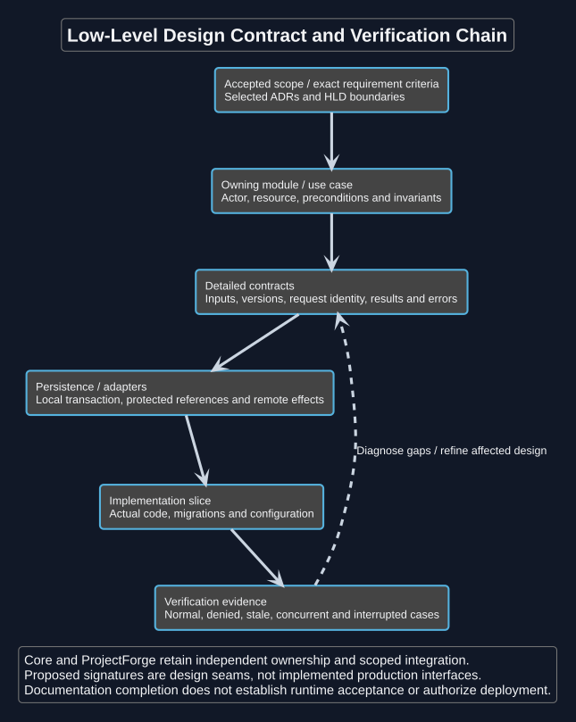

# 1. Introduction to Low-Level Design (LLD)

[Next: Module Breakdown](02-Module-Breakdown.md)

Part of the [Software Design Document](../../01-Project-Planning/02-Project-Management-Plan.md#stage-4-system-design).

## 1.1 Purpose

The LLD turns the selected MVP architecture and required behavior into implementable module, data, interface and verification contracts. It identifies who owns an operation, what input/authority it requires, which invariants it preserves, what it records and how normal, denied, stale or interrupted outcomes are resolved.

Use this document to begin a scoped implementation slice and find the relevant detailed record. HLD establishes product-wide boundaries; UI/UX specifies how tasks and outcomes are presented; LLD defines the owning operations and technical obligations that realize them. A proposed signature or diagram is not an implemented production API or evidence that a runtime check passed.

## 1.2 Scope

### Core

Cover Identity and Access, Professional Presentation, Representation and Sharing, Files and Operations, and Applications. Refine invited authority, independent drafts, explicit selected updates/publication, private artifacts/PDF, protected recipient delivery, manual application tracking and immutable actual-material history.

### ProjectForge

Cover the separate Git Collaboration and Work Management capabilities: local actor/grant mapping, authorized native Git transfers/file history, repository issues and simple Kanban. ProjectForge owns its records and repository bytes and integrates with Core through the scoped service/status contracts.

### Supporting Technical Concerns

Cover local relational integrity, private filesystem references, expected versions, stable request identity, durable work/outbox, bounded error/audit handling, secure configuration, tests and recovery interfaces. Exact runtime/dependency compatibility and operating procedures remain subject to setup/rehearsal evidence.

Personal mail/calendar, AI, advanced review/releases, general Sprints and user workflow/deployment execution remain deferred. Retained broad-product design records keep their source status; their inclusion does not create MVP dependencies or implementation authority.

## 1.3 References

| Reference | Authority / purpose |
| --- | --- |
| [Project charter](../../01-Project-Planning/01-Project-Charter.md#mvp-scope) | Accepted product scope |
| [SRS](../../02-Requirements-Engineering/01-Software-Requirements-Specification.md) | Requirement wording, domain definitions and recorded status |
| [RTM](../../02-Requirements-Engineering/03-Requirements-Traceability-Matrix.md) | Exact criterion applicability, gates and implementation/execution evidence |
| [System Analysis](../../03-System-Analysis/01-System-Context-And-Gap-Analysis.md) | Logical domain/scenario inputs and unresolved analysis questions |
| [HLD](../01-High-Level-Design/01-Introduction.md) | Independent systems, component ownership, data/security and deployment boundaries |
| [UI/UX](../02-UI-UX-Design/01-Introduction.md) and [development handoff](../02-UI-UX-Design/13-Handoff-To-Development.md) | Task, screen/state, accessibility and input/output presentation contracts |
| [ADR index](../ADR/Decision-Index.md) | Selected/superseded decisions and rationale |
| [Implementation baseline ADR](../ADR/ADR-006-Selected-Mvp-Implementation-Baseline.md) | Selected mechanisms and evidence gates |
| [Frontend ADR](../ADR/ADR-007-React-Inertia-Frontend.md) | React/Inertia within independent Laravel applications and trusted Blade PDF templates |
| [Project Setup](../../05-Agile-Iterative-Development/01-Project-Setup.md) | Actual environment, locked builds and executable setup evidence |
| [Test strategy](../../05-Agile-Iterative-Development/02-Test-Strategy.md) | Planned/executed verification and result records |
| [Deployment plan](../../06-Deployment-Release/01-Deployment-Plan.md) / [runbook](../../06-Deployment-Release/02-Runbook.md) | Separate release, migration, rollout and recovery gates |

Resolve conflicting details against accepted scope and the relevant selected/superseding decision before implementation. LLD refines requirements; it does not silently change policy, add dependencies or promote proposed criteria to accepted status.

## 1.4 Audience and Reading Approach

Developers use the owning module/operation to locate invariants, persistence and adapters. Testers use the same contracts to derive observable normal/failure checks. UI implementers map screen states to actual result semantics. Operators use configuration/error/recovery interfaces together with the rehearsed runbook.

Start with Module Breakdown, then the detailed operation, Database Design and API Specification relevant to the selected slice. Review business rules, errors, security, configuration and tests before claiming the behavior complete. Retained component records may discuss deferred domains; select only the applicable MVP clauses and governing status.

## 1.5 Required Operation Contract

| Subject | Detail required before relying on the design |
| --- | --- |
| Ownership | Owning system/module, resource and permitted consumers |
| Actor / authority | Identity context, current resource/action policy, local grants and unavailable-authority behavior |
| Inputs | Validated fields/identifiers, exact material/revision and relevant language/temporal meaning |
| Preconditions / invariants | Required lifecycle state, ownership and protected-reference rules |
| Concurrency | Expected version, deterministic locking where required and conflict handling |
| Request identity | Actor/operation/payload binding, matching retry result and inconsistent reuse behavior where applicable |
| Effects | Local transaction, durable intent/outcome, filesystem/Git/mail/remote effects and observable partial state |
| Result / errors | Exact success, denial, invalid, conflict, pending/unavailable/unknown outcomes under the owning contract |
| Recovery | Same-operation resolution, protected reservation/reference handling and safe reconciliation |
| Verification | Exact criterion, fixtures, normal/denied/stale/concurrent/interrupted checks and actual evidence when executed |

Concrete names and framework types are resolved during implementation in the owning record. Do not mistake illustrative methods for existing code or infer an HTTP endpoint for every internal module call.

## 1.6 Implementation and Trust Boundaries

Each Laravel application owns its database, credentials, key, sessions, private paths and writes. Internal components use explicit local contracts. Core-to-ProjectForge interaction uses authenticated scoped requests; ProjectForge checks current Core entitlement and local resource/action grants. A narrow status credential does not read Core content.

React/Inertia provides application-local presentation. Laravel retains routing, sessions, validation and policies; frontend visibility is not permission. Protected file/recipient delivery and native Git keep their distinct entry contracts. Issue-write permission is not Git-write authority.

Core separates mutable source, independent drafts, immutable publication snapshots and submission events. Retain exact submitted bytes/references through later edits, replacement or withdrawal. A live pointer is not a substitute for historical material identity.

A local database transaction cannot atomically roll back a remote commit, filesystem/Git change or delivered message. Follow selected reservation, durable record/outbox and reconciliation rules. A timeout may leave remote completion unknown; preserve truthful outcomes rather than blindly repeating work or releasing protected bytes.

## 1.7 Design-to-Verification Flow

[PlantUML source](Diagrams/lld-contract-handoff.puml) · [PNG](Diagrams/lld-contract-handoff.png)

The chain connects the exact requirement to an owning contract, separately authorized implementation and fresh verification. Feedback may refine the affected design; a consequential selected-choice change requires the relevant ADR/impact review rather than an undocumented workaround.

## Implementation Entry Conditions

Begin with an applicable accepted requirement/selected criterion disposition, scoped work item and owning module. Identify exact data/interface changes and dependent contracts before editing code. Preserve unresolved policy/input gates explicitly instead of inventing limits, security rules, fallback behavior or runtime compatibility.

For the selected slice, establish current authority, exact data/material identity, success/failure semantics and planned checks. Verify isolated setup and real integration at their assigned gates before relying on them. Documentation completion does not authorize source implementation, dependency installation or deployment in this task.

## 1.8 Verification and Change Control

Select checks from the actual implementation risk: unit checks for owned rules, real persistence/concurrency checks for database invariants, contract/integration checks for scoped service and native Git behavior, and complete-path checks for protected delivery/history and UI outcomes. Do not mirror method internals as the only evidence of business correctness.

Record exact criterion/case, candidate/build, environment/configuration, fixture/data versions, expected/observed result and evidence. Keep planned, blocked, failed and executed outcomes distinguishable. A mock response, rendered UML or successful static link check cannot demonstrate actual authorization, Git, mail or restore behavior.

When a contract/schema/policy/environment changes, follow affected consumers, screens, pending work, retained artifacts and recovery consequences. Update LLD/HLD, UI/UX, PlantUML sources/renders and exact RTM traces together. Reassess any earlier evidence invalidated by the change.

## Sections

1. Introduction (this document)
2. [Module Breakdown](02-Module-Breakdown.md)
3. [Detailed Module Design](03-Detailed-Module-Design.md)
4. [Database Design](04-Database-Design.md)
5. [API Specification](05-API-Specification.md)
6. [Algorithms And Business Rules](06-Algorithms-And-Business-Rules.md)
7. [Error Handling And Logging](07-Error-Handling-And-Logging.md)
8. [Security Implementation](08-Security-Implementation.md)
9. [Configuration And Environment](09-Configuration-And-Environment.md)
10. [Unit Test Design](10-Unit-Test-Design.md)
11. [Traceability](11-Traceability.md)
12. [Appendices](12-Appendices.md)
