# 3. Detailed Module Design

[Previous: Module Breakdown](02-Module-Breakdown.md) · [Low-Level Design introduction](01-Introduction.md) · [Next: Database Design](04-Database-Design.md)

## 3.1 Responsibilities

Detailed design defines owning operations and their invariants, not merely a list of controllers. The selected MVP has five Core modules and two ProjectForge modules. Each application retains independent keys, sessions, database credentials, private storage and writes. Actual code paths/types are recorded with implementation; illustrative signatures are design seams rather than existing production methods.

| Module | Owned operation family | Invariant / public boundary |
| --- | --- | --- |
| Core Identity and Access | Invitation/account/session policy and current entitlement | Actor context is current; status-only service authority exposes no private content |
| Core Professional Presentation | Profile/draft changes, selected apply and publication | Independent drafts and immutable revisions; no automatic profile propagation or implicit publication |
| Core Representation and Sharing | Link/viewer state, selected representation and delivery eligibility | Current policy governs every protected path; recipient context is not owner membership |
| Core Files and Operations | Artifact admission, reservations/references, private delivery and PDF processing | Exact bytes/integrity and protected retention survive partial failure and cleanup |
| Core Applications | Mutable tracking and immutable actual-material capture | Historical material is not reconstructed from today's live resume |
| ProjectForge Git Collaboration | Repository grants, actual native transfers and file/history reads | Current Core entitlement plus local action grant; private Git storage and distinct credentials |
| ProjectForge Work Management | Repository issues and simple Kanban | Stable issue identity, current grant, expected version and attributable outcome |

Communication/calendar and workflow/deployment coordination records below remain deferred. Advanced review/releases and general Sprints are not MVP operations even where retained examples describe them. Current selected behavior and ADR status govern interpretation.

## 3.2 Classes & Interfaces

| Responsibility | Contract | Encapsulation |
| --- | --- | --- |
| Entry adapter | Establish receiving request/job context, validate transport shape, invoke owning operation and map result | Browser/API/Git/worker concerns do not become domain authority |
| Application use case | Coordinate current actor/resource policy, expected version, local transaction and external-effect intent | Explicit operation owner; no hidden consequential effects in unrelated saves/getters |
| Domain record / policy | Enforce owned lifecycle and meaningful invariants | Receive sufficient current context; construction alone is not permanent authorization |
| Repository / storage port | Read/write owned state and protected bytes under the operation contract | No cross-owner table or filesystem shortcut |
| Scoped integration adapter | Carry permitted actor/scope, timeout/result and stable request identity | Receiving owner still validates current entitlement/local grants |
| Worker / outbox handler | Process recorded intent and reconcile observed outcomes | Owner-local access and protected references; queue admission is not completion |

Keep mutable domain internals private. Return permitted projections, stable identifiers or immutable material references rather than another module's unrestricted ORM entity. Internal calls need not be HTTP; system crossings use the scoped API/status contract. Dependency injection binds technical adapters without granting a universal service object access to every user's content.

## 3.3 Methods and Error Outcomes

The operation names below identify behavioral seams. Resolve concrete types, payloads and endpoint mapping in the owning implementation and API specification.

| Operation | Input / authority | Recorded result | Important alternatives |
| --- | --- | --- | --- |
| ApplySelectedProfileChanges | Actor, draft, expected source/draft context and selected fields | Updated independent draft/version; publication unchanged | Denied, invalid selection, stale comparison/write |
| SaveDraft | Actor, draft, validated content/language and expected version | Owning saved draft/version | Invalid, denied, stale or uncertain response |
| PublishResume | Actor, exact candidate/language, expected version, selected artifact references and request identity as governed | Immutable revision, applicable live selection and durable effect intent | Denied, stale, unavailable exact material or unknown response |
| ResolveSharedRepresentation | Current link/viewer context and selected resource/language | Only currently eligible representation/bytes | Invalid/changed/hidden context, missing eligible variant, unavailable material |
| AdmitArtifact | Actor, selected file metadata/bytes and applicable reservation context | Accurate admitted/processing/usability state and owned identity | Type/size/quota denial, interrupted transfer, unavailable storage |
| CaptureSubmission | Actor, application, exact actual-material selection and stable request identity | Immutable submission event with protected exact references/digests | Invalid/missing material, inconsistent retry, denied or pending capture |
| UpdateApplication | Actor, application, permitted tracking fields and expected version | Updated mutable tracking/version, historical events unchanged | Invalid follow-up/context, denied or stale write |
| ReadRepositoryFilesOrHistory | Scoped actor, repository, immutable revision and allowed path/cursor | Authorized entries/history and resolved revision | Invalid scope/path, hidden resource, revoked/unavailable authority |
| CreateOrUpdateIssue / MoveIssue | Scoped actor, repository/issue, permitted fields, expected version where required and request identity | Stable issue identity and recorded state/version | Invalid input/assignee, hidden/denied, stale or inconsistent repeated payload |
| AuthorizeGitOperation | Evaluated transport identity, repository/ref/action and current authority | Permission for the applicable native transport action | Revoked credential/grant, unavailable entitlement or denied action |

API status codes and exact field names follow [API Specification](05-API-Specification.md). A denied request has no unauthorized business effect; bounded security metadata may still be recorded. Do not map every timeout to definitive failure or every queued effect to success.

### Per-operation Specification

Record owner, actor/resource/action, exact input/material identity, preconditions, version/request identity, validation, local writes/locks, external effects, result/errors and recovery. Link exact criteria and planned checks. Distinguish mutable business data from immutable history, current access policy and durable processing metadata.

## 3.4 Internal Flow

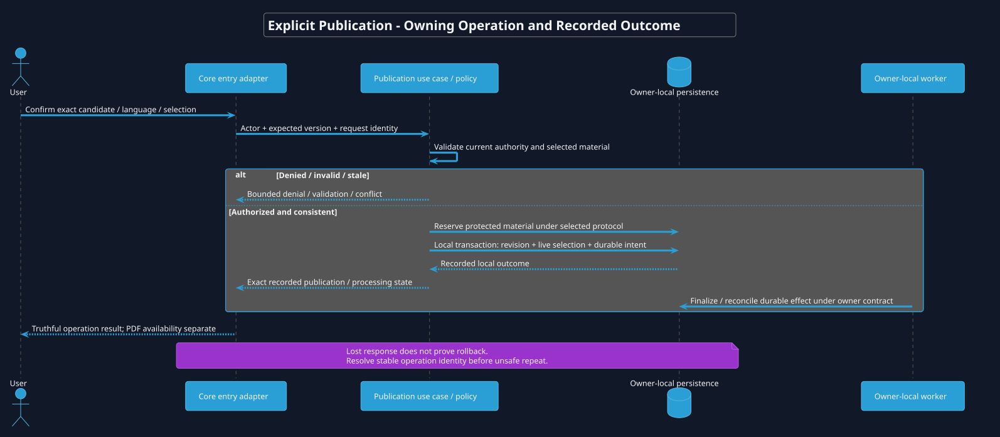

[PlantUML source](Diagrams/Detailed/module-publication-contract.puml) · [PNG](Diagrams/Detailed/module-publication-contract.png)

The sequence illustrates the selected publication boundary: validate current authority and exact material, protect required bytes, commit the revision/live selection and applicable durable intent locally, then finalize/reconcile owner-local work. Concrete reservation/transaction ordering follows [Database Design](04-Database-Design.md) and the selected T05 contract; the diagram is not a distributed atomicity guarantee.

PDF processing/availability remains separate from confirmed publication. A lost response after commit requires recorded-outcome resolution under stable identity, not blind duplication or assumed rollback. Retry authority and stored-outcome behavior remain operation-specific.

## 3.5 Design Patterns

| Pattern | Use when | Guardrail |
| --- | --- | --- |
| Explicit application service / use case | A deliberate command coordinates owned rules/effects | Avoid framework callbacks that hide publication or remote work |
| Domain invariant / policy | An owned transition needs enforceable business meaning | Server-side current resource authority remains explicit |
| Port and adapter | Persistence, rendering, mail, Git or scoped service needs a technical seam | An adapter does not acquire universal business ownership |
| Optimistic concurrency | Mutable aggregate changes require current-version protection | Reject/review stale intent; do not overwrite unseen changes |
| Stable request identity | Repeated consequential commands need a recorded outcome | Bind actor/operation/payload and preserve matching retry semantics |
| Durable outbox / work record | Selected intent/effect must survive interruption | Local acceptance differs from completed external effect |
| Protected artifact reference / reservation | Publication/submission needs exact bytes through failure/retention | Pending uncertainty does not authorize cleanup |

Choose a pattern because an operation requires its guarantee, not to maximize class count. No additional framework, broker, cache or container platform is selected by this table.

## 3.6 Failure, Consistency and Security Review

Local SQL transactions do not roll back filesystem, native Git, mail or remote database effects. Preserve separately recorded outcomes, protect references and reconcile under the owner. Deterministic locking/version checks and concurrent quota reservations must follow the physical design and actual database evidence.

Every entry path re-evaluates applicable actor/resource/action authority. Core's status-only service credential cannot read professional content. Git clients require real transport credentials/grants independently of browser or issue permission. Recipient delivery checks current policy even for known direct URLs or previously viewed material.

Return bounded stable error/correlation information without secrets, private bytes or host paths. Use [Error Handling and Logging](07-Error-Handling-And-Logging.md), [Security Implementation](08-Security-Implementation.md) and [Configuration and Environment](09-Configuration-And-Environment.md) for refinements. Their documentation does not prove configured enforcement.

## 3.7 Verification and Implementation Handoff

| Boundary | Required evidence |
| --- | --- |
| Identity and resource policy | Wrong owner, wrong scope, revoked grant/session and authority unavailable |
| Selected updates/publication | Independent text, partial selected apply, stale version, separate confirmation and exact revision |
| Sharing/files | Current selection/language, direct retrieval, unusable/replaced material and concurrent quota policy |
| Application history | Exact actual material, repeated/interrupted capture and unchanged history after later edits/withdrawal |
| ProjectForge | Real allowed/denied native Git, resolved revision, issue/board grants and stale/repeated mutations |
| Durable processing | Lost response, interrupted worker/finalization, protected references and truthful pending/unknown outcomes |
| Recovery | Restored local records/private bytes/Git state and pending effects remain consistent and safely authorized |

Use [Unit Test Design](10-Unit-Test-Design.md) and the [test strategy](../../05-Agile-Iterative-Development/02-Test-Strategy.md) to select meaningful checks; use real persistence/concurrency/integration where the guarantee depends on them. Mock success cannot prove native Git, private serving, mail or restore behavior.

Link exact criterion, owning operation, actual code/migration revision, configuration, expected/observed result and evidence through [Traceability](11-Traceability.md) / [RTM](../../02-Requirements-Engineering/03-Requirements-Traceability-Matrix/README.md). Keep proposed, pending, failed and executed states distinct. Preserve selected ADRs and update affected consumers/screens/contracts when a consequential change occurs.

## Retained Detailed Design Records

The ten records below retain their explicit anchors, rationale and proposed/deferred status. They support detailed refinement without overriding selected MVP scope. All embedded views use local dark renders; UML uses editable PlantUML. Native non-UML maps retain their source format. Artifact rendering is documentation verification, not runtime acceptance.

Resumefolio — Design Principles and Object-Oriented Approach

### Resumefolio — Design Principles and Object-Oriented Approach

**Proposed approach:** cohesive resource-owning modules, explicit use-case handlers, small invariant-preserving domain objects and adapters at external-effect boundaries. Use OO principles to make accepted behavior understandable and verifiable, not to maximize the number of classes or patterns.

**Status:** proposed detailed-design guidance. Class/interface names below illustrate technical responsibilities; they are not implemented production code, final signatures or newly accepted requirements.

[Responsibilities](#design-record-02-detailed-and-object-oriented-design-01-design-principles-and-object-oriented-approach-md--heading-1-responsibilities-and-dependency-direction) · [Principles](#design-record-02-detailed-and-object-oriented-design-01-design-principles-and-object-oriented-approach-md--heading-2-design-principles-in-this-project) · [Model](#design-record-02-detailed-and-object-oriented-design-01-design-principles-and-object-oriented-approach-md--heading-3-class-and-object-modeling) · [Patterns](#design-record-02-detailed-and-object-oriented-design-01-design-principles-and-object-oriented-approach-md--heading-4-pattern-selection-and-consequences) · [Behavior](#design-record-02-detailed-and-object-oriented-design-01-design-principles-and-object-oriented-approach-md--heading-5-operation-contracts-and-object-lifetime) · [Review](#design-record-02-detailed-and-object-oriented-design-01-design-principles-and-object-oriented-approach-md--heading-6-review-and-component-handoff) · [OO visual package](#design-record-02-detailed-and-object-oriented-design-01-design-principles-and-object-oriented-approach-md--heading-8-object-oriented-visual-and-responsibility-package)

Current MVP scope and selected mechanisms: [Baseline](https://github.com/Farhad-V/Web-Resumefolio/blob/1f2acaa351ac306cb57cbe4fe9742e8bd90720d9/docs/MVP/baseline/README.md). Deferred provider, advanced collaboration and workflow-execution designs are not MVP prerequisites.

#### Source and design authority

Follow the [accepted scope](../../01-Project-Planning/01-Project-Charter.md#mvp-scope), [source decisions](../../02-Requirements-Engineering/01-Software-Requirements-Specification/07-Change-And-Baseline/03-Requirements-Questions-And-Decisions.md#change-and-baseline-open-questions-and-decisions), [analysis domain model](../../03-System-Analysis/02-Domain-And-Information-Analysis.md#analysis-domain-and-information-analysis--03-domain-model-and-object-oriented-view), [operation contracts](../../03-System-Analysis/03-Processes-Scenarios-And-Business-Rules.md#analysis-business-rules-and-operation-contracts--10-domain-constraints-and-operation-contracts) and [logical component boundaries](../01-High-Level-Design/14-Appendices.md#design-record-01-software-architecture-02-system-decomposition-and-boundaries-md). Conceptual domain classes are inputs; technical controllers, handlers, adapters and persistence mappings are design refinements, not additional business concepts.

#### 1. Responsibilities and dependency direction

[Proposed responsibility and dependency direction](Diagrams/Detailed/oo-responsibility-direction.svg)

[Editable DOT](Diagrams/Detailed/oo-responsibility-direction.dot) · 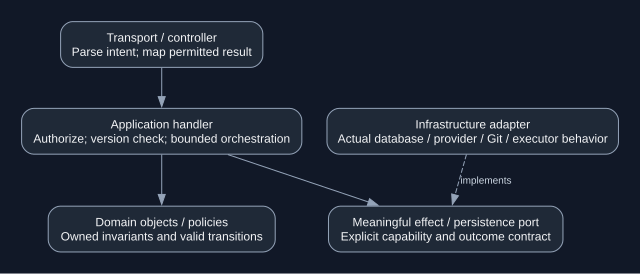

**Transport/controller:** validate transport shape, establish request identity, invoke the appropriate use case and map permitted outcomes into responses. Controllers must not directly publish, update another module’s tables or infer external success from a queue acknowledgment.

**Application handler:** orchestrate one explicit command/query, current authority, expected-version checks, bounded local transaction and attributable outcome. It coordinates domain objects and ports without hiding remote effects inside getters, ORM hooks or unrelated save operations.

**Domain object/policy:** protect owned invariants and meaningful transitions, such as selected source application, separate publication and protected actual-material identity. Keep policies independent of HTTP/session globals and provider response formats. A policy must receive enough current context; an object is not safe merely because its constructor ran once.

**Infrastructure adapter:** implement persistence, provider, native Git, rendition, artifact and executor contracts. Translate actual results into the application outcome vocabulary without inventing rollback, receipt or termination. Interfaces are justified where substitutability, volatile dependencies, verification seams or effect boundaries matter.

**Composition root:** Laravel’s dependency container wires implementations to required contracts. Do not resolve arbitrary dependencies throughout domain logic or retain a user/session identity in a shared singleton. Runtime lifetime and authority freshness remain explicit.

#### 2. Design principles in this project

##### Single responsibility

Keep comparison/application, publication, protected retrieval and actual submission capture as distinct use cases. A class called ResumeManager must not silently combine source updates, PDF generation, link controls and external submission. Cohesion is defined by the invariant or reason to change, not an arbitrary maximum method count.

##### Open/closed design

Introduce a small adapter or strategy when a real variation exists: generated versus uploaded representation, provider operations, storage or executor control. Add an implementation without rewriting the consumer’s invariant logic where feasible. Do not anticipate unlimited providers or create extension points for hypothetical features excluded from Version 1.

##### Liskov substitution

Implementations of a port must preserve its documented input, outcome, failure and protected-state semantics. An uploaded-rendition adapter cannot return another language because the requested file is absent. A provider adapter cannot classify an unknown send as confirmed failure merely to fit a boolean return type.

##### Interface segregation

Consumers require only the operations and permitted projections they need. Split read-only publication resolution from mutation or administrative contracts where authority differs. An executor consumer must not gain unrestricted host administration through a convenient general-purpose interface.

##### Dependency inversion

Use-case handlers depend on meaningful contracts at external boundaries; infrastructure realizes them. This does not require wrapping every Laravel utility or introducing a repository interface for each trivial table. Preserve clear domain ownership and make actual side effects substitutable in focused verification.

##### DRY without policy confusion

One authoritative policy owner prevents inconsistent grant, quota or lifecycle rules. Similar-looking validation in two domains is not automatically the same rule: link revocation and provider consent are different authority boundaries. Share stable technical primitives, not a universal mutable business object.

##### KISS and YAGNI

Start with the smallest design that realizes accepted scenarios and exceptional outcomes. Do not add a general event bus, event sourcing, generic workflow framework or a class per field by default. Simplicity cannot remove real Git, conditional execution, history preservation or required recovery from agreed scope.

#### 3. Class and object modeling

[Illustrative publication use-case class design](Diagrams/Detailed/publication-use-case-classes.svg)

[Editable PlantUML](Diagrams/Detailed/publication-use-case-classes.puml) · 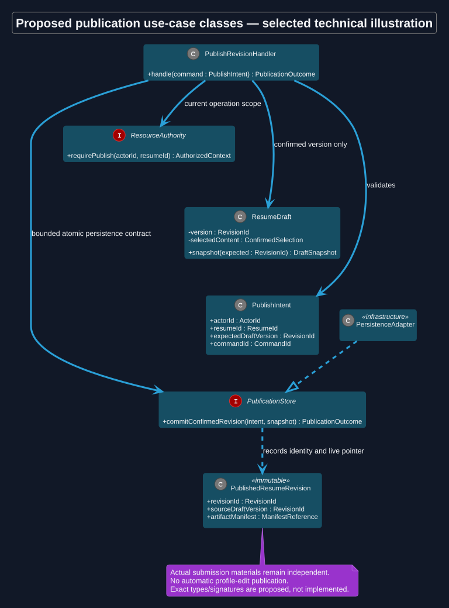

This selected technical model illustrates Presentation responsibility; it is not the complete component class model. Type and operation names remain proposals pending implementation-level signature/schema refinement.

##### Meaningful identities and values

Represent actor/resource/command identity, expected revision, content language and attempt identity using validated types or equivalent explicit constraints. Avoid passing interchangeable unvalidated strings through every boundary. Keep time meaning explicit: an instant, local scheduled time and provider timezone mapping need different interpretation even if their physical representation is later shared.

##### Entities aggregates and immutable records

ResumeDraft owns selected editable state and independent overrides. PublishedResumeRevision identifies the separately confirmed presentation; later edits create a different revision rather than mutate its historical identity. SubmissionMaterialSet records actual material/provenance independently. Shared bytes may be deduplicated only while reference, immutability and retention rules remain preserved.

An aggregate boundary groups state whose invariant needs local atomicity. It does not automatically mean one database table, one service or one giant object graph. Keep provider/runner/target truth outside local aggregates; represent attributable attempts and observations instead of pretending a local object controls the remote state.

##### Visibility and collaboration

Expose public application contracts and permitted projections. Keep domain mutation operations internal to the owning component. Avoid handing a mutable ORM entity to another module and relying on convention not to save it. Mapping persistence records into domain/query objects may be direct or explicit depending on actual complexity; do not mandate duplication for its own sake.

#### 4. Pattern selection and consequences

[Select a pattern for an actual design problem](Diagrams/Detailed/pattern-selection-route.svg)

[Editable DOT](Diagrams/Detailed/pattern-selection-route.dot) · 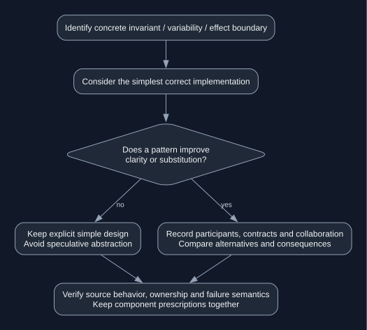

##### Adapter — external systems and persistence

**Problem:** provider/Git/storage/executor mechanics vary independently from product invariants. **Participants:** application port, infrastructure implementation and consumer handler. **Consequence:** consumers retain domain meaning while adapters require compatibility and error/uncertainty mapping. Do not mask different capabilities behind a misleading common success contract.

##### Strategy — selected representation resolution

**Problem:** generated/uploaded rendition handling differs while the caller requests a specific permitted representation. **Participants:** selected resolution policy and eligible representation implementations. **Consequence:** selection remains explicit; no implementation may silently bypass language, current eligibility or availability. A simple branch is acceptable when a strategy hierarchy would add no useful separation.

##### Factory — constructing valid revisions or attempts

**Problem:** creation must bind a confirmed draft version or reviewed operation intent to attributable identity. **Participants:** creation operation/factory and validated inputs. **Consequence:** consistent construction without side effects hidden in constructors. A factory does not authorize publication, send or deployment by itself.

##### Facade — a bounded application use case

**Problem:** one deliberate user action coordinates several internal steps. **Participants:** public handler/contract and owned collaborators. **Consequence:** a clear entry point and test seam; avoid a universal facade that centralizes all resource authority and lifecycle behavior.

##### Observer or domain event — explicit committed reactions

Use a committed event only for a named reaction with clear authority and durable dispatch needs. In-process notification is not durable delivery. A listener must not silently publish, send mail or deploy because an unrelated model was saved. Where consequential external work exists, use the [runtime attempt protocol](../01-High-Level-Design/14-Appendices.md#design-record-01-software-architecture-03-process-view-concurrency-and-runtime-behavior-md).

##### Singleton and generic abstractions — default caution

Do not use a singleton to hold actor/session/transaction state, or a universal repository/service locator to bypass ownership. Stateless immutable shared configuration can have a suitable framework lifetime after compatibility evaluation. Reuse is justified by an actual contract and consumers, not a pattern checklist.

#### 5. Operation contracts and object lifetime

For each concrete command define actor/resource context, preconditions, expected revision, admitted inputs, intended effects, protected frame, actual outcome classes and repetition/concurrency behavior. Denied/conflicting requests preserve protected state; partial/unknown external results require evidence rather than an invented unchanged-state assertion.

**Publication example:** authorize the intended resume; verify confirmed draft version; construct the intended revision; atomically update the permitted publication pointer; record attributable result. Source changes alone cannot call this operation. PDF rendering and external sending are separate explicit work. A response lost after commit resolves the same command identity rather than publishing again blindly.

Inject the clock and effect ports into handlers that need deterministic behavior. Keep transaction/unit-of-work lifetime bounded to the command. Jobs carry stable references and reviewed intent, then reconstruct current authority/capability at execution; they do not serialize an indefinitely privileged session or stale mutable ORM graph.

Release resources on completion/failure, distinguish cancellation request from confirmed stop and keep logging bounded. Do not retain credentials, provider response bodies or private artifacts inside long-lived shared service objects.

#### 6. Review and component handoff

##### Focused design checks

- Every class has a coherent responsibility tied to a source invariant or technical mechanism.
- Public/internal visibility and component dependency direction are explicit; no consumer writes another owner’s state.
- Substituted adapters preserve denied, unavailable, partial and unknown results as well as success.
- Source/draft/publication/actual-history identities and independent link/PDF controls remain distinct.
- Constructors/getters/observers do not hide consequential mutations or remote operations.
- Command version/identity, object lifetime, transaction scope and protected state are verifiable under races and failures.
- Patterns reduce a concrete problem; unnecessary indirection, god objects and cyclic dependencies are challenged.

These are planned review criteria, not completed product tests. Later component checks use deterministic domain/handler cases, actual database transaction/concurrency integration and controlled external-boundary verification where applicable. A mock-only test cannot establish real Git semantics, provider idempotency, executor isolation or usable recovery.

##### Where concrete prescriptions belong

Use the [complete component package template](02-Module-Breakdown.md#design-record-03-component-and-module-design-component-and-module-design-md) and [actual component catalog](02-Module-Breakdown.md#design-record-03-component-and-module-design-component-and-module-design-md) for signatures, computational data/classes, algorithms and technical scenarios. Link shared [data](04-Database-Design.md#design-record-04-data-design-data-design-md), [interface](05-API-Specification.md#design-record-05-interface-and-api-design-interface-and-api-design-md) and [security](../01-High-Level-Design/14-Appendices.md#design-record-06-design-quality-and-security-analysis-design-quality-and-security-analysis-md) choices instead of duplicating policy.

Record significant alternatives and consequences in [design decisions](../ADR/Decision-Index.md#design-record-07-design-decisions-design-decisions-md). Use [evolution and debt](12-Appendices.md#design-record-02-detailed-and-object-oriented-design-05-design-evolution-refactoring-and-technical-debt-md) for actual smells/compatibility/refactoring work, and [design review/handoff](../01-High-Level-Design/14-Appendices.md#design-record-06-design-quality-and-security-analysis-05-design-review-traceability-and-handoff-md) for identified candidate findings and disposition.

#### 7. FAU basis and current limits

FAU V08 distinguishes architecture from implementation-level component models, including computational data, classes, fine-grained behavior and technical scenarios. It presents GoF/POSA patterns, examples, anti-patterns, smells and modeling conventions. SOLID/DRY/KISS/YAGNI here are supplementary project guidance, not a claim that the supplied lectures mandate every named technique. DDD remains selective and optional.

This document provides a project-specific OO approach and a selected illustrative class design. Final component-wide signatures/types, schemas, complete class diagrams, exact criterion mappings and external compatibility/feasibility remain further design work. No production class, live test, technical baseline acceptance or advisor endorsement is established by this authoring update.

[Detailed Design index](12-Appendices.md#design-record-02-detailed-and-object-oriented-design-detailed-and-object-oriented-design-md) · [Diagram catalog](12-Appendices.md#design-record-02-detailed-and-object-oriented-design-diagrams-diagram-catalog-md) · [FAU reference map](../01-High-Level-Design/14-Appendices.md#design-record-design-references-and-coverage-md)

#### 8. Object-oriented visual and responsibility package

These are selected **proposed design examples**, not implemented classes, detected code defects, complete domain coverage or accepted signatures. The existing [publication UML class diagram](#design-record-02-detailed-and-object-oriented-design-01-design-principles-and-object-oriented-approach-md--heading-3-class-and-object-modeling) supplies attributes, operations, associations and interface realization. The following views explain complementary design questions. Read arrows according to each diagram type; source dependencies, runtime messages and conceptual relationships are different.

##### 8.1 Before and after: separate reasons to change

[Before and after: separate reasons to change](Diagrams/Detailed/oo-before-after.svg)

[Editable PlantUML](Diagrams/Detailed/oo-before-after.puml) · 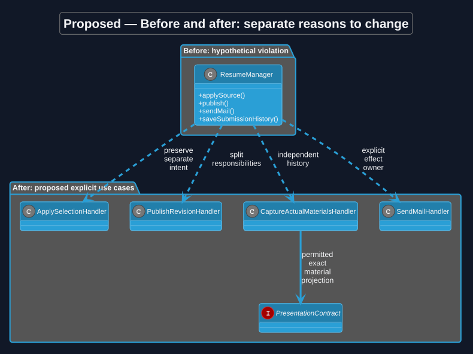

The before design is a teaching counterexample, not an observed production defect. Splitting preserves explicit source application, publication, actual history and send intent; it does not make the handlers separate services.

##### 8.2 Object diagram: one illustrative publication collaboration

[Object diagram: one illustrative publication collaboration](Diagrams/Detailed/oo-runtime-objects.svg)

[Editable PlantUML](Diagrams/Detailed/oo-runtime-objects.puml) · 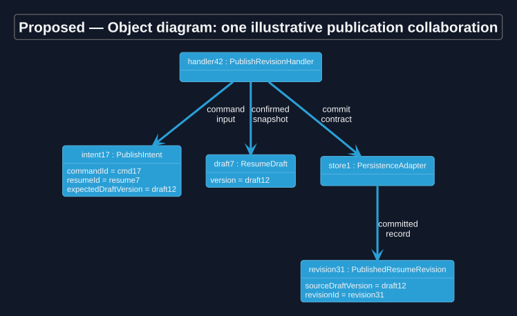

Invented identities illustrate a successful post-commit snapshot. Links represent collaboration/record relationships, not ownership of a live ORM graph or an actual runtime trace. Revision creation and pointer/result recording require the coherent guarded commit described below.

##### 8.3 Package diagram: acyclic source dependencies

[Package diagram: acyclic source dependencies](Diagrams/Detailed/oo-packages.svg)

[Editable PlantUML](Diagrams/Detailed/oo-packages.puml) · 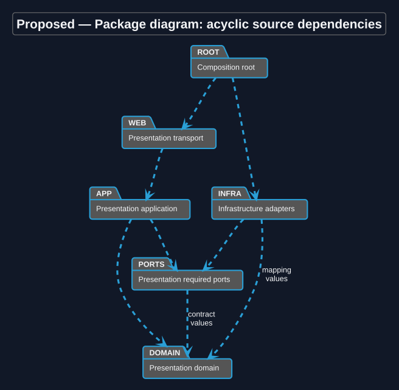

Arrows mean source dependencies. This proposed graph has no cycles; wiring belongs at the composition root. These are illustrative packages inside the modular application, not proof that current imports have been audited.

##### 8.4 Dependency inversion at the persistence boundary

[Dependency inversion at the persistence boundary](Diagrams/Detailed/oo-dependency-inversion.svg)

[Editable PlantUML](Diagrams/Detailed/oo-dependency-inversion.puml) · 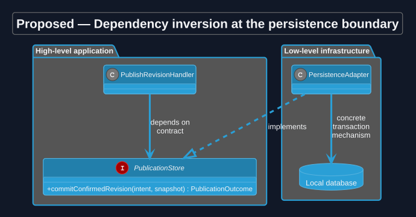

The consumer owns the meaning of the required port. Runtime calls reach an adapter, while source dependency points toward the abstraction. The port must preserve current guards, coherent local commit and repeat-command outcomes; its name alone provides no atomicity.

##### 8.5 Inheritance versus composition: rendition variation

[Inheritance versus composition: rendition variation](Diagrams/Detailed/oo-composition.svg)

[Editable PlantUML](Diagrams/Detailed/oo-composition.puml) · 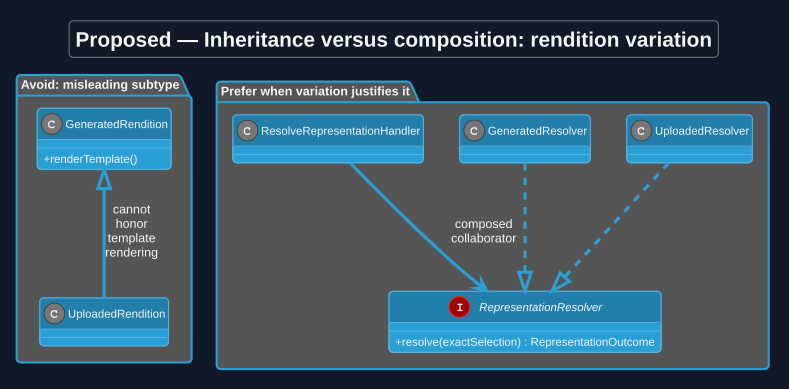

Uploaded material is not a behavioral subtype of template-generated material. Composition permits independent implementations of an exact-selection contract. Neither may silently substitute a language, rendition or unavailable file; a simple branch can be clearer when polymorphism adds no value.

##### 8.6 Interface realization and narrow consumer access

[Interface realization and narrow consumer access](Diagrams/Detailed/oo-realization.svg)

[Editable PlantUML](Diagrams/Detailed/oo-realization.puml) · 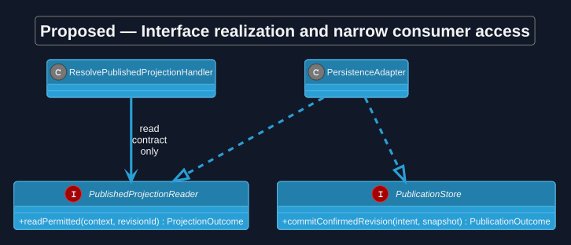

The read consumer receives only its required interface, not mutation access. Implementing both interfaces does not authorize callers; exact current resource and lifecycle checks remain required. Names are proposed design roles, not framework bindings already configured.

##### 8.7 Coupling and cohesion: compare responsibility shapes

[Coupling and cohesion: compare responsibility shapes](Diagrams/Detailed/oo-coupling-cohesion.svg)

[Editable PlantUML](Diagrams/Detailed/oo-coupling-cohesion.puml) · 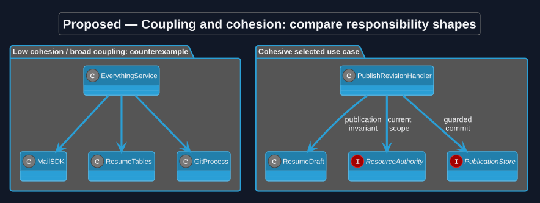

Cohesion follows one invariant and reason to change. Necessary authority and commit dependencies are deliberate coupling. Arrow count alone is not a quality score; no coupling/cohesion metrics were measured, and splitting every method into a class would not establish good design.

##### 8.8 Sequence: explicit publication object collaboration

[Sequence: explicit publication object collaboration](Diagrams/Detailed/oo-publication-sequence.svg)

[Editable PlantUML](Diagrams/Detailed/oo-publication-sequence.puml) · 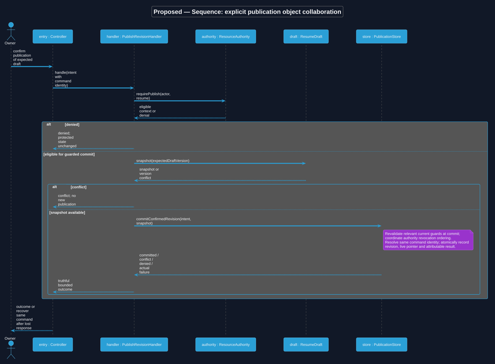

An early authority check is insufficient under races. The persistence/authority mechanism must establish the relevant admission order and expected-version guard. A lost response after a possible commit is resolved using the same command identity. No PDF generation, mail send or deployment is implicit.

##### 8.9 Conceptual domain model: independent identities

[Conceptual domain model: independent identities](Diagrams/Detailed/oo-conceptual-domain.svg)

[Editable PlantUML](Diagrams/Detailed/oo-conceptual-domain.puml) · 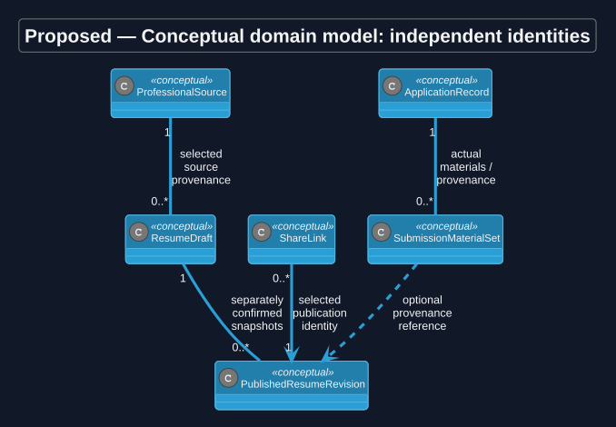

Selected conceptual excerpt, not the complete analysis model or physical schema. Multiplicities express this illustrative relationship shape and need exact scenario/schema refinement. Source provenance does not trigger propagation; submitted actual materials remain independently protected if later draft/publication/link state changes. No composition diamond implies cascade deletion.

##### 8.10 Law of Demeter: request an intention, avoid navigation chains

[Law of Demeter: request an intention, avoid navigation chains](Diagrams/Detailed/oo-demeter.svg)

[Editable PlantUML](Diagrams/Detailed/oo-demeter.puml) · 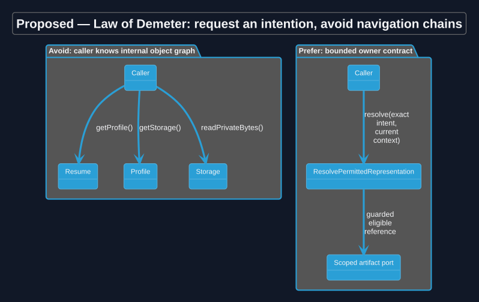

The counterexample shows caller navigation, not a justified byte-access route. An intention-revealing owner contract reduces knowledge of internal structure. Law of Demeter is a collaboration guideline; shortening a call chain cannot replace authority checks or safe artifact-reference lifetime coordination.

##### 8.11 Optional Strategy preview: exact representation resolution

[Optional Strategy preview: exact representation resolution](Diagrams/Detailed/oo-strategy-preview.svg)

[Editable PlantUML](Diagrams/Detailed/oo-strategy-preview.puml) · 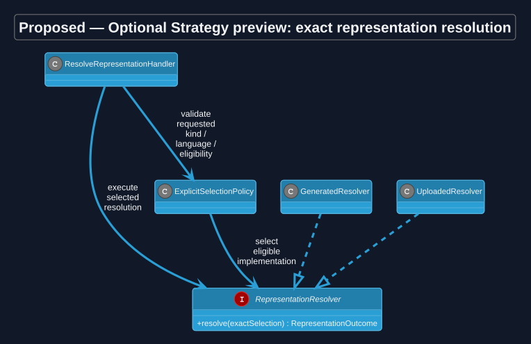

Optional design pattern preview, not a mandatory hierarchy. Strategy separates real generation/upload variation while the handler preserves exact selection and current eligibility. Unknown rendering/storage results must remain truthful; no strategy may silently publish or select a fallback.

##### 8.12 Responsibility table — CRC-style cards

Responsibilities describe proposed roles rather than final class counts. Collaborators are bounded contracts; a listed collaborator confers no blanket permission.

| Class / role | Responsibilities | Collaborators |
| --- | --- | --- |
| PublishRevisionHandler | Orchestrate explicit confirmed publication; preserve truthful outcome and command identity | ResourceAuthority, ResumeDraft, PublicationStore |
| ResumeDraft | Preserve selected editable state/overrides; supply exact expected-version snapshot | Validated intent/value objects |
| PublishedResumeRevision | Identify immutable confirmed content and provenance | PublicationStore; permitted projection contracts |
| ResourceAuthority | Supply current scoped eligibility and coordinate required admission semantics | Identity/resource policy owner; current grant state |
| PublicationStore | Guard current state and commit revision, live pointer and attributable result coherently; resolve repeated identity | PersistenceAdapter and actual local transaction mechanism |
| ResolveRepresentationHandler | Resolve the exact eligible representation without silent substitution | ExplicitSelectionPolicy, narrow resolver/artifact contracts |
| CaptureActualMaterialsHandler | Preserve independent actual submission evidence and provenance | Presentation projection contract; Files reference protection; Applications store |

##### 8.13 SOLID — violation and proposed correction

| Principle | Illustrative violation | Proposed correction and limit |
| --- | --- | --- |
| Single responsibility | ResumeManager applies source, publishes, sends and changes submission history | Separate explicit handlers and owners; keep each invariant cohesive |
| Open/closed | Every representation variation rewrites publication invariants | Introduce a narrow resolver only for real variation; avoid speculative frameworks |
| Liskov substitution | Uploaded resolver returns another language or reports unknown as failed | Preserve exact selection and documented outcome semantics across implementations |
| Interface segregation | Read consumer receives mutation and unrestricted host operations | Inject only required projection/control contracts; check current authority separately |
| Dependency inversion | Publication handler instantiates provider/database details | Depend on meaningful required ports; wire concrete adapters at composition root |

##### 8.14 Use-case-to-class mapping

These scenario labels are design cross-references, **not newly assigned requirement IDs or exact criterion closure**. Follow the analysis operation contracts and component documents for authoritative identities and full paths.

| User intention / scenario | Proposed application entry | Domain roles / values | Important collaborators and boundary |
| --- | --- | --- | --- |
| Preview and apply selected source changes | ApplySelectionHandler | ResumeDraft, confirmed selection, expected revision | Presentation owner; preserve independent overrides and other resumes |
| Separately confirm publication | PublishRevisionHandler | PublishIntent, ResumeDraft, PublishedResumeRevision | Current ResourceAuthority and guarded PublicationStore |
| Resolve a permitted exact representation | ResolveRepresentationHandler | Exact selection, language, revision reference | Sharing eligibility and Files protection; no silent unavailable fallback |
| Capture actual submitted materials | CaptureActualMaterialsHandler | ApplicationRecord, SubmissionMaterialSet, provenance | Applications-owned commit coordinated with protected Files references |
| Explicitly send external communication | SendMailHandler | Reviewed intent and durable attempt identity | Communication owner and provider adapter; reconcile unknown effects before repetition |

##### 8.15 Review and implementation follow-through

Refine each selected role into the owning component's exact signatures, invariants, visibility, types and outcome vocabulary. Check dependency cycles against actual imports, substitution against failure/unknown outcomes, and publication against real transaction/revocation/version races. Verify reference protection before committing consumers and preserve actual submission evidence independently. Rendering these examples establishes readable documentation only; it does not establish runtime behavior, safe persistence, real external compatibility or measured coupling/cohesion.

Resumefolio — Manual Applications Component Design

### Resumefolio — Manual Applications Component Design

**Responsibility:** manage private application preparation and explicitly recorded progress while preserving identifiable material actually submitted. A current resume, a live sharing link, provider acceptance and historical submitted content are different facts.

**Status:** proposed LC-04 component design. The accepted manual-application scope is preserved. Detailed fields/progress/capture/retention proposals remain subject to their source disposition; technical names and schema below are proposals, not implemented code or accepted product refinements.

[Sources](#design-record-03-component-and-module-design-components-applications-md--heading-1-source-authority-and-boundaries) · [Contracts](#design-record-03-component-and-module-design-components-applications-md--heading-2-public-operations) · [Model](#design-record-03-component-and-module-design-components-applications-md--heading-3-owned-classes-and-logical-data) · [Algorithms](#design-record-03-component-and-module-design-components-applications-md--heading-4-submission-capture-and-correction-algorithms) · [Failures](#design-record-03-component-and-module-design-components-applications-md--heading-5-concurrency-failure-and-lifecycle-scenarios) · [Review](#design-record-03-component-and-module-design-components-applications-md--heading-6-verification-and-open-decisions) · [Landscape package](#design-record-03-component-and-module-design-components-applications-md--heading-7-application-context-and-landscape-package)

Current MVP scope and selected mechanisms: [Baseline](https://github.com/Farhad-V/Web-Resumefolio/blob/1f2acaa351ac306cb57cbe4fe9742e8bd90720d9/docs/MVP/baseline/README.md). Deferred provider, advanced collaboration and workflow-execution designs are not MVP prerequisites.

#### 1. Source authority and boundaries

Use [APP-D01–APP-D09](../../02-Requirements-Engineering/01-Software-Requirements-Specification/03-Requirements-Specification/09-Manual-Application-Management.md#requirements-specification-manual-application-management), [Q-D12](../../02-Requirements-Engineering/01-Software-Requirements-Specification/03-Requirements-Specification/09-Manual-Application-Management.md#requirements-specification-manual-application-management--id-resolution-q-d12), [Q-D13](../../02-Requirements-Engineering/01-Software-Requirements-Specification/03-Requirements-Specification/09-Manual-Application-Management.md#requirements-specification-manual-application-management--id-resolution-q-d13) and [Q-D14](../../02-Requirements-Engineering/01-Software-Requirements-Specification/03-Requirements-Specification/09-Manual-Application-Management.md#requirements-specification-manual-application-management--id-resolution-q-d14). Those answer sections are proposed, not blanket accepted field/state/retention policy. Exact criteria retain their original wording/status.

The [analysis interaction](../../03-System-Analysis/03-Processes-Scenarios-And-Business-Rules.md#analysis-behavioral-and-scenario-analysis--06-scenario-based-view), [data](../../03-System-Analysis/02-Domain-And-Information-Analysis.md#analysis-domain-and-information-analysis--05-data-oriented-view) and [operation contracts](../../03-System-Analysis/03-Processes-Scenarios-And-Business-Rules.md#analysis-business-rules-and-operation-contracts--10-domain-constraints-and-operation-contracts) govern meaning. Follow [architecture boundaries](../01-High-Level-Design/14-Appendices.md#design-record-01-software-architecture-02-system-decomposition-and-boundaries-md) and [module rules](02-Module-Breakdown.md#design-record-03-component-and-module-design-01-modularity-dependencies-and-encapsulation-md).

**Own:** application/opportunity context, private preparation and cover-letter revisions, manual progress history, actual submission events/material manifests and attributable corrections.

**Do not own:** mutable source profile/resume internals, sharing-link controls, provider mailbox/calendar truth, physical artifact storage or automatic external job-portal submission. AI drafting/analysis is outside Version 1. Associations to other components carry references, not inherited grants or universal administrative access.

**Required capabilities:** Presentation exposes permitted identified preparation/source revisions; Files provides usable artifact identity and protected-reference retention; Communication/Calendar exposes permitted correspondence/activity summaries; Identity supplies context while Applications evaluates current resource-operation policy. No other component mutates Applications tables directly.

#### 2. Public operations

Signatures below are implementation-level proposals. `CommandContext` means current actor/resource policy plus stable command identity where mutating; `ExpectedVersion` protects conflicting changes. Results use permitted confirmed/pending/invalid/denied/conflict/unavailable/partial/unknown meanings as applicable. Exact transport/type syntax remains tied to the evaluated language/data conventions.

##### SavePreparation(context, applicationId?, expectedVersion?, preparationInput)

Create or edit the intended private application preparation. Validate ownership, company/opportunity identity, manually authored cover-letter input and explicitly selected resume reference. The Q-D12 candidate requires title/company/role for a usable record but permits incomplete private drafts; preserve that proposal status rather than treat draft save as submission readiness.

Within a short local transaction, check current authority/version, persist only this application’s intended edits and an attributable command outcome. Do not mutate shared company data, the associated resume, publication or history implicitly. Missing reference permission and duplicate-company/role context require explicit handling; no global unique company/role constraint silently forbids distinct applications.

##### RecordProgress(context, applicationId, expectedVersion, transitionInput)

Apply the [owner-selected manual status policy](../../02-Requirements-Engineering/01-Software-Requirements-Specification/03-Requirements-Specification/09-Manual-Application-Management.md#owner-selected-manual-application-status). Every ordered pair of the seven existing statuses is permitted, including backward/reopen moves and an explicitly recorded same-status occurrence. No mandatory reason, interview sequence or terminal-state lock is imposed. The receiving operation validates ownership/current actor, input and expectedVersion; only invalid input, unauthorized action or stale state prevents a status write.

In the application transaction, append a progress event with actor, previous/new status, optional reason, effective time and server-recorded time, and advance the mutable application version/current status. Default effective time to the confirmed action time; preserve any explicit valid user-supplied effective time. Same-status recording requires an explicit user progress action, not passive navigation or an unrelated save. Preserve old progress events; corrections append rather than rewrite them. When leaving Offer, clear the current offer_outcome and preserve its prior value in the new event's before snapshot.

Status changes are manual only. Selecting Submitted is independent from exact-material capture and cannot be blocked solely by missing captured material; show capture as incomplete when appropriate. Do not send, infer receipt or alter historical materials from a progress edit. The selected state vocabulary comes from Q-D12; this owner's later manual-movement decision resolves the former transition-policy gap. Runtime verification remains pending.

##### CaptureActualSubmission(context, applicationId, expectedVersion, actualEventInput, materialInput)

Identify a real submission event and the material actually sent through that route. Input distinguishes actual event metadata, selected actual resume/cover-letter artifacts or other source-permitted material, provenance and completeness. A manual external-portal submission can be recorded without the product sending anything. User assertion and provider observation retain distinct provenance.

Do not reconstruct actual materials from whatever live resume exists later. Return complete/partial/unavailable/pending classification according to the source contract and actual capture evidence. Do not label a historical event nonexistent merely because its material capture is incomplete; do not label a material set complete without its required usable references.

##### CorrectSubmissionRecord(context, submissionId, expectedVersion, correctionInput)

Correct metadata with attributable prior/new values, actor/time/reason. An erroneous material replacement creates a version/correction relationship under the proposed Q-D14 rule; it must not erase the original recorded evidence silently. Distinguish correction from a genuinely new submission event. Current permission and lifecycle rules apply to the exact application/submission.

##### Queries and related lifecycle operations

Provide permitted list/detail/history projections with revision and material-completeness provenance. Resolve linked correspondence/calendar summaries through their owners under current access. Archive/trash/restore/purge commands require the reviewed source lifecycle policy and reference-safe Files collaboration; no hard retention duration or automatic cascading behavior is newly adopted here.

#### 3. Owned classes and logical data

[Proposed Applications class and reference model](Diagrams/Detailed/applications-owned-model.svg)

[Editable PlantUML](Diagrams/Detailed/applications-owned-model.puml) · 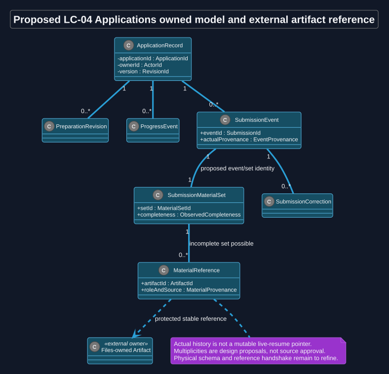

**ApplicationRecord:** stable application/owner identity, version, lifecycle, company/opportunity context and deliberate associations. Proposed optional fields include URL/contact/location/description/source/notes/deadline per Q-D12; exact types/limits remain physical refinement. Time-sensitive values preserve precision and timezone meaning rather than a misleading universal date string.

**PreparationRevision:** manually authored cover-letter content and identified intended resume reference, independently versioned as needed by source behavior. Preparation is not actual-history evidence. Reusing a company context must not unexpectedly change another application.

**ProgressEvent:** append-attributable actor/time/from/to/reason/context, with a projection of current progress. Corrections preserve provenance instead of rewriting the fact that an earlier event was recorded. The accepted transition policy, not class naming, governs valid changes.

**SubmissionEvent:** stable event/application identity, actual route/effective time and provenance. Repeated real submissions are distinct events; retries of recording the same command are not automatically new submissions.

**SubmissionMaterialSet and MaterialReference:** identified actual material manifest, completeness/availability observation, role/language/source version and Files-owned artifact reference where required. Physical sharing/deduplication must preserve independent actual-material identity and protected references. Missing/expired material is visible, not substituted with a new current resume.

**SubmissionCorrection:** attributable correction identity, prior/new version/reference relationship and reason. Exact retention/erasure handling follows reviewed policy and applicable evidence, not an invented immutable-forever rule.

##### Logical persistence prescription

Use owner/application identity and version constraints; separate preparation, progress events, actual events, material membership and correction relationships. Enforce non-null/unique/reference integrity appropriate to actual selected fields, command identities and material roles. Index private owner/application lookup, attributable history order and unresolved capture work where justified. Avoid a uniqueness rule that collapses confirmed distinct applications or resubmissions.

External artifact ownership remains with Files; store permitted stable references and provenance, not unrestricted paths or other modules’ ORM objects. Exact engine-specific types, key sizes, collation, indexes, schema migration SQL and deletion constraints require [shared physical data refinement](04-Database-Design.md#design-record-04-data-design-data-design-md). The diagram’s multiplicities describe this proposal, not new accepted source cardinalities.

#### 4. Submission capture and correction algorithms

[Proposed actual-material capture collaboration](Diagrams/Detailed/applications-capture-sequence.svg)

[Editable PlantUML](Diagrams/Detailed/applications-capture-sequence.puml) · 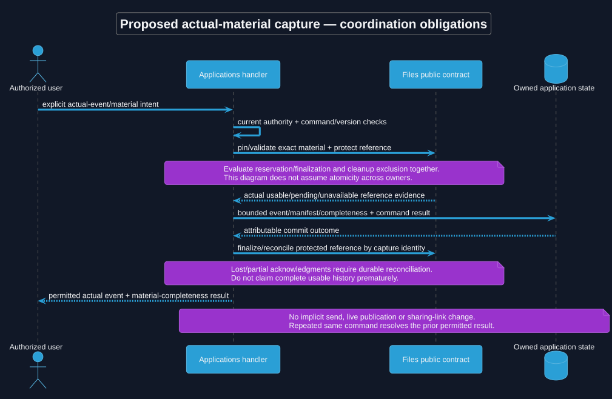

1. Validate explicit actual-event intent, actor/application context, expected version and command identity. Check current authority before exposing prior outcome or referenced private material.
2. Bind command identity to the intended recording request. Same-intent repetition resolves the prior permitted result; changed intent under that identity conflicts rather than overwrites history.
3. Resolve exact actual material/provenance. Do not defer this by asking a worker to copy the latest live resume. If material processing is asynchronous, persist the pinned intended identity and a truthful pending/incomplete observation.
4. Establish Files-owned usable artifact/protected-reference guarantees through its evaluated public protocol. Coordinate reference reservation/finalization and local commit so cleanup cannot delete material between eligibility check and durable protection. The concrete cross-module transaction/handshake requires joint Applications/Files/data design; an unprotected read-then-insert is insufficient.
5. Under the selected local consistency guard, recheck application authority/version/lifecycle and persist the attributable submission event/material manifest/completeness plus command result. Persist any required reconciliation work durably. If the source policy coordinates progress, apply its exact rule; material completeness does not silently invent submission or progress.
6. Commit the local result, reconcile reference finalization/abandoned reservations and return permitted attributable state. Lost client response resolves the same command identity; storage/provider effects are not assumed rolled back.

Correction follows the same authority/version/identity protocol, retains the original relationship/evidence as required and records the correction separately. New actual submissions receive new event identities. Do not repurpose a correction endpoint to delete protected material or change sharing links.

**Protected frame:** source profiles/resumes/overrides/publications, independent sharing controls, unrelated applications, mailbox/calendar state, other actors’ private data and target/execution state remain unaffected unless a separate permitted command explicitly owns that effect.

#### 5. Concurrency failure and lifecycle scenarios

**Concurrent preparation/progress edits:** compare expected versions and return explicit conflict rather than silently overwriting another action. Preserve entered intent for an authorized compare/reapply path.

**Actual event with incomplete material:** report known event/provenance and actual completeness separately. Do not infer false completion or silently replace unavailable bytes with the latest source. Proposed material requirements and incomplete handling remain Q-D13 review work.

**Capture versus cleanup:** enforce the evaluated protected-reference handshake. A confirmed historical reference must survive eligible source retirement. Reconcile abandoned reservations using attributable capture identity, not age alone where commit/effect is uncertain.

**Commit succeeds/response lost:** return the same permitted command result when repeated; do not create duplicate real submission history. Two deliberately distinct submissions are different events even when content matches.

**Provider send unknown or disconnected:** Communication owns attempt reconciliation. Applications can retain a permitted association/provenance but cannot translate send acceptance/unknown into receipt, Submitted progress or complete actual evidence automatically.

**Correction or deletion races:** verify current version/lifecycle and retained reference constraints. Archive removes active-list presence under policy without erasing historical identity. Trash/restore/purge, backup expiry and hard-erasure conflicts remain exact source/applicability decisions. Do not newly accept the proposed 30-day period here.

**Recovery:** restore application/events/manifests and referenced artifacts consistently; reapply current authority/deletion decisions and report missing material. Do not reactivate links/collaborators, resend mail or construct history from a different live revision.

Ordinary diagnostics use bounded actor/operation/application/event identities and result categories. Do not log cover-letter text, private artifacts, provider tokens or unrelated correspondence. User feedback distinguishes draft saved, progress recorded, actual event captured and material set pending/incomplete/complete.

#### 6. Verification and open decisions

##### Requirement-to-design responsibility map

| Source | Primary design responsibility |
|---|---|
| APP-D01–D03 | Explicit opportunity/context, selected resume and manual preparation |
| APP-D04–D05 | Reviewed manual progress and attributable actual-event recording |
| APP-D06–D07 | Independent actual materials, new events and correction provenance |
| APP-D08 | Deliberate permitted correspondence/calendar associations |
| APP-D09 | Current private access, archive/retirement/recovery and protected references |

This maps candidate intent, not completion of every source acceptance criterion. Exact criterion/path evidence and unresolved proposals must be reconciled before acceptance.

##### Planned focused checks

- Valid/incomplete preparation, denied cross-user reference, distinct same-company applications and stale edits.
- Progress changes versus actual submission/material completeness, including denied/invalid transitions and corrections.
- Capture pinned materials, then edit/publish/retire the source; actual history remains correct.
- Duplicate same/different-intent commands, distinct resubmissions and commit/response interruption.
- Concurrent file cleanup/reservation/finalization, interrupted capture and unusable/missing artifacts.
- Metadata/material correction preserving attributable prior relationships under current policy.
- Provider unknown/disconnection and linked calendar/email changes without inferred progress or receipt.
- Isolated restore with current grants/deletion decisions and explicit missing-material status.

Use deterministic policy/handler checks and actual persistence/reference/concurrency integration. Controlled provider/storage/recovery verification is separate where authorized. No checks are executed or marked passed by this document update.

##### Remaining decisions

Q-D12/13/14 detailed field/state/capture/correction/retention dispositions; physical types/limits and constraints; exact operation signatures; Files reference handshake and local atomicity; usable material/provenance evidence; criterion-level comparison and actual review. These remain visible engineering/source decisions rather than default values.

Follow the [component template](02-Module-Breakdown.md#design-record-03-component-and-module-design-component-and-module-design-md), [runtime protocol](../01-High-Level-Design/14-Appendices.md#design-record-01-software-architecture-03-process-view-concurrency-and-runtime-behavior-md), [interface design](05-API-Specification.md#design-record-05-interface-and-api-design-interface-and-api-design-md), [security/quality](../01-High-Level-Design/14-Appendices.md#design-record-06-design-quality-and-security-analysis-design-quality-and-security-analysis-md) and [review/handoff](../01-High-Level-Design/14-Appendices.md#design-record-06-design-quality-and-security-analysis-05-design-review-traceability-and-handoff-md). The class/sequence diagrams are proposed technical views, not full physical schema or implemented runtime traces. No live application send/capture, migration, restoration or baseline acceptance is performed.

[Component catalog](02-Module-Breakdown.md#design-record-03-component-and-module-design-component-and-module-design-md) · [Application diagram catalog](12-Appendices.md#design-record-03-component-and-module-design-components-diagrams-diagram-catalog-md)

#### 7. Application context and landscape package

**Terminology:** this document owns LC-04, the **manual job-application management component**. “Application landscape” below means its place among logical Resumefolio capabilities, not a newly selected portfolio of independently deployed applications. C4 Level 1/2 retain the whole-system/application-runtime scope; module-level UML views retain logical ownership. All proposed source dispositions and feasibility gates above remain unchanged.

##### 7.1 Provided and required component interfaces

[Provided and required component interfaces](Diagrams/Detailed/applications-interfaces.svg)

[Editable PlantUML](Diagrams/Detailed/applications-interfaces.puml) · 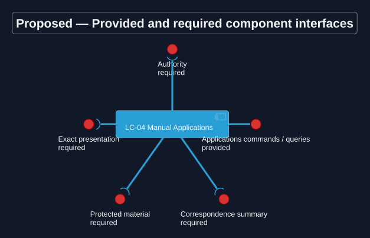

Provided circle and required sockets denote logical contracts, not allocated network APIs. Applications owns resource-operation policy; current Identity context does not give blanket access. Command families require exact signature refinement.

##### 7.2 C4 Level 1: Resumefolio system context

[C4 Level 1: Resumefolio system context](Diagrams/Detailed/drivers-c4-system-context.svg)

[Editable PlantUML](Diagrams/Detailed/drivers-c4-system-context.puml) · 

C4-style Level 1 scope is the whole software system; LC-04 is not promoted to a separate system. Public viewers have no Applications access merely because they can view a published resume. No internal module boxes appear at this level.

##### 7.3 C4 Level 2: modular application and stores

[C4 Level 2: modular application and stores](Diagrams/Detailed/boundaries-c4-containers.svg)

[Editable PlantUML](Diagrams/Detailed/boundaries-c4-containers.puml) · 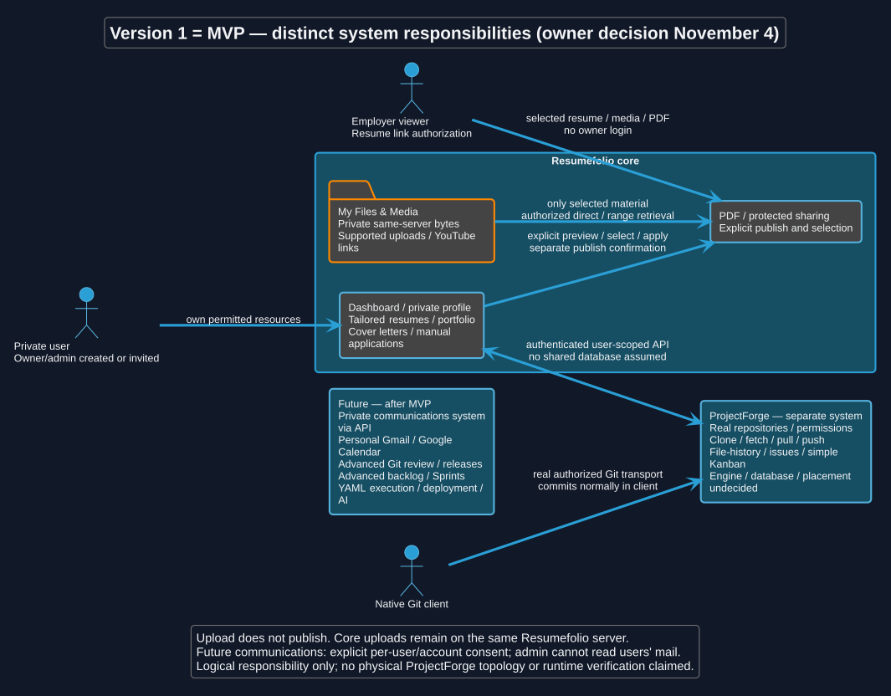

C4-style containers are applications/runtimes and data stores, not Docker units or nine services. Worker and provider facilities remain subject to enabling evidence. Sharing one database does not allow another module to write Applications state.

##### 7.4 Logical capability landscape

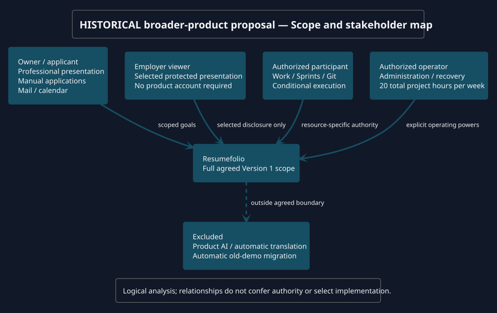

[Editable PlantUML](../../03-System-Analysis/Diagrams/Scope-Stakeholder-Map.puml) · 

Portfolio-style map of nine logical modules grouped for navigation, not separate deployed applications, teams or enterprise systems. Grouping does not create new integration requirements; Work/Git/Workflow have no implied Applications lifecycle authority.

##### 7.5 Applications inbound and outbound dependencies

[Applications inbound and outbound dependencies](Diagrams/Detailed/applications-dependencies.svg)

[Editable PlantUML](Diagrams/Detailed/applications-dependencies.puml) · 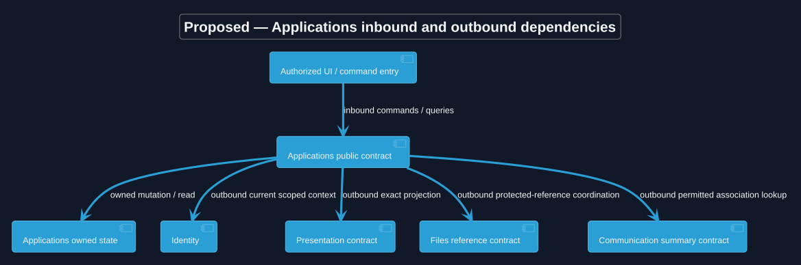

Use/dependency direction, not bidirectional state access. No consumer obtains mutable Applications ORM records. A permitted correspondence association is not automatic progress or submission capture.

##### 7.6 Applications layered architecture

[Applications layered architecture](Diagrams/Detailed/applications-layers.svg)

[Editable PlantUML](Diagrams/Detailed/applications-layers.puml) · 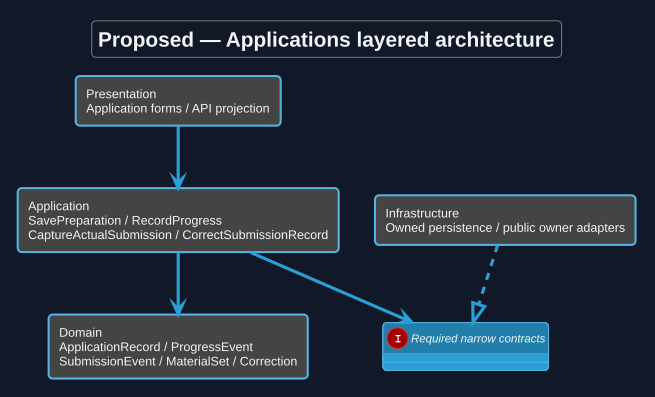

Proposed role allocation, not implemented classes or selected REST routes. Domain rules must retain proposal status where Q-D12/13/14 remain unresolved. Infrastructure does not gain authority to alter another owner’s tables.

##### 7.7 Internal responsibility areas within LC-04

[Internal responsibility areas within LC-04](Diagrams/Detailed/applications-internal-structure.svg)

[Editable PlantUML](Diagrams/Detailed/applications-internal-structure.puml) · 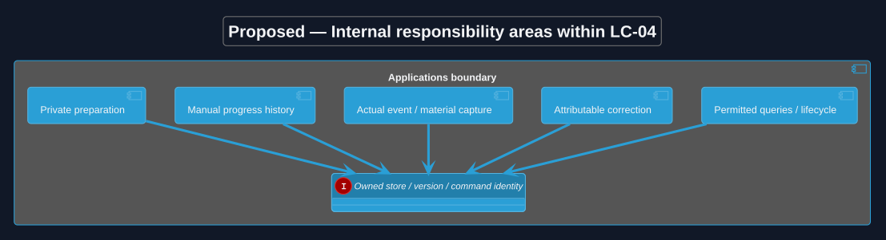

Internal design areas, not independently deployed sub-applications. Progress, event existence and material completeness are distinct facts; correcting one must not silently rewrite another or manufacture submitted status.

##### 7.8 Candidate package dependencies

[Candidate package dependencies](Diagrams/Detailed/applications-packages.svg)

[Editable PlantUML](Diagrams/Detailed/applications-packages.puml) · 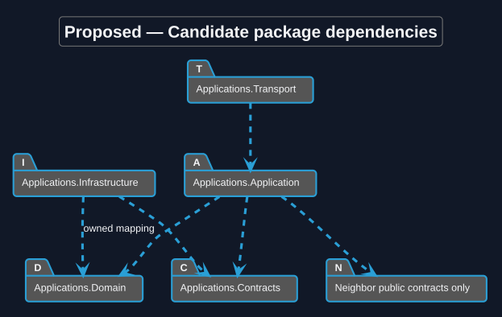

Proposed namespaces; actual Laravel autoloading/folder conventions remain to inspect/select. Source dependencies must be acyclic and cross-owner access limited to exported contracts. Runtime coordination direction is not inferred from package names alone.

##### 7.9 Integration types and evidence boundaries

[Integration types and evidence boundaries](Diagrams/Detailed/applications-integration.svg)

[Editable PlantUML](Diagrams/Detailed/applications-integration.puml) · 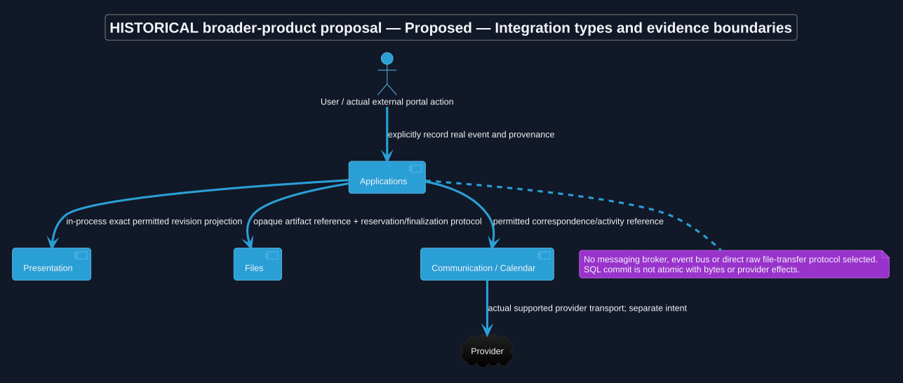

File integration is through Files-owned usable identity/reference protection, not raw private paths. Any asynchronous reconciliation needs durable attributable work; no messaging product or provider lookup guarantee is adopted.

##### 7.10 Actual submission capture across owner contracts

[Actual submission capture across owner contracts](Diagrams/Detailed/applications-cross-owner-sequence.svg)

[Editable PlantUML](Diagrams/Detailed/applications-cross-owner-sequence.puml) · 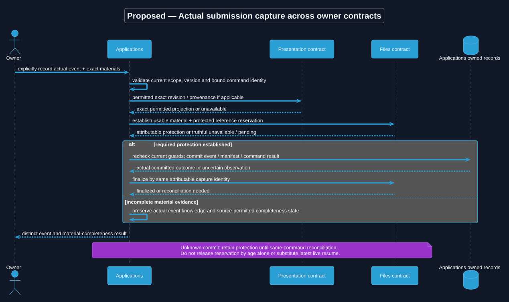

Logical public-contract collaboration, not a proven cross-module atomic handshake. Actual reservation, consumer commit, finalization and cleanup ordering remains joint Applications/Files/data design. New real submissions differ from repeats of one recording command.

##### 7.11 UML use cases for the manual Applications capability

[UML use cases for the manual Applications capability](Diagrams/Detailed/applications-use-cases.svg)

[Editable PlantUML](Diagrams/Detailed/applications-use-cases.puml) · 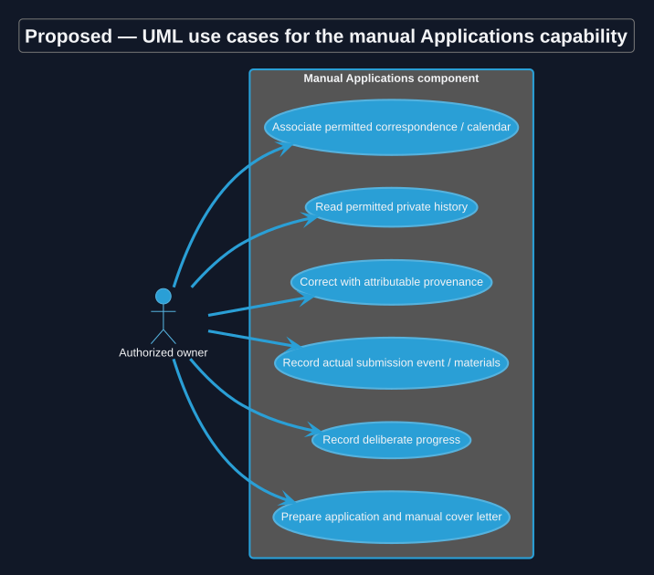

Design-level use-case summary, not allocated new use-case IDs or exact criterion coverage. No automatic job-portal submission, AI drafting, universal admin access or email-inferred progress is introduced.

##### 7.12 Optional deployment mapping of logical roles

[Optional deployment mapping of logical roles](Diagrams/Detailed/drivers-uml-deployment.svg)

[Editable PlantUML](Diagrams/Detailed/drivers-uml-deployment.puml) · 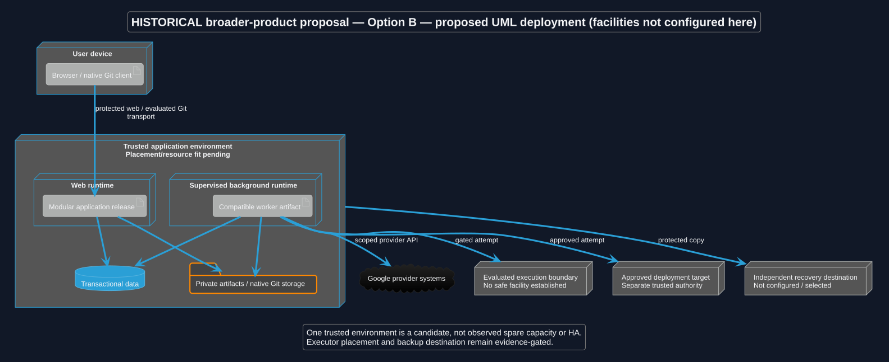

Optional candidate mapping, not an installed topology or assertion that one host meets capacity/recovery needs. Refer to the owning deployment document; dated demo allocations are not production sizing guarantees.

##### 7.13 Application / module inventory

Technology is the shared proposed Laravel/OOP modular-app approach unless the owning design specifies otherwise. Criticality is a qualitative consequence classification, not accepted availability tiers. Responsible delivery/decision owner is Farhad; domain owners below are logical responsibilities, not separate staffed teams.

| Name / level | Purpose | Logical owner | Technology / status | Criticality consequence |
| --- | --- | --- | --- | --- |
| Resumefolio / software system | Full accepted V1 capabilities | Farhad | Proposed modular Laravel application | Cross-capability availability/privacy impact |
| Manual Applications / LC-04 module | Private preparation, progress and actual-material history | Applications | Same modular app; not a separate service | Wrong or lost actual history affects evidence integrity |
| Professional Presentation / module | Source, independent resumes and explicit publication | Presentation | Same candidate app | Wrong revision/content can misrepresent intent |
| Representation / Sharing / module | Exact permitted representation/link controls | Sharing | Same candidate app | Unauthorized disclosure or wrong representation |
| Communication / Calendar / module | Actual supported account/provider interactions | Communication | App adapters + conditional provider access | Duplicate/unknown effects and private correspondence exposure |
| Identity / Access / module | Current scoped context and access policy | Identity + resource owner | Actual session/auth mechanisms to refine | Protected-operation admission and privacy |
| Files / Operations / module | Usable artifact identity, protection and operations | Files | App capability + selected storage/runtime TBD | Missing/corrupt protected actual material / recovery loss |

This focused inventory lists the system, LC-04 and its relevant neighbors; the landscape diagram and component catalog include Work, Git and Workflow as separate logical owners. External job portals are outside the product boundary and are not inventoried as owned apps.

##### 7.14 Capability mapping

`O` owns the capability; `S` supplies a required supporting contract; `—` means no primary role in this selected mapping, not a privacy exemption or exhaustive integration claim.

| Logical module | Private preparation | Manual progress | Actual event / material manifest | Current admission | Usable bytes / references | Mail/calendar truth |
| --- | --- | --- | --- | --- | --- | --- |
| Applications | O | O | O | O (resource action) | S (consumer protection) | — |
| Presentation | S (exact revision) | — | S (exact provenance) | S (owned access) | S (its consumers) | — |
| Identity | S | S | S | O (identity/scope contract) | S (current scope) | — |
| Files | S | — | S (artifact protection) | S (owned access) | O | — |
| Communication | S (permitted association) | — | S (attributable observation only) | S (owned access) | S (its attachments) | O (provider evidence, not invented receipt) |

##### 7.15 Interface catalog

Operation names remain proposed. No REST route, broker topic, provider protocol version or public endpoint is allocated by this table.

| Application / logical owner | Interface / operation family | Protocol / exposure | Consumers |
| --- | --- | --- | --- |
| Applications | SavePreparation, RecordProgress, CaptureActualSubmission, CorrectSubmissionRecord | Proposed in-process application contracts; transport mapping TBD | Authorized UI/entry paths |
| Applications | Permitted list/detail/history and reviewed lifecycle operations | Owned query/command contracts | Authorized user flow; other consumers only if justified |
| Presentation | Exact permitted preparation/source revision projection | Public owner contract; not raw ORM/table access | Applications preparation/capture |
| Files | Usable artifact identity, reservation/finalization and safe lifecycle | Evaluated public reference protocol; concrete handshake pending | Applications material consumers |
| Identity | Current identity/scope context | Actual selected mechanism TBD | Applications owner admission |
| Communication / Calendar | Permitted correspondence/activity summary | Public owner contract; external provider handled by that owner | Explicit Applications association |

##### 7.16 Technology stack

| Layer | Proposed / observed position | Version status | Evidence needed |
| --- | --- | --- | --- |
| Application | Proposed Laravel / PHP OOP modular app | Final supported PHP/Laravel versions not selected here | Inspect actual manifests, lockfile and intended runtime |
| Demo inventory | Earlier inspected PHP 8.3 / existing Laravel / Nginx / MySQL on Ubuntu 24.04.4 | Dated observation, not accepted production baseline | Confirm actual environment and compatibility |
| Applications persistence | Owned records with version/identity guards | Engine-specific schema/types/indexes pending | Actual persistence design and concurrency checks |
| Files storage | Usable protected artifact/reference capability | Placement, keys, recovery and concrete protocol pending | Real byte/reference lifecycle and isolated restore evidence |
| Provider integration | Communication-owned mail/calendar adapter | OAuth/prerequisites and supported operations pending | Actual provider capability and authorized integration evidence |

##### 7.17 Data ownership / CRUD matrix

CRUD permissions below describe **logical write ownership**, not SQL grants or unconstrained deletion. `C/R/U/D*` means owner-controlled lifecycle only; `R(contract)` means permitted projection through the owner, not direct database access. Actual retention, correction and erasure policy remains sourced/proposed as stated above.

| Logical module | Applications records/events/manifests | Presentation records/revisions | Files bytes/reference ledger | Communication records | Identity state |
| --- | --- | --- | --- | --- | --- |
| Applications | C/R/U/D* under reviewed policy | R(contract) | R(contract) + explicit reservation/finalization requests | R(contract) | R(contract) |
| Presentation | No direct access | C/R/U/D* | Public reference requests for own consumers | No implied access | R(contract) |
| Files | No direct access | No direct access | C/R/U/D*; protected references gate reclamation | No direct access | R(contract) |
| Communication | No direct mutation | No direct mutation | Public reference requests for own attachments | C/R/U/D* plus actual provider semantics | R(contract) |
| Identity | No blanket business-data access | No blanket business-data access | No blanket private-byte access | No blanket correspondence access | C/R/U/D* under actual identity policy |

SQL/shared-host placement does not merge these owners. A request to reserve a Files reference is an owned command, not permission for Applications to CRUD the Files ledger itself. Administrative access remains subject to exact source-policy reconciliation, not a universal bypass.

##### 7.18 Quality / NFR scenarios

No numeric availability, latency, concurrency, retention or RPO/RTO target is accepted here. Q-D25/26 and owning quality/recovery records retain their proposal/evidence status.

| Application / module | Quality attribute | Required design behavior / scenario | Target / verification status |
| --- | --- | --- | --- |
| Applications | Integrity / consistency | Preserve actual event/material identity through source edits, correction, repeat and races | Exact contracts and real persistence/reference checks pending |
| Applications + Identity | Security / privacy | Current scoped admission and permitted history projection under revocation | Actual synchronization and access checks required |
| Applications + Files | Recoverability / availability | Report missing material truthfully; restore consistent usable references/bytes/keys | Usable backups/recovery not established by this document |
| Whole modular app | Performance / capacity | Bound combined web/artifact/Git/worker demand without false completion | Agreed workload and real combined-load evidence pending; account count is not concurrency |
| Applications + Communication | Reliability | No progress or actual submission inferred from unknown send / provider acceptance | Controlled adapter/association evidence required |
| Applications UI | Usability / accessibility | Distinguish saved preparation, recorded progress, actual event and material completeness | Actual UI and agreed accessibility/browser targets need verification |

##### 7.19 Lifecycle and ownership

| Item | Status / version | Responsible owner / support | Retirement / change plan |
| --- | --- | --- | --- |
| LC-04 design | Proposed design candidate; no software release version allocated | Farhad; actual operating support route to establish | Compatible change with source-policy disposition and exact evidence |
| Application records/history | Source-governed lifecycle; Q-D12/13/14 detailed proposals unresolved | Applications owner | Archive/trash/correction/erasure by reviewed policy; no new 30-day default |
| Referenced actual materials | Independent protected identities; usable-byte state distinct | Applications consumer + Files owner | No cascade/age-only reservation release across unknown commit; reconcile protection |
| Linked correspondence/provider account | Owned by Communication under actual access/lifecycle | Communication + current user authority | Disconnection does not rewrite prior actual facts or authorize resend |

##### 7.20 Application-level decision note

**Proposed application of existing ADRs, not a new accepted decision:** retain LC-04 within the modular application and access neighbors through public contracts ([ADR-001](../ADR/ADR-001-Modular-Application-Boundaries.md#design-record-07-design-decisions-adr-001-modular-application-boundaries-md)); preserve separate publication and actual-history identities ([ADR-002](../ADR/ADR-002-Explicit-Publication-And-History.md#design-record-07-design-decisions-adr-002-explicit-publication-and-history-md)); keep consequential external attempts under their owning durable reconciliation protocol ([ADR-003](../ADR/ADR-003-Durable-External-Attempts.md#design-record-07-design-decisions-adr-003-durable-external-attempts-md)). All retain their Proposed status.

The simplest alternative to separate deployment avoids adding network/operating/consistency costs before actual evidence justifies extraction. A future independent Applications service requires a new explicit ADR covering contracts, migration, identity, protected references, resource/recovery cost and operating support; this package does not select that alternative. Refer to the [ADR template](../ADR/Decision-Index.md#design-record-07-design-decisions-design-decisions-md) and [deployment owner](../01-High-Level-Design/14-Appendices.md#design-record-01-software-architecture-04-deployment-topology-nodes-and-networks-md).

These views/tables complement the detailed class/capture algorithms above. They do not close exact acceptance criteria, accept Q-D12/13/14, select a physical topology, establish capacity or execute capture/send/recovery. Verify the actual candidate through the owning review/handoff process.

Resumefolio — Communication and Calendar Component Design

### Resumefolio — Communication and Calendar Component Design

**Responsibility:** coordinate private mail/calendar intent with explicitly authorized provider capabilities, preserve attributable outcomes and distinguish local records from provider truth. A message accepted by a provider is not proven delivered/read, and a local calendar association is not a provider mutation.

**Status:** proposed LC-05 component design. Q-D15 access remains evidence-gated; Q-D16/Q-D17 detailed behavior remains proposed in the source specification. OAuth was reported uncreated. No provider account, token, supported API/version, scope approval or actual send/synchronization result is established here.

[Authority](#design-record-03-component-and-module-design-components-communication-and-calendar-md--heading-1-source-authority-and-ownership) · [Operations](#design-record-03-component-and-module-design-components-communication-and-calendar-md--heading-2-public-operations-and-result-contracts) · [Data](#design-record-03-component-and-module-design-components-communication-and-calendar-md--heading-3-owned-classes-and-logical-data) · [Send](#design-record-03-component-and-module-design-components-communication-and-calendar-md--heading-4-reviewed-send-and-uncertain-outcome-protocol) · [Calendar](#design-record-03-component-and-module-design-components-communication-and-calendar-md--heading-5-calendar-authority-and-reconciliation) · [Recovery](#design-record-03-component-and-module-design-components-communication-and-calendar-md--heading-6-security-failure-and-recovery-boundaries) · [Review](#design-record-03-component-and-module-design-components-communication-and-calendar-md--heading-7-verification-and-open-decisions) · [Communication package](#design-record-03-component-and-module-design-components-communication-and-calendar-md--heading-8-communication-calendar-and-delivery-view-package)

Current MVP scope and selected mechanisms: [Baseline](https://github.com/Farhad-V/Web-Resumefolio/blob/1f2acaa351ac306cb57cbe4fe9742e8bd90720d9/docs/MVP/baseline/README.md). Deferred provider, advanced collaboration and workflow-execution designs are not MVP prerequisites.

#### 1. Source authority and ownership

Use [EGC-D01–EGC-D12](../../02-Requirements-Engineering/01-Software-Requirements-Specification/03-Requirements-Specification/06-Email-Calendar-And-Google-Integration.md#requirements-specification-email-calendar-and-google-integration), [Q-D15](../../02-Requirements-Engineering/01-Software-Requirements-Specification/03-Requirements-Specification/06-Email-Calendar-And-Google-Integration.md#requirements-specification-email-calendar-and-google-integration--id-resolution-q-d15), [Q-D16](../../02-Requirements-Engineering/01-Software-Requirements-Specification/03-Requirements-Specification/06-Email-Calendar-And-Google-Integration.md#requirements-specification-email-calendar-and-google-integration--id-resolution-q-d16) and [Q-D17](../../02-Requirements-Engineering/01-Software-Requirements-Specification/03-Requirements-Specification/06-Email-Calendar-And-Google-Integration.md#requirements-specification-email-calendar-and-google-integration--id-resolution-q-d17). Provider scopes listed there are proposals whose current applicability, audience/verification, costs/quotas and actual capability need official-source assessment at configuration time; this design does not independently certify them.

Follow [analysis interfaces](../../03-System-Analysis/04-Interfaces-Security-And-Quality.md#analysis-interfaces-security-and-quality-analysis--12-interfaces-and-external-interactions), [states](../../03-System-Analysis/03-Processes-Scenarios-And-Business-Rules.md#analysis-behavioral-and-scenario-analysis--07-state-based-view), [operation contracts](../../03-System-Analysis/03-Processes-Scenarios-And-Business-Rules.md#analysis-business-rules-and-operation-contracts--10-domain-constraints-and-operation-contracts), [runtime protocol](../01-High-Level-Design/14-Appendices.md#design-record-01-software-architecture-03-process-view-concurrency-and-runtime-behavior-md) and [security design](../01-High-Level-Design/14-Appendices.md#design-record-06-design-quality-and-security-analysis-02-security-threat-modeling-and-trust-boundaries-md).

**Own:** user/provider identity and capability state; local correspondence projections and compose intent; attributable remote-draft/send operations; local activities/private notes; selected provider-event mappings and synchronization observations/conflicts.

**Do not own:** all provider mailbox/calendar state, application progress/actual submitted manifests, private artifact byte storage, user-wide permission grants or an assumed working delivery infrastructure. Application/work references remain explicit associations with independently checked access.

**Dependencies:** current actor/resource authority; evaluated mail/calendar adapters; protected artifact access; durable local pending-operation/claim mechanism; clock/time representation and actual reminder delivery capability. No product-wide service account or Codex connector is assumed to provide personal Gmail access.

#### 2. Public operations and result contracts

The signatures below name proposed responsibilities, not final language/API syntax. Mutating operations carry current context, resource/expected version, stable command identity and intended input where appropriate. Return permitted confirmed/pending/invalid/denied/conflict/unavailable/partial/unknown outcomes with attributable references, never a boolean that hides remote uncertainty.

##### Connection and capability operations

**ConnectSelectedAccount(context, authorizationResult):** bind verified provider identity to the intended product owner and evaluated consent/capabilities. Validate account selection and applicable callback/security protocol in the actual adapter; do not accept unverified client-supplied identity as account proof.

**DisconnectConnection(context, connectionId, expectedVersion):** stop new dependent dispatch/fetch/push work, invalidate locally usable credentials and mark retained copies/mappings disconnected/stale under source rules. Provider revocation is an actual external result, distinct from successful local disconnect. Already admitted effects may need reconciliation.

**ReconnectAndReconcile(context, connectionId, authorizationResult):** reassess actual identity/capability, then reconcile existing mappings/attempts. A different provider identity cannot silently inherit the prior mailbox context. Never replay old sends or recreate mapped events merely because access returns.

##### Mail read compose draft and reply

**SearchReadCorrespondence(context, connectionId, queryOrMessageReference):** authorize selected mailbox capability, bounded search/page/read and any retained local projection. Preserve provider message/thread identity, observation time and freshness/disconnection state. Render untrusted content safely; attachments require protected access.

**SaveComposeDraft(context, draftId?, expectedVersion?, content):** preserve current local edit intent and report actual save state. Remote draft persistence, if requested/supported, is a separate versioned provider operation with its own outcome. An out-of-order autosave cannot overwrite a newer edit silently.

**PrepareSend(context, draftId, expectedVersion, reviewedRecipientsAndArtifacts):** validate selected sender/account and bind exact To/Cc/Bcc, subject/body, reply/thread context and attachment identities to a reviewed intent. Content/recipient/attachment changes invalidate the prior review as required by the source policy. Reply-all is not inferred automatically.

**DispatchReviewedIntent(context, reviewedIntentId, commandId):** create/admit the attributable attempt under current authority/capability and durable dispatch rules; sending remains deliberate. **ReconcileSend(context, attemptId):** inspect only actually supported attributable provider evidence and record what is known. Do not invent a query/idempotency guarantee or infer delivery from acceptance.

##### Local activities provider mappings and reminders

**SaveLocalActivity(context, activityId?, expectedVersion?, activityInput):** create/edit local time/notes/associations without publishing remotely by default.

**PublishSelectedActivity(context, activityId, expectedVersion, selectedCalendar):** explicitly request a permitted provider event and record its attributable result/mapping. **ReconcileCalendarMapping(context, mappingId, versionContext):** apply the source field-authority/conflict rules, not implicit whole-account mirroring.

**UnlinkLocalMapping(context, mappingId, expectedVersion):** remove the local association where permitted without a provider deletion. **DeleteProviderEvent(context, mappingId, expectedVersion, explicitConfirmation):** a distinct authorized consequential operation with unknown-effect handling where needed.

**PlanOrDeliverReminder(context, activityId, versionContext):** requires the actual selected delivery facility and current eligibility. Scheduling, provider acceptance and delivery are separate facts; disconnected capability or unavailable delivery must not be labeled notified.

#### 3. Owned classes and logical data

[After MVP — Proposed connection intent and calendar mapping model](Diagrams/Detailed/communication-owned-model.svg)

[Editable PlantUML](Diagrams/Detailed/communication-owned-model.puml) · 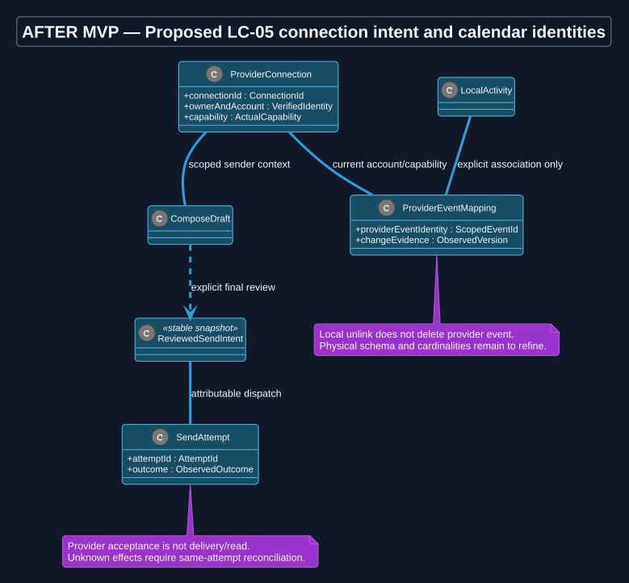

**ProviderConnection:** stable product-owner/connection identity, verified provider-account identity, capability/consent observations, locally usable credential reference, lifecycle/version and relevant timestamps. Sensitive credentials remain restricted and recoverable through evaluated key procedures, not exposed through public projections.

**CorrespondenceProjection / ComposeDraft:** provider message/thread references and observed freshness, or private editable recipient/body/attachment/reply intent with version. Local projection retention/disconnected availability follows reviewed policy; a retained copy is not proof of current provider access or freshness.

**ReviewedSendIntent / SendAttempt:** exact reviewed sender/content/recipient/artifact version, command/attempt identity, current claim/dispatch evidence, provider references where supplied and acceptance/pending/partial/unknown observations. Review identity must not point to a later mutable draft version.

**LocalActivity / ProviderEventMapping:** local private fields and time semantics, selected provider/calendar/event/recurrence identity, last observed provider change evidence, field authority, sync status/conflict and connection context. Local association and provider event lifecycles remain distinct.

**ReminderIntent:** actual intended channel, subject/version/time, pending/delivery-attempt identity and attributable result. Do not add a second silent sending system that bypasses authority or uncertain-effect handling.

##### Logical persistence and types

Scope all private records and lookups to actual owner/connection context. Uniqueness for provider message/event identities must include the actual account/calendar namespace; identical provider-looking strings across accounts are not interchangeable. Protect command/attempt identity and expected local versions against duplicate/stale updates. Persist source/observation provenance and pending intents needed for reconciliation.

Timed events retain unambiguous instant and source/display timezone. All-day calendar dates and exclusive end semantics follow the source proposal, not arbitrary midnight conversion; recurrence/exception identity is preserved. Physical engine/types, field lengths, token storage/key handling, indexes, pagination limits and concrete provider version/change facilities remain evaluated refinements, not invented schema details.

#### 4. Reviewed send and uncertain outcome protocol

[After MVP — Proposed reviewed send and lost-response handling](Diagrams/Detailed/communication-send-sequence.svg)

[Editable PlantUML](Diagrams/Detailed/communication-send-sequence.puml) · 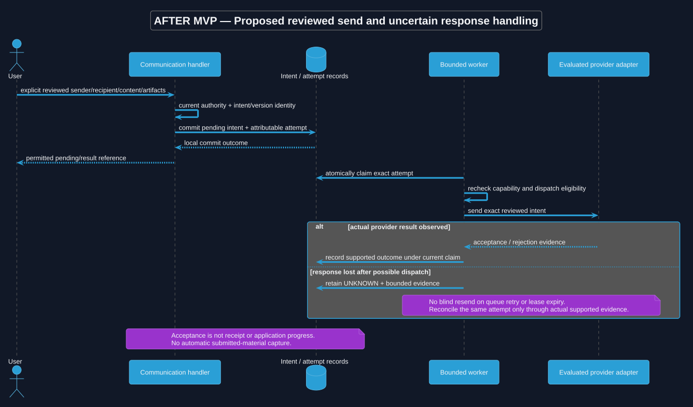

1. Resolve current owner/connection/send authority and intended draft version. Validate the final selected sender/recipient/thread/content/artifact set and bind it to an immutable reviewed intent or equivalent stable snapshot.
2. Under the selected local guard, bind a unique command identity to that intent, record an attributable pending attempt and durable dispatch state. Same-intent repeat resolves the previous permitted result; changed intent conflicts.
3. A bounded worker claims the attempt, checks relevant current authority/capability and dispatch eligibility, and sends the exact reviewed intent through the evaluated adapter outside a long database transaction. Attachment usability/authorization must match the reviewed identities; unavailable changes require explicit handling, not silent substitution.
4. Record evidence-supported provider acceptance/rejection or pending/partial/unknown outcome with a current claim check. Local fencing does not stop an old network action or establish exactly-once remote delivery.
5. If a response is lost after possible dispatch, retain unknown and reconcile the same attempt through actual authorized provider evidence. Generic queue redelivery or lease expiry must not send blindly. Further explicit retry requires the source contract’s duplication warning/decision and evidence/identity rules.
6. Show truthful status to the user. Product admission, provider acceptance, delivery, recipient read and application submission/progress remain separate facts. Applications may explicitly associate permitted correspondence; it must not receive automatic progress changes or fabricated actual-material evidence.

The send adapter must report capability and actual result semantics, not suppress uncertainty behind success/failure. Provider operations/scopes/version/quotas, duplicate detection and reconciliation mechanisms require current actual evidence before dependent acceptance.

#### 5. Calendar authority and reconciliation

**After MVP.** Shared operating and recovery controls still apply where relevant.

[After MVP — Proposed local versus provider event decisions](Diagrams/Detailed/calendar-reconciliation-route.svg)

[Editable PlantUML](Diagrams/Detailed/calendar-reconciliation-route.puml) · 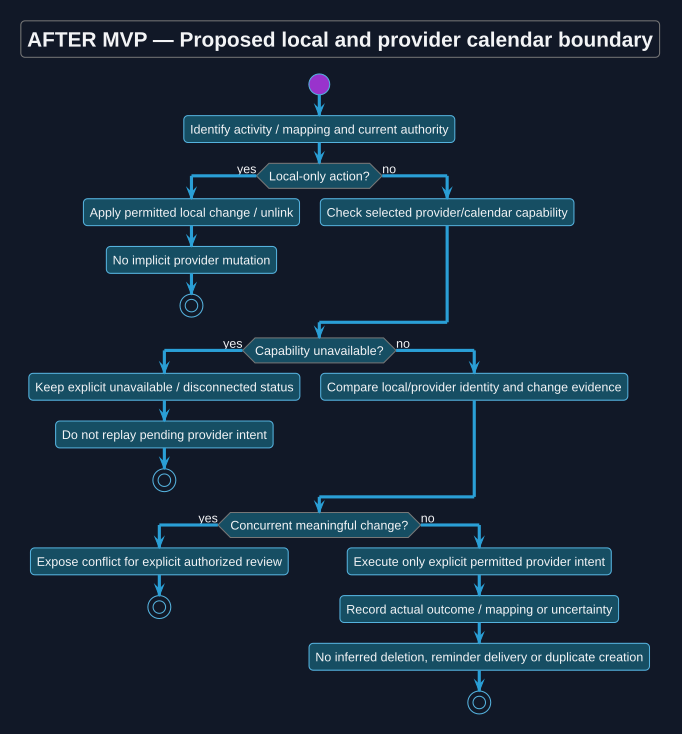

**Local-only activity:** save local intent without provider effect. Explicit publish establishes a new attributable mapping only when permitted provider creation is observed. Unknown creation cannot become a fresh create on reconnect automatically.

**Imported provider event:** provider-owned fields remain authoritative under the Q-D17 proposal until an explicit permitted update succeeds. Local private notes/application associations remain local. A provider scope that technically reaches many events does not authorize indiscriminate product disclosure.

**Mapped updates:** compare local and actually available provider version/change evidence. A concurrent meaningful change becomes an explicit conflict/review, not silent last-write-wins. Resolve by an authorized choice against identified versions and record actual effect/uncertainty. No universal bidirectional policy is introduced.

**Unlink and delete:** permitted local unlink does not require silently deleting the external event. Provider deletion needs a separate explicit confirmed intent and current target-calendar authority. An external deletion marks retained local mapping state removed/unavailable according to source rules, without inventing a new local business outcome.

**Disconnect and reconnect:** stop new connection-dependent work; mark retained data stale/disconnected and invalidate local credential usability. Reconnect re-evaluates identity/capability and reconciles pending state. Do not duplicate event creation, old sends or reminder delivery. Dates/timezones/recurrence exceptions retain their actual source meaning.

#### 6. Security failure and recovery boundaries

**Private isolation:** connection/message/event references are verified under current owner/resource policy, including any actual accepted administrative rules. Associations with Applications or Work never grant whole-mailbox/calendar access. Return safe denied projections without unrelated private existence/content.

**Untrusted content:** sanitize display and protect attachments; do not execute email HTML or automatically load tracking resources under the source proposal. Attachment/reference paths and filenames are not authorization. Tokens, message bodies and private attachments do not enter ordinary logs or diagrams.

**Credential failure:** refresh/revocation/consent loss changes usable capability explicitly. A stale local token record or installed package cannot establish access. Do not bypass identity or send using another connected account as a fallback.

**Concurrency:** stale autosave, changed reviewed recipients, simultaneous send clicks, expired worker claims and local/provider edits have explicit version/intent/claim behavior. An observed remote effect is retained even when local access changes before the acknowledgment arrives; current permission still controls further action/disclosure.

**Operating recovery:** restart/resume pending state under current authority and the same attempt identities. Isolated restore checks connection/credential/key state, marks copies appropriately and reconciles effects before any new send/event/deployment-like action. Historical credentials/capabilities and restored queued work are not automatically valid. Local data deletion, provider deletion and backup expiry follow distinct reviewed policies.

**User feedback:** distinguish local draft saved, remote draft saved, send pending/accepted/unknown, local activity, mapped provider state, conflict and reminder delivery observation. Unavailable capabilities or missing artifacts are visible; never silently substitute identity, content or language.

#### 7. Verification and open decisions

| Source | Primary component responsibility |
|---|---|
| EGC-D01–D02 | Selected identity/capability, explicit consent and private-resource isolation  **After MVP.** |
| EGC-D03–D06 | Read/compose/draft/send/reply and truthful attributable outcomes  **After MVP.** |
| EGC-D07–D08 | Time/recurrence meaning, local activity and explicit mapping/conflicts  **After MVP.** |
| EGC-D09–D10 | Permitted application associations and actual reminder outcomes  **After MVP.** |
| EGC-D11–D12 | Disconnect/reconnect, bounded failures/recovery and feasibility evidence  **After MVP.** |

This map associates candidate intent; it does not close every source criterion. Exact mapping and Q-D15–Q-D17 disposition remain review work.

##### Planned focused verification

- Wrong-owner message/event/account references, changed grants and target-calendar authority.
- Local/remote drafts, stale autosave and changed content/recipient/artifact after final review.
- Double send, response loss before/after possible acceptance, duplicate delivery, stale worker completion and reconnect without replay.
- Explicit reply/thread/To/Cc behavior without inferred reply-all or receipt.
- Local-only publish, imported field authority, concurrent local/provider change, provider deletion versus local unlink and unknown event creation.
- Timed/all-day/timezone/recurrence cases and unavailable reminder delivery.
- Untrusted HTML/tracking/attachments, restricted diagnostics and credential privacy.
- Isolated restart/restore/disconnect handling with actual pending-effect reconciliation and current authority.

Use deterministic policy/adapter cases plus real persistence/claim concurrency and controlled provider operations when authorized. No send, account connection, scope grant, event mutation or restore test is performed here; mocks cannot certify provider access or idempotency.

##### Remaining prescriptions and evidence

Actual OAuth project/audience/consent/redirect/security handling, current scopes/verification/quota/cost, concrete provider versions/paging/change tokens and correlation facilities; exact class/signature/schema/type and resource limits; credential/key recovery; actual delivery/scheduler/worker operation; Q-D16/Q-D17 detailed source acceptance; exact criterion review and candidate disposition. Known OAuth setup absence is not a request for an existing project ID.

Follow [component templates](02-Module-Breakdown.md#design-record-03-component-and-module-design-component-and-module-design-md), [shared data](04-Database-Design.md#design-record-04-data-design-data-design-md), [API contracts](05-API-Specification.md#design-record-05-interface-and-api-design-interface-and-api-design-md), [operations/recovery](../01-High-Level-Design/14-Appendices.md#design-record-06-design-quality-and-security-analysis-03-operations-backup-recovery-and-resilience-md) and [review/handoff](../01-High-Level-Design/14-Appendices.md#design-record-06-design-quality-and-security-analysis-05-design-review-traceability-and-handoff-md). These technical views refine FAU component/data/dynamic modeling; they are not an accepted physical schema, complete current provider integration or baseline approval.

[Component catalog](02-Module-Breakdown.md#design-record-03-component-and-module-design-component-and-module-design-md) · [Component diagram catalog](12-Appendices.md#design-record-03-component-and-module-design-components-diagrams-diagram-catalog-md)

#### 8. Communication, calendar and delivery view package

**After MVP.** Shared operating and recovery controls still apply where relevant.

These **proposed LC-05 views** preserve Google-oriented accepted scope and Q-D15 capability gates / Q-D16–17 proposal status. Requested chat, SMS, push, Microsoft Graph and alternate protocols are shown as unselected alternatives, not new V1 commitments. Conditional invitation/free-busy/recurrence/notification behavior needs exact source disposition and actual provider capability evidence. Diagrams allocate no endpoint, scope, library, event enum or service topology.

##### 8.1 Communication and calendar interfaces

**After MVP.** Shared operating and recovery controls still apply where relevant.

[After MVP — Communication and calendar interfaces](Diagrams/Detailed/comm-interfaces.svg)

[Editable PlantUML](Diagrams/Detailed/comm-interfaces.puml) · 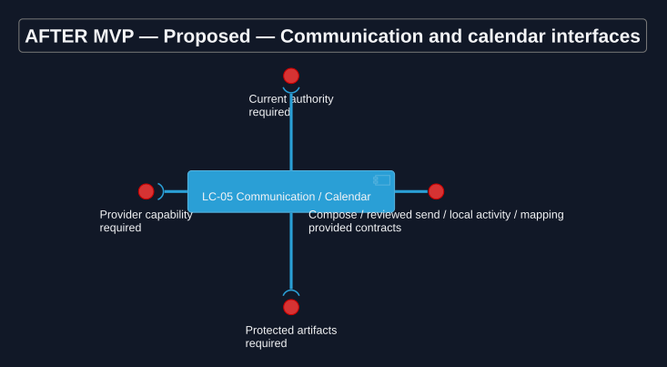

Logical contracts with provided circle and required sockets. Mail/calendar responsibilities are parts of LC-05, not newly selected services. Exact operations/signatures remain proposals as defined above.

##### 8.2 C4 Level 1: users and external provider

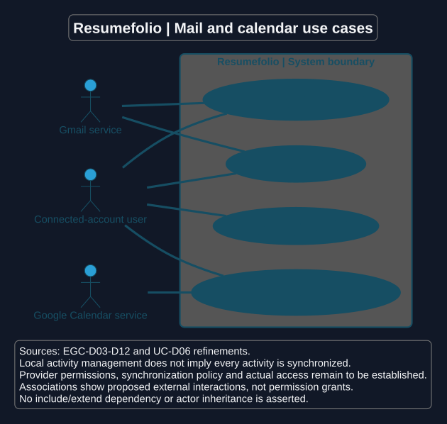

[Editable PlantUML](../../02-Requirements-Engineering/Diagrams/Use-Cases-Mail-And-Calendar.puml) · 

Whole-system C4-style context, not LC-05 as a separate software system. External correspondent interaction belongs to the provider; the product cannot infer receipt/read from its own request outcome.

##### 8.3 C4 Level 2: actual proposed runtime boundaries

[Editable PlantUML](../../02-Requirements-Engineering/Diagrams/Use-Cases-Mail-And-Calendar.puml) · 

C4-style containers are web/runtime/store boundaries. Chat and separate notification services are not promoted into scope. Scheduler/worker/provider access is a pending operating capability, not configured infrastructure.

##### 8.4 Owner communication and calendar use cases

**After MVP.** Shared operating and recovery controls still apply where relevant.

[After MVP — Owner communication and calendar use cases](Diagrams/Detailed/comm-use-cases.svg)

[Editable PlantUML](Diagrams/Detailed/comm-use-cases.puml) · 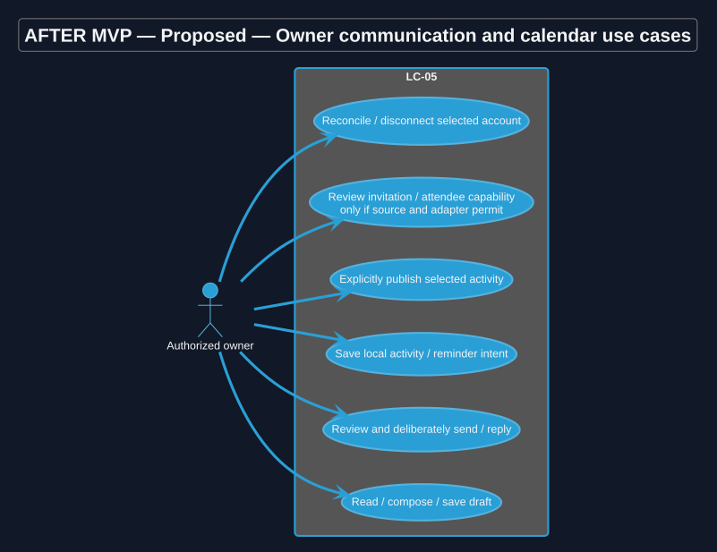

Scenario summary, not new allocated use cases. Scheduling a local activity is not inviting attendees. Invitation creation/response, conflict lookup and reminder delivery require actual source disposition and provider capability before implementation.

##### 8.5 Domain classes and optional requested concepts

[After MVP — Domain classes and optional requested concepts](Diagrams/Detailed/comm-domain.svg)

[Editable PlantUML](Diagrams/Detailed/comm-domain.puml) · 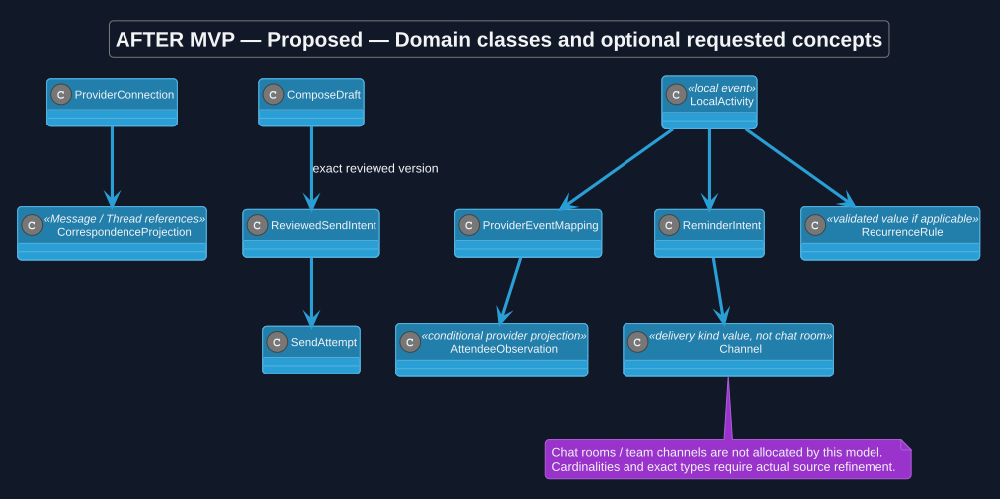

Message and Thread are provider-scoped projection identities, not claims of owned provider truth. Attendee and recurrence roles are conditional refinements. Channel denotes an explicitly selected delivery kind; the diagram creates no chat feature or push/SMS entitlement.

##### 8.6 Logical ERD: owned and observed records

[After MVP — Logical ERD: owned and observed records](Diagrams/Detailed/comm-erd.svg)

[Editable PlantUML](Diagrams/Detailed/comm-erd.puml) · 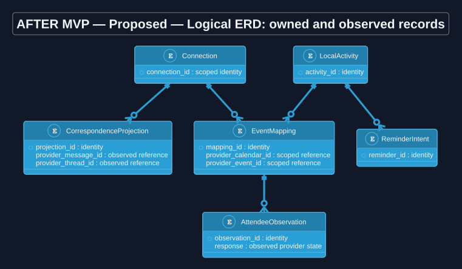

Selected logical ERD with proposed multiplicities, not migration SQL or complete schema. Calendars/messages/threads remain provider-scoped references/projections; private local notes and mappings remain owned. Exact uniqueness, attendee retention and mapping cardinality need refinement; no cascade deletion implied.

##### 8.7 Reviewed send and delivery observations

[After MVP — Reviewed send and delivery observations](Diagrams/Detailed/comm-send.svg)

[Editable PlantUML](Diagrams/Detailed/comm-send.puml) · 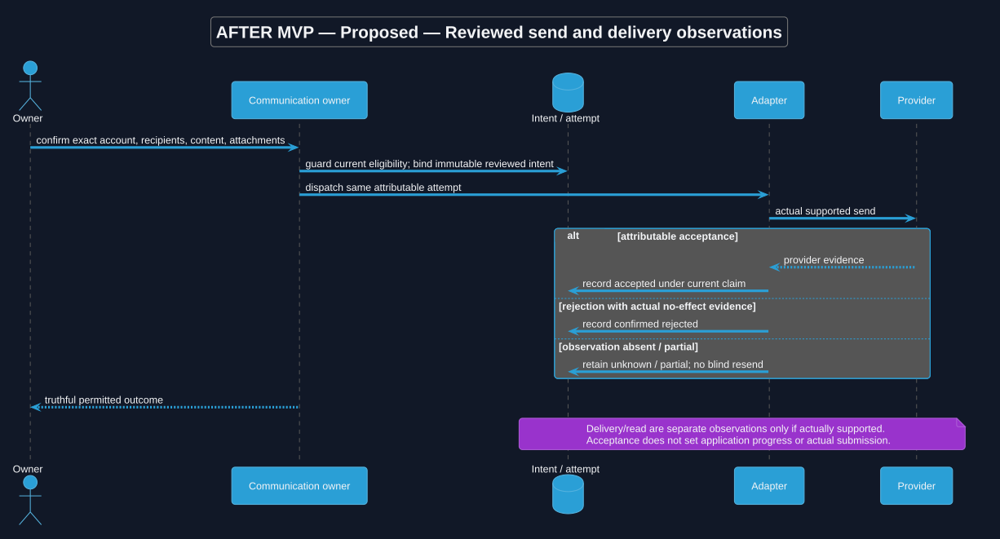

No delivery/read guarantee or provider lookup/idempotency API is invented. Reviewed content cannot refer to a later mutable draft. Exact attachment identity and current usable capability must hold at actual dispatch.

##### 8.8 Conditional event creation and attendee response

[After MVP — Conditional event creation and attendee response](Diagrams/Detailed/comm-invitation.svg)

[Editable PlantUML](Diagrams/Detailed/comm-invitation.puml) · 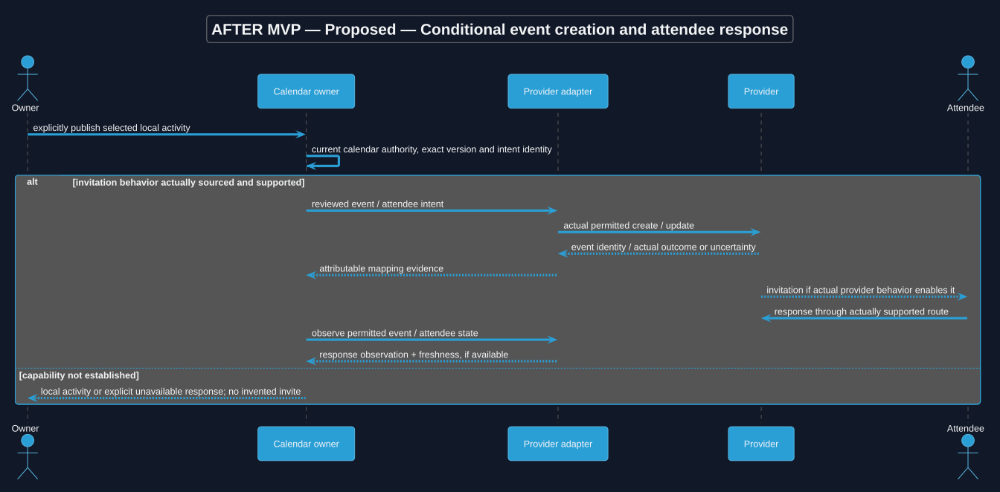

Conditional interaction, not newly accepted attendee workflow. Event mutation, invitation dispatch and attendee response are separate effects/facts. Unknown create/update must reconcile the same intent; no recreate-on-reconnect.

##### 8.9 Reminder trigger and actual notification outcome

[After MVP — Reminder trigger and actual notification outcome](Diagrams/Detailed/comm-reminder.svg)

[Editable PlantUML](Diagrams/Detailed/comm-reminder.puml) · 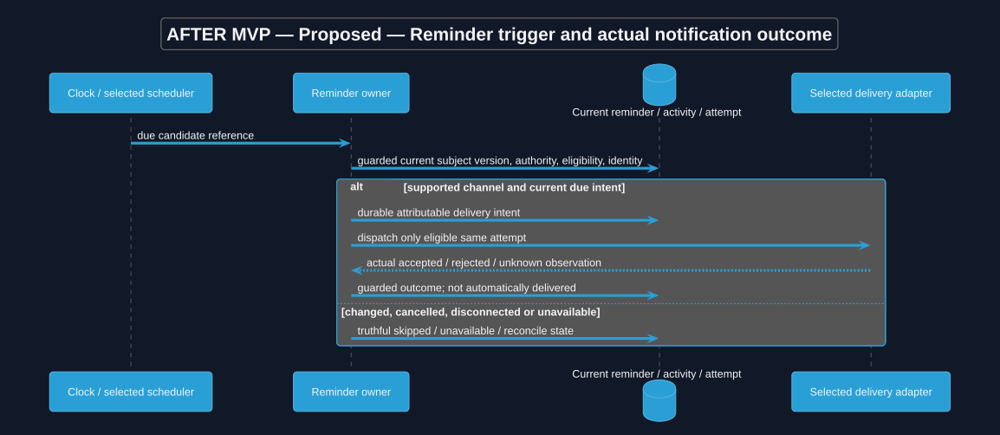

Scheduler/delivery facilities are not established by this drawing. Due detection does not prove notification. Edits/cancellation and duplicate triggers need current guard/identity handling; no implicit second mail sender or unsupported fallback channel.

##### 8.10 Message and send knowledge: distinct dimensions

[After MVP — Message and send knowledge: distinct dimensions](Diagrams/Detailed/comm-message-state.svg)

[Editable PlantUML](Diagrams/Detailed/comm-message-state.puml) · 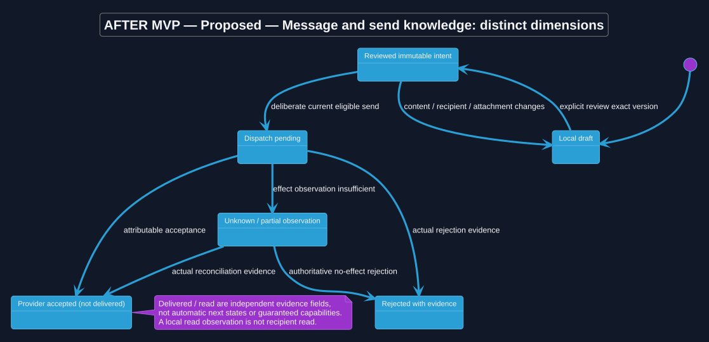

Avoid a misleading draft→sent→delivered→read chain. Product admission, provider acceptance, receipt and read are different facts. No actual enum or unsupported delivery-tracking feature is adopted.

##### 8.11 Event status and attendee response dimensions

[After MVP — Event status and attendee response dimensions](Diagrams/Detailed/comm-event-state.svg)

[Editable PlantUML](Diagrams/Detailed/comm-event-state.puml) · 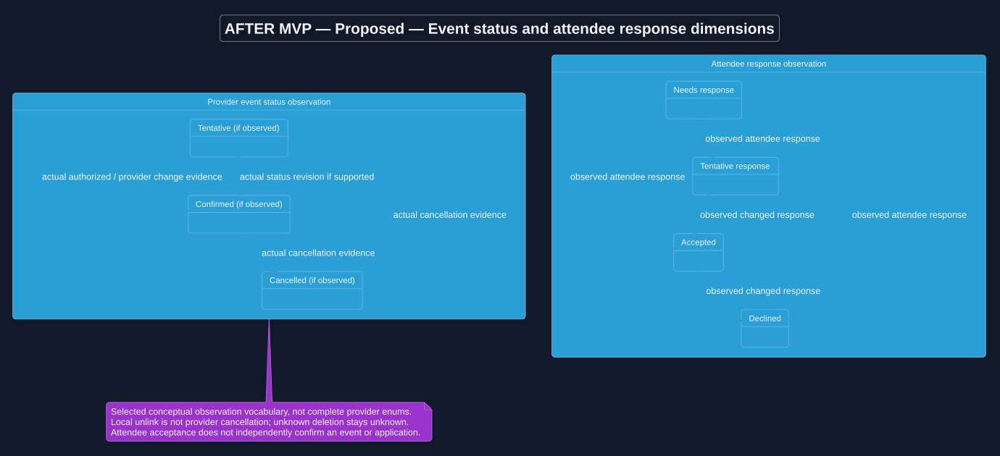

Orthogonal subjects shown separately. Actual supported states/transitions and field authority must be mapped from current provider evidence; no automatic authoritative transition from local notes or associations.

##### 8.12 Conditional scheduling and conflict detection

[After MVP — Conditional scheduling and conflict detection](Diagrams/Detailed/comm-scheduling.svg)

[Editable PlantUML](Diagrams/Detailed/comm-scheduling.puml) · 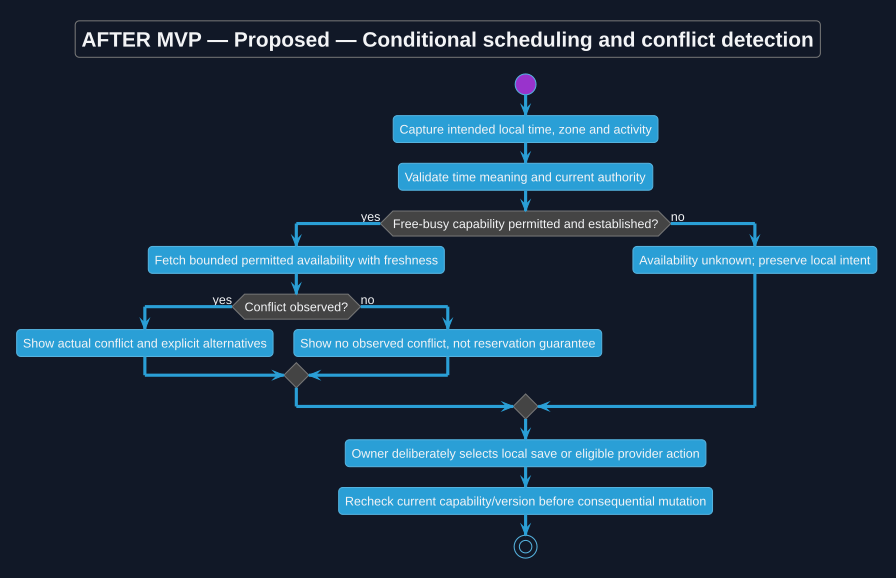

Conflict detection/free-busy is conditional, not an established requirement or adapter feature. Lookup results are time-bounded observations and cannot reserve a slot; avoid silently moving meetings or inviting attendees.

##### 8.13 Bounded recurrence expansion and exception identity

[After MVP — Bounded recurrence expansion and exception identity](Diagrams/Detailed/comm-recurrence.svg)

[Editable PlantUML](Diagrams/Detailed/comm-recurrence.puml) · 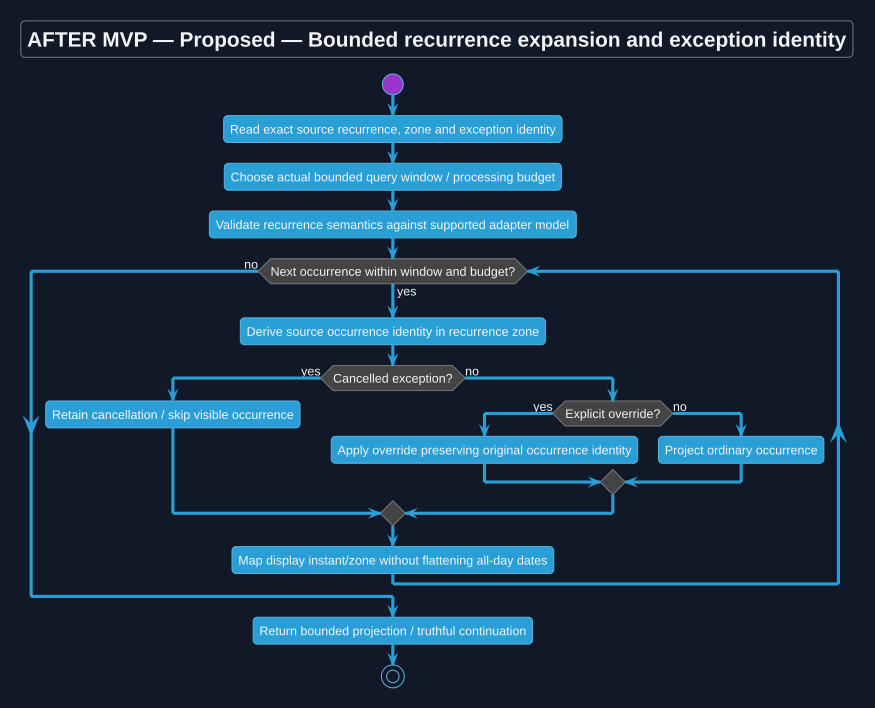

Proposed projection algorithm, not an adopted recurrence library or new provider behavior. Do not infinitely expand an unbounded rule, erase original occurrence identity or convert a series wall-clock rule into a fixed UTC offset. Exact DST/exception semantics need actual source/provider evaluation.

##### 8.14 Logical work flow and channel eligibility

[After MVP — Logical work flow and channel eligibility](Diagrams/Detailed/comm-notification-flow.svg)

[Editable PlantUML](Diagrams/Detailed/comm-notification-flow.puml) · 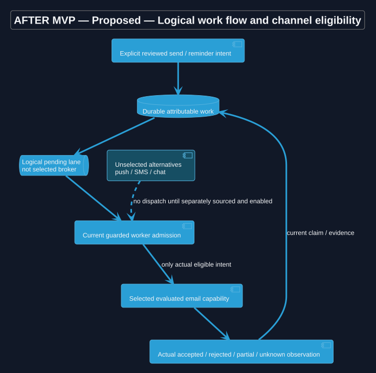

Queues denote logical durable work, not a messaging product. Retry requires operation-specific repetition evidence and a selected budget; unknown effects reconcile first. No automatic fallback from email to push/SMS/chat is selected.

##### 8.15 Selected scope versus protocol alternatives

[After MVP — Selected scope versus protocol alternatives](Diagrams/Detailed/comm-integration-options.svg)

[Editable PlantUML](Diagrams/Detailed/comm-integration-options.puml) · 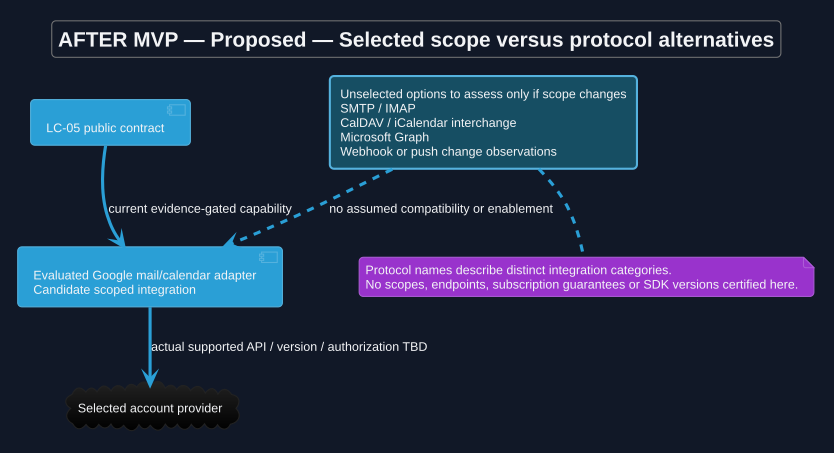

Requested integration vocabulary is inventoried as unselected alternatives. This document does not assert that Google uses CalDAV/SMTP for the proposed design or that Microsoft access exists. Current official capability/security/quotas must be verified at selection/configuration time.

##### 8.16 Conditional free-busy lookup

[After MVP — Conditional free-busy lookup](Diagrams/Detailed/comm-free-busy.svg)

[Editable PlantUML](Diagrams/Detailed/comm-free-busy.puml) · 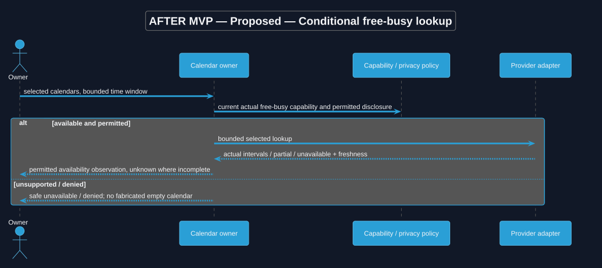

No free-busy API or scope is certified. Disclosure of detailed titles/attendees is not justified by availability access. “No observed conflict” under partial results must not be represented as guaranteed free.

##### 8.17 Conditional calendar reconciliation and conflict resolution

**After MVP.** Shared operating and recovery controls still apply where relevant.

[After MVP — Conditional calendar reconciliation and conflict resolution](Diagrams/Detailed/comm-sync.svg)

[Editable PlantUML](Diagrams/Detailed/comm-sync.puml) · 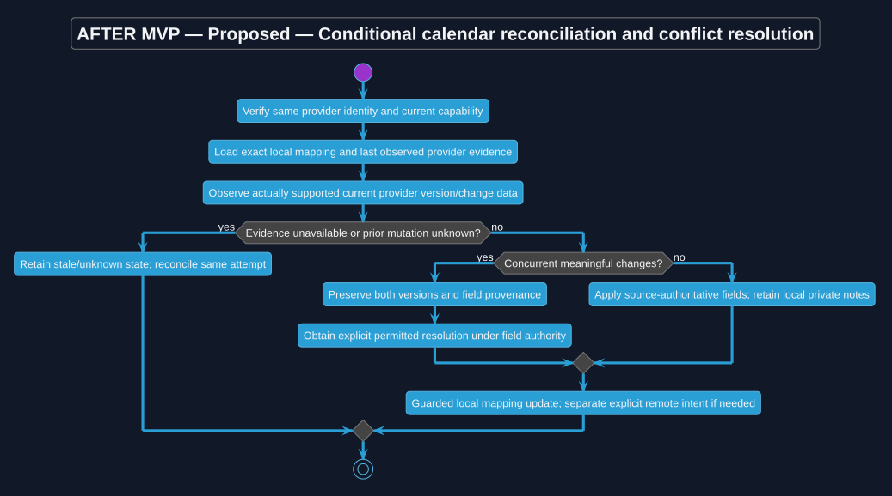

No universal last-write-wins, full-account mirror or sync-token mechanism is adopted. Source field authority remains Q-D17 proposed; actual provider version/change facilities require evaluation. Reconnect cannot automatically create duplicate events or replay sends.

##### 8.18 Optional trusted runtime placement

[Editable PlantUML](../../02-Requirements-Engineering/Diagrams/Use-Cases-Mail-And-Calendar.puml) · 

Optional candidate mapping, not configured hosts/services or verified delivery. No dedicated notification server, SMS gateway or chat service is selected. Secrets remain restricted and ordinary logs exclude tokens/content.

##### 8.19 Timezone and daylight-saving semantics

| Case | Proposed representation / handling | Required verification / unresolved detail |
| --- | --- | --- |
| Timed one-off activity | Preserve unambiguous instant and source/display timezone, not only display string | Round-trip source intent and provider representation; exact schema pending |
| Ambiguous local time at clock rollback | Require explicit supported disambiguation; do not guess silently | Selected timezone library/provider policy and actual source behavior |
| Nonexistent local time at clock advance | Reject or obtain explicit supported adjustment under reviewed policy | No arbitrary automatic hour shift allocated |
| All-day event | Preserve date range and source-proposed exclusive end; do not convert to arbitrary UTC midnight | Date-only round-trip and display across zones |
| Recurring event | Preserve recurrence zone, rule and original occurrence identity | DST transition, exception and override cases under actual supported semantics |
| Reminder due / changed event | Derive intended due observation from exact current subject version and time meaning | Duplicate trigger, delayed worker, cancelled/changed event and current authority |

##### 8.20 Interface catalog

| API / contract | Protocol / exposure | Consumer / boundary | Current selection status |
| --- | --- | --- | --- |
| LC-05 connect/read/draft/review/send/reconcile | Proposed public in-process owner contracts; transport routes TBD | Authorized UI / eligible worker | Signatures and actual adapter mapping pending |
| LC-05 local activity / mapping / reminder | Proposed owner commands/queries | Authorized local flows and actual selected scheduler | Local save separate from remote mutation and delivery |
| Selected Google adapter | Actual API/version/auth protocol to evaluate | LC-05 only under current selected-account capability | OAuth/scopes/quotas/evidence gates pending |
| Files exact protected attachment contract | Public owner reference protocol | Compose/review/send consumers | Usability, pinning and lifetime protocol requires joint refinement |
| Identity current context | Actual selected authority mechanism | LC-05 resource-operation admission | No whole-mailbox access inherited by association |
| SMTP/IMAP, CalDAV, iCalendar, Graph, webhooks | Distinct unselected integration categories | No allocated consumer or live endpoint | Evaluate only if actual source need and capability justify |

##### 8.21 Notification channels and delivery policy

No numerical retry, fallback, rate, deadline or retention policy is adopted by this table.

| Channel / path | Status | Retry / uncertainty policy | Fallback | Rate / admission |
| --- | --- | --- | --- | --- |
| Explicit reviewed provider email | Source capability with actual setup still gated | Same-attempt reconciliation after uncertain effect; repeat only under actual contract | No silent other account/recipient/channel | Actual provider limits and one operation budget to evaluate |
| Reminder delivery | Source capability; actual channel/facility selection pending | Due intent, subject version and stable attempt; accepted is not delivered | Truthful unavailable/pending; no fabricated notified state | Actual scheduler/channel budget pending |
| In-product status projection | Current truthful operation/reminder state, not guaranteed push notification | Read actual recorded observation under current access | No conversion of unknown to success | Bounded permitted query policy to define |
| Push / SMS / chat | Unselected alternatives | No retry implementation or permission allocated | No automatic cross-channel fallback | No gateway/service/cost selected |

##### 8.22 Data ownership and CRUD

`Owner C/R/U/D*` means owner-controlled lifecycle under actual policy, not unconstrained deletion or a SQL grant. Consumers request public operations/projections; they do not CRUD another owner's tables. Provider-side mutation requires separate exact current capability and intent.

| Data / resource | LC-05 | Other local owner / consumer | Provider boundary |
| --- | --- | --- | --- |
| Local compose / reviewed intent / attempts | Owner C/R/U/D*; retained evidence rules apply | Applications/Work get only explicit permitted associations | Provider copy/effect is separately observed |
| Message/thread projection | Owner-controlled permitted retained projection | No blanket mailbox access | Actual provider state authoritative where specified |
| Local activity / private notes | Owner C/R/U/D* | Explicit permitted association only | Local save does not publish private notes |
| Event mapping / sync observation | Owner-controlled mapping and conflict state | No direct foreign mutation | Selected event/calendar identity and field authority respected |
| Actual submission manifest / progress | No direct mutation | Applications owns C/R/U/D* | Email/event evidence never auto-creates submitted status |
| Artifact bytes / reference ledger | Public Files requests and own consumer protection | Files owns physical state/lifecycle | Provider attachment copy is separate effect |
| Credentials / key material | Restricted connection/secret handling | Identity/Operations responsibilities as actually designed | Actual revocation/consent is not assumed from local disconnect |

##### 8.23 Privacy and permission matrix

| Subject | Visibility / access | Sharing / delegation limit | Enforcement evidence |
| --- | --- | --- | --- |
| Mailbox message/thread | Current selected owner and actual scoped capability | Application association gives no whole-mailbox disclosure | Wrong-owner IDs, current access and sanitized projection checks |
| To/Cc/Bcc and body | Exact reviewed private send intent | No recipient expansion, reply-all inference or raw payload logging | Changed recipients/content invalidate reviewed intent as sourced |
| Local private notes | Local permitted access only | Do not silently publish as provider description | Field-authority and serialization checks |
| Calendar/event | Actual selected calendar and product resource scope | Technical account scope does not imply product-wide sharing | Current calendar authority and same-account mapping checks |
| Attendee/free-busy | Conditional supported projection with freshness | Availability does not authorize titles, private notes or delegation | Exact consent/capability and safe unknown/partial handling |
| Delegated/admin access | Only exact accepted source policy and actual provider rights | No universal admin bypass or implied delegation; unresolved source conflict stays visible | Criterion-level policy reconciliation before implementation |
| Untrusted mail/attachments | Sanitized display and protected byte access | No automatic tracking-resource load or executable content trust | Actual content-handling and reference checks |

##### 8.24 Failure and reconciliation table

| Failure / trigger | Required behavior | Recovery / protected state |
| --- | --- | --- |
| Send rejected with actual evidence | Record exact rejection; distinguish from uncertainty | Repeat only if actual repetition contract permits and current intent still eligible |
| Send/event-create response lost | Retain same attempt unknown/partial effect | Actual supported reconciliation; no blind resend/recreate on reconnect |
| Duplicate invite / reminder trigger | Resolve bound identity and current subject version | Do not dispatch twice merely due to duplicate local delivery; provider evidence still needed |
| Local/provider sync conflict | Preserve identified versions and field authority | Explicit permitted resolution; no whole-record last-write-wins |
| Disconnected / revoked account | Stop new dependent work; mark retained copies stale as sourced | Reconnect verifies same identity/capability; no replay of old effects |
| Expired worker claim | Fence stale local writes with actual guard | Local fence cannot stop remote effect; reconcile before repetition |
| DST ambiguity / recurrence exception mismatch | Preserve intent and source identity; show explicit unresolved/invalid state | Actual supported disambiguation and bounded projection; no guessed occurrence |
| Missing delivery infrastructure / attachment | Truthful unavailable/pending; no success or silent substitute | Establish actual capability/usable reference before affected work |

##### 8.25 Quality / NFR scenarios

| Attribute | Scenario / required observation | Target / status |
| --- | --- | --- |
| Delivery latency | Separate local admission, queue age, provider acceptance and any supported delivery observation | Numerical target unselected; actual supported timestamps/evidence needed |
| Availability | Degrade only affected capability; no unsafe account/channel fallback | No accepted availability target or HA facility established |
| Consistency | Same-intent duplicate, stale compose, local/provider conflict and restored pending work | Actual persistence/claim/provider evidence required |
| Privacy/security | Current account isolation, protected attachments, sanitized content and restricted secrets | Exact policy/access mechanisms and controlled verification pending |
| Time correctness | Timed/all-day/DST/recurrence exceptions round-trip as intended | Library/provider compatibility and source-policy disposition pending |
| Retention/recovery | Distinguish local projection deletion, provider deletion, attempt evidence and recoverable keys | No retention duration, backup readiness or RPO/RTO adopted |
| Capacity | Combined send/sync/reminder work remains bounded within total project resources | Workload, provider quotas, scheduler/worker and resource budgets to evaluate |

All views and tables are documentation proposals, not actual provider capability assessment, exact criterion closure or live operations. No account consent, send, event/invite mutation, reminder dispatch, sync, deployment or restore is performed. Keep Q-D15–17 status, current official-provider assessment at configuration time and actual review evidence visible.

Resumefolio — Files and Operations Component Design

### Resumefolio — Files and Operations Component Design

**Responsibility:** admit and identify usable private artifacts, account for concurrent growth, preserve protected references, replace/reclaim safely and assess recoverable operating state. Metadata creation, stored bytes, permitted retrieval and actual reclaimed capacity are different facts.

**Status:** proposed LC-09 component design. No storage backend, quota number, backup destination, recovery target or accepted physical schema is selected here. Farhad retains policy/operations decision authority within source permissions and actual resource limits.

[Authority](#design-record-03-component-and-module-design-components-files-and-operations-md--heading-1-source-authority-and-ownership) · [Contracts](#design-record-03-component-and-module-design-components-files-and-operations-md--heading-2-public-operations) · [Model](#design-record-03-component-and-module-design-components-files-and-operations-md--heading-3-owned-data-and-state-dimensions) · [Admission](#design-record-03-component-and-module-design-components-files-and-operations-md--heading-4-admission-and-accounting-protocol) · [References](#design-record-03-component-and-module-design-components-files-and-operations-md--heading-5-protected-reference-replacement-and-reclamation) · [Recovery](#design-record-03-component-and-module-design-components-files-and-operations-md--heading-6-operating-recovery-and-failure-scenarios) · [Review](#design-record-03-component-and-module-design-components-files-and-operations-md--heading-7-verification-and-open-decisions) · [Storage package](#design-record-03-component-and-module-design-components-files-and-operations-md--heading-8-files-storage-and-operations-view-package)

Current MVP scope and selected mechanisms: [Baseline](https://github.com/Farhad-V/Web-Resumefolio/blob/1f2acaa351ac306cb57cbe4fe9742e8bd90720d9/docs/MVP/baseline/README.md). Deferred provider, advanced collaboration and workflow-execution designs are not MVP prerequisites.

#### 1. Source authority and ownership

Use [AFO-D01–AFO-D12](../../02-Requirements-Engineering/01-Software-Requirements-Specification/03-Requirements-Specification/02-Administration-Files-And-Operational-Behavior.md#requirements-specification-administration-files-and-operational-behavior), [Q-D24 proposed accounting/limits](../../02-Requirements-Engineering/01-Software-Requirements-Specification/03-Requirements-Specification/02-Administration-Files-And-Operational-Behavior.md#requirements-specification-administration-files-and-operational-behavior--id-resolution-q-d24), [quality/recovery requirements](../../02-Requirements-Engineering/01-Software-Requirements-Specification/03-Requirements-Specification/14-Quality-Security-And-Recovery-Requirements.md#requirements-specification-quality-security-and-recovery-requirements), [source decisions](../../02-Requirements-Engineering/01-Software-Requirements-Specification/07-Change-And-Baseline/03-Requirements-Questions-And-Decisions.md#change-and-baseline-open-questions-and-decisions) and [analysis data/contracts](../../03-System-Analysis/03-Processes-Scenarios-And-Business-Rules.md#analysis-business-rules-and-operation-contracts--10-domain-constraints-and-operation-contracts).

Q-D24 contains numeric starting proposals, not measured safe allocations or accepted defaults. Preserve their source status rather than implementing those values automatically. Actual workload, temporary/Git/log growth, policy ownership and operating capacity still require evaluation. Backups were reported unconfigured.

**Own:** effective file-policy versions, admission/reservation identities and accounting, private artifact metadata/usability/provenance, attributable protected-reference records, replacement/reclamation attempts and recovery assessments.

**Do not own:** Presentation publication intent, Applications actual-history meaning, Git object/ref semantics, provider truth or an unconstrained administrator bypass. Native repository storage and operating backup facilities require evaluated adapters/coordination; a file policy UI cannot safely allocate unsupported capacity.

**Consumers:** Presentation/Sharing request eligible representations; Applications registers actual-material protection; Communication/Workflow register permitted attachments/outputs; Git supplies native storage/temporary-use evidence; operating procedures consume bounded health/recovery records. All calls use current resource/action authority and permitted projections, not raw public paths or foreign table writes.

#### 2. Public operations

Proposed signatures name responsibilities rather than final language/transport types. Mutations carry current actor/resource context, stable command identity and expected versions where needed. Outcomes retain confirmed/pending/denied/invalid/conflict/unavailable/partial/unknown meaning and actual evidence.

##### UpdateEffectivePolicy(context, expectedPolicyVersion, proposedPolicy)

Authorize the actual policy owner, validate types/units/categories and the evaluated infrastructure envelope, then record an attributable effective version. Changing limits must not silently delete existing data, fabricate headroom or bypass protected-history rules. Evaluate outstanding reservations consistently when policy changes; exact effective-time/over-limit behavior follows the reviewed source decision.

##### ReserveGrowth(context, quotaContext, category, intendedSize, policyVersion, commandId)

Atomically evaluate applicable per-file, account/category/global and operating-headroom guards under one consistent policy/usage view. Reserve identified capacity before making growth available. Multiple concurrent requests cannot spend the same remaining allocation. Unknown final-size work needs bounded staged admission rather than an unlimited reservation.

##### FinalizeArtifact(context, reservationId, attemptId, actualArtifactEvidence)

Confirm canonical storage identity, actual size/type/processing result and usable state under source policy. Reconcile actual versus reserved growth and retain attributable accounting. A completed upload transport or metadata row alone cannot certify usable content. Failed validation/processing keeps the candidate unavailable and schedules bounded cleanup/reconciliation.

##### ResolveUsableArtifact(context, artifactId, intendedRepresentation)

Return a permitted identity/projection or controlled delivery capability only after current authority, protected-reference context, actual availability and requested language/revision/type are checked. Sharing separately owns link eligibility; Files cannot grant access just because bytes exist. Unavailable representations never become private fallback content.

##### ProtectReference / FinalizeReference / ReleaseReference

Register attributable consumer/resource/version purpose against exact artifact identity. Protection must exclude concurrent physical deletion before another owner commits a reference. Finalization/release use stable reference/operation identity and actual consumer evidence, not an unverified notification. Uncertain reservations remain protected until reconciliation can establish a safe outcome; age alone cannot prove an abandoned reference.

##### ReplaceReference(context, expectedReferenceVersion, newArtifactId)

Confirm new artifact usability/authority and protection before changing the owning association through its contract. Preserve the prior usable association until the intended switch is confirmed. Release an old reference only if its exact owner/version is no longer required; other publication/submission references continue protecting the artifact.

##### CollectUnreferencedBytes(context, candidateId, expectedArtifactVersion)

Acquire an exclusive reclamation claim compatible with the reference-registration protocol. Recheck all relevant protected references/reservations and lifecycle policy before deletion. Record actual storage deletion outcome and only then reconcile reclaimed capacity. A logical row delete, queued cleanup or request acknowledgment is not reclaimed-byte evidence.

##### AssessRecovery(context, sourceIdentity, isolatedTarget, coveredScope)

Evaluate an identified consistent recovery set, actual storage/keys/configuration coverage, integrity, current authority and external-effect reconciliation. Distinguish prerequisites missing, incomplete/failed assessment and demonstrated usable results. No restore/purchase/production switch is authorized simply by this contract.

#### 3. Owned data and state dimensions

[Proposed artifact reference and accounting identities](Diagrams/Detailed/files-owned-model.svg)

[Editable PlantUML](Diagrams/Detailed/files-owned-model.puml) · 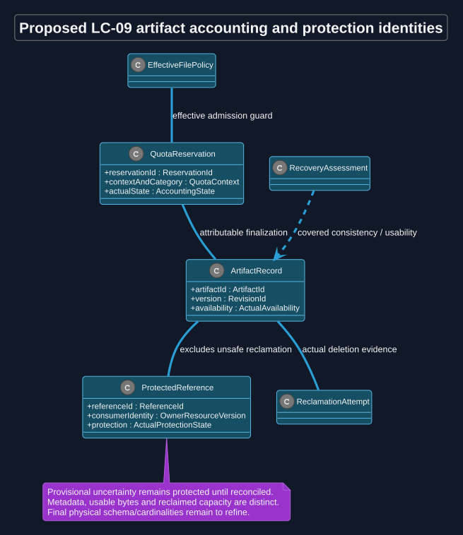

**EffectiveFilePolicy:** versioned scope/category, units and actual proposed/accepted limits/envelope rationale. **QuotaLedger/Reservation:** responsible context, category, attributable intended growth, outstanding/finalized/released/reconciliation status and actual accounting evidence. Physical deduplication does not erase semantic charging for responsible contexts.

**ArtifactRecord:** stable private storage identity, owner/provenance, content classification, actual byte size, expected/observed validation, usable/unavailable state and version. Canonical paths are internal implementation details. Language/rendition/source revision remain explicit when relevant.

**ProtectedReference:** exact artifact and consumer/resource/version/purpose, provisional/finalized/released/reconciliation state and command identity. **StorageAttempt/ReclamationAttempt:** actual external write/delete observations and claim/version context. **RecoveryAssessment:** identified source/target/scope, checks, measured facts, limitations and actual disposition.

Keep artifact usability, reference protection, lifecycle/trash eligibility and physical presence/accounting as separate dimensions. A retired source may still have protected published/submitted references; a failed cleanup can leave bytes even after logical unlink; a recovered metadata row may reference missing bytes.

Logical persistence needs scoped unique command/reservation/reference identities, version/claim checks, authoritative accounting updates and indexes for owner/artifact/reference/reconciliation lookup. Concrete engine/types/collation/indexes, physical storage layout and consistent DB/storage write protocol remain [data design](04-Database-Design.md#design-record-04-data-design-data-design-md) refinement. The class diagram does not adopt final source cardinalities or schema.

#### 4. Admission and accounting protocol

[Proposed file admission and finalization](Diagrams/Detailed/files-admission-sequence.svg)

[Editable PlantUML](Diagrams/Detailed/files-admission-sequence.puml) · 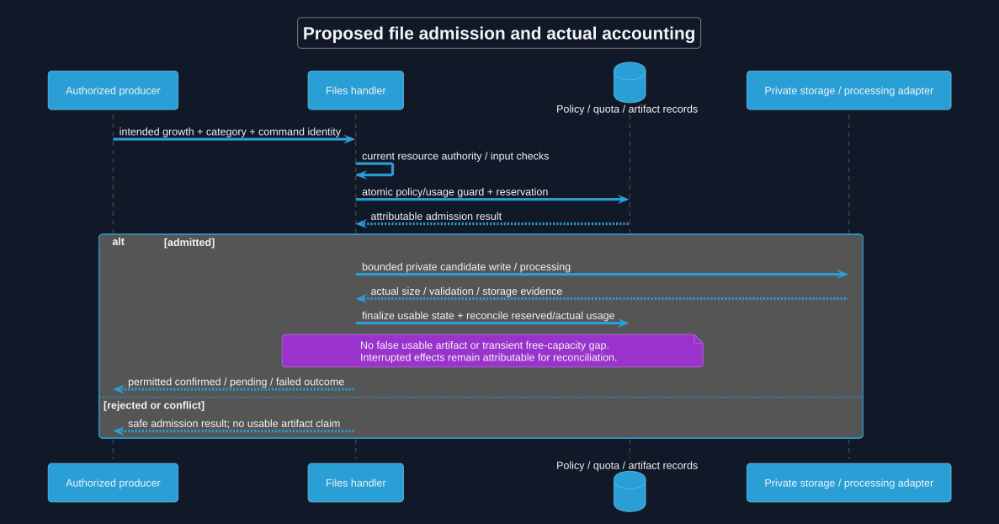

1. Validate explicit upload/generated-output intent, resource authority, declared category/type and applicable policy version. Check real content/size through the evaluated processing path, not the filename alone.
2. Under the chosen local accounting guard, calculate applicable committed usage plus outstanding reservations and reserve attributable growth only if all relevant limits/headroom conditions permit. Record command/result identity atomically. Avoid double charging same-intent retries or undercounting shared artifacts across quota contexts.
3. Write/process into a private bounded candidate area outside long-held database locks. Restrict content/path handling; do not expose candidate bytes through a public static route. Record actual attempt identity and known byte/processing outcomes.
4. Reconcile actual size and applicable policy before usability/finalization. If actual work exceeds admitted bounds, apply the reviewed rejection/extension protocol rather than consuming unreserved capacity silently. Confirm the intended stored artifact and mark usable only on actual evidence.
5. Convert reserved to confirmed usage without a transient free-capacity window; release only genuinely unused reservation. Persist required consumer/reference work durably. Return attributable confirmed/pending/rejected/unknown state without false completion.
6. Reconcile interrupted writes, failed processing and abandoned work using evidence/identity. Physical leftover bytes and outstanding reservations count in the actual operating envelope until safely resolved. Never purge unrelated user/history/database content to recover headroom automatically.

Generated PDFs, uploads, workflow artifacts, native Git packs and diagnostics have different producers and temporary-growth behavior. They need explicit category/adapter contracts rather than a misleading one-size-fits-all byte counter. Git-native accounting/cleanup remains coordinated with the Git owner, not a raw file deletion routine.

#### 5. Protected reference replacement and reclamation

[Reference protection and physical reclamation](Diagrams/Detailed/files-reclamation-route.svg)

[Editable PlantUML](Diagrams/Detailed/files-reclamation-route.puml) · 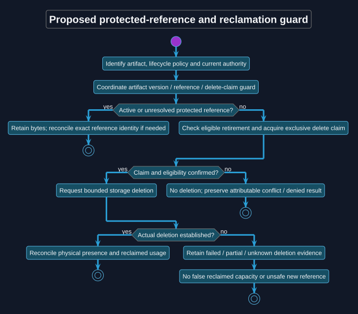

The joint Applications/Presentation/Files protocol must serialize reference admission against physical deletion. One proposed approach is an artifact-version/state guard plus attributable provisional protection: reference registration refuses an artifact already exclusively claimed for deletion; cleanup cannot claim an artifact with unresolved or active protection. Finalize consumer identity after its commit through a durable handshake or equivalent evaluated local transaction design.

If consumer commit succeeds but acknowledgment is lost, retain protection and reconcile the same identity. If the consumer definitively did not commit, release only the corresponding provisional protection. Uncertainty must not turn into an automatic expiry that deletes actual history. This design obligation needs concrete schema/locking tests; naming a handshake does not prove it implemented.

Replacement protects/validates the new artifact first, switches the intended owner/version association, then reconciles release of the old association. Any other active publication, submission, attachment or allowed operating reference still protects the old bytes. A failed switch preserves the old usable representation; a lost result triggers reference reconciliation rather than blind swap/release.

Reclamation requires source lifecycle eligibility, current permission, no remaining active/provisional protection and an exclusive delete claim. Record actual deletion evidence, then update physical presence/usage; reconcile partial/unknown storage results without granting a new reference to an artifact whose presence is uncertain. Deduplicated storage requires reference checks across every responsible owner, not only one user's visible list.

#### 6. Operating recovery and failure scenarios

**Quota race/policy change:** simultaneous admissions share a serialized effective view. Changing a limit evaluates existing usage/reservations without silent deletion or unsupported headroom. Preserve allowed read/delete/recovery behavior under actual source rules.

**Interrupted candidate write:** distinguish no confirmed usable artifact from actual leftover bytes. Keep private unavailable state and reconcile reservation/cleanup. Metadata rollback does not delete external storage bytes automatically.

**Replacement or capture uncertainty:** protect actual prior/new references until attributable owner results establish safe release. Source retirement must not delete actual application history or published evidence merely because a live draft changed.

**Cleanup failure/storage full:** record known residual bytes or unknown deletion outcome; no false reclaimed capacity. Apply bounded admission/degradation and operator feedback. Do not claim that free-space observations alone guarantee safe concurrent processing.

**Sensitive content and paths:** validate canonical permitted identifiers, restrict active content display, protect download/delivery paths and redact diagnostics. Secret/key/workspace cleanup has actual evidence/limits; a method return or container name is not proof of complete erasure/isolation.

**Recovery:** coverage includes relational state, private artifacts, native repositories where required, publication/submission manifests, operating configuration and usable keys. Restore into a suitable isolated environment, verify references/usability/current authority and reconcile external operations before promotion. Backups are not configured by this document; no RPO/RTO or destination is invented.

Follow [operations/recovery](../01-High-Level-Design/14-Appendices.md#design-record-06-design-quality-and-security-analysis-03-operations-backup-recovery-and-resilience-md), [deployment placement](../01-High-Level-Design/14-Appendices.md#design-record-01-software-architecture-04-deployment-topology-nodes-and-networks-md) and [runtime reconciliation](../01-High-Level-Design/14-Appendices.md#design-record-01-software-architecture-03-process-view-concurrency-and-runtime-behavior-md) as shared procedure owners. Files coordinates actual record/artifact/recovery evidence rather than duplicating all operating policy.

#### 7. Verification and open decisions

| Source | Primary design responsibility |
|---|---|
| AFO-D01–D04 | Versioned owner policy, evaluated limits, per-file and concurrent aggregate admission |
| AFO-D05–D07 | Content validation, resource isolation and truthful usable/failed/interrupted state |
| AFO-D08–D11 | Reference-safe replacement, operating evidence and actual bounded cleanup/reclamation |
| AFO-D12 / QSR | Version-specific operating readiness and attributable recovery/quality evidence |

This maps source intent, not completion of every acceptance criterion. Numeric Q-D24 proposals and lifecycle/source dispositions retain their actual status.

##### Planned checks

- Duplicate/simultaneous reservations at account/global boundaries and policy changes with active work.
- Invalid content, declared/actual size mismatch, generated/temporary growth and interrupted write/finalization.
- Direct private path/foreign artifact access, stale link/grant context and missing selected rendition.
- Capture/publication reference registration racing cleanup; lost consumer acknowledgments and stale delete claims.
- Replacement failure, retained older publication/submission, cross-owner deduplicated references and unknown deletion result.
- Storage pressure, bounded diagnostics/cleanup and native Git temporary/reclamation coordination.
- Isolated backup/restore with missing keys/bytes/references, current authority and no replay of remote effects.

Use actual persistence/accounting/concurrency tests and suitable storage/recovery observation alongside deterministic policy checks. No upload, deletion, backup, restore, stress test or product mutation is executed here.

##### Remaining prescriptions

Review Q-D24 numeric limits/charging/envelope and supported formats; select/evaluate storage/backend and actual resource facilities; specify concrete quota/reference/deletion guard/transaction schemas and signatures; reconcile native Git/output/log accounting; establish independent backup/key recovery; complete exact criterion mapping and actual candidate review. The protected-reference handshake is a decisive joint Applications/Files/data-model design task, not a completed mechanism.

Use [component templates](02-Module-Breakdown.md#design-record-03-component-and-module-design-component-and-module-design-md), [interface contracts](05-API-Specification.md#design-record-05-interface-and-api-design-interface-and-api-design-md), [security](../01-High-Level-Design/14-Appendices.md#design-record-06-design-quality-and-security-analysis-02-security-threat-modeling-and-trust-boundaries-md) and [review/handoff](../01-High-Level-Design/14-Appendices.md#design-record-06-design-quality-and-security-analysis-05-design-review-traceability-and-handoff-md). These component/data/dynamic views follow the FAU refinement approach but allocate no accepted physical schema, arbitrary cleanup permission or phase approval.

[Component catalog](02-Module-Breakdown.md#design-record-03-component-and-module-design-component-and-module-design-md) · [Component diagram catalog](12-Appendices.md#design-record-03-component-and-module-design-components-diagrams-diagram-catalog-md)

#### 8. Files, storage and operations view package

These **proposed LC-09 views** refine private artifact/accounting/reference responsibilities. General folders, resumable chunks, malware scanner, thumbnails/indexing, object-storage protocols, hot/warm/cold tiers, replication, CDN and sync clients are conditional options, not newly accepted features or configured facilities. Sharing, consumer version/history, provider effects and native Git retain their own owners. Q-D24 numbers and recovery targets remain unaccepted proposals/choices.

##### 8.1 Files provided and required interfaces

[Files provided and required interfaces](Diagrams/Detailed/files-interfaces.svg)

[Editable PlantUML](Diagrams/Detailed/files-interfaces.puml) · 

Logical provided circle and required sockets; exact signatures remain proposals. Files cannot grant sharing access merely because bytes exist, nor claim a consumer committed merely from a queued notification.

##### 8.2 C4 Level 1: artifact-related system context

[C4 Level 1: artifact-related system context](Diagrams/Detailed/files-context.svg)

[Editable PlantUML](Diagrams/Detailed/files-context.puml) · 

C4-style whole-system context. Internal Files/Git/Applications modules belong below Level 1. Local storage may remain inside the system boundary; external facility placement is conditional, not a selected S3/backup architecture.

##### 8.3 C4 Level 2: modular runtime and storage

[C4 Level 2: modular runtime and storage](Diagrams/Detailed/files-context.svg)

[Editable PlantUML](Diagrams/Detailed/files-context.puml) · 

C4-style application/runtime/store boundaries, not a separately deployed file microservice. Object storage is a possible backend rather than an adopted product. Worker readiness, keys and recovery facilities need actual evidence.

##### 8.4 Artifact operations and separately owned sharing

[Artifact operations and separately owned sharing](Diagrams/Detailed/files-use-cases.svg)

[Editable PlantUML](Diagrams/Detailed/files-use-cases.puml) · 

Use-case summary, not allocated IDs or a new generic folder/version browser. Share creation is owned elsewhere; Files supplies exact usable artifacts and guarded delivery. Restore/purge requires actual scoped authority and policy, not a universal operator role.

##### 8.5 Artifact, reference and operation classes

[Artifact, reference and operation classes](Diagrams/Detailed/files-domain.svg)

[Editable PlantUML](Diagrams/Detailed/files-domain.puml) · 

Selected roles are proposals, not final types/cardinalities. VersionReference belongs to the relevant consumer; ShareLink is not Files-owned. Folder is notation for a conditional future grouping, not an accepted general file-manager feature.

##### 8.6 Logical artifact and ledger relationships

[Logical artifact and ledger relationships](Diagrams/Detailed/files-erd.svg)

[Editable PlantUML](Diagrams/Detailed/files-erd.puml) · 

Selected logical ERD, not a full schema or accepted cardinality allocation. Actual folder/version/permission persistence is not invented; those may be labels, consumer-owned references and current policy contracts. Command uniqueness, quota accounting and reclamation guards still need concrete design.

##### 8.7 Upload with conditional resumable transport

[Upload with conditional resumable transport](Diagrams/Detailed/files-upload.svg)

[Editable PlantUML](Diagrams/Detailed/files-upload.puml) · 

Resumable chunks are an unselected option, not a chosen endpoint/part-size policy. Define ownership, ranges, integrity, expiration and restart semantics before use. Transport completion or metadata row alone does not make an artifact usable; leftover bytes still consume actual space.

##### 8.8 Exact download and current access admission

[Exact download and current access admission](Diagrams/Detailed/files-download.svg)

[Editable PlantUML](Diagrams/Detailed/files-download.puml) · 

The concrete delivery route and revocation/admission ordering remain to select. A controlled delivery capability must not become an indefinitely reusable raw public path. Do not substitute another language, private file or newer live revision.

##### 8.9 Share link creation and access through its owner

[Share link creation and access through its owner](Diagrams/Detailed/files-share.svg)

[Editable PlantUML](Diagrams/Detailed/files-share.puml) · 

Logical collaboration, not an allocated bearer-token format, expiration policy or raw storage URL. Sharing owns link lifecycle; Files owns usability/reference/delivery guards. Link creation does not automatically publish or change submitted evidence.

##### 8.10 Artifact usability, lifecycle and presence dimensions

[Artifact usability, lifecycle and presence dimensions](Diagrams/Detailed/files-artifact-state.svg)

[Editable PlantUML](Diagrams/Detailed/files-artifact-state.puml) · 

Illustrative dimensions, not accepted enums or a new trash period. Physical presence/accounting and reference protection are separate; do not flatten them into a single file status. Actual deletion requires an exclusive guard and storage evidence.

##### 8.11 Operation and job knowledge states

[Operation and job knowledge states](Diagrams/Detailed/files-job-state.svg)

[Editable PlantUML](Diagrams/Detailed/files-job-state.puml) · 

Proposed operation/coordinator knowledge, not a selected queue enum. Queue acknowledgment and worker exit do not prove content usability or byte deletion. A cancellation request is not a confirmed stopped or cleaned job.

##### 8.12 Private candidate processing pipeline

[Private candidate processing pipeline](Diagrams/Detailed/files-pipeline.svg)

[Editable PlantUML](Diagrams/Detailed/files-pipeline.puml) · 

Scanning, thumbnailing and indexing are conditional, not installed features or proof of safety. If a required scanner is unavailable, do not bypass it. Fork/join is a logical view; optional derivative failure must not silently alter original usability/accounting semantics.

##### 8.13 Concurrent reference replacement conflict resolution

[Concurrent reference replacement conflict resolution](Diagrams/Detailed/files-concurrent-edits.svg)

[Editable PlantUML](Diagrams/Detailed/files-concurrent-edits.puml) · 

This is association/version conflict handling, not collaborative binary-file editing or automatic content merge. Unknown switch outcome retains protection until same-command reconciliation; neither age nor conflict alone proves a reference safe to release.

##### 8.14 Storage architecture options and unselected tiers

[Storage architecture options and unselected tiers](Diagrams/Detailed/files-context.svg)

[Editable PlantUML](Diagrams/Detailed/files-context.puml) · 

Options diagram, not a selected tier/replication/CDN topology. Replication is not by itself a usable independent backup. Hot/warm/cold costs, keys, protected references, privacy and retrieval behavior require an explicit decision and evidence.

##### 8.15 Logical hierarchy versus canonical storage identity

[Logical hierarchy versus canonical storage identity](Diagrams/Detailed/files-paths.svg)

[Editable PlantUML](Diagrams/Detailed/files-paths.puml) · 

Conditional folder notation, not an accepted file-manager scope. Stable identity must survive display labels where selected. Canonicalization, traversal protection, copy charging and permission propagation need actual contracts; physical paths stay internal.

##### 8.16 Version, trash, restore and physical reclaim flow

[Version, trash, restore and physical reclaim flow](Diagrams/Detailed/files-trash.svg)

[Editable PlantUML](Diagrams/Detailed/files-trash.puml) · 

No version count, retention duration or 30-day default allocated. Trash does not prove reclaimed bytes. Restoring metadata cannot create missing bytes or reactivate old permissions/links; a restore of a whole backup is a separate controlled procedure.

##### 8.17 Logical job lanes, reconciliation and intervention

[Logical job lanes, reconciliation and intervention](Diagrams/Detailed/files-queues.svg)

[Editable PlantUML](Diagrams/Detailed/files-queues.puml) · 

Logical lanes are not a selected queue product, worker count or automatic dead-letter retry policy. Retry only when the actual effect contract supports it; local lease expiry cannot prove a storage write/delete never occurred. Bounded resources and cleanup remain separately observed.

##### 8.18 Storage and sync integration options

[Storage and sync integration options](Diagrams/Detailed/files-context.svg)

[Editable PlantUML](Diagrams/Detailed/files-context.puml) · 

Requested integration names are alternatives, not supported features. Do not assume an “S3-compatible” label guarantees the needed atomicity/retention semantics or that external sync preserves product ownership/reference constraints.

##### 8.19 Optional deployment mapping for Files capabilities

[Optional deployment mapping for Files capabilities](Diagrams/Detailed/drivers-uml-deployment.svg)

[Editable PlantUML](Diagrams/Detailed/drivers-uml-deployment.puml) · 

Proposed placement, not installed infrastructure or proof that existing guest allocation is sufficient. The earlier backup absence remains explicit. No object-store account, CDN, extra host or replication service is purchased or configured.

##### 8.20 Interface catalog

| API / owner contract | Protocol / exposure | Consumer | Status / limit |
| --- | --- | --- | --- |
| ReserveGrowth / FinalizeArtifact | Proposed in-process command contract; transport TBD | Upload / PDF / output producer | Actual accounting guard and usable evidence needed |
| ResolveUsableArtifact | Guarded owner projection / delivery capability | Presentation / Sharing / Communication | Exact identity, current authority and actual presence; no raw private URL |
| Protect / Finalize / ReleaseReference | Evaluated public consumer/reference protocol | Applications / Presentation / other actual consumers | Joint commit/finalization/deletion ordering still to specify |
| ReplaceReference | Owner-coordinated expected-version operation | Exact owning association | Preserve old usable reference until switch established |
| CollectUnreferencedBytes | Restricted explicit reclamation contract | Eligible bounded operations worker | Exclusive claim, actual deletion evidence and accounting |
| UpdateEffectivePolicy / AssessRecovery | Scoped policy / isolated-assessment command | Actual permitted policy owner/operator | No automatic spending, restore, promotion or limit acceptance |
| S3-compatible / NFS / SMB / WebDAV / sync | Unselected alternatives; no endpoint allocated | No configured adapter/client | Assess exact supported semantics before adoption |

##### 8.21 Permission and access-control matrix

Roles describe **scoped responsibilities**, not implemented RBAC grants. Actual administrative source-policy conflicts remain unresolved; there is no blanket private-content operator/admin bypass.

| Role / current context | Upload / finalize | Resolve private bytes | Share | Replace / protect | Reclaim / restore |
| --- | --- | --- | --- | --- | --- |
| Authorized resource owner | Only admitted own intended resource | Current exact permitted identity | Through Sharing-owned controls only | Exact owned association and policy | Source-defined lifecycle only; not arbitrary physical purge |
| Permitted shared viewer | No implicit write | Only currently eligible exact representation | No implicit re-share/admin right | None by viewing | None |
| Authorized consuming component | Public contract under actual operation context | Permitted projection only | No link authority inherited | Own attributable reference purpose only | Request release; cannot delete Files ledger/bytes directly |
| Eligible job worker | Current bounded claim/capability only | Only operation-required scope | No implicit privilege | Current claim and consumer evidence | Explicit permitted operation with actual guards; stop distinct from cleanup |
| Scoped operations/policy role | No universal business-content permission | Only actual source-authorized diagnostic/recovery scope | No bypass | Policy and recovery responsibilities only as authorized | Actual safe assessment/reclamation scope and evidence; no assumed production restore |

##### 8.22 Audit and operations event template

This table specifies event categories to evaluate, not installed audit infrastructure or actual event records. Keep authoritative command/accounting/reference evidence coherent; ordinary telemetry cannot replace it. Store bounded permitted identities/categories, never private bytes, tokens or unrestricted paths.

| Event | Actor / provenance | Resource / operation identity | Timestamp meaning | Evidence / privacy requirement |
| --- | --- | --- | --- | --- |
| Policy version changed | Actual authorized policy context | Policy scope/version and bound command | Actual effective/recorded instant | Prior/new attributable rule; no fabricated capacity |
| Growth reserved/finalized/reconciled | User/producer + current claim | Reservation/category/attempt | Actual admission/result observations | Actual size/units and coherent ledger state |
| Artifact usability changed | Validating adapter / owner | Artifact/version + storage attempt | Actual validation observation | Actual outcome category; no file-content dump |
| Protection registered/finalized/released | Consumer owner + exact evidence | Artifact/reference/consumer version | Actual admission/finalization observation | Preserve unknown consumer commit; exact protected purpose |
| Reclamation attempted/observed | Eligible scoped operator/worker | Artifact/delete claim/attempt | Actual delete/result observation | Reclaimed only on actual evidence; unknown remains visible |
| Recovery assessment performed | Actual permitted assessment context | Source/candidate/isolated target/scope | Actual checks start/results | Usable records/bytes/keys checks and limitations; not copy-success alone |

##### 8.23 Quotas, limits and retention

| Policy dimension | Proposed rule / rationale | Value / status | Required mechanism / evidence |
| --- | --- | --- | --- |
| Per-file / account / category / global growth | Evaluate committed usage plus outstanding reservations coherently | Q-D24 starting numbers remain proposals; no defaults adopted | Actual serialized admission and full operating envelope |
| Candidate / temporary / Git / logs / derivatives | Include real concurrent temporary and residual growth | Concrete budgets pending | Producer-specific evidence and bounded work; Git native semantics retained |
| Actual size differs from declared | Reject or extend only through reviewed admitted protocol | No unbounded unknown-size allocation | Actual measured size and no transient free-capacity window |
| Physical deduplication | Preserve independent consumer identity and source-defined charging | Charging policy pending | Cross-owner reference protection and actual byte accounting |
| Trash / archive / version retention | Follow reviewed owner/source policy | No retention duration or version count allocated | Protected submitted/publication evidence and applicable erasure decisions |
| Reservation cleanup | Release only with evidence of safe no-consumer/no-effect state | No age-only expiry for unknown commit | Same-identity reconciliation and compatible exclusive deletion guard |
| Backup expiry / RPO / RTO | Independent usable recovery design | Backups unconfigured in documented inventory; targets unselected | Actual consistent source, keys, isolated restore and current authority |

##### 8.24 Failure handling

| Failure | Truthful response | Recovery / protected frame |
| --- | --- | --- |
| Partial / resumable upload interrupted | Candidate unavailable; actual residual bytes/reservation remain attributable | Same upload/attempt reconciliation; actual supported resume or bounded cleanup |
| Corrupt / invalid content | Do not finalize as usable | Preserve valid prior associations; apply actual validation/cleanup policy |
| Storage unavailable / full | Refuse/degrade affected admission/retrieval; no invented headroom | Reconcile unknown writes/deletes and actual residual usage; no unrelated purge |
| Duplicate same/different intent | Resolve same permitted result / reject identity mismatch | No double charging or history mutation; actual uniqueness/guard required |
| Reference registration races reclaim | Either protection admitted or exclusive deletion claim wins under actual protocol | Never admit a new consumer to uncertain/deleting bytes |
| Consumer commit/finalize acknowledgment lost | Retain provisional protection and uncertainty | Reconcile same consumer/command; age alone not abandonment proof |
| Replacement interrupted | Old association remains until actual switch established | Protect both where unknown; release only evidence-supported no-longer-needed reference |
| Delete response lost | Reclaimed capacity unknown, not credited as success | Observe actual backend state through supported safe mechanism |
| Restore lacks key/bytes/reference | Report incomplete/blocked recovery | No public promotion, old grant reactivation or external replay |

##### 8.25 Data ownership and CRUD boundaries

`Owner C/R/U/D*` denotes controlled lifecycle under actual policy, not raw SQL grants or unconditional deletion. Cross-owner references use public contracts; shared physical database/storage does not merge ownership.

| Data family | Files / Operations | Other owner / consumer | Boundary |
| --- | --- | --- | --- |
| Artifact metadata / actual storage attempts | Owner C/R/U/D* | Permitted exact identity/projection | No raw path or foreign mutation |
| Quota/policy/reservation ledger | Owner-controlled updates under actual authority | Admitted producer requests only | No direct usage counter manipulation |
| Protected reference ledger | Owner-controlled protocol and reclamation coordination | Consumer supplies exact purpose/commit evidence through contracts | Unknown protection cannot be silently expired |
| Publication / selected representation / share link | Public Files support only | Presentation / Sharing own lifecycle | Bytes existing grants no share or publication authority |
| Actual submission event/material manifest | Public Files support only | Applications owns historical meaning/corrections | No cascade from source retirement or current-live changes |
| Native repositories/refs | Coordinated storage/accounting support | Git owner controls Git-native operations | No raw cleanup that bypasses ref/object semantics |
| Recovery source/keys/configuration | Actual scoped assessment and artifact evidence | Operations/security and respective record owners | No assumed blanket content access or restored permanent privilege |

##### 8.26 Non-functional scenarios and targets

| Attribute | Required observation / scenario | Target / acceptance status |
| --- | --- | --- |
| Throughput / latency | Combined upload/download/processing plus Git/worker load; correct admission and exact delivery | No benchmark, concurrency or latency target adopted; workload and resource budgets pending |
| Durability / integrity | Actual usable bytes and consistent protected references through interruption/corruption/recovery | No vendor durability claim or replication guarantee selected |
| Availability | Truthful affected-capability degradation; preserve safe independent operations | No HA/CDN/availability target established |
| Consistency | Concurrent reservations, replacement, reference registration and exclusive deletion | Actual database/backend guard and race evidence required |
| Security / privacy | Current exact byte access; path/content controls; restricted metadata/diagnostics | Actual delivery/revocation ordering and controlled verification needed |
| Recoverability | Consistent records/artifacts/repositories/keys and current authority in isolated restore | No configured backup destination or accepted RPO/RTO; usable evidence pending |
| Operability | Attributable pending/unknown/cleanup state, bounded resource use and usable procedures | Actual tools/runbooks and intervention thresholds to select |

These records do not establish a general document-management product, backend capability, live upload/delete/share/backup, configured processing service, accepted quota or completed criterion verification. Keep source Q-D24 and quality/recovery proposals visible; synchronize Applications/Presentation/Files reference design before dependent implementation.

#### MVP private-media flow

[Editable source](../01-High-Level-Design/14-Appendices.md#design-record-01-software-architecture-diagrams-mvp-private-media-puml) · .

#### MVP library admission and selected playback contract

1. Admit a supported upload to the owner's private library only after effective type, size and aggregate-quota validation. Persist private same-server artifact identity and truthful usable/pending/failed state; upload grants no publication or employer access.
2. An owner may deliberately select a library item for a resume draft. Reuse/selection does not remove independence of other resumes or rewrite an actual submitted set. Publish through the separate confirmation flow.
3. Resolve an employer request through current link/viewer and selected-publication authority. Apply the same check to direct files, PDFs, preview/thumbnail renditions and byte-range delivery. Never redirect to an unprotected public storage path.
4. Serve supported browser-playable uploaded media safely; unsupported formats follow explicit policy rather than silently invoking heavyweight transcoding. YouTube links refer to externally hosted playback; private uploads remain local/private.
5. Preserve protected publication/submission references during retirement/reclamation. Back up bytes, metadata and required keys consistently, and demonstrate recovery before release acceptance. Same-server primary storage does not imply same-disk-only backups.

Exact allowed MIME/extension/signature rules, numerical quotas, range/session admission behavior, playback support, backup destination and recovery targets remain to be refined and verified. No separate media infrastructure or editor is authorized by this contract.

Resumefolio — Git Collaboration Component Design

### Resumefolio — Git Collaboration Component Design

**Responsibility:** host actual Git repositories and coordinate repository-scoped collaboration against exact object/ref/review identities. A database row, GitHub development tool or repository web page is not evidence that product clone/fetch/push works.

**Status:** proposed LC-07 component design. Git engine, transport configuration and detailed Q-D21/Q-D22 rules remain pending evaluation/disposition. No repository, credential, live transfer, merge, workflow or deployment is created here.

[Authority](#design-record-03-component-and-module-design-components-git-collaboration-md--heading-1-source-authority-and-boundaries) · [Contracts](#design-record-03-component-and-module-design-components-git-collaboration-md--heading-2-public-operations) · [Data](#design-record-03-component-and-module-design-components-git-collaboration-md--heading-3-owned-model-and-storage-boundaries) · [Merge](#design-record-03-component-and-module-design-components-git-collaboration-md--heading-4-revision-bound-review-and-merge-protocol) · [Failure](#design-record-03-component-and-module-design-components-git-collaboration-md--heading-5-security-concurrency-and-recovery) · [Review](#design-record-03-component-and-module-design-components-git-collaboration-md--heading-6-verification-and-open-decisions) · [Essential views](#design-record-03-component-and-module-design-components-git-collaboration-md--heading-7-essential-git-and-collaboration-views)

Current MVP scope and selected mechanisms: [Baseline](https://github.com/Farhad-V/Web-Resumefolio/blob/1f2acaa351ac306cb57cbe4fe9742e8bd90720d9/docs/MVP/baseline/README.md). Deferred provider, advanced collaboration and workflow-execution designs are not MVP prerequisites.

#### 1. Source authority and boundaries

Use [GIT-D01–GIT-D10](../../02-Requirements-Engineering/01-Software-Requirements-Specification/03-Requirements-Specification/08-Git-Hosting-And-Collaboration.md#requirements-specification-git-hosting-and-collaboration), [Q-D21](../../02-Requirements-Engineering/01-Software-Requirements-Specification/03-Requirements-Specification/08-Git-Hosting-And-Collaboration.md#requirements-specification-git-hosting-and-collaboration--id-resolution-q-d21), [Q-D22](../../02-Requirements-Engineering/01-Software-Requirements-Specification/03-Requirements-Specification/08-Git-Hosting-And-Collaboration.md#requirements-specification-git-hosting-and-collaboration--id-resolution-q-d22), [analysis operation contracts](../../03-System-Analysis/03-Processes-Scenarios-And-Business-Rules.md#analysis-business-rules-and-operation-contracts--10-domain-constraints-and-operation-contracts) and [architecture boundaries](../01-High-Level-Design/14-Appendices.md#design-record-01-software-architecture-02-system-decomposition-and-boundaries-md).

Q-D21 SSH/HTTPS support, repository naming/private defaults and token lifetimes are proposals, not accepted operating settings. Q-D22 reviewer/self-review rules and initial merge strategy likewise remain proposed. Preserve real Git/collaboration scope without implementing every proposal as a settled requirement.

**Own:** repository namespace/identity, grants and ref policy evaluation within source authority, native-storage association, fork provenance, pull-request/review/check context, issues/milestones and tag/release identities.

**Do not own:** Work project completion, Applications/Presentation private data, arbitrary application-host execution, workflow enabling conditions or deployment-target authority. Associations and events carry explicit identifiers, not inherited permissions.

**Required capabilities:** current identity/resource authority; evaluated Git-native backend and client transport; quota/storage/headroom evidence from Files/Operations; protected release artifact contracts; durable mutation intent/observation and operating recovery. No engine/version or transport is selected simply because Git exists on the demo.

#### 2. Public operations

Operation names are proposed contracts, not final language signatures. Mutations use current actor/repository/ref context, expected revisions where relevant and stable intent identity. Return evidence-supported confirmed/denied/invalid/conflict/pending/partial/unknown results, with safe permitted projections.

##### CreateRepository / BrowseRepository

Validate actual namespace/name rules, ownership, initialization intent and actual capacity before creation. Coordinate native-store creation with metadata using an attributable lifecycle; a failed/unknown creation must not become a usable repository row. Browse files/history/branches only within current read authority and supported object/path handling. Treat repository content as untrusted data, never server-executable templates or arbitrary commands.

##### TransferGit(context, repositoryId, transportOperation, refIntent)

The evaluated server transport must support actual standard-client operations required by the accepted contract. Clone/fetch/push are native exchanges; client pull includes client-side fetch/integration and cannot be certified by inventing a separate database action.

Authenticate the actual client credential, resolve canonical permitted repository and recheck read/write/ref policy for the requested exchange. Browser session and Git credential contracts remain distinct. Enforce evaluated transfer/repository/temporary-growth admission. Native receive validation and ref outcomes must be surfaced honestly, including per-ref/partial results where applicable. Do not claim whole-push atomicity unless actually supported, requested and verified.

##### ForkRepository(context, sourceRepositoryId, intendedOwner, commandId)

Evaluate source visibility/read/fork authority, target namespace/grants and storage admission. Record upstream provenance and distinct target identity. A private fork cannot silently widen visibility. Upstream grant revocation and retained fork content require the actual source retention/access decision, not a generic assumption that copying grants perpetual rights. Reconcile partial native-copy/metadata effects before retry.

##### OpenReview / ReviewRevision / MergeExpectedRefs

A pull request binds source/target repository/ref identities and evaluated object revisions. Reviews/comments/checks identify the actual revision/context they concern. A review of old code is not approval of new code. Source changes invalidate revision-bound approval under the proposed policy; target changes require reevaluation/conflict checks. Missing/unknown required checks are not passing checks.

Merge rechecks current authority, source/target revisions, conflicts and required review/check evidence before a guarded Git-native target update. Closing is not merging. Proposed merge-commit/solo self-review exceptions remain Q-D22 choices; no second reviewer or chosen merge strategy is invented here.

##### ManageIssueMilestone / CreateTag / CreateRelease

Issues/milestones are repository-owned records, distinct from Work items with explicit associations only. Tags identify exact native revisions; release records bind evaluated tag/revision and protected assets. Mutation/replacement of published tag/asset requires explicit authorized action, history and reference-safe behavior under source policy. Release publication grants no production deployment permission.

##### ReconcileRepositoryMutation / RetireRepository

Reconcile an attributable repository/ref/fork/release operation against actual native and local evidence after interrupted result persistence. Retirement/cleanup respects access/lifecycle, fork/review/release references, native repository integrity and backup coverage. A deleted metadata row is not proof of safe native reclamation.

#### 3. Owned model and storage boundaries

[After MVP — Proposed Git identity and review model](Diagrams/Detailed/git-owned-model.svg)

[Editable PlantUML](Diagrams/Detailed/git-owned-model.puml) · 

**RepositoryRecord:** stable owner/namespace/repository identity, native-store locator, lifecycle/version and source-derived access policy. Canonical paths stay internal. **RefObservation:** repository/ref name plus exact object identity and actual observation context; it is not a second authoritative ref database.

**PullRequestContext:** source/target repository/ref/revision tuple, author, actual open/closed/merged observation and intended merge operation. **ReviewEvidence / CheckEvidence:** actor/provider, exact evaluated revision/context, observed outcome and provenance. **RepositoryMutationAttempt:** stable intent, expected/observed refs, current policy evaluation, known native/local effects and reconciliation state.

**ForkProvenance, Issue, Milestone, Tag/ReleaseRecord:** distinct owner-scoped identities and explicit associations. **ReleaseAssetReference:** Files-protected artifact/provenance under actual revision/access/lifecycle policy. Do not duplicate mutable foreign ORM entities or return a raw private storage path.

Native object/ref state belongs to the evaluated Git backend; relational metadata indexes private namespace/identity, associations, review/check/attempt context and permitted projections. Engine-specific types, object format handling, collation/name constraints and native/SQL coordination require physical refinement. Do not assume every object ID has a fixed hash length or that a generic SQL transaction controls Git refs.

#### 4. Revision-bound review and merge protocol

**After MVP.** Shared operating and recovery controls still apply where relevant.

[After MVP — Proposed guarded merge and metadata reconciliation](Diagrams/Detailed/git-merge-sequence.svg)

[Editable PlantUML](Diagrams/Detailed/git-merge-sequence.puml) · 

1. Validate exact current repository/source/target identity, intended strategy and stable command identity. Authorize the actual merge action/ref and disclosure under current account/grant/lifecycle policy.
2. Resolve actual native ref/object context and required review/check evidence for that context. If source/target/evidence changed, reject or explicitly reevaluate; do not silently merge a different revision. Native fetch/object discovery is not permission to update a ref.
3. Record attributable intended mutation and evaluated policy/revision context. Compute the candidate integration through the evaluated backend in controlled resources without executing repository code/hooks supplied by users.
4. Revalidate all ref/policy preconditions at the mutation boundary under the concrete coordination protocol, and compare/update the native target against its expected old value. Source movement and grant changes also need defined serialization/validation; target compare alone is not proof that every other condition stayed valid.
5. Record native success/conflict/failure evidence and reconcile pull-request/attempt metadata. Git and SQL do not share an automatically atomic commit. If a ref changed but the metadata response/commit was lost, keep attributable uncertainty and reconcile actual refs/evidence before any repeat.
6. Publish only an attributable revision notification to eligible consumers after known outcome. Workflow Coordination independently evaluates trigger/isolation/authority; Deployment independently checks the exact artifact/target action. No merge event manufactures those permissions.

##### Native primitive evidence and its limits

The official [git-update-ref documentation](https://git-scm.com/docs/git-update-ref.html) supports expected-old-object comparison and grouped ref update preparation/commit. It also warns that concurrent readers may observe a subset of grouped modifications. This supports a proposed native guard; it does not make SQL metadata, authorization, source-review evidence or all readers globally atomic.

The official [git-receive-pack documentation](https://git-scm.com/docs/git-receive-pack) describes quarantining incoming objects until pre-receive validation and forbids pre-receive refs pointing at quarantined objects. An evaluated integration should respect that lifecycle. Quarantine is not a complete isolation, quota or backup design. Actual backend/version behavior and hooks/transport policy still need controlled validation. Sources inspected ; installed-runtime compatibility was not verified.

#### 5. Security concurrency and recovery

**Credential/ref policy:** use evaluated individually attributable/revocable client credentials and current repository/ref permissions. The source token lifetime and SSH/HTTPS proposals need actual disposition. Never put account passwords or real tokens in URLs/logs/examples. Revocation blocks subsequent admitted operations under the defined boundary; already emitted/copied bytes cannot be recalled.

**Untrusted inputs:** validate refs, object/path references and canonical namespace independently of shell/storage syntax. Do not concatenate user input into arbitrary shell commands or execute repository-supplied hooks on the trusted host. Native Git handling, pack processing and object inspection still consume resources and require evaluated limits.

**Concurrent updates:** serialize/compare the exact intended refs and context. Two simultaneous merges/pushes may produce one accepted update and a stale conflict; they must not silently overwrite. Review and check freshness must match the actual candidate. Multi-ref partial outcomes are reported, not collapsed into universal success.

**Interrupted transfer/mutation:** object receipt, ref update, request acknowledgment and relational observation are different facts. Native failure/unknown status needs authoritative reconciliation. Repeating a mutation command must not create duplicate merge commits or ref changes blindly.

**Storage/reference lifecycle:** account for packs/temp work, retained refs, forks, release artifacts and garbage-collection delays through actual evaluated envelope/owner contracts. SQL unlink is not safe object deletion or proof of freed bytes. Do not use a generic file collector to remove reachable native objects.

**Recovery:** restore native repositories and corresponding metadata/review/release references consistently, verify integrity/current authority and reconcile unresolved ref/runner/target effects. Do not automatically relaunch workflows or deploy restored revisions. Backups/fork retention/key coverage and actual usable restore remain evidence gates.

Ordinary diagnostics retain bounded operation/repository/ref/evaluated-revision/result references without credentials, private code dumps or unrelated content. Private existence/content exposure and administrative authority follow source policy, not a new global bypass.

#### 6. Verification and open decisions

| Source | Primary responsibility |
|---|---|
| GIT-D01–D04 | Repository ownership, current ref authority, actual client transfer and browsing |
| GIT-D05–D07 | Fork provenance, revision-bound review/checks and guarded merge  **Advanced paths after MVP; any retained core/basic path follows the release register.** |
| GIT-D08–D09 | Repository issues/milestones, exact tags/releases and protected assets |
| GIT-D10 | Lifecycle, resource feasibility and consistent recovery |

This maps candidate intent, not exact closure of all acceptance criteria.

##### Planned focused verification

- Controlled standard-client clone/fetch/pull/push over the actually selected transports, including private denial and credential/ref revocation.
- Canonical name/ref/path/argument rejection, sensitive diagnostic handling and nonexecution of untrusted code/hooks.
- Simultaneous push/merge, stale source/target, obsolete review/check, unknown checks and protected-ref force/delete denial.
- Interrupted native update before/after actual ref mutation and lost metadata observation, without duplicate consequential replay.
- Private fork provenance/access/retention and partial copy reconciliation.
- Issue/Work association without permission inheritance; tag/release revision binding and reference-safe asset replacement.
- Pack/storage pressure, actual admission/temporary usage, repository cleanup integrity and isolated consistent restoration.
- Merge/release notification without implicit workflow or deployment authorization.

Use real isolated native Git/client/transport checks alongside policy/handler tests and actual metadata concurrency/reconciliation verification. Mocks cannot establish standard-client behavior or native ref consistency. No transfer, credential creation, merge or restore is executed by this authoring task.

##### Remaining decisions

Evaluate engine/library/service versus direct native integration, actual supported version/transport/client matrix, authentication/scope/rotation, hook/process isolation, source/target/grant coordination, native/SQL reconciliation, quotas/temp growth, fork retention and release lifecycle. Resolve detailed Q-D21/Q-D22 policy and physical signature/schema choices, record exact criterion mappings and actual candidate review before dependent implementation.

Follow [component template](02-Module-Breakdown.md#design-record-03-component-and-module-design-component-and-module-design-md), [runtime](../01-High-Level-Design/14-Appendices.md#design-record-01-software-architecture-03-process-view-concurrency-and-runtime-behavior-md), [Files reference coordination](#design-record-03-component-and-module-design-components-files-and-operations-md), [API contracts](05-API-Specification.md#design-record-05-interface-and-api-design-interface-and-api-design-md), [security](../01-High-Level-Design/14-Appendices.md#design-record-06-design-quality-and-security-analysis-design-quality-and-security-analysis-md) and [review/handoff](../01-High-Level-Design/14-Appendices.md#design-record-06-design-quality-and-security-analysis-05-design-review-traceability-and-handoff-md). These component/class/interaction views adapt the FAU refinement approach without claiming a selected engine, accepted schema, actual security assurance or baseline approval.

[Component catalog](02-Module-Breakdown.md#design-record-03-component-and-module-design-component-and-module-design-md) · [Component diagram catalog](12-Appendices.md#design-record-03-component-and-module-design-components-diagrams-diagram-catalog-md)

#### 7. Essential Git and collaboration views

This compact package covers the seven requested diagram topics and one permission matrix only. Native Git facts are distinguished from proposed product policy; topology/example names are synthetic. Q-D21/22 transport, reviewer, self-review and merge-strategy choices remain unresolved/proposed. No engine, CI, webhook, team model or branching policy is adopted by drawing these views.

##### 7.1 Native Git objects and references

[Native Git objects and references](Diagrams/Detailed/git-essential-objects.svg)

[Editable PlantUML](Diagrams/Detailed/git-essential-objects.puml) · 

Native object relationships, not relational ownership. Branch refs are mutable names; refs are not a fifth object type. A lightweight tag points directly to its target without a tag object; annotated tag targets are not limited to commits. HEAD can also be detached. Object-format handling must not assume one hash length; this selected view omits gitlinks and pack layout.

##### 7.2 Commit graph: branches, merge and tag

[Commit graph: branches, merge and tag](Diagrams/Detailed/git-essential-graph.svg)

[Editable PlantUML](Diagrams/Detailed/git-essential-graph.puml) · 

Synthetic topology with arrows from commit to parent, not chronological message flow. M has two parents in this example; names are illustrative, not real object IDs or an adopted merge strategy. Tag mutation/branch retirement still requires actual policy.

##### 7.3 Candidate short-lived branch and guarded integration flow

[After MVP — Candidate short-lived branch and guarded integration flow](Diagrams/Detailed/git-essential-branching.svg)

[Editable PlantUML](Diagrams/Detailed/git-essential-branching.puml) · 

A minimal GitHub-Flow-like candidate for this design, not a mandated repository policy or a change to this project’s development process. No Git Flow release/develop branches, required second reviewer, merge strategy or CI execution is selected. Q-D22 disposition controls actual rules.

##### 7.4 Pull request lifecycle and revision-bound readiness

**After MVP.** Shared operating and recovery controls still apply where relevant.

[After MVP — Pull request lifecycle and revision-bound readiness](Diagrams/Detailed/git-essential-pr-state.svg)

[Editable PlantUML](Diagrams/Detailed/git-essential-pr-state.puml) · 

Review/readiness is distinct from open/closed/merged lifecycle. Draft/reopen are conditional UI refinements, not newly accepted features. Unknown native mutation does not mark Merged until actual reconciliation; closing a PR cannot undo a merge.

##### 7.5 Push, checks, review and guarded merge

[After MVP — Push, checks, review and guarded merge](Diagrams/Detailed/git-essential-pr-sequence.svg)

[Editable PlantUML](Diagrams/Detailed/git-essential-pr-sequence.puml) · 

No installed CI or webhook service is assumed. Checks must concern the actual merge candidate/context under the selected policy; source/target movement requires reevaluation. Native/SQL outcomes are not one atomic transaction; unknown ref mutation reconciles before repeat.

##### 7.6 Repository and collaboration identity model

[After MVP — Repository and collaboration identity model](Diagrams/Detailed/git-essential-domain.svg)

[Editable PlantUML](Diagrams/Detailed/git-essential-domain.puml) · 

Selected class roles, not a final schema or copy of native objects into SQL. Branch names are ref observations rather than authoritative SQL branch records. Team is conditional; membership does not grant repository rights without accepted policy. No multiplicities or actual class signatures are newly allocated.

##### 7.7 Git and collaboration capability boundaries

[Git and collaboration capability boundaries](Diagrams/Detailed/git-essential-components.svg)

[Editable PlantUML](Diagrams/Detailed/git-essential-components.puml) · 

Logical component boundaries, not a new deployed Git/review/CI/notification service portfolio. Native backend/transport are still to evaluate. Product hosting remains distinct from GitHub tools used to develop Resumefolio.

Native object/ref explanations follow the official [Git data model](https://git-scm.com/docs/gitdatamodel) (inspected ). This source explains object relationships; it does not establish installed backend compatibility, product permissions or adopted collaboration policy.

##### 7.8 Permission and branch-protection matrix

Rows describe proposed **operation scopes**, not accepted named roles or implemented RBAC grants. Current Identity context, repository/ref policy and source lifecycle must all permit the action. No administrator, team membership, browser session or CI identity automatically bypasses private access or protected-ref rules.

| Current scoped actor | Read / clone / fetch | Push source ref | Review | Merge protected target | Configure policy / destructive ref action |
| --- | --- | --- | --- | --- | --- |
| Read-authorized participant | Only permitted repository and actual client transport | No implicit write | Only if separately eligible under actual review policy | No implicit merge | None inferred |
| Write-authorized contributor | Current permitted read | Exact allowed refs; native validation, quota and expected-ref policy | Review authority separate from authorship | Separate current merge authority and all required gates | Force/delete never inferred from ordinary write |
| Eligible reviewer | Permitted exact candidate projection | No write inferred from review | Bind evidence to exact revision/context; self-review rule pending | Approval is not merge permission | Cannot waive required gates by comment alone |
| Merge-authorized actor | Current exact source/target access | Only separately granted refs | Required evidence must remain current | Guard actual expected refs, authority, conflicts and actual required checks/review | No silent bypass for stale/unknown gates |
| Repository policy owner | Current source-authorized scope | Not a universal bypass | Actual policy applies | Exact policy and current evidence still required unless a real sourced exception exists | Only explicit authorized attributable configuration/force/delete; protected references/lifecycle still apply |
| Check/workflow identity | Minimum actual scoped capability | No implicit push/merge authority | Check evidence only for actual evaluated context | A passing check grants no merge/deploy permission | No arbitrary trusted-host execution or credentials |

**Protection rules to specify before implementation:** actual protected refs, allowed update/delete/force operations, review/self-review exceptions, required check context and freshness, target/source movement handling, individually attributable client credentials, source/target/grant synchronization and native/SQL reconciliation. Missing or unknown required evidence is not passing. Native support and exact source disposition determine the actual rule set; this matrix selects no mandatory second reviewer, merge-commit strategy or transport.

The existing detailed merge protocol remains authoritative for mutation order and uncertainty. No clone/push, credential creation, CI run, PR, merge, tag or repository policy change is executed by this documentation update.

Resumefolio — Identity and Access Component Design

### Resumefolio — Identity and Access Component Design

**Responsibility:** establish attributable account/session context, manage explicitly scoped grants and credential lifecycle, and support current owner-side operation authorization. Unified sign-in never grants access to unrelated private resources.

**Status:** proposed LC-01 technical design. Q-D03–Q-D05 details remain subject to source disposition. No account, grant, factor, credential, timing value or accepted security baseline is created by this update.

[Authority](#design-record-03-component-and-module-design-components-identity-and-access-md--heading-1-source-authority-and-policy-boundaries) · [Contracts](#design-record-03-component-and-module-design-components-identity-and-access-md--heading-2-public-operations) · [Data](#design-record-03-component-and-module-design-components-identity-and-access-md--heading-3-owned-model-and-sensitive-state) · [Authorization](#design-record-03-component-and-module-design-components-identity-and-access-md--heading-4-current-authority-and-revocation-protocol) · [Failures](#design-record-03-component-and-module-design-components-identity-and-access-md--heading-5-recovery-and-failure-boundaries) · [Review](#design-record-03-component-and-module-design-components-identity-and-access-md--heading-6-verification-and-open-decisions) · [Essential views](#design-record-03-component-and-module-design-components-identity-and-access-md--heading-7-essential-identity-and-access-views)

Current MVP scope and selected mechanisms: [Baseline](https://github.com/Farhad-V/Web-Resumefolio/blob/1f2acaa351ac306cb57cbe4fe9742e8bd90720d9/docs/MVP/baseline/README.md). Deferred provider, advanced collaboration and workflow-execution designs are not MVP prerequisites.

#### 1. Source authority and policy boundaries

Use [ACC-D01–ACC-D12](../../02-Requirements-Engineering/01-Software-Requirements-Specification/03-Requirements-Specification/01-Accounts-Authentication-And-Permissions.md#requirements-specification-accounts-authentication-and-permissions), [Q-D03](../../02-Requirements-Engineering/01-Software-Requirements-Specification/03-Requirements-Specification/01-Accounts-Authentication-And-Permissions.md#requirements-specification-accounts-authentication-and-permissions--id-resolution-q-d03), [Q-D04](../../02-Requirements-Engineering/01-Software-Requirements-Specification/03-Requirements-Specification/01-Accounts-Authentication-And-Permissions.md#requirements-specification-accounts-authentication-and-permissions--id-resolution-q-d04), [Q-D05](../../02-Requirements-Engineering/01-Software-Requirements-Specification/03-Requirements-Specification/01-Accounts-Authentication-And-Permissions.md#requirements-specification-accounts-authentication-and-permissions--id-resolution-q-d05) and [actual source decisions](../../02-Requirements-Engineering/01-Software-Requirements-Specification/07-Change-And-Baseline/03-Requirements-Questions-And-Decisions.md#change-and-baseline-open-questions-and-decisions). Proposed onboarding, password/factor/session timing and role rules do not become accepted through design prose.

**Administrative-policy reconciliation:** earlier source history and later proposed administrative restrictions must be reconciled at exact authority/record scope. This component does not silently replace accepted owner/admin powers with the newer “no routine private read” proposal, or infer a universal bypass. Before accepting affected administrative operations, identify the authoritative actor/resource/action matrix and record the actual disposition. The enforcement mechanism below is policy-driven and preserves that pending decision.

**Own:** account/invitation identities, authenticating credential references/verifiers, sessions, factor/recovery state, scoped grant records and attributable authority changes. **Resource owners retain:** application/presentation/file/repository lifecycle and operation-specific invariants. Identity supplies current context and policy evaluation, not unrestricted domain mutation.

Employer link authorization is separately scoped by Sharing, provider capability by Communication and client repository credentials/ref authority by Git. Where common credential storage/evaluation is reused, scope and lifecycle remain explicit rather than turning all contexts into a product session.

#### 2. Public operations

Signatures are proposed responsibility contracts. Actual types, framework/libraries, secret handling, factor mechanism and policy values require evaluated implementation design. Commands carry attributable identity and expected versions where conflict matters; results disclose only permitted information.

##### InviteAccount / AcceptInvitation

Authorize actual account-management authority; bind invitation to intended recipient and reviewed onboarding policy. Validate current invitation/account state and single-use/expiry conditions once accepted. Accepting an invitation does not automatically grant project/repository membership. Pending invitations, active/suspended/deletion-pending states remain distinct; exact lifecycle/periods retain source status.

##### EstablishContext / EndSession / EndAllSessions

Verify selected authentication factors and current account eligibility through evaluated mechanisms, then establish a fresh session context with protection against fixation and cross-user leakage. Store only required server-side session/credential metadata; protect cookies/transport and state-changing requests according to the actual selected web stack. Logout invalidates the relevant server-side scope, not merely a UI label or browser cookie.

Sign-out-all and password reset invalidate the source-defined account-session scope. They do not automatically revoke unrelated provider or Git credentials unless actual policy requires that separate change. Session idle/absolute values in Q-D05 are proposals, not implementation defaults. Shared sign-in across authorized areas does not imply federated OAuth or a selected SSO product.

##### EvaluateAuthority(context, resourceReference, operation, currentResourceState)

Resolve current actor/account/session eligibility, current scoped grant/credential/link policy as applicable, and resource-owner operation/lifecycle constraints. Return a bounded decision/evaluation context with actual policy/version provenance. Missing or unresolved permission cannot become an allow. A decision is not an indefinitely reusable token independent of later state.

The owner applies the decision at the protected operation boundary. Every page/API/file/Git/background path needs the applicable check; middleware may enforce common admission, but cannot replace resource-specific checks or protect raw bypass routes by assertion alone.

##### ChangeGrant / AcceptMembership / TransferOwnership

Validate actual grant-management authority, intended resource/recipient/scope and current lifecycle/version. Invitation is not effective membership until its source conditions hold. Ownership transfers preserve a valid responsible owner under the reviewed policy; do not silently orphan a resource or give a board invite repository/private-mail access. Record attributable prior/new context without credential values.

##### RevokeAccess / SuspendAccount

Change the exact account/grant/session/credential scope under authority and version guards, invalidate relevant cached/effective contexts, and record completion only at the defined consistency boundary. Resource-specific revocation must not delete unrelated owned resources or claim previously delivered bytes were recalled. Account suspension preserves data according to source rules and does not invent deletion/restoration powers.

##### EnrollFactor / RecoverAccess / ResetCredential

Use explicit identity/authority checks and evaluated verification/recovery mechanisms. Recovery cannot bypass suspension, owner protection or applicable administrative rules. Keep actual factor mechanism, owner emergency recovery, key storage and delivery prerequisites explicit. Failed/unavailable delivery or identity evidence leaves access unresolved/denied, not automatically verified. Never email plaintext passwords or log supplied secrets.

#### 3. Owned model and sensitive state

[Proposed account session and scoped-grant identities](Diagrams/Detailed/identity-owned-model.svg)

[Editable PlantUML](Diagrams/Detailed/identity-owned-model.puml) · 

**Account:** stable actor identity, actual lifecycle/version and source-defined platform role context. **Invitation:** intended recipient/account purpose, actual lifecycle and protected verifier reference. **SessionRecord:** account/context identity, actual creation/last-use/expiry/revocation state and relevant version; no unbounded privileged snapshot.

**CredentialVerifier / FactorRecoveryState:** evaluated password/factor/reset verification material and single-use/revocation semantics, restricted to the intended scope. Public projections exclude secrets, verifiers and recovery material. Exact algorithms/parameters/libraries must be selected against current authoritative guidance and actual compatibility rather than invented in this model.

**ScopedGrant:** subject, resource namespace/identity, permitted operations/role relationship, current state/version and attributable change provenance. **AuthorityChangeRecord:** actor, target, purpose and actual prior/new/result context, with source retention/audit protection. **OperationIdentity:** duplicate/expected-version coordination for consequential identity/grant commands where needed.

Persistence must isolate account/resource lookup, enforce scoped uniqueness and single-use/version conditions where required, and support current revocation evaluation. Final schema/types/normalization, factor/key lifecycle, session backend and cache coherence remain [data design](04-Database-Design.md#design-record-04-data-design-data-design-md) and security refinement. A database role column alone is not a complete authorization matrix.

#### 4. Current authority and revocation protocol

[Proposed protected-operation and revocation boundary](Diagrams/Detailed/identity-authorization-sequence.svg)

[Editable PlantUML](Diagrams/Detailed/identity-authorization-sequence.puml) · 

1. A protected owner operation resolves the actor/session/credential context and intended resource/action without trusting a client-supplied owner/role claim.
2. Evaluate current account eligibility, exact scoped policy/grant and required factor/operation conditions. The resource owner validates its current lifecycle and invariant. Use policy/version context under the chosen synchronization protocol where a mutation races a grant/account change.
3. Admit only the explicit permitted operation, preserving unrelated state and safe denial disclosure. Do not reuse a positive decision forever in a controller, job or shared singleton.
4. Revocation commits the intended version/state and invalidation scope; subsequent decisions must observe it after the reported completion boundary. Concrete synchronization/cache/worker rules must prevent stale authorizations bypassing that promise. Long-running operations recheck at required consequential stages.
5. Record actual result and bounded evidence. Effects already admitted/in flight may require reconciliation; bytes already emitted/downloaded cannot be retracted. A later request/range fetch needs current authorization.

Use request/job-scoped authority context; persistent workers reconstruct it for each operation. A provider refresh token, Git client credential, employer viewer session and internal executor credential have different scopes and do not become interchangeable because they identify the same human.

##### Supporting security references

The official [OWASP Authorization guidance](https://cheatsheetseries.owasp.org/cheatsheets/Authorization_Cheat_Sheet.html) supports default-deny policy and permission validation on every request. The [OWASP Session Management guidance](https://cheatsheetseries.owasp.org/cheatsheets/Session_Management_Cheat_Sheet.html) informs session lifecycle/invalidation and bounded lifecycle diagnostics. These inform mechanism evaluation; they do not choose Resumefolio’s administrative policy or certify implementation. Sources consulted; actual library/configuration compatibility remains unverified.

#### 5. Recovery and failure boundaries

**Wrong/private identifier:** safe denial without unrelated content/existence disclosure; owner-specific constraints apply even to background/internal callers. No global administrator/service identity is inferred.

**Grant/account change during use:** resolve actual operation-admission and revocation ordering. Do not assume an obsolete cached role or serialized job session remains valid. Already known external effects are retained for reconciliation, not overwritten as no-effect failure.

**Duplicate invitation/reset/grant command:** use attributable intent and atomic single-use/version checks where applicable. Replay must not create duplicate memberships, grant different scope or reactivate an invalidated credential. Exact token expiry/attempt/rate limits remain source/engineering decisions.

**Notification/provider unavailable:** do not accept account/email/recovery verification without actual evidence. Generic outward responses, throttling and safe recovery details follow reviewed source policy. Delivery logging is not proof that a recipient received a recovery message.

**Lost response after identity change:** resolve the same permitted recorded operation outcome under current authority; do not repeat a suspension/ownership/reset action blindly or leak credential material through result lookup.

**Restore old identity state:** reassess current account/deletion/grant/session/credential decisions and key/verifier usability; do not resurrect revoked access or replay old reset/invitation notifications automatically. Define a reviewed recovery procedure, including exceptional owner access, without creating a hidden public bypass.

Diagnostics record bounded actor/operation/resource/result and applicable policy version, not passwords, raw session IDs, reset/factor values or private data dumps. Retention/editability follow the authoritative audit/source rules, not new periods in this component.

#### 6. Verification and open decisions

| Source | Primary component responsibility |
|---|---|
| ACC-D01–D02 | Individual identity and shared sign-in across separately authorized areas |
| ACC-D03–D05 | Current resource/action authority, private isolation and bounded collaboration |
| ACC-D06–D08 | Integration with separate employer/link and protected-retrieval controls |
| ACC-D09–D10 | Exact administrative/grant powers and attributable authority changes |
| ACC-D11–D12 | No delivery/recovery bypass; session/grant/account lifecycle enforcement |

This maps responsibility, not semantic closure of every criterion. Administrative-policy reconciliation and source Q-D03–Q-D05 disposition remain explicit.

##### Planned focused checks

- Wrong-owner private page/API/file/Git/background references and invitation without effective membership.
- Source-defined owner/admin/ordinary/collaborator/viewer actions, including prohibited owner/peer-admin mutations and explicitly permitted exceptional powers once reconciled.
- Current session after logout/all-session reset/suspension, revoked grants/credentials and later protected/range requests.
- Grant change racing mutation/read admission and stale worker/cache contexts.
- Single-use invitation/reset/factor recovery replay, changed intent and unavailable/failed delivery without bypass.
- Separate employer/provider/Git credential scopes and long-lived worker identity leakage.
- Isolated recovery of old sessions/grants/keys with current authority and no unintended notifications.

Use actual framework/session/persistence/cache/concurrency integration alongside deterministic policy checks. A mock allow/deny test cannot establish server-side invalidation, all-route coverage or recovery safety. No live authentication, grant change, recovery or security test is performed here.

##### Remaining prescriptions

Reconcile actual administrative/owner authority and source policy; choose/evaluate password/factor/recovery mechanisms, session store/lifetimes, cookie/CSRF/security controls and notification facilities; specify concrete types/schema/uniqueness, version/invalidation protocol and safe key recovery; map exact criteria and review the actual candidate. No numeric timeout or password default, public-registration policy or new recovery privilege is silently accepted.

Follow [component templates](02-Module-Breakdown.md#design-record-03-component-and-module-design-component-and-module-design-md), [shared security](../01-High-Level-Design/14-Appendices.md#design-record-06-design-quality-and-security-analysis-02-security-threat-modeling-and-trust-boundaries-md), [runtime](../01-High-Level-Design/14-Appendices.md#design-record-01-software-architecture-03-process-view-concurrency-and-runtime-behavior-md), [interfaces](05-API-Specification.md#design-record-05-interface-and-api-design-interface-and-api-design-md) and [review/handoff](../01-High-Level-Design/14-Appendices.md#design-record-06-design-quality-and-security-analysis-05-design-review-traceability-and-handoff-md). Class/interaction diagrams adapt FAU component refinement; they establish neither final schema nor production security assurance/baseline approval.

[Component catalog](02-Module-Breakdown.md#design-record-03-component-and-module-design-component-and-module-design-md) · [Component diagram catalog](12-Appendices.md#design-record-03-component-and-module-design-components-diagrams-diagram-catalog-md)

#### 7. Essential identity and access views

This compact package adds **six essential diagrams** and reuses the [existing domain class model](#design-record-03-component-and-module-design-components-identity-and-access-md--heading-3-owned-model-and-sensitive-state). It adds no speculative group hierarchy, token service, standalone identity provider or duplicate permission matrix. The authoritative actor/resource/action policy and administrative reconciliation remain in the source records and section 1. Q-D03–05 proposals retain their status.

##### 7.1 Identity responsibilities and scoped contracts

[Identity responsibilities and scoped contracts](Diagrams/Detailed/identity-essential-components.svg)

[Editable PlantUML](Diagrams/Detailed/identity-essential-components.puml) · 

Provided circles and required sockets describe logical contracts. Resource owners keep lifecycle/action invariants. Session establishment is not a blanket resource grant; exact bindings, backend and signatures remain proposed.

##### 7.2 Authentication and conditional second factor

[Authentication and conditional second factor](Diagrams/Detailed/identity-essential-authentication.svg)

[Editable PlantUML](Diagrams/Detailed/identity-essential-authentication.puml) · 

Conditional factor branch cannot be skipped when policy requires it. Diagram does not select a factor product, password algorithm, timeout or token format. A source-required delivery/recovery proof cannot be replaced by a log entry or unavailable-facility fallback.

##### 7.3 Authorization decision and enforcement flow

[Authorization decision and enforcement flow](Diagrams/Detailed/identity-essential-authorization.svg)

[Editable PlantUML](Diagrams/Detailed/identity-essential-authorization.puml) · 

PEP means policy enforcement point; PDP means policy decision point. These are responsibilities, not selected standalone products. Every protected web/API/file/Git/job boundary needs its applicable check. Actual synchronization must order revocation and admission; an early allow is not permanent authority.

##### 7.4 Scoped roles, attributes and resource ownership

[Scoped roles, attributes and resource ownership](Diagrams/Detailed/identity-essential-access-model.svg)

[Editable PlantUML](Diagrams/Detailed/identity-essential-access-model.puml) · 

Candidate scoped role-plus-resource-context evaluation, not adoption of a pure RBAC/ABAC engine or a new role hierarchy. Group/Team and Permission types need not be separate tables/classes unless actual sourced requirements justify them. Exact role/action matrices remain in authoritative source disposition.

##### 7.5 Session lifecycle and separate credential scopes

[Session lifecycle and separate credential scopes](Diagrams/Detailed/identity-essential-session-state.svg)

[Editable PlantUML](Diagrams/Detailed/identity-essential-session-state.puml) · 

Proposed session observations, not final stored enums. Revocation affects subsequent protected admission under the actual synchronization promise; it cannot recall previously emitted bytes or stop every already admitted external effect. Provider-token refresh belongs to the evaluated Communication integration, not implicit product-session refresh.

##### 7.6 Clients, trusted application and external scopes

[Clients, trusted application and external scopes](Diagrams/Detailed/security-trust-boundaries.svg)

[Editable PlantUML](Diagrams/Detailed/security-trust-boundaries.puml) · 

User-supplied owner/role/token claims are not trusted merely because they cross an ingress. No external IdP or OAuth/OIDC login is selected; provider capability is a separate trust/credential scope. Actual TLS, credential verification, storage access and route coverage require implementation evidence.

##### Scope and omitted optional views

Shared product sign-in does not establish federated OAuth/OIDC login. Therefore an authorization-code/PKCE/token-refresh login diagram is omitted until actual federation need, provider/client type and authoritative protocol selection exist. Communication's provider OAuth capability remains a separate owner/evidence gate; it must not be mistaken for LC-01 product authentication. This omission does not decide against a future evaluated federation mechanism.

The existing class model already covers Account (user identity), SessionRecord, CredentialVerifier, FactorRecoveryState and ScopedGrant. Roles/permissions/policy are described by the actual scoped-grant and owner-evaluation contracts; inventing separate Group/Token entities or an unsupported role hierarchy would add no essential clarity at this stage. A final permission matrix must follow exact source disposition, including unresolved administrative powers, rather than make pending policy appear accepted in a diagram.

Mechanism guidance follows the official [OWASP Authentication](https://cheatsheetseries.owasp.org/cheatsheets/Authentication_Cheat_Sheet.html) and [OWASP Authorization](https://cheatsheetseries.owasp.org/cheatsheets/Authorization_Cheat_Sheet.html) guidance, inspected . These support evaluating authentication controls, default-deny decisions and per-request permission checks; they do not choose Resumefolio's owner/admin policy or certify actual security.

No account, session, factor, grant, token, configuration or live security test is created. Actual framework/session/credential selection, all-route enforcement, revocation ordering and recovery evidence remain required before acceptance.

Resumefolio — Professional Presentation Component Design

### Resumefolio — Professional Presentation Component Design

**Responsibility:** maintain reusable professional information and independently tailored resumes, review selected source changes, and create explicit publication revisions without rewriting previous submissions.

**Status:** proposed LC-02 technical design. The four-point source-update/publication policy is owner-accepted; concrete schemas, field rules, rendering mechanisms and remaining policy details are not accepted by this document.

[Scope](#design-record-03-component-and-module-design-components-professional-presentation-md--heading-1-source-authority-and-component-boundaries) · [Operations](#design-record-03-component-and-module-design-components-professional-presentation-md--heading-2-public-operations) · [Model](#design-record-03-component-and-module-design-components-professional-presentation-md--heading-3-owned-model-and-invariants) · [Consistency](#design-record-03-component-and-module-design-components-professional-presentation-md--heading-4-update-and-publication-protocol) · [Failures](#design-record-03-component-and-module-design-components-professional-presentation-md--heading-5-technical-scenarios-and-failure-handling) · [Review](#design-record-03-component-and-module-design-components-professional-presentation-md--heading-6-verification-and-remaining-decisions) · [Essential views](#design-record-03-component-and-module-design-components-professional-presentation-md--heading-7-essential-presentation-views)

Current MVP scope and selected mechanisms: [Baseline](https://github.com/Farhad-V/Web-Resumefolio/blob/1f2acaa351ac306cb57cbe4fe9742e8bd90720d9/docs/MVP/baseline/README.md). Deferred provider, advanced collaboration and workflow-execution designs are not MVP prerequisites.

#### 1. Source authority and component boundaries

Use [PRP-D01–PRP-D10](../../02-Requirements-Engineering/01-Software-Requirements-Specification/03-Requirements-Specification/12-Profiles-Resumes-And-Portfolio.md#requirements-specification-profiles-resumes-and-portfolio), the [owner-accepted update policy](../../02-Requirements-Engineering/01-Software-Requirements-Specification/07-Change-And-Baseline/03-Requirements-Questions-And-Decisions.md#change-and-baseline-open-questions-and-decisions--id-owner-accepted-profile-update-policy), [Q-D07](../../02-Requirements-Engineering/01-Software-Requirements-Specification/03-Requirements-Specification/12-Profiles-Resumes-And-Portfolio.md#requirements-specification-profiles-resumes-and-portfolio--id-resolution-q-d07) and [analysis operation contracts](../../03-System-Analysis/03-Processes-Scenarios-And-Business-Rules.md#analysis-business-rules-and-operation-contracts--10-domain-constraints-and-operation-contracts). The accepted core is:

1. Source changes do not automatically alter existing resumes or their published views.
2. The owner previews differences and selects/applies intended changes; resume-specific overrides and other resumes remain independent.
3. Applying/saving and publishing are separate actions, with separate owner confirmation for publication.
4. Previously submitted documents remain preserved independently of later source, resume or publication changes.

[Q-D06](../../02-Requirements-Engineering/01-Software-Requirements-Specification/03-Requirements-Specification/12-Profiles-Resumes-And-Portfolio.md#requirements-specification-profiles-resumes-and-portfolio--id-resolution-q-d06), [Q-D08](../../02-Requirements-Engineering/01-Software-Requirements-Specification/03-Requirements-Specification/12-Profiles-Resumes-And-Portfolio.md#requirements-specification-profiles-resumes-and-portfolio--id-resolution-q-d08) and [Q-D09](../../02-Requirements-Engineering/01-Software-Requirements-Specification/03-Requirements-Specification/12-Profiles-Resumes-And-Portfolio.md#requirements-specification-profiles-resumes-and-portfolio--id-resolution-q-d09) propose field/composition, evidence and language details. Their counts, mandatory fields, default selections, formats, fallback and source-deletion rules retain review status. English/German support does not imply automatic translation.

**Own:** reusable profile content, professional skills/projects and evidence associations, independently tailored selections/order/layout/overrides, source-comparison provenance, drafts and publication content revisions. Professional projects are distinct from Work Management projects and Git repositories.

**Collaborators:** [Identity](#design-record-03-component-and-module-design-components-identity-and-access-md) supplies current attributable authority; [Files](#design-record-03-component-and-module-design-components-files-and-operations-md) owns artifact admission, protected references and physical availability; [Representation and Sharing](#design-record-03-component-and-module-design-components-representation-and-sharing-md) owns rendition/download/link/viewer eligibility; [Applications](#design-record-03-component-and-module-design-components-applications-md) owns actual submitted-material history. Other modules consume explicit versioned contracts and do not mutate Presentation records directly.

#### 2. Public operations

These are proposed application contracts, not final language signatures or API routes. Mutations include actor context, stable command identity, target identity and expected versions. Outputs contain only permitted data and actual outcome/provenance.

##### SaveProfile / SaveEvidenceAssociation

Validate current authority and expected profile/evidence version; apply reviewed field, language and reference rules. Persist only admitted changes and attributable result. New reusable content does not update existing resumes, live publications or historical submissions. Files must establish artifact usability before content references advertise availability; private evidence does not gain public access through association alone.

##### CreateResume / SaveDraft

Create an independent resume identity and explicit source selections. Save draft-owned ordering, display/layout choice, overrides and language context under an expected draft version. Draft completeness and publishability are separate states. Do not copy edits back into the shared profile or infer an active share link. Resume duplication details remain subject to Q-D06 review.

##### CompareSource(resumeId, expectedDraftVersion, sourceRevision)

Read a consistent, authorized source/draft pair. Return a comparison identity containing exact versions and attributable proposed additions/changes/removals with affected selections/overrides. Comparison is read-only: it neither applies source changes nor publishes. Use stable entry/field identities where the evaluated model supports them; do not guess correspondence solely from visible text or array position.

##### ApplySelectedChanges(comparisonId, selection, expectedDraftVersion)

Recheck current authority and the exact compared source/draft versions. Apply only the owner-selected differences under reviewed override/source-removal rules. Preserve unrelated overrides, omitted selections, other resumes and the current publication. A changed source/draft invalidates an obsolete comparison unless an explicitly reviewed merge protocol proves the selected change remains valid. Return conflict/recomparison rather than silently overwriting new work.

##### PreviewDraft / PublishRevision

Preview resolves the explicitly selected draft revision, language, layout and permitted evidence without changing live state. Publish requires a separate explicit owner command tied to that reviewed candidate and expected draft/current-publication versions. Validate publication prerequisites and protect exact referenced artifacts before committing an immutable publication manifest and live revision pointer. Do not publish whichever draft happens to be latest when an older confirmation arrives.

Publication success establishes the selected content revision. PDF generation, delivery, download eligibility and live-link availability are separately reported by their responsible components; saving a publication record does not prove a PDF exists or an employer received it. A later draft edit cannot mutate an already published revision.

##### ResolvePublication / RetireContent

Resolve an exact permitted publication revision and its manifest for the requesting contract. Public callers still require Sharing's current access checks. Retirement checks draft/publication/application references and reviewed lifecycle rules; it cannot physically delete protected historical bytes or silently invent replacement content. Source deletion and retention durations remain explicit decisions.

#### 3. Owned model and invariants

[Professional source, independent draft and publication model](Diagrams/Detailed/presentation-owned-model.svg)

[Editable PlantUML](Diagrams/Detailed/presentation-owned-model.puml) · 

**ProfileRevision:** reusable semantic content with stable entry identities and explicit language context. Exact shared versus language-specific fields follow reviewed policy. **EvidenceAssociation:** intended skill/professional-project meaning and exact artifact/link reference, not storage ownership or permission to fetch arbitrary remote URLs.

**ResumeDraft:** independent selections, ordering, layout choice, overrides, version and source provenance. **Comparison:** consistent source/draft identities and proposed difference identities; persistence/expiry strategy remains open. **PublicationRevision:** immutable content/selection/language/layout manifest plus exact referenced artifact identities and provenance. The concrete manifest must preserve sufficient content and renderer/layout identity for its stated reproducibility contract; a mutable profile foreign key alone cannot provide independence.

**PublicationPointer:** current live revision for the reviewed publication/language scope. **CommandResult:** attributable operation identity, intent/version and known outcome for safe duplicate handling. Do not store secrets or entire private content dumps in diagnostics.

Core invariants:

- Profile, draft, publication and actual submission are separate revision contexts.
- Selected application of source changes preserves unrelated resume-owned state.
- Publication requires a distinct confirmed command against the intended candidate.
- Referenced evidence remains protected against concurrent reclamation; existence alone grants no viewer authority.
- Historical submission capture resolves actual material through Applications/Files contracts, not a later reconstruction from the current live resume.

Final types, aggregate boundaries, schema/constraints and snapshot-versus-version-reference choices belong to [data design](04-Database-Design.md#design-record-04-data-design-data-design-md). Immutable publications do not establish indefinite retention or prohibit source-authorized retirement.

#### 4. Update and publication protocol

[Selected apply and separate publication interaction](Diagrams/Detailed/presentation-update-publication.svg)

[Editable PlantUML](Diagrams/Detailed/presentation-update-publication.puml) · 

1. Resolve current actor/resource authority and a consistent source/draft pair. Produce a preview with exact versions and no mutation.
2. Receive explicit selected changes. Revalidate authority, selection intent and source/draft versions; execute the guarded draft transaction and record its result. An empty/invalid selection must not broaden into “apply all.”
3. Return the saved draft and its version. The existing publication remains current. Publication confirmation is a later operation with its own command identity and reviewed candidate.
4. For publication, reserve/protect exact usable evidence references through Files so cleanup cannot win between validation and commit. Recheck draft/live-pointer versions and current authority at the chosen admission boundary; atomically record the immutable manifest, new pointer and attributable result within the evaluated persistence design.
5. Finalize protected references using actual committed publication evidence. If acknowledgment is lost, retain protection and reconcile the same operation; release only after proving the consumer did not commit or no longer requires it. Exact cross-owner transaction/locking protocol remains a joint design task.
6. Supply the committed publication identity to authorized rendition/sharing consumers. Any later asynchronous processing uses that exact manifest and fresh required authority, not a serialized privileged session or mutable “latest resume.”

Use application handlers for orchestration, domain policies/value types for composition and version invariants, repositories for owned state, and injected Files/Identity contracts. Rich text/link/media rendering needs evaluated safe rendering and input/output handling; this document selects no renderer or allowed markup. Shared layout changes must not silently rewrite historical rendition claims.

#### 5. Technical scenarios and failure handling

**Concurrent edits or stale preview:** reject the stale expected version without partial overwrite; retain the owner's work for a clear recompare path. Exact automatic merge behavior is not accepted.

**Source removed or override exists:** show the actual relationship and reviewed conflict/removal choices. Do not delete selected resume content or replace local overrides merely because the source changed. Preserve the accepted independence boundary while unresolved deletion details are decided.

**Save fails or response is lost:** distinguish committed result, known no-change failure and unresolved outcome. Resolve a repeated command against its recorded intent/result under current authority; a reused identity with different payload is a conflict. A retry cannot publish as a side effect of resolving a draft save.

**Publication fails during reference coordination:** keep the prior live revision when no new pointer committed. Reconcile protected references using consumer evidence; do not treat a timeout as proof of rollback or prematurely reclaim artifacts. A committed publication with unavailable downstream rendition reports that distinct state truthfully.

**Evidence unavailable, replaced or unsafe:** block the affected availability claim under reviewed policy; preserve prior protected references and show the actual issue. Physical replacement, draft reference replacement and publication are separate actions. Do not fetch arbitrary evidence links server-side or execute uploaded content merely to preview it.

**Language/layout mismatch:** use explicit variant and candidate identities. No automatic translation, silent draft/publication substitution or relabeling of uploaded documents. Detailed fallback/completeness behavior remains Q-D09 review.

**Restore or retirement:** validate manifests, artifact availability, current account/grant/link authority and application-history dependencies. Restoring a database cannot prove bytes or rendering inputs are recoverable; do not automatically publish restored drafts or reactivate withdrawn sharing. Use the [operations/recovery procedure](../01-High-Level-Design/14-Appendices.md#design-record-06-design-quality-and-security-analysis-03-operations-backup-recovery-and-resilience-md).

#### 6. Verification and remaining decisions

| Source group | Component responsibility |
| --- | --- |
| PRP-D01/D02 | Reusable professional information and independent opportunity-specific composition |
| PRP-D03/D04; accepted Q-D07 core | Independent overrides, preview/select/apply and separate publication |
| PRP-D05/D06 | Evidence meaning, associations and explicit per-resume disclosure selections |
| PRP-D07 | Manually maintained language context and independent variant editing |
| PRP-D08/D09 | Truthful preview/save/publication/rendition states and admitted content |
| PRP-D10 | Reference-aware retirement and preserved submitted-material independence |

This is responsibility mapping; exact criterion closure and remaining source dispositions are pending.

##### Planned focused checks

- Two resumes with different selections/overrides: source edits change neither until selected apply; applying one preserves the other and its publication.
- Preview and save never publish; separate confirmation publishes only the intended version, including concurrent draft/live-pointer edits.
- Stale comparisons, empty selections, deleted source entries, conflicting overrides and duplicate command identities.
- Evidence ownership/availability and protected-reference registration racing cleanup, including lost commit/finalization responses.
- Actual submitted content remains unchanged after profile, draft, layout, publication and artifact replacement operations.
- Independent English/German edits; missing variant and distinct generated/uploaded representation behavior under reviewed policy.
- Invalid/unsafe content, wrong-owner direct access, stale worker authority, retirement and isolated restoration with missing bytes.

Use deterministic composition/handler checks plus actual persistence/version/concurrency and reference-coordination integration checks. Inspect the selected renderer with representative long content, media, languages and accessibility cases once chosen. No product save, publication, upload, recovery or acceptance test is executed by this documentation update.

##### Remaining implementation prescriptions

Review Q-D06/Q-D08/Q-D09 and unresolved Q-D07 details; specify concrete field/entry identity and override granularity, source-deletion/reset semantics, language/publication-pointer scopes, manifest reproducibility, renderer/layout versioning and safe content policy. Evaluate actual persistence/locking, reference finalization, authorization and recovery mechanisms. Complete exact criterion mapping and candidate evidence before implementation handoff; no fixed counts, retention duration or numerical performance claim is introduced here.

Use [component templates](02-Module-Breakdown.md#design-record-03-component-and-module-design-component-and-module-design-md), [interface contracts](05-API-Specification.md#design-record-05-interface-and-api-design-interface-and-api-design-md), [runtime design](../01-High-Level-Design/14-Appendices.md#design-record-01-software-architecture-03-process-view-concurrency-and-runtime-behavior-md) and [review/handoff](../01-High-Level-Design/14-Appendices.md#design-record-06-design-quality-and-security-analysis-05-design-review-traceability-and-handoff-md). These class and interaction views adapt the FAU component-refinement approach; they do not establish a final schema or whole-baseline acceptance.

[Component catalog](02-Module-Breakdown.md#design-record-03-component-and-module-design-component-and-module-design-md) · [Diagram catalog](12-Appendices.md#design-record-03-component-and-module-design-components-diagrams-diagram-catalog-md)

#### 7. Essential presentation views

This compact package adds **five complementary diagrams**, reusing the [existing domain model](#design-record-03-component-and-module-design-components-professional-presentation-md--heading-3-owned-model-and-invariants) and [selected apply / separate publication sequence](#design-record-03-component-and-module-design-components-professional-presentation-md--heading-4-update-and-publication-protocol). The component owns reusable content, independent drafts and explicit publication revisions; it does not own viewer-link eligibility, physical storage or actual submitted-material history. Accepted four-point policy remains authoritative; remaining Q-D06/08/09 and Q-D07 details retain their source status.

##### 7.1 Presentation ownership and provided/required contracts

[Presentation ownership and provided/required contracts](Diagrams/Detailed/presentation-essential-components.svg)

[Editable PlantUML](Diagrams/Detailed/presentation-essential-components.puml) · 

Circle marks a provided contract; sockets mark required capabilities. Consumers obtain bounded permitted projections, not write access to Presentation internals. Rendering inputs/layout identity belong in the publication reproducibility contract; actual renderer is unselected.

##### 7.2 Essential owner and viewer intentions

[Essential owner and viewer intentions](Diagrams/Detailed/presentation-essential-use-cases.svg)

[Editable PlantUML](Diagrams/Detailed/presentation-essential-use-cases.puml) · 

Preserves the accepted four-point update/publication policy. Template/layout selection is part of sourced composition, not a newly selected theme marketplace. Shared links and download/export eligibility remain owned by Representation/Sharing.

##### 7.3 Draft, preview and immutable publication dimensions

[Draft, preview and immutable publication dimensions](Diagrams/Detailed/presentation-essential-lifecycle.svg)

[Editable PlantUML](Diagrams/Detailed/presentation-essential-lifecycle.puml) · 

Conceptual lifecycle dimensions rather than one persisted status enum. Preview never mutates live state. Publication success does not establish PDF existence or link availability; submitted material remains independent after live selection/visibility changes. Concrete withdrawal/archival behavior requires source disposition.

##### 7.4 Visitor resolves an exact eligible publication

[Visitor resolves an exact eligible publication](Diagrams/Detailed/presentation-essential-visitor.svg)

[Editable PlantUML](Diagrams/Detailed/presentation-essential-visitor.puml) · 

No static/CDN bypass is introduced. A cached representation can never substitute for current authorization or an unavailable requested language/revision. Actual serving, rendering and revocation ordering require evaluated mechanisms; arrows do not certify them.

##### 7.5 Version-bound rendering inputs and separate outputs

[Version-bound rendering inputs and separate outputs](Diagrams/Detailed/presentation-essential-rendering.svg)

[Editable PlantUML](Diagrams/Detailed/presentation-essential-rendering.puml) · 

Minimal rendering pipeline includes the essential template/section/style relationship without inventing a theme engine, token schema or marketplace. PDF delivery/access belongs to Representation/Sharing and Files. HTML sanitization, media handling, long content, languages and renderer compatibility need actual evaluation.

##### Scope of the essential package

The existing class model already captures professional source/entry identity, evidence associations, independent draft selections/overrides and publication manifests. The existing update/publication sequence already specifies validation, current version/authority checks, protected media references, coherent pointer/result commit and finalization/reconciliation; a second edit/publish sequence would duplicate that owner.

No speculative section-by-audience matrix is added: public/link-only/connection/private semantics must follow actual content selection and Sharing policy, not an invented social “connections” model. Likewise vCard, JSON Resume, LinkedIn/GitHub sync, CDN and analytics are not allocated as integrations. Required generated/uploaded PDF and web representation contracts remain distinct in the owning [Representation and Sharing design](#design-record-03-component-and-module-design-components-representation-and-sharing-md). No automatic translation or external profile import is implied.

Before implementation, select actual content/layout/renderer versioning, safe input/output handling and exact manifestation/reference/authority mechanisms. Check representative long content, languages, media, availability and accessibility against an actual candidate; rendering these design diagrams does not establish product behavior. No profile edit, publication, export, share change or external synchronization is performed here.

#### MVP private-media flow

[Editable source](../01-High-Level-Design/14-Appendices.md#design-record-01-software-architecture-diagrams-mvp-private-media-puml) · .

Resumefolio — Representation and Sharing Component Design

### Resumefolio — Representation and Sharing Component Design

**Responsibility:** resolve permitted published content and PDF variants, manage independent employer links and viewer contexts, and authorize protected retrieval against current policy and actual artifact availability.

**Status:** proposed LC-03 technical design. No live link, password, renderer, session mechanism or physical schema is created here. Detailed Q-D10/Q-D11 policies remain proposed; the accepted separation of source updates, draft saves, publication and submitted history remains binding.

[Boundaries](#design-record-03-component-and-module-design-components-representation-and-sharing-md--heading-1-source-authority-and-ownership) · [Operations](#design-record-03-component-and-module-design-components-representation-and-sharing-md--heading-2-public-operations) · [Model](#design-record-03-component-and-module-design-components-representation-and-sharing-md--heading-3-owned-model-and-state-dimensions) · [Retrieval](#design-record-03-component-and-module-design-components-representation-and-sharing-md--heading-4-protected-retrieval-and-revocation-protocol) · [Failures](#design-record-03-component-and-module-design-components-representation-and-sharing-md--heading-5-technical-scenarios-and-failure-handling) · [Review](#design-record-03-component-and-module-design-components-representation-and-sharing-md--heading-6-verification-and-remaining-decisions) · [Essential views](#design-record-03-component-and-module-design-components-representation-and-sharing-md--heading-7-essential-representation-and-sharing-views)

Current MVP scope and selected mechanisms: [Baseline](https://github.com/Farhad-V/Web-Resumefolio/blob/1f2acaa351ac306cb57cbe4fe9742e8bd90720d9/docs/MVP/baseline/README.md). Deferred provider, advanced collaboration and workflow-execution designs are not MVP prerequisites.

#### 1. Source authority and ownership

Use [PDF-D01–PDF-D10](../../02-Requirements-Engineering/01-Software-Requirements-Specification/03-Requirements-Specification/11-Pdf-And-Controlled-Sharing.md#requirements-specification-pdf-and-controlled-sharing), [Q-D10](../../02-Requirements-Engineering/01-Software-Requirements-Specification/03-Requirements-Specification/11-Pdf-And-Controlled-Sharing.md#requirements-specification-pdf-and-controlled-sharing--id-resolution-q-d10), [Q-D11](../../02-Requirements-Engineering/01-Software-Requirements-Specification/03-Requirements-Specification/11-Pdf-And-Controlled-Sharing.md#requirements-specification-pdf-and-controlled-sharing--id-resolution-q-d11), [account and access requirements](../../02-Requirements-Engineering/01-Software-Requirements-Specification/03-Requirements-Specification/01-Accounts-Authentication-And-Permissions.md#requirements-specification-accounts-authentication-and-permissions) and the [accepted update/publication policy](../../02-Requirements-Engineering/01-Software-Requirements-Specification/07-Change-And-Baseline/03-Requirements-Questions-And-Decisions.md#change-and-baseline-open-questions-and-decisions--id-owner-accepted-profile-update-policy). Accepted scope includes password-protected employer viewing without a viewer product account, selected content and protected file/PDF access, generated/uploaded download choices and owner link/password controls. Proposed numerical password/attempt/expiry rules, multiple-link details, rendition layout and session semantics do not become accepted through this design.

**Own:** per-resume download configuration, uploaded-variant associations, generated-rendition attempts and revision bindings, independent link configuration, password-verification references, scoped viewer contexts and attributable management outcomes.

**Collaborators:** [Presentation](#design-record-03-component-and-module-design-components-professional-presentation-md) owns draft/publication content and exact revision manifests; [Identity](#design-record-03-component-and-module-design-components-identity-and-access-md) supplies current account authority and evaluated authentication facilities; [Files](#design-record-03-component-and-module-design-components-files-and-operations-md) owns artifact admission, protection and delivery/storage facilities; [Applications](#design-record-03-component-and-module-design-components-applications-md) owns actual submitted material. A link is neither a product account nor proof of the viewer's real employer identity. A PDF-mode change is neither link revocation nor publication.

#### 2. Public operations

Contracts below express proposed responsibilities, not final routes/types. Management commands carry attributable actor context, target, stable command identity and expected versions. Resolve current resource authority rather than trusting a supplied owner identity.

##### ConfigureDownloads

Record generated/uploaded/both/neither choices and explicit uploaded-language enablement under reviewed policy. A configured option is not proof that its artifact exists. Preserve unrelated links, passwords, publication and actual submitted copies. Mode changes take effect at the defined subsequent-retrieval boundary without deleting protected bytes automatically.

##### AssociateUploadedPDF / RequestGeneratedRendition

Bind an uploaded variant to its actual admitted artifact and declared language under reviewed validation policy; do not relabel another-language document. A replacement changes the usable association only after validation and availability are established, preserving the prior usable association on failure.

Generated output binds to an exact publication revision/language, renderer/layout identity and relevant inputs. Owner draft previews are separately labeled and cannot become employer publications. Record a durable attempt identity and bounded pending/processing/available/failed outcome. Repeated processing resolves the same intended work; a stale worker cannot attach an old artifact as the current revision. Concrete renderer, caching and PDF layout/accessibility criteria require evaluation.

##### CreateOrChangeLink / ChangeLinkPassword / DisableLink

Authorize the actual owner/manager action and validate the intended publication/content scope and expected link version. Keep link identity, enabled state, password changes, optional expiry and download configuration as distinct dimensions. Store protected verifier material through an evaluated mechanism; never log or return stored plaintext secrets. Exact creation/default/expiry/attempt-limit rules retain Q-D11 status.

Password rotation and disabling update the applicable authorization generation/version and invalidate affected viewer contexts under the reviewed policy. Re-enabling is an explicit management operation where permitted, not a side effect of changing a PDF mode. Management must not silently broaden content selection or activate an unrelated link.

##### EstablishViewerContext

Resolve current link eligibility and verify supplied evidence using the evaluated mechanism and abuse controls. Bind a successful viewer context to that link's current authorization generation and bounded content scope. A correct password does not authorize another link, private draft, unselected evidence or account administration. Safe failure responses avoid unnecessary private resource disclosure. Actual session lifetime, secret handling and throttling mechanisms remain implementation decisions.

##### RetrieveRepresentation

Resolve the requested web/generated/uploaded representation, intended publication, language and exact artifact. Apply current link/viewer eligibility, selected content, current download mode/language and actual matching availability. Return a permitted projection/controlled delivery or an accurate unavailable/denied result. Never silently substitute a draft, another language or an older generated rendition as current.

Owner preview and Applications history access use their own current authority and explicit identities; they do not bypass employer restrictions by sharing an unprotected storage URL. Submitted-history capture uses actual material and protected references through Applications/Files rather than regenerating from the latest resume.

#### 3. Owned model and state dimensions

[Link, viewer context and exact rendition model](Diagrams/Detailed/sharing-owned-model.svg)

[Editable PlantUML](Diagrams/Detailed/sharing-owned-model.puml) · 

**DownloadConfiguration:** resume scope, mode, uploaded-language switches and version. **UploadedVariant:** exact artifact association, actual language, admission/availability and association version. **GeneratedRendition:** exact publication/language/render-input identity, attempt and actual output state. Artifact bytes and physical cleanup remain Files responsibilities.

**SharingLink:** independent identity, intended publication-stream/content scope, state/version and protected password-verifier reference. **ViewerContext:** link identity, authorization generation and reviewed lifecycle scope; it is not a verified employer identity. **ManagementResult:** attributable command identity, expected version, actual outcome and bounded provenance.

Do not collapse these independent facts:

- Publication exists versus a particular rendition being available.
- Download is enabled versus exact-language bytes being usable.
- Link is enabled versus this viewer context being current.
- Artifact exists versus this request being permitted to retrieve it.
- Retrieval was admitted versus delivery completed or the recipient read it.
- Downloaded copy exists versus product control over that external copy.

Final types/schema, indexing, uniqueness, verifier/session storage and atomic version checks belong to [data design](04-Database-Design.md#design-record-04-data-design-data-design-md) and evaluated security design. Immutable rendition identity does not prescribe indefinite retention.

#### 4. Protected retrieval and revocation protocol

[Protected retrieval checks before controlled delivery](Diagrams/Detailed/sharing-protected-retrieval.svg)

[Editable PlantUML](Diagrams/Detailed/sharing-protected-retrieval.puml) · 

1. Identify the intended link, viewer context, representation and language. Resolve current link eligibility and applicable authorization generation without trusting client-supplied role/scope claims.
2. Resolve the permitted current publication under the reviewed stream policy and selected content. A viewer cannot resolve owner drafts or unrelated artifacts through identifier manipulation.
3. For PDF retrieval, evaluate current mode/language switches and the exact generated/uploaded association. Distinguish processing, unavailable, failed and denied states without leaking protected metadata.
4. Resolve the exact usable artifact and retain any necessary delivery/reference protection through Files. Before admitting bytes, apply the chosen synchronization protocol covering link/password/mode/publication changes racing retrieval. Independent reads followed by an unguarded raw-file redirect cannot establish this guarantee.
5. Deliver through the evaluated protected serving path. Subsequent requests, including range requests, require current applicable authorization. Private artifact paths, thumbnails, generated exports, cache hits and alternate endpoints must not become bypass routes.
6. Record bounded actual outcome. Already emitted or downloaded bytes cannot be recalled. Define the admission/completion boundary for in-flight transfers explicitly; later checks must observe completed revocation under the selected consistency protocol.

Any signed delivery capability, proxy/internal redirect, browser/server cache or CDN facility needs an explicit scope, expiry, invalidation and in-flight evaluation before selection. The design does not claim immediate revocation merely because a token expires later. Cache keys and response handling must preserve viewer/link/publication/language separation and avoid private cross-context disclosure.

The official [OWASP Authorization guidance](https://cheatsheetseries.owasp.org/cheatsheets/Authorization_Cheat_Sheet.html), consulted, supports permission checks on every request and protected static resources. It informs enforcement evaluation without selecting the serving mechanism or certifying this design.

Generation uses request/job-scoped authority and exact input identities, not a serialized privileged session or mutable “latest resume.” Protect artifact references before consumer commit, finalize against actual committed association evidence, and reconcile uncertain outcomes before release. A local database rollback does not undo stored bytes or renderer side effects. Follow the joint [Files reference protocol](#design-record-03-component-and-module-design-components-files-and-operations-md--heading-5-protected-reference-replacement-and-reclamation).

#### 5. Technical scenarios and failure handling

**Wrong password, disabled link or stale viewer:** safely deny; do not disclose unrelated resource details or allow a previously cached positive decision indefinitely. A different valid link/context cannot inherit this link's scope.

**Mode/password/publication change during retrieval:** use actual version/admission ordering; retry resolution or deny where appropriate. An admitted response may already have emitted bytes, so report the real boundary rather than claiming recall.

**Missing or old rendition:** expose the actual permitted state. The new web publication may be available while its generated PDF is processing under the Q-D10 proposal; do not present a previous artifact as matching the new revision. Downloading an older revision requires a separately permitted explicit context.

**Generation interruption or duplicate worker:** reconcile the same input/attempt and actual output identity. Bound temporary growth and failed cleanup through Files. A superseded result can remain protected for valid history/owner uses but cannot overwrite the current association without guarded intent.

**Upload replacement fails:** retain the prior usable association and actual failed candidate state; do not report success from upload transport alone or release references before proving they are no longer needed.

**Lost management response:** resolve the same command result under current authority. Reuse with changed intent is a conflict. Repeated password management must not create an untracked secret or falsely claim that an earlier revocation did not occur.

**Retirement or restored state:** link removal does not physically delete every artifact or historical submission. Restore manifests, bytes and verifier/key usability in isolation; reconcile current account/link/revocation decisions before promotion. Do not automatically re-enable previously disabled links. Use [operations/recovery](../01-High-Level-Design/14-Appendices.md#design-record-06-design-quality-and-security-analysis-03-operations-backup-recovery-and-resilience-md).

Diagnostics retain bounded link/operation/revision/outcome provenance under reviewed retention, excluding supplied passwords, raw viewer/session secrets, private content dumps and claims of verified employer identity or successful reading.

#### 6. Verification and remaining decisions

| Source group | Component responsibility |
| --- | --- |
| PDF-D01/D02 | Exact generated and independently uploaded PDF/language associations |
| PDF-D03 | Mode and uploaded-language configuration distinct from availability |
| PDF-D04–D06 | Scoped employer contexts, direct retrieval protection and owner link/password controls |
| PDF-D07 | Explicit publication/rendition identity and truthful current availability |
| PDF-D08 | Downloaded-copy limits and separate actual submitted history |
| PDF-D09/D10 | Failure-safe processing, protected references, retirement and restored access |

This maps responsibilities, not closure of every criterion or acceptance of Q-D10/Q-D11 details.

##### Planned focused checks

- Four download modes across generated/uploaded availability, English/German variants and permitted/denied contexts.
- Correct/wrong password, no viewer product account, link isolation, unselected evidence and direct/alternate artifact endpoints.
- Password rotation, disabling, expiry where adopted and stale viewer contexts on later full/range/cache requests.
- Mode/publication/revocation changes racing retrieval admission; actual in-flight delivery boundaries.
- Exact publication/render identity, missing/processing/failed PDF and stale generation completion without silent fallback.
- Upload replacement failure, duplicate generation and protected-reference finalization racing cleanup or lost responses.
- Independent submitted copies and restored artifacts/link generations without unintended reactivation.

Use deterministic policy/handler checks with actual persistence/concurrency, protected serving/cache and selected renderer integration. Inspect generated PDFs with representative long multilingual text, fonts, pagination, links and media treatment once the renderer is chosen. No live link, password change, generation, download, revocation or recovery test is performed by this documentation update.

##### Remaining implementation prescriptions

Review Q-D10/Q-D11 and related session policies; choose/evaluate renderer, safe PDF processing, layout/font licensing and measurable accessibility expectations; define exact publication-stream/content selection and language behavior. Specify concrete verifier/session/abuse mechanisms, serving/cache invalidation and admission ordering, schema/types/version guards, artifact reference coordination and restoration procedure. Complete exact criterion mapping and actual candidate evidence before handoff. No numerical password/timeout/attempt default or automatic conformance claim is introduced here.

Use [component templates](02-Module-Breakdown.md#design-record-03-component-and-module-design-component-and-module-design-md), [interface contracts](05-API-Specification.md#design-record-05-interface-and-api-design-interface-and-api-design-md), [runtime design](../01-High-Level-Design/14-Appendices.md#design-record-01-software-architecture-03-process-view-concurrency-and-runtime-behavior-md), [security design](../01-High-Level-Design/14-Appendices.md#design-record-06-design-quality-and-security-analysis-02-security-threat-modeling-and-trust-boundaries-md) and [review/handoff](../01-High-Level-Design/14-Appendices.md#design-record-06-design-quality-and-security-analysis-05-design-review-traceability-and-handoff-md). Class and interaction views adapt the FAU component-refinement approach and establish neither a final schema nor production security assurance.

[Component catalog](02-Module-Breakdown.md#design-record-03-component-and-module-design-component-and-module-design-md) · [Diagram catalog](12-Appendices.md#design-record-03-component-and-module-design-components-diagrams-diagram-catalog-md)

#### 7. Essential representation and sharing views

This focused package adds **four complementary diagrams and two essential control tables**. Reuse the [existing domain model](#design-record-03-component-and-module-design-components-representation-and-sharing-md--heading-3-owned-model-and-state-dimensions) and [protected retrieval sequence](#design-record-03-component-and-module-design-components-representation-and-sharing-md--heading-4-protected-retrieval-and-revocation-protocol), which already define the detailed representation/context checks. No additional generic sharing platform, organization audience, group-sharing model or notification subsystem is allocated. Q-D10/11 detailed policy remains proposed.

##### 7.1 Representation and sharing contracts

[Representation and sharing contracts](Diagrams/Detailed/sharing-essential-components.svg)

[Editable PlantUML](Diagrams/Detailed/sharing-essential-components.puml) · 

Provided circle and required sockets show logical capabilities. Presentation owns content/publication; Files owns actual bytes/protection. Exact rendering and current access eligibility must agree; link possession is not proof of employer identity.

##### 7.2 Essential representation routes

[Essential representation routes](Diagrams/Detailed/sharing-essential-formats.svg)

[Editable PlantUML](Diagrams/Detailed/sharing-essential-formats.puml) · 

Generated and uploaded PDFs are different sources, not interchangeable conversion stages. New publication may exist while generation is pending; availability and current download configuration stay separate. No arbitrary-format export system or automatic translation is introduced.

##### 7.3 Link eligibility and viewer generation

[Link eligibility and viewer generation](Diagrams/Detailed/sharing-essential-link-state.svg)

[Editable PlantUML](Diagrams/Detailed/sharing-essential-link-state.puml) · 

Proposed eligibility observations, not final persisted enum, default enablement or selected expiry period. Created/configured does not necessarily mean active. Password rotation and disabling have distinct intent but both require actual viewer-context invalidation semantics.

##### 7.4 Create link, verify viewer and admit exact retrieval

[Create link, verify viewer and admit exact retrieval](Diagrams/Detailed/sharing-essential-link-sequence.svg)

[Editable PlantUML](Diagrams/Detailed/sharing-essential-link-sequence.puml) · 

Logical collaboration, not a selected session/token implementation, secret-generation policy or raw storage URL. Actual revocation and delivery ordering remains an implementation gate. Sharing does not send email or record actual submission automatically.

##### 7.5 Essential audience and operation boundaries

These rows summarize scoped contexts, not newly accepted role/audience tiers. No “connections,” organization-wide access or named-recipient verification model is inferred.

| Current context | Permitted content / action | Boundary |
| --- | --- | --- |
| Authorized owner/manager | Exact source-authorized link/download management and owner preview | Management authority checked separately; preview is not employer publication |
| Password-verified employer viewer | Only currently selected published content and enabled exact representation/language | No product account required; no verified real-employer identity, private drafts or unrelated evidence |
| Anonymous/public request | Only content explicitly permitted by actual publication/Sharing policy | A public URL does not implicitly make protected PDF bytes public |
| Applications history consumer | Exact actual material under its own current authority | Not substituted with current live publication or an unprotected employer URL |
| Disabled/expired/stale/wrong-link context | Safe denied/unavailable projection | No cached positive decision, cross-link scope inheritance or private fallback |

##### 7.6 Essential share security and delivery constraints

No entropy number, password length, expiry, session lifetime or rate-limit default is adopted here. Select actual mechanisms through security/source disposition and verify them against the actual serving path.

| Concern | Required design constraint | Selection / verification gate |
| --- | --- | --- |
| Link identifier / secret | Evaluate unpredictability and exposure; identifiers do not replace current scoped authorization | Concrete secure generation, storage, disclosure and lookup rules pending; no raw secrets in logs |
| Password | Verify protected material through evaluated mechanism; no stored plaintext secret disclosure | Actual verifier, rotation and recovery/source policy pending |
| Expiry | Apply only if adopted, with unambiguous time and current evaluation | No duration or automatic default selected |
| Revocation / password rotation | Invalidate applicable viewer generation and subsequent admitted retrieval under defined ordering | Actual persistence/cache/serving race checks; cannot recall emitted copies |
| Abuse / rate limiting | Bound attempts/resource consumption without inventing a permissive failure path | Actual policy, mechanism and threshold evaluation pending |
| Cache / CDN / signed delivery | Exact link/viewer/publication/language separation and current eligibility; no raw bypass route | No CDN, Accept-negotiation scheme, signed URL or cache implementation selected |
| Diagnostics | Bounded permitted operation/link/revision/result metadata | Exclude passwords, raw viewer/session secrets, private bodies and unproven “read” claims |

##### Essential scope limits

Web and distinct generated/uploaded PDF routes explain the present component. HTTP Accept negotiation, JSON/image exports, embed/oEmbed, organization/group sharing, social previews, webhooks and external APIs are omitted because no actual selected need/capability is established here. A new integration must receive its own sourced scope, access and compatibility assessment. Email delivery remains a separate explicit Communication operation, not an automatic side effect of creating a link.

No link/password change, PDF generation, download, revocation, cache change or external send is executed by this documentation update. Actual component signatures, current access/delivery synchronization, verifier/session/abuse facilities and protected-reference mechanisms still require candidate-specific design and verification.

#### MVP private-media flow

[Editable source](../01-High-Level-Design/14-Appendices.md#design-record-01-software-architecture-diagrams-mvp-private-media-puml) · .

Resumefolio — Work Management Component Design

### Resumefolio — Work Management Component Design

**Responsibility:** manage work projects, boards, backlog items/tasks and coherent Sprint plans, with explicit completion decisions, scoped collaboration and truthful change history.

**Status:** proposed LC-06 technical design. Detailed Q-D18–Q-D20 workflow, cardinality, role and Sprint policies remain proposed. No live board, membership, task or Sprint is changed here; logical ownership does not mandate separate deployment.

[Scope](#design-record-03-component-and-module-design-components-work-management-md--heading-1-source-authority-and-boundaries) · [Operations](#design-record-03-component-and-module-design-components-work-management-md--heading-2-public-operations) · [Model](#design-record-03-component-and-module-design-components-work-management-md--heading-3-owned-model-and-invariants) · [Consistency](#design-record-03-component-and-module-design-components-work-management-md--heading-4-mutation-and-sprint-end-protocol) · [Failures](#design-record-03-component-and-module-design-components-work-management-md--heading-5-technical-scenarios-and-failure-handling) · [Review](#design-record-03-component-and-module-design-components-work-management-md--heading-6-verification-and-remaining-decisions) · [Essential views](#design-record-03-component-and-module-design-components-work-management-md--heading-7-essential-work-management-views)

Current MVP scope and selected mechanisms: [Baseline](https://github.com/Farhad-V/Web-Resumefolio/blob/1f2acaa351ac306cb57cbe4fe9742e8bd90720d9/docs/MVP/baseline/README.md). Deferred provider, advanced collaboration and workflow-execution designs are not MVP prerequisites.

#### 1. Source authority and boundaries

Use [PKS-D01–PKS-D11](../../02-Requirements-Engineering/01-Software-Requirements-Specification/03-Requirements-Specification/13-Projects-Kanban-And-Sprints.md#requirements-specification-projects-kanban-and-sprints), [Q-D18](../../02-Requirements-Engineering/01-Software-Requirements-Specification/03-Requirements-Specification/13-Projects-Kanban-And-Sprints.md#requirements-specification-projects-kanban-and-sprints--id-resolution-q-d18), [Q-D19](../../02-Requirements-Engineering/01-Software-Requirements-Specification/03-Requirements-Specification/13-Projects-Kanban-And-Sprints.md#requirements-specification-projects-kanban-and-sprints--id-resolution-q-d19), [Q-D20](../../02-Requirements-Engineering/01-Software-Requirements-Specification/03-Requirements-Specification/13-Projects-Kanban-And-Sprints.md#requirements-specification-projects-kanban-and-sprints--id-resolution-q-d20) and [analysis operation contracts](../../03-System-Analysis/03-Processes-Scenarios-And-Business-Rules.md#analysis-business-rules-and-operation-contracts--10-domain-constraints-and-operation-contracts). Preserve the agreed project/Kanban/backlog/task/Sprint capability while distinguishing source-derived meanings from proposed refinements.

Canonical state names, Ready criteria, item types, priority vocabulary, one-backlog/one-active-Sprint limits, owner/editor powers, incomplete-work handling and optional cadence retain their proposal status. They are not implementation defaults established by this document. The delivery project's current GitHub board and its working cadence are not product configuration or product-test evidence.

**Own:** work-project and board configuration, column/card mapping, backlog items, tasks, assignments, ordering, work-specific membership/assignment relationships, Sprint identity and coherent Sprint Backlog, and attributable work/period outcomes. Coordinate authoritative scoped grants with Identity; do not create a second contradictory permission source.

**Collaborators:** [Identity](#design-record-03-component-and-module-design-components-identity-and-access-md) supplies current actor/grant authority; [Git](#design-record-03-component-and-module-design-components-git-collaboration-md) owns repository issues/requests/commits and repository permissions; [Communication and Calendar](#design-record-03-component-and-module-design-components-communication-and-calendar-md) owns calendar/provider effects and separately authorized reminders; [Applications](#design-record-03-component-and-module-design-components-applications-md) owns application progress; [Files](#design-record-03-component-and-module-design-components-files-and-operations-md) owns any admitted attachments and protected references.

Professional portfolio projects, work projects and Git repositories retain distinct identities. Cross-module association conveys neither access nor ownership. A work-item move, due date or commit does not by itself send mail, accept an item, alter application progress, start a workflow or deploy.

#### 2. Public operations

These proposed application contracts require concrete signatures/types after policy and persistence evaluation. Mutations carry actor context, target identities, expected relevant versions and stable command identity. Results state actual confirmed/invalid/denied/conflict/pending/unknown outcomes and permitted projections.

##### CreateProject / ConfigureBoard

Validate current project-management authority and reviewed structure. Create explicit project/backlog/board relationships without implicit portfolio or repository creation. Board configuration maps cards/columns to defined work semantics; presentation order or a column label alone cannot establish item acceptance.

Changing/removing an occupied column requires a reviewed target mapping and coherent updates for affected cards. Never silently discard cards or leave invalid column references. Define the transaction or explicit pending transition for large changes; report completion only after the promised invariant holds.

##### RefineItem / SaveTask / ChangeAssignment

Maintain reviewed item/task fields, criteria, parent relationships, ordering and eligible assignment under current authority and expected versions. Validate target project and membership scope; do not assign foreign/ineligible users by accepting client identifiers alone. Task progress, item acceptance and Sprint Goal outcome are separate facts. Done tasks do not automatically prove an accepted item.

##### MoveWork

Resolve the actual card target and current board/item/task versions. Validate source/destination mapping, transition and completion rules, ordering anchors and current actor scope. Apply canonical state and affected board position coherently under the chosen concurrency protocol. If one work record appears in multiple views, preserve a single authoritative state rather than diverging per-board status copies. Reordering cannot bypass completion checks.

##### PlanSprint / ChangeSprintPlan

**After MVP.** Shared operating and recovery controls still apply where relevant.

Maintain one coherent Sprint Backlog: Sprint Goal, selected backlog items and delivery plan/tasks. A board is a view of that plan, not a second Sprint Backlog. Validate current project/item eligibility, reviewed time/date rules and allowed concurrent Sprint relationships.

Apply goal/scope/plan changes as one guarded operation when their invariants depend on each other; preserve attributable prior/new context. Rules about active-Sprint changes, confirmation, role powers, cadence and cardinality retain Q-D19 status. No calendar event or provider notification is implied by planning a Sprint.

##### RecordTaskCompletion / AcceptItem / RecordGoalOutcome

Validate the actual completion or acceptance authority and evidence required by reviewed policy. Record the decision against the exact item/criteria or goal context. Distinguish reported completion, authorized acceptance, unfinished work and unknown outcome. Moving a card, exhausting tasks or reaching the end date cannot fabricate acceptance or goal achievement.

##### CloseSprintPeriod

**After MVP.** Shared operating and recovery controls still apply where relevant.

Resolve current Sprint, plan and selected-item versions. Record period end/cancellation separately from goal outcome and item acceptance. Preserve the historical goal, selected scope, delivery plan and actual outcomes so later item changes cannot rewrite what was known at close.

Apply reviewed incomplete-work disposition explicitly. The Q-D19 return-to-backlog/no-automatic-carry-over rule remains proposed; the mechanism must support its reviewed disposition rather than silently select a next Sprint. Return a truthful outcome even when work remains incomplete. A scheduled date alone does not certify a successful Sprint.

##### ChangeMembership / AssociateResource / QueryWorkSummary

Coordinate work-specific membership with Identity's authoritative scoped grant lifecycle. On removal, handle assignments using reviewed clear/reassign rules while preserving attributable history. Exact transaction/invalidation protocol is a joint design task; do not report completed revocation while new protected operations still rely on stale membership.

Associations store explicit resource identity and meaning; follow-through checks target-owner authority and returns safe unavailable results for deleted/inaccessible targets. Queries count distinct authorized records with explicit filters, time-zone meaning and completeness. Do not count tasks as accepted items or invent complete totals when a required dependency is unavailable. Reporting and automatic triggers remain bounded by Q-D20 review.

#### 3. Owned model and invariants

[After MVP — Work project, board and coherent Sprint Backlog model](Diagrams/Detailed/work-owned-model.svg)

[Editable PlantUML](Diagrams/Detailed/work-owned-model.puml) · 

**WorkProject:** stable work identity and lifecycle/version. **Board / ColumnMapping / CardPlacement:** configured view, explicit target identity, state mapping and ordering; no independent acceptance truth. **BacklogItem:** work meaning, criteria, state/version and acceptance provenance. **Task:** explicit parent or reviewed standalone relationship, work state and assignment context.

**Sprint / SprintBacklog:** period identity, goal, selected item identities and delivery plan as one coherent logical whole. **SprintOutcomeRecord:** attributable period-end context and actual goal/item outcomes with sufficient versioned meaning to preserve history. **WorkMembership / Assignment:** project-scoped relationship coordinated with actual Identity grants, not a universal user role.

**ResourceAssociation:** target namespace/identity and intended association, not copied private data or inherited authority. **WorkChange / CommandResult:** bounded actor, intent, expected versions, prior/new outcome and stable operation identity. History representation and retention remain explicit design decisions; event sourcing is not selected by the need for history.

Core invariants:

- Board movement, canonical work state and completion/acceptance stay coherent.
- Referenced work belongs to the intended project/plan under reviewed relationship rules.
- Goal, selected items and delivery plan describe one Sprint Backlog.
- Period end, task completion, item acceptance and goal achievement remain distinct.
- Later edits or new planning do not rewrite a closed period's recorded context.
- Associations and membership changes preserve unrelated module permissions and owned data.

Final aggregate/transaction boundaries, schema/cardinalities, ordering representation, indexes and uniqueness follow [data design](04-Database-Design.md#design-record-04-data-design-data-design-md). Do not put an entire project into one ever-growing in-memory aggregate by assumption, or rely on isolated row versions to enforce cross-item Sprint invariants.

#### 4. Mutation and Sprint-end protocol

**After MVP.** Shared operating and recovery controls still apply where relevant.

[After MVP — Guarded work mutation and explicit Sprint-period close](Diagrams/Detailed/work-mutation-sprint-close.svg)

[Editable PlantUML](Diagrams/Detailed/work-mutation-sprint-close.puml) · 

1. Resolve current actor/project authority and intended operation. Read the relevant project/board/item/plan state and exact expected versions; reject invalid relationships before mutation.
2. Check the same command identity against its recorded intent/outcome. Return a permitted prior result for a true duplicate; changed intent under the same identity is a conflict. An unresolved response is not proof that the first operation failed.
3. Evaluate transition, assignment, ordering and Sprint invariants. Use evaluated locking/conditional updates and consistent guard ordering for all affected records. Grant revocation and concurrent plan/item changes require a defined operation-admission ordering.
4. Commit the coherent local mutation, necessary version changes and attributable result. For closing a period, preserve the exact goal/scope/plan and actual outcomes and apply only the reviewed incomplete-work disposition in that boundary or an explicit recoverable workflow.
5. Return the actual committed result. Any explicitly configured external reminder/event intent is durable and separately dispatched/reconciled through its owning contract. Local commit is not proof of a provider effect; no remote effect is implied by a normal work mutation.
6. Subsequent reads use current permitted state; persistent workers reconstruct scoped authority for each protected operation rather than reusing a serialized session. Resolve history through recorded versions/context, not the current mutable item alone.

Application handlers orchestrate current authority and persistence contracts; domain policies/value types express work and Sprint invariants; injected adapters handle permitted cross-module operations. Keep policy rules out of board-drag UI callbacks and provider adapters. A reusable transition policy may be sufficient; no generic workflow engine, mandatory CQRS or event bus is selected here.

#### 5. Technical scenarios and failure handling

**Concurrent movement/order/configuration:** stale source position, destination mapping or neighboring order anchors produce conflict/reload rather than overwriting another actor's change. Concurrent moves across views cannot create contradictory canonical states or duplicate active placement where forbidden.

**Member removed during edit:** enforce actual revocation/admission ordering. Preserve past attribution without leaving invalid active assignments under reviewed policy. Do not delete a user's unrelated projects or repository access as a side effect.

**Task/item/criteria change during Sprint close:** guard the relevant versions or capture a consistent reviewed outcome. A close cannot report accepted work based on obsolete criteria or silently replace a newly edited plan. Later correction uses an attributable reviewed procedure, not destructive history rewriting.

**Incomplete Sprint:** record real period/goal/item outcomes and explicit disposition. Calendar expiry is not success; a later Sprint does not inherit unfinished work without the reviewed selection action. Preserve unfinished state and history rather than resetting work as though it never began.

**Lost response, duplicate command or failed save:** resolve actual recorded outcome under current authority before repeating. A failed local transaction leaves no claimed successful mutation; an unknown outcome remains unresolved until evidence establishes it. UI optimism must reconcile to actual server state.

**Cross-module target unavailable:** retain safe association meaning without exposing private target metadata or claiming complete reports. A commit or provider event cannot grant repository/project access or mark work complete merely because its identifier matches.

**Retirement/restoration:** check referenced items, membership, Sprint history and any artifact dependencies under reviewed rules. Restore into isolation, reconcile current authority and retained history, and prevent replay of reminders/provider actions. No retention period, cascade deletion or restoration power is invented. Follow [operations/recovery](../01-High-Level-Design/14-Appendices.md#design-record-06-design-quality-and-security-analysis-03-operations-backup-recovery-and-resilience-md).

Diagnostics retain bounded operation/project/item/Sprint/version/outcome provenance under reviewed retention; exclude private content dumps and secrets. Distinguish partial/unavailable reports from complete authorized counts.

#### 6. Verification and remaining decisions

| Source group | Component responsibility |
| --- | --- |
| PKS-D01/D02 | Project/board context, column mapping and coherent work movement |
| PKS-D03–D05 | Backlog refinement, task relationships, assignment, ordering and dates  **Advanced paths after MVP; any retained core/basic path follows the release register.** |
| PKS-D06 | Scoped collaboration and membership/assignment change handling |
| PKS-D07/D08 | Goal, selected items and delivery plan as one coherent Sprint Backlog  **Advanced paths after MVP; any retained core/basic path follows the release register.** |
| PKS-D09 | Explicit completion/acceptance and actual Sprint-end outcomes  **Advanced paths after MVP; any retained core/basic path follows the release register.** |
| PKS-D10/D11 | Bounded associations/reports, truthful changes, retirement and recovery  **Advanced paths after MVP; any retained core/basic path follows the release register.** |

This maps responsibility, not semantic closure of every criterion or acceptance of Q-D18–Q-D20 policies.

##### Planned focused checks

- Cross-project references, wrong-owner/viewer mutations, revoked membership and eligible assignment under the reviewed matrix.
- Valid/invalid movements, completion checks, occupied-column remapping and coherent canonical state across multiple views.
- Simultaneous moves/reorders/refinements and board configuration changes with actual persistence/version guards.
- Goal/selected-item/plan coherence; active-Sprint edits and concurrent Sprint eligibility under reviewed rules.
- Completed tasks with unaccepted items, ended periods with unachieved goals and explicit incomplete-work disposition.
- Concurrent criteria/item/plan changes during close, repeated close requests and historical independence after later edits.
- Linked repository/calendar/application targets without inherited access, false automation or misleading report totals.
- Failed/unknown save results, duplicate identities with changed payload and isolated restore without notification replay.

Use deterministic policy/handler checks plus actual persistence/transaction/concurrency, grant invalidation and cross-module integration checks. A drag-and-drop UI test alone cannot prove canonical-state or Sprint consistency. No product mutation, notification, Sprint closure, recovery or acceptance test is executed by this documentation update.

##### Remaining implementation prescriptions

Review Q-D18–Q-D20 and exact criterion dispositions; specify relationships, state/column mapping, ordering strategy, completion evidence/authority, date/time semantics, active-Sprint constraints and incomplete-work/correction rules. Define concrete signatures/schema, cross-record transaction guards, membership coordination, bounded queries, history capture and recovery. Evaluate any reminder/trigger facility separately. No mandatory cadence, product WIP/count limit or generic automation engine is introduced here.

Use [component templates](02-Module-Breakdown.md#design-record-03-component-and-module-design-component-and-module-design-md), [interface contracts](05-API-Specification.md#design-record-05-interface-and-api-design-interface-and-api-design-md), [runtime design](../01-High-Level-Design/14-Appendices.md#design-record-01-software-architecture-03-process-view-concurrency-and-runtime-behavior-md) and [review/handoff](../01-High-Level-Design/14-Appendices.md#design-record-06-design-quality-and-security-analysis-05-design-review-traceability-and-handoff-md). Class and interaction views adapt the FAU component-refinement approach; they establish neither final physical design nor whole-baseline acceptance.

[Component catalog](02-Module-Breakdown.md#design-record-03-component-and-module-design-component-and-module-design-md) · [Diagram catalog](12-Appendices.md#design-record-03-component-and-module-design-components-diagrams-diagram-catalog-md)

#### 7. Essential work management views

This compact package adds **five complementary diagrams and two scoped reference tables**. Reuse the [existing domain model](#design-record-03-component-and-module-design-components-work-management-md--heading-3-owned-model-and-invariants) and [mutation/Sprint-close protocol](#design-record-03-component-and-module-design-components-work-management-md--heading-4-mutation-and-sprint-end-protocol). No extra task/project/search services, generic workflow engine, automatic notification/index pipeline, Epic/time-entry feature or critical-path algorithm is selected. Q-D18–20 state, role, relationship and Sprint details remain proposed.

##### 7.1 Work ownership and scoped interfaces

[Work ownership and scoped interfaces](Diagrams/Detailed/work-essential-views.svg)

[Editable PlantUML](Diagrams/Detailed/work-essential-views.puml) · 

Owner-side handlers coordinate board/work/Sprint invariants and current membership. Neighbor contracts expose only permitted Git/calendar/artifact associations; no inherited permissions, hidden automation or direct foreign-state writes.

##### 7.2 Candidate task lifecycle versus acceptance

[After MVP — Candidate task lifecycle versus acceptance](Diagrams/Detailed/work-essential-task-state.svg)

[Editable PlantUML](Diagrams/Detailed/work-essential-task-state.puml) · 

No fixed implementation enums or mandatory Review column are adopted. Actual status/column mapping and transition permissions must be refined from Q-D18–20. Work transition rules are distinct from execution workflows in LC-08.

##### 7.3 Guarded work creation, assignment and transition

[Guarded work creation, assignment and transition](Diagrams/Detailed/work-essential-transition.svg)

[Editable PlantUML](Diagrams/Detailed/work-essential-transition.puml) · 

One compact sequence covers the essential mutation collaboration; the detailed existing Sprint-close protocol remains authoritative. Actual synchronization must protect cross-record invariants and current admission. Optional downstream facilities need separate explicit intent and evidence.

##### 7.4 One authoritative work model, multiple permitted projections

[One authoritative work model, multiple permitted projections](Diagrams/Detailed/work-essential-views.svg)

[Editable PlantUML](Diagrams/Detailed/work-essential-views.puml) · 

Kanban/list/summary responsibilities share canonical work state; timeline/calendar is an unselected view option rather than provider synchronization. Query freshness, filters, pagination and unavailable-neighbor handling need concrete design.

##### 7.5 Coherent Sprint planning, execution and review

**After MVP.** Shared operating and recovery controls still apply where relevant.

[After MVP — Coherent Sprint planning, execution and review](Diagrams/Detailed/work-essential-sprint-planning.svg)

[Editable PlantUML](Diagrams/Detailed/work-essential-sprint-planning.puml) · 

Period end is not successful goal achievement. Return-to-backlog/no-auto-carry-over and Sprint cardinality/cadence remain Q-D19 proposals, not defaults. Actual cross-item/plan version guards and historical capture need persistence verification; no reminder/provider event is implicit.

##### 7.6 Scoped permission summary

Rows describe capability scopes to reconcile with the actual source matrix, **not adopted RBAC roles or settled Q-D20 powers**. Account/platform role, work membership and exact resource/action policy must agree; administrative source reconciliation remains separate. Assignee status alone confers no management authority.

| Current scoped context | View | Create / refine | Assign | Transition / acceptance | Delete / lifecycle |
| --- | --- | --- | --- | --- | --- |
| Read-authorized participant | Permitted project records/projections | No implied mutation | None inferred | None inferred | None inferred |
| Edit-authorized participant | Current permitted projection | Only exact granted project/item scope | Only actual assignment power and eligible project member | Only allowed state transition; acceptance authority separate | Only actual reviewed lifecycle power |
| Project-management authority | Current actual project scope | Configure/plan only as source permits | Reviewed membership/assignment constraints | Sprint plan/close and acceptance remain explicit scoped decisions | No orphaned cards/history or unsupported cascade |
| Item-acceptance authority | Permitted exact criteria/version context | No unrelated management rights inferred | No implicit right | Accept only with actual criteria/evidence; task Done is insufficient | No implicit physical deletion |
| Background/internal caller | Actual operation-required projection | Current claim/authority only, never serialized permanent privilege | No blanket service role | Cannot infer goal success/acceptance from date or event | No automatic purge or restored permission replay |

##### 7.7 Essential association and integration boundaries

| Neighbor / integration | Permitted relationship | Explicit limit |
| --- | --- | --- |
| Git / pull request / commit | Exact repository-owned identity association; follow-through uses current Git access | Merge/commit/check does not automatically complete/accept work or grant repository rights |
| Workflow / CI/CD | Separate eligible trigger only if actual source/configuration permits | Work movement is not permission to execute code or deploy; target approval separate |
| Calendar / reminders | Explicit permitted local/provider association or independently authorized reminder intent | Sprint planning/end date is not automatic invite, send or notification success |
| Files / attachments | Actual admitted usable reference through Files protocol if required | No raw private path; pin before consumer commit and reconcile unknown reference finalization |
| Applications | Explicit association only where sourced | Work progress does not change application progress or actual submitted materials |
| Chat / webhooks / import-export | No selected interface or new feature allocated here | Evaluate exact source need, privacy, identity and compatibility before adding |

##### Why additional views are omitted

The existing domain model already explains project, board/card, backlog item/task, Sprint Backlog, assignment and association identities. Record actual parent-child rules there; block/blocked-by relationships, Epic/Subtask/Label/Comment/TimeEntry types and critical-path computation are not inferred from generic work-management examples. Likewise an actual custom-transition configuration requires source-backed allowed states/guards; the candidate task diagram is not permission to create a general automation engine.

Concrete current membership/transition checks, cross-record transaction ordering, assignment removal behavior, bounded reporting and closed-period history remain implementation prescriptions. No live task, member, board, Sprint, notification, index, CI or external integration is changed by this documentation update.

Resumefolio — Workflow and Deployment Coordination Component Design

### Resumefolio — Workflow and Deployment Coordination Component Design

**Responsibility:** validate supported workflow definitions, coordinate explicitly admitted execution attempts, preserve evidence-supported outcomes, and coordinate separately authorized deployment attempts against exact artifacts and targets.

**Status:** proposed LC-08 technical design. Real execution remains subject to unresolved isolation, capacity, cleanup and operating evidence gates. No runner, workflow, secret, target or deployment is enabled by this document.

[Scope](#design-record-03-component-and-module-design-components-workflow-and-deployment-md--heading-1-source-authority-and-trust-boundaries) · [Operations](#design-record-03-component-and-module-design-components-workflow-and-deployment-md--heading-2-public-operations) · [Model](#design-record-03-component-and-module-design-components-workflow-and-deployment-md--heading-3-owned-model-and-state-dimensions) · [Execution](#design-record-03-component-and-module-design-components-workflow-and-deployment-md--heading-4-admission-dispatch-and-reconciliation-protocol) · [Deployment](#design-record-03-component-and-module-design-components-workflow-and-deployment-md--heading-5-separate-deployment-protocol) · [Failures](#design-record-03-component-and-module-design-components-workflow-and-deployment-md--heading-6-technical-scenarios-and-failure-handling) · [Review](#design-record-03-component-and-module-design-components-workflow-and-deployment-md--heading-7-verification-and-remaining-decisions) · [Workflow views](#design-record-03-component-and-module-design-components-workflow-and-deployment-md--heading-8-workflow-executor-and-deployment-views)

Current MVP scope and selected mechanisms: [Baseline](https://github.com/Farhad-V/Web-Resumefolio/blob/1f2acaa351ac306cb57cbe4fe9742e8bd90720d9/docs/MVP/baseline/README.md). Deferred provider, advanced collaboration and workflow-execution designs are not MVP prerequisites.

#### 1. Source authority and trust boundaries

Use [YML-D01–YML-D12](../../02-Requirements-Engineering/01-Software-Requirements-Specification/03-Requirements-Specification/19-Yaml-Workflows-And-Cicd.md#requirements-specification-yaml-workflows-and-cicd), [Q-D23](../../02-Requirements-Engineering/01-Software-Requirements-Specification/03-Requirements-Specification/19-Yaml-Workflows-And-Cicd.md#requirements-specification-yaml-workflows-and-cicd--id-resolution-q-d23), [analysis operation contracts](../../03-System-Analysis/03-Processes-Scenarios-And-Business-Rules.md#analysis-business-rules-and-operation-contracts--10-domain-constraints-and-operation-contracts) and [architecture execution boundaries](../01-High-Level-Design/14-Appendices.md#design-record-01-software-architecture-02-system-decomposition-and-boundaries-md). Agreed real YAML execution is conditional on demonstrated safe feasibility. Definition validation alone does not satisfy that capability; a blocker neither removes scope silently nor authorizes new infrastructure spending.

Q-D23's schema keys, trigger set, run-state vocabulary and numerical resource limits are evaluation proposals. No GitHub Actions compatibility, runner product, container engine or paid service is selected here. The dated small-server observation is not execution capacity or isolation evidence.

**Own:** supported-contract versions, validated-definition provenance, trigger/admission decisions, immutable run/attempt context, executor dispatch/observation, restricted log/artifact associations, cancellation/reconciliation/cleanup state, and separately authorized deployment intent/results.

**Collaborators:** [Git](#design-record-03-component-and-module-design-components-git-collaboration-md) owns actual repository/ref/code identity and repository grants; [Identity](#design-record-03-component-and-module-design-components-identity-and-access-md) supplies current scoped authority; [Files](#design-record-03-component-and-module-design-components-files-and-operations-md) owns output admission/accounting/protected references; [Work](#design-record-03-component-and-module-design-components-work-management-md) owns work acceptance. Run success is not work-item acceptance, publication or permission to deploy.

Keep three trust boundaries explicit: trusted application coordination; untrusted workflow/code execution; privileged deployment-target operations. Untrusted code must not receive production/admin credentials, application data, other-job state or authority to approve itself. Logical module separation inside Laravel does not itself isolate executed code. Actual process/filesystem/network/resource/credential containment needs an evaluated mechanism and denial/escape evidence before enabling.

The official [OWASP CI/CD Security guidance](https://cheatsheetseries.owasp.org/cheatsheets/CI_CD_Security_Cheat_Sheet.html), consulted, informs least-privilege evaluation for pipeline secrets, resource access and executor OS identity. It does not select a runner or establish Resumefolio's isolation evidence.

#### 2. Public operations

Proposed contracts require concrete types/routes after evaluation. Commands include current actor context, exact resource/revision intent, stable identity and relevant expected versions. Return actual denied/invalid/blocked/pending/confirmed/partial/unknown outcomes; do not infer remote effects from local commits.

##### ValidateSupportedDefinition

Read the exact repository/code/definition identities under authority; parse with an evaluated safe parser and validate the versioned supported schema. Reject unsupported executable semantics and report bounded diagnostics. Validation does not execute commands, resolve arbitrary external includes or grant access to private network services. Store validation provenance against exact inputs; a later ref update cannot inherit it automatically.

##### AdmitAttempt

Validate current trigger provenance, repository/ref/actor authority, exact definition/code inputs, permitted credentials and resource policy. Confirm the current execution-enabling evidence applies to this environment/configuration. Reserve actual concurrent capacity/output/workspace headroom before accepting runnable work; otherwise return blocked/denied without launching it.

Bind the run and attempt to immutable inputs, initiator, policy/evidence version and permitted resource/secret scope. Record durable dispatch intent atomically with admission. An event delivery is not a new authorized run merely because it is repeated; preserve source event/command identity and reviewed trigger semantics.

##### DispatchAttempt / ObserveAttempt / ReconcileAttempt

Dispatch through an authenticated, scoped executor contract using stable attempt identity and evaluated single-launch/fencing coordination. Require attributable launch acknowledgment and executor identity, not a database Running label alone. Record observations only from the authorized executor/attempt context with guarded ordering; stale callbacks cannot overwrite a newer reconciliation decision.

An uncertain launch is not permission to launch again. Reconcile the same attempt using durable executor/workspace/effect evidence before any consequential repeat. Fresh retries create explicitly authorized new attempts and retain prior provenance; retry eligibility depends on possible side effects, not simply a Failed/Unknown label.

##### RequestCancel

Authorize the exact active attempt and record cancellation intent separately from confirmed stop. Send an attributable request to the executor and reconcile actual running/completed effects. A completed attempt can win the race; a cancellation request cannot retroactively erase success, effects or outputs. Confirm stop only from evidence covering the intended process tree and relevant descendants/resources under the evaluated mechanism.

##### RetrieveOutput / FinalizeCleanup

Resolve current repository/run/output scope before log/artifact access. Treat logs and artifacts as untrusted private content; use safe display, bounded output and evaluated secret handling. Redaction cannot make unrestricted secret injection safe. Protect exact usable output references through Files and distinguish captured/truncated/unavailable output.

Cleanup independently records workspace/process/temporary-byte outcome. A terminal run is not proof of reclaimed capacity or removed credentials. Failed/unknown cleanup retains reservation/quarantine as required by actual evidence; do not make the workspace reusable by changing a status field.

##### DeployApprovedArtifact

Require a separate current target-specific authorization and reviewed approval bound to exact artifact/revision, target/configuration version and compatible data/recovery plan. Neither YAML, run success, a mutable branch name nor an untrusted callback constitutes deployment approval. Use the separate protocol in Section 5.

#### 3. Owned model and state dimensions

[After MVP — Workflow coordination, executor and target boundaries](Diagrams/Detailed/workflow-trust-model.svg)

[Editable PlantUML](Diagrams/Detailed/workflow-trust-model.puml) · 

**SupportedContract / DefinitionValidation:** schema version, exact inputs, diagnostics and validation evidence. **RunIntent:** attributable trigger and requested immutable context. **ExecutionAttempt:** distinct identity, bound code/definition/policy/environment context, admitted resource scope and actual observed outcome. **DispatchRecord / ExecutorObservation:** stable launch identity and attributable evidence; a callback is untrusted until authenticated and scoped.

**CancellationRecord:** requested action and confirmed/unknown stop evidence. **OutputManifest:** exact admitted artifact/log identities and capture state. **CleanupRecord:** actual process/workspace/secret/reservation disposition. **DeploymentApproval / DeploymentAttempt:** separately authorized exact target/artifact/configuration intent, attempt identity and actual target observations.

Execution admission, dispatch acknowledgment, running observation, terminal outcome, cancellation intent, output availability, cleanup and deployment outcome remain separate dimensions. Q-D23's proposed Queued/Running/Succeeded/Failed/Cancelled/Unknown states cannot encode every one of these facts in one column. Preserve contradictory or late evidence for reconciliation rather than overwriting history.

Final schemas, state-transition rules, leases/fencing, callback sequencing and retention follow [data design](04-Database-Design.md#design-record-04-data-design-data-design-md). No distributed exactly-once execution or transaction spanning SQL, executor, artifact store and target is claimed.

#### 4. Admission, dispatch and reconciliation protocol

1. Resolve exact repository/code/definition and current trigger/actor authority. Validate supported semantics without executing them.
2. Check applicable enabling evidence and atomically reserve bounded concurrent capacity under actual resource/accounting policy. Record immutable admitted context and durable dispatch intent in the evaluated local transaction.
3. Dispatch the same attempt through the evaluated executor identity/deduplication protocol. Recheck authority at consequential boundaries; do not serialize an evergreen privileged session into a worker.
4. Accept only attributable observations for the intended attempt/executor generation. Maintain real pending/running/terminal/unknown facts and actual step outcomes under reviewed aggregation rules. Connection loss or elapsed coordinator timeout alone does not prove termination.
5. Admit and protect bounded outputs through Files; preserve exact code/attempt provenance. Resolve terminal execution separately from output/cleanup state and any deployment eligibility.
6. Reconcile interrupted launches, cancellation races and cleanup from actual executor/effect evidence. Release reservations only when the corresponding resources are proven releasable. Fresh retries require explicit policy/authority and known effect boundaries.

Use application handlers and state policies for orchestration, durable repositories for intents/observations and injected executor/storage/target adapters. The executor cannot become a privileged in-process application service merely for convenience. Leases without fencing do not prove an old worker stopped; concrete stale-worker exclusion and capacity accounting remain implementation gates.

#### 5. Separate deployment protocol

[After MVP — Exact approval, target attempt and unknown-effect reconciliation](Diagrams/Detailed/workflow-deployment-sequence.svg)

[Editable PlantUML](Diagrams/Detailed/workflow-deployment-sequence.puml) · 

1. Resolve an exact usable artifact and trustworthy provenance under reviewed eligibility; do not deploy a mutable artifact name or branch alias as though it identifies fixed bytes.
2. Obtain separate attributable target approval and current target authority. Validate actual configuration, data migration compatibility, maintenance/availability impact, health checks and recovery procedure. Approval must not silently transfer to changed inputs.
3. Protect the artifact and record durable deployment intent/attempt. Serialize or otherwise guard incompatible target operations with an evaluated target-generation/fencing mechanism; a coordinator lock alone may not exclude an already running remote operation.
4. Dispatch through a narrowly scoped trusted target adapter. Untrusted job code cannot receive target secrets or approve its own stage. Local SQL completion cannot prove target changes succeeded or rolled back.
5. Observe actual applied version/configuration, health and data effects. Record confirmed, failed/partial or unknown outcome with attributable evidence. Health success alone may not establish data compatibility or completion of every required step.
6. On uncertainty, freeze incompatible consequential repeats and reconcile the same target attempt. Rollback or forward recovery is a separately evaluated/authorized action; an irreversible data migration cannot be undone merely by redeploying older code. Preserve current authority and the reviewed recovery plan.

Deployment evidence never implies successful backup/restore or general release approval. Use [deployment topology](../01-High-Level-Design/14-Appendices.md#design-record-01-software-architecture-04-deployment-topology-nodes-and-networks-md) and [operations/recovery](../01-High-Level-Design/14-Appendices.md#design-record-06-design-quality-and-security-analysis-03-operations-backup-recovery-and-resilience-md) for shared operating responsibilities.

#### 6. Technical scenarios and failure handling

**Enabling evidence missing or changed:** keep real execution blocked, state the unresolved resource/isolation finding and route the scope/budget conflict through existing decisions. Validation-only functionality must be labeled honestly.

**Untrusted ref/fork/definition:** resolve actual provenance and scoped credentials. Deny attempts to reach production/admin services, host paths, other jobs or unauthorized destinations using the evaluated enforcement mechanism. A container label, log redaction or schema validation is not containment evidence.

**Runner loss / lost launch acknowledgment:** preserve Unknown/pending effect context until reconciled; do not silently dispatch a duplicate, free active capacity or mark cancellation confirmed. Quarantine unresolved reusable state where necessary.

**Cancel/complete race / stale callback:** retain actual event ordering and guarded attempt identity. Do not rewrite a completed effect as no-effect Cancelled or accept an observation from a superseded executor generation.

**Secret/output incident:** stop further exposure where possible, restrict output, revoke/rotate affected credentials through their responsible authority and preserve bounded incident evidence. Already disclosed credentials are not made safe by deleting a log or replacing matching text. Actual incident response needs a reviewed procedure.

**Resource exhaustion / cleanup failure:** enforce evaluated process/output/workspace bounds and account for residual usage. Reject new work when the promised headroom is unavailable. Terminal outcome and actual reclamation remain distinct.

**Unknown deployment effect:** inspect the intended target attempt and actual applied state before repeat/recovery. Do not blindly resend deployment or call an API timeout a rollback. Preserve partial data/target evidence and prevent conflicting actions under the chosen coordination protocol.

**Restored coordinator:** reconcile current grants, pending intents, executor generations, outputs and actual target state before dispatch. Do not replay old execution/deployment automatically from restored pending rows. Isolated restore and recovery-key usability need actual evidence.

Diagnostics retain bounded attempt/revision/target/policy/result provenance with reviewed retention and access; exclude secrets, production data dumps and executable log rendering. No cleanup, retry, incident or restoration permission is invented by this documentation.

#### 7. Verification and remaining decisions

| Source group | Component responsibility |
| --- | --- |
| YML-D01–D03 | Supported semantics, authorized triggers and immutable run/attempt provenance  **After MVP.** |
| YML-D04–D06 | Demonstrated isolation, scoped secrets and bounded resource admission  **After MVP.** |
| YML-D07–D09 | Evidence-supported outcomes, private outputs, cancellation and reconciliation  **After MVP.** |
| YML-D10 | Separately authorized exact-artifact/target deployment and recovery  **After MVP.** |
| YML-D11/D12 | Actual cleanup, operating guidance and hard enabling-evidence gate  **After MVP.** |

This maps responsibility; exact criterion closure and Q-D23 feasibility/acceptance remain pending.

##### Planned focused checks

- Unsupported/malformed definitions, immutable revision binding, duplicate triggers and changed authority/ref context.
- Actual process/filesystem/network/admin/credential isolation, cross-job leakage and evaluated escape/denial controls in an authorized isolated test environment.
- Concurrent capacity reservations, sustained/temporary growth, output caps, timeouts and actual cleanup before capacity reuse.
- Lost launch acknowledgment, stale worker/callback, runner loss and cancel/complete races without duplicate effects.
- Restricted safe log/artifact retrieval, secret leakage paths and exact output provenance/protection.
- Approval invalidated by artifact/target/configuration changes; untrusted code unable to approve/deploy or obtain target secrets.
- Partial/unknown target effects, concurrent deployments, incompatible data migration and reviewed forward/rollback recovery.
- Restored pending attempts without replay and reconciliation against actual executor/target state.

Use deterministic policy/state checks plus actual persistence/concurrency and authorized executor/target integration evidence. Mock success cannot establish containment, process termination, resource fit or target rollback. No workflow execution, secret injection, deployment, escape test or recovery test is performed by this update.

##### Remaining implementation prescriptions

Resolve Q-D23's actual containment mechanism, budget-compatible capacity, supported schema/triggers and numerical policy candidates. Specify concrete types/schema, dispatch identity/deduplication/fencing, observation authentication, cancellation/termination evidence, secret lifecycle, output admission and cleanup accounting. Separately evaluate target adapters, approval scope, deployment ordering, data compatibility, health checks and recovery. Record exact criterion/evidence mapping before dependent implementation/enabling; these gates are not completed by a design document.

Use [component templates](02-Module-Breakdown.md#design-record-03-component-and-module-design-component-and-module-design-md), [interface contracts](05-API-Specification.md#design-record-05-interface-and-api-design-interface-and-api-design-md), [runtime design](../01-High-Level-Design/14-Appendices.md#design-record-01-software-architecture-03-process-view-concurrency-and-runtime-behavior-md), [security design](../01-High-Level-Design/14-Appendices.md#design-record-06-design-quality-and-security-analysis-02-security-threat-modeling-and-trust-boundaries-md) and [review/handoff](../01-High-Level-Design/14-Appendices.md#design-record-06-design-quality-and-security-analysis-05-design-review-traceability-and-handoff-md). These views adapt the FAU component-refinement approach and establish neither final physical implementation nor phase acceptance.

[Component catalog](02-Module-Breakdown.md#design-record-03-component-and-module-design-component-and-module-design-md) · [Diagram catalog](12-Appendices.md#design-record-03-component-and-module-design-components-diagrams-diagram-catalog-md)

#### 8. Workflow, executor and deployment views

**After MVP.** Shared operating and recovery controls still apply where relevant.

This package adds **nine complementary diagrams and one permission/approval matrix**, reusing the [existing domain/trust model](#design-record-03-component-and-module-design-components-workflow-and-deployment-md--heading-3-owned-model-and-state-dimensions) and [exact-approval deployment sequence](#design-record-03-component-and-module-design-components-workflow-and-deployment-md--heading-5-separate-deployment-protocol). It covers the requested topics without duplicating those views. Q-D23 supported schema, trigger/state vocabulary, numerical limits and executor feasibility remain proposed/evidence-gated. No artifact registry, secrets manager, environment service, notification product or traffic strategy is adopted.

##### 8.1 Coordination, executor and target contracts

**After MVP.** Shared operating and recovery controls still apply where relevant.

[After MVP — Coordination, executor and target contracts](Diagrams/Detailed/workflow-essential-components.svg)

[Editable PlantUML](Diagrams/Detailed/workflow-essential-components.puml) · 

Logical provided/required contracts, not independently deployed services. Untrusted executor code cannot access privileged target credentials or authorize deployment; secrets and artifacts are scoped references, not public API payloads.

##### 8.2 Candidate CI/CD path with distinct execution and deployment gates

**After MVP.** Shared operating and recovery controls still apply where relevant.

[After MVP — Candidate CI/CD path with distinct execution and deployment gates](Diagrams/Detailed/workflow-essential-pipeline.svg)

[Editable PlantUML](Diagrams/Detailed/workflow-essential-pipeline.puml) · 

Build/test/scan/package are candidate pipeline responsibilities, not mandatory schema keys or installed scanners. No default dev→staging→prod automation, registry or GitHub Actions compatibility is selected. Every actual execution and target operation remains evidence-gated.

##### 8.3 Run observation, cancellation and cleanup dimensions

[After MVP — Run observation, cancellation and cleanup dimensions](Diagrams/Detailed/workflow-essential-run-state.svg)

[Editable PlantUML](Diagrams/Detailed/workflow-essential-run-state.puml) · 

Proposed observation vocabulary, not final Q-D23 enums. Waiting-for-approval belongs to the separate deployment intent, not a claim that all pipelines contain an approval stage. Stop requested, stop confirmed, terminal effect and reclaimed resources stay distinct.

##### 8.4 Deployment approval and actual target outcome

[After MVP — Deployment approval and actual target outcome](Diagrams/Detailed/workflow-essential-deployment-state.svg)

[Editable PlantUML](Diagrams/Detailed/workflow-essential-deployment-state.puml) · 

Separate approval/readiness/target knowledge dimensions summarized in one view, not persisted enums. “Live” requires the actual defined checks; rollback/forward repair is a new authorized operation with its own failure/unknown state. Health success alone may be insufficient.

##### 8.5 Deployment strategy alternatives, not a selection

[After MVP — Deployment strategy alternatives, not a selection](Diagrams/Detailed/workflow-essential-strategies.svg)

[Editable PlantUML](Diagrams/Detailed/workflow-essential-strategies.puml) · 

Comparison only. Existing small-host inventory does not establish multi-instance capacity, load balancers or data compatibility. No strategy, traffic-shifting mechanism, automatic expansion or paid facility is adopted; a simpler guarded replacement may be evaluated for the actual target.

##### 8.6 Failed verification and safe recovery decision

[After MVP — Failed verification and safe recovery decision](Diagrams/Detailed/workflow-essential-recovery.svg)

[Editable PlantUML](Diagrams/Detailed/workflow-essential-recovery.puml) · 

No automatic rollback/notification is selected. Reverting application files cannot unsend messages, reverse all target side effects or undo an irreversible migration. A failed health probe is evidence to assess, not universal permission to restore older code.

##### 8.7 Conditional environment promotion and exact approval gates

[After MVP — Conditional environment promotion and exact approval gates](Diagrams/Detailed/workflow-essential-promotion.svg)

[Editable PlantUML](Diagrams/Detailed/workflow-essential-promotion.puml) · 

Promotion is conditional and target-scoped, not an automatic deployment chain. Successful dev/staging checks do not approve production or establish recovery readiness. Changed target/configuration/artifact invalidates approval according to actual policy.

##### 8.8 Runner architecture and trust isolation

[After MVP — Runner architecture and trust isolation](Diagrams/Detailed/workflow-essential-executor.svg)

[Editable PlantUML](Diagrams/Detailed/workflow-essential-executor.puml) · 

Logical queues/workers do not select a runner product, container engine or cache. Actual process/filesystem/network/secret/resource containment and cleanup must be demonstrated before real YAML execution. Untrusted code has no connector to privileged target operations.

##### 8.9 Candidate executor and deployment placement

**After MVP.** Shared operating and recovery controls still apply where relevant.

[After MVP — Candidate executor and deployment placement](Diagrams/Detailed/workflow-essential-topology.svg)

[Editable PlantUML](Diagrams/Detailed/workflow-essential-topology.puml) · 

Optional node mapping, not an installed topology. Dev/staging/prod may be logical scopes; exact target identities, secrets, compatibility, resource headroom and recovery facilities require actual selection/evidence. Executor code cannot obtain target approval credentials.

##### 8.10 Scoped permission and target-approval matrix

Rows describe operation scopes, not adopted global roles or a settled separation-of-duties rule. No second approver is invented for this solo-owned project. Actual policy must identify who can approve each exact environment/action; untrusted code can never approve itself or inherit production secrets from a successful run.

| Current actor / capability | Definition / run | Output / cancel | Development / staging target | Production / other protected target |
| --- | --- | --- | --- | --- |
| Repository-authorized contributor | Edit/read definitions only within Git grants; actual launch requires distinct current run admission and enabling evidence | Only permitted exact run/output scope; cancel is a request, not confirmed stop | No deployment authority inferred from write/run success | None inferred from branch, YAML, PR approval or check |
| Execution-admission authority | Exact trigger/code/definition, bounded resources and applicable evidence only | Current run scope and actual facility contract | Separate target authority/approval required even for development | Separate exact target/config/artifact approval required |
| Scoped executor identity | Only admitted attempt, workspace and actually allowed secrets | Authenticated attempt observations; no unrestricted data/output access | Cannot approve or reach privileged target by implication | No production/admin credentials, application data or approval power |
| Target-authorized approver | No additional repository/run grant implied | No extra private output scope implied | Actual established environment, exact artifact/configuration and recovery context | Actual protected-target scope, current approval and compatibility; changed inputs require reevaluation |
| Trusted deployment adapter | Only exact independently admitted target operation | Attributable actual target observations; no forged success | Narrow target credential and conflict/unknown-effect guard | Same constraint; coordinator lock alone cannot fence old remote work |
| Scoped operator / recovery authority | Only actual permitted intervention | Cleanup/resource release only from real evidence | Separately assessed compatible rollback / forward repair | No automatic rollback, old-grant restoration or replay from backups |

**Domain refinement:** the existing model uses SupportedContract/DefinitionValidation for a versioned supported pipeline definition, RunIntent/ExecutionAttempt for immutable work, OutputManifest for actual artifacts, and DeploymentApproval/DeploymentAttempt for exact target intent. Stage/Job/Step/Trigger, Environment/Release and Secret are concepts to map only where the supported contract/source requires them; do not create a generic pipeline framework or expose raw secret values merely to fill a class diagram. Supported secret handles and target configuration need separate scoped lifetime and provenance.

**Integration sequence coverage:** the existing section 5 sequence supplies exact artifact, approval, target dispatch, health/outcome observation and reconciliation. A webhook is only one possible trigger transport, not selected infrastructure or an authorization grant. Trigger provenance, duplicate delivery, current authority, real executor isolation and usable artifacts precede any separately authorized deployment.

These diagrams do not enable validation-only work as a substitute for agreed conditional real execution. Actual feasibility blockers remain visible and require scope/budget disposition without silent feature removal or infrastructure purchase. No pipeline, scan, cache, runner, secret, environment, deployment, traffic shift, rollback or notification is executed/configured by this documentation update.

## Implementation contract record

For an implemented operation capture the owning service, input and output types, authorization decision, persistence boundary, retry behavior and relevant checks. Confirm the planned signatures against actual framework and persistence choices.
