# 4. Database Design

[Previous: Detailed Module Design](03-Detailed-Module-Design.md) · [Low-Level Design introduction](01-Introduction.md) · [Next: API Specification](05-API-Specification.md)

## Design Coverage

The physical schema section covers table families, keys, types and indexes. The detailed records include ERDs and migration strategy. Verify the concrete migrations against the chosen MySQL environment.

## MVP physical schema design

Use isolated InnoDB databases with utf8mb4. Public identifiers use UUIDs stored as BINARY(16); timestamps are UTC DATETIME(6). Retain the user's time zone for a follow-up or due date. Resolve foreign keys only within their owning database. Use RESTRICT for protected references and immutable history, subject to the explicit permanent-erasure and retention policy in section 4.11. Mutable aggregates carry an unsigned version, checked in their write transaction.

| Store | Tables and core columns | Keys, integrity and access paths |
| --- | --- | --- |
| Core identity | users(id, email_normalized, password_hash, state, is_admin, projectforge_entitlement); invitations(id, user_id, token_hash, expires_at, consumed_at); sessions(id, user_id, expires_at, revoked_at) | Unique normalized email and token digest. Index sessions by user and expiry. Consume an invitation atomically. The selected authentication package owns recovery and TOTP storage. |
| Core presentation | profiles(id, owner_id, version); resumes(id, owner_id, version); resume_drafts(id, resume_id, locale, version, content_json); publication_revisions(id, resume_id, locale, revision_no, snapshot_json); live_publications(resume_id, locale, publication_id) | One profile per owner, one draft and live pointer per resume/locale. Unique revision number per resume/locale. Scoped foreign key ensures the live pointer matches its resume and locale. Draft changes never mutate immutable revisions. |
| Core private media | artifacts(id, owner_id, storage_key, sha256, size_bytes, detected_mime, locale, state); artifact_reservations(id, owner_id, artifact_id, bytes, state, expires_at); publication_artifacts(publication_id, artifact_id, position); share_links(id, resume_id, password_hash, state, version) | Unique storage key; index owner/state and reservation expiry. Preserve artifact references across retries. Share authority checks the current link, live revision and selected attachment before each request. |
| Core applications | applications(id, owner_id, status, next_action, follow_up_date, follow_up_timezone, version); submission_events(id, application_id, event_no, submitted_at, context_json); submission_artifacts(event_id, artifact_id, sha256) | Index applications by owner and follow-up. Unique event number per application. Submission events append; attached artifacts retain the exact bytes and recorded digest. |
| ProjectForge accounts | forge_users(id, core_issuer, core_user_uuid, state); repositories(id, storage_key, state, version); repository_grants(repository_id, user_id, role); git_credentials(id, user_id, token_hash, expires_at, revoked_at); git_credential_scopes(credential_id, repository_id, access) | Unique issuer/user UUID, storage key and credential digest. Composite primary keys for grants and credential scopes. Index grants by user. Git refs and objects remain in private bare repositories. |
| ProjectForge issues | issues(id, repository_id, issue_no, title, body, state, priority, assignee_id, due_date, due_timezone, version); issue_events(id, issue_id, actor_id, version, event_type) | Unique issue number per repository; index repository/state and assignee. Application policy verifies the assignee is eligible for that repository. Moves keep the same issue ID and record an attributable event. |
| Both stores | idempotency_records(actor_id, operation, key_hash, payload_hash, state, expires_at); outbox(id, operation_id, payload_json, state, next_attempt_at); audit_events(id, actor_id, event_type, resource_id, occurred_at) | Unique actor/operation/key and operation IDs as appropriate. Index pending outbox rows by state and next attempt. Store only bounded, necessary metadata. Use package-provided queue/cache infrastructure where applicable. |

Use composite owner-scoped relationships for links between private resources where ownership must match. Use unique and foreign-key constraints for identities and referential integrity. Application transactions enforce lifecycle and authorization decisions that a database constraint cannot express.

**Write ordering.** Lock the owning aggregate or reservation counters in a deterministic order. Check expected version and authority before writes. For publication or submission, reserve immutable bytes, write the revision or event and outbox in the same local transaction, then finalize reservations asynchronously. Retain references while a result is pending or uncertain. Test migrations, concurrency and rollback or recovery on real MySQL before accepting the implementation.

## 4.1 Schema Ownership and Enforcement

The table families above specify the selected MVP direction, not executed migrations. The [column contracts](#mvp-column-contracts) and [scoped keys/write protocols](#mvp-protected-foreign-keys) below complete application-owned physical details; package-owned DDL still requires Setup verification. Core and ProjectForge have separate schemas/users and owner-local writes. Public actor mapping across systems uses issuer/subject identity, not a cross-database foreign key or shared session table.

| Concern | Enforcement contract | Migration/verification requirement |
| --- | --- | --- |
| Private ownership | Match owner identity across related private resources and check current actor/action policy | Define referenced composite unique keys and matching FK column types/order where owner-scoped integrity requires them; test wrong-owner links |
| Draft and live selection | Scope draft/live-publication identity to the same material and locale | Migration must enforce intended uniqueness and pointer consistency; test cross-material/locale pointer rejection |
| Immutable history | Append publication/submission records under the owning operation; preserve exact material references | Prevent application update/delete paths from rewriting history; verify protected-delete restrictions and actual artifact bytes |
| Repository authority | Local actor mappings, repository grants and Git credential scopes | Verify unique issuer/subject mapping, grant keys and revoked access; relational identity alone does not prove current Core entitlement |
| Issue version/identity | Repository-scoped number, stable issue identity and mutable version | Reject stale writes and unauthorized assignees under the owning transaction/policy |
| Durable outcomes | Stable actor/operation/key identity bound to payload plus attributable outbox work | Concurrent same-key requests resolve one recorded outcome; mismatched reuse cannot mutate a second effect |

Database constraints protect structural integrity. Authorization, eligibility, lifecycle meaning and current sharing/entitlement must also be checked by owning operations. A foreign key cannot establish permission to retrieve the referenced bytes.

## 4.2 Column, Identity and Value Conventions

Use the selected UUID representation consistently for application-owned public identities and their references. Resolve exact framework/package-owned session, authentication, queue and cache columns against installed package migrations; do not force conceptual table sketches over an incompatible package schema.

Store hashes/verifiers under the selected credential/integrity design and never raw secret tokens for convenience. A file digest identifies byte integrity, not access authority or encryption. Size/quota accounting uses explicit units and sufficient ranges under the selected policy. Use section 4.10 for application-owned nullability, defaults, lengths and valid values, and express them in the concrete migrations. Verify package-owned schema separately.

Mutable aggregate versions are updated atomically with the write. UTC timestamp storage and user-local follow-up/due context remain distinct; date-only values must not shift meaning through an arbitrary time-zone conversion. Content locale, interface language and artifact language are separate data concerns.

JSON snapshots/content preserve the exact selected representation but do not replace indexed relationship identities or current access policy. Validate payload shape and bounded content at the owner. Avoid storing private bytes or unrestricted sensitive payloads in outbox/audit fields merely because JSON can hold them.

## 4.3 Principal Relationship View

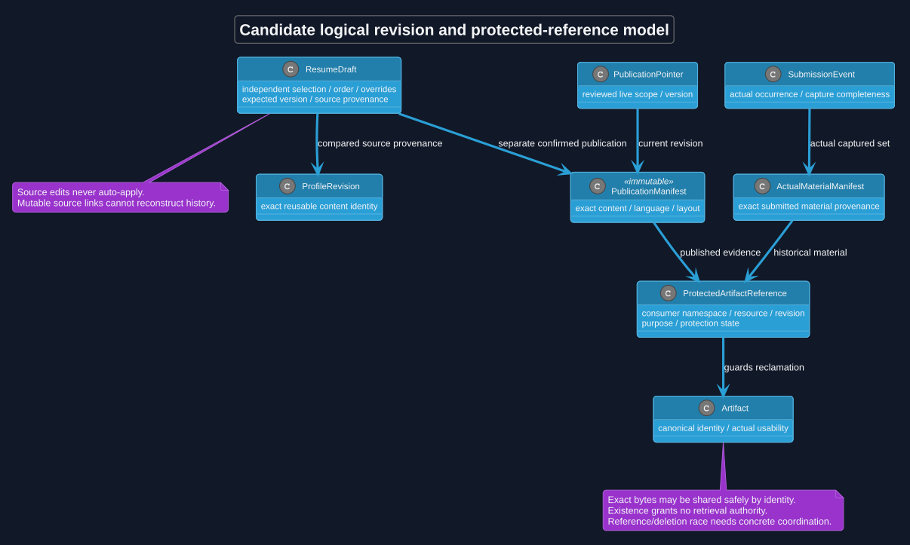

[PlantUML source](Diagrams/Data/data-logical-revisions-and-references.puml) · [PNG](Diagrams/Data/data-logical-revisions-and-references.png)

The retained relationship view distinguishes mutable material, immutable revisions and protected artifact references. Its proposal details/multiplicities retain source status. Exact selected physical columns/constraints are specified by the MVP table families and concrete reviewed migrations, not inferred from an illustration.

## 4.4 Transaction and Concurrency Protocols

| Operation | Transactional obligation | Failure/repetition behavior |
| --- | --- | --- |
| Consume invitation | Atomically validate usable state and record consumption under the selected account contract | Concurrent use cannot produce multiple successful consumptions |
| Save/apply draft | Check owner/current authority and expected version, then record intended changes/version | Stale/invalid intent does not overwrite later state or publish implicitly |
| Publish | Protect exact artifacts, commit immutable revision/live selection and required durable intent locally | Preserve pending references; matching request resolves recorded result; PDF completion remains separate |
| Capture submission | Record exact actual-material event/references and required durable intent under stable identity | Missing material remains explicit; no substitution of the current live resume or duplicate event on retry |
| Admit/replace/remove artifact | Serialize relevant reservation/accounting decisions and owner-controlled reference release | Concurrent admission respects selected quota/reserve; cleanup cannot delete protected bytes |
| Create/update/move issue | Apply local grant, version and request identity with stable repository/issue state | Mismatched identity or stale write conflicts without overwriting newer work |
| Process outbox | Claim/record progress and reconcile the owning effect under its actual contract | Worker restart/lost response cannot justify duplicate effect or false completion |

Use deterministic lock order where locking is required; implement the concrete row/counter ordering in section 4.11 and verify conflict behavior. Retry bounded transient database failures only under a protocol that preserves command identity, current authority and separately recorded effects. Do not invent a universal retry count or assume every transaction can be safely replayed.

Filesystem, native Git, SMTP and remote commits are outside local SQL atomicity. Keep intent and observed result attributable. A SQL rollback does not undo delivered bytes or a changed Git ref. Required protection remains until the owning evidence permits finalization/release.

## 4.5 Query Paths, Indexes and Pagination

| Query family | Intended scoping/access path | Check |
| --- | --- | --- |
| Private account/material lookup | Owner/resource with relevant locale/version | No cross-user reads and appropriate selective lookup |
| Application follow-up | Owner plus applicable follow-up/status ordering | Stable pagination/order and intended temporal semantics |
| Artifact/reservation work | Owner/state and reservation lifecycle/expiry | Efficient pending/cleanup discovery without premature release |
| Repository grants/issues | Local actor/repository, state/assignee and stable issue identity | Permission-scoped results and representative query plans |
| Pending outbox | State and next eligible processing time/operation identity | Bounded work selection, safe competing workers and recoverable claims |

Define actual index order against verified queries and cardinalities. Unique constraints must match the invariant, not a guessed global uniqueness rule. Measure representative data sizes and combined workload on the selected MySQL environment before adding indexes or changing placement.

Pagination must preserve stable permitted ordering under its contract. Caches/read models cannot become authority sources or substitute a live pointer for exact history. Protect actor/resource/revision/policy scope and invalidation behavior under the owning read/delivery contract.

## 4.6 Retention, Deletion and Cleanup

Restrict deletion of protected references and immutable history as specified. Withdrawing publication changes access, not submission meaning. Replacing a file or removing one draft association cannot authorize deletion of bytes still protected by another owner reference.

Reservation expiry is a review/reconciliation input, not universal proof that no effect occurred. Distinguish genuinely abandoned work from pending/uncertain finalization before reclaiming bytes or accounting. Define account/resource removal through the selected retention policy; do not introduce broad cascades or new retention durations here.

Keep audit/request/outbox metadata bounded and purpose-limited. Resolve expiration/cleanup windows and late-retry behavior through governing contracts rather than selecting arbitrary numeric defaults.

## 4.7 Migration and Compatibility Plan

Review each application migration independently with the actual compatible code/package versions. Specify DDL, keys/indexes, nullability/defaults, data transformation and verification. Assess existing data, immutable history, pending work and previous-code compatibility before claiming rollback is safe.

Rehearse migrations on isolated real MySQL with synthetic or properly protected fixtures. Record candidate/schema version, execution result, constraint tests, query/performance observations and recovery preconditions. A clean empty-schema migration is not sufficient evidence for a populated transition or concurrency guarantee.

Code rollback, schema reversal and restoring data are separate decisions. Irreversible/lossy changes need an explicit recovery/compatibility assessment under the governing release procedure. Do not silently drop valid history or recalculate actual submitted materials from mutable content during a backfill.

## 4.8 Backup, Restore and Security

Backups must cover Core records/private artifacts, ProjectForge metadata/native repositories and required durable outcomes/configuration under the approved procedure. Protect copies and recovery secrets, then demonstrate isolated restoration.

Validate foreign/owner relationships, exact artifact digests, publication/selection state, intended current access, Git objects/refs and pending work before replay or cleanup. A database-only restore cannot establish that files/Git bytes exist. Restored state must not silently re-enable revoked access or repeat effects without reconciliation under the recovery contract.

Separate database users/private paths and environment configuration. Keep production/test data isolated and sensitive payloads out of diagnostics. See [Security Implementation](08-Security-Implementation.md), [Configuration and Environment](09-Configuration-And-Environment.md) and the [runbook](../../06-Deployment-Release/02-Runbook.md).

## 4.9 Database Acceptance and Handoff

| Check | Evidence needed |
| --- | --- |
| Migration/schema | Actual DDL execution and package-schema compatibility on selected MySQL |
| Integrity | Wrong-owner/FK/unique/pointer violations rejected and immutable/protected history preserved |
| Concurrency | Concurrent invitation consumption, stale writes, quota reservations and repeated command identities |
| Partial effects | Interrupted artifact finalization/outbox and database/Git/filesystem mismatch remain attributable and recoverable |
| Read behavior | Authorized scoped queries, stable pagination and representative query plans |
| Retention | Protected bytes/references survive replacement, withdrawal, deletion attempts and uncertain work |
| Recovery | Isolated restore validates related records, exact bytes/digests and native Git state |

Link actual migrations/code, criterion/case, candidate/environment, fixtures, expected/observed result and limitations through [Traceability](11-Traceability.md) and the [RTM](../../02-Requirements-Engineering/03-Requirements-Traceability-Matrix/README.md). Follow [Detailed Module Design](03-Detailed-Module-Design.md), [API Specification](05-API-Specification.md) and [Unit Test Design](10-Unit-Test-Design.md) for operation/verification detail.

No database, migration, backup job or runtime pass is created by this document. The retained records below preserve rationale and anchors; deferred-domain models and proposed details do not supersede selected MVP scope. All embedded views use local dark renders, with UML in editable PlantUML.

## 4.10 Concrete MVP Column Contracts

The following is the application-owned physical design to implement and verify on MySQL 8.4; it is not executed DDL. It completes the abbreviated table families above. The [selected technical baseline](https://github.com/Farhad-V/Web-Resumefolio/blob/1f2acaa351ac306cb57cbe4fe9742e8bd90720d9/docs/MVP/baseline/technical-decisions.md) T02–T08 and [policy baseline](https://github.com/Farhad-V/Web-Resumefolio/blob/1f2acaa351ac306cb57cbe4fe9742e8bd90720d9/docs/MVP/baseline/policy-decisions.md) Q-D06–14 govern values, retention and protection. These refinements do not create a migration or alter a live store.

### Shared Types, Nulls and Defaults

| Symbol / convention | Physical contract |
| --- | --- |
| `U` | `BINARY(16)` UUID; application-generated, non-null, no database default. `id:U` is the primary key unless a composite PK is stated. UUID bytes encode the canonical API identity without application-dependent byte swapping. |
| `V` | `BIGINT UNSIGNED NOT NULL DEFAULT 1`, with `CHECK (version BETWEEN 1 AND 9007199254740991)`; transactional compare-and-increment. Public issue/event numbers have the same positive safe-integer bound and no default. |
| `T` | `DATETIME(6)` UTC, non-null, explicitly supplied by the operation; `T?` is nullable with default null. No implicit on-update clock on immutable rows. |
| `S(n)` | `VARCHAR(n)` under utf8mb4, non-null, no default; `S(n)?` nullable/default null. IDs, token hashes, storage keys, locales, timezones, enums and normalized identifiers use binary/case-sensitive comparison. Human display text is not an identity key. |
| `H` | `BINARY(32)` SHA-256 digest, non-null/no default. Credential verifiers use protected package/password formats where specified, not an assumed unsalted SHA-256 password hash. |
| `J` | MySQL `JSON NOT NULL`, explicitly supplied after owner validation; it is not a replacement for scoped relational references. |
| `B` | `BIGINT UNSIGNED NOT NULL`, no default, for exact byte counts; negative/overflow values rejected before writes. |
| Row timestamps | Mutable root rows include `created_at:T`, `updated_at:T`; immutable/event rows include `created_at:T` only. Join rows need no implicit timestamp unless stated. |

Every field below is non-null with no default unless `?`, a named default, or a package-owned exception is stated. Required names/titles contain non-whitespace content. Application validation and migration checks agree on enum values, positive counters and paired fields. MySQL character limits do not substitute for API code-point validation; no silent truncation. All foreign keys are owner-local with `ON UPDATE RESTRICT` and `ON DELETE RESTRICT`; deletion explicitly releases eligible children under policy rather than broad cascades. Same-host databases have no cross-system FKs.

### Core Identity and Presentation

| Table | Columns beyond row timestamps | Constraints / indexes |
| --- | --- | --- |
| `users` | `id:U`, `email_normalized:S(254)`, `password_hash:S(255)?`, `state:S(16)` default `invited`, `is_admin:BOOLEAN` default false, `projectforge_entitlement:BOOLEAN` default false, `version:V` | Unique email with exact normalized comparison; state in `invited,active,suspended,disabled`. Password may be null only before completed activation; active admission requires the selected password/factor setup. |
| `invitations` | `id:U`, `user_id:U`, `token_hash:H`, `expires_at:T`, `consumed_at:T?` | FK user; unique token digest; index `(user_id,expires_at)`; T02 expiry 72 hours from issue, atomic single consumption. Expiry/consumption never activates an otherwise disabled account. |
| `profiles` | `id:U`, `owner_id:U`, `version:V`, `content_json:J` | FK owner; unique owner and `(id,owner_id)`. JSON contains ordered reusable professional entries and their stable entry IDs; no mandatory sensitive demographics. |
| `resumes` | `id:U`, `owner_id:U`, `version:V`, `archived_at:T?`, `deleted_at:T?` | FK owner; unique `(id,owner_id)`; index `(owner_id,deleted_at)`. Content is in language drafts/revisions, not an implicit profile live view. |
| `resume_drafts` | `id:U`, `resume_id:U`, `owner_id:U`, `locale:S(2)`, `version:V`, `source_profile_version:BIGINT UNSIGNED?`, `content_json:J`, `deleted_at:T?` | FK `(resume_id,owner_id)`; unique `(resume_id,locale)` and `(id,owner_id)`. Locale `en,de`; optional source version is positive. Source comparison preserves ordered selection and independent overrides. |
| `publication_revisions` | `id:U`, `resume_id:U`, `owner_id:U`, `locale:S(2)`, `revision_no:BIGINT UNSIGNED`, `snapshot_json:J`, `source_draft_version:BIGINT UNSIGNED`, `created_at:T` | FK `(resume_id,owner_id)`; unique `(resume_id,locale,revision_no)`, `(id,resume_id,locale,owner_id)` and `(id,owner_id)`. Positive counters; locale `en,de`. Append-only snapshot records exact chosen text/layout/selection. Q-D06 publish guard requires display name, contact method and meaningful selected section. |
| `live_publications` | `resume_id:U`, `owner_id:U`, `locale:S(2)`, `publication_id:U`, `version:V` | PK `(resume_id,locale)`; FK `(resume_id,owner_id)` and `(publication_id,resume_id,locale,owner_id)` to the revision's corresponding unique key. Withdrawing removes the live pointer under version/authority protection, not the revision/history. |

Laravel/Fortify/Passport-owned password recovery, TOTP, OAuth, queue/cache and `sessions` columns are exceptions: use their compatible installed package migrations and record their actual DDL during Setup. The conceptual sessions sketch is not a replacement package schema. Extend or wrap package storage to enforce T02's two-hour idle/twelve-hour absolute lifetime, reset/disable revocation and sensitive-action freshness; do not assume a native `revoked_at` column exists. Keep TOTP secrets encrypted and recovery-code handling package-compatible. Recovery tokens expire after 30 minutes; Admin TOTP is mandatory. No raw token/secret is stored in evidence.

### Core Files, Renditions and Sharing

| Table | Columns beyond row timestamps | Constraints / indexes |
| --- | --- | --- |
| `artifacts` | `id:U`, `owner_id:U`, `storage_key:S(255)`, `sha256:H`, `size_bytes:B`, `detected_mime:S(127)`, `locale:S(2)?`, `state:S(16)`, `version:V` | FK owner; unique storage key and `(id,owner_id)`; index `(owner_id,state)`. State `quarantined,processing,usable,failed,retired,deleting,deleted`; file usability follows T06 validation, never client MIME alone. Locale null for language-neutral media, otherwise `en,de`. Private immutable keys are server-generated, never user paths. |
| `artifact_reservations` | `id:U`, `owner_id:U`, `artifact_id:U?`, `operation_id:U`, `bytes:B`, `state:S(16)`, `expires_at:T`, `version:V` | FK owner and optional `(artifact_id,owner_id)`; unique `(id,owner_id)`; index `(owner_id,state)`, `(state,expires_at)`, `operation_id`. State `reserved,protected,finalized,released,uncertain`; state assigned explicitly. Expiry triggers reconciliation, never automatic unsafe reclamation. |
| `publication_artifacts` | `publication_id:U`, `owner_id:U`, `artifact_id:U`, `position:INT UNSIGNED`, `purpose:S(32)` | PK `(publication_id,artifact_id,purpose)`; unique `(publication_id,purpose,position)`; owner-scoped FKs to publication/artifact. Position starts at zero. Purpose `selected_media,uploaded_pdf,generated_pdf`; exact locale/rendition eligibility is checked by the owning operation. |
| `resume_artifacts` | `resume_id:U`, `owner_id:U`, `artifact_id:U`, `locale:S(2)`, `purpose:S(32)`, `position:INT UNSIGNED` | PK `(resume_id,locale,purpose,position)`; owner-scoped FKs; locale `en,de`; same purposes as above. Draft/current selection is separate from immutable publication associations. |
| `resume_download_settings` | `resume_id:U`, `owner_id:U`, `locale:S(2)`, `generated_enabled:BOOLEAN` default false, `uploaded_enabled:BOOLEAN` default false, `version:V` | PK `(resume_id,locale)`; owner-scoped FK; locale `en,de`. Supports both/neither independently. A flag never makes a failed/missing artifact available. |
| `rendition_requests` | `id:U`, `owner_id:U`, `publication_id:U`, `artifact_id:U?`, `operation_id:U`, `state:S(16)`, `version:V` | Owner-scoped FKs; index `(publication_id,state)`, unique operation ID. State `pending,processing,available,failed,uncertain`; available requires the exact usable generated artifact. Publication locale/version fixes rendering input. |
| `share_links` | `id:U`, `resume_id:U`, `owner_id:U`, `token_hash:H`, `password_hash:S(255)`, `state:S(16)` default `active`, `generation:BIGINT UNSIGNED` default 1, `expires_at:T?`, `version:V` | Unique token digest and `(id,resume_id,owner_id)`; owner-scoped resume FK; positive generation. State `active,disabled`. Q-D11 identity has at least 32 random bytes; store its digest, never a public storage path. Password change/disable atomically increments generation. |
| `viewer_contexts` | `id:U`, `share_link_id:U`, `resume_id:U`, `owner_id:U`, `generation:BIGINT UNSIGNED`, `session_token_hash:H`, `created_at:T`, `last_seen_at:T`, `expires_at:T`, `revoked_at:T?` | Composite FK to share link; unique session digest; index `(share_link_id,generation)`, `expires_at`. Q-D11 enforces 30-minute idle/eight-hour absolute lifetime and current generation/expiry/state on every new admission. Viewer context is not a named employer identity. |

### Core Applications and Exact History

| Table | Columns beyond row timestamps | Constraints / indexes |
| --- | --- | --- |
| `applications` | `id:U`, `owner_id:U`, `company:S(255)`, `opportunity_title:S(255)`, `opportunity_url:S(2048)?`, `resume_id:U?`, `cover_letter:MEDIUMTEXT` default empty string (explicitly inserted), `status:S(16)` default `preparing`, `offer_outcome:S(8)?`, `next_action:S(2048)?`, `follow_up_date:DATE?`, `follow_up_timezone:S(64)?`, `version:V`, `archived_at:T?`, `deleted_at:T?` | FK owner and optional `(resume_id,owner_id)`; unique `(id,owner_id)`; index `(owner_id,follow_up_date,status)`. Status `preparing,ready,submitted,interview,offer,rejected,withdrawn`; outcome null/`accepted`/`declined`, non-null only in `offer`. Date and zone are both null or both non-null. Rename the earlier conceptual `follow_up_at` to this date pair to preserve Q-D09's date-only meaning. Opportunity URL is recorded context, never permission to fetch it. |
| `application_progress_events` | `id:U`, `application_id:U`, `owner_id:U`, `actor_id:U`, `version:BIGINT UNSIGNED`, `from_status:S(16)`, `to_status:S(16)`, `from_offer_outcome:S(8)?`, `to_offer_outcome:S(8)?`, `reason:S(2048)?`, `effective_at:T`, `created_at:T` | Owner-scoped application FK; unique `(application_id,version)`; statuses use the application's same enum. Append with the versioned progress change; do not rewrite an old progress event to disguise a correction. Every pair of the seven statuses is allowed by the [owner-selected manual policy](../../02-Requirements-Engineering/01-Software-Requirements-Specification/03-Requirements-Specification/09-Manual-Application-Management.md#owner-selected-manual-application-status), including explicit same-status progress events. Reason is optional; effective_at defaults to the confirmed action time, created_at records server persistence time. Outcome snapshots are null/accepted/declined and non-null only for an Offer endpoint; leaving Offer clears current outcome but retains the prior snapshot. Status edits never mutate submitted materials or require completed capture. |
| `submission_events` | `id:U`, `application_id:U`, `owner_id:U`, `event_no:BIGINT UNSIGNED`, `submitted_at:T`, `submitted_timezone:S(64)`, `context_json:J`, `material_json:J`, `corrects_event_id:U?`, `created_at:T` | Owner-scoped application FK; unique `(application_id,event_no)`, `(id,owner_id)`, `(id,application_id,owner_id)`. Correction FK `(corrects_event_id,application_id,owner_id)` references an earlier event for that application. Material JSON preserves exact authored text, selected language/mode and provenance; no live-pointer reconstruction. Positive safe event numbers. |
| `submission_artifacts` | `event_id:U`, `owner_id:U`, `artifact_id:U`, `sha256:H`, `purpose:S(32)`, `position:INT UNSIGNED` | PK `(event_id,purpose,position)`; owner-scoped event/artifact FKs. SHA-256 must match the reserved immutable artifact when capture commits. Purpose `resume_pdf,cover_letter,supporting_material`; each position identifies the exact selected bytes. |

Incomplete private preparation can omit the selected resume, cover letter, next action and follow-up; empty preparation text is explicit. Required company/title validation applies when saving a usable application record. Q-D12 progress edits do not send or certify delivery. Do not insert a successful immutable submission event until all required exact material is durably protected; store incomplete/failed attempts in the durable operation record. Corrections append another event and never mutate the prior set.

### ProjectForge Accounts, Repositories and Issues

| Table | Columns beyond row timestamps | Constraints / indexes |
| --- | --- | --- |
| `forge_users` | `id:U`, `core_issuer:S(255)`, `core_user_uuid:U`, `state:S(16)` default `active`, `version:V` | Unique `(core_issuer,core_user_uuid)`; state `active,disabled`. Mapping is not proof of current Core entitlement. No FK into Core. |
| `repositories` | `id:U`, `owner_id:U`, `display_name:S(255)`, `storage_key:S(255)`, `state:S(16)`, `next_issue_no:BIGINT UNSIGNED` default 1, `version:V` | FK owner to forge_users; unique storage key; index `(owner_id,state)`; state `provisioning,active,archived,retiring,failed`. Counter bounded to positive JSON-safe range and incremented under the repository lock; abort on exhaustion. |
| `repository_grants` | `repository_id:U`, `user_id:U`, `role:S(8)` | Composite PK `(repository_id,user_id)`; FKs repository/user; index `(user_id,repository_id)`; role `owner,writer,reader`. Owner change and grant re-evaluation occur atomically under the owning policy. |
| `issue_grants` | `repository_id:U`, `user_id:U`, `access:S(8)` | Composite PK `(repository_id,user_id)`; FKs repository/user; index `(user_id,repository_id)`; access `read,write`. Explicit issue-only capability; no Git permission inferred from it. |
| `git_credentials` | `id:U`, `user_id:U`, `token_hash:H`, `created_at:T`, `expires_at:T`, `revoked_at:T?` | FK forge user; unique token digest; index `(user_id,expires_at)`. T04 uses a 32-byte random PAT shown once, expiring after 90 days; current entitlement and grants still checked. |
| `git_credential_scopes` | `credential_id:U`, `repository_id:U`, `access:S(8)` | PK `(credential_id,repository_id)`; FKs credential/repository; access `read,write`. Credential scope intersects current user grants; it cannot add authority. |
| `issues` | `id:U`, `repository_id:U`, `issue_no:BIGINT UNSIGNED`, `title:S(255)`, `body:MEDIUMTEXT` explicitly empty when blank, `state:S(16)` default `todo`, `priority:S(8)` default `normal`, `assignee_id:U?`, `due_date:DATE?`, `due_timezone:S(64)?`, `version:V` | FK repository and optional forge assignee; unique `(repository_id,issue_no)` and `(id,repository_id)`; indexes `(repository_id,state,issue_no)`, `(assignee_id,due_date)`. State `todo,in_progress,done`; priority `low,normal,high`. Title/body/date/version bounds match [API schemas](05-API-Specification.md#mvp-json-schemas). |
| `issue_events` | `id:U`, `issue_id:U`, `repository_id:U`, `actor_id:U`, `version:BIGINT UNSIGNED`, `event_type:S(16)`, `created_at:T` | Composite FK issue/repository and FK actor; unique `(issue_id,version)`. Event type `created,updated,moved`; a move uses `moved`, including a combined edit. Record one attributable event per resulting issue version. |

Assignee eligibility is checked inside the issue mutation protocol against current issue/repository grants. A FK proves identity, not eligibility. Removing a grant cannot leave later operations treating an ineligible assignee as newly authorized; retain attribution and expose the unavailable assignment for correction. Issue number allocation and event insertion commit with the issue and idempotency outcome. Failed transactions may leave no new issue; numbers are identities, not a promise of gapless global sequencing.

## 4.11 Owner-Scoped Foreign Keys and Durable Operations

These matching keys are mandatory, not informal owner-ID comparisons:

| Child columns | Referenced unique columns |
| --- | --- |
| `resume_drafts(resume_id,owner_id)`; `publication_revisions(resume_id,owner_id)`; `share_links(resume_id,owner_id)`; optional `applications(resume_id,owner_id)` | `resumes(id,owner_id)` |
| `live_publications(publication_id,resume_id,locale,owner_id)` | `publication_revisions(id,resume_id,locale,owner_id)` |
| `publication_artifacts(publication_id,owner_id)`; `rendition_requests(publication_id,owner_id)` | `publication_revisions(id,owner_id)` |
| Every concrete artifact association's `(artifact_id,owner_id)` | `artifacts(id,owner_id)` |
| `submission_events(application_id,owner_id)` | `applications(id,owner_id)` |
| `submission_artifacts(event_id,owner_id)` | `submission_events(id,owner_id)` |
| `viewer_contexts(share_link_id,resume_id,owner_id)` | `share_links(id,resume_id,owner_id)` |

Define columns in identical type/order/collation on both sides; create parent unique keys before child FKs. Require non-null owner IDs on associations; the only nullable artifact FK is a not-yet-finalized reservation/rendition. The same owner's different resumes/languages are still distinct selections and require current operation policy, not just these FKs.

Each store owns `idempotency_records`: `id:U` PK, `actor_id:U`, `operation:S(255)`, `key_hash:H`, `payload_hash:H`, `state:S(16)`, `resource_id:U?`, `response_status:SMALLINT UNSIGNED?`, `response_json:JSON?`, `created_at:T`, `expires_at:T`, `completed_at:T?`. Unique `(actor_id,operation,key_hash)`; index `(state,expires_at)`. Operation includes canonical method/resource route. States `in_progress,completed,failed,uncertain`; `response_status`/`response_json` are both present for a replayable terminal result and absent otherwise. Store only the permitted bounded response needed for exact replay, under the same private access as its resource; never credentials or unrelated private content. A resource ID here is diagnostic polymorphic identity, not a cross-owner FK or permission shortcut. See [API retry contract](05-API-Specification.md#mvp-json-errors-and-retries).

`outbox` has `id:U` PK, `operation_id:U` FK to the local operation record, `effect_key:S(128)`, `payload_json:J`, `state:S(16)`, `attempt_count:INT UNSIGNED` default 0, `next_attempt_at:T?`, `claimed_until:T?`, `created_at:T`, `completed_at:T?`. Unique `(operation_id,effect_key)`, index `(state,next_attempt_at)`; states `pending,processing,completed,failed,uncertain`. One operation can have multiple explicitly named effects. Lease expiry allows investigation/reclaim under the effect protocol; it does not prove an earlier external effect failed. Payloads contain minimum references, never arbitrary secret/private byte copies.

Owner-local background commands without a public request key allocate their own stable internal command identity in the same operation store before dispatch; the actor is the explicit service/operation principal, never a guessed human. Compute completed request expiry seven days after terminal completion and retain the record through pending effects. Cleanup removes eligible completed child outbox records before their operation record, preserving required reconciliation/audit references.

ProjectForge's `query_cursors` supports bounded history traversal without putting an unbounded graph frontier in a URL: `id:U` PK, `actor_id:U` FK to forge_users, `repository_id:U` FK to repositories, `token_hash:H` unique, `context_hash:H`, `traversal_json:J`, `created_at:T`, `expires_at:T`; index `expires_at`. Context binds resolved revision, path/filter/order and receiving operation. Expired or discarded context returns the API's explicit cursor-unavailable outcome. Cursor retention is an operational paging choice, never permission or a retained business-history guarantee. No source data is deleted by cursor expiry.

`audit_events` has `id:U` PK, `actor_id:U?`, `event_type:S(64)`, `resource_id:U?`, `operation_id:U?`, `outcome:S(16)`, `metadata_json:J`, `occurred_at:T`. Outcome `accepted,denied,failed,pending,unknown`; index `(occurred_at,id)` and `(resource_id,occurred_at)`. System events may have no human actor. Preserve attributed IDs without a cascading FK into erasable human records. Allowlist diagnostic metadata; T07 bounds audit retention to 180 days with authorized expiry, not ordinary arbitrary editing. Operation references are owner-local and protect still-required reconciliation evidence.

### Concrete Write Locks and Reference Protection

- Invitation: lock the invitation row, then owning user; validate current usable state/expiry and consume/activate once in the same transaction.
- Issue create: claim the unique idempotency record, then lock the repository/counter and relevant current grants in deterministic ID order; allocate number, insert issue/event and complete recorded response atomically. Issue update locks the claimed operation and issue, checks current grant/expected version, updates once, inserts its event and stored response together.
- Publication: claim operation, lock resume then language draft/live pointer, validate expected versions; lock selected artifact rows sorted by UUID before inserting protected associations, immutable revision/live pointer and outbox. Submission locks application then sorted exact artifacts and commits event/associations/outcome together. No external call is performed while holding a transaction just to satisfy a diagram.
- File admission uses owner-local `storage_accounts(scope:S(16), subject_key:S(64), used_bytes:B default 0, reserved_bytes:B default 0, version:V)` with PK `(scope,subject_key)`; scope is `global,user,repository`. Use canonical server-defined subject keys. Lock global, then user/repository counters in stable order before creating/releasing a reservation. Count quarantine/temporary bytes; policy/physical free-space guards still apply. Git reservations use the same owner-local ledger protocol, not Core's database. Reconcile actual temporary usage before releasing capacity.
- Reference insertion/release and garbage collection lock the same artifact row before evaluating all concrete draft/publication/submission/rendition associations and active reservations. Collection marks `deleting` only after proving no protected consumer remains; after commit, delete bytes and record confirmed outcome before releasing accounted usage. Failed/unknown removal remains attributable and cannot falsely release capacity. No new association may attach to a deleting/deleted artifact.

Unique operation claim and business mutations use the same local transaction where possible; a crash before commit leaves neither completed effect nor false replay result. Durable asynchronous intent is committed before dispatch. At repeat admission recheck current authority, then resolve recorded outcome before expectedVersion rejection of an already completed same-key command. These are protocols to test on real MySQL, not claims of demonstrated concurrency safety.

### Retention, Dates and Migration Acceptance

Q-D14 retains soft-deleted private drafts/applications for 30 days; expiry only makes unreferenced eligible data reclaimable. Deliberate permanent erasure has its separate explicit owner authority and other-owner-copy/deletion-record rules; immutable history protection does not invent eternal retention against that policy. Backups retain T08's seven daily/four weekly copies; recovery must reapply later deletion/revocation records before serving access. Never remove protected bytes because an idempotency/audit timer elapsed.

Application follow-up and issue due dates are `DATE` plus IANA zone, whereas actual submission/created/recorded times are UTC `DATETIME(6)`. Enforce pair-null checks for each date/zone and validate actual zones in application code. Timestamps, date-only values and preserved source text are not interchangeable. Migration review must exercise wrong-owner/wrong-resume/wrong-locale FKs, nullable optional FK behavior, unique numbers/digests, enum and version bounds, API-to-column round trips, same-key races, quota/reference races and interrupted finalization on the selected real MySQL. Record package-owned DDL and actual checks at Setup; no installed-schema or runtime pass is asserted here.

Resumefolio — Analysis to Logical and Physical Data Models

### Resumefolio — Analysis to Logical and Physical Data Models

Current implementation choices and scope: [Baseline](https://github.com/Farhad-V/Web-Resumefolio/blob/1f2acaa351ac306cb57cbe4fe9742e8bd90720d9/docs/MVP/baseline/README.md). Runtime verification remains subject to its gates.

**Purpose:** refine the conceptual information model into reviewable logical record families, integrity rules, access patterns and a physical-design specification for implementation.

**Status:** proposed technical design. This document defines a candidate relational model and physical mapping obligations, not an accepted engine, executable migration or verified schema. The accepted profile-update/publication/history behavior is preserved; unresolved source cardinalities and policies remain unresolved.

[Sources](#design-record-04-data-design-01-analysis-to-logical-and-physical-data-models-md--heading-1-analysis-to-design-contract) · [Ownership](#design-record-04-data-design-01-analysis-to-logical-and-physical-data-models-md--heading-2-logical-record-families-and-ownership) · [Revisions](#design-record-04-data-design-01-analysis-to-logical-and-physical-data-models-md--heading-3-revision-and-reference-model) · [Integrity](#design-record-04-data-design-01-analysis-to-logical-and-physical-data-models-md--heading-4-keys-relationships-and-integrity) · [Physical mapping](#design-record-04-data-design-01-analysis-to-logical-and-physical-data-models-md--heading-5-physical-representation-and-access-paths) · [Transactions](#design-record-04-data-design-01-analysis-to-logical-and-physical-data-models-md--heading-6-consistency-and-external-state) · [Handoff](#design-record-04-data-design-01-analysis-to-logical-and-physical-data-models-md--heading-7-schema-evolution-verification-and-handoff)

#### 1. Analysis-to-design contract

The [domain model](../../03-System-Analysis/02-Domain-And-Information-Analysis.md#analysis-domain-and-information-analysis--03-domain-model-and-object-oriented-view) explains responsibilities; the [data-oriented view](../../03-System-Analysis/02-Domain-And-Information-Analysis.md#analysis-domain-and-information-analysis--05-data-oriented-view) defines information meaning, conceptual ER relationships and integrity checks. Use the [dictionary](../../02-Requirements-Engineering/01-Software-Requirements-Specification/05-Data-Definitions/02-Data-Dictionary.md#data-definitions-data-dictionary), [glossary](../../02-Requirements-Engineering/01-Software-Requirements-Specification/05-Data-Definitions/03-Requirements-Glossary.md#data-definitions-glossary), [operation contracts](../../03-System-Analysis/03-Processes-Scenarios-And-Business-Rules.md#analysis-business-rules-and-operation-contracts--10-domain-constraints-and-operation-contracts) and [source decisions](../../02-Requirements-Engineering/01-Software-Requirements-Specification/07-Change-And-Baseline/03-Requirements-Questions-And-Decisions.md#change-and-baseline-open-questions-and-decisions) as authorities. This file refines them rather than creating a competing conceptual specification.

For each implementation record, trace **source concept/criterion → owning component → logical identity/relationship → invariant → physical enforcement → verification evidence**. DA-S/DA-I analysis locators and provisional requirement IDs remain source locators, not mandatory table names or final accepted requirements.

Design levels are distinct:

| Level | Question answered | Current deliverable |
| --- | --- | --- |
| Conceptual analysis | What information and meaning must remain distinct? | Existing linked analysis and dictionary |
| Logical design | Which owned records, keys, relationships and rules preserve that meaning? | Candidate families, revision model and integrity allocation below |
| Physical design | Which exact types, constraints, indexes and storage operations implement those rules on a chosen engine? | Candidate representation/access-path specification; engine-specific DDL remains gated |

Do not interpret an analysis diagram's unspecified endpoint as one-to-one or convert a P-labeled proposed count into a database constraint without source disposition. One coherent Sprint Backlog is an established meaning; one profile per account, one active Sprint and other detailed limits retain their proposal status.

#### 2. Logical record families and ownership

Prefer transactional relational persistence for local structured state as the current design candidate, consistent with [persistence/lifecycle guidance](#design-record-04-data-design-03-persistence-caching-and-data-lifecycle-md). A logical family can map to several tables or a justified structured value. It is not a separate database or deployment mandate.

##### Identity and Access — LC-01

Account, credential/factor verification references, session/invitation state, scoped grants and attributable authority changes. Keys preserve actor/resource/action context and current eligibility. Work/repository-specific relationships coordinate with this authority; a universal role column cannot encode every resource permission. See [component design](03-Detailed-Module-Design.md#design-record-03-component-and-module-design-components-identity-and-access-md).

##### Professional Presentation — LC-02

Profile content/revisions, stable professional entry identities, language-specific values, resume drafts, independent selections/order/overrides, comparisons and immutable publication manifests. Profile provenance does not cause live lookup to overwrite a resume. See [component design](03-Detailed-Module-Design.md#design-record-03-component-and-module-design-components-professional-presentation-md).

##### Representation and Sharing — LC-03

Download configuration, independent sharing links, protected verifier references, viewer authorization generations, uploaded associations and exact-input generated-rendition attempts. Link state, PDF mode, current publication and available bytes remain separate dimensions. See [component design](03-Detailed-Module-Design.md#design-record-03-component-and-module-design-components-representation-and-sharing-md).

##### Manual Applications — LC-04

Company/opportunity/application context, authored cover letters, progress, submission events/corrections and independently preserved actual-material manifests. Actual submitted material never resolves solely through a mutable current-resume reference. See [component design](03-Detailed-Module-Design.md#design-record-03-component-and-module-design-components-applications-md).

##### Communication and Calendar — LC-05

**After MVP.** Shared operating and recovery controls still apply where relevant.

Provider connections and protected credential references, locally owned notes/associations, provider-scoped message/event identities, local activities, mappings and send/synchronization/reminder attempts. Provider truth and local desired state remain distinguishable; local-only events have no fabricated provider ID. See [component design](03-Detailed-Module-Design.md#design-record-03-component-and-module-design-components-communication-and-calendar-md).

##### Work Management — LC-06

Work projects, boards/column mappings/card placements, items/tasks/assignments, scoped membership relationships, Sprints, coherent goal/selected-work/delivery-plan records and historical outcomes. A board is a view; card position and task completion are not item acceptance. See [component design](03-Detailed-Module-Design.md#design-record-03-component-and-module-design-components-work-management-md).

##### Git Collaboration — LC-07

Repository namespace/ownership/storage association, grants/ref policies, forks, review requests and exact reviewed revisions, issues/milestones and releases. SQL metadata is not the authoritative Git object/ref store. See [component design](03-Detailed-Module-Design.md#design-record-03-component-and-module-design-components-git-collaboration-md).

##### Workflow and Deployment — LC-08

**After MVP.** Shared operating and recovery controls still apply where relevant.

Supported-definition validation, immutable run context, admitted execution attempts, dispatch/observations, output/cleanup associations, separate target approval and deployment attempts. Execution outcome, cancellation request, cleanup and target effect are separate facts. See [component design](03-Detailed-Module-Design.md#design-record-03-component-and-module-design-components-workflow-and-deployment-md).

##### Files and Operations — LC-09

Artifact identity/provenance/usability, effective quota policies/reservations/accounting, protected consumer references, replacement/reclamation attempts and recovery assessments. Native Git and generated/temporary outputs need explicit evaluated accounting adapters. See [component design](03-Detailed-Module-Design.md#design-record-03-component-and-module-design-components-files-and-operations-md).

Cross-component reads use permitted contracts/projections; ownership does not prohibit evaluated foreign keys in a shared relational store. A foreign key provides referential integrity, not authorization or permission to mutate another component's records.

#### 3. Revision and reference model

[Candidate logical model for independent content and protected artifacts](Diagrams/Data/data-logical-revisions-and-references.svg)

[Editable PlantUML](Diagrams/Data/data-logical-revisions-and-references.puml) · 

The diagram names candidate logical records; ordinary arrows express relationships, not accepted minimum/maximum cardinalities. Physical table decomposition remains a design choice.

**Stable identity versus version:** a resume/profile/item identity names the continuing resource; a revision/version names exact content or a concurrency state. Do not reuse a mutable resource ID as proof of immutable historical content. Revision numbering strategy and identifier format remain physical choices.

**Independent draft state:** represent selected entry identities, ordering and explicit override values separately from shared source values. Distinguish “no override” from an intentional empty value and omitted selection. Comparison records or issued comparison identities bind the exact source/draft versions; stale application must conflict or follow an explicitly reviewed merge rule.

**Publication manifest:** preserve sufficient exact content, selection, language, layout/render-input identity and artifact references for the promised publication behavior. A manifest may embed an immutable snapshot or reference immutable version records; it must not dereference mutable source text to reconstruct history. The accepted policy does not require retaining every intermediate keystroke forever.

**Actual material manifest:** submission events identify actual captured material with provenance and completeness state. The artifact may be safely shared by exact immutable identity if reference protection is sufficient; historical independence does not mandate duplicate physical bytes. Report incomplete capture honestly rather than synthesizing “actual submitted” material from today's publication.

**Protected reference:** consumer namespace/resource/revision/purpose identifies why an artifact cannot be reclaimed. Reserve/protect before consumer commit, finalize using actual committed consumer evidence and release only after proving it safe. An uncertain acknowledgment keeps protection pending. The concrete shared-database or cross-owner protocol must exclude the race between new reference registration and physical deletion.

**Historical work and external context:** Sprint closing preserves goal/scope/plan/outcome meaning independent of later item edits. Git reviews bind exact source/target repository revisions. Provider operations and execution/deployment attempts preserve intended versus observed external state. These cannot all be reduced to one generic “status/history” blob.

#### 4. Keys, relationships and integrity

##### Identity and scoping

- Use stable non-secret primary identities. Decide generated integer versus UUID/other representation after evaluating key size, exposed-ID handling and actual workloads; unguessable identity alone is not access control.
- Namespace external identifiers by provider connection/account/type or repository context. External IDs are opaque values with evaluated length and comparison semantics; do not impose numeric or case-insensitive interpretation by default.
- Scope command deduplication to the actual owner/actor/resource/operation contract. Store enough protected intent comparison to distinguish a true duplicate from reused identity with changed payload. Do not copy secrets into ordinary command/audit records for convenience.
- Use uniqueness for source-authorized identities and associations, not guessed business labels. A proposed single-profile or active-Sprint limit cannot be accepted through a unique index.

##### Referential and domain constraints

Within an evaluated shared store, use foreign keys where they match lifecycle and ownership. Prevent cross-owner/project links using compatible scoped composite keys or guarded owner-side transactions, not merely a child-row FK to a globally valid ID. Use typed association tables or a resource registry with explicit lifecycle enforcement where heterogeneous grants/links are needed; a free-form `(type, id)` pair has no automatic database referential guarantee.

Define requiredness per claim: an incomplete draft can differ from a publishable revision; a queued attempt can lack a started timestamp; an unknown external outcome is not a known failure; a local event need not have a provider mapping. Represent absent/unknown/not-applicable distinctions explicitly where the domain needs them. Avoid sentinel IDs, empty timestamps and arbitrary zero values.

| Invariant | Candidate enforcement and limit |
| --- | --- |
| Required identity, valid references, source-approved uniqueness | PK/NOT NULL/FK/UNIQUE where evaluated and applicable; engine behavior must be verified |
| Valid ranges and row-local combinations | Evaluated CHECK/type constraints plus domain validation; exact engine/version support remains pending |
| Expected revision on mutation | Conditional update/lock and guarded result; no silent lost update |
| Cross-record Sprint/ordering/ownership rules | Owner-side consistent transaction and suitable lock/guard set; isolated row checks are insufficient |
| Current grants and revocation boundary | Resource-specific evaluation synchronized with admission; referential integrity alone does not authorize |
| Consumer reference versus reclamation | Shared reference/deletion guard or evaluated coordination protocol, including uncertain commit recovery |
| Remote send/Git ref/execution/target effect | Durable intent and attributable observation/reconciliation; SQL rollback cannot undo remote effects |

##### Normalization and justified snapshots

Normalize reusable identities, ownership, grants and many-to-many selections/associations. Keep independent cardinality and ordering explicit. Do not store comma-separated foreign IDs or repeat mutable account/provider metadata across operational tables as competing truth.

Immutable publication/submission/Sprint snapshots are intentional preservation of historical meaning, not an accidental second mutable source. Cached projections/counters require an owner, provenance/version, rebuild path and stale-data behavior. Justify denormalization against measured access patterns and maintenance costs before selecting it. JSON is suitable only where its exact shape, versioning, validation, size and query/constraint limits are defined; it cannot hide core ownership and authorization relationships.

#### 5. Physical representation and access paths

[Logical invariant to physical storage and verification allocation](Diagrams/Data/data-physical-enforcement-map.svg)

[Editable PlantUML](Diagrams/Data/data-physical-enforcement-map.puml) · 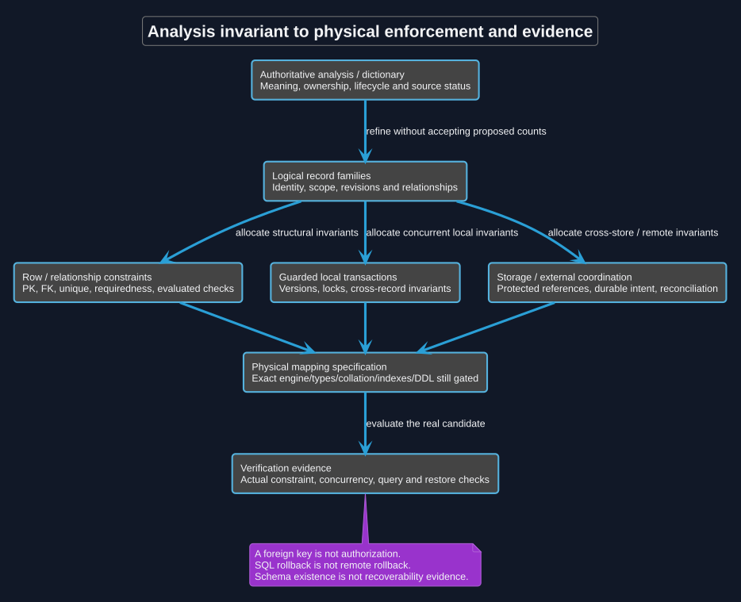

##### Candidate representation specification

The following are type families and obligations, not final SQL column definitions. Evaluate actual database engine/version, transactional storage configuration, driver/ORM, collation and migration facilities before executable DDL. The observed demo MySQL installation is not engine selection or proof that the required features behave correctly.

| Logical value | Physical mapping obligation |
| --- | --- |
| Resource/revision identity | Exact PK/FK representation and compatible referenced types; no accidental coercion |
| Concurrency version | Non-null revision/counter or evaluated token with conditional-update semantics; overflow/regeneration rule |
| Language and opaque provider/Git identifier | Explicit validated domain and intentional case/comparison/length rules; no silent truncation |
| User text/structured manifest | Unicode-capable representation, reviewed size bounds and schema/version validation; safe rendering remains application work |
| Instant / local date / time zone | Distinct representations: normalized UTC instants for actual events, date-only where intended, named intended zone/local scheduling context where required |
| Size/quota/reservation | Non-negative exact integer units and evaluated range/overflow; atomic concurrent accounting |
| Credential/verifier/key reference | Evaluated protected storage and restricted projections; never plaintext secrets in diagnostics, migrations or seed data |
| Artifact/Git storage locator | Canonical private identity and metadata, not a publicly retrievable path or arbitrary user-supplied executable path |

Store private artifact bytes and native Git objects/refs through evaluated storage adapters. SQL records own their metadata, provenance, protection and known state; metadata existence is not proof that bytes, refs or keys are usable. Filesystem/object-store and SQL backup consistency needs an explicit recovery procedure.

##### Query-driven candidate indexes

- **Private resource lists:** owner/context plus relevant lifecycle/filter/order and stable pagination tie-breaker. Confirm that the query applies current permitted scope.
- **Draft/publication lookup:** resource/revision identity; current publication pointer unique within the reviewed publication/language scope. Do not infer one pointer per language until that scope is decided.
- **Reference checks:** artifact plus active/protected consumer scope and operation identity, supporting both new protection and guarded reclamation.
- **Pending operations:** dispatch/reconciliation state plus due/lease timing and stable identity; avoid scanning large private payload columns to find work.
- **Provider mappings:** connection/account/type/external identity under actual provider comparison rules.
- **Work and reviews:** project/board/order or Sprint/item selection; repository/request/evaluated revision context. Exact composite ordering follows real queries.
- **Access lookup:** canonical link locator or evaluated token-lookup representation, and scoped grant/session eligibility lookup. Indexes are not revocation or secrecy mechanisms.

For every proposed index, record actual query shape, expected selectivity/ordering, ownership filter, write cost and measured plan once an engine/candidate exists. No fixed index count, performance result, capacity claim or blanket indexing of every foreign key is asserted here.

#### 6. Consistency and external state

Align with [runtime design](../01-High-Level-Design/14-Appendices.md#design-record-01-software-architecture-03-process-view-concurrency-and-runtime-behavior-md) and the owning component's operation contracts. Select isolation/locking from actual invariants rather than a universal transaction-level slogan. Specify which records are locked, guard ordering, conflict/deadlock handling and bounded retry rules after engine evaluation.

Local transaction boundaries must preserve draft apply, publication-pointer/manifest/result updates, Sprint-plan consistency and command outcome identity. Unique constraints and conditional writes handle races that “check then insert/update” cannot safely prevent alone. Cross-record predicates and quota totals need an evaluated synchronization mechanism; optimistic versioning on one row does not protect unrelated rows automatically.

For external effects, atomically record local intent with its owned state where required, then dispatch and reconcile outside the local transaction. Durable dispatch does not promise exactly-once remote execution. Track confirmed/pending/partial/unknown effects and prevent blind resend/relaunch/redeploy after ambiguity. See [ADR-003](../ADR/ADR-003-Durable-External-Attempts.md#design-record-07-design-decisions-adr-003-durable-external-attempts-md).

Physical cleanup requires both safe reference exclusion and actual deletion/reclamation evidence. Restoration must reconcile current authority and external state before consumers resume. Restoring old session/grant rows or pending attempts cannot silently resurrect access or replay remote actions. Retention, caching and cleanup policy remain owned by [persistence and lifecycle](#design-record-04-data-design-03-persistence-caching-and-data-lifecycle-md) and [operations/recovery](../01-High-Level-Design/14-Appendices.md#design-record-06-design-quality-and-security-analysis-03-operations-backup-recovery-and-resilience-md).

#### 7. Schema evolution, verification and handoff

##### Required schema record before implementation

For each owned table/structured record, supply: source criterion and component owner; purpose; exact columns/types/units; nullability by lifecycle; PK/FK/unique/check rules; deletion/update actions; authorization lookup; read/write queries and indexes; version/transaction guards; sensitive-field handling; migration/backfill/compatibility; retention/reference/recovery behavior; and focused verification evidence. Record unresolved items as gates rather than guessing SQL.

Use [ADR records](../ADR/Decision-Index.md#design-record-07-design-decisions-design-decisions-md) for consequential engine/storage/schema trade-offs. [ADR-002](../ADR/ADR-002-Explicit-Publication-And-History.md#design-record-07-design-decisions-adr-002-explicit-publication-and-history-md) supplies the proposed technical direction for publication/history while the underlying owner-accepted behavior remains authoritative. No new ADR acceptance is implied here.

##### Migration and compatibility

Version schema and manifest formats explicitly. Evaluate expand/backfill/validate/switch/retire steps when readers and writers overlap; specify exact compatibility and deployment ordering. Test conversions, collation/uniqueness changes and historical-reference preservation on representative controlled data. A down migration cannot guarantee reversal of lossy transforms, deleted bytes or external effects. Destructive changes require the source-authorized lifecycle and a proven compatible recovery path, not an assumed cascade.

##### Planned focused checks

- Cross-owner/project FK/reference manipulation, scoped uniqueness, requiredness and actual engine constraint behavior.
- Two independent resumes, selected source apply, separate publication and immutable actual submission history.
- Simultaneous conditional writes, duplicate commands, publication-pointer races and coherent Sprint-close history.
- Protected-reference registration/finalization racing cleanup, including lost acknowledgment and restored state.
- Provider identity scoping, opaque identifier comparison, multilingual text, intentional empty overrides and date/time-zone meaning.
- Quota overflow/concurrent reservations, pending dispatch lookup and stale-worker observation guards.
- Migration/backfill compatibility, query plans and isolated restoration with missing bytes/keys and current authority.

Use actual engine/persistence/concurrency integration evidence alongside deterministic domain checks. In-memory tests cannot establish database collation, isolation, FK behavior or storage recovery. No migration, database mutation, schema test, restore or query benchmark is performed by this document update.

**Completion boundary:** shared logical/physical mapping guidance is populated. Final engine/DDL, policy-dependent cardinalities, reference/authority synchronization, field limits, query-plan evidence and exact criterion closure remain implementation prerequisites. Advisor consultation was unavailable because the required shell launcher was absent; this document has no independent Advisor endorsement.

The split from analysis concepts to technical persistence follows FAU's architecture/component refinement and persistence concern; this folder/table organization is a project adaptation. Use the [reference map](../01-High-Level-Design/14-Appendices.md#design-record-design-references-and-coverage-md) and [design review/handoff](../01-High-Level-Design/14-Appendices.md#design-record-06-design-quality-and-security-analysis-05-design-review-traceability-and-handoff-md) for coverage and acceptance.

[Data Design](#design-record-04-data-design-data-design-md) · [Diagram catalog](#design-record-04-data-design-diagrams-diagram-catalog-md)

#### Essential data-model diagrams

Only **five essential complementary diagrams** are added; no new tables. They use one selected revision/pointer example to show conceptual meaning, logical structure, physical obligations and refinement. The [existing revision/reference view](#design-record-04-data-design-01-analysis-to-logical-and-physical-data-models-md--heading-3-revision-and-reference-model), [physical enforcement view](#design-record-04-data-design-01-analysis-to-logical-and-physical-data-models-md--heading-5-physical-representation-and-access-paths) and linked analysis domain/data models remain their authoritative owners. This package does not pretend to be a complete selected schema for all nine components.

##### Conceptual identities: no attributes or physical choices

[Conceptual identities: no attributes or physical choices](Diagrams/Data/data-essential-conceptual.svg)

[Editable PlantUML](Diagrams/Data/data-essential-conceptual.puml) · 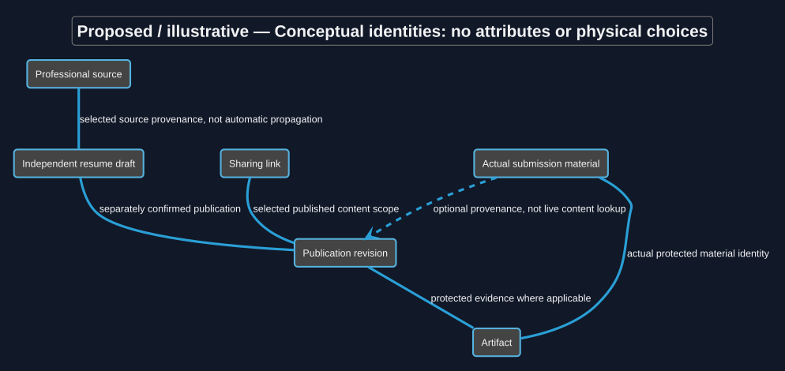

Selected conceptual excerpt to anchor the accepted source/draft/publication/actual-history distinction. It omits attributes, keys and unaccepted cardinalities. The authoritative full conceptual model remains in analysis; this excerpt creates no additional domain entities or permission grants.

##### Logical ERD: exact publication and live selection

[Logical ERD: exact publication and live selection](Diagrams/Data/data-essential-logical.svg)

[Editable PlantUML](Diagrams/Data/data-essential-logical.puml) · 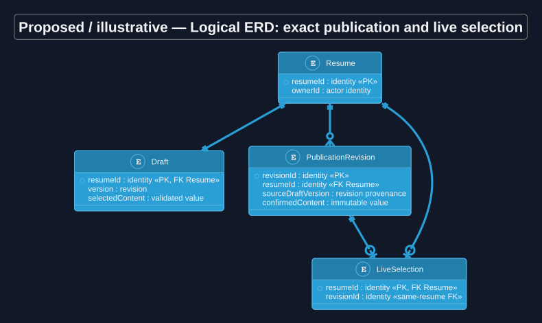

Proposed selected cardinalities, not acceptance of one-profile/account or all lifecycle rules. The live selection must identify a revision belonging to the same resume. sourceDraftVersion is historical provenance, not a foreign key to a mutable current version. Command results, content-language scope and artifact reference protocol remain outside this excerpt and must be refined.

##### Physical schema illustration: types, scoped keys and indexes

[Physical schema illustration: types, scoped keys and indexes](Diagrams/Data/data-essential-physical.svg)

[Editable PlantUML](Diagrams/Data/data-essential-physical.puml) · 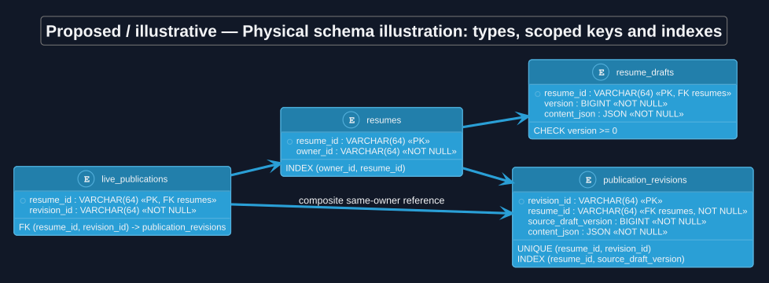

SQL-style illustration consistent with the component template, not selected engine/DDL. VARCHAR(64), BIGINT, JSON and indexes are example choices, not accepted limits or a recommendation for exposed-ID encoding. Full owner FK, collation, version overflow, content validation, command identity/result storage, current authorization, language scope and protected references need actual design. Composite FK prevents selecting another resume’s revision; no cascade action is adopted. Check actual engine support and access plans before selecting indexes.

##### Conceptual to logical to physical refinement

[Conceptual to logical to physical refinement](Diagrams/Data/data-essential-levels.svg)

[Editable PlantUML](Diagrams/Data/data-essential-levels.puml) · 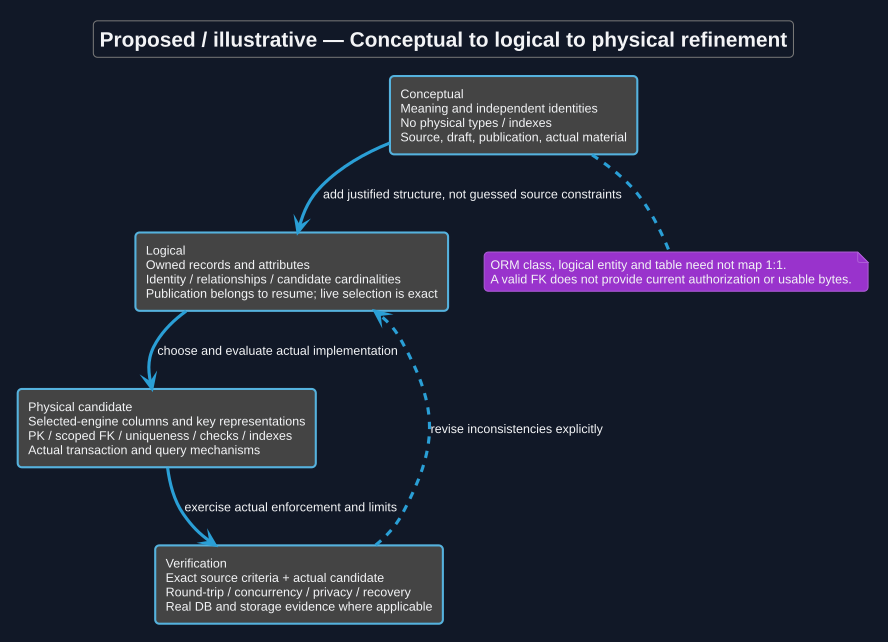

The three levels add different information. Source proposals cannot become accepted uniqueness/cardinality rules by entering a physical diagram. Physical schema and SQL atomicity cannot govern provider effects, native Git refs or artifact bytes without their actual protocols.

##### Normalization walkthrough with explicit example dependencies

[Normalization walkthrough with explicit example dependencies](Diagrams/Data/data-essential-normalization.svg)

[Editable PlantUML](Diagrams/Data/data-essential-normalization.puml) · 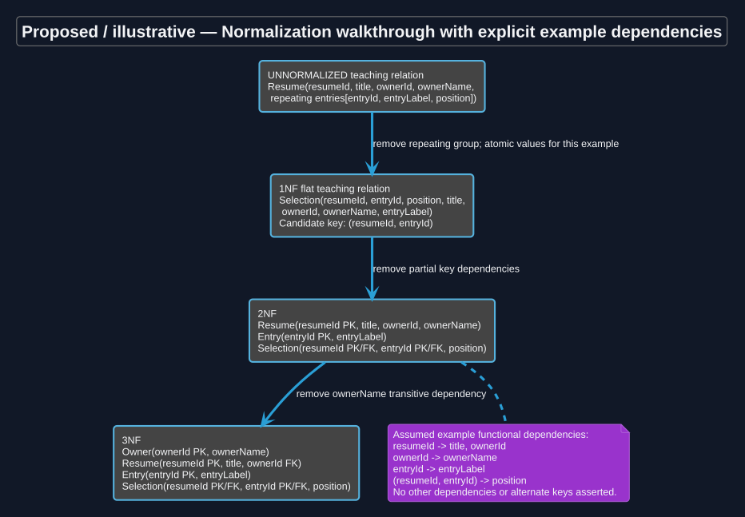

Synthetic teaching relation, not a discovered schema defect or adopted selection multiplicity. It assumes at most one entry per resume/entry pair solely for the exercise. A real entry may require language/version/occurrence identity. Do not use mutable Entry/Owner lookups to reconstruct immutable publication or actual submission content. Historical snapshots intentionally preserve exact old meaning and are not redundant mutable source-of-truth tables.

##### Scope and consistency limits

The existing physical mapping/access-path text and tables remain unchanged; no new indexing, type, naming, denormalization or partitioning policy is selected. A separate functional-dependency diagram is unnecessary because the normalization figure states its assumed dependencies. Component-specific ORM/classes and schema excerpts stay in the [component template](02-Module-Breakdown.md#design-record-03-component-and-module-design-component-and-module-design-md) and actual owner designs. Data lifecycle/retention remains in the [persistence owner](#design-record-04-data-design-03-persistence-caching-and-data-lifecycle-md).

Actual physical selection requires identified engine/version, exact source cardinality/status, types/collation, integrity/ref actions, query plans, current authority/version guards, protected-reference coordination and usable recovery evidence. A publication pointer/result commit and independent historical artifacts must remain coherent under real concurrency; a diagram or JSON column cannot establish that. No migration, data rewrite, normalization refactor, index build or database test is executed here.

Resumefolio — Persistence, Caching and Data Lifecycle

### Resumefolio — Persistence, Caching and Data Lifecycle

Current implementation choices and scope: [Baseline](https://github.com/Farhad-V/Web-Resumefolio/blob/1f2acaa351ac306cb57cbe4fe9742e8bd90720d9/docs/MVP/baseline/README.md). Runtime verification remains subject to its gates.

**Purpose:** define how owned state, private artifacts and external observations remain consistent through normal writes, cache reuse, replacement, retirement and recovery.

**Status:** proposed shared technical design. No database/cache engine, retention duration, backup destination or numerical recovery target is accepted here. No storage facility is configured by this update.

[Scope](#design-record-04-data-design-03-persistence-caching-and-data-lifecycle-md--heading-1-authority-and-storage-responsibilities) · [Persistence](#design-record-04-data-design-03-persistence-caching-and-data-lifecycle-md--heading-2-persistence-strategy-and-consistency) · [Caching](#design-record-04-data-design-03-persistence-caching-and-data-lifecycle-md--heading-3-cache-policy-and-invalidation) · [Lifecycle](#design-record-04-data-design-03-persistence-caching-and-data-lifecycle-md--heading-4-admission-replacement-and-reclamation) · [Recovery](#design-record-04-data-design-03-persistence-caching-and-data-lifecycle-md--heading-5-backup-and-recovery-consistency) · [Review](#design-record-04-data-design-03-persistence-caching-and-data-lifecycle-md--heading-6-verification-and-implementation-handoff) · [Essential views](#design-record-04-data-design-03-persistence-caching-and-data-lifecycle-md--heading-7-essential-persistence-cache-and-recovery-views)

#### 1. Authority and storage responsibilities

Use [business rules and lifecycle](../../02-Requirements-Engineering/01-Software-Requirements-Specification/03-Requirements-Specification/04-Business-Rules-And-Data-Lifecycle.md#requirements-specification-business-rules-and-data-lifecycle), [file/operating requirements](../../02-Requirements-Engineering/01-Software-Requirements-Specification/03-Requirements-Specification/02-Administration-Files-And-Operational-Behavior.md#requirements-specification-administration-files-and-operational-behavior), [quality/recovery requirements](../../02-Requirements-Engineering/01-Software-Requirements-Specification/03-Requirements-Specification/14-Quality-Security-And-Recovery-Requirements.md#requirements-specification-quality-security-and-recovery-requirements), [conceptual data analysis](../../03-System-Analysis/02-Domain-And-Information-Analysis.md#analysis-domain-and-information-analysis--05-data-oriented-view) and [source decisions](../../02-Requirements-Engineering/01-Software-Requirements-Specification/07-Change-And-Baseline/03-Requirements-Questions-And-Decisions.md#change-and-baseline-open-questions-and-decisions). Detailed proposed limits/lifecycles retain their source status.

The [logical/physical model](#design-record-04-data-design-01-analysis-to-logical-and-physical-data-models-md) owns record/key/schema refinement. This document owns shared persistence, freshness and lifecycle protocols. [Files and Operations](03-Detailed-Module-Design.md#design-record-03-component-and-module-design-components-files-and-operations-md) owns artifact accounting/protection/reclamation; resource-owning components decide whether references remain necessary. [Operations/recovery](../01-High-Level-Design/14-Appendices.md#design-record-06-design-quality-and-security-analysis-03-operations-backup-recovery-and-resilience-md) owns the actual backup/restore procedure and evidence.

Preserve the accepted distinctions: source edits do not update existing resumes automatically; selected apply preserves independent content; publication needs separate confirmation; actual submitted material remains independent. Retention is not unlimited merely because history must remain independent.

#### 2. Persistence strategy and consistency

##### Candidate storage allocation

| State | Candidate responsibility and selection boundary |
| --- | --- |
| Owned structured records | Transactional relational store for local invariants; evaluate engine/version/driver/constraints and actual operating cost |
| Private artifacts | Evaluated private filesystem/object storage adapter with canonical identity, admission and protected references |
| Git objects/refs | Evaluated native Git storage/transport; relational metadata cannot replace native truth |
| Provider/executor/target effects | Local durable intent and attributable observations; external owner remains authoritative for actual effects |
| Rebuildable projections/cache | Derived state with explicit owner/provenance; loss cannot erase authoritative records or create access |
| Backup set | Independent protected recoverable copy of required stores/configuration/keys, with actual consistency evidence |

The demo's observed MySQL installation is an evaluation input, not engine selection. Compare a compatible relational alternative against actual transactions, migrations, operations, resource fit and team capacity before recording a consequential selection in an [ADR](../ADR/Decision-Index.md#design-record-07-design-decisions-design-decisions-md). A separate distributed cache, search service or event platform is not required by this model; add dependencies only for an evidenced need.

##### Write and read contract

Authorize the owned operation, validate expected versions, apply its coherent local transaction and record attributable result. Define isolation/locks/conditional writes from actual invariants, including quota totals, publication pointers, Sprint plans and grant-change ordering. Simple check-then-write is not sufficient protection against concurrent mutations.

Read models can combine permitted projections but do not acquire ownership of another component's data. Critical eligibility and version decisions use authoritative or equivalently synchronized state. A replica, cache or worker snapshot requires an explicit consistency contract before it can decide revocation, available quota or deletion safety.

Local SQL, stored bytes, Git refs and provider/target effects do not share an assumed transaction. Record durable pending intent where needed, dispatch through scoped adapters and reconcile the same attempt after ambiguity. A local rollback does not remove uploaded bytes, undo a Git ref or recall a sent message. Follow [runtime design](../01-High-Level-Design/14-Appendices.md#design-record-01-software-architecture-03-process-view-concurrency-and-runtime-behavior-md) and [ADR-003](../ADR/ADR-003-Durable-External-Attempts.md#design-record-07-design-decisions-adr-003-durable-external-attempts-md).

#### 3. Cache policy and invalidation

[Current eligibility before private cached content delivery](Diagrams/Data/persistence-protected-cache-flow.svg)

[Editable PlantUML](Diagrams/Data/persistence-protected-cache-flow.puml) · 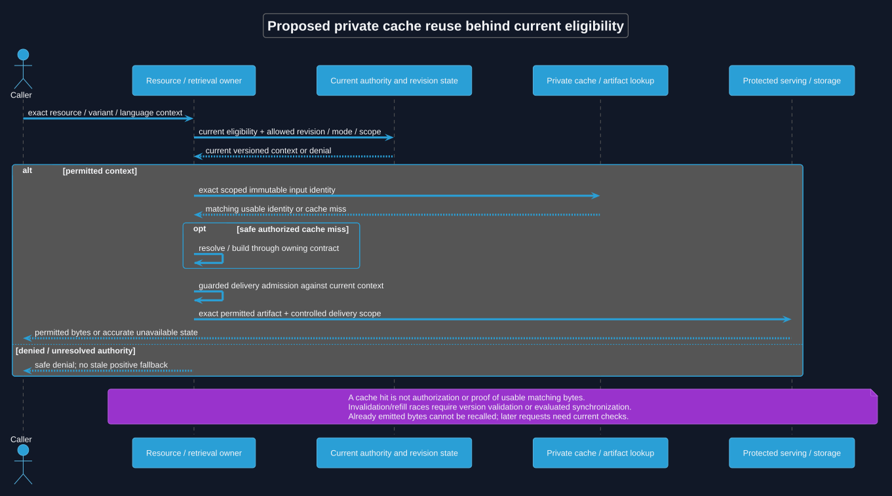

Start with no separate distributed cache dependency unless measurements justify one. Request-local memoization must stay within the current attributable operation; persistent workers must not reuse another request's actor or positive permission decision.

##### Cache classes

- **Public static assets:** immutable content/build identity and evaluated browser/server policy; only genuinely public assets belong here.
- **Private generated renditions:** exact publication/language/layout/renderer/input identity and usable artifact association. A cache hit still passes current link/account/grant/mode eligibility before bytes are admitted.
- **Private query projections:** owner/resource/filter/version scope, explicit freshness and safe failure behavior. Never reuse one user's permitted result as another user's projection.
- **Authority/session state:** current source-defined account/link/grant generation and synchronized invalidation. A TTL alone cannot establish the promised post-revocation behavior.
- **Quota/reference/deletion state:** safety-critical authoritative coordination; a stale cached count cannot admit growth or authorize reclamation.

##### Required cache record

For each actual cache, specify owner, payload classification, key dimensions, version/provenance, population timing, freshness bound, invalidation trigger, concurrent-fill behavior, size/eviction, failure fallback and verification. Exact TTLs and capacity values remain review/evaluation decisions, not defaults in this file.

Publish invalidation only after the authoritative local commit. If invalidation delivery can be lost, correctness must still follow from current-version validation, an evaluated atomic mechanism or an explicit repair protocol. A pre-commit invalidation followed by a concurrent stale refill cannot be treated as fresh indefinitely. Locking/single-flight may reduce duplicate work but is not proof of freshness or exclusive authority.

Negative results also need scope/freshness: cached missing language/artifact/permission can become outdated after publication or grant changes. Cache absence is not proof of deletion; a cache hit is not proof of available matching bytes. Do not substitute older publications or another language silently when an exact rendition is unavailable.

Browser/server/CDN caches, internal redirects and signed delivery capabilities need evaluated privacy, scope and revocation semantics. No delivery technology is selected here. Later full/range requests require applicable current checks; already emitted/downloaded bytes cannot be recalled. If an authority dependency is unavailable, do not serve private bytes on an unproven old allow. A safe cache miss can rebuild only through authorized owner contracts.

#### 4. Admission, replacement and reclamation

[Artifact lifecycle, protected references and actual reclamation](Diagrams/Data/persistence-artifact-lifecycle.svg)

[Editable PlantUML](Diagrams/Data/persistence-artifact-lifecycle.puml) · 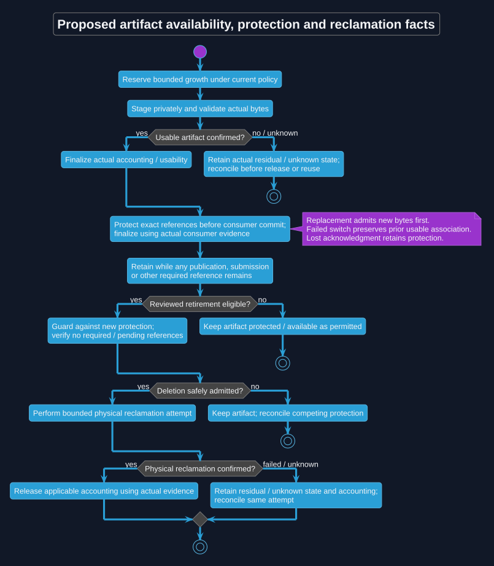

The figure separates logical availability, protected consumer use and physical reclamation. Exact source retirement/trash/retention rules remain open; this protocol grants no new deletion authority.

##### Admit and protect

1. Resolve current quota/resource policy and reserve bounded growth atomically against concurrent usage/reservations and operating headroom. Include temporary/generated/log/Git growth where applicable, not only visible uploads.
2. Stage bytes privately; validate actual size/type/processing and canonical identity. Metadata or transport success alone is not usable availability.
3. Finalize actual accounting and artifact state. Failed/interrupted writes retain known residual bytes or unknown state until reconciled; do not fabricate reclaimed capacity.
4. Protect an exact artifact reference before its consumer commits publication, historical material or another protected association. Finalize against actual committed consumer evidence. A lost acknowledgment retains protection until the consumer outcome is established.

##### Replace and retire

Admit/validate the replacement before switching the guarded consumer association. Preserve the prior usable association on failure. Once switched, release the old consumer reference only when no valid obligation remains; other publications/submissions/consumers may still protect the same bytes. Physical deduplication does not merge their permissions or lifecycles.

Retiring source content, removing a share link, changing a download mode and deleting physical bytes are different operations. Resource owners resolve lifecycle and history obligations under actual source authority. No cascade from source/profile/account deletion may silently destroy protected actual materials or unrelated references.

##### Reclaim safely

Establish reviewed retirement/retention eligibility and exclude every protected/pending reference under the concrete reference/deletion guard. Coordinate new reference registration with deletion so a stale scan cannot win a race. A prior count of zero or an old cleanup job is insufficient authority to delete.

Record a bounded reclamation attempt, perform storage deletion and reconcile actual outcome. Unknown deletion remains unknown; do not mark bytes reclaimed or release accounting from an API request alone. Handle stale locators, new protection and worker-generation races through the evaluated protocol. Release accounting only for confirmed applicable reclamation, keeping logical versus physical quantities distinct.

Actual transaction/guard schemas and storage adapter behavior remain joint Files/data-design prerequisites. Cleanup age, cache eviction or a terminal workflow label cannot prove protected references disappeared or workspace resources stopped being used.

#### 5. Backup and recovery consistency

Define a recoverable set covering relational records, artifact bytes/manifests, native Git repositories/refs, relevant configuration identities and usable recovery keys. Record compatible versions and a recoverable point or coordinated write procedure; unrelated database/file copies do not establish consistency. Protect the backup's own access and independence from the primary failure domain.

No destination, paid service, schedule, retention duration, RPO or RTO is selected here. Existing backups-not-configured remains an operating gap. Backup success is not restore success, and redundancy/failover is not established by a proposed recovery procedure.

Recovery sequence:

1. Identify actual source/version, intended recovery scope and possible loss; restore into an isolated target with outbound effects disabled.
2. Verify schema/manifest compatibility, native repositories, actual artifact/key usability, reference/accounting integrity and recorded command/attempt context.
3. Reconcile current account/grant/link/revocation decisions rather than resurrecting access from old session rows. Rebuild disposable caches from validated authoritative state.
4. Reconcile provider, executor and deployment effects before resuming pending work. Restored pending intents cannot automatically resend mail, relaunch jobs or redeploy.
5. Measure actual recoverable/usable state and loss, record unresolved findings and follow the owning operating procedure before promotion.

Schema rollback cannot reverse deleted bytes, exposed secrets or irreversible remote/data effects. Keep a compatible forward-repair/recovery path and preserve actual observations. Detailed operating steps and authorization belong to [operations/recovery](../01-High-Level-Design/14-Appendices.md#design-record-06-design-quality-and-security-analysis-03-operations-backup-recovery-and-resilience-md).

#### 6. Verification and implementation handoff

##### Planned focused checks

- Actual transaction/version behavior for concurrent ownership/publication/Sprint/quota changes.
- Private cache key isolation, cross-user/viewer requests, stale permission/link/mode state and later range/cache requests.
- Commit/invalidation/refill races, lost invalidation, worker context leakage and safe authority/cache outage behavior.
- Exact publication/language/rendition identity; missing/failed output without silent old-content fallback.
- Concurrent reservations, interrupted writes, failed replacement and accurate residual-byte accounting.
- New reference registration versus cleanup, lost consumer acknowledgment, shared historical references and unknown deletion outcome.
- Isolated restore with missing bytes/keys, current revocation reconciliation, cache rebuild and no remote-action replay.

Use deterministic lifecycle policies plus actual persistence/storage/cache/concurrency and authorized restore evidence. A mock deletion or cache test cannot establish physical reclamation, real revocation behavior or usable recovery. No cache, cleanup, deletion, backup, restore or product test is executed by this update.

##### Required implementation decisions

Select/evaluate actual database/storage configuration; specify transaction and reference/deletion guards; define authoritative resource/accounting ownership; document each measured cache need and exact freshness/failure contract. Review source retention/trash rules and numerical policies, establish backup coverage/keys/independent destination and obtain actual restoration evidence. Complete exact criterion mapping and record consequential choices in [ADRs](../ADR/Decision-Index.md#design-record-07-design-decisions-design-decisions-md).

Shared direction is populated; concrete engine/cache/storage facilities, physical protocol verification and recovery readiness remain pending. This document refines the existing data/lifecycle plan and does not reopen accepted publication/history behavior or select new infrastructure. FAU's persistence concern and component-refinement approach are mapped in the [reference guide](../01-High-Level-Design/14-Appendices.md#design-record-design-references-and-coverage-md).

[Data Design](#design-record-04-data-design-data-design-md) · [Logical/physical model](#design-record-04-data-design-01-analysis-to-logical-and-physical-data-models-md) · [Review/handoff](../01-High-Level-Design/14-Appendices.md#design-record-06-design-quality-and-security-analysis-05-design-review-traceability-and-handoff-md) · [Diagram catalog](#design-record-04-data-design-diagrams-diagram-catalog-md)

#### 7. Essential persistence, cache and recovery views

Only **six complementary diagrams** are added; no new tables. Reuse the [existing protected-cache view](#design-record-04-data-design-03-persistence-caching-and-data-lifecycle-md--heading-3-cache-policy-and-invalidation) and [artifact lifecycle view](#design-record-04-data-design-03-persistence-caching-and-data-lifecycle-md--heading-4-admission-replacement-and-reclamation). These diagrams specify candidate correctness obligations, not selected engines, actual cache deployment, configured backup or passing integration tests.

##### 7.1 Persistence responsibilities and authoritative stores

[MVP with explicitly deferred paths — Persistence responsibilities and authoritative stores](Diagrams/Data/persistence-essential-architecture.svg)

[Editable PlantUML](Diagrams/Data/persistence-essential-architecture.puml) · 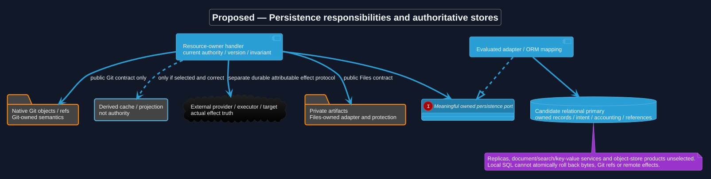

Combines persistence allocation with store boundaries without inventing a polyglot service portfolio. Primary is a logical authority role, not a selected engine/host. A replica or derived projection cannot decide current grants, quota or deletion safety unless an actual equivalent synchronization contract is established.

##### 7.2 Guarded write and post-commit cache coherence

[Guarded write and post-commit cache coherence](Diagrams/Data/persistence-essential-write.svg)

[Editable PlantUML](Diagrams/Data/persistence-essential-write.puml) · 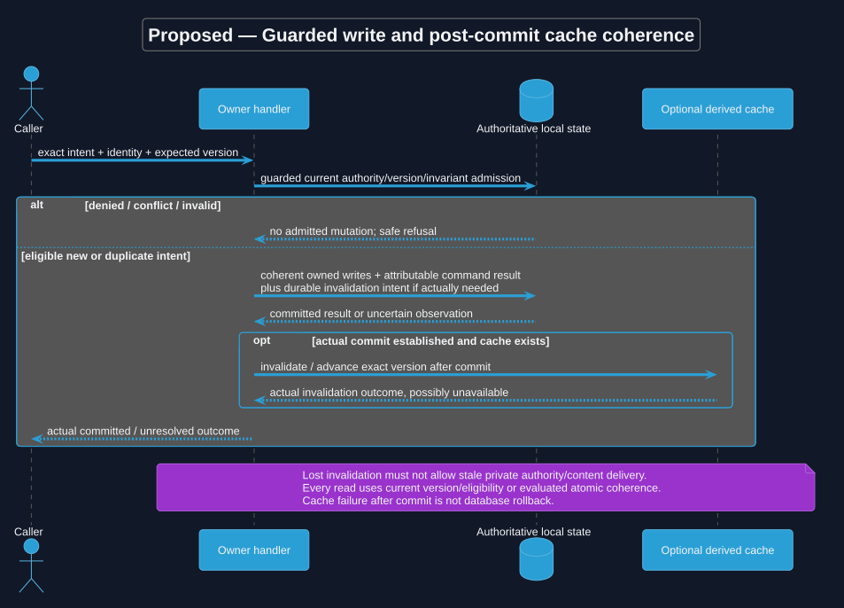

No cache engine, transaction isolation level or event platform selected. If commit is uncertain, reconcile the same command identity before claiming success or failure. Invalidation mechanics must handle lost delivery and concurrent old fills; TTL alone cannot establish revocation correctness.

##### 7.3 Authorized cache-aside read: hit, miss and outage

[Authorized cache-aside read: hit, miss and outage](Diagrams/Data/persistence-essential-read.svg)

[Editable PlantUML](Diagrams/Data/persistence-essential-read.puml) · 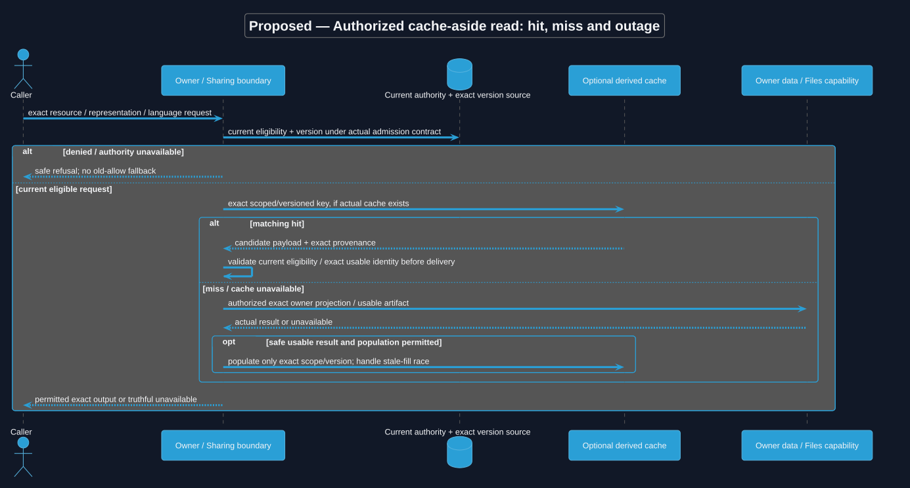

Cache-aside is an illustrative candidate; direct authoritative reads remain the simplest baseline. Cache hit/miss is not proof of current permission, artifact presence or matching language. Cache outage may bypass only optional cache work, never required authority or usable-byte checks. No CDN/browser private-cache behavior is selected.

##### 7.4 Versioned invalidation and concurrent-fill safety

[Versioned invalidation and concurrent-fill safety](Diagrams/Data/persistence-essential-invalidation.svg)

[Editable PlantUML](Diagrams/Data/persistence-essential-invalidation.puml) · 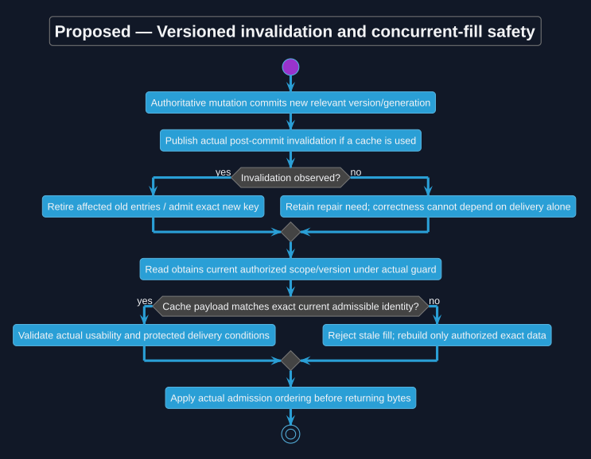

An old fill racing after invalidation must not overwrite a current-version entry or bypass current eligibility. Versioned keys still need cache bounds/eviction and actual authoritative-read ordering. TTL/repair events may support freshness/resource policy but do not replace synchronized authority/ref/quota correctness.

##### 7.5 Logical retirement, policy assessment and physical deletion

[Logical retirement, policy assessment and physical deletion](Diagrams/Data/persistence-essential-deletion.svg)

[Editable PlantUML](Diagrams/Data/persistence-essential-deletion.puml) · 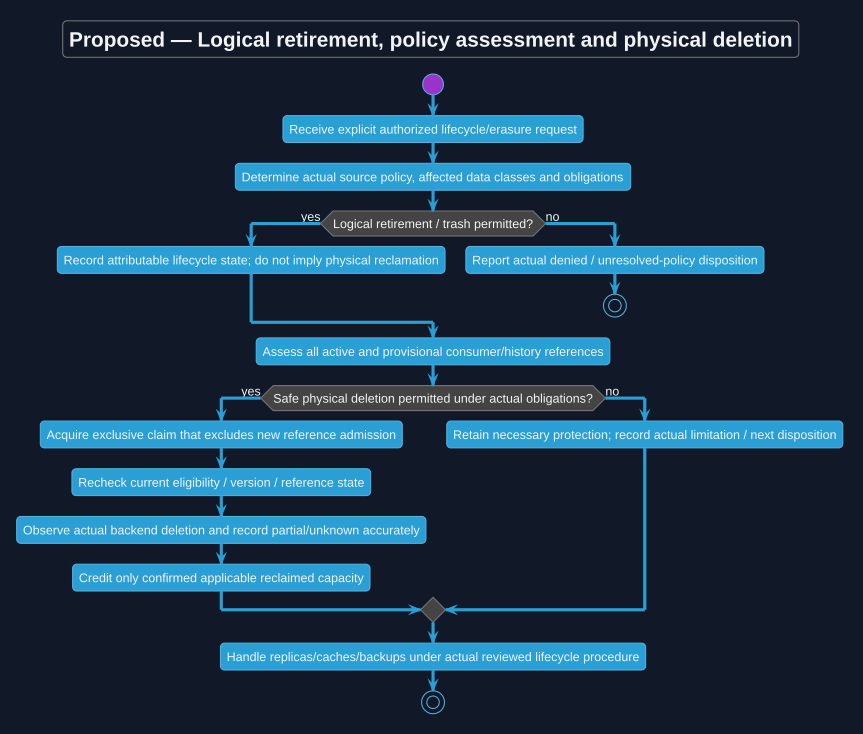

No retention duration, cascade, automatic purge or legal erasure entitlement is decided by this engineering flow. A privacy/erasure request needs applicable source/legal disposition; protected history is not a blanket indefinite-retention justification. SQL unlink, cache eviction and deletion acknowledgment are not proof of byte reclamation. Backup-expiry handling requires actual policy, not invented immediate erasure.

##### 7.6 Consistent backup set and isolated usable restore

[Consistent backup set and isolated usable restore](Diagrams/Data/persistence-essential-recovery.svg)

[Editable PlantUML](Diagrams/Data/persistence-essential-recovery.puml) · 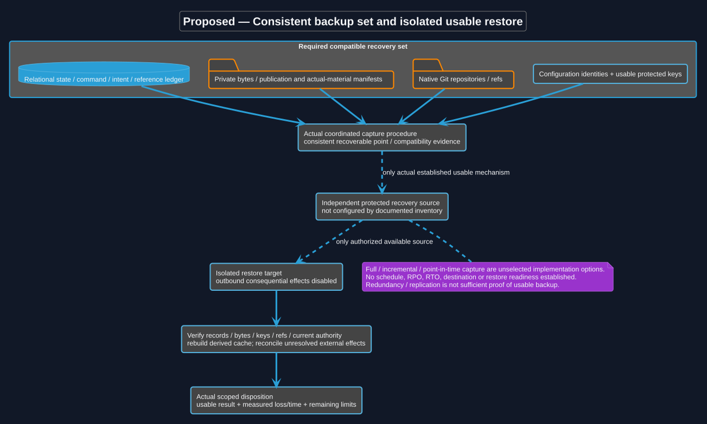

Recovery must stop if prerequisites/source/keys are absent. Restore success is usable consistent state, not a completed copy. Reassess current revocations/deletion decisions; never replay restored sends, workflow launches or deployments automatically. Actual recovery steps remain owned by Operations/Recovery.

##### Deliberately omitted alternatives

No replicas, sharding/partitioning, document/search store, distributed cache, tiered hot/warm/cold layout or private CDN is selected. Separate read-through/write-through/write-behind diagrams would add unchosen mechanisms rather than clarify the present baseline; write-behind is not permission to defer authoritative safety-critical state. Database buffer caches are engine internals, not an authorization facility. Replica read-your-writes/failover and tier/replication choices require actual resource, consistency and operating evidence before addition.

Physical schema remains in the [logical/physical data-model owner](#design-record-04-data-design-01-analysis-to-logical-and-physical-data-models-md--heading-essential-data-model-diagrams). Schema migration/evolution stays in the [evolution procedure](12-Appendices.md#design-record-02-detailed-and-object-oriented-design-05-design-evolution-refactoring-and-technical-debt-md), and actual backup/runbook detail in [Operations/Recovery](../01-High-Level-Design/14-Appendices.md#design-record-06-design-quality-and-security-analysis-03-operations-backup-recovery-and-resilience-md). These references avoid another competing schema, migration policy or recovery target.

Actual implementation must establish current admission ordering, commit/invalidation/refill safety, protected-reference/deletion exclusion, residual accounting and isolated usable recovery. Numerical TTL, retention, rate, workload, isolation-level and recovery values remain pending actual selection/source disposition. This authoring performs no cache flush, deletion, backup, restore, migration, privacy-policy decision or product test.

Resumefolio — Data Design

### Resumefolio — Data Design

Current implementation choices and scope: [Baseline](https://github.com/Farhad-V/Web-Resumefolio/blob/1f2acaa351ac306cb57cbe4fe9742e8bd90720d9/docs/MVP/baseline/README.md). Runtime verification remains subject to its gates.

**Use this folder to understand how analysis information becomes owned records, physical integrity rules and recoverable storage behavior.** It defines shared data mechanisms; each component keeps its concrete data structures and operation-specific invariants in its own design package.

Owner and decision authority: Farhad. **Current position:** both documents are populated with project-specific proposed design and **15 distinct diagrams**: seven model/refinement views and eight persistence/lifecycle views. Each has an editable PlantUML source and SVG/PNG exports. They do not establish a final database/cache/storage engine, executable schema, configured backup, accepted retention policy or verified recovery capability.

[Reading route](#design-record-04-data-design-data-design-md--heading-1-reading-route) · [Document guide](#design-record-04-data-design-data-design-md--heading-2-find-the-right-record) · [Diagrams](#design-record-04-data-design-data-design-md--heading-3-diagram-gallery-and-catalog) · [Boundaries](#design-record-04-data-design-data-design-md--heading-4-ownership-and-shared-invariants) · [Readiness](#design-record-04-data-design-data-design-md--heading-5-review-and-implementation-readiness)

#### 1. Reading route

1. Read the [domain model](../../03-System-Analysis/02-Domain-And-Information-Analysis.md#analysis-domain-and-information-analysis--03-domain-model-and-object-oriented-view), [data-oriented analysis](../../03-System-Analysis/02-Domain-And-Information-Analysis.md#analysis-domain-and-information-analysis--05-data-oriented-view) and [dictionary](../../02-Requirements-Engineering/01-Software-Requirements-Specification/05-Data-Definitions/02-Data-Dictionary.md#data-definitions-data-dictionary) for meaning, conceptual relationships and lifecycle obligations.
2. Read [Analysis to Logical and Physical Data Models](#design-record-04-data-design-01-analysis-to-logical-and-physical-data-models-md) for the nine ownership families, revision/reference model, keys, normalization, integrity allocation, candidate physical representations, query-driven indexes and migration/handoff requirements.
3. Read [Persistence, Caching and Data Lifecycle](#design-record-04-data-design-03-persistence-caching-and-data-lifecycle-md) for storage responsibility, transactions, cache freshness/invalidation, artifact admission/replacement/reclamation and recovery consistency.
4. Apply these shared rules to the [owning component package](02-Module-Breakdown.md#design-record-03-component-and-module-design-component-and-module-design-md), aligning its operation contracts with [runtime concurrency](../01-High-Level-Design/14-Appendices.md#design-record-01-software-architecture-03-process-view-concurrency-and-runtime-behavior-md) and [interface contracts](05-API-Specification.md#design-record-05-interface-and-api-design-interface-and-api-design-md).
5. Record consequential choices in [ADRs](../ADR/Decision-Index.md#design-record-07-design-decisions-design-decisions-md) and actual criterion findings/evidence in [Design Review and Handoff](../01-High-Level-Design/14-Appendices.md#design-record-06-design-quality-and-security-analysis-05-design-review-traceability-and-handoff-md).

The retained file numbers are stable locators. Schema integrity and normalization are included in document 01; the numbering does not require creating a separate file 02.

#### 2. Find the right record

| Question | Owning record |
| --- | --- |
| How do analysis concepts map to logical records and component owners? | [01 — Analysis-to-design contract and ownership](#design-record-04-data-design-01-analysis-to-logical-and-physical-data-models-md) |
| How are drafts, publications, submitted material and artifact references kept independent? | [01 — Revision/reference model](#design-record-04-data-design-01-analysis-to-logical-and-physical-data-models-md--heading-3-revision-and-reference-model) |
| Which rules belong in keys, constraints or guarded transactions? | [01 — Integrity](#design-record-04-data-design-01-analysis-to-logical-and-physical-data-models-md--heading-4-keys-relationships-and-integrity) |
| What exact physical schema and index evidence is still required? | [01 — Physical mapping and handoff](#design-record-04-data-design-01-analysis-to-logical-and-physical-data-models-md--heading-5-physical-representation-and-access-paths) |
| What is authoritative in SQL, private storage, Git and external systems? | [03 — Persistence strategy](#design-record-04-data-design-03-persistence-caching-and-data-lifecycle-md--heading-2-persistence-strategy-and-consistency) |
| Can a private cache hit bypass current permission checks? | [03 — Cache policy](#design-record-04-data-design-03-persistence-caching-and-data-lifecycle-md--heading-3-cache-policy-and-invalidation) |
| When may references, bytes and quota accounting be released? | [03 — Lifecycle protocol](#design-record-04-data-design-03-persistence-caching-and-data-lifecycle-md--heading-4-admission-replacement-and-reclamation) |
| Who owns the actual backup/restore procedure and readiness evidence? | [Operations and Recovery](../01-High-Level-Design/14-Appendices.md#design-record-06-design-quality-and-security-analysis-03-operations-backup-recovery-and-resilience-md) |

#### 3. Diagram gallery and catalog

##### Independent revisions and protected references

[Candidate logical revisions and protected artifact references](Diagrams/Data/data-logical-revisions-and-references.svg)

[Owning model document](#design-record-04-data-design-01-analysis-to-logical-and-physical-data-models-md) · [Editable PlantUML](Diagrams/Data/data-logical-revisions-and-references.puml) · 

This selected logical view separates reusable source, independent draft, immutable publication, actual material and artifact protection. Arrows express relationships, not accepted cardinality limits or a complete physical ERD.

##### Current eligibility before private cache delivery

[Private cache reuse behind current eligibility](Diagrams/Data/persistence-protected-cache-flow.svg)

[Owning persistence document](#design-record-04-data-design-03-persistence-caching-and-data-lifecycle-md) · [Editable PlantUML](Diagrams/Data/persistence-protected-cache-flow.puml) · 

A cache hit neither grants access nor proves matching bytes remain usable. Actual admission/invalidation synchronization and serving facilities still require evaluation.

##### Essential model views — document 01

The [model diagram package](#design-record-04-data-design-01-analysis-to-logical-and-physical-data-models-md--heading-essential-data-model-diagrams) adds five complementary views to the two existing revision/reference and physical-enforcement diagrams:

- [Conceptual identities without attributes or physical choices](Diagrams/Data/data-essential-conceptual.svg) · [source](Diagrams/Data/data-essential-conceptual.puml) · 
- [Logical ERD with candidate attributes, keys and cardinalities](Diagrams/Data/data-essential-logical.svg) · [source](Diagrams/Data/data-essential-logical.puml) · 
- [Physical schema illustration with types, scoped keys and candidate indexes](Diagrams/Data/data-essential-physical.svg) · [source](Diagrams/Data/data-essential-physical.puml) · 
- [Conceptual → logical → physical refinement and verification](Diagrams/Data/data-essential-levels.svg) · [source](Diagrams/Data/data-essential-levels.puml) · 
- [Normalization walkthrough with explicit assumed functional dependencies](Diagrams/Data/data-essential-normalization.svg) · [source](Diagrams/Data/data-essential-normalization.puml) · 

The physical schema and normalization relation are labeled examples, not accepted DDL, a migration or a measured current-schema defect. Proposed multiplicities, types and indexes require actual source/engine/workload disposition. Immutable publication and actual-submission snapshots preserve historical meaning; they must not be reconstructed through mutable current source records.

##### Essential persistence views — document 03

The [persistence diagram package](#design-record-04-data-design-03-persistence-caching-and-data-lifecycle-md--heading-7-essential-persistence-cache-and-recovery-views) adds six complementary views to the two existing protected-cache and artifact-lifecycle diagrams:

- [Persistence architecture with authoritative relational state, private bytes, native Git and external effect boundaries](Diagrams/Data/persistence-essential-architecture.svg) · [source](Diagrams/Data/persistence-essential-architecture.puml) · 
- [Guarded write, actual commit observation and post-commit cache coherence](Diagrams/Data/persistence-essential-write.svg) · [source](Diagrams/Data/persistence-essential-write.puml) · 
- [Authorized cache-aside read: matching hit, miss and safe outage behavior](Diagrams/Data/persistence-essential-read.svg) · [source](Diagrams/Data/persistence-essential-read.puml) · 
- [Versioned invalidation and concurrent-fill safety](Diagrams/Data/persistence-essential-invalidation.svg) · [source](Diagrams/Data/persistence-essential-invalidation.puml) · 
- [Logical retirement, obligation assessment and guarded physical deletion](Diagrams/Data/persistence-essential-deletion.svg) · [source](Diagrams/Data/persistence-essential-deletion.puml) · 
- [Consistent recovery set and isolated usable restore](Diagrams/Data/persistence-essential-recovery.svg) · [source](Diagrams/Data/persistence-essential-recovery.puml) · 

A cache hit never replaces current authority or exact usable-artifact checks. Lost invalidation must not create a stale-allow bypass. Unknown consumer commits retain protection, and deletion acknowledgment alone does not prove reclaimed capacity. Recovery requires actual compatible records/bytes/keys/repositories and current permission/effect reconciliation.

The [complete diagram catalog](#design-record-04-data-design-diagrams-diagram-catalog-md) links **15 PlantUML sources, 15 SVGs and 15 PNGs**. Counts refer to distinct views, not repeated image links. Existing gallery figures above are reused; this README update adds no new diagram or table.

##### Reading boundaries

Use the [analysis data model](../../03-System-Analysis/02-Domain-And-Information-Analysis.md#analysis-domain-and-information-analysis--05-data-oriented-view) for authoritative conceptual meaning, the [component data template](02-Module-Breakdown.md#design-record-03-component-and-module-design-component-and-module-design-md) for component-specific class/ORM refinements, and [Operations/Recovery](../01-High-Level-Design/14-Appendices.md#design-record-06-design-quality-and-security-analysis-03-operations-backup-recovery-and-resilience-md) for actual procedures and readiness evidence. Shared storage choices do not transfer another module's write authority.

Replicas, sharding, alternate document/search stores, distributed caches, tiered storage and CDN remain unselected options. No TTL, retention, backup schedule, RPO/RTO, physical engine or legal erasure disposition is accepted by these diagrams. Current unconfigured-backup status remains an explicit operating gap.

#### 4. Ownership and shared invariants

The [component catalog](02-Module-Breakdown.md#design-record-03-component-and-module-design-component-and-module-design-md) defines nine logical owners. Identity owns current access context; Presentation owns professional content and publication intent; Sharing owns links and rendition eligibility; Applications owns actual submitted material; Communication owns provider coordination; Work owns work/Sprint meaning; Git owns native repository collaboration; Workflow owns gated attempt/deployment coordination; Files owns artifact admission/accounting/protection. Detailed record allocation is in document 01.

Shared invariants to preserve:

- Source edits, selected draft application, separate confirmed publication and actual submitted history remain distinct under the [accepted owner policy](../../02-Requirements-Engineering/01-Software-Requirements-Specification/07-Change-And-Baseline/03-Requirements-Questions-And-Decisions.md#change-and-baseline-open-questions-and-decisions--id-owner-accepted-profile-update-policy).
- Stable resource identity, exact revision identity and current authority are different facts; a foreign key or unguessable ID is not authorization.
- Scoped grants, private queries and cached delivery respect resource/action context and completed revocation boundaries.
- Protected/pending consumer references exclude unsafe physical reclamation; retiring a logical reference does not prove bytes or capacity were reclaimed.
- Goal, selected items and delivery plan form one coherent Sprint Backlog; board position and elapsed time cannot fabricate acceptance or goal achievement.
- SQL state, private bytes, Git refs and provider/executor/target effects require explicit coordination and truthful pending/partial/unknown outcomes.
- Restoring old data cannot automatically resurrect revoked access or replay uncertain external actions.

Component packages own exact record structures and operation realization. This folder owns shared integrity/storage conventions. Security owns threat controls, and Operations owns actual recovery procedure and evidence. Link these authorities instead of duplicating policy or inventing retention durations here.

#### 5. Review and implementation readiness

##### Required implementation package

For each schema/storage change, identify its source criterion and owner, logical meaning, exact types/units/nullability, keys and constraints, scoped access paths, query/index rationale, version/transaction guards, sensitive data handling, migration compatibility, reference/lifecycle consequences and recovery checks. Record unresolved decisions as gates.

For any cache, specify payload/key scope, authoritative provenance, freshness/invalidation, concurrent fill, capacity/eviction and safe failure behavior. For any physical cleanup, demonstrate protected-reference exclusion and actual reclamation. For recovery, validate a consistent usable set and reconcile current authority/external effects before resumption.

##### Remaining decisions and evidence

Final engine/version/storage selection, exact DDL/types/collation/indexes, policy-dependent cardinalities/retention, reference-deletion and authorization synchronization, measured cache need and backup destination/key handling remain pending. The demo environment is evidence to evaluate, not a selected final data platform.

Use actual persistence/concurrency/storage/cache and authorized isolated recovery checks alongside domain tests. Diagram rendering and file-link checks verify documentation only; they do not establish database integrity, query performance, security or restoration readiness. No live migration, deletion, backup/restore, product-test Pass or phase approval is created by this folder's completion.

#### 6. FAU basis and maintenance

FAU's architecture persistence concern and component computational-data refinement inform these views. The shared folder layout, candidate relational mapping, cache records and implementation handoff checklist are project adaptations, not a university-mandated file tree. See the [reference and coverage map](../01-High-Level-Design/14-Appendices.md#design-record-design-references-and-coverage-md).

When changing a shared rule, reconcile the source decision, owning model/lifecycle document, affected component contracts, runtime/security/operations views and ADRs. Regenerate changed diagrams, check local links and cross-view consistency, and preserve historical evidence with its original scope. Add or split files only when substantive content or ownership makes that useful.

[System Design home](../../01-Project-Planning/02-Project-Management-Plan.md#stage-4-system-design) · [Component and Module Design](02-Module-Breakdown.md#design-record-03-component-and-module-design-component-and-module-design-md) · [Diagram catalog](#design-record-04-data-design-diagrams-diagram-catalog-md)

Data Design — Diagram Catalog

### Data Design — Diagram Catalog

Keep editable sources and SVG/PNG exports synchronized. These are proposed technical views, not final physical schemas.

Current MVP scope and selected mechanisms: [Baseline](https://github.com/Farhad-V/Web-Resumefolio/blob/1f2acaa351ac306cb57cbe4fe9742e8bd90720d9/docs/MVP/baseline/README.md). Deferred provider, advanced collaboration and workflow-execution designs are not MVP prerequisites.

#### Logical and physical data-model refinement

- [Logical revisions and protected references](Diagrams/Data/data-logical-revisions-and-references.svg) · [PlantUML](Diagrams/Data/data-logical-revisions-and-references.puml) · 
- [Invariant enforcement and physical mapping](Diagrams/Data/data-physical-enforcement-map.svg) · [PlantUML](Diagrams/Data/data-physical-enforcement-map.puml) · 

[Owning document](#design-record-04-data-design-01-analysis-to-logical-and-physical-data-models-md). Candidate logical relationships and physical enforcement allocation. Final types, constraints, engine, policy-dependent cardinalities and coordination mechanisms remain gated.

#### Persistence, caching and lifecycle

- [Current eligibility before private cache delivery](Diagrams/Data/persistence-protected-cache-flow.svg) · [PlantUML](Diagrams/Data/persistence-protected-cache-flow.puml) · 
- [Artifact protection and physical reclamation](Diagrams/Data/persistence-artifact-lifecycle.svg) · [PlantUML](Diagrams/Data/persistence-artifact-lifecycle.puml) · 

[Owning document](#design-record-04-data-design-03-persistence-caching-and-data-lifecycle-md). Proposed persistence and lifecycle protocols. Actual storage/cache facilities, freshness/guard mechanisms, retention and recovery evidence remain pending.

#### Essential conceptual, logical and physical model views

- [Conceptual identities: no attributes or physical choices](Diagrams/Data/data-essential-conceptual.svg) · [PlantUML](Diagrams/Data/data-essential-conceptual.puml) · 
- [Logical ERD: exact publication and live selection](Diagrams/Data/data-essential-logical.svg) · [PlantUML](Diagrams/Data/data-essential-logical.puml) · 
- [Physical schema illustration: types, scoped keys and indexes](Diagrams/Data/data-essential-physical.svg) · [PlantUML](Diagrams/Data/data-essential-physical.puml) · 
- [Conceptual to logical to physical refinement](Diagrams/Data/data-essential-levels.svg) · [PlantUML](Diagrams/Data/data-essential-levels.puml) · 
- [Normalization walkthrough with explicit example dependencies](Diagrams/Data/data-essential-normalization.svg) · [PlantUML](Diagrams/Data/data-essential-normalization.puml) · 

[Owning data model document](#design-record-04-data-design-01-analysis-to-logical-and-physical-data-models-md--heading-essential-data-model-diagrams). Selected examples and normalization dependencies are illustrative, not accepted schema or migrations.

#### Essential persistence, cache and recovery views

- [Persistence responsibilities and authoritative stores](Diagrams/Data/persistence-essential-architecture.svg) · [PlantUML](Diagrams/Data/persistence-essential-architecture.puml) · 
- [Guarded write and post-commit cache coherence](Diagrams/Data/persistence-essential-write.svg) · [PlantUML](Diagrams/Data/persistence-essential-write.puml) · 
- [Authorized cache-aside read: hit, miss and outage](Diagrams/Data/persistence-essential-read.svg) · [PlantUML](Diagrams/Data/persistence-essential-read.puml) · 
- [Versioned invalidation and concurrent-fill safety](Diagrams/Data/persistence-essential-invalidation.svg) · [PlantUML](Diagrams/Data/persistence-essential-invalidation.puml) · 
- [Logical retirement, policy assessment and physical deletion](Diagrams/Data/persistence-essential-deletion.svg) · [PlantUML](Diagrams/Data/persistence-essential-deletion.puml) · 
- [Consistent backup set and isolated usable restore](Diagrams/Data/persistence-essential-recovery.svg) · [PlantUML](Diagrams/Data/persistence-essential-recovery.puml) · 

[Owning persistence document](#design-record-04-data-design-03-persistence-caching-and-data-lifecycle-md--heading-7-essential-persistence-cache-and-recovery-views). Existing cache/lifecycle views reused; no replica/cache/backend/backup facility selected.

#### Complete diagram alignment — November 4

[Full project inventory and verification limits](../01-High-Level-Design/14-Appendices.md#design-record-01-software-architecture-diagrams-diagram-catalog-md). This current disposition supersedes earlier partial diagram-allocation lists.

| Editable source or visual | Current applicability | Matching exports |
| --- | --- | --- |
| [data-essential-conceptual.puml](Diagrams/Data/data-essential-conceptual.puml) | MVP core / cross-cutting| [SVG](Diagrams/Data/data-essential-conceptual.svg) ·  |
| [data-essential-levels.puml](Diagrams/Data/data-essential-levels.puml) | MVP core / cross-cutting| [SVG](Diagrams/Data/data-essential-levels.svg) ·  |
| [data-essential-logical.puml](Diagrams/Data/data-essential-logical.puml) | MVP core / cross-cutting| [SVG](Diagrams/Data/data-essential-logical.svg) ·  |
| [data-essential-normalization.puml](Diagrams/Data/data-essential-normalization.puml) | Reference / design method| [SVG](Diagrams/Data/data-essential-normalization.svg) ·  |
| [data-essential-physical.puml](Diagrams/Data/data-essential-physical.puml) | MVP core / cross-cutting| [SVG](Diagrams/Data/data-essential-physical.svg) ·  |
| [data-logical-revisions-and-references.puml](Diagrams/Data/data-logical-revisions-and-references.puml) | MVP core / cross-cutting| [SVG](Diagrams/Data/data-logical-revisions-and-references.svg) ·  |
| [data-physical-enforcement-map.puml](Diagrams/Data/data-physical-enforcement-map.puml) | MVP core / cross-cutting| [SVG](Diagrams/Data/data-physical-enforcement-map.svg) ·  |
| [persistence-artifact-lifecycle.puml](Diagrams/Data/persistence-artifact-lifecycle.puml) | MVP core / cross-cutting| [SVG](Diagrams/Data/persistence-artifact-lifecycle.svg) ·  |
| [persistence-essential-architecture.puml](Diagrams/Data/persistence-essential-architecture.puml) | Mixed MVP / future| [SVG](Diagrams/Data/persistence-essential-architecture.svg) ·  |
| [persistence-essential-deletion.puml](Diagrams/Data/persistence-essential-deletion.puml) | MVP core / cross-cutting| [SVG](Diagrams/Data/persistence-essential-deletion.svg) ·  |
| [persistence-essential-invalidation.puml](Diagrams/Data/persistence-essential-invalidation.puml) | MVP core / cross-cutting| [SVG](Diagrams/Data/persistence-essential-invalidation.svg) ·  |
| [persistence-essential-read.puml](Diagrams/Data/persistence-essential-read.puml) | MVP core / cross-cutting| [SVG](Diagrams/Data/persistence-essential-read.svg) ·  |
| [persistence-essential-recovery.puml](Diagrams/Data/persistence-essential-recovery.puml) | MVP core / cross-cutting| [SVG](Diagrams/Data/persistence-essential-recovery.svg) ·  |
| [persistence-essential-write.puml](Diagrams/Data/persistence-essential-write.puml) | MVP core / cross-cutting| [SVG](Diagrams/Data/persistence-essential-write.svg) ·  |
| [persistence-protected-cache-flow.puml](Diagrams/Data/persistence-protected-cache-flow.puml) | MVP core / cross-cutting| [SVG](Diagrams/Data/persistence-protected-cache-flow.svg) ·  |

## Migration evidence checklist

For each candidate migration record the affected tables and constraints, expected access path, production compatibility, and recovery or rollback approach. Rehearse on isolated MySQL with synthetic data and verify referential integrity and expected query behavior.

## Core Administrator Persistence and Admission

`users.is_admin` is a non-null boolean, default false, owned by Core. It records the selected administrator duty independently of `projectforge_entitlement` and Forge repository grants. It is never accepted from registration, profile updates, mass assignment, SSO claims or client-controlled session data.

At each administrative request, read the current active Core account and `is_admin` flag, require the selected administrator TOTP setup and successful factor verification, and enforce the selected 15-minute recent-authentication requirement for sensitive actions. A previously loaded page or cached session role is insufficient. Authorization failure or unavailable current authority denies the action.

The explicit Core action matrix is: manage account invitation/state/administrator assignment; manage selected operational policies; read permitted audit metadata. Every action additionally requires its owning action policy. Administrator status alone permits no private resume, file, application, message or repository content access, impersonation, or Forge entitlement/grant. Actor-owned content still follows its ordinary ownership/recipient policy.

An authorized current administrator changes `is_admin` through an explicit privileged operation: recheck actor privilege and target version under the owning transaction, update once, increment the version and append an audit event with actor, target, old/new flag, server time and outcome. No secret/private payload belongs in that event. The initial administrator is provisioned only by an explicit reviewed operator bootstrap procedure against the intended isolated environment, with recorded audit evidence; neither first signup nor invitation automatically grants administration. Package TOTP/recovery storage remains package-owned and subject to Setup verification.

Planned checks (not executed): default/non-admin denial, forged role input rejection, suspended/disabled actor denial, absent/invalid TOTP and expired recent-authentication denial, privilege revocation between page load and action, stale/concurrent assignment conflict and atomic audit, bootstrap isolation, and denial of private content or Forge access solely because of administrator status. No migrations or authorization implementation are recorded yet.
