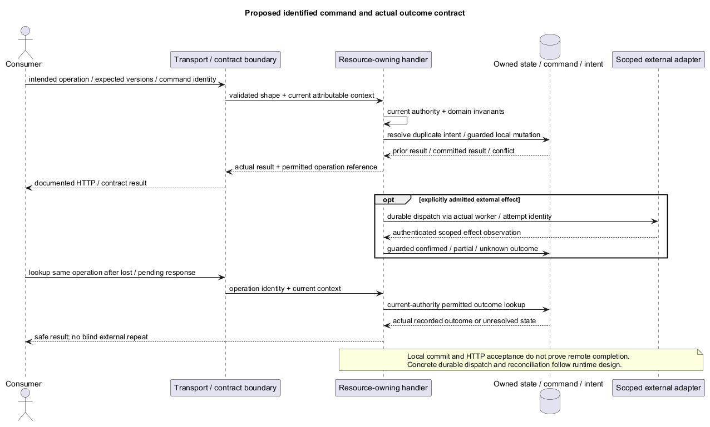
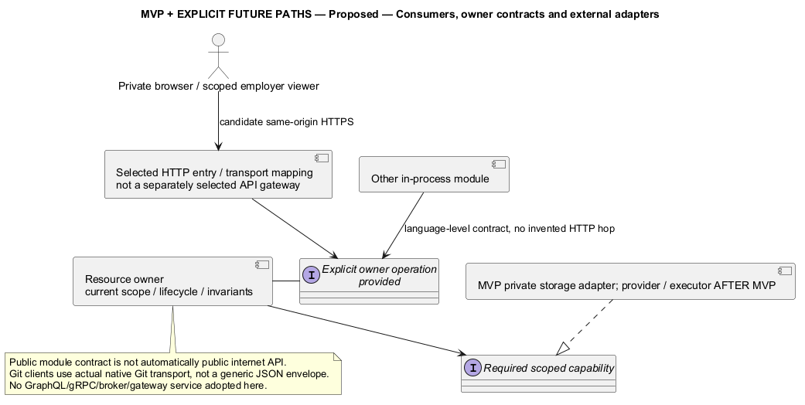

# API Specification

[Low-Level Design index](03-Low-Level-Design.md)

## Contract Coverage

The MVP contract section lists routes, request and response fields, status codes and caller authority. Keep the endpoint-specific checks with the work item.

## MVP API contracts

The versioned JSON interface is server-to-server. Browser UI uses each application's Laravel session and Inertia; native Git uses its separate authorized transport. Core signs scoped calls to ProjectForge. On every protected call, ProjectForge verifies the current Core entitlement and the local resource grant. Service credentials for Core identity status grant access only to status, never content. The paths below are proposed implementation names.

| Operation | Request | Success response and obligations |
| --- | --- | --- |
| GET /internal/v1/accounts/{userId}/projectforge-status | Status-only service credential; Core subject UUID | 200 with userId, active and entitled. Use the bounded status timeout and fail closed when the service is unavailable. |
| GET /api/v1/repositories | Scoped actor token and optional opaque cursor | 200 with permitted repository summaries and nextCursor. Stable cursor ordering; never return unauthorized repositories. |
| GET /api/v1/repositories/{repositoryId}/files | Scoped read token, immutable revision and optional repository-relative path | 200 with authorized entries and resolved revision; results contain no host path. |
| GET /api/v1/repositories/{repositoryId}/history | Scoped read token, revision and optional cursor | 200 with commit summaries for the permitted repository, resolved revision and nextCursor. |
| GET /api/v1/repositories/{repositoryId}/issues | Scoped issue-read token, optional state and cursor | 200 with repository-scoped issues, their versions and nextCursor. |
| POST /api/v1/repositories/{repositoryId}/issues | Scoped issue-write token, Idempotency-Key, title, body and optional priority, assignee and due date | 201 with stable issue ID, repository issue number and version. Issue authority does not grant Git write. |
| PATCH /api/v1/repositories/{repositoryId}/issues/{issueId} | Scoped issue-write token, Idempotency-Key, expectedVersion and changed fields | 200 with updated issue and version. Supports a fixed board move using state. A stale version produces a conflict without overwriting the later change. |

Issue states are todo, in_progress and done. Priorities are low, normal and high. An issue response contains id, number, title, state, priority, assigneeId, dueDate and version. A repository summary contains id and display name. History returns immutable revision identifiers. Dates carried as local dates include their time-zone context where applicable.

Return 401 for invalid identity, 403 for a forbidden visible action, 404 for missing or hidden resources, 409 for stale writes or mismatched idempotency payloads, 422 for invalid input and 503 when required authority cannot be checked. Errors expose a stable code and correlation ID. Do not include private content or storage paths. Bind write keys to actor, operation and payload and return the stored outcome for a matching retry. Reconcile uncertain outcomes before any repeat that could duplicate effects. Verify these contracts with allowed, denied, invalid, stale and interrupted requests.

Resumefolio — API Protocols, Contracts and Compatibility

### Resumefolio — API Protocols, Contracts and Compatibility

Current implementation choices and scope: [Baseline](https://github.com/Farhad-V/Web-Resumefolio/blob/1f2acaa351ac306cb57cbe4fe9742e8bd90720d9/docs/MVP/baseline/README.md). Runtime verification remains subject to its gates.

**Purpose:** define shared communication choices, contract contents, result semantics and compatibility rules for browser, component and external integration boundaries.

**Status:** proposed technical design, November 2, 2026. This is a shared contract specification, not an implemented route catalog, adopted frontend stack or verified provider/client compatibility matrix. Concrete signatures and payload schemas remain with their owning components.

[Scope](#design-record-05-interface-and-api-design-01-api-protocols-contracts-and-compatibility-md--heading-1-sources-and-interface-ownership) · [Protocols](#design-record-05-interface-and-api-design-01-api-protocols-contracts-and-compatibility-md--heading-2-protocol-choices-by-consumer) · [Contracts](#design-record-05-interface-and-api-design-01-api-protocols-contracts-and-compatibility-md--heading-3-required-contract-record) · [HTTP](#design-record-05-interface-and-api-design-01-api-protocols-contracts-and-compatibility-md--heading-4-http-results-and-concurrency) · [Repetition](#design-record-05-interface-and-api-design-01-api-protocols-contracts-and-compatibility-md--heading-5-command-identity-and-asynchronous-effects) · [Boundaries](#design-record-05-interface-and-api-design-01-api-protocols-contracts-and-compatibility-md--heading-6-external-and-protected-exchanges) · [Evolution](#design-record-05-interface-and-api-design-01-api-protocols-contracts-and-compatibility-md--heading-7-versioning-and-compatibility) · [Review](#design-record-05-interface-and-api-design-01-api-protocols-contracts-and-compatibility-md--heading-8-verification-and-handoff) · [Essential views](#design-record-05-interface-and-api-design-01-api-protocols-contracts-and-compatibility-md--heading-9-essential-api-and-contract-views)

#### 1. Sources and interface ownership

Use [EIF-D01–EIF-D10 and IF-01–IF-08](../../02-Requirements-Engineering/01-Software-Requirements-Specification.md#requirements-specification-external-interface-requirements), [analysis interfaces](../../03-System-Analysis/01-System-Analysis.md#analysis-interfaces-security-and-quality-analysis--12-interfaces-and-external-interactions), the [dictionary](../../02-Requirements-Engineering/01-Software-Requirements-Specification.md#data-definitions-data-dictionary) and [architecture boundaries](../01-High-Level-Design/14-Appendices.md#design-record-01-software-architecture-02-system-decomposition-and-boundaries-md). Inventory labels identify source boundaries, not new API endpoint IDs or selected transports.

The resource-owning component provides the contract and enforces its invariants. Consumers use explicit permitted identities/projections and cannot mutate private records through a shared ORM model. This folder owns shared conventions; [component designs](02-Module-Breakdown.md#design-record-03-component-and-module-design-component-and-module-design-md) own exact operations/types, [interaction realizations](#design-record-05-interface-and-api-design-03-use-case-realizations-and-interactions-md) own selected collaborations, and [runtime design](../01-High-Level-Design/14-Appendices.md#design-record-01-software-architecture-03-process-view-concurrency-and-runtime-behavior-md) owns concurrency/reconciliation behavior.

Accepted publication/history behavior remains binding: preview/select/apply changes only the intended draft, publication needs separate owner confirmation, and actual submitted materials remain independent. API convenience cannot combine these into an implicit publish or submission action.

#### 2. Protocol choices by consumer

| Boundary | Candidate communication and rationale |
| --- | --- |
| Private browser UI | Same-origin HTTPS with server-side authorization; server-rendered/progressively enhanced views and HTTP/JSON commands where useful |
| Employer viewing / file retrieval | Protected HTTPS projection/controlled byte delivery, with separate viewer/link scope and exact variant eligibility |
| In-process components | Explicit language-level interfaces/value types; no HTTP hop solely to connect modules in one application |
| Background effects | Durable identified intent and scoped worker/adapter dispatch; transport remains evaluated rather than implying exactly-once messaging |
| Google provider integrations | Evaluated official provider APIs/consent/capabilities through adapters; current scopes/version/quotas require selection-time evidence |
| Git clients | Evaluated native Git-compatible transport and client credentials; browser session/JSON endpoints do not establish clone/fetch/push interoperability |
| Executor / deployment target | Authenticated attempt-scoped control/observation and separate target authority across evaluated trust boundaries |

HTTP/JSON is the current interactive-command proposal, not a mandate to expose a public REST API. GraphQL can be evaluated for evidenced client/query needs; gRPC for an evidenced separately deployed consumer and compatibility needs. Neither is needed merely because the application has components. Do not add a broker, public API, mobile client or service split without a justified requirement/decision. Actual browser support, frontend framework and transport products remain pending evaluation.

#### 3. Required contract record

Before implementation, record each provided/required operation with:

- **Identity and trace:** contract owner, consumer, source IF/EIF/domain criteria, scenario and contract revision.
- **Invocation:** operation purpose, transport/method/path or in-process signature, media type, input schema and bounded payload rules.
- **Authority:** caller/context, resource/action scope, current eligibility/revocation checks, anti-forgery mechanism where applicable and safe denial disclosure.
- **Meaning:** required/optional/nullable fields, identifiers/units, dates/instants/time zones, language/revision provenance and enum/unknown-value handling.
- **Consistency:** expected versions, command/attempt identity, transaction/admission boundary and which external effects can remain unknown.
- **Results:** actual outcome variants, permitted response projection, HTTP mapping where relevant, field errors, operation lookup and repetition/reconciliation behavior.
- **Lifecycle:** pagination/filter/order, cancellation/expiry/retention where relevant, compatibility/deprecation and verification evidence.

Validate transport shape at the boundary and domain invariants at the owner. Distinguish omitted from intentional empty/null values, especially resume overrides, patch-like updates and optional provider mappings. Do not accept arbitrary fields for mass assignment. Exposed IDs identify resources; they do not establish permission.

Pagination needs bounded page size, deterministic ordering with a stable tie-breaker and documented cursor/filter semantics. Re-evaluate authority on each page and cursor use; define concurrent-change/completeness behavior. A cursor must not grant access or reveal another user's private query. Numerical limits require reviewed resource policy.

#### 4. HTTP results and concurrency

Apply [RFC 9110 HTTP semantics](https://www.rfc-editor.org/rfc/rfc9110.html) rather than using transport success as proof of domain completion. Read-only retrieval must not trigger publication, send, deployment or other business mutations. Protocol idempotence concerns repeated intended server effect, not identical response bodies or a guarantee about remote provider behavior.

| Condition | Candidate HTTP mapping and qualification |
| --- | --- |
| Completed permitted read/command | 200 with the actual result; 201 only when its creation semantics apply; 204 only when no response content is needed |
| Accepted but incomplete operation | 202 with permitted operation reference/status lookup; acceptance does not prove eventual success |
| Malformed / unsupported / semantically invalid input | 400 / 415 / 422 as applicable, with stable safe field/problem details |
| Missing/invalid authentication or insufficient authority | 401 / 403 where applicable; 401 includes the required challenge semantics; reviewed 404 concealment may protect private existence |
| Stale conditional request / domain conflict | 412 for a failed applicable HTTP precondition; 409 for the defined state/intent conflict |
| Resource/abuse pressure | 429 or 503 where appropriate; any retry advice must not authorize blind repetition of uncertain effects |
| Internal/transport uncertainty | Appropriate 5xx/transport failure plus safe operation reconciliation; never invent an HTTP status meaning “definitely not sent” |

Final endpoint mappings and disclosure rules belong in each exact contract. Domain outcomes include confirmed, pending, denied, invalid, conflict, unavailable, partial and unknown where meaningful; they are not a mandatory universal envelope or eight new status codes. A successful operation-status lookup can return 200 while describing a failed or unresolved underlying attempt.

Use an evaluated expected-version field or applicable ETag/If-Match precondition to prevent stale writes. If using HTTP validators, scope them to the actual representation and implement their comparison semantics correctly; an arbitrary domain revision is not automatically a compliant ETag. A single resource validator may not guard a cross-record Sprint or grant-change race. Exact locking/admission remains [data/runtime design](04-Database-Design.md#design-record-04-data-design-01-analysis-to-logical-and-physical-data-models-md).

For HTTP error representations, evaluate [RFC 9457 Problem Details](https://www.rfc-editor.org/rfc/rfc9457.html): stable problem type/title/status semantics with safe instance/field extensions where useful. Do not expose stack traces, storage paths, secrets or private target existence. Display text may be localized; machine codes and field identities remain stable. These standards were reviewed November 2, 2026; framework/route compatibility is not verified here.

#### 5. Command identity and asynchronous effects

[Identified command, guarded owner mutation and safe outcome lookup](https://github.com/Farhad-V/Web-Resumefolio/blob/1f2acaa351ac306cb57cbe4fe9742e8bd90720d9/docs/MVP/SDLC/04-system-design/05-interface-and-api-design/diagrams/api-command-outcome-sequence.svg)

[Editable PlantUML](https://github.com/Farhad-V/Web-Resumefolio/blob/1f2acaa351ac306cb57cbe4fe9742e8bd90720d9/docs/MVP/SDLC/04-system-design/05-interface-and-api-design/diagrams/api-command-outcome-sequence.puml) · 

Consequential commands use a documented stable command identity scoped to the actual operation/actor/resource contract. Validate current authority before returning a prior result. Compare attributable intended payload/version context so reuse with changed intent conflicts instead of executing new work. Storage/expiry and secret-safe intent representation are explicit implementation decisions; no idempotency-header standard or infinite retention is assumed.

Commit the owned local change, result and required durable external intent coherently. A worker uses current required authority, immutable inputs and stable attempt identity; it does not carry an evergreen privileged session. Operation lookup identifies the actual command/attempt and returns only permitted bounded evidence. Polling, push feedback or callbacks need explicit ownership and compatibility; no realtime protocol is selected here.

A lost response prompts lookup/reconciliation of the same operation. A local deduplication key cannot prove a provider accepted a send, a runner did not start or a target rolled back. Do not repeat such effects blindly. Fresh retries/new attempts require explicit operation policy, current authority and known effect boundaries. Cancellation request and confirmed stop are distinct results; completion can win a race.

#### 6. External and protected exchanges

##### Browser and employer entry paths

Use evaluated transport/session controls and state-change protection for cookie-authenticated requests. [OWASP CSRF guidance](https://cheatsheetseries.owasp.org/cheatsheets/Cross-Site_Request_Forgery_Prevention_Cheat_Sheet.html) informs anti-forgery evaluation; same-origin deployment alone is not a complete CSRF mechanism. CORS configuration does not replace authentication, resource authorization or applicable CSRF controls. Exact framework/session/cookie compatibility remains pending.

Employer viewer context remains link-scoped and is not proof of a named employer identity. Resolve current link generation, selected content, publication/language and download eligibility before protected delivery. Apply current checks to direct paths, range/cache requests and alternate endpoints. Already emitted/downloaded bytes cannot be recalled. See [Sharing](03-Detailed-Module-Design.md#design-record-03-component-and-module-design-components-representation-and-sharing-md).

##### Files and provider adapters

Uploads distinguish transfer, admitted usable artifact and consumer association. Specify supported media, bounded streaming, replacement and unavailable/error behavior through [Files](03-Detailed-Module-Design.md#design-record-03-component-and-module-design-components-files-and-operations-md); do not expose raw private paths or execute uploaded previews.

Provider adapters map actual capabilities/results into local contracts without losing pending/partial/unknown meaning. Provider acceptance is not recipient delivery/reading. Consent changes, disconnect/reconnect, external IDs, time-zone mappings, throttling and reconciliation stay explicit. See [Communication](03-Detailed-Module-Design.md#design-record-03-component-and-module-design-components-communication-and-calendar-md). Current Google API/scopes/quotas must be verified against official sources when selecting the adapter; none is certified here.

##### Git, executor and target interfaces

**After MVP.** Shared operating and recovery controls still apply where relevant.

Native Git clients use evaluated transport/credential/ref rules and actual client interoperability evidence; do not wrap every exchange in a JSON result envelope. See [Git](03-Detailed-Module-Design.md#design-record-03-component-and-module-design-components-git-collaboration-md).

Executor callbacks must be authenticated and bound to the exact attempt/generation, with stale/duplicate observation handling. Deployment approval names exact artifact/target/configuration and separate current authority. A callback, merge or run success cannot approve deployment. Actual containment and execution-enabling evidence remain gates in [Workflow and Deployment](03-Detailed-Module-Design.md#design-record-03-component-and-module-design-components-workflow-and-deployment-md).

#### 7. Versioning and compatibility

[Contract change, consumer compatibility and safe retirement](https://github.com/Farhad-V/Web-Resumefolio/blob/1f2acaa351ac306cb57cbe4fe9742e8bd90720d9/docs/MVP/SDLC/04-system-design/05-interface-and-api-design/diagrams/api-contract-evolution.svg)

[Editable PlantUML](https://github.com/Farhad-V/Web-Resumefolio/blob/1f2acaa351ac306cb57cbe4fe9742e8bd90720d9/docs/MVP/SDLC/04-system-design/05-interface-and-api-design/diagrams/api-contract-evolution.puml) · 

Version externally consumed contracts deliberately. Select path/header/media-type or another explicit scheme only for actual consumers; do not create an arbitrary `/v1` public API solely for internal modularity. In-process interfaces also need consumer coordination, and queued payloads may outlive the deployment that produced them.

An additive field is compatible only if actual consumers tolerate it. Changed requiredness, enum values, defaults, units, ordering, permission scope, side effects and result meaning can break consumers even when JSON shape looks similar. Do not weaken privacy or grant broader permissions to preserve an old client's convenience.

For a change, identify active browsers/clients, workers, stored pending payloads, callbacks and adapters; classify shape and semantic impact; define old/new reader-writer compatibility; migrate/backfill where needed; verify coexistence; then retire only with actual disposition. No default deprecation period or perpetual old-version support is invented. Preserve exact historical publication/submission and pending external-attempt meaning through schema/job/API changes.

#### 8. Verification and handoff

| Source group | Shared contract responsibility |
| --- | --- |
| EIF-D01/D02 | Reviewable operation record and clear input/feedback semantics |
| EIF-D03/D04 | Consistent authority across entry paths and protected byte exchange |
| EIF-D05–D07 | Explicit provider, native Git and executor/target boundaries |
| EIF-D08 | Operation-specific conflict, repetition, cancellation and uncertain effects |
| EIF-D09/D10 | Operating/recovery boundaries and consistent identity/time/language/lifecycle meaning |

##### Planned focused checks

- Schema/requiredness/unknown-field/media-type behavior, safe errors and exact status/precondition semantics.
- Direct wrong-owner requests, employer scope, anti-forgery paths and current permission/revocation checks.
- Stale versions, duplicate command identities, changed intent and lost responses without duplicate external effects.
- Pending-result lookup under current authority, cancellation races and authenticated stale/duplicate callbacks.
- Bounded deterministic pagination, concurrent changes, time/language/revision and private projection isolation.
- Actual Git-client/provider/serving interoperability once facilities are selected; mock success is insufficient.
- Old/new client/worker/payload coexistence, semantic compatibility and safe retirement.

Use contract tests plus actual framework/persistence/concurrency and authorized integration evidence. No live route, provider send, Git transfer, executor action, deployment or product compatibility test is performed by this update.

**Remaining prescriptions:** specify exact route/signature and payload/result schemas per owner; choose client/framework/session/security facilities; fix endpoint status/precondition/repetition contracts, resource limits and pagination; evaluate actual external versions/capabilities and callback authentication; record compatibility/migration evidence. The shared design is populated, not a complete API implementation or accepted baseline.

The FAU component-interface/use-case realization concerns inform this design; protocol conventions and this document layout are project adaptations. See the [reference map](../01-High-Level-Design/14-Appendices.md#design-record-design-references-and-coverage-md) and [review/handoff](../01-High-Level-Design/14-Appendices.md#design-record-06-design-quality-and-security-analysis-05-design-review-traceability-and-handoff-md).

[Interface and API Design](#design-record-05-interface-and-api-design-interface-and-api-design-md) · [Interaction realizations](#design-record-05-interface-and-api-design-03-use-case-realizations-and-interactions-md) · [Diagram catalog](#design-record-05-interface-and-api-design-diagrams-diagram-catalog-md)

#### 9. Essential API and contract views

Only **four complementary diagrams** are added; no new tables, endpoints or schema excerpts. Reuse the existing [contract evolution diagram](#design-record-05-interface-and-api-design-01-api-protocols-contracts-and-compatibility-md--heading-7-versioning-and-compatibility) and the [interaction realization document](#design-record-05-interface-and-api-design-03-use-case-realizations-and-interactions-md) for detailed collaborations. Diagrams express candidate boundaries and engineering workflow, not selected protocols/services or tested client compatibility.

##### 9.1 Consumers, owner contracts and external adapters

[MVP with explicitly deferred paths — Consumers, owner contracts and external adapters](https://github.com/Farhad-V/Web-Resumefolio/blob/1f2acaa351ac306cb57cbe4fe9742e8bd90720d9/docs/MVP/SDLC/04-system-design/05-interface-and-api-design/diagrams/api-essential-boundaries.svg)

[Editable PlantUML](https://github.com/Farhad-V/Web-Resumefolio/blob/1f2acaa351ac306cb57cbe4fe9742e8bd90720d9/docs/MVP/SDLC/04-system-design/05-interface-and-api-design/diagrams/api-essential-boundaries.puml) · 

Essential interface landscape and provider/consumer boundary in one view. Actual authentication, anti-forgery and resource checks remain required at all applicable entry paths. Adapters preserve denied/conflict/pending/partial/unknown outcomes; a reachable technical credential is not human authority.

##### 9.2 Protocol selection by actual boundary need

[MVP with explicitly deferred paths — Protocol selection by actual boundary need](https://github.com/Farhad-V/Web-Resumefolio/blob/1f2acaa351ac306cb57cbe4fe9742e8bd90720d9/docs/MVP/SDLC/04-system-design/05-interface-and-api-design/diagrams/api-essential-selection.svg)

[Editable PlantUML](https://github.com/Farhad-V/Web-Resumefolio/blob/1f2acaa351ac306cb57cbe4fe9742e8bd90720d9/docs/MVP/SDLC/04-system-design/05-interface-and-api-design/diagrams/api-essential-selection.puml) · 

Decision aid, not a product-selection benchmark. GraphQL/gRPC/WebSocket/async transport require an actual justified need, supported consumers and operating compatibility. Durable asynchronous intent is a semantic requirement where needed, not automatic selection of a messaging broker or exactly-once delivery.

##### 9.3 Contract-first refinement without mandatory code generation

[Contract-first refinement without mandatory code generation](https://github.com/Farhad-V/Web-Resumefolio/blob/1f2acaa351ac306cb57cbe4fe9742e8bd90720d9/docs/MVP/SDLC/04-system-design/05-interface-and-api-design/diagrams/api-essential-contract-workflow.svg)

[Editable PlantUML](https://github.com/Farhad-V/Web-Resumefolio/blob/1f2acaa351ac306cb57cbe4fe9742e8bd90720d9/docs/MVP/SDLC/04-system-design/05-interface-and-api-design/diagrams/api-essential-contract-workflow.puml) · 

OpenAPI, AsyncAPI, protobuf and GraphQL schemas are alternative representations for actual selected protocols, not four required artifacts. Mock/codegen is optional and cannot prove real authorization, external idempotency or runtime interoperability. No spec file, toolchain or production implementation is generated here.

##### 9.4 Consumer expectations and provider verification

[Consumer expectations and provider verification](https://github.com/Farhad-V/Web-Resumefolio/blob/1f2acaa351ac306cb57cbe4fe9742e8bd90720d9/docs/MVP/SDLC/04-system-design/05-interface-and-api-design/diagrams/api-essential-consumer-verification.svg)

[Editable PlantUML](https://github.com/Farhad-V/Web-Resumefolio/blob/1f2acaa351ac306cb57cbe4fe9742e8bd90720d9/docs/MVP/SDLC/04-system-design/05-interface-and-api-design/diagrams/api-essential-consumer-verification.puml) · 

Compact consumer-driven contract-testing concept, not an installed test platform. Actual consumers must tolerate additive fields/enums where claimed; changed defaults, permission scope, effects or ordering can break compatibility even with unchanged schema. Required live/controlled evidence remains separately scoped.

##### Essential scope and evolution limits

No separate API landscape, HTTP-version/TLS stack or URI resource graph is added before actual transport, routes and clients are selected. A conceptual resource identity does not allocate a public URL. In-process modularity does not mandate HTTP, a gateway or `/v1` routing. HTTP/JSON remains the interactive-command proposal; native Git, protected files and external control/provider exchanges preserve their own contracts.

The existing compatibility/evolution view already owns change classification, consumer coordination and safe retirement. A real deprecation process must identify active client/worker/persisted-payload versions, truthful migration guidance, actual observation and explicit removal disposition; no calendar dates, sunset headers, universal migration window or perpetual old-version support are invented. Public API scheme, rate limits and service targets remain actual selection/source decisions.

Concrete payload/endpoint/error/repetition prescriptions belong in each owning component, preserving separate draft apply, publication and actual history. Old/new consumer coexistence must not weaken current authority, drop unresolved effects or silently reinterpret language/time/version meaning. No route/spec generation, contract test, codegen, protocol upgrade, deprecation notice or provider/native-client operation is executed by this documentation update.

#### MVP core–ProjectForge API contract refinement

The API is the integration seam between distinct systems, not an internal module call or shared database. The following are required contract subjects; endpoint paths, transport credentials, token format, versions, timeout values and error codes remain design decisions.

| Contract subject | Required observable behavior | Verification still required |
| --- | --- | --- |
| Authenticated actor and resource | Bind the actual user, action and target resource; reject impersonation, unrelated grants and universal admin bypass | Two-user allowed/denied and forged-subject cases |
| Current authority and revocation | Re-evaluate applicable account/repository/board grants; API access does not itself confer native Git credentials | Changed grant/account state and separate Git transport checks |
| Repository / file / history projection | Return only the permitted repository/revision projection; no private core library paths or unrestricted mutable models | Cross-user/private-path and exact revision checks |
| Issues and simple Kanban | Own state in ProjectForge, preserve attributable changes and truthful failures; no advanced Sprint/review/release promise | Intended issue/board flow plus stale/denied/failure cases |
| Unknown or failed result | Preserve actual local intent/observed remote outcome; reconcile before repeating a consequential request | Interrupted response and duplicate-request cases with selected mechanism |
| Independent storage/recovery | Cross-system IDs carry no shared transaction assumption; restore must reconcile references and current authority | Isolated restore and stale-reference walkthrough |

Native Git clone/fetch/pull/push is a separate ProjectForge entry contract; ordinary commits are client-created. No API method is required to create a server-side commit merely to save core data. Mail/calendar API contracts below are future-only and preserve per-user/account consent; administrator role grants no mail-reading authority.

Resumefolio — Use-Case Realizations and Interactions

### Resumefolio — Use-Case Realizations and Interactions

Current implementation choices and scope: [Baseline](https://github.com/Farhad-V/Web-Resumefolio/blob/1f2acaa351ac306cb57cbe4fe9742e8bd90720d9/docs/MVP/baseline/README.md). Runtime verification remains subject to its gates.

**Purpose:** show how technical components collaborate to realize existing analysis scenarios without changing their goals or accepted behavior.

**Status:** proposed technical realizations, November 2, 2026. The routes and diagrams specify responsibilities and consistency obligations, not implemented endpoints, proven atomicity or executed scenario tests. Exact signatures and mechanisms remain with component owners.

[Sources](#design-record-05-interface-and-api-design-03-use-case-realizations-and-interactions-md--heading-1-source-and-realization-conventions) · [Coverage](#design-record-05-interface-and-api-design-03-use-case-realizations-and-interactions-md--heading-2-scenario-to-component-map) · [Content](#design-record-05-interface-and-api-design-03-use-case-realizations-and-interactions-md--heading-3-content-sharing-and-actual-material) · [Providers](#design-record-05-interface-and-api-design-03-use-case-realizations-and-interactions-md--heading-4-provider-interactions) · [Work and execution](#design-record-05-interface-and-api-design-03-use-case-realizations-and-interactions-md--heading-5-work-git-execution-and-deployment) · [Recovery](#design-record-05-interface-and-api-design-03-use-case-realizations-and-interactions-md--heading-6-policy-admission-and-recovery) · [Review](#design-record-05-interface-and-api-design-03-use-case-realizations-and-interactions-md--heading-7-verification-and-completion-boundary) · [Essential views](#design-record-05-interface-and-api-design-03-use-case-realizations-and-interactions-md--heading-8-essential-use-case-realization-views)

#### 1. Source and realization conventions

Use the existing [use-case/scenario catalog](../../02-Requirements-Engineering/01-Software-Requirements-Specification.md#scenarios-and-models-user-stories-and-scenarios), [scenario-based analysis](../../03-System-Analysis/01-System-Analysis.md#analysis-behavioral-and-scenario-analysis--06-scenario-based-view), [state-based analysis](../../03-System-Analysis/01-System-Analysis.md#analysis-behavioral-and-scenario-analysis--07-state-based-view) and [operation contracts](../../03-System-Analysis/01-System-Analysis.md#analysis-business-rules-and-operation-contracts--10-domain-constraints-and-operation-contracts). UC-D and SB-M references retain those sources' status; this document allocates no new primary use cases or acceptance.

Follow [shared API contracts](#design-record-05-interface-and-api-design-01-api-protocols-contracts-and-compatibility-md), [runtime coordination](../01-High-Level-Design/14-Appendices.md#design-record-01-software-architecture-03-process-view-concurrency-and-runtime-behavior-md) and [data integrity](04-Database-Design.md#design-record-04-data-design-01-analysis-to-logical-and-physical-data-models-md). Each protected operation resolves current actor/resource authority, expected versions and attributable intent before its owner admits effects. An arrow denotes a responsibility exchange, not a remote service, database transaction or automatic trigger.

Existing component diagrams remain the detailed owning views. The new overview and recovery view below connect them rather than replacing their contracts. Unspecified lock ordering, dispatch fencing, provider compatibility and reference/deletion guards remain implementation work.

#### 2. Scenario-to-component map

All SB-M identifiers below resolve in the linked [scenario analysis](../../03-System-Analysis/01-System-Analysis.md#analysis-behavioral-and-scenario-analysis--06-scenario-based-view). This is responsibility coverage, not criterion closure or a claim that every alternative path has an implementation sequence.

| Existing scenario family | Technical owner and detailed realization |
| --- | --- |
| UC-D01 / SB-M01 | [Presentation](03-Detailed-Module-Design.md#design-record-03-component-and-module-design-components-professional-presentation-md): compare/select/apply; separately confirmed publication |
| UC-D02 / SB-M02–03 | [Sharing](03-Detailed-Module-Design.md#design-record-03-component-and-module-design-components-representation-and-sharing-md): independent PDF configuration and link/password management |
| UC-D03 / SB-M04 | Sharing with Presentation/Files: selected, current protected representation retrieval |
| UC-D04–05 / SB-M05–06 | [Applications](03-Detailed-Module-Design.md#design-record-03-component-and-module-design-components-applications-md): manual preparation/progress and separate actual-material capture |
| UC-D06 / SB-M07–08 | [Communication/Calendar](03-Detailed-Module-Design.md#design-record-03-component-and-module-design-components-communication-and-calendar-md): read/send and explicit local/provider synchronization  **After MVP.** |
| UC-D07 / SB-M09 | [Work](03-Detailed-Module-Design.md#design-record-03-component-and-module-design-components-work-management-md): refinement, coherent Sprint planning and actual period outcomes |
| UC-D08 / SB-M10 | [Identity](03-Detailed-Module-Design.md#design-record-03-component-and-module-design-components-identity-and-access-md) with resource owner: effective membership, scoped grants and revocation |
| UC-D09 / SB-M11–12 | [Git](03-Detailed-Module-Design.md#design-record-03-component-and-module-design-components-git-collaboration-md): native transfers, revision-bound review and guarded ref update |
| UC-D10 / SB-M13–14 | [Workflow/Deployment](03-Detailed-Module-Design.md#design-record-03-component-and-module-design-components-workflow-and-deployment-md): gated execution and separate target-authorized deployment  **After MVP.** |
| UC-D11 / SB-M15 | [Files/Operations](03-Detailed-Module-Design.md#design-record-03-component-and-module-design-components-files-and-operations-md): effective policy, admission/accounting and restricted evidence |
| UC-D12 / SB-M16 | Files/Operations with affected owners: isolated restore, current authority and external-state reconciliation |

#### 3. Content, sharing and actual material

##### Source update and separate publication

Presentation resolves authorized source/draft versions and returns read-only differences. Explicit selected apply rechecks those versions and saves only intended draft changes, preserving unrelated overrides and other resumes. Separate owner confirmation names the reviewed candidate; Presentation protects exact evidence references through Files and commits the publication manifest/live pointer/result within its defined consistency boundary.

[Selected apply and separately confirmed publication](https://github.com/Farhad-V/Web-Resumefolio/blob/1f2acaa351ac306cb57cbe4fe9742e8bd90720d9/docs/MVP/SDLC/04-system-design/03-component-and-module-design/components/diagrams/presentation-update-publication.svg)

[Owning design and editable exports](03-Detailed-Module-Design.md#design-record-03-component-and-module-design-components-professional-presentation-md--heading-4-update-and-publication-protocol).

Stale comparisons conflict/recompare; denied operations do not mutate. Lost save/publish responses resolve the same command outcome. Failed/unknown reference finalization retains protection until consumer evidence permits release. Draft save, publication, PDF availability and employer access remain distinct outcomes under the [accepted policy](../../02-Requirements-Engineering/01-Software-Requirements-Specification.md#change-and-baseline-open-questions-and-decisions--id-owner-accepted-profile-update-policy).

##### PDF/link management and protected retrieval

Sharing authorizes owner-side configuration against exact versions. Download mode changes neither rotate passwords nor disable links implicitly. Viewer context is independently link-scoped; it proves password possession under reviewed policy, not named employer identity.

At retrieval, Sharing resolves current link/viewer generation, selected publication/content, language/mode and exact matching rendition. Files supplies actual usable identity and controlled delivery. The evaluated admission protocol must cover revocation/configuration/publication races; direct paths, caches and range requests cannot bypass applicable checks. Missing variants return their permitted actual state without draft/old-language fallback. Already emitted bytes cannot be recalled.

[Protected retrieval sequence and failure cases](03-Detailed-Module-Design.md#design-record-03-component-and-module-design-components-representation-and-sharing-md--heading-4-protected-retrieval-and-revocation-protocol) own the detailed diagram and unresolved serving mechanism.

##### Manual application and actual capture

Applications owns preparation/progress without implicit sending. An explicit actual-event/material command resolves exact admitted artifacts, protects references through Files and commits attributable submission/material completeness. Finalization reconciles actual committed consumer evidence. Capture does not publish, change a sharing link or certify provider receipt. Incomplete material stays labeled incomplete; later profile/publication edits cannot rewrite actual submitted material.

[Actual-material capture sequence](https://github.com/Farhad-V/Web-Resumefolio/blob/1f2acaa351ac306cb57cbe4fe9742e8bd90720d9/docs/MVP/SDLC/04-system-design/03-component-and-module-design/components/diagrams/applications-capture-sequence.svg) and [Applications design](03-Detailed-Module-Design.md#design-record-03-component-and-module-design-components-applications-md) define duplicate/lost-response/reference failure behavior.

#### 4. Provider interactions

##### Deliberate send

Communication validates current account/provider capability and reviewed recipient/content/attachment intent, then records durable send attempt context. The scoped worker dispatches the same attempt under the actual provider contract and records observed acceptance/failure/unknown state. Provider acceptance is not recipient delivery or reading, and does not automatically create a complete application-history capture.

On timeout/lost response, reconcile the existing attempt before any consequential repeat. An expired local worker lease or generic queue retry cannot prove no send occurred. Read-only mail access creates no send intent. [Send sequence](https://github.com/Farhad-V/Web-Resumefolio/blob/1f2acaa351ac306cb57cbe4fe9742e8bd90720d9/docs/MVP/SDLC/04-system-design/03-component-and-module-design/components/diagrams/communication-send-sequence.svg) and the [owning component](03-Detailed-Module-Design.md#design-record-03-component-and-module-design-components-communication-and-calendar-md) hold exact responsibilities and provider gates.

##### Local activity and selected calendar synchronization

**After MVP.** Shared operating and recovery controls still apply where relevant.

Communication distinguishes locally owned event intent, provider identity/mapping and actual synchronization observations. Explicitly selected synchronization rechecks current capability, field authority, versions/time meaning and actual provider state. Local save does not imply provider success. Conflicts, disconnect/reconnect, deleted targets and ambiguous writes retain real outcomes instead of inventing agreement or repeating effects blindly.

[Calendar reconciliation route](https://github.com/Farhad-V/Web-Resumefolio/blob/1f2acaa351ac306cb57cbe4fe9742e8bd90720d9/docs/MVP/SDLC/04-system-design/03-component-and-module-design/components/diagrams/calendar-reconciliation-route.svg) is the owning view. Actual provider versions/scopes/quotas and source synchronization policies remain pending evaluation/disposition.

#### 5. Work, Git, execution and deployment

**After MVP.** Shared operating and recovery controls still apply where relevant.

[After MVP — Guarded handoffs without inherited authority](https://github.com/Farhad-V/Web-Resumefolio/blob/1f2acaa351ac306cb57cbe4fe9742e8bd90720d9/docs/MVP/SDLC/04-system-design/05-interface-and-api-design/diagrams/interaction-git-execution-deployment.svg)

[Editable PlantUML](https://github.com/Farhad-V/Web-Resumefolio/blob/1f2acaa351ac306cb57cbe4fe9742e8bd90720d9/docs/MVP/SDLC/04-system-design/05-interface-and-api-design/diagrams/interaction-git-execution-deployment.puml) · 

##### Work and changed collaboration

Work validates current project/action authority, coherent item/task/board/plan relationships and relevant versions before committing. Goal, selected items and delivery plan remain one Sprint Backlog. Period-end records actual context/outcomes; task completion, item acceptance and goal achievement do not follow automatically from a column move or elapsed date.

Identity and the resource owner coordinate effective membership/grant changes and assignment consequences under reviewed policy. Invitation alone is not effective membership, and project access does not grant repository/private-mail authority. Stale contexts and grant changes racing operations need concrete synchronization. See [work mutation/Sprint-close sequence](https://github.com/Farhad-V/Web-Resumefolio/blob/1f2acaa351ac306cb57cbe4fe9742e8bd90720d9/docs/MVP/SDLC/04-system-design/03-component-and-module-design/components/diagrams/work-mutation-sprint-close.svg) and [Identity authorization sequence](https://github.com/Farhad-V/Web-Resumefolio/blob/1f2acaa351ac306cb57cbe4fe9742e8bd90720d9/docs/MVP/SDLC/04-system-design/03-component-and-module-design/components/diagrams/identity-authorization-sequence.svg).

##### Native Git and revision-bound review

Git authenticates actual client credentials and repository/ref scope for native transfer. Review/merge resolves exact current source/target revisions, current authority and required review/check policy. A guarded native ref update is coordinated with durable metadata observations; SQL rollback cannot undo an already changed ref. Stale revision/review produces conflict/re-evaluation, not a blind merge repeat. See [Git merge sequence](https://github.com/Farhad-V/Web-Resumefolio/blob/1f2acaa351ac306cb57cbe4fe9742e8bd90720d9/docs/MVP/SDLC/04-system-design/03-component-and-module-design/components/diagrams/git-merge-sequence.svg).

##### Conditional execution and separate target stage

**After MVP.** Shared operating and recovery controls still apply where relevant.

A Git event may produce workflow intent only under an explicit supported authorized trigger. Workflow separately validates immutable code/definition context and actual isolation/resource/secret-enabling evidence before admission. Run identity, launch acknowledgment, terminal outcome, cancellation request, output availability and cleanup remain distinct.

Run success supplies no deployment permission. The target stage separately binds current approval to exact artifact/revision/target/configuration and recovery compatibility. Unknown executor/target effects require same-attempt reconciliation; do not relaunch/redeploy automatically. [Workflow boundaries](https://github.com/Farhad-V/Web-Resumefolio/blob/1f2acaa351ac306cb57cbe4fe9742e8bd90720d9/docs/MVP/SDLC/04-system-design/03-component-and-module-design/components/diagrams/workflow-trust-model.svg) and [deployment sequence](https://github.com/Farhad-V/Web-Resumefolio/blob/1f2acaa351ac306cb57cbe4fe9742e8bd90720d9/docs/MVP/SDLC/04-system-design/03-component-and-module-design/components/diagrams/workflow-deployment-sequence.svg) own detailed mechanisms/gates.

#### 6. Policy, admission and recovery

Files/Operations authorizes effective policy changes, atomically reserves concurrent growth, validates actual usable artifacts and records true accounting. Protected consumer references exclude reclamation; retiring a record or a finished workflow does not prove bytes/workspace were reclaimed. Partial/unknown storage outcomes retain evidence and applicable protection/accounting for reconciliation. See [admission sequence](https://github.com/Farhad-V/Web-Resumefolio/blob/1f2acaa351ac306cb57cbe4fe9742e8bd90720d9/docs/MVP/SDLC/04-system-design/03-component-and-module-design/components/diagrams/files-admission-sequence.svg) and [reclamation route](https://github.com/Farhad-V/Web-Resumefolio/blob/1f2acaa351ac306cb57cbe4fe9742e8bd90720d9/docs/MVP/SDLC/04-system-design/03-component-and-module-design/components/diagrams/files-reclamation-route.svg).

[MVP with explicitly deferred paths — Isolated restoration and explicit resumption gate](https://github.com/Farhad-V/Web-Resumefolio/blob/1f2acaa351ac306cb57cbe4fe9742e8bd90720d9/docs/MVP/SDLC/04-system-design/05-interface-and-api-design/diagrams/interaction-isolated-recovery.svg)

[Editable PlantUML](https://github.com/Farhad-V/Web-Resumefolio/blob/1f2acaa351ac306cb57cbe4fe9742e8bd90720d9/docs/MVP/SDLC/04-system-design/05-interface-and-api-design/diagrams/interaction-isolated-recovery.puml) · 

For UC-D12, the authorized operator identifies source/version and intended scope; Operations coordinates isolated restoration with outbound actions disabled. Affected owners verify schema/content manifests, bytes/native repositories, keys, protected references and actual current authority. Reconcile provider/executor/target effects before resuming work. Missing bytes/keys, inconsistent references or unresolved dangerous effects remain findings, not a successful usable-state claim.

Backup coverage/destination, recovery targets and promotion disposition remain in [Operations/Recovery](../01-High-Level-Design/14-Appendices.md#design-record-06-design-quality-and-security-analysis-03-operations-backup-recovery-and-resilience-md). Restoration does not re-enable historical grants/links or replay pending remote actions automatically. No backup or recovery capability is established by this sequence.

#### 7. Verification and completion boundary

For each realization, record the exact source scenario/criterion, owner/consumer, candidate/environment, actor and current grants, input/state versions, command/attempt identity, expected effects and unchanged protected state, observed result and remaining limits. Cover normal, denied, invalid, conflict, partial, uncertain and recovery branches where applicable. Diagram coverage is not executed verification.

Focused preservation checks:

- Separate source apply/publication and independent actual material across later changes.
- Current authority on all entry/follow-through paths and no permission inherited from associations/events.
- Protected-reference coordination before consumer commit and safe reconciliation before release.
- Actual provider/native-ref/executor/target observations without false atomicity or blind repeat.
- Coherent work/Sprint history and recovery without access resurrection or remote replay.

Use component policy tests plus actual persistence/concurrency and authorized integration evidence. Remaining work includes exact signatures/types, synchronization/fencing, selected external compatibility, full criterion mapping and implementation-specific scenario sequences. No live product action, acceptance test, baseline approval or new policy selection is performed here.

These technical interaction views adapt FAU's use-case realization/component-collaboration approach; source goals remain in requirements/analysis. Use the [reference map](../01-High-Level-Design/14-Appendices.md#design-record-design-references-and-coverage-md) and [review/handoff](../01-High-Level-Design/14-Appendices.md#design-record-06-design-quality-and-security-analysis-05-design-review-traceability-and-handoff-md).

[Interface and API Design](#design-record-05-interface-and-api-design-interface-and-api-design-md) · [Contract conventions](#design-record-05-interface-and-api-design-01-api-protocols-contracts-and-compatibility-md) · [Diagram catalog](#design-record-05-interface-and-api-design-diagrams-diagram-catalog-md)

#### 8. Essential use-case realization views

Only **four complementary diagrams** are added; no new tables, payloads or use-case IDs. Reuse the detailed source/apply/publication, actual-material capture, provider send/calendar, Work/Identity, native Git, execution/deployment and recovery sequences already linked in sections 3–6. This prevents a second competing definition of the same collaboration.

##### 8.1 Selected actors and use-case boundaries

[Selected actors and use-case boundaries](https://github.com/Farhad-V/Web-Resumefolio/blob/1f2acaa351ac306cb57cbe4fe9742e8bd90720d9/docs/MVP/SDLC/04-system-design/05-interface-and-api-design/diagrams/interaction-essential-use-cases.svg)

[Editable PlantUML](https://github.com/Farhad-V/Web-Resumefolio/blob/1f2acaa351ac306cb57cbe4fe9742e8bd90720d9/docs/MVP/SDLC/04-system-design/05-interface-and-api-design/diagrams/interaction-essential-use-cases.puml) · 

Selected existing source-family summary, not new use-case allocation or complete system coverage. No include/extend arrow joins apply, publish or capture: they are distinct deliberate goals/actions, not automatically executed substeps. Other source families remain mapped in section 2.

##### 8.2 Use-case realization through owner contracts

[Use-case realization through owner contracts](https://github.com/Farhad-V/Web-Resumefolio/blob/1f2acaa351ac306cb57cbe4fe9742e8bd90720d9/docs/MVP/SDLC/04-system-design/05-interface-and-api-design/diagrams/interaction-essential-realization.svg)

[Editable PlantUML](https://github.com/Farhad-V/Web-Resumefolio/blob/1f2acaa351ac306cb57cbe4fe9742e8bd90720d9/docs/MVP/SDLC/04-system-design/05-interface-and-api-design/diagrams/interaction-essential-realization.puml) · 

UML-style realization overview, not a claim that every arrow is a network API call. The existing Sharing retrieval sequence owns detailed ordering. Concrete revocation/admission/reference synchronization must still be designed and verified.

##### 8.3 Separate owner commands across the content journey

[Separate owner commands across the content journey](https://github.com/Farhad-V/Web-Resumefolio/blob/1f2acaa351ac306cb57cbe4fe9742e8bd90720d9/docs/MVP/SDLC/04-system-design/05-interface-and-api-design/diagrams/interaction-essential-end-to-end.svg)

[Editable PlantUML](https://github.com/Farhad-V/Web-Resumefolio/blob/1f2acaa351ac306cb57cbe4fe9742e8bd90720d9/docs/MVP/SDLC/04-system-design/05-interface-and-api-design/diagrams/interaction-essential-end-to-end.puml) · 

End-to-end activity spans separate commands and user decisions, not one atomic API transaction or mandatory sequence for every user. Recording a manual submission does not require this exact publication journey; actual submitted material can come from the source-permitted real route. Provider acceptance alone is not an actual submission claim.

##### 8.4 Alternate paths, duplicate commands and uncertain effects

[Alternate paths, duplicate commands and uncertain effects](https://github.com/Farhad-V/Web-Resumefolio/blob/1f2acaa351ac306cb57cbe4fe9742e8bd90720d9/docs/MVP/SDLC/04-system-design/05-interface-and-api-design/diagrams/interaction-essential-alternates.svg)

[Editable PlantUML](https://github.com/Farhad-V/Web-Resumefolio/blob/1f2acaa351ac306cb57cbe4fe9742e8bd90720d9/docs/MVP/SDLC/04-system-design/05-interface-and-api-design/diagrams/interaction-essential-alternates.puml) · 

Generic exception interaction complements rather than replaces operation-specific sequences. Local commit response loss uses same-command local reconciliation; remote effects require actual adapter evidence and cannot be inferred from SQL rollback, lease expiry or timeout. No observation API, retry count or automatic effect replay is invented.

##### Reading and coverage limits

The existing scenario-to-component map owns source-family references; it is not exact criterion closure. Use-case summaries show goals, realization views show participating contracts, activity views show control flow, and sequences show message ordering/evidence. None proves a selected locking scheme, remote service deployment or atomic transaction across owners and facilities.

No generic orchestration engine, choreography bus, gateway, boundary/control/entity hierarchy or additional interaction state model is introduced solely to satisfy a diagram taxonomy. Actual operations remain owner-coordinated; events carry provenance without granting permission. Optional state/communication diagrams belong with a concrete component when they resolve a real question.

Before implementation, refine exact signatures, permitted inputs/projections, authority/version ordering, actual external capabilities and safe repetition/cancellation behavior. Validate normal/denied/conflict/partial/unknown paths and protected state against an identified candidate; numerical timeout, latency or retry budgets remain actual design decisions. No request, provider operation, ref update, workflow, deployment or live scenario test is executed by this update.

Interface and API Design — Diagram Catalog

### Interface and API Design — Diagram Catalog

Keep editable sources and SVG/PNG exports synchronized. These are proposed technical interaction and compatibility views.

Current MVP scope and selected mechanisms: [Baseline](https://github.com/Farhad-V/Web-Resumefolio/blob/1f2acaa351ac306cb57cbe4fe9742e8bd90720d9/docs/MVP/baseline/README.md). Deferred provider, advanced collaboration and workflow-execution designs are not MVP prerequisites.

#### API protocols, contracts and compatibility

- [Identified command and actual outcome contract](https://github.com/Farhad-V/Web-Resumefolio/blob/1f2acaa351ac306cb57cbe4fe9742e8bd90720d9/docs/MVP/SDLC/04-system-design/05-interface-and-api-design/diagrams/api-command-outcome-sequence.svg) · [PlantUML](https://github.com/Farhad-V/Web-Resumefolio/blob/1f2acaa351ac306cb57cbe4fe9742e8bd90720d9/docs/MVP/SDLC/04-system-design/05-interface-and-api-design/diagrams/api-command-outcome-sequence.puml) · 
- [Contract evolution and compatibility](https://github.com/Farhad-V/Web-Resumefolio/blob/1f2acaa351ac306cb57cbe4fe9742e8bd90720d9/docs/MVP/SDLC/04-system-design/05-interface-and-api-design/diagrams/api-contract-evolution.svg) · [PlantUML](https://github.com/Farhad-V/Web-Resumefolio/blob/1f2acaa351ac306cb57cbe4fe9742e8bd90720d9/docs/MVP/SDLC/04-system-design/05-interface-and-api-design/diagrams/api-contract-evolution.puml) · 

[Owning document](#design-record-05-interface-and-api-design-01-api-protocols-contracts-and-compatibility-md). Proposed shared contract behavior. Exact routes/types, framework and external compatibility, dispatch and transition mechanisms remain implementation work.

#### Use-case realizations and interactions

- [Independent Git, execution and deployment admission](https://github.com/Farhad-V/Web-Resumefolio/blob/1f2acaa351ac306cb57cbe4fe9742e8bd90720d9/docs/MVP/SDLC/04-system-design/05-interface-and-api-design/diagrams/interaction-git-execution-deployment.svg) · [PlantUML](https://github.com/Farhad-V/Web-Resumefolio/blob/1f2acaa351ac306cb57cbe4fe9742e8bd90720d9/docs/MVP/SDLC/04-system-design/05-interface-and-api-design/diagrams/interaction-git-execution-deployment.puml) · 
- [Isolated recovery and resumption gate](https://github.com/Farhad-V/Web-Resumefolio/blob/1f2acaa351ac306cb57cbe4fe9742e8bd90720d9/docs/MVP/SDLC/04-system-design/05-interface-and-api-design/diagrams/interaction-isolated-recovery.svg) · [PlantUML](https://github.com/Farhad-V/Web-Resumefolio/blob/1f2acaa351ac306cb57cbe4fe9742e8bd90720d9/docs/MVP/SDLC/04-system-design/05-interface-and-api-design/diagrams/interaction-isolated-recovery.puml) · 

[Owning document](#design-record-05-interface-and-api-design-03-use-case-realizations-and-interactions-md). Cross-component responsibility overviews complement detailed component-owned sequences; exact synchronization, compatibility and operating evidence remain pending.

#### Essential API and contract views

- [Consumers, owner contracts and external adapters](https://github.com/Farhad-V/Web-Resumefolio/blob/1f2acaa351ac306cb57cbe4fe9742e8bd90720d9/docs/MVP/SDLC/04-system-design/05-interface-and-api-design/diagrams/api-essential-boundaries.svg) · [PlantUML](https://github.com/Farhad-V/Web-Resumefolio/blob/1f2acaa351ac306cb57cbe4fe9742e8bd90720d9/docs/MVP/SDLC/04-system-design/05-interface-and-api-design/diagrams/api-essential-boundaries.puml) · 
- [Protocol selection by actual boundary need](https://github.com/Farhad-V/Web-Resumefolio/blob/1f2acaa351ac306cb57cbe4fe9742e8bd90720d9/docs/MVP/SDLC/04-system-design/05-interface-and-api-design/diagrams/api-essential-selection.svg) · [PlantUML](https://github.com/Farhad-V/Web-Resumefolio/blob/1f2acaa351ac306cb57cbe4fe9742e8bd90720d9/docs/MVP/SDLC/04-system-design/05-interface-and-api-design/diagrams/api-essential-selection.puml) · 
- [Contract-first refinement without mandatory code generation](https://github.com/Farhad-V/Web-Resumefolio/blob/1f2acaa351ac306cb57cbe4fe9742e8bd90720d9/docs/MVP/SDLC/04-system-design/05-interface-and-api-design/diagrams/api-essential-contract-workflow.svg) · [PlantUML](https://github.com/Farhad-V/Web-Resumefolio/blob/1f2acaa351ac306cb57cbe4fe9742e8bd90720d9/docs/MVP/SDLC/04-system-design/05-interface-and-api-design/diagrams/api-essential-contract-workflow.puml) · 
- [Consumer expectations and provider verification](https://github.com/Farhad-V/Web-Resumefolio/blob/1f2acaa351ac306cb57cbe4fe9742e8bd90720d9/docs/MVP/SDLC/04-system-design/05-interface-and-api-design/diagrams/api-essential-consumer-verification.svg) · [PlantUML](https://github.com/Farhad-V/Web-Resumefolio/blob/1f2acaa351ac306cb57cbe4fe9742e8bd90720d9/docs/MVP/SDLC/04-system-design/05-interface-and-api-design/diagrams/api-essential-consumer-verification.puml) · 

[Owning API contract guide](#design-record-05-interface-and-api-design-01-api-protocols-contracts-and-compatibility-md--heading-9-essential-api-and-contract-views). Existing evolution/interaction views reused; no protocol, gateway, schema tooling or endpoint allocated.

#### Essential use-case realization views

- [Selected actors and use-case boundaries](https://github.com/Farhad-V/Web-Resumefolio/blob/1f2acaa351ac306cb57cbe4fe9742e8bd90720d9/docs/MVP/SDLC/04-system-design/05-interface-and-api-design/diagrams/interaction-essential-use-cases.svg) · [PlantUML](https://github.com/Farhad-V/Web-Resumefolio/blob/1f2acaa351ac306cb57cbe4fe9742e8bd90720d9/docs/MVP/SDLC/04-system-design/05-interface-and-api-design/diagrams/interaction-essential-use-cases.puml) · 
- [Use-case realization through owner contracts](https://github.com/Farhad-V/Web-Resumefolio/blob/1f2acaa351ac306cb57cbe4fe9742e8bd90720d9/docs/MVP/SDLC/04-system-design/05-interface-and-api-design/diagrams/interaction-essential-realization.svg) · [PlantUML](https://github.com/Farhad-V/Web-Resumefolio/blob/1f2acaa351ac306cb57cbe4fe9742e8bd90720d9/docs/MVP/SDLC/04-system-design/05-interface-and-api-design/diagrams/interaction-essential-realization.puml) · 
- [Separate owner commands across the content journey](https://github.com/Farhad-V/Web-Resumefolio/blob/1f2acaa351ac306cb57cbe4fe9742e8bd90720d9/docs/MVP/SDLC/04-system-design/05-interface-and-api-design/diagrams/interaction-essential-end-to-end.svg) · [PlantUML](https://github.com/Farhad-V/Web-Resumefolio/blob/1f2acaa351ac306cb57cbe4fe9742e8bd90720d9/docs/MVP/SDLC/04-system-design/05-interface-and-api-design/diagrams/interaction-essential-end-to-end.puml) · 
- [Alternate paths, duplicate commands and uncertain effects](https://github.com/Farhad-V/Web-Resumefolio/blob/1f2acaa351ac306cb57cbe4fe9742e8bd90720d9/docs/MVP/SDLC/04-system-design/05-interface-and-api-design/diagrams/interaction-essential-alternates.svg) · [PlantUML](https://github.com/Farhad-V/Web-Resumefolio/blob/1f2acaa351ac306cb57cbe4fe9742e8bd90720d9/docs/MVP/SDLC/04-system-design/05-interface-and-api-design/diagrams/interaction-essential-alternates.puml) · 

[Owning interaction guide](#design-record-05-interface-and-api-design-03-use-case-realizations-and-interactions-md--heading-8-essential-use-case-realization-views). Existing detailed component sequences reused; no new source use cases, API payloads or execution evidence allocated.

#### November 4 release applicability

Current MVP figures replace the former common-product boundary. Future and historical figures retain their details without committing them to MVP.

| Editable source | Current applicability |
| --- | --- |
| [api-essential-contract-workflow.puml](https://github.com/Farhad-V/Web-Resumefolio/blob/1f2acaa351ac306cb57cbe4fe9742e8bd90720d9/docs/MVP/SDLC/04-system-design/05-interface-and-api-design/diagrams/api-essential-contract-workflow.puml) | Method / document navigation|
| [interaction-git-execution-deployment.puml](https://github.com/Farhad-V/Web-Resumefolio/blob/1f2acaa351ac306cb57cbe4fe9742e8bd90720d9/docs/MVP/SDLC/04-system-design/05-interface-and-api-design/diagrams/interaction-git-execution-deployment.puml) | Future after MVP|

#### Complete diagram alignment — November 4

[Full project inventory and verification limits](../01-High-Level-Design/14-Appendices.md#design-record-01-software-architecture-diagrams-diagram-catalog-md). This current disposition supersedes earlier partial diagram-allocation lists.

| Editable source or visual | Current applicability | Matching exports |
| --- | --- | --- |
| [api-command-outcome-sequence.puml](https://github.com/Farhad-V/Web-Resumefolio/blob/1f2acaa351ac306cb57cbe4fe9742e8bd90720d9/docs/MVP/SDLC/04-system-design/05-interface-and-api-design/diagrams/api-command-outcome-sequence.puml) | MVP core / cross-cutting| [SVG](https://github.com/Farhad-V/Web-Resumefolio/blob/1f2acaa351ac306cb57cbe4fe9742e8bd90720d9/docs/MVP/SDLC/04-system-design/05-interface-and-api-design/diagrams/api-command-outcome-sequence.svg) ·  |
| [api-contract-evolution.puml](https://github.com/Farhad-V/Web-Resumefolio/blob/1f2acaa351ac306cb57cbe4fe9742e8bd90720d9/docs/MVP/SDLC/04-system-design/05-interface-and-api-design/diagrams/api-contract-evolution.puml) | MVP core / cross-cutting| [SVG](https://github.com/Farhad-V/Web-Resumefolio/blob/1f2acaa351ac306cb57cbe4fe9742e8bd90720d9/docs/MVP/SDLC/04-system-design/05-interface-and-api-design/diagrams/api-contract-evolution.svg) ·  |
| [api-essential-boundaries.puml](https://github.com/Farhad-V/Web-Resumefolio/blob/1f2acaa351ac306cb57cbe4fe9742e8bd90720d9/docs/MVP/SDLC/04-system-design/05-interface-and-api-design/diagrams/api-essential-boundaries.puml) | Mixed MVP / future| [SVG](https://github.com/Farhad-V/Web-Resumefolio/blob/1f2acaa351ac306cb57cbe4fe9742e8bd90720d9/docs/MVP/SDLC/04-system-design/05-interface-and-api-design/diagrams/api-essential-boundaries.svg) ·  |
| [api-essential-consumer-verification.puml](https://github.com/Farhad-V/Web-Resumefolio/blob/1f2acaa351ac306cb57cbe4fe9742e8bd90720d9/docs/MVP/SDLC/04-system-design/05-interface-and-api-design/diagrams/api-essential-consumer-verification.puml) | MVP core / cross-cutting| [SVG](https://github.com/Farhad-V/Web-Resumefolio/blob/1f2acaa351ac306cb57cbe4fe9742e8bd90720d9/docs/MVP/SDLC/04-system-design/05-interface-and-api-design/diagrams/api-essential-consumer-verification.svg) ·  |
| [api-essential-contract-workflow.puml](https://github.com/Farhad-V/Web-Resumefolio/blob/1f2acaa351ac306cb57cbe4fe9742e8bd90720d9/docs/MVP/SDLC/04-system-design/05-interface-and-api-design/diagrams/api-essential-contract-workflow.puml) | Method / document navigation| [SVG](https://github.com/Farhad-V/Web-Resumefolio/blob/1f2acaa351ac306cb57cbe4fe9742e8bd90720d9/docs/MVP/SDLC/04-system-design/05-interface-and-api-design/diagrams/api-essential-contract-workflow.svg) ·  |
| [api-essential-selection.puml](https://github.com/Farhad-V/Web-Resumefolio/blob/1f2acaa351ac306cb57cbe4fe9742e8bd90720d9/docs/MVP/SDLC/04-system-design/05-interface-and-api-design/diagrams/api-essential-selection.puml) | Mixed MVP / future| [SVG](https://github.com/Farhad-V/Web-Resumefolio/blob/1f2acaa351ac306cb57cbe4fe9742e8bd90720d9/docs/MVP/SDLC/04-system-design/05-interface-and-api-design/diagrams/api-essential-selection.svg) ·  |
| [interaction-essential-alternates.puml](https://github.com/Farhad-V/Web-Resumefolio/blob/1f2acaa351ac306cb57cbe4fe9742e8bd90720d9/docs/MVP/SDLC/04-system-design/05-interface-and-api-design/diagrams/interaction-essential-alternates.puml) | MVP core / cross-cutting| [SVG](https://github.com/Farhad-V/Web-Resumefolio/blob/1f2acaa351ac306cb57cbe4fe9742e8bd90720d9/docs/MVP/SDLC/04-system-design/05-interface-and-api-design/diagrams/interaction-essential-alternates.svg) ·  |
| [interaction-essential-end-to-end.puml](https://github.com/Farhad-V/Web-Resumefolio/blob/1f2acaa351ac306cb57cbe4fe9742e8bd90720d9/docs/MVP/SDLC/04-system-design/05-interface-and-api-design/diagrams/interaction-essential-end-to-end.puml) | MVP core / cross-cutting| [SVG](https://github.com/Farhad-V/Web-Resumefolio/blob/1f2acaa351ac306cb57cbe4fe9742e8bd90720d9/docs/MVP/SDLC/04-system-design/05-interface-and-api-design/diagrams/interaction-essential-end-to-end.svg) ·  |
| [interaction-essential-realization.puml](https://github.com/Farhad-V/Web-Resumefolio/blob/1f2acaa351ac306cb57cbe4fe9742e8bd90720d9/docs/MVP/SDLC/04-system-design/05-interface-and-api-design/diagrams/interaction-essential-realization.puml) | MVP core / cross-cutting| [SVG](https://github.com/Farhad-V/Web-Resumefolio/blob/1f2acaa351ac306cb57cbe4fe9742e8bd90720d9/docs/MVP/SDLC/04-system-design/05-interface-and-api-design/diagrams/interaction-essential-realization.svg) ·  |
| [interaction-essential-use-cases.puml](https://github.com/Farhad-V/Web-Resumefolio/blob/1f2acaa351ac306cb57cbe4fe9742e8bd90720d9/docs/MVP/SDLC/04-system-design/05-interface-and-api-design/diagrams/interaction-essential-use-cases.puml) | MVP core / cross-cutting| [SVG](https://github.com/Farhad-V/Web-Resumefolio/blob/1f2acaa351ac306cb57cbe4fe9742e8bd90720d9/docs/MVP/SDLC/04-system-design/05-interface-and-api-design/diagrams/interaction-essential-use-cases.svg) ·  |
| [interaction-git-execution-deployment.puml](https://github.com/Farhad-V/Web-Resumefolio/blob/1f2acaa351ac306cb57cbe4fe9742e8bd90720d9/docs/MVP/SDLC/04-system-design/05-interface-and-api-design/diagrams/interaction-git-execution-deployment.puml) | Future after MVP| [SVG](https://github.com/Farhad-V/Web-Resumefolio/blob/1f2acaa351ac306cb57cbe4fe9742e8bd90720d9/docs/MVP/SDLC/04-system-design/05-interface-and-api-design/diagrams/interaction-git-execution-deployment.svg) ·  |
| [interaction-isolated-recovery.puml](https://github.com/Farhad-V/Web-Resumefolio/blob/1f2acaa351ac306cb57cbe4fe9742e8bd90720d9/docs/MVP/SDLC/04-system-design/05-interface-and-api-design/diagrams/interaction-isolated-recovery.puml) | Mixed MVP / future| [SVG](https://github.com/Farhad-V/Web-Resumefolio/blob/1f2acaa351ac306cb57cbe4fe9742e8bd90720d9/docs/MVP/SDLC/04-system-design/05-interface-and-api-design/diagrams/interaction-isolated-recovery.svg) ·  |

Resumefolio — Interface and API Design

### Resumefolio — Interface and API Design

Current implementation choices and scope: [Baseline](https://github.com/Farhad-V/Web-Resumefolio/blob/1f2acaa351ac306cb57cbe4fe9742e8bd90720d9/docs/MVP/baseline/README.md). Runtime verification remains subject to its gates.

**Use this folder to understand communication contracts and how components collaborate to realize existing scenarios.** Shared protocol/result/compatibility conventions belong here; exact signatures and domain invariants remain with their owning components.

Owner and decision authority: Farhad. Updated November 2, 2026.

**Current position:** both documents are populated with project-specific proposed design. **Twelve local diagrams** illustrate contracts, protocol selection, consumer verification, use-case realization and safe interactions; detailed component diagrams are linked at their owning locations. No implemented route catalog, adopted frontend/API stack, verified external integration or accepted baseline is claimed.

[Reading route](#design-record-05-interface-and-api-design-interface-and-api-design-md--heading-1-reading-route) · [Document guide](#design-record-05-interface-and-api-design-interface-and-api-design-md--heading-2-find-the-right-record) · [Diagrams](#design-record-05-interface-and-api-design-interface-and-api-design-md--heading-3-diagrams-and-owning-views) · [Boundaries](#design-record-05-interface-and-api-design-interface-and-api-design-md--heading-4-ownership-and-preservation-rules) · [Readiness](#design-record-05-interface-and-api-design-interface-and-api-design-md--heading-5-review-and-current-limits)

#### 1. Reading route

1. Read [interface requirements](../../02-Requirements-Engineering/01-Software-Requirements-Specification.md#requirements-specification-external-interface-requirements) and [analysis interfaces](../../03-System-Analysis/01-System-Analysis.md#analysis-interfaces-security-and-quality-analysis--12-interfaces-and-external-interactions) for existing boundary meanings and source status.
2. Read [API Protocols, Contracts and Compatibility](#design-record-05-interface-and-api-design-01-api-protocols-contracts-and-compatibility-md) for protocol options, required contract records, HTTP/result semantics, expected versions, command identity, protected/external exchanges and compatibility.
3. Read [Use-Case Realizations and Interactions](#design-record-05-interface-and-api-design-03-use-case-realizations-and-interactions-md) for UC-D01–UC-D12/SB-M01–SB-M16 responsibility coverage, technical routes, failure boundaries and linked component sequences.
4. Follow the [component catalog](02-Module-Breakdown.md#design-record-03-component-and-module-design-component-and-module-design-md) for concrete operations/types and the [runtime design](../01-High-Level-Design/14-Appendices.md#design-record-01-software-architecture-03-process-view-concurrency-and-runtime-behavior-md) for concurrency and reconciliation obligations.
5. Record consequential choices in [ADRs](../ADR/Decision-Index.md#design-record-07-design-decisions-design-decisions-md) and actual criterion/evidence disposition in [review/handoff](../01-High-Level-Design/14-Appendices.md#design-record-06-design-quality-and-security-analysis-05-design-review-traceability-and-handoff-md).

The retained numbers are stable document locators. Component/external integration guidance is included in document 01; no separate file 02 is required merely to close the numbering gap.

#### 2. Find the right record

| Question | Owning location |
| --- | --- |
| Which transport fits browser, local component, Git or external consumers? | [01 — Protocol choices](#design-record-05-interface-and-api-design-01-api-protocols-contracts-and-compatibility-md--heading-2-protocol-choices-by-consumer) |
| What must each operation contract specify? | [01 — Required contract record](#design-record-05-interface-and-api-design-01-api-protocols-contracts-and-compatibility-md--heading-3-required-contract-record) |
| How do HTTP results, stale writes and uncertain effects differ? | [01 — Results and repetition](#design-record-05-interface-and-api-design-01-api-protocols-contracts-and-compatibility-md) |
| How are clients, workers and stored payloads kept compatible? | [01 — Compatibility](#design-record-05-interface-and-api-design-01-api-protocols-contracts-and-compatibility-md--heading-7-versioning-and-compatibility) |
| Which components realize each existing source scenario? | [03 — Scenario map](#design-record-05-interface-and-api-design-03-use-case-realizations-and-interactions-md--heading-2-scenario-to-component-map) |
| Where are detailed publication, send, Git, work and target sequences? | [03 — Owning component links](#design-record-05-interface-and-api-design-03-use-case-realizations-and-interactions-md) |
| Where do schema/storage and threat/operating details belong? | [Data](04-Database-Design.md#design-record-04-data-design-data-design-md) and [Quality/Security](../01-High-Level-Design/14-Appendices.md#design-record-06-design-quality-and-security-analysis-design-quality-and-security-analysis-md) |

#### 3. Diagrams and owning views

##### Identified command and actual outcome

[Command handling and permitted outcome lookup](https://github.com/Farhad-V/Web-Resumefolio/blob/1f2acaa351ac306cb57cbe4fe9742e8bd90720d9/docs/MVP/SDLC/04-system-design/05-interface-and-api-design/diagrams/api-command-outcome-sequence.svg)

[Owning contract document](#design-record-05-interface-and-api-design-01-api-protocols-contracts-and-compatibility-md) · [PlantUML](https://github.com/Farhad-V/Web-Resumefolio/blob/1f2acaa351ac306cb57cbe4fe9742e8bd90720d9/docs/MVP/SDLC/04-system-design/05-interface-and-api-design/diagrams/api-command-outcome-sequence.puml) · 

Transport acceptance and a local commit do not certify remote completion. Lost responses resolve the same attributable operation before a consequential repeat.

##### Independent Git, execution and target admission

**After MVP.** Shared operating and recovery controls still apply where relevant.

[After MVP — Independent authority at Git, execution and deployment boundaries](https://github.com/Farhad-V/Web-Resumefolio/blob/1f2acaa351ac306cb57cbe4fe9742e8bd90720d9/docs/MVP/SDLC/04-system-design/05-interface-and-api-design/diagrams/interaction-git-execution-deployment.svg)

[Owning realizations document](#design-record-05-interface-and-api-design-03-use-case-realizations-and-interactions-md) · [PlantUML](https://github.com/Farhad-V/Web-Resumefolio/blob/1f2acaa351ac306cb57cbe4fe9742e8bd90720d9/docs/MVP/SDLC/04-system-design/05-interface-and-api-design/diagrams/interaction-git-execution-deployment.puml) · 

The overview does not prescribe automatic execution or deployment. Explicit trigger policy, actual execution-enabling evidence and separate target approval remain necessary.

##### Contract guide — six local views

The [essential API package](#design-record-05-interface-and-api-design-01-api-protocols-contracts-and-compatibility-md--heading-9-essential-api-and-contract-views) adds four views to the existing command/outcome sequence and contract-evolution diagram:

- [Consumer/provider boundaries](https://github.com/Farhad-V/Web-Resumefolio/blob/1f2acaa351ac306cb57cbe4fe9742e8bd90720d9/docs/MVP/SDLC/04-system-design/05-interface-and-api-design/diagrams/api-essential-boundaries.svg) · [PlantUML](https://github.com/Farhad-V/Web-Resumefolio/blob/1f2acaa351ac306cb57cbe4fe9742e8bd90720d9/docs/MVP/SDLC/04-system-design/05-interface-and-api-design/diagrams/api-essential-boundaries.puml) · 
- [Protocol selection by actual consumer need](https://github.com/Farhad-V/Web-Resumefolio/blob/1f2acaa351ac306cb57cbe4fe9742e8bd90720d9/docs/MVP/SDLC/04-system-design/05-interface-and-api-design/diagrams/api-essential-selection.svg) · [PlantUML](https://github.com/Farhad-V/Web-Resumefolio/blob/1f2acaa351ac306cb57cbe4fe9742e8bd90720d9/docs/MVP/SDLC/04-system-design/05-interface-and-api-design/diagrams/api-essential-selection.puml) · 
- [Contract-first refinement](https://github.com/Farhad-V/Web-Resumefolio/blob/1f2acaa351ac306cb57cbe4fe9742e8bd90720d9/docs/MVP/SDLC/04-system-design/05-interface-and-api-design/diagrams/api-essential-contract-workflow.svg) · [PlantUML](https://github.com/Farhad-V/Web-Resumefolio/blob/1f2acaa351ac306cb57cbe4fe9742e8bd90720d9/docs/MVP/SDLC/04-system-design/05-interface-and-api-design/diagrams/api-essential-contract-workflow.puml) · 
- [Consumer expectations and provider verification](https://github.com/Farhad-V/Web-Resumefolio/blob/1f2acaa351ac306cb57cbe4fe9742e8bd90720d9/docs/MVP/SDLC/04-system-design/05-interface-and-api-design/diagrams/api-essential-consumer-verification.svg) · [PlantUML](https://github.com/Farhad-V/Web-Resumefolio/blob/1f2acaa351ac306cb57cbe4fe9742e8bd90720d9/docs/MVP/SDLC/04-system-design/05-interface-and-api-design/diagrams/api-essential-consumer-verification.puml) · 

These views select no public REST API, gateway, GraphQL/gRPC/broker, code-generation tool or versioned endpoint scheme. Module contracts can remain in-process; native Git and protected-byte/provider/control exchanges retain their actual distinct contracts. Consumer expectations cannot override accepted behavior or privacy.

##### Interaction guide — six local views

The [essential realization package](#design-record-05-interface-and-api-design-03-use-case-realizations-and-interactions-md--heading-8-essential-use-case-realization-views) adds four views to the existing Git/execution/deployment overview and isolated-recovery sequence:

- [Selected actors and existing use-case families](https://github.com/Farhad-V/Web-Resumefolio/blob/1f2acaa351ac306cb57cbe4fe9742e8bd90720d9/docs/MVP/SDLC/04-system-design/05-interface-and-api-design/diagrams/interaction-essential-use-cases.svg) · [PlantUML](https://github.com/Farhad-V/Web-Resumefolio/blob/1f2acaa351ac306cb57cbe4fe9742e8bd90720d9/docs/MVP/SDLC/04-system-design/05-interface-and-api-design/diagrams/interaction-essential-use-cases.puml) · 
- [Protected retrieval realized through owner contracts](https://github.com/Farhad-V/Web-Resumefolio/blob/1f2acaa351ac306cb57cbe4fe9742e8bd90720d9/docs/MVP/SDLC/04-system-design/05-interface-and-api-design/diagrams/interaction-essential-realization.svg) · [PlantUML](https://github.com/Farhad-V/Web-Resumefolio/blob/1f2acaa351ac306cb57cbe4fe9742e8bd90720d9/docs/MVP/SDLC/04-system-design/05-interface-and-api-design/diagrams/interaction-essential-realization.puml) · 
- [Separate commands across the content journey](https://github.com/Farhad-V/Web-Resumefolio/blob/1f2acaa351ac306cb57cbe4fe9742e8bd90720d9/docs/MVP/SDLC/04-system-design/05-interface-and-api-design/diagrams/interaction-essential-end-to-end.svg) · [PlantUML](https://github.com/Farhad-V/Web-Resumefolio/blob/1f2acaa351ac306cb57cbe4fe9742e8bd90720d9/docs/MVP/SDLC/04-system-design/05-interface-and-api-design/diagrams/interaction-essential-end-to-end.puml) · 
- [Alternate paths and uncertain effects](https://github.com/Farhad-V/Web-Resumefolio/blob/1f2acaa351ac306cb57cbe4fe9742e8bd90720d9/docs/MVP/SDLC/04-system-design/05-interface-and-api-design/diagrams/interaction-essential-alternates.svg) · [PlantUML](https://github.com/Farhad-V/Web-Resumefolio/blob/1f2acaa351ac306cb57cbe4fe9742e8bd90720d9/docs/MVP/SDLC/04-system-design/05-interface-and-api-design/diagrams/interaction-essential-alternates.puml) · 

Document 03 reuses the detailed component-owned publication/retrieval/capture/send/calendar/work/Git/executor/file sequences. Its scenario map describes responsibility, not exact criterion closure. The content journey spans deliberate separate actions, not one automatic publish/send/submit transaction. Generic alternate paths complement, rather than replace, each operation's actual contract.

The [complete diagram catalog](#design-record-05-interface-and-api-design-diagrams-diagram-catalog-md) contains **12 PlantUML sources, 12 SVGs and 12 PNGs**. Counts refer to distinct local views, not repeated links or component diagrams maintained elsewhere. Read captions at the stated abstraction level: arrows are not proof of remote-service deployment, automatic permission, atomicity or runtime behavior. This README update adds no table or diagram.

#### 4. Ownership and preservation rules

Requirements/analysis retain source goals and scenario meaning. This folder refines provided/required contracts and collaborations; resource owners enforce actual operations. Data design owns schema/reference integrity, runtime owns concurrency/reconciliation, security owns threat controls and Operations owns the actual recovery procedure.

Preserve these shared rules:

- Current actor/resource/action authority applies across browser, native-client, file, background and callback entry paths.
- Source preview/apply, separately confirmed publication and actual submitted material remain independent.
- Private cached/direct/range retrieval cannot silently bypass current eligibility or substitute another revision/language.
- Command identity prevents defined duplicate local intent; it does not prove remote exactly-once execution.
- Provider acceptance is not recipient receipt; cancellation request is not confirmed stop; terminal execution is not cleanup; run success is not target approval.
- Membership, resource association and emitted events convey no unrelated permissions or automatic side effects.
- Recovery reconciles current authority and actual external state before resumption, without replaying uncertain actions.

#### 5. Review and current limits

Before implementation handoff, specify exact signatures/routes and payload/result schemas, requiredness/units/language/time/revision conventions, authority and anti-forgery controls, status/precondition/error mappings, pagination/resource bounds, command/attempt repetition semantics and compatibility behavior. Each realization needs source/criterion links, current context/version checks, consistency boundary, external effects and applicable failure/recovery branches.

Verify actual framework, persistence/concurrency, protected serving and selected provider/Git/executor compatibility using suitable authorized evidence. Mock results and diagram/link checks do not establish interoperability, safe remote retries, isolation or recovery readiness. Final transport/client/framework facilities, external capabilities, synchronization and exact criterion closure remain pending.

No endpoint, provider send, repository transfer, execution, deployment, account/link change or acceptance test is performed by this documentation. Scope and baseline acceptance remain with their source authorities.

#### 6. FAU basis and maintenance

FAU's component interfaces and use-case realization views inform these documents. HTTP conventions, compatibility records and this folder structure are project adaptations, not a university-mandated API style. See the [reference map](../01-High-Level-Design/14-Appendices.md#design-record-design-references-and-coverage-md).

When changing a contract, identify consumers and stored pending payloads, reconcile source/owner/data/runtime/security consequences, update the owning realization and ADR, regenerate affected diagrams and check local links. Preserve historical evidence and distinguish documentation checks from product verification.

[System Design home](../../01-Project-Planning/02-Project-Management-Plan.md#stage-4-system-design) · [Component Design](02-Module-Breakdown.md#design-record-03-component-and-module-design-component-and-module-design-md) · [Diagram catalog](#design-record-05-interface-and-api-design-diagrams-diagram-catalog-md)

