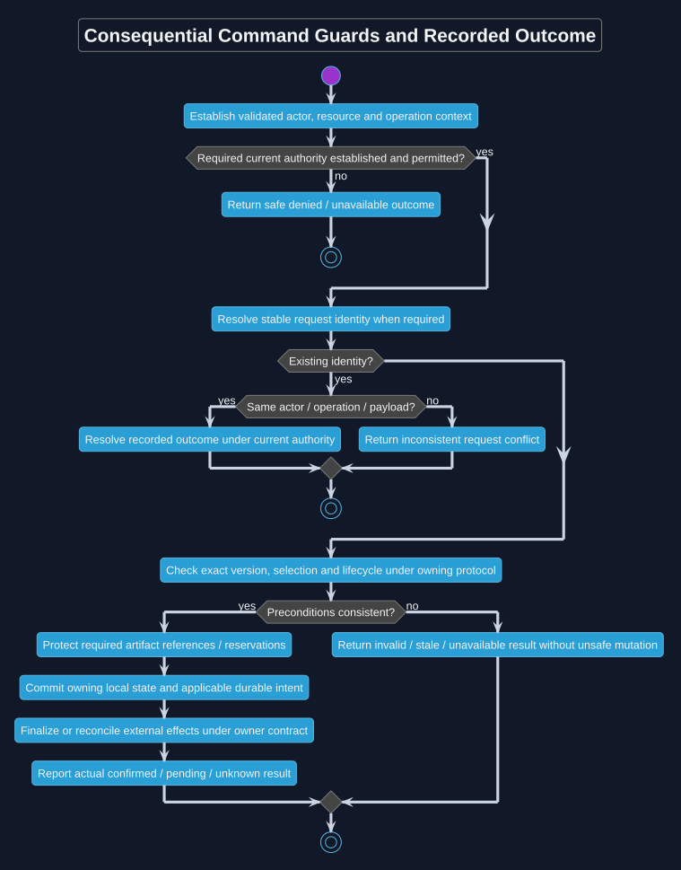
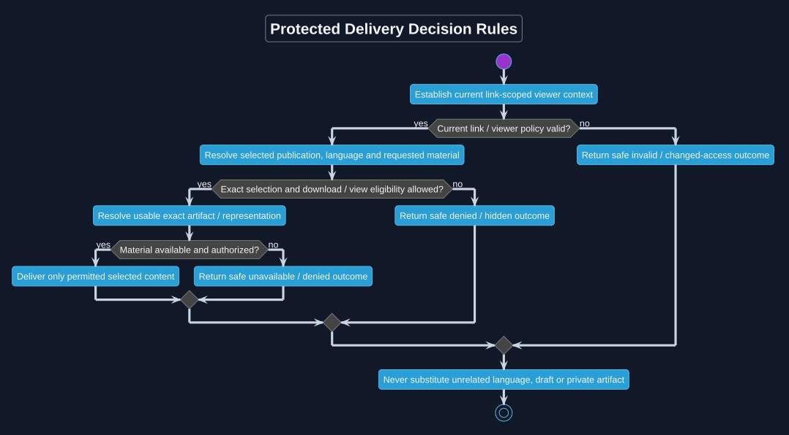

# 6. Algorithms And Business Rules

[Previous: API Specification](05-API-Specification.md) · [Low-Level Design introduction](01-Introduction.md) · [Next: Error Handling and Logging](07-Error-Handling-And-Logging.md)

This chapter specifies guarded operation steps and decision rules for the selected MVP. The algorithms are implementation contracts to refine and verify, not executed code or a new source of business policy. The [SRS](../../02-Requirements-Engineering/01-Software-Requirements-Specification.md), selected ADRs and owning module contracts govern behavior and unresolved inputs.

## 6.1 Operation Flows

### Common Consequential Command Protocol

[PlantUML source](Diagrams/business-command-guards.puml) · [PNG](Diagrams/business-command-guards.png)

1. Establish receiving actor, resource, operation and validated input context.
2. Check required current authority. Distinguish denied identity/action from unavailable authority; neither permits an unauthorized effect.
3. Where request identity is required, resolve actor/operation/key and payload under the selected concurrency protocol. Matching requests resolve their recorded outcome; inconsistent reuse conflicts.
4. Check current versions, lifecycle state and exact selection at the owning transaction/decision point.
5. Protect required reservations/references and commit the local business state plus applicable durable intent/outcome.
6. Finalize or reconcile file/Git/mail/remote work under its owner; preserve uncertainty and protection while required.
7. Report only the actual recorded outcome. Local persistence or queue acceptance is not proof of completed external work.

The diagram expresses guards, not a requirement to hold database locks during network calls or a universal transaction order for all modules. Concrete locking, revalidation and request-identity races follow [Database Design](04-Database-Design.md) and [API Specification](05-API-Specification.md).

### Apply Selected Profile Changes

| Step | Rule |
| --- | --- |
| Resolve target | Identify current owner, source comparison, exact draft and content language |
| Validate intent | Ensure selected fields belong to the reviewed comparison and preserve independent overrides/text |
| Check version | Compare expected source/draft context under the owning write protocol |
| Apply | Change only the explicitly selected draft content and update its version |
| Return | Name the saved draft outcome; publication and submitted history remain unchanged |

No selection is not permission to apply every source change. A stale comparison requires review; never silently overwrite later work or publish an unseen candidate.

### Publish Exact Candidate

1. Validate current actor/resource authority and the intended draft/language/version.
2. Validate exact selected artifacts and usable material identity; do not replace missing bytes with a newer file.
3. Reserve/protect required immutable material under the selected reference protocol.
4. In the owning local transaction, create the immutable revision, update the applicable live selection and record required durable work/outcome.
5. Finalize/reconcile reservations asynchronously as specified; retain protection while completion is pending/uncertain.
6. Report publication truthfully, with PDF availability and sharing eligibility separate.

A later draft/profile edit cannot mutate the published snapshot. Withdrawal changes current access under policy without rewriting actual submitted history.

### Capture Actual Submitted Materials

Resolve the authorized application and reviewed actual-material selection, including independently authored text/files or a selected revision as applicable. Validate stable request identity and exact available material; protect the required bytes/references before claiming capture.

Record the immutable event and exact material metadata/digests with applicable durable intent locally. Resolve matching retries without a duplicate event. Missing/uncertain actual material remains explicit under the capture contract; do not reconstruct history from the current live resume or claim a complete capture prematurely.

Mutable application status, next action and follow-up are distinct operations with expected-version/authority rules. Recording a manual submission does not automatically send it to an employer.

Application status follows the [owner-selected manual policy](../../02-Requirements-Engineering/01-Software-Requirements-Specification.md#owner-selected-manual-application-status): allow any of the seven existing statuses from any current status, including backward/reopened states and explicit same-status progress events. Reason is optional. Validate current owner/input/expected version, then append attributed before/after status and offer-outcome snapshots plus effective/recorded times in the same local write as the new current state. Clear current offer outcome when leaving Offer; preserve its history. Missing exact-material capture stays explicitly incomplete and does not prevent manual status selection. No external event or capture completion automatically changes status; no status edit rewrites actual submitted material.

### Admit, Replace and Reclaim Artifacts

| Phase | Rule |
| --- | --- |
| Admission | Validate selected types, per-file limits, aggregate allowance and disk reserve under the actual policy |
| Concurrent reservation | Serialize relevant accounting decisions so simultaneously acceptable-looking requests cannot jointly exceed the allowance |
| Usability / association | Distinguish transferred bytes, admitted usable artifact and consumer selection |
| Replacement | Commit the intended association only under its contract; failed replacement does not pretend prior usable material changed |
| Release | Require reference-owner evidence and retention eligibility before physical reclamation/accounting release |
| Reconcile | Expiry alone does not prove no effect; preserve bytes needed by pending/uncertain operations |

A hash supports byte integrity, not permission or encryption. Do not invent new file limits, quarantine infrastructure or retention durations here.

### Repository and Issue Operations

For scoped JSON, ProjectForge validates caller/scope, current Core entitlement and local resource/action grants. Resolve repository-relative paths and immutable revision identity for file/history reads; return permitted projections without host paths.

For issue creation/update/board movement, validate allowed fields/state/assignee, expected version where required and stable write identity. Preserve issue identity through moves; a stale write conflicts without overwriting later state. Issue authority does not grant native Git write.

Native Git uses the evaluated transport, credentials and applicable repository/ref/action checks. Its effects cannot be undone by assuming SQL rollback. Advanced review/releases and user workflow execution remain deferred.

## 6.2 Validation Rules

| Validation subject | Required decision | Owning enforcement |
| --- | --- | --- |
| Caller / actor | Accept only validated receiving context and permitted identity scope | Entry adapter plus current owner policy |
| Resource / ownership | Target exists within current visible/action scope | Owning service/policy and owner-scoped relationships |
| Expected version | Requested mutable state still matches reviewed intent | Transactional compare/update; stale conflict |
| Request identity | Same actor/operation/payload or inconsistent reuse | Durable record and concurrent uniqueness/claim protocol |
| Material / language | Exact intended content/artifact is usable and eligible | Presentation/Files/Applications/Sharing contract |
| Lifecycle transition | Selected operation is valid in actual current state | Owning domain/use-case rules |
| Input bounds / formats | Apply selected field limits and supported types | Server validation, with UI assistance only |
| Temporal meaning | Preserve date-only versus instant and applicable zone/locale | Owning data/API contract |
| Repository path / grant | No host traversal or unrelated repository/action access | ProjectForge and actual transport boundary |
| Retention / quota | References and concurrent reservations allow the operation | Owning accounting/transaction/reference protocol |

Validate business rules at the decision point that protects the effect. An early UI check or known ID cannot authorize later access. Define exact nullability, lengths, limits and late-retry behavior in concrete schemas/contracts rather than silently introducing defaults.

### Protected Delivery Decision Flow

[PlantUML source](Diagrams/protected-delivery-rules.puml) · [PNG](Diagrams/protected-delivery-rules.png)

Current viewer/link policy, selection, language and view/download eligibility are separate guards. Apply them to direct, alternate and applicable range/cache paths as governed. Link-scoped context is not named employer identity. Revocation cannot recall bytes already delivered.

## 6.3 Edge Cases

| Condition | Required result / invariant |
| --- | --- |
| Source changed after comparison | Conflict/review; independent draft and current publication not silently overwritten |
| Draft changed before publication | Reject stale candidate; do not publish newer unseen content |
| Matching repeated command | Resolve the same recorded outcome under current authority |
| Same identity, different payload | Conflict without performing a second inconsistent effect |
| Two concurrent issue updates | Only the valid expected-version transition succeeds; later state preserved |
| Two admissions jointly exceed allowance | Selected concurrent accounting policy prevents over-admission |
| Missing exact submitted artifact | Explicit unavailable/pending capture; no replacement with current material |
| Share/grant revoked | New protected decisions apply current policy, including direct/Git entry paths |
| Required authority unavailable | Safe unavailable outcome; no operation using assumed entitlement |
| Lost response after commit | Outcome unknown until resolved; no assumed rollback or blind repeat |
| Worker stops after partial effect | Durable owner evidence supports reconciliation with references protected |
| Reservation appears expired | Reconcile attributable work before release; expiry is not universal proof of abandonment |
| Restored state contains pending work | Check intended access, existing outcomes and actual bytes/Git before replay/cleanup |

## Partial Effect and Retry Rules

A local transaction protects local relational consistency, not a distributed effect. Retain committed results and classify definitive rejection separately from unknown completion. Retry only under the documented operation identity, current authority and effect protocol; never replay every exception or release still-required bytes automatically.

If reconciliation establishes a prior outcome, report it accurately. If evidence remains insufficient, keep the documented pending/unknown state and operator/user-safe status path. Do not fabricate success, conceal failure or use broad compensation that erases valid immutable history.

Error shapes and diagnostic bounds belong in [Error Handling and Logging](07-Error-Handling-And-Logging.md). Permission/secret handling belongs in [Security Implementation](08-Security-Implementation.md). Numeric timeout/retry/retention values remain selected-input or verification gates where unresolved.

## Verification and Handoff

For each algorithm, derive checks from its guards and invariants, not merely from line-by-line implementation. Include allowed/denied, stale, duplicate/mismatched, concurrent, interrupted and recovery cases where applicable. Use real MySQL/concurrency and actual Git/delivery facilities when the guarantee depends on them.

Record exact criterion, operation, candidate, configuration, fixtures, expected/observed outcomes and evidence. Link [Detailed Module Design](03-Detailed-Module-Design.md), [Database Design](04-Database-Design.md), [API Specification](05-API-Specification.md), [Unit Test Design](10-Unit-Test-Design.md) and [Traceability](11-Traceability.md) / [RTM](../../02-Requirements-Engineering/03-Requirements-Traceability-Matrix.md).

These algorithms create no implemented methods, executed tests, new product scope or deployment authority. UML/source rendering and local-link checks verify documentation artifacts only.
