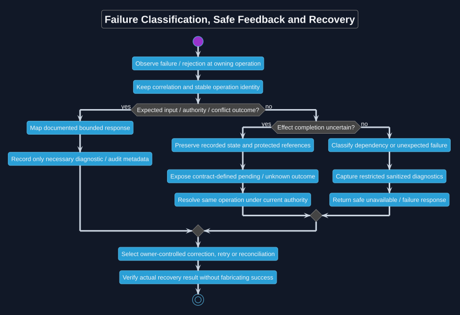

# 7. Error Handling And Logging

[Previous: Algorithms and Business Rules](06-Algorithms-And-Business-Rules.md) · [Low-Level Design introduction](01-Introduction.md) · [Next: Security Implementation](08-Security-Implementation.md)

Handle errors at the owning operation and map them to the receiving interface without changing their business meaning. Preserve the distinction between definitive rejection, confirmed local work, dependency failure and uncertain remote completion. This specification defines planned contracts, not implemented exception classes, configured logging infrastructure or executed recovery tests.

## 7.1 Error Categories

| Category | Meaning | Invariant |
| --- | --- | --- |
| Input / selection invalid | Request or selected material does not satisfy the reviewed contract | No successful business mutation; return permitted correction details |
| Identity / authority | Receiving caller, current actor, resource visibility or action permission is not accepted | No unauthorized content/effect; avoid leaking hidden resource existence |
| Stale / inconsistent command | Expected version differs or the same request identity is reused with different scope/payload | Preserve newer state and original recorded identity/outcome |
| Required authority unavailable | Current entitlement/policy dependency cannot be established | Fail closed; do not assume stale or broad authority |
| Material / capacity unavailable | Exact bytes, selected variant, storage or admission resource is not usable under policy | No silent substitution or damage to unrelated retained material |
| Known incomplete / partial work | Some attributable stages completed while required work remains | Expose actual state and preserve owner evidence/protection |
| Unknown effect | Completion cannot be established, possibly after dispatch or commit | No assumed rollback, fabricated success or blind repeat |
| Unexpected implementation/infrastructure failure | An unanticipated condition interrupts the operation | Safe public response plus restricted diagnostics; preserve known committed effects |

Keep expected domain outcomes distinct from unexpected exceptions. Do not catch every failure and turn it into an empty list, generic success or a retryable error. A timeout alone does not establish whether the remote owner committed.

## 7.2 Error Codes

The [API error contract](05-API-Specification.md#mvp-api-contracts) owns JSON status mapping and safe public result fields.

| Documented status | Use | Client response |
| --- | --- | --- |
| `401` | Invalid receiving identity | Establish the permitted authentication context |
| `403` | Forbidden visible action | Explain safe restriction without bypass or private disclosure |
| `404` | Missing or hidden resource | Preserve the selected information-hiding policy |
| `409` | Stale write or inconsistent request-identity reuse | Review current state or correct identity misuse; no silent overwrite |
| `422` | Invalid input | Correct permitted field/selection details |
| `503` | Required authority cannot be checked | Safe unavailable outcome without unauthorized operation |

This is not a complete infrastructure-status catalog. Unexpected server failures use the implementation's reviewed safe server-error mapping; do not invent endpoint-specific codes or expose internals. Browser/Inertia, native Git and protected file delivery retain their own response contracts rather than a universal JSON wrapper.

### Public Error Contract

Return a stable reviewed error code, bounded human-readable guidance and correlation ID, with permitted field details where relevant. Concrete serialization is defined in the owning API schema; the diagnostic correlation ID is not an access credential.

Exclude stack traces, SQL, private host paths, tokens, uploaded bytes and unrelated resource names. Do not disclose a hidden resource through different validation details or explanatory messages. Internal exception types need not become public codes one-for-one.

Map the result where the receiving interface can preserve its meaning. Inner services should not fabricate HTTP behavior for every local call or swallow exceptions required for rollback/reconciliation. See [Detailed Module Design](03-Detailed-Module-Design.md) for ownership.

## 7.3 Logging

Use structured, bounded diagnostics with necessary operation context. Diagnostic logging, attributable audit records and durable business/request outcomes serve different purposes. A log line is not a substitute for the outbox, request-identity record, immutable submission event or a recovery protocol.

### Structured Event Fields

| Field role | Purpose / limit |
| --- | --- |
| Event time and severity | Order/classify observations using the configured consistent representation; not documentary update dates |
| Application / environment | Identify Core versus ProjectForge and prevent confusion with test/rehearsal |
| Candidate / component | Attribute behavior to actual revision and owner where available |
| Correlation / operation identity | Connect permitted request/job observations; do not reuse raw credentials as IDs |
| Event / outcome code | Stable bounded classification rather than uncontrolled free-form sensitive payload |
| Actor / resource metadata | Only permitted necessary identifiers, protected by log access policy |
| Dependency / duration / attempt context | Diagnose unavailable or delayed work without secret endpoints/payloads |
| Exception diagnostics | Restricted sanitized detail when needed; never returned wholesale to the caller |

Define concrete field names, size limits and storage/access settings during implementation. Validate or sanitize untrusted metadata so newline/control content cannot forge misleading entries. Restrict access and ensure a configured export/collector does not become an unrestricted copy of private product data.

### Severity Guidance

| Severity role | Appropriate use |
| --- | --- |
| Debug | Deliberate development/troubleshooting detail under safe configuration, not production private-payload dumping |
| Informational | Useful bounded operation/service observations without logging every normal field error at high severity |
| Warning | Recoverable but operationally relevant anomaly, unusual denial pattern or delayed/unreconciled work |
| Error | Unexpected failure or failed required processing needing investigation |
| Critical | Actual severe operational condition under the selected alert policy, not every rejected request |

Expected validation, permission denial and optimistic conflicts are not automatically errors. Apply useful severity/sampling policy to avoid obscuring genuine faults. Any aggregation or suppression must preserve required audit/incident evidence and cannot hide incomplete business work.

### Excluded Data

Never log raw passwords, invite/share verifiers, authorization headers, session/Git tokens, application keys, recovery codes or other credentials. Exclude private files, resume/cover-letter content, full submission material, unrestricted Git content and sensitive request/response bodies.

Redact before emission and review exception context/framework middleware for accidental capture. Hashing a secret for casual logging is not automatically an acceptable identifier. Synthetic fixtures should test exclusion without exposing real credentials in evidence.

## Error-to-Action Mapping

| Category | Caller feedback | Owning follow-up |
| --- | --- | --- |
| Validation | Associated field/context correction | Record only useful bounded metadata; preserve safe input |
| Authorization / hidden | Safe denied/hidden result | Verify current policy and investigate anomalous patterns without granting broader access |
| Conflict | Persistent current-state review | Preserve stored newer state and correlate intended command |
| Required authority unavailable | Accurate unavailable capability | Inspect bounded dependency evidence; do not bypass the check |
| Unusable exact material | Explicit unavailable/incomplete state | Resolve under the material/reference owner; no newer-byte substitution |
| Capacity / storage failure | Accurate selected admission/failure result | Inspect reserve/accounting and protect existing retained material |
| Partial / unknown effect | Name what is known and safe status route | Resolve same operation; retain protected references and separately committed outcomes |
| Unexpected failure | Bounded safe error with correlation | Restricted diagnostics, scoped correction and fresh verification |

## 7.4 Failure and Recovery Flow

[PlantUML source](Diagrams/error-handling-route.puml) · [PNG](Diagrams/error-handling-route.png)

The owner retains actual state and protection before choosing correction/retry/reconciliation. A log or a public error does not authorize destructive cleanup, key rotation or production restore. Such operations follow the approved runbook and explicit authority.

## 7.5 Boundary-Specific Handling

| Boundary | Required behavior |
| --- | --- |
| Browser form | Associate errors with controls, preserve permitted input and distinguish invalid from denied/stale |
| Protected recipient/file | Safe access feedback and no private bytes before current policy permits delivery; late stream failure does not recall emitted bytes |
| Scoped service call | Preserve stable identity, current authority and definitive versus uncertain outcome |
| Native Git | Use evaluated transport-compatible failure behavior; do not wrap every exchange in JSON or imply issue permission grants transfer access |
| Worker/outbox | Retain durable stage/outcome and failed-work visibility; reconcile interrupted effects under owner-local rules |
| Database/storage | Separate local rollback from file/Git/remote effects and preserve required artifact/reference protection |
| Transactional mail | Delivery failure/pending is distinct from committed business state; no unsupported claim of recipient reading/receipt |

User feedback follows [UI/UX Interaction and Feedback](../02-UI-UX-Design/09-Interaction-And-Feedback.md). Product copy should describe task outcomes, not force users to diagnose internal queues or database exceptions.

## 7.6 Retries, Cleanup and Log Availability

Retry only the failures allowed by the owning contract, with bounded policy, stable request identity and current authority. A matching command resolves its recorded result; changed payload reuse conflicts. Do not automatically repeat a possibly committed write after a lost response or release reservations solely because a diagnostic timeout occurred.

If logging/export is unavailable, follow an explicit implementation policy for safe local diagnostics, alerting and operation handling. Do not silently treat lost required durable/audit records as complete, and do not let optional diagnostic emission corrupt a confirmed business result. Separate these cases before selecting failure behavior.

Restrict log storage/exports, review growth and retention under the selected operational policy, and monitor failures/backlog without exposing secrets. No new collector, retention duration, alert channel or staffing schedule is selected here. See [Configuration and Environment](09-Configuration-And-Environment.md) and [HLD observability](../01-High-Level-Design/11-Non-Functional-Strategy.md).

## 7.7 Verification and Handoff

| Test subject | Required evidence |
| --- | --- |
| Error mapping | Invalid identity/input, hidden/forbidden resource, stale write and unavailable authority preserve the documented categories |
| Disclosure control | Responses/logs exclude credentials, private bytes, SQL/stack details and host paths; untrusted metadata cannot forge events |
| Correlation | Actual request/job/service observations can be linked without exposing access tokens |
| UI recovery | Safe input, associated errors, persistent conflict/pending/unknown feedback and no blind repeat |
| Durable outcomes | Lost response, worker interruption and partial file/Git effects retain truthful recorded state/protection |
| Operational failure | Log/export/storage problems follow the defined policy without fabricated business success or lost required records |
| Severity / volume | Expected rejections remain distinguishable from meaningful failures and required evidence is retained |

Record criterion/case, actual revision/configuration, fixtures, observed response/event fields and limitations. Use [Unit Test Design](10-Unit-Test-Design.md), [Traceability](11-Traceability.md) and the [RTM](../../02-Requirements-Engineering/03-Requirements-Traceability-Matrix.md). Align sensitive-data rules with [Security Implementation](08-Security-Implementation.md) and recovery with the [runbook](../../06-Deployment-Release/02-Runbook.md).

This document configures no logger, executes no failure test and claims no runtime pass. Actual field schemas, alert/retention settings and recovery evidence must be attached to the implementing work.
