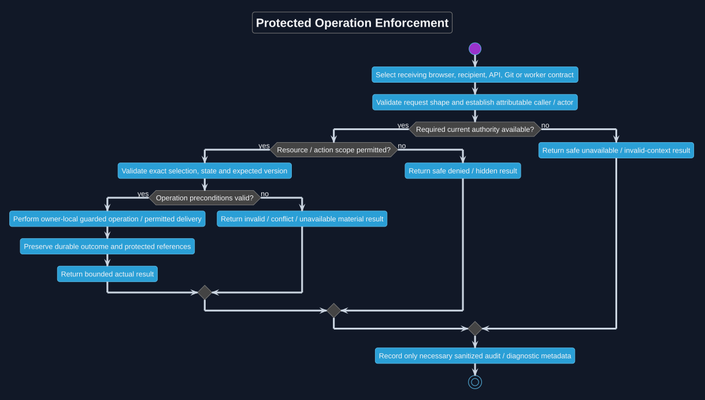

# 8. Security Implementation

[Previous: Error Handling and Logging](07-Error-Handling-And-Logging.md) · [Low-Level Design introduction](01-Introduction.md) · [Next: Configuration and Environment](09-Configuration-And-Environment.md)

This chapter allocates security enforcement to concrete entry, policy, operation, persistence and adapter responsibilities. It refines the selected [Security Architecture](../01-High-Level-Design/10-Security-Architecture.md), not an installed implementation, penetration-test result or compliance claim. Exact package settings and unresolved policy values require the owning implementation and evidence.

## 8.1 Input Validation

| Boundary | Required validation | Enforcement point |
| --- | --- | --- |
| Browser/Inertia action | Request shape, permitted fields, current resource/action context and applicable state-change protection | Receiving Laravel entry plus owning policy/use case |
| Scoped JSON | Caller/token, actor/scope binding, identifiers, allowed fields and payload limits | API adapter and current owner authority |
| Draft/publication/capture | Exact language/material selection, lifecycle, expected version and request identity where required | Presentation/Applications/Files operation |
| Recipient delivery | Current link/viewer context, selected representation, language and view/download eligibility | Sharing and file delivery owner, including direct/alternate paths |
| Artifact admission | Selected type/size/quota/disk-reserve policy and usable-content association | Files admission/reservation protocol |
| Repository path/revision | Permitted repository-relative path and exact resolved revision | ProjectForge file/history adapter and repository owner |
| Issue/board mutation | Permitted fields/state, assignee eligibility, local action grant and expected version | Work Management transaction/policy |
| Git transport | Actual credential, repository/ref/action scope and current entitlement | Evaluated native Git authorization boundary |

Use allowlisted operation inputs and explicit mapping into owned state; do not let arbitrary client fields assign owner, role or immutable-history data. Client validation improves feedback but never replaces server enforcement. Exact lengths, formats and limits come from governing schemas/policy rather than guessed values.

Treat authored text, filenames and media metadata as untrusted. Use the selected safe presentation/rendering path and trusted Blade PDF templates. Do not execute uploaded previews, derive unrestricted filesystem commands from input or disclose private host paths. Validate resolved access rather than trusting an extension or a display label as proof of safety.

## 8.2 Password and Token Handling

| Secret / credential | Implementation obligation |
| --- | --- |
| User passwords | Use selected framework authentication/password hashing; never persist plaintext or expose it in diagnostics |
| Invitation/recovery/share verifiers | Apply selected protected verifier storage, consumption, expiry and revocation behavior |
| Application keys | Independent per application/environment and server-side only |
| Core/ProjectForge service credentials | Restrict caller, actor/scope and intended endpoint; status-only credentials cannot read content |
| Git credentials | Protected stored verifier, repository/action scope and current expiry/revocation checks |
| Factor/recovery secrets | Use selected package storage and administrator controls; no raw values in source/evidence |
| SMTP/backup/operating secrets | Restricted environment access and approved recovery procedure; no frontend exposure |

Record actual credential formats, lifetimes, key/secret lifecycle and package compatibility in the implementing contract/configuration. Do not introduce a new universal factor requirement, lifetime, identity provider or vault merely to fill a documentation gap. The selected [frontend ADR](../ADR/ADR-007-React-Inertia-Frontend.md) retains Laravel/Fortify authentication and independent sessions.

Rotation/revocation may affect active sessions, service calls, pending work and restore capability. Define those effects and recovery preconditions before execution. This chapter does not rotate keys, disable accounts or expose any secret value.

## 8.3 Access Control

### Entry-point Matrix

| Entry | Authority required | Data/effect limit |
| --- | --- | --- |
| Core workspace | Current invited account/session plus resource/action policy | Authorized Core records and operations only |
| Employer/share view | Current link-scoped viewer policy | Selected currently eligible representation; no owner workspace or private application history |
| Direct file/PDF/media | Current owner/recipient policy and exact artifact eligibility | Only authorized bytes; known URL/ID is insufficient |
| Core → ProjectForge API | Valid scoped actor request, current Core entitlement and local grant | Permitted repository/issue action; no direct data-store shortcut |
| ProjectForge → Core status | Narrow service status authority | Current identity/entitlement status only, no private content |
| Native Git | Transport credential, applicable current entitlement and local repository/ref/action grant | Authorized transfer; issue-write is not Git-write |
| Worker/scheduler | Owner-local execution identity and applicable operation context | No bypass because a job was previously queued |
| Administration/operations | Explicit selected duty/privilege | No unrestricted private-content access from an administrator label |

Deny unauthorized operations without unauthorized business effects. If required authority cannot be established, return the documented safe unavailable result instead of assuming cached or broad service permission. Receiving resource owners remain authoritative even if another entry already authenticated the caller.

### Enforcement Flow

[PlantUML source](Diagrams/security-enforcement.puml) · [PNG](Diagrams/security-enforcement.png)

The flow illustrates security guards, not a universal class or a requirement to hold locks during network calls. Concrete checks must protect the contract-defined effect/decision point, including current-state/version checks under the owning transaction. Earlier page-load permission does not authorize later requests.

## 8.4 Protected Sharing and Content Delivery

Keep publication, share state/password and PDF/download configuration distinct. Resolve current viewer/link generation, exact selected content, language and availability before delivery. Apply the governing policy to direct, alternate, range/cache and active-context paths rather than protecting only a UI route.

A link-scoped viewer is not verified named employer identity. Do not expose unselected/private content or silently substitute another-language PDF. Revocation changes subsequent access according to the contract; already emitted/downloaded bytes cannot be recalled.

Historical artifact protection is separate from recipient access. Submitted material remains preserved after edits/withdrawal, but a retained reference does not make bytes generally shareable. Do not turn a private storage key into a public URL with no owner policy.

## 8.5 Persistence, Files and Native Execution

| Boundary | Required control |
| --- | --- |
| Database | Owner-local credentials/writes, scoped relationships and reviewed constraints; current authorization remains an application obligation |
| Private storage | Restricted paths/permissions and owner-controlled delivery; no unrestricted static exposure |
| Artifact lifecycle | Concurrent admission/reservation policy and reference-aware removal; retain protection while outcomes remain uncertain |
| PDF processing | Trusted templates and exact selected input, applicable resource/content controls and private output |
| Native Git | Repository/path/ref/action scope, evaluated client interoperability and private repository storage |
| Background work | Durable attributable intent/result, owner-local credentials and bounded processing under the selected policy |

Use safe database/command/filesystem adapters instead of concatenating untrusted input into SQL, shell or host paths. Actual parameter/argument/path handling must be verified in implementation. No malware-scanner or user execution sandbox is selected here; untrusted workflow execution remains deferred.

A SQL rollback cannot undo delivered bytes, changed Git refs or a remote commit. Preserve request identity, known outcomes and protected references, then reconcile at the owner rather than using destructive blanket compensation.

## 8.6 Browser, Session and Diagnostic Controls

Keep application sessions/keys independent and apply reviewed Laravel state-change protections. CORS, same-origin placement, hidden controls and client route guards do not replace authentication/resource authorization. Validate actual cookie/session/framework configuration on the receiving entry.

Use bounded safe errors and restricted structured logs under [Error Handling and Logging](07-Error-Handling-And-Logging.md). Exclude passwords, headers/tokens, factor secrets, private text/files and host paths from responses, source, frontend bundles and evidence. Sanitize untrusted diagnostic metadata before emission.

Rate/admission limits, resource bounds and operational thresholds must follow selected policy and verified capacity. Do not invent numeric settings or describe a framework default as proven protection.

## 8.7 Environment and Recovery Boundaries

Separate Core/ProjectForge process identities, databases/users, keys, sessions and private storage, even when initially sharing a host. Verify effective privileges rather than treating directory names as isolation. Keep development/test/rehearsal synthetic data and secrets separate from production/demo stores.

Protect backup copies and recovery secrets and demonstrate isolated restoration of records, exact artifact bytes/digests and native Git state. Review restored intended access and pending/request outcomes before replay or cleanup. A restore must not silently re-enable revoked authority or duplicate external effects under the recovery contract.

Logical application separation is not host-compromise containment or automatic failover. Confirm actual permissions and failure coverage through [Configuration and Environment](09-Configuration-And-Environment.md), [Deployment Architecture](../01-High-Level-Design/09-Deployment-Architecture.md) and the [runbook](../../06-Deployment-Release/02-Runbook.md).

## Entry-point Verification

| Check family | Required cases |
| --- | --- |
| Identity/invitation/session | Valid/invalid/expired/consumed context, current account state and selected factor/admin controls |
| Resource isolation | Wrong owner/identifier, hidden resource and unauthorized fields; direct request independent of UI |
| Sharing/delivery | Wrong/changed viewer context, selected language/material, revoked link, direct/alternate delivery and applicable cache/range behavior |
| Scoped integration | Wrong caller/actor/scope, status-only access, revoked entitlement/grant and required authority unavailable |
| Native Git/issues | Actual allowed/denied transfers, distinct issue-write grants, path/revision handling and current revocation |
| Concurrency/retention | Stale version, same-key/mismatched payload, concurrent quota and interrupted protected-reference finalization |
| Content/secrets | Safe authored/uploaded handling, trusted rendering, bounded outputs and no secret/private payload leakage |
| Isolation/recovery | Effective owner/environment privileges and isolated consistent restore with safe pending-work reconciliation |

Use synthetic personas, keys and content. Record exact criterion/case, actual candidate/configuration, input/grant/data context, observed response/effect and bounded evidence. Unit checks cannot alone prove real transport, filesystem permissions or restored private bytes; verify the actual facility where required.

Use [Unit Test Design](10-Unit-Test-Design.md), [Traceability](11-Traceability.md) and the [RTM](../../02-Requirements-Engineering/03-Requirements-Traceability-Matrix.md) for verification links. Unresolved policy/configuration and unexecuted checks remain explicit gaps. This chapter installs no controls, executes no security assessment and establishes no runtime pass or deployment permission.
