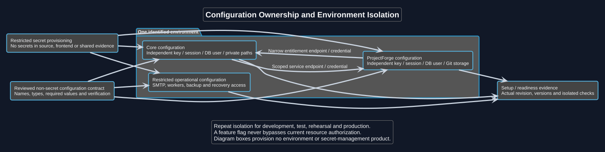

# 9. Configuration And Environment

[Previous: Security Implementation](08-Security-Implementation.md) · [Low-Level Design introduction](01-Introduction.md) · [Next: Unit Test Design](10-Unit-Test-Design.md)

## 9.1 Configuration and Environment

Configuration binds the selected application design to an identified environment without merging Core and ProjectForge authority. Each application/environment has independent keys, sessions, database credentials and private storage. This chapter specifies configuration responsibilities; it does not create an environment, install packages, provision secrets or claim working connectivity.

Use [Project Setup](../../05-Agile-Iterative-Development/01-Project-Setup.md) for actual versions, paths and successfully executed commands. Runtime/dependency targets follow the selected baseline and [frontend ADR](../ADR/ADR-007-React-Inertia-Frontend.md). Exact variable names and package-specific settings are resolved against the actual implementation, not inferred from conceptual examples here.

### Configuration Contract

For every setting record owner, purpose, actual name when implemented, type/format, required/optional state, non-secret default if justified, validation, secret classification, reload/restart implications and verification. Do not supply fake credentials, production addresses or arbitrary timeout/quota values to make an example look runnable.

| Group | Owner / purpose | Required validation and boundary |
| --- | --- | --- |
| Application identity | Each receiving Laravel app | Intended environment, application key and safe public identity/base URL; independent Core/Forge sessions |
| Runtime / dependencies | Each application build/deployment | Effective compatible versions/extensions and locked dependency/build identity |
| Database | Respective owner | Intended isolated schema/user, allowed privileges and no implicit demo/production target |
| Private storage | Core artifacts; Forge repositories | Intended private root, effective process permissions and no public delivery bypass |
| Sessions / browser state | Respective receiving app | Reviewed session/cookie/domain behavior that does not accidentally share authority |
| Jobs / scheduler | Owner-local workers | Selected backend/settings, durable state, compatible code and startup/shutdown/supervision |
| Scoped integration | Core adapter and Forge receiver | Intended service endpoint, restricted caller/scope, current actor context and selected credential protocol |
| Entitlement status | Forge caller and Core narrow endpoint | Status-only access, current result and bounded unavailable behavior |
| Native Git | ProjectForge | Evaluated engine/transport, credential/grant scope and private repository path |
| Transactional mail | Owning system-message path | Actual controlled SMTP delivery and failure feedback; log output is not delivery proof |
| Admission / processing | Owning file/Git/job operation | Selected type/size/quota/reserve and resource policy; actual validated units/ranges |
| Diagnostics | Respective app / operations | Safe debug/error behavior, restricted structured metadata and bounded storage/export |
| Backup / restore | Explicit operational owner | Protected copies, recovery access and isolated target with verified consistency |

Configuration cannot substitute for current authority. A valid service URL/key does not authorize arbitrary resources, and a private path name does not prove effective filesystem isolation.

### Environment Separation

| Environment | Intended use | Safeguard |
| --- | --- | --- |
| Development | Reproducible setup and selected feature work | Non-production credentials/paths and synthetic or appropriately protected fixtures |
| Automated test | Actual checks/migrations/concurrency as applicable | Distinct test database/storage; verify target before destructive reset/fixture work |
| Rehearsal | Candidate rollout, compatibility and recovery demonstration | Controlled configuration and safe effects away from active production |
| Production | Approved deployed candidate | Restricted access, reviewed settings, actual health/smoke and recovery evidence |
| Isolated restore | Validate consistent records/private bytes/Git | Separate targets/connectivity and control of mail/jobs/external effects before replay |

Do not copy a production configuration into a test run casually. Prevent rehearsal/restore from sending unintended mail or replaying live effects. Shared-host placement remains a shared failure domain even with separate application configuration.

## Configuration Ownership

[PlantUML source](Diagrams/configuration-boundaries.puml) · [PNG](Diagrams/configuration-boundaries.png)

The diagram repeats logically for each environment. It specifies authority boundaries, not a new vault, hosting provider, container platform or actual deployment topology. Operator privileges are explicit duties, not unrestricted product access.

### Required, Optional and Invalid Values

Validate required configuration before serving the affected capability. Missing/invalid critical identity, database or private-path settings must not fall back to insecure broad access or an unintended data target. Report bounded safe diagnostics without printing secret values.

Distinguish malformed/missing startup inputs from a dependency that becomes unavailable at runtime. Optional integrations/capabilities can report accurately unavailable under their contract rather than falsely failing every unrelated feature. Define actual readiness behavior with the deployment/runbook; do not claim a green process signal proves current authority, mail or restore.

Defaults must be non-secret, justified and safe for the actual environment. A setting with no accepted numeric value remains an input/evidence gate; do not invent duration, retention or resource allowances here.

### Secret Provisioning and Evidence

Supply application/service/Git/SMTP/backup secrets through the selected restricted environment mechanism. Keep raw secrets out of source, lockfiles, frontend assets, sample configuration, command output and shared evidence. Safe examples contain names and clearly non-secret explanatory values, not reusable live credentials.

Separate applications and environments even if one person operates them. Record key identifiers/configuration identity without exposing values. Rotation/revocation procedures must account for active sessions, scoped calls, pending jobs and restore requirements before execution; this chapter performs no rotation.

Actual framework configuration loading, build-time/frontend exposure and process reload behavior must be verified against installed packages. Record which changes require rebuild, cache refresh or process/worker restart in the rehearsed operating guide rather than providing unexecuted generic commands.

## 9.2 Feature Flags

Keep deferred product capabilities unavailable. A flag controls exposure/rollout of an authorized implemented slice; it is not an alternate permission model or evidence that a capability passed its gate.

| Flag contract field | Required meaning |
| --- | --- |
| Owner / purpose | Named application/module and exact capability controlled |
| Default / environments | Explicit reviewed default and intended environment scope; no inferred enabled production state |
| Authority | Server resource/action policy applies regardless of flag state |
| Dependencies / gates | Required setup, contract and acceptance evidence before enablement |
| Disabled behavior | Safe navigation, API/job behavior and user feedback, with no hidden direct-route bypass |
| Pending work / data | Defined behavior for admitted operations and existing state when toggled |
| Audit / operation | Bounded attributable change and reviewed reload/restart implications |
| Removal condition | Work item and compatibility criteria for retiring the temporary switch |

Do not silently enable personal mail/calendar, AI, advanced review/releases, general Sprints or user workflow execution by a local flag. Scope/architecture changes require their governing decision. Disabling a flag does not erase durable history, undo a remote commit or authorize deletion of protected artifacts.

## 9.3 Configuration Change and Promotion

Associate the deployment candidate with source revision, locked build, effective runtime, non-secret configuration identity and migration set. Review change impact on sessions, service callers, private paths, pending jobs, native Git and recovery before promotion.

Apply environment-specific secrets separately from reusable artifacts. Verify the same candidate through rehearsal and production under the [deployment plan](../../06-Deployment-Release/01-Deployment-Plan.md). Configuration rollback, code rollback and restoring application data have different safety conditions; the [runbook](../../06-Deployment-Release/02-Runbook.md) governs actual steps.

Changing a database target or private root must not silently disconnect retained references from exact bytes. Changing service identity or timeout handling cannot justify stale authority or blind repeated writes. Reassess previous evidence invalidated by a configuration/dependency change.

## 9.4 Setup and Readiness Verification

| Check | Required observation |
| --- | --- |
| Clean build | Actual compatible versions/extensions, locked install and frontend build for both apps |
| Environment target | Intended application, schema/user, private roots and no implicit demo/production access |
| Effective isolation | Separate keys/sessions/credentials and real process/path privileges |
| Server/client boundary | Secrets remain server-side; browser configuration exposes only reviewed public inputs |
| Scoped services | Correct caller/actor/scope and current entitlement; unavailable authority fails safely |
| Jobs/scheduler | Correct owner/revision/configuration, durable outcomes and safe interrupted-work behavior |
| Mail / Git | Actual controlled delivery and evaluated native client/grant behavior, not mock/log-only proof |
| Admission / logs | Selected resource policy and safe diagnostic fields/settings work in the actual configuration |
| Missing/invalid inputs | Safe bounded failure with no insecure fallback or secret disclosure |
| Backup/restore | Protected access and isolated consistent records/artifacts/Git recovery with safe pending-effect handling |
| Flags | Enabled/disabled direct-entry/job behavior preserves authority and protected state |

Record actual commands only after successful execution under authorized setup. Link candidate/environment, safe configuration metadata, cases, observed result, limitations and follow-up to the work item and [RTM](../../02-Requirements-Engineering/03-Requirements-Traceability-Matrix/README.md). Do not expose secret dumps as evidence.

## 9.5 Handoff and References

Use [Security Implementation](08-Security-Implementation.md) for credential/access enforcement, [Error Handling and Logging](07-Error-Handling-And-Logging.md) for diagnostic safety, [Database Design](04-Database-Design.md) for owner/storage constraints and [API Specification](05-API-Specification.md) for service/result behavior.

[Unit Test Design](10-Unit-Test-Design.md) and [Traceability](11-Traceability.md) connect configuration-dependent checks to exact criteria. Actual setup values remain pending until recorded in Project Setup; completing this chapter configures no environment and establishes no runtime or deployment pass.
