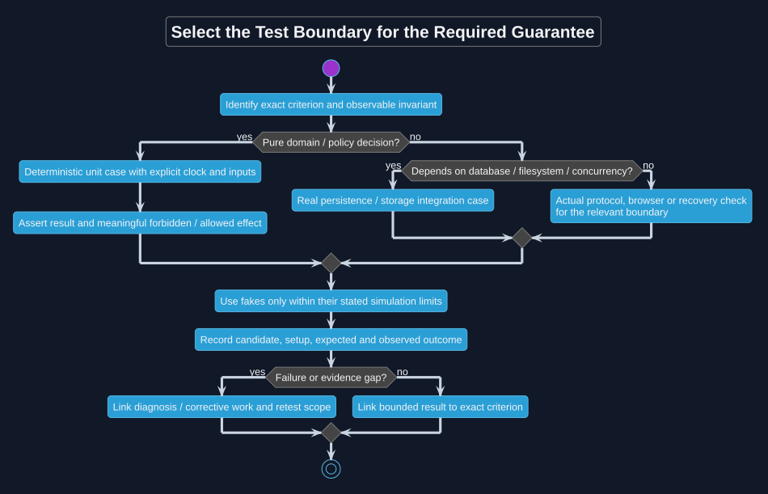

# 10. Unit Test Design

[Previous: Configuration and Environment](09-Configuration-And-Environment.md) · [Low-Level Design introduction](01-Introduction.md) · [Next: Traceability](11-Traceability.md)

Unit tests verify owned domain/policy decisions through deterministic inputs and observable results. They complement real persistence, protocol, browser and recovery checks where the guarantee depends on those facilities. This chapter specifies planned cases; it creates no test code, selects no new test framework and claims no execution result.

Use exact requirement criteria and the selected MVP scope. Local `UT-` labels below are planned case locators, not new requirements or substitutes for the RTM's acceptance IDs.

## 10.1 Cases by Module

| Module | Unit-level behavior | Required boundary beyond a unit fake |
| --- | --- | --- |
| Identity and Access | Invitation/account eligibility, current policy decisions and narrow status projection | Actual framework session/factor/configuration, concurrent invitation consumption and direct receiving entries |
| Professional Presentation | Explicit selected apply, independent text, expected-version decisions and immutable revision construction | Real transaction/version conflicts, publication/live-pointer constraints and protected exact artifacts |
| Representation and Sharing | Current selection/language/download eligibility and bounded denial | Actual direct/alternate/range/cache delivery and active-context revocation policy |
| Files and Operations | Selected admission rules, protected-reference release decisions and usable/processing outcome mapping | Real concurrent accounting, bytes/digests, path permissions, interrupted finalization and storage limits |
| Applications | Exact-material manifest, matching retry/payload conflict and historical identity | Database uniqueness/concurrency, immutable event persistence and exact retained bytes after later changes |
| Git Collaboration | Local grant/scope decisions, relative-path/revision validation and unavailable authority handling | Real native client/credential/ref operations and repository storage consistency |
| Work Management | Permitted issue changes, stable identity, expected-version decisions and assignee eligibility | Real atomic updates/events and repository-scoped API behavior |
| Supporting adapters | Safe outcome/error mapping and intended port interaction | Actual SMTP, configuration, database/filesystem/Git and restore facilities |

A unit policy denial does not prove every route invokes that policy. A fake immutable artifact does not prove bytes survive replacement or restoration. Keep each test's assurance bounded by what it actually exercises.

## 10.2 Mocks and Test Data

### Fixture Rules

Use synthetic owner, other-owner, collaborator and administrator identifiers with explicit grants and account state. Model recipient link-scoped context separately from product membership. Fixtures identify draft/source versions, selected language/revision/artifacts, request keys and payloads relevant to the case.

Use an injectable fixed/controllable clock for time-dependent decisions and deterministic identities where identity affects the assertion. For boundary expiry cases, document whether the selected contract treats the boundary as expired; do not invent grace periods or lifetimes. Date-only/instant tests preserve the owning temporal semantics.

Keep fixtures minimal and reset state per case. Do not use real credentials, private resume content, existing demo databases or production repository paths. Unit cases should not unexpectedly send mail, launch Git transfers or modify live stores.

### Doubles and Assertions

Use fakes/stubs for explicit technical ports only where their behavior matches the simulated contract. Prefer a small meaningful fake to extensive internal call choreography. Assert public result, unchanged/changed owned state and a consequential allowed/forbidden effect where relevant.

Do not mock the policy/use-case behavior being tested or mirror private implementation details as the only assertion. Exact call counts are appropriate only when they express a real invariant, such as no dispatch on denial, not incidental helper ordering. Verify database races and transport compatibility against real facilities rather than teaching a fake to return the desired result.

## 10.3 Deterministic Unit Cases

All cases below are **planned / not executed**. Preserve existing UT-01–UT-07 identities when adding implementation references.

| Case | Arrange and act | Observable assertion |
| --- | --- | --- |
| UT-01 Invitation expires | Evaluate a credential at the contract-defined expiry boundary using a fixed clock | Deny admission and do not request activation when expiry applies |
| UT-02 Scoped authority | Actor lacks the applicable resource/action grant | Deny before the protected effect port is invoked |
| UT-03 Apply selected profile changes | Two source changes exist; explicitly select one for an independent draft | Only selected content changes, independent text remains and draft version advances as governed; no publication invoked |
| UT-04 Stale edit | Expected version is older than current owned state | Return conflict with no mutation/dispatch |
| UT-05 Submission retry | Matching actor/operation/key/payload resolves a recorded result; then reuse key with changed payload | Matching request returns the original result; changed request conflicts without another capture |
| UT-06 Protected reference retention | Artifact has a durable publication/submission reference or still-required pending protection | Refuse unsafe reclamation; retain protection under the owning contract |
| UT-07 Issue transition | Request allowed issue change, then an expected-version mismatch | Valid decision preserves issue identity; stale decision requests no mutation |
| UT-08 Independent publication | Change source/draft after an immutable revision was constructed | Existing revision/history projection remains unchanged |
| UT-09 Current share selection | Request unselected or ineligible content/language through a viewer context | Deny/safe unavailable per contract, with no substitute/private byte delivery |
| UT-10 Authority unavailable | Entitlement status port cannot establish current authority | Safe unavailable outcome; no repository effect permitted |
| UT-11 Exact actual material | Capture selection contains independently authored/exact referenced material | Manifest preserves actual selected identity rather than resolving today's live pointer |
| UT-12 Missing exact material | Requested capture/publication artifact is unusable or outcome remains uncertain | Contract-defined incomplete/unavailable result; no fabricated complete capture or different-byte substitution |
| UT-13 Distinct Git authority | Actor has issue-write but lacks native Git action grant | Issue scope does not authorize Git transfer/write |
| UT-14 Unknown effect | Adapter reports lost/unresolved completion after possible dispatch | Preserve uncertainty and operation identity; no blind repeat or false rollback |
| UT-15 Safe error mapping | Expected denial/conflict or unexpected failure contains sensitive internal context | Public projection remains bounded and diagnostic redaction rules exclude sensitive values |
| UT-16 Reference release decision | One consumer releases a reference while another still protects the artifact | Refuse physical reclamation until governing references/policy permit it |

A sequential UT-05 fake verifies owner decision logic, not simultaneous request uniqueness. A unit-level UT-07 version mismatch verifies expected behavior, not atomic SQL. Link the companion integration cases below before accepting those guarantees.

## 10.4 Boundary Values and Decision Tables

| Rule | Test dimensions |
| --- | --- |
| Expiry/current state | Before, at and after the defined boundary; disabled/revoked/unavailable context |
| Selection/apply | None, subset and all explicitly selected changes; independent overrides; stale comparison |
| Versioning | Matching version, stale version and invalid input under the actual contract |
| Request identity | New key, same actor/operation/payload, changed payload/scope and recorded pending/unknown outcome |
| Sharing | Selected/unselected resource, eligible/missing language, current/changed link and download policy |
| Admission | Below/at/over selected size/quota thresholds with defined units; concurrent guarantee tested separately |
| Retention | No required references, active protected reference, pending/uncertain protection and allowed release |
| Issue permission | Allowed/denied actor/action, assignee eligibility and valid/invalid transition values |
| Temporal content | Date-only versus instant and applicable zone meaning without arbitrary shifting |

Use concrete selected limits in implementation cases; do not invent numeric policy values to make a test runnable. A proposed/unresolved boundary remains an explicit input gap rather than a made-up acceptance target.

## 10.5 Select the Correct Test Level

[PlantUML source](Diagrams/test-boundary-selection.puml) · [PNG](Diagrams/test-boundary-selection.png)

| Guarantee | Required evidence beyond pure unit logic |
| --- | --- |
| Duplicate/foreign-key/live-pointer enforcement | Actual selected MySQL migrations and constraints, including wrong-owner and cross-material/locale cases |
| Concurrent admission/invitation/issue writes | Controlled competing transactions against real database/accounting state |
| Durable outbox and partial effects | Interrupted worker/finalization and same-operation reconciliation with real persistence/storage |
| Private bytes/path/digest | Authorized direct delivery, effective permissions and exact file verification |
| Native Git | Actual allowed/denied client exchanges with evaluated credentials/repository scope |
| Framework/browser behavior | Real receiving session/validation/CSRF configuration, direct requests and complete UI tasks |
| SMTP/configuration | Controlled actual delivery and isolated environment/secret handling |
| Backup/restore | Isolated restoration of records, exact artifacts and Git state with safe pending-work/access reconciliation |
| Accessibility/usability | Actual configured journey assessment and observations, separate from fake component state |

Follow the [Test Strategy](../../05-Agile-Iterative-Development/02-Test-Strategy.md). A local fake or in-memory database cannot establish MySQL locking, filesystem isolation or external interoperability merely because it returns a matching response.

## 10.6 Case Record and Execution Evidence

| Field | Required record |
| --- | --- |
| Identity/source | Planned case locator, exact criterion and owning operation/module |
| Arrange | Synthetic actor/grants, data versions, clock, selected material and double behavior |
| Act | Deliberate operation and relevant request/version context |
| Expected | Observable result, invariant and meaningful effect/no-effect assertion |
| Implementation | Actual test file/case reference and source revision when written |
| Execution | Actual command, candidate/environment, observed result and bounded evidence |
| Limits/follow-up | Simulation limits, companion integration checks, failure/blocker and corrective work |

Do not populate observed-result/pass fields from the expected-result text. Record unexecuted cases as pending and preserve failed/blocked cases. Exact framework, commands and test-file layout follow the actual project setup, not unverified generic examples.

## 10.7 Handoff and Maintenance

Before implementing a rule, link its invariant to the governing operation and exact criterion. Select the narrowest meaningful test boundary, then include broader evidence only where the guarantee requires it. Reassess affected cases when policy, schema, adapter or configuration changes invalidate previous assumptions.

Use [Detailed Module Design](03-Detailed-Module-Design.md), [Database Design](04-Database-Design.md), [API Specification](05-API-Specification.md), [Algorithms and Business Rules](06-Algorithms-And-Business-Rules.md) and [Security Implementation](08-Security-Implementation.md) for contract details. Record implementation/results centrally in [Traceability](11-Traceability.md) and the [RTM](../../02-Requirements-Engineering/03-Requirements-Traceability-Matrix.md).

This chapter adds no runnable tests or production changes and executes no product checks. Documentation links and diagram rendering establish artifact consistency only.
