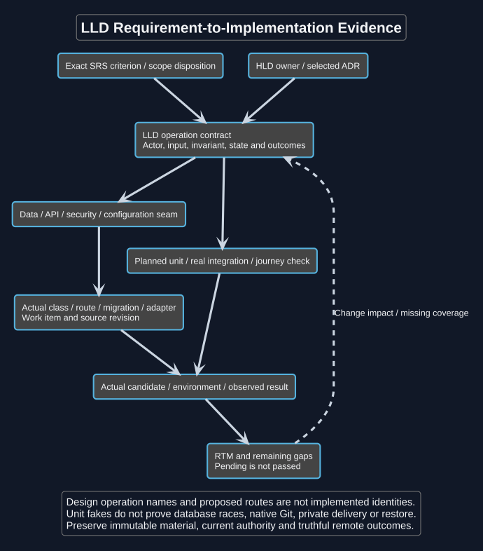

# 11. Traceability

[Previous: Unit Test Design](10-Unit-Test-Design.md) · [Low-Level Design introduction](01-Introduction.md) · [Next: Appendices](12-Appendices.md)

Traceability connects exact required behavior to an owning operation, data/interface contract, actual implementation and fresh verification. The [SRS](../../02-Requirements-Engineering/01-Software-Requirements-Specification.md) owns requirement meaning and the [RTM](../../02-Requirements-Engineering/03-Requirements-Traceability-Matrix.md) owns criterion applicability and recorded results. This chapter is the LLD navigation map, not a duplicate criterion register or a declaration that implementation exists.

## 11.1 HLD Components → LLD Modules

| HLD responsibility | LLD owner | Contract and invariant |
| --- | --- | --- |
| Invited identity and current entitlement | Core Identity and Access | Current actor/account context; narrow status projection exposes no private content |
| Professional presentation | Core Professional Presentation | Independent drafts, explicit selected apply and separately confirmed immutable publication |
| Protected representation/sharing | Core Representation and Sharing | Current link/viewer/selection/language/download eligibility on protected delivery |
| Private files and PDF | Core Files and Operations | Exact usable bytes, reservations, protected references and truthful processing outcomes |
| Manual applications/history | Core Applications | Mutable tracking distinct from immutable actual-material capture and retrieval |
| Repositories and native Git | ProjectForge Git Collaboration | Current entitlement/local grant and actual transport/revision authority |
| Issues and simple Kanban | ProjectForge Work Management | Repository-scoped action, stable issue identity and expected-version transition |
| Cross-cutting operations | Respective application/module and explicitly authorized operating procedure | Owner-local configuration, diagnostics, durable work and consistent recovery |

Use [Module Breakdown](02-Module-Breakdown.md) and [Detailed Module Design](03-Detailed-Module-Design.md) for exact provisions. Sharing a helper or deployment host does not merge independent sessions, database credentials, private paths or write authority.

## 11.2 Requirements → Classes / Endpoints

Names below identify design seams. Record actual class, route, migration and test identities only when implementation establishes them. Proposed paths in the [MVP API contracts](05-API-Specification.md#mvp-api-contracts) remain distinguishable from deployed endpoints.

| Requirement behavior | Owning operation / design seam | Data / interface provision | Verification path |
| --- | --- | --- | --- |
| Invited admission/current authority | Invitation/account policy and receiving authorization | Selected authentication/session plus narrow entitlement status | Planned UT-01/UT-02/UT-10; real invitation consumption, session and direct-entry checks |
| Selected profile changes | ApplySelectedProfileChanges / draft save | Explicit selection and expected source/draft version | UT-03/UT-04 plus real stale/concurrent persistence |
| Separate publication | PublishResume | Immutable revision, correct live selection and protected artifacts | UT-08 plus real publication constraints and exact bytes |
| Protected recipient content | ResolveSharedRepresentation / file delivery | Current viewer/link, exact selected variant and eligibility | UT-09 plus actual direct/alternate/cache-related delivery under the contract |
| Artifact admission/retention | AdmitArtifact / reference release | Selected type/quota/reserve, concurrent accounting and retained protection | UT-06/UT-16 plus real reservation races, filesystem and interrupted finalization |
| Actual submitted materials | CaptureSubmission / exact history retrieval | Immutable event, exact authored/revision/file identity and digests | UT-05/UT-11/UT-12 plus real uniqueness, bytes and later-change/restore checks |
| Application tracking | UpdateApplication | Mutable versioned status/next action/follow-up with temporal meaning | Unit rule cases plus real allowed/denied/stale updates |
| Repository files/history | ReadRepositoryFilesOrHistory | Permitted repository-relative path and resolved immutable revision | Unit validation plus actual scope/path/revision integration |
| Issues / board movement | CreateOrUpdateIssue / MoveIssue | Stable issue identity, expected version and actor/operation/payload-bound write key | UT-07 plus real concurrent API/database behavior |
| Native Git | AuthorizeGitOperation and evaluated transport adapter | Git credentials, current entitlement and local repository/ref/action grant | UT-13 plus real allowed/denied native client exchanges |
| Truthful partial/unknown effects | Owning durable outcome/outbox and reconciliation | Preserve separately committed results and protected references | UT-14 plus interrupted/lost-response integration |
| Safe diagnostics/errors | Receiving error mapping and restricted logger/audit | Bounded public result and redacted structured metadata | UT-15 plus actual response/log/configuration inspection |

UT labels are local planned case locators from [Unit Test Design](10-Unit-Test-Design.md), not acceptance criterion IDs or passed checks. Exact criterion wording/disposition remains in the RTM/register. One operation can support several criteria; each still needs a demonstrated expected result.

## 11.3 Design and Evidence Chain

[PlantUML source](Diagrams/lld-traceability.puml) · [PNG](Diagrams/lld-traceability.png)

The chain separates design coverage, actual implementation identity and executed evidence. A link to a design area or a rendered UML diagram does not prove that the route exists, the policy is invoked or the artifact bytes survive a restore.

## 11.4 Cross-Cutting Contract Map

| LLD record | Trace responsibility |
| --- | --- |
| [Database Design](04-Database-Design.md) | Actual table/constraint/migration, owner-scoped relationship, version/transaction and retained reference |
| [API Specification](05-API-Specification.md) | Caller/actor/scope, concrete payload/result, version/key, error and retry behavior |
| [Algorithms and Business Rules](06-Algorithms-And-Business-Rules.md) | Guards, exact selection, lifecycle, concurrency and truthful recovery steps |
| [Error Handling and Logging](07-Error-Handling-And-Logging.md) | Public category, safe diagnostic fields and actual recorded outcome |
| [Security Implementation](08-Security-Implementation.md) | Protected entry, current authority, credential/storage and direct-request enforcement |
| [Configuration and Environment](09-Configuration-And-Environment.md) | Effective environment targets, isolation, selected flags and secret-safe settings |
| [Unit Test Design](10-Unit-Test-Design.md) | Deterministic planned rule cases and companion real-facility checks |
| [UI/UX handoff](../02-UI-UX-Design/13-Handoff-To-Development.md) | Task/screen states, accessibility, responsive language context and safe user recovery |

Trace current authorization and retention to the actual resource entry/owner, not merely a generic “security” or “files” label. Trace remote uncertainty to its stable operation record and reconciliation, not only an exception class. Shared concerns can require several linked owners without permitting unrestricted writes between them.

## Implementation Evidence Field

For each changed operation, record the requirement, exact implementation seam, revision, relevant test and observed outcome. Keep a field pending when the actual identity or result is unknown.

| Field | Required record |
| --- | --- |
| Source | Exact criterion identifier and scope/disposition, relevant requirement and governing ADR |
| Owner/context | Application/module, actor/resource/action, material/language/version and prerequisites |
| Design provision | Exact operation, data/API/security/configuration clause and invariant |
| Work item | Scoped issue/task and dependencies; no invented assignment or implementation status |
| Implementation | Actual class/method/route/adapter/migration and source/build revision |
| Planned verification | Case reference, fixtures, expected observable result and necessary test level |
| Execution | Actual command/check, environment/configuration, observed response/effect and evidence |
| Remaining gap | Failed, blocked or unexecuted work, limitation, owner/follow-up and affected gate |

Store bounded references, not credentials/private material, in shared evidence. A fake adapter establishes only simulated behavior; actual MySQL locking, native Git, private file serving, SMTP and isolated restore require their matching facilities.

## 11.5 Status and Scope Rules

| Evidence condition | Required reporting |
| --- | --- |
| Design exists, implementation absent | Record coverage with implementation pending |
| Planned case not executed | Keep not-executed/pending; expected result is not an observation |
| Actual pass | Link exact candidate/setup and evidence supporting that criterion |
| Actual failure | Record observed mismatch and corrective work without hiding it behind design completeness |
| Blocked check | Identify missing dependency/input and affected criterion/gate |
| Deferred/conditional criterion | Preserve applicability and activation condition; do not count as verified MVP work |
| Evidence invalidated by change | Reassess affected guarantees and obtain fresh checks |

Preserve the RTM's existing disposition/result vocabulary. Do not introduce replacement acceptance IDs or silently promote proposed criteria. Deferred communication/calendar, advanced Sprints/review/releases and user execution records do not create selected MVP classes/endpoints.

## 11.6 Change Impact and Reverse Review

When code, schema, contract, permission, dependency or environment changes:

1. Identify affected exact criteria and selected decisions.
2. Follow operation owners through consumers, screen states, persistence, adapters and pending work.
3. Review current authority, exact historical materials, request/version identity, retention and recovery consequences.
4. Update affected HLD/LLD, UI/UX, PlantUML source/renders and implementation references together.
5. Select fresh normal, denied, stale, duplicate, concurrent and interrupted checks proportionate to the actual guarantee.
6. Record actual results and remaining risk/gates in the owning work item and RTM.

Review reverse traces too. A new endpoint/class/effect without a governing task or justified supporting responsibility may indicate scope creep. A criterion with no owner, concrete design provision or executable verification path remains a gap. File counts and coverage links do not establish behavioral completeness.

## 11.7 Acceptance and Handoff

Before implementing a slice, establish its exact criteria, owner, operation inputs/results, data/security constraints and planned checks. Before acceptance, attach actual revision-specific code and evidence and keep failed/blocked/unexecuted work visible. Release readiness also depends on applicable operational/security/recovery gates beyond unit results.

Use [HLD Traceability](../01-High-Level-Design/13-Traceability.md), [UI/UX Traceability](../02-UI-UX-Design/14-Traceability.md), the [test strategy](../../05-Agile-Iterative-Development/02-Test-Strategy.md) and [deployment plan](../../06-Deployment-Release/01-Deployment-Plan.md) for cross-stage evidence. Continue to [Appendices](12-Appendices.md) for supporting design records and catalogs.

This trace map creates no implementation, executed test, accepted risk or deployment permission. Documentation verification is separate from runtime acceptance.
