# 12. Appendices

[Low-Level Design index](03-Low-Level-Design.md)

The records below retain supporting design rationale, implementation-view material, diagram catalogs and references.

<a id="design-record-02-detailed-and-object-oriented-design-05-design-evolution-refactoring-and-technical-debt-md"></a>

<details>
<summary>Resumefolio — Design Evolution Refactoring and Technical Debt</summary>

<a id="design-record-02-detailed-and-object-oriented-design-05-design-evolution-refactoring-and-technical-debt-md--heading-resumefolio--design-evolution-refactoring-and-technical-debt"></a>

### Resumefolio — Design Evolution Refactoring and Technical Debt

**Approach:** evolve the design through explicit source impact, small compatible changes and fresh verification. Preserve accepted product behavior, private authority, publication/submission identity and attributable external effects across every revision.

**Status:** proposed engineering procedure, November 2, 2026. Product implementation has not been established by this document. No code smell, accepted shortcut, measured debt cost or completed refactoring is invented here. Farhad remains the decision and delivery owner.

[Classification](#design-record-02-detailed-and-object-oriented-design-05-design-evolution-refactoring-and-technical-debt-md--heading-1-change-risk-defect-and-debt) · [Impact](#design-record-02-detailed-and-object-oriented-design-05-design-evolution-refactoring-and-technical-debt-md--heading-2-change-impact-and-decision-route) · [Refactoring](#design-record-02-detailed-and-object-oriented-design-05-design-evolution-refactoring-and-technical-debt-md--heading-3-incremental-refactoring-procedure) · [Compatibility](#design-record-02-detailed-and-object-oriented-design-05-design-evolution-refactoring-and-technical-debt-md--heading-4-data-interface-and-runtime-evolution) · [Debt records](#design-record-02-detailed-and-object-oriented-design-05-design-evolution-refactoring-and-technical-debt-md--heading-5-debt-records-prioritization-and-review) · [Evidence](#design-record-02-detailed-and-object-oriented-design-05-design-evolution-refactoring-and-technical-debt-md--heading-6-verification-and-completion) · [Visual package](#design-record-02-detailed-and-object-oriented-design-05-design-evolution-refactoring-and-technical-debt-md--heading-8-evolution-and-debt-visual-package)

Current MVP scope and selected mechanisms: [Baseline](https://github.com/Farhad-V/Web-Resumefolio/blob/1f2acaa351ac306cb57cbe4fe9742e8bd90720d9/docs/MVP/baseline/README.md). Deferred provider, advanced collaboration and workflow-execution designs are not MVP prerequisites.

<a id="design-record-02-detailed-and-object-oriented-design-05-design-evolution-refactoring-and-technical-debt-md--heading-authoritative-inputs"></a>

#### Authoritative inputs

Follow the [working method and change control](../../01-Project-Planning/02-Project-Management-Plan.md#delivery-approach), [source questions and decisions](../../02-Requirements-Engineering/01-Software-Requirements-Specification.md#change-and-baseline-open-questions-and-decisions), [architecture options](../01-High-Level-Design/14-Appendices.md#design-record-01-software-architecture-01-design-drivers-and-solution-options-md), [component boundaries](../01-High-Level-Design/14-Appendices.md#design-record-01-software-architecture-02-system-decomposition-and-boundaries-md), [OO principles](03-Detailed-Module-Design.md#design-record-02-detailed-and-object-oriented-design-01-design-principles-and-object-oriented-approach-md) and [design review/handoff](../01-High-Level-Design/14-Appendices.md#design-record-06-design-quality-and-security-analysis-05-design-review-traceability-and-handoff-md).

<a id="design-record-02-detailed-and-object-oriented-design-05-design-evolution-refactoring-and-technical-debt-md--heading-1-change-risk-defect-and-debt"></a>

#### 1. Change risk defect and debt

[Classifying findings before recording debt](https://github.com/Farhad-V/Web-Resumefolio/blob/1f2acaa351ac306cb57cbe4fe9742e8bd90720d9/docs/MVP/SDLC/04-system-design/02-detailed-and-object-oriented-design/diagrams/design-finding-classification.svg)

[Editable DOT](https://github.com/Farhad-V/Web-Resumefolio/blob/1f2acaa351ac306cb57cbe4fe9742e8bd90720d9/docs/MVP/SDLC/04-system-design/02-detailed-and-object-oriented-design/diagrams/design-finding-classification.dot) · 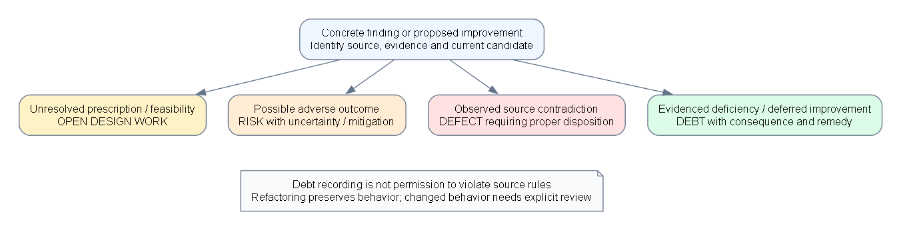

**Open design work:** a prescription, comparison or evidence task remains unresolved. Examples are executor isolation, Git engine integration, combined capacity, independent recovery facilities and exact criterion reconciliation. These are not automatically technical debt or approved omissions.

**Risk:** a possible future adverse outcome with uncertainty, impact and mitigation. Keep authoritative risk ownership in the project risk register; link relevant component/operating records rather than maintain conflicting risk scores here.

**Defect:** observed behavior or design contradicts an applicable source obligation. A broken authority check or loss of actual submitted materials is not made acceptable merely by labeling it debt. Fix or explicitly resolve the affected requirement/change decision under actual authority.

**Technical debt:** an evidenced design/implementation deficiency or deliberately deferred improvement whose ongoing consequences and remediation are identifiable. It can be deliberate or discovered; do not claim a trade-off was accepted unless the actual decision exists. Debt recording does not authorize scope reduction or bypass an execution/security/recovery gate.

**Refactoring:** change internal structure while preserving the applicable observable behavior and contracts. A changed permission policy, publication rule, API outcome or retention behavior is a behavioral change even when implemented during cleanup. Split those decisions and verification from the structural refactoring.

<a id="design-record-02-detailed-and-object-oriented-design-05-design-evolution-refactoring-and-technical-debt-md--heading-2-change-impact-and-decision-route"></a>

#### 2. Change impact and decision route

[Impact assessment through design and implementation](https://github.com/Farhad-V/Web-Resumefolio/blob/1f2acaa351ac306cb57cbe4fe9742e8bd90720d9/docs/MVP/SDLC/04-system-design/02-detailed-and-object-oriented-design/diagrams/design-change-impact-route.svg)

[Editable DOT](https://github.com/Farhad-V/Web-Resumefolio/blob/1f2acaa351ac306cb57cbe4fe9742e8bd90720d9/docs/MVP/SDLC/04-system-design/02-detailed-and-object-oriented-design/diagrams/design-change-impact-route.dot) · 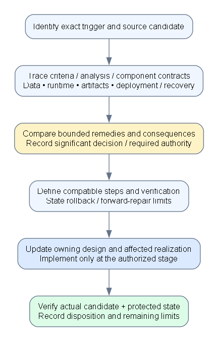

1. Identify the triggering requirement, observed defect, environment/dependency change or concrete smell. Record the current source/design revision and affected operation; avoid an unspecific “improve architecture” task.
2. Trace required behavior and protected state through analysis contracts, component responsibilities, interfaces, schemas/artifacts, jobs and deployment/recovery procedures. Determine whether the proposal is structural, behavioral, operating or a mixture.
3. Compare the smallest viable remedies and the consequences of leaving the condition unchanged. Consider compatibility, private access, concurrency, resource demand, historical identity, external effects, operational burden and full engineering time.
4. Record a consequential technical choice in an [ADR](../ADR/Decision-Index.md#design-record-07-design-decisions-design-decisions-md). Material scope, spending, date or source-policy changes need the appropriate owner disposition; they are not implicit in an engineering recommendation.
5. Define bounded changes, expected outcomes, protected-state checks, compatibility/migration plan and actual rollback/forward-repair limits before consequential execution.
6. Update the authoritative owning design and affected component realizations. Execute permitted implementation/verification only at the agreed stage and record the actual candidate/evidence/disposition.

<a id="design-record-02-detailed-and-object-oriented-design-05-design-evolution-refactoring-and-technical-debt-md--heading-impact-questions-specific-to-resumefolio"></a>

##### Impact questions specific to Resumefolio

- Could the change automatically propagate a source edit into a draft, publication or actual-history record?
- Does a cache, read model, queued identity or module helper bypass current account/link/grant authority?
- Can new retry/dispatch behavior repeat a send, Git mutation, workflow or deployment with uncertain prior effect?
- Are artifact/repository identities, protected references, quotas and recoverable key/data relationships preserved?
- Do old/new web and worker versions interpret the same command payload, state and result consistently?
- Does a component extraction add network failures, operational identities or a distributed consistency problem not represented in the existing contracts?

<a id="design-record-02-detailed-and-object-oriented-design-05-design-evolution-refactoring-and-technical-debt-md--heading-3-incremental-refactoring-procedure"></a>

#### 3. Incremental refactoring procedure

<a id="design-record-02-detailed-and-object-oriented-design-05-design-evolution-refactoring-and-technical-debt-md--heading-establish-the-actual-starting-point"></a>

##### Establish the actual starting point

Identify the current code/design candidate and evidence. Record existing contract behavior with focused checks and justified limitations. Characterization checks describe what is observed; they must not silently bless an observed defect that contradicts requirements. Where no implementation exists, review/refine the design instead of claiming a code refactoring.

<a id="design-record-02-detailed-and-object-oriented-design-05-design-evolution-refactoring-and-technical-debt-md--heading-make-a-bounded-structural-change"></a>

##### Make a bounded structural change

Examples include separating a publication handler from a broad manager, introducing a real provider adapter seam, removing forbidden cross-module table writes or replacing mutable shared request state. Keep each step small enough to assess and reverse where technically possible. Do not create a service hierarchy or interfaces for hypothetical variation.

<a id="design-record-02-detailed-and-object-oriented-design-05-design-evolution-refactoring-and-technical-debt-md--heading-preserve-explicit-boundaries"></a>

##### Preserve explicit boundaries

Keep application orchestration separate from resource invariants and external adapters. Preserve denied/conflict/partial/unknown outcomes as well as success. Moving code into an observer or generic helper must not hide publication, send or deployment effects. A changed transaction boundary requires concurrency review even if method signatures remain unchanged.

<a id="design-record-02-detailed-and-object-oriented-design-05-design-evolution-refactoring-and-technical-debt-md--heading-verify-and-reconcile"></a>

##### Verify and reconcile

Run checks proportional to the changed contract and risk: domain/handler behavior, dependency direction, actual persistence/transaction races and controlled external integration where applicable. Update diagrams, operation signatures, artifact mappings and operating guidance to the same candidate. Do not close the work merely because a file rename or unit-only suite passes.

<a id="design-record-02-detailed-and-object-oriented-design-05-design-evolution-refactoring-and-technical-debt-md--heading-4-data-interface-and-runtime-evolution"></a>

#### 4. Data interface and runtime evolution

[Compatible evolution and limited reversal](https://github.com/Farhad-V/Web-Resumefolio/blob/1f2acaa351ac306cb57cbe4fe9742e8bd90720d9/docs/MVP/SDLC/04-system-design/02-detailed-and-object-oriented-design/diagrams/compatible-design-evolution.svg)

[Editable DOT](https://github.com/Farhad-V/Web-Resumefolio/blob/1f2acaa351ac306cb57cbe4fe9742e8bd90720d9/docs/MVP/SDLC/04-system-design/02-detailed-and-object-oriented-design/diagrams/compatible-design-evolution.dot) · 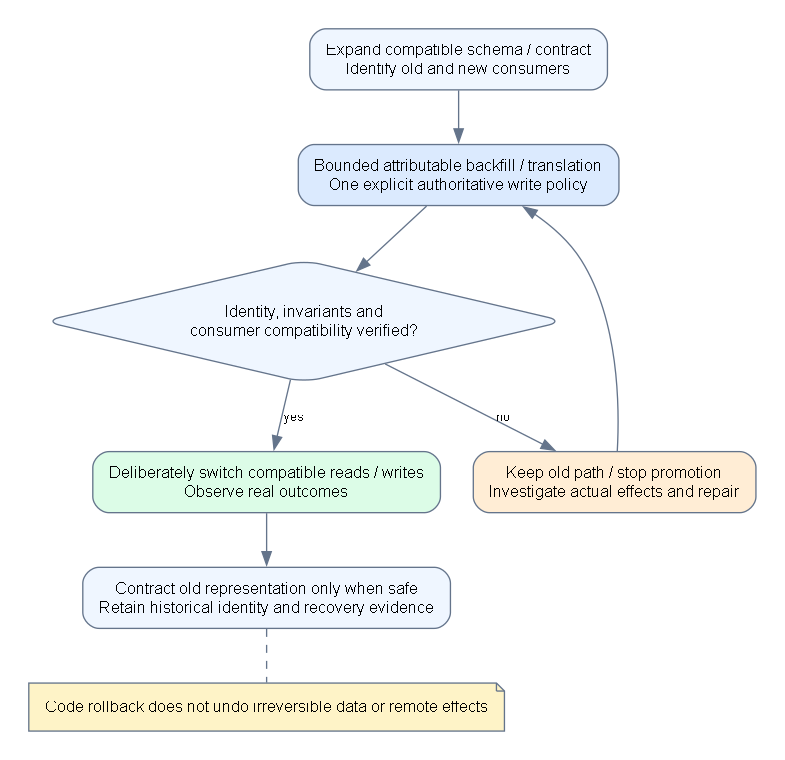

<a id="design-record-02-detailed-and-object-oriented-design-05-design-evolution-refactoring-and-technical-debt-md--heading-expand-validate-and-contract"></a>

##### Expand validate and contract

Prefer additive compatible structures/contracts when practical. Introduce a new representation behind a defined boundary; backfill or translate in bounded attributable work; validate identity/count/invariants and actual consumers; switch reads/writes deliberately; remove the old representation only after compatibility and recovery conditions permit it.

This is a pattern to evaluate, not a guarantee that dual writing is atomic. If old/new writes coexist, specify one authoritative write path, conflict/reconciliation behavior, backfill checkpoints and failure handling. Avoid deleting old data simply because a deployment succeeded.

<a id="design-record-02-detailed-and-object-oriented-design-05-design-evolution-refactoring-and-technical-debt-md--heading-published-and-submitted-identity"></a>

##### Published and submitted identity

Preserve intended publication revision, artifact language/provenance and actual submission manifests through schema/storage changes. A backfill must not substitute current live content for historical sent material. Physical deduplication may share bytes only when protected-reference and lifecycle semantics remain intact.

<a id="design-record-02-detailed-and-object-oriented-design-05-design-evolution-refactoring-and-technical-debt-md--heading-api-adapter-and-job-compatibility"></a>

##### API adapter and job compatibility

Version or translate external/persisted contracts deliberately. Identify old clients, provider results, queued payloads and pending attempts that may outlive a release. Drain, translate or retain a compatible handler as justified; do not discard unresolved consequential attempts. Current authority is reconstructed at use, not inherited indefinitely from an old serialized job.

<a id="design-record-02-detailed-and-object-oriented-design-05-design-evolution-refactoring-and-technical-debt-md--heading-component-extraction"></a>

##### Component extraction

Keep Git, provider, PDF/storage and executor integration at explicit adapters. Extract a component into an independent facility only when measured resource/isolation needs, release cadence or actual operating value justify the added cost. Define new network/credential/failure/recovery contracts first. Earlier proposed modular boundaries do not authorize a paid host or automatically make distributed operations safe.

<a id="design-record-02-detailed-and-object-oriented-design-05-design-evolution-refactoring-and-technical-debt-md--heading-rollback-and-forward-repair"></a>

##### Rollback and forward repair

Reverting application code may be possible only while schema/data/contract compatibility holds. An irreversible migration, sent message, ref update or target deployment cannot be undone by checking out an older commit. Stop further effects, retain evidence, assess what changed and select compatible rollback, reviewed forward repair or scoped recovery. Follow [deployment procedures](../01-High-Level-Design/14-Appendices.md#design-record-01-software-architecture-04-deployment-topology-nodes-and-networks-md) and [runtime reconciliation](../01-High-Level-Design/14-Appendices.md#design-record-01-software-architecture-03-process-view-concurrency-and-runtime-behavior-md).

<a id="design-record-02-detailed-and-object-oriented-design-05-design-evolution-refactoring-and-technical-debt-md--heading-5-debt-records-prioritization-and-review"></a>

#### 5. Debt records prioritization and review

<a id="design-record-02-detailed-and-object-oriented-design-05-design-evolution-refactoring-and-technical-debt-md--heading-current-register-position"></a>

##### Current register position

No product implementation debt item is allocated by this document. Existing execution, provider, capacity, recovery and criterion gaps remain open engineering/evidence work in their authoritative records. The following fields define how to record an actual later debt finding; they are not invented findings or accepted deferrals.

<a id="design-record-02-detailed-and-object-oriented-design-05-design-evolution-refactoring-and-technical-debt-md--heading-required-fields-for-an-actual-debt-item"></a>

##### Required fields for an actual debt item

- Stable local identifier/title, actual discovery date, source candidate and affected components/contracts.
- Concrete evidence: code/model locator, observed dependency/smell or actual accepted trade-off; distinguish observation from prediction.
- Consequences of leaving it unchanged, affected source criteria, security/privacy/data-loss implications and uncertainty.
- Proposed remedies, alternatives, migration/compatibility needs, verification and realistic full engineering effort.
- Responsible owner, decision authority, actual state and review trigger; link the authoritative work tracker and ADR where applicable.
- Closure evidence identifying the remedied candidate, actual checks and remaining limitations; retain superseded history.

Keep work descriptions and current scheduling in the [product backlog](https://github.com/Farhad-V/Web-Resumefolio/blob/1f2acaa351ac306cb57cbe4fe9742e8bd90720d9/docs/MVP/Project-Management/product-backlog.md) and actual tracker. The shared [review record](../01-High-Level-Design/14-Appendices.md#design-record-06-design-quality-and-security-analysis-05-design-review-traceability-and-handoff-md) owns findings/disposition. This document owns the method, not a second live backlog.

<a id="design-record-02-detailed-and-object-oriented-design-05-design-evolution-refactoring-and-technical-debt-md--heading-prioritization"></a>

##### Prioritization

First identify source violations and gates that block the affected commitment. Then compare actual exposure, recurrence/change cost, coupling/blast radius, remediation effort and dependency timing. Prefer risk reduction and verified user value over cosmetic uniformity. Use 20 total project hours/week without treating documentation/testing/operations as free extra time. No fixed debt percentage, numeric score or universal threshold is adopted here.

<a id="design-record-02-detailed-and-object-oriented-design-05-design-evolution-refactoring-and-technical-debt-md--heading-smell-indicators-and-review-triggers"></a>

##### Smell indicators and review triggers

Review dependency cycles, forbidden internal imports, oversized interfaces, repeated authority/lifecycle rules, hidden external effects, long-lived mutable user state, transaction scopes around network calls and difficult-to-isolate scenarios. Coupling/cohesion metrics or change history can support a finding but cannot alone prove a design is wrong.

Reassess when a requirement changes, provider/runtime compatibility changes, combined-load evidence contradicts assumptions, an incident exposes a boundary failure, a migration touches protected history or repeated work demonstrates actual maintenance cost. A periodic checkpoint may be chosen in real planning; no fabricated calendar deadline is assigned here.

<a id="design-record-02-detailed-and-object-oriented-design-05-design-evolution-refactoring-and-technical-debt-md--heading-6-verification-and-completion"></a>

#### 6. Verification and completion

**Structural evidence:** allowed dependency direction, exported/internal boundaries, class/contract consistency and diagrams match the actual candidate.

**Behavior evidence:** source invariants and protected state remain valid for normal, denied, conflict, duplicate, partial and unknown-effect paths where applicable. Include explicit publication/history and revoked-access cases for affected changes.

**Operating evidence:** compatible app/worker/schema versions, attributable pending work, resource behavior, private storage/keys and restore/reconciliation limits are assessed where changed. Mocks alone cannot prove provider idempotency, Git refs, executor isolation or usable recovery.

**Closure:** record actual change scope, source/design/code candidate, verification method/results, debt/defect disposition and remaining limits. Supersede ADRs explicitly; do not erase historical decisions or present old source hashes as current. Whole-phase acceptance remains a separate actual owner decision.

<a id="design-record-02-detailed-and-object-oriented-design-05-design-evolution-refactoring-and-technical-debt-md--heading-7-fau-basis-and-related-records"></a>

#### 7. FAU basis and related records

FAU V07 treats architecture as an input to implementation/testing, change impact and controlled evolution. V08 discusses anti-patterns, design smells, model refactoring and conventions. This procedure adapts that teaching to Resumefolio’s accepted boundaries; the debt field set and compatibility route are project conventions, not a university-prescribed ledger.

- [OO principles and pattern guidance](03-Detailed-Module-Design.md#design-record-02-detailed-and-object-oriented-design-01-design-principles-and-object-oriented-approach-md)
- [Shared concern ownership](../01-High-Level-Design/14-Appendices.md#design-record-01-software-architecture-05-cross-cutting-concerns-overview-md)
- [Component implementation packages](02-Module-Breakdown.md#design-record-03-component-and-module-design-component-and-module-design-md)
- [Data ownership and physical refinement](04-Database-Design.md#design-record-04-data-design-data-design-md)
- [Operating recovery design](../01-High-Level-Design/14-Appendices.md#design-record-06-design-quality-and-security-analysis-03-operations-backup-recovery-and-resilience-md)
- [FAU reference map](../01-High-Level-Design/14-Appendices.md#design-record-design-references-and-coverage-md)

This update performs document and generated-diagram checks only. It executes no refactoring, migration, recovery, live security/capacity test or product release. Advisor transport remains unavailable as recorded for this candidate; no independent endorsement is claimed.

[Detailed Design index](#design-record-02-detailed-and-object-oriented-design-detailed-and-object-oriented-design-md) · [Diagram catalog](#design-record-02-detailed-and-object-oriented-design-diagrams-diagram-catalog-md)

<a id="design-record-02-detailed-and-object-oriented-design-05-design-evolution-refactoring-and-technical-debt-md--heading-8-evolution-and-debt-visual-package"></a>

#### 8. Evolution and debt visual package

All comparisons below are **hypothetical design examples** unless an exact inspected candidate is explicitly identified. No implementation debt, actual architecture erosion, migration, measured hotspot or completed release is established. Legacy replacement is a conditional engineering pattern, not added product scope.

<a id="design-record-02-detailed-and-object-oriented-design-05-design-evolution-refactoring-and-technical-debt-md--heading-81-beforeafter-class-responsibilities"></a>

##### 8.1 Before/after class responsibilities

[Before/after class responsibilities](https://github.com/Farhad-V/Web-Resumefolio/blob/1f2acaa351ac306cb57cbe4fe9742e8bd90720d9/docs/MVP/SDLC/04-system-design/02-detailed-and-object-oriented-design/diagrams/evolution-class-change.svg)

[PlantUML](https://github.com/Farhad-V/Web-Resumefolio/blob/1f2acaa351ac306cb57cbe4fe9742e8bd90720d9/docs/MVP/SDLC/04-system-design/02-detailed-and-object-oriented-design/diagrams/evolution-class-change.puml) · 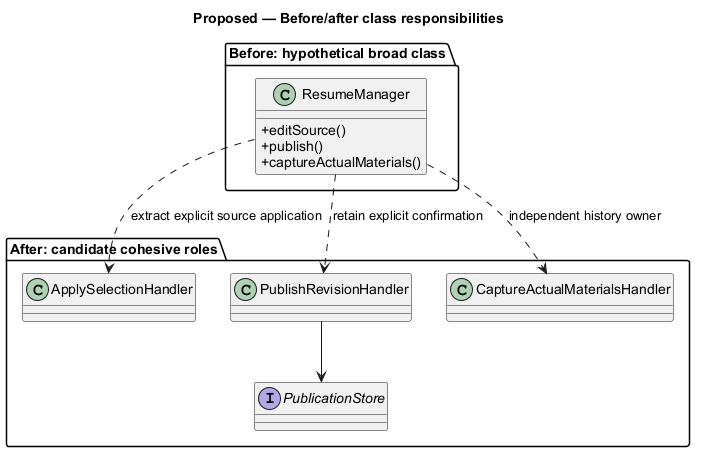

A hypothetical original, not a detected code smell. Extracting roles must preserve observable contracts; changing publication or history behavior is a separate behavioral decision.

<a id="design-record-02-detailed-and-object-oriented-design-05-design-evolution-refactoring-and-technical-debt-md--heading-82-step-by-step-transformation-and-verification"></a>

##### 8.2 Step-by-step transformation and verification

[Step-by-step transformation and verification](https://github.com/Farhad-V/Web-Resumefolio/blob/1f2acaa351ac306cb57cbe4fe9742e8bd90720d9/docs/MVP/SDLC/04-system-design/02-detailed-and-object-oriented-design/diagrams/evolution-refactoring-sequence.svg)

[PlantUML](https://github.com/Farhad-V/Web-Resumefolio/blob/1f2acaa351ac306cb57cbe4fe9742e8bd90720d9/docs/MVP/SDLC/04-system-design/02-detailed-and-object-oriented-design/diagrams/evolution-refactoring-sequence.puml) · 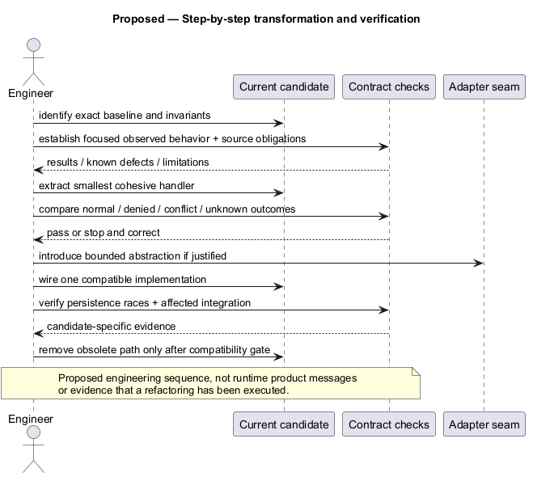

Each step has a reviewable candidate and a stop/correct route. Characterization does not legitimize known requirement violations; code reversal remains conditional on data and effect compatibility.

<a id="design-record-02-detailed-and-object-oriented-design-05-design-evolution-refactoring-and-technical-debt-md--heading-83-hypothetical-dependency-cycle-and-hotspot"></a>

##### 8.3 Hypothetical dependency cycle and hotspot

[Hypothetical dependency cycle and hotspot](https://github.com/Farhad-V/Web-Resumefolio/blob/1f2acaa351ac306cb57cbe4fe9742e8bd90720d9/docs/MVP/SDLC/04-system-design/02-detailed-and-object-oriented-design/diagrams/evolution-dependency-hotspots.svg)

[PlantUML](https://github.com/Farhad-V/Web-Resumefolio/blob/1f2acaa351ac306cb57cbe4fe9742e8bd90720d9/docs/MVP/SDLC/04-system-design/02-detailed-and-object-oriented-design/diagrams/evolution-dependency-hotspots.puml) · 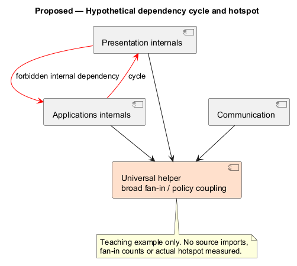

Red edges depict an invented cycle to investigate, not actual repository dependencies. A central technical utility is not automatically debt; shared mutable business authority and change propagation require concrete evidence.

<a id="design-record-02-detailed-and-object-oriented-design-05-design-evolution-refactoring-and-technical-debt-md--heading-84-beforeafter-package-dependency-direction"></a>

##### 8.4 Before/after package dependency direction

[Before/after package dependency direction](https://github.com/Farhad-V/Web-Resumefolio/blob/1f2acaa351ac306cb57cbe4fe9742e8bd90720d9/docs/MVP/SDLC/04-system-design/02-detailed-and-object-oriented-design/diagrams/evolution-package-direction.svg)

[PlantUML](https://github.com/Farhad-V/Web-Resumefolio/blob/1f2acaa351ac306cb57cbe4fe9742e8bd90720d9/docs/MVP/SDLC/04-system-design/02-detailed-and-object-oriented-design/diagrams/evolution-package-direction.puml) · 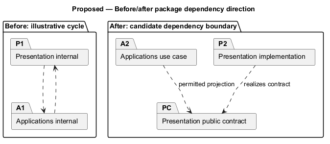

The target removes this selected source cycle through an owner-controlled public contract. It does not permit cross-module writes or prove that the entire application is acyclic. Runtime requests and source dependency arrows must be reviewed separately.

<a id="design-record-02-detailed-and-object-oriented-design-05-design-evolution-refactoring-and-technical-debt-md--heading-85-intended-versus-eroded-architecture"></a>

##### 8.5 Intended versus eroded architecture

[Intended versus eroded architecture](https://github.com/Farhad-V/Web-Resumefolio/blob/1f2acaa351ac306cb57cbe4fe9742e8bd90720d9/docs/MVP/SDLC/04-system-design/02-detailed-and-object-oriented-design/diagrams/evolution-erosion.svg)

[PlantUML](https://github.com/Farhad-V/Web-Resumefolio/blob/1f2acaa351ac306cb57cbe4fe9742e8bd90720d9/docs/MVP/SDLC/04-system-design/02-detailed-and-object-oriented-design/diagrams/evolution-erosion.puml) · 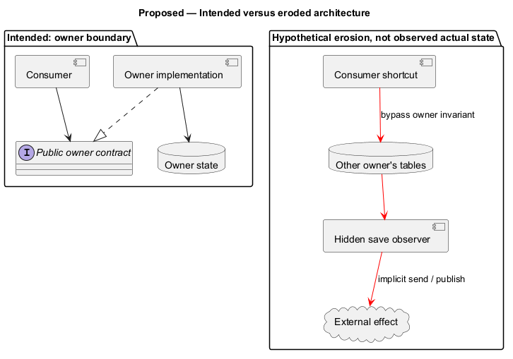

An actual-versus-intended comparison requires an identified source candidate and inspected imports/effects. No actual architecture audit is asserted here; the erosion half shows the kinds of divergence to look for.

<a id="design-record-02-detailed-and-object-oriented-design-05-design-evolution-refactoring-and-technical-debt-md--heading-86-design-evolution-timeline-and-adr-history"></a>

##### 8.6 Design evolution timeline and ADR history

[Historical or unselected alternative — Design evolution timeline and ADR history](https://github.com/Farhad-V/Web-Resumefolio/blob/1f2acaa351ac306cb57cbe4fe9742e8bd90720d9/docs/MVP/SDLC/04-system-design/02-detailed-and-object-oriented-design/diagrams/evolution-history.svg)

[PlantUML](https://github.com/Farhad-V/Web-Resumefolio/blob/1f2acaa351ac306cb57cbe4fe9742e8bd90720d9/docs/MVP/SDLC/04-system-design/02-detailed-and-object-oriented-design/diagrams/evolution-history.puml) · 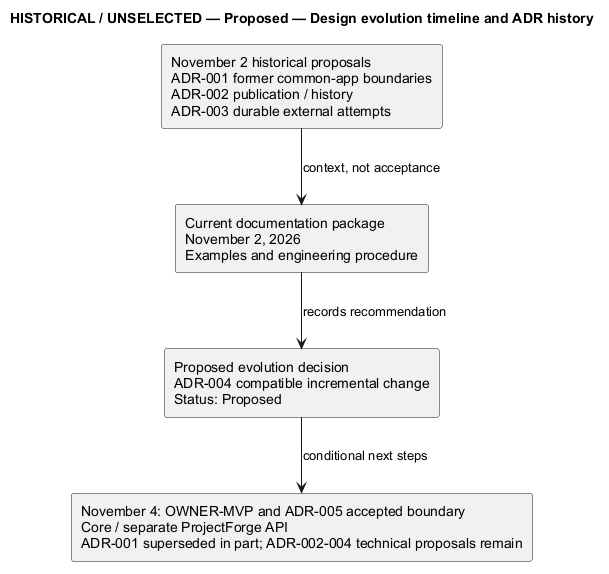

This is a documentation/proposal sequence, not a fabricated release/version history. Existing ADRs remain Proposed. Future implementation and acceptance have no invented date.

<a id="design-record-02-detailed-and-object-oriented-design-05-design-evolution-refactoring-and-technical-debt-md--heading-87-strangler-facade-conditional-future-replacement"></a>

##### 8.7 Strangler facade: conditional future replacement

[Strangler facade: conditional future replacement](https://github.com/Farhad-V/Web-Resumefolio/blob/1f2acaa351ac306cb57cbe4fe9742e8bd90720d9/docs/MVP/SDLC/04-system-design/02-detailed-and-object-oriented-design/diagrams/evolution-strangler.svg)

[PlantUML](https://github.com/Farhad-V/Web-Resumefolio/blob/1f2acaa351ac306cb57cbe4fe9742e8bd90720d9/docs/MVP/SDLC/04-system-design/02-detailed-and-object-oriented-design/diagrams/evolution-strangler.puml) · 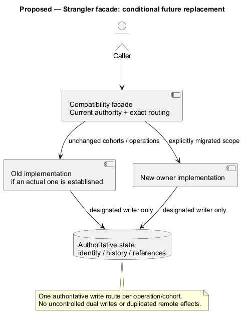

A conditional pattern, not a new legacy-migration feature or authorized migration. Define routing, compatible contracts, pending work, reference protection, reconciliation and cutover evidence before any real use. Do not shadow consequential sends or deployments.

<a id="design-record-02-detailed-and-object-oriented-design-05-design-evolution-refactoring-and-technical-debt-md--heading-88-branch-by-abstraction-inside-one-application"></a>

##### 8.8 Branch by abstraction inside one application

[Branch by abstraction inside one application](https://github.com/Farhad-V/Web-Resumefolio/blob/1f2acaa351ac306cb57cbe4fe9742e8bd90720d9/docs/MVP/SDLC/04-system-design/02-detailed-and-object-oriented-design/diagrams/evolution-branch-abstraction.svg)

[PlantUML](https://github.com/Farhad-V/Web-Resumefolio/blob/1f2acaa351ac306cb57cbe4fe9742e8bd90720d9/docs/MVP/SDLC/04-system-design/02-detailed-and-object-oriented-design/diagrams/evolution-branch-abstraction.puml) · 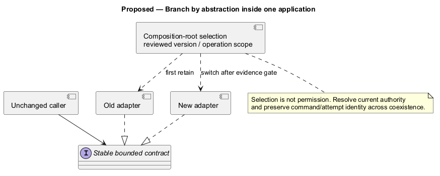

Introduce abstraction, retain behavior through the old adapter, verify the new adapter, switch the designated route, then retire only when old consumers/pending work permit. This is independent of creating a long-lived source-control branch.

<a id="design-record-02-detailed-and-object-oriented-design-05-design-evolution-refactoring-and-technical-debt-md--heading-89-legacy-shaped-versus-target-component-state"></a>

##### 8.9 Legacy-shaped versus target component state

[Legacy-shaped versus target component state](https://github.com/Farhad-V/Web-Resumefolio/blob/1f2acaa351ac306cb57cbe4fe9742e8bd90720d9/docs/MVP/SDLC/04-system-design/02-detailed-and-object-oriented-design/diagrams/evolution-component-target.svg)

[PlantUML](https://github.com/Farhad-V/Web-Resumefolio/blob/1f2acaa351ac306cb57cbe4fe9742e8bd90720d9/docs/MVP/SDLC/04-system-design/02-detailed-and-object-oriented-design/diagrams/evolution-component-target.puml) · 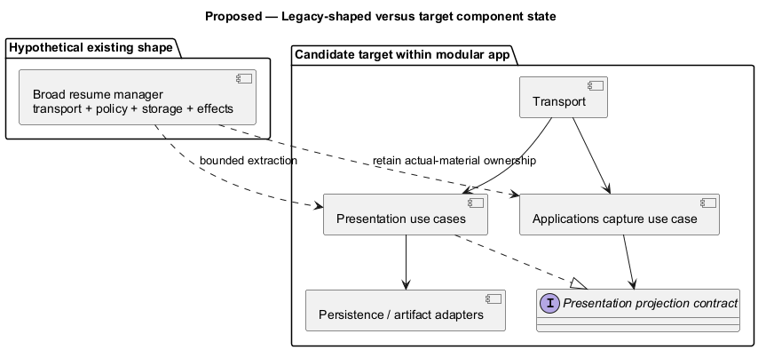

Legacy-shaped is a hypothetical structural comparison, not an established running legacy system. The target remains a modular application; this view neither selects microservices nor authorizes moving private data.

<a id="design-record-02-detailed-and-object-oriented-design-05-design-evolution-refactoring-and-technical-debt-md--heading-810-refactoringmigration-work-lifecycle"></a>

##### 8.10 Refactoring/migration work lifecycle

[Refactoring/migration work lifecycle](https://github.com/Farhad-V/Web-Resumefolio/blob/1f2acaa351ac306cb57cbe4fe9742e8bd90720d9/docs/MVP/SDLC/04-system-design/02-detailed-and-object-oriented-design/diagrams/evolution-lifecycle.svg)

[PlantUML](https://github.com/Farhad-V/Web-Resumefolio/blob/1f2acaa351ac306cb57cbe4fe9742e8bd90720d9/docs/MVP/SDLC/04-system-design/02-detailed-and-object-oriented-design/diagrams/evolution-lifecycle.puml) · 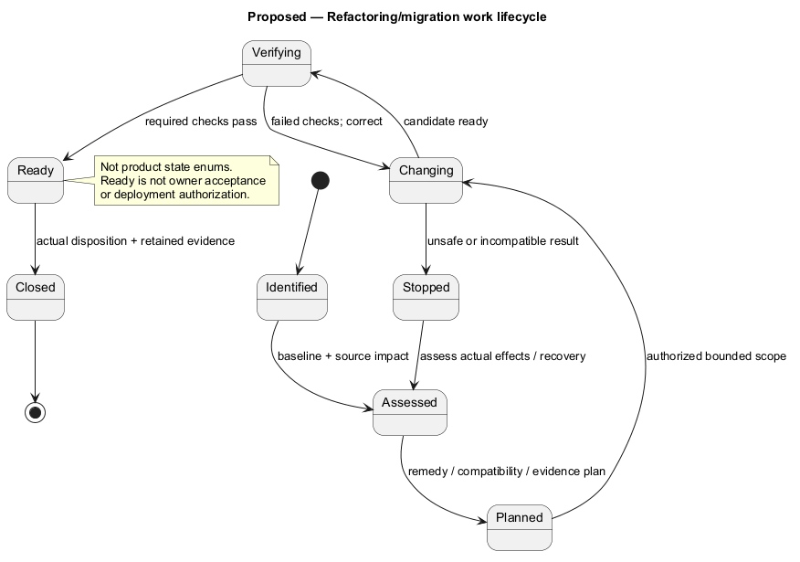

Proposed engineering-work states, not implementation enums. Stopping work cannot undo irreversible data or remote effects; reassess before compatible rollback, forward repair or recovery.

<a id="design-record-02-detailed-and-object-oriented-design-05-design-evolution-refactoring-and-technical-debt-md--heading-811-contract-oriented-verification-safety-net"></a>

##### 8.11 Contract-oriented verification safety net

[Contract-oriented verification safety net](https://github.com/Farhad-V/Web-Resumefolio/blob/1f2acaa351ac306cb57cbe4fe9742e8bd90720d9/docs/MVP/SDLC/04-system-design/02-detailed-and-object-oriented-design/diagrams/evolution-safety-net.svg)

[PlantUML](https://github.com/Farhad-V/Web-Resumefolio/blob/1f2acaa351ac306cb57cbe4fe9742e8bd90720d9/docs/MVP/SDLC/04-system-design/02-detailed-and-object-oriented-design/diagrams/evolution-safety-net.puml) · 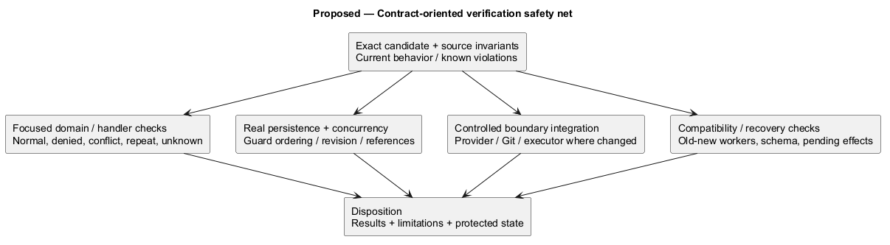

A coverage plan rather than a measured coverage percentage. Choose checks for affected risks; unit mocks alone do not establish persistence races, actual external idempotency, executor isolation or usable recovery.

<a id="design-record-02-detailed-and-object-oriented-design-05-design-evolution-refactoring-and-technical-debt-md--heading-812-smell-to-refactoring-mapping"></a>

##### 8.12 Smell-to-refactoring mapping

| Indicator to investigate | Candidate remedy | Evidence and preservation check |
| --- | --- | --- |
| Broad manager with unrelated reasons to change | Extract cohesive handlers | Inspect actual callers; preserve explicit confirmation and owned invariants |
| Cyclic internal imports / cross-owner table access | Introduce owner public contract; relocate misplaced responsibility | Inspect actual import/write graph; prevent mutation bypass |
| Repeated authority logic diverges | Consolidate rule at authoritative owner | Compare exact semantics; do not merge distinct grant/consent rules |
| Long navigation chains expose private internals | Intention-revealing owner operation | Preserve exact eligibility and protected reference lifetime |
| Network call inside local transaction | Separate durable intent and attributable effect attempt | Review atomicity changes; reconcile uncertain results before repetition |
| Mutable actor/session retained in shared service | Bound context lifetime and reconstruct current authority | Exercise concurrent callers and revocation; no stale privileged identity |
| Oversized adapter interface | Split consumer-specific ports | Preserve capability and failure semantics for all affected consumers |

<a id="design-record-02-detailed-and-object-oriented-design-05-design-evolution-refactoring-and-technical-debt-md--heading-813-technical-debt-register-format-and-current-position"></a>

##### 8.13 Technical debt register format and current position

This is a register **template**, not a second live backlog. No evidenced implementation debt item is allocated here. Link real future entries to the authoritative tracker and review record; open feasibility/design work remains in its owning record.

| Item / evidence | Impact if retained | Full cost to fix | Priority / disposition | Owner / closure |
| --- | --- | --- | --- | --- |
| No actual debt item established by this update | Not assessed | Not estimated | Unassigned; no accepted deferral | Farhad; requires actual finding and evidence |
| Template: stable ID + candidate + code/model locator + observed deficiency | Source criteria, exposure, recurrence and uncertainty | Analysis, implementation, migration, verification, docs and operations; estimate only after inspection | Actual urgency, rationale, authority and review trigger; link tracker/ADR | Responsible owner; exact remedied candidate, checks and remaining limits |

<a id="design-record-02-detailed-and-object-oriented-design-05-design-evolution-refactoring-and-technical-debt-md--heading-814-classification-prioritization-and-measurement-aids"></a>

##### 8.14 Classification, prioritization and measurement aids

[Technical debt quadrant](https://github.com/Farhad-V/Web-Resumefolio/blob/1f2acaa351ac306cb57cbe4fe9742e8bd90720d9/docs/MVP/SDLC/04-system-design/02-detailed-and-object-oriented-design/diagrams/evolution-debt-quadrant.svg)

[SVG](https://github.com/Farhad-V/Web-Resumefolio/blob/1f2acaa351ac306cb57cbe4fe9742e8bd90720d9/docs/MVP/SDLC/04-system-design/02-detailed-and-object-oriented-design/diagrams/evolution-debt-quadrant.svg) · 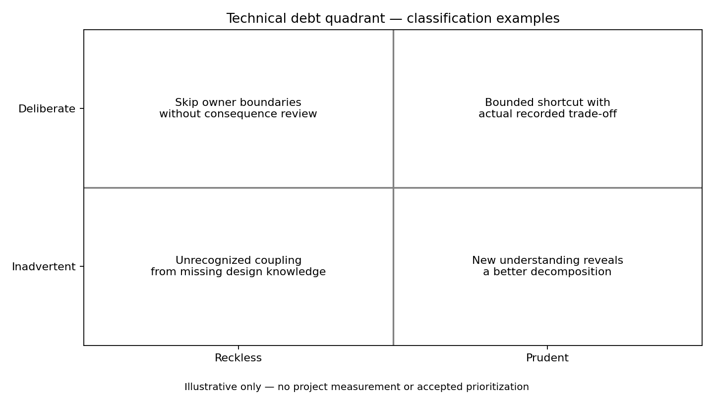

[Impact versus effort matrix](https://github.com/Farhad-V/Web-Resumefolio/blob/1f2acaa351ac306cb57cbe4fe9742e8bd90720d9/docs/MVP/SDLC/04-system-design/02-detailed-and-object-oriented-design/diagrams/evolution-impact-effort.svg)

[SVG](https://github.com/Farhad-V/Web-Resumefolio/blob/1f2acaa351ac306cb57cbe4fe9742e8bd90720d9/docs/MVP/SDLC/04-system-design/02-detailed-and-object-oriented-design/diagrams/evolution-impact-effort.svg) · 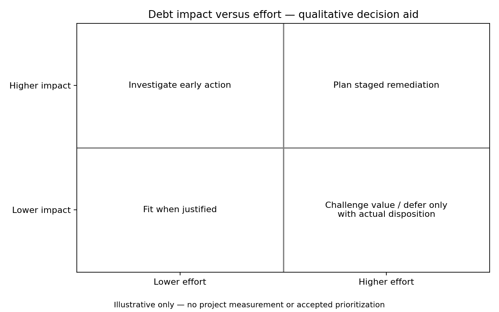

[Conceptual debt interest curve](https://github.com/Farhad-V/Web-Resumefolio/blob/1f2acaa351ac306cb57cbe4fe9742e8bd90720d9/docs/MVP/SDLC/04-system-design/02-detailed-and-object-oriented-design/diagrams/evolution-interest-curve.svg)

[SVG](https://github.com/Farhad-V/Web-Resumefolio/blob/1f2acaa351ac306cb57cbe4fe9742e8bd90720d9/docs/MVP/SDLC/04-system-design/02-detailed-and-object-oriented-design/diagrams/evolution-interest-curve.svg) · 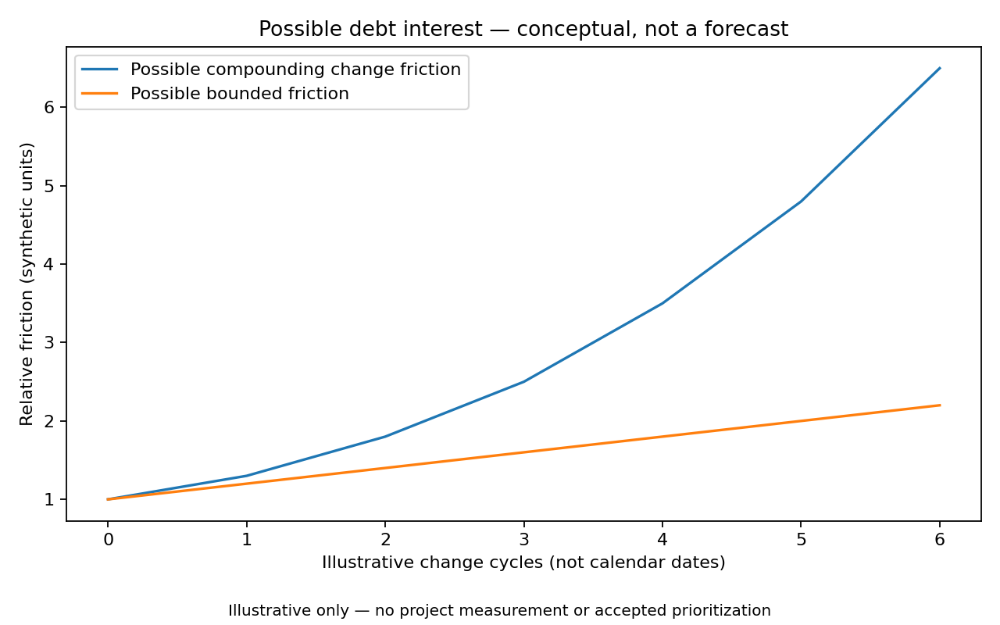

[Illustrative churn versus complexity hotspot chart](https://github.com/Farhad-V/Web-Resumefolio/blob/1f2acaa351ac306cb57cbe4fe9742e8bd90720d9/docs/MVP/SDLC/04-system-design/02-detailed-and-object-oriented-design/diagrams/evolution-churn-complexity.svg)

[SVG](https://github.com/Farhad-V/Web-Resumefolio/blob/1f2acaa351ac306cb57cbe4fe9742e8bd90720d9/docs/MVP/SDLC/04-system-design/02-detailed-and-object-oriented-design/diagrams/evolution-churn-complexity.svg) · 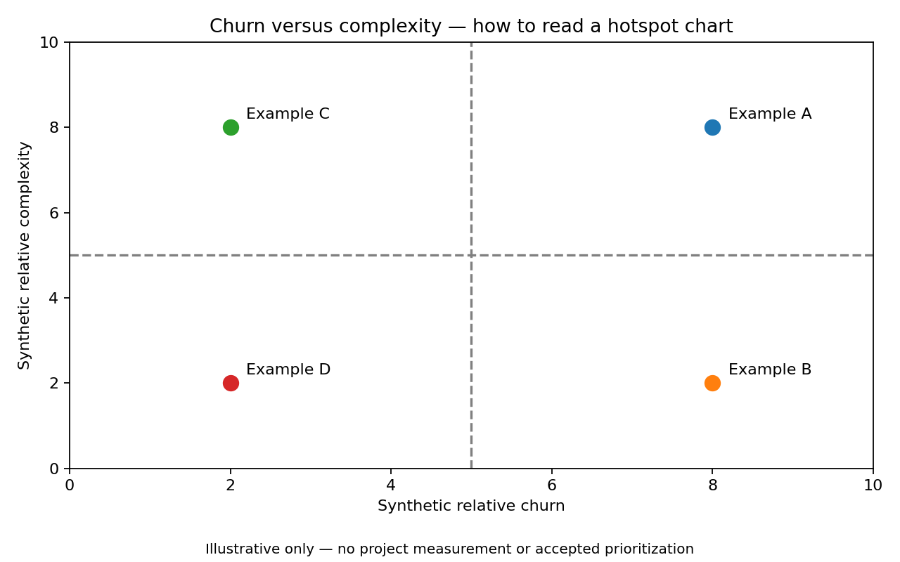

Quadrant labels classify how a deficiency arose, not whether it is acceptable. Impact/effort is qualitative: source violations and commitment-blocking security, privacy, history or recovery gates take precedence over convenience. Neither chart allocates work or authorizes deferral.

The interest curves show possible maintenance-friction shapes, not forecast hours, money, deadlines or a claim that all debt compounds. The hotspot chart contains **four invented points**, not file names or project measurements. For a real chart, fix the candidate/history window, define churn (including rename/generated-file handling), choose a compatible complexity measure and inspect the high-churn/high-complexity candidates before recording findings. High values alone do not establish debt; small frequently changed files and complex stable algorithms can be legitimate.

[Synthetic chart data](https://github.com/Farhad-V/Web-Resumefolio/blob/1f2acaa351ac306cb57cbe4fe9742e8bd90720d9/docs/MVP/SDLC/04-system-design/02-detailed-and-object-oriented-design/diagrams/evolution-chart-data.json) · [Reproducible package generator](#design-record-02-detailed-and-object-oriented-design-diagrams-evolution-visuals-generator-py). The generator defaults to staging; its explicit publish option checks saved target hashes before writing. No measurement collection or product execution occurs.

<a id="design-record-02-detailed-and-object-oriented-design-05-design-evolution-refactoring-and-technical-debt-md--heading-815-evolution-decision-record"></a>

##### 8.15 Evolution decision record

See [ADR-004 — Compatible incremental design evolution](../ADR/ADR-004-Compatible-Incremental-Design-Evolution.md#design-record-07-design-decisions-adr-004-compatible-incremental-design-evolution-md). **Status: Proposed.** It records the recommended procedure and alternatives; it does not accept a debt item, authorize a migration, change product behavior or establish owner approval.

</details>

<a id="design-record-02-detailed-and-object-oriented-design-detailed-and-object-oriented-design-md"></a>

<details>
<summary>Resumefolio — Detailed and Object-Oriented Design</summary>

<a id="design-record-02-detailed-and-object-oriented-design-detailed-and-object-oriented-design-md--heading-resumefolio--detailed-and-object-oriented-design"></a>

### Resumefolio — Detailed and Object-Oriented Design

Current implementation choices and scope: [Baseline](https://github.com/Farhad-V/Web-Resumefolio/blob/1f2acaa351ac306cb57cbe4fe9742e8bd90720d9/docs/MVP/baseline/README.md). Runtime verification remains subject to its gates.

**Start here to turn architecture responsibilities into understandable component designs and evolve those designs safely.** This section owns shared OO guidance and refactoring/debt procedures; actual component packages own concrete interfaces, classes, algorithms and technical scenarios.

Owner and decision authority: Farhad. Updated November 2, 2026.

**Status:** proposed design guidance. This folder has **two numbered documents, 01 and 05**; 02–04 are unused numbering gaps, not missing mandatory files. The numbering preserves stable existing links. No implementation, measured debt, migration or accepted technical baseline is established by the illustrations.

[Contents](#design-record-02-detailed-and-object-oriented-design-detailed-and-object-oriented-design-md--heading-1-contents-and-reading-order) · [Maps](#design-record-02-detailed-and-object-oriented-design-detailed-and-object-oriented-design-md--heading-2-reading-and-concept-maps) · [Example](#design-record-02-detailed-and-object-oriented-design-detailed-and-object-oriented-design-md--heading-3-shared-publication-example) · [Glossary](#design-record-02-detailed-and-object-oriented-design-detailed-and-object-oriented-design-md--heading-4-glossary) · [Cheat sheet](#design-record-02-detailed-and-object-oriented-design-detailed-and-object-oriented-design-md--heading-5-design-cheat-sheet) · [Review](#design-record-02-detailed-and-object-oriented-design-detailed-and-object-oriented-design-md--heading-6-review-and-maintenance)

<a id="design-record-02-detailed-and-object-oriented-design-detailed-and-object-oriented-design-md--heading-1-contents-and-reading-order"></a>

#### 1. Contents and reading order

| File / location | Topic | One-line summary |
| --- | --- | --- |
| [01 — Design Principles and OO Approach](03-Detailed-Module-Design.md#design-record-02-detailed-and-object-oriented-design-01-design-principles-and-object-oriented-approach-md) | Shared detailed-design guidance | Allocate responsibilities, apply principles/patterns, and specify object collaboration and lifetime. |
| [05 — Design Evolution, Refactoring and Technical Debt](#design-record-02-detailed-and-object-oriented-design-05-design-evolution-refactoring-and-technical-debt-md) | Assess and evolve a design | Classify findings, plan compatible changes, record actual debt and verify preserved contracts. |
| [Component packages](02-Module-Breakdown.md#design-record-03-component-and-module-design-component-and-module-design-md) | Concrete realization | Keep each component's signatures, classes, algorithms, scenarios and constraints together. |
| [Diagram catalog](#design-record-02-detailed-and-object-oriented-design-diagrams-diagram-catalog-md) | Editable visual sources and exports | Find each figure with its owner, source and readable SVG/PNG. |

Before 01, read [architecture drivers](../01-High-Level-Design/14-Appendices.md#design-record-01-software-architecture-01-design-drivers-and-solution-options-md), [module boundaries](../01-High-Level-Design/14-Appendices.md#design-record-01-software-architecture-02-system-decomposition-and-boundaries-md), the [analysis domain model](../../03-System-Analysis/01-System-Analysis.md#analysis-domain-and-information-analysis--03-domain-model-and-object-oriented-view) and [operation contracts](../../03-System-Analysis/01-System-Analysis.md#analysis-business-rules-and-operation-contracts--10-domain-constraints-and-operation-contracts). Requirements retain required meaning; technical design cannot silently change permissions, publication or history rules.

Use the [component template](02-Module-Breakdown.md#design-record-03-component-and-module-design-component-and-module-design-md) to realize a component. Consult shared [data](04-Database-Design.md#design-record-04-data-design-data-design-md), [API](05-API-Specification.md#design-record-05-interface-and-api-design-interface-and-api-design-md) and [quality/security](../01-High-Level-Design/14-Appendices.md#design-record-06-design-quality-and-security-analysis-design-quality-and-security-analysis-md) guidance at affected boundaries. Use 05 before changing an established candidate, then link actual findings to [review/handoff](../01-High-Level-Design/14-Appendices.md#design-record-06-design-quality-and-security-analysis-05-design-review-traceability-and-handoff-md) and significant choices to [ADRs](../ADR/Decision-Index.md#design-record-07-design-decisions-design-decisions-md).

<a id="design-record-02-detailed-and-object-oriented-design-detailed-and-object-oriented-design-md--heading-2-reading-and-concept-maps"></a>

#### 2. Reading and concept maps

<a id="design-record-02-detailed-and-object-oriented-design-detailed-and-object-oriented-design-md--heading-21-section-learning-path"></a>

##### 2.1 Section learning path

[Section learning path](https://github.com/Farhad-V/Web-Resumefolio/blob/1f2acaa351ac306cb57cbe4fe9742e8bd90720d9/docs/MVP/SDLC/04-system-design/02-detailed-and-object-oriented-design/diagrams/oo-index-reading-path.svg)

[Editable PlantUML](https://github.com/Farhad-V/Web-Resumefolio/blob/1f2acaa351ac306cb57cbe4fe9742e8bd90720d9/docs/MVP/SDLC/04-system-design/02-detailed-and-object-oriented-design/diagrams/oo-index-reading-path.puml) · 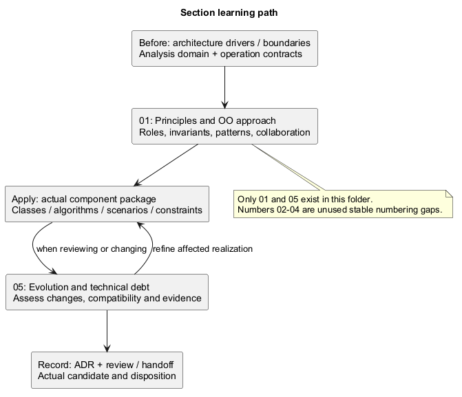

Read 01 for shared guidance; use the component package for concrete realization; use 05 when assessing or changing a design. The loop represents iterative work, not a source dependency cycle.

<a id="design-record-02-detailed-and-object-oriented-design-detailed-and-object-oriented-design-md--heading-22-principles-patterns-and-refactoring"></a>

##### 2.2 Principles, patterns and refactoring

[Principles, patterns and refactoring](https://github.com/Farhad-V/Web-Resumefolio/blob/1f2acaa351ac306cb57cbe4fe9742e8bd90720d9/docs/MVP/SDLC/04-system-design/02-detailed-and-object-oriented-design/diagrams/oo-index-concept-map.svg)

[Editable PlantUML](https://github.com/Farhad-V/Web-Resumefolio/blob/1f2acaa351ac306cb57cbe4fe9742e8bd90720d9/docs/MVP/SDLC/04-system-design/02-detailed-and-object-oriented-design/diagrams/oo-index-concept-map.puml) · 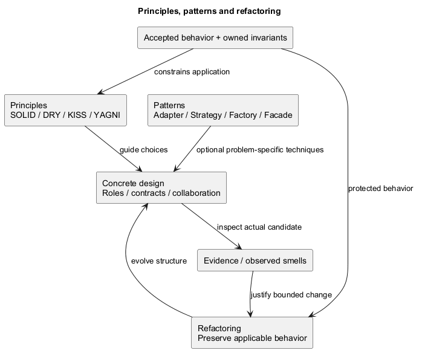

Principles guide judgment, patterns solve specific recurring problems, and refactoring changes structure. None replaces source obligations or verification; an observed defect may require a separately reviewed behavior correction.

<a id="design-record-02-detailed-and-object-oriented-design-detailed-and-object-oriented-design-md--heading-23-prerequisites-and-reading-dependencies"></a>

##### 2.3 Prerequisites and reading dependencies

[Prerequisites and reading dependencies](https://github.com/Farhad-V/Web-Resumefolio/blob/1f2acaa351ac306cb57cbe4fe9742e8bd90720d9/docs/MVP/SDLC/04-system-design/02-detailed-and-object-oriented-design/diagrams/oo-index-prerequisites.svg)

[Editable PlantUML](https://github.com/Farhad-V/Web-Resumefolio/blob/1f2acaa351ac306cb57cbe4fe9742e8bd90720d9/docs/MVP/SDLC/04-system-design/02-detailed-and-object-oriented-design/diagrams/oo-index-prerequisites.puml) · 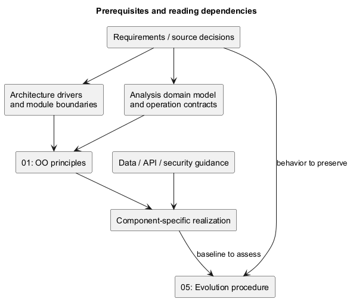

Arrows mean reading inputs, not runtime calls or code imports. Review shared data/API/security decisions alongside the affected component; an evolution proposal requires an identified baseline rather than an invented implementation.

<a id="design-record-02-detailed-and-object-oriented-design-detailed-and-object-oriented-design-md--heading-24-architecture-to-detailed-design-bridge"></a>

##### 2.4 Architecture-to-detailed-design bridge

[Architecture-to-detailed-design bridge](https://github.com/Farhad-V/Web-Resumefolio/blob/1f2acaa351ac306cb57cbe4fe9742e8bd90720d9/docs/MVP/SDLC/04-system-design/02-detailed-and-object-oriented-design/diagrams/oo-index-architecture-bridge.svg)

[Editable PlantUML](https://github.com/Farhad-V/Web-Resumefolio/blob/1f2acaa351ac306cb57cbe4fe9742e8bd90720d9/docs/MVP/SDLC/04-system-design/02-detailed-and-object-oriented-design/diagrams/oo-index-architecture-bridge.puml) · 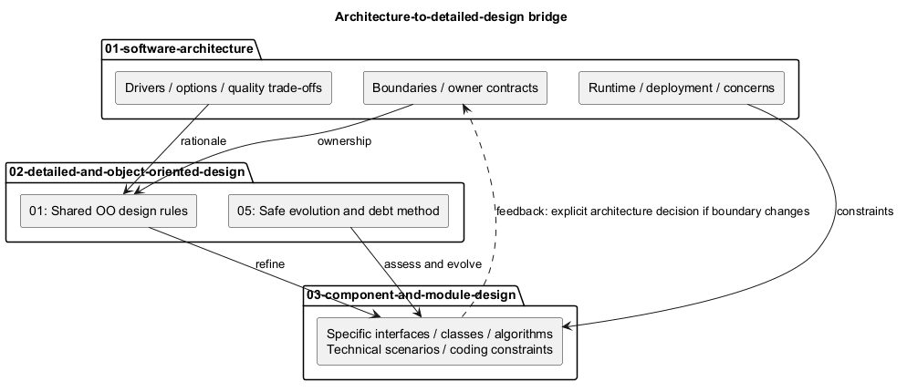

Architecture assigns system responsibilities and operating constraints. Detailed component design refines their realization. If refinement changes boundaries or quality trade-offs, update the architecture/ADR explicitly instead of silently diverging.

<a id="design-record-02-detailed-and-object-oriented-design-detailed-and-object-oriented-design-md--heading-25-levels-of-abstraction"></a>

##### 2.5 Levels of abstraction

[Levels of abstraction](https://github.com/Farhad-V/Web-Resumefolio/blob/1f2acaa351ac306cb57cbe4fe9742e8bd90720d9/docs/MVP/SDLC/04-system-design/02-detailed-and-object-oriented-design/diagrams/oo-index-abstraction-levels.svg)

[Editable PlantUML](https://github.com/Farhad-V/Web-Resumefolio/blob/1f2acaa351ac306cb57cbe4fe9742e8bd90720d9/docs/MVP/SDLC/04-system-design/02-detailed-and-object-oriented-design/diagrams/oo-index-abstraction-levels.puml) · 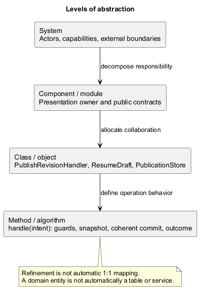

Use the level needed by the question. System/module views do not specify method algorithms, while a class diagram cannot establish deployment isolation or actual transaction correctness.

<a id="design-record-02-detailed-and-object-oriented-design-detailed-and-object-oriented-design-md--heading-26-design-lifecycle-and-feedback"></a>

##### 2.6 Design lifecycle and feedback

[Design lifecycle and feedback](https://github.com/Farhad-V/Web-Resumefolio/blob/1f2acaa351ac306cb57cbe4fe9742e8bd90720d9/docs/MVP/SDLC/04-system-design/02-detailed-and-object-oriented-design/diagrams/oo-index-design-lifecycle.svg)

[Editable PlantUML](https://github.com/Farhad-V/Web-Resumefolio/blob/1f2acaa351ac306cb57cbe4fe9742e8bd90720d9/docs/MVP/SDLC/04-system-design/02-detailed-and-object-oriented-design/diagrams/oo-index-design-lifecycle.puml) · 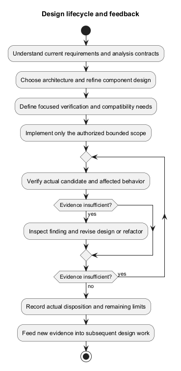

A proposed workflow, not evidence of completed implementation. Refactoring preserves applicable behavior; changed source policy or externally visible contracts need their own disposition. Failed reverification does not close the work.

<a id="design-record-02-detailed-and-object-oriented-design-detailed-and-object-oriented-design-md--heading-27-topic-mind-map"></a>

##### 2.7 Topic mind map

[Topic mind map](https://github.com/Farhad-V/Web-Resumefolio/blob/1f2acaa351ac306cb57cbe4fe9742e8bd90720d9/docs/MVP/SDLC/04-system-design/02-detailed-and-object-oriented-design/diagrams/oo-index-topic-mindmap.svg)

[Editable PlantUML](https://github.com/Farhad-V/Web-Resumefolio/blob/1f2acaa351ac306cb57cbe4fe9742e8bd90720d9/docs/MVP/SDLC/04-system-design/02-detailed-and-object-oriented-design/diagrams/oo-index-topic-mindmap.puml) · 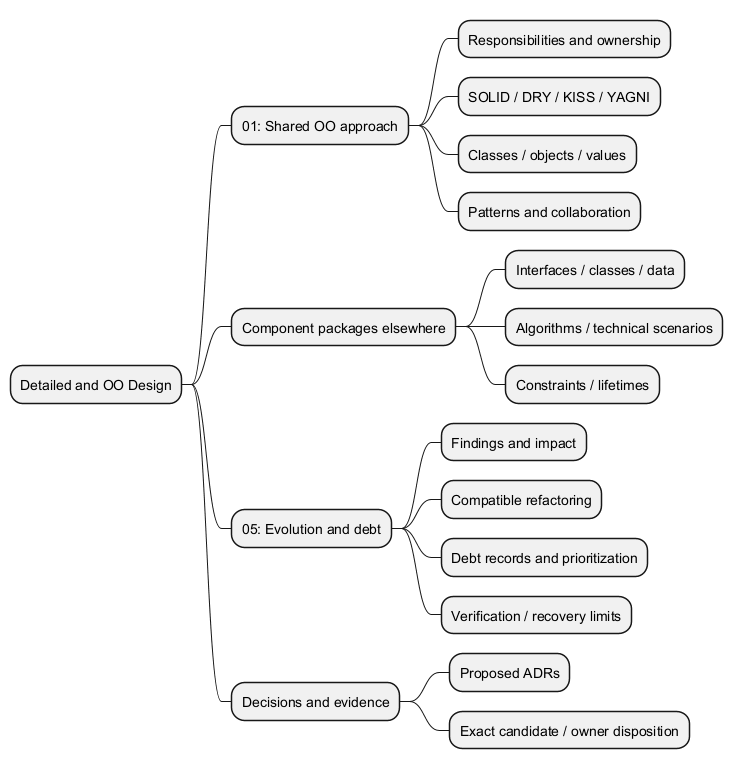

This map groups topics rather than prescribing dependencies. Component-specific details remain in the owning component package; ADRs and review evidence retain their own owners.

<a id="design-record-02-detailed-and-object-oriented-design-detailed-and-object-oriented-design-md--heading-3-shared-publication-example"></a>

#### 3. Shared publication example

[Selected proposed publication classes](https://github.com/Farhad-V/Web-Resumefolio/blob/1f2acaa351ac306cb57cbe4fe9742e8bd90720d9/docs/MVP/SDLC/04-system-design/02-detailed-and-object-oriented-design/diagrams/publication-use-case-classes.svg)

[PlantUML](https://github.com/Farhad-V/Web-Resumefolio/blob/1f2acaa351ac306cb57cbe4fe9742e8bd90720d9/docs/MVP/SDLC/04-system-design/02-detailed-and-object-oriented-design/diagrams/publication-use-case-classes.puml) · 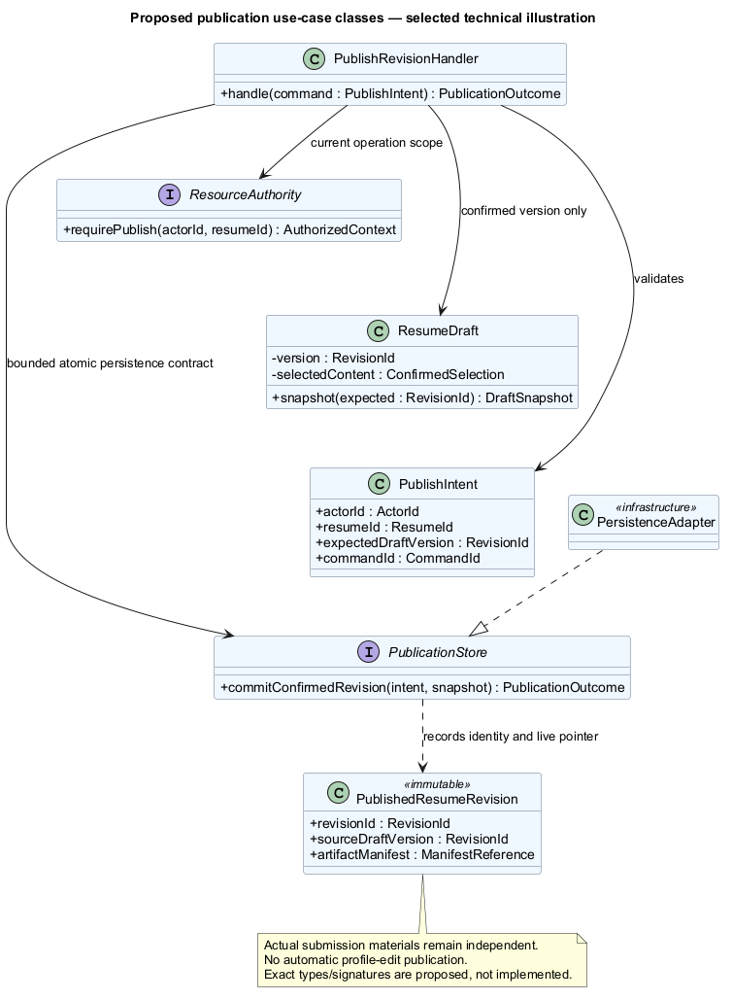

Use this existing small model as the running example: PublishRevisionHandler coordinates current authority, an exact draft version and PublicationStore; PublishedResumeRevision preserves the separately confirmed identity. [01](03-Detailed-Module-Design.md#design-record-02-detailed-and-object-oriented-design-01-design-principles-and-object-oriented-approach-md--heading-8-object-oriented-visual-and-responsibility-package) develops its objects, dependencies and collaboration. [05](#design-record-02-detailed-and-object-oriented-design-05-design-evolution-refactoring-and-technical-debt-md--heading-8-evolution-and-debt-visual-package) uses the same publication responsibility to illustrate bounded extraction and compatibility. These are related teaching views, not snapshots of implemented classes or a measured before/after refactoring.

Source edits do not automatically apply to independent resumes or publish them. Actual submitted materials remain independently protected. Early authorization alone cannot settle a race: current admission ordering, expected-version checks and coherent local commit need concrete mechanisms and verification. No mail send, PDF generation or deployment is implicit in publication.

<a id="design-record-02-detailed-and-object-oriented-design-detailed-and-object-oriented-design-md--heading-4-glossary"></a>

#### 4. Glossary

| Term | Meaning in this section |
| --- | --- |
| OO / UML | Object-oriented design / Unified Modeling Language; model responsibility and collaboration at the stated level. |
| Component / module | Logical resource-owning boundary; not automatically an independently deployed service. |
| Class / object | A defined type and a particular runtime instance of that type. |
| Entity / value object | Identity-bearing domain concept / value defined by its content and validation rules. |
| Aggregate | State grouped for an invariant requiring local consistency; not automatically one table. |
| Port / adapter | Meaningful required or provided contract / infrastructure implementation that preserves its semantics. |
| Cohesion / coupling | How closely responsibilities belong together / the dependencies between design elements. |
| SOLID | Single responsibility, open/closed, Liskov substitution, interface segregation and dependency inversion. |
| DRY / KISS / YAGNI | Avoid duplicated authoritative knowledge / keep the solution simple / avoid speculative functionality. |
| CRC | Class–Responsibility–Collaborator summary of roles and required cooperation. |
| Refactoring | Structural change preserving applicable observable behavior and contracts. |
| Technical debt | Evidenced deficiency or actual deferred improvement with identifiable ongoing consequences and remediation. |
| ADR | Architecture Decision Record; records context, alternatives, consequences and actual decision status. |
| Characterization check | Records observed behavior; does not legitimize an observed requirement violation. |

<a id="design-record-02-detailed-and-object-oriented-design-detailed-and-object-oriented-design-md--heading-5-design-cheat-sheet"></a>

#### 5. Design cheat sheet

| Category / cue | Practical response | Caution / owner |
| --- | --- | --- |
| Single responsibility / broad manager | Separate coherent use cases and resource owners | Avoid a class per method; [01](03-Detailed-Module-Design.md#design-record-02-detailed-and-object-oriented-design-01-design-principles-and-object-oriented-approach-md) |
| Open/closed and substitution | Isolate real variation; preserve exact input/outcome semantics | Never convert unknown effects into convenient failure or substitute unavailable content |
| Interface segregation / dependency inversion | Inject narrow meaningful contracts; wire adapters at composition root | An interface alone does not enforce authority or atomicity |
| DRY / repeated policy | Keep one authoritative owner for the same rule | Similar-looking consent and link grants may be distinct rules |
| Adapter | Translate provider, storage, Git or executor mechanics | Preserve actual capabilities, failures and uncertainty |
| Strategy | Separate real eligible representation variation | A simple branch can suffice; no silent fallback |
| Factory / Facade | Construct valid identities / expose one bounded use case | Construction does not authorize effects; avoid a universal manager |
| Observer / committed event | Use only a named authorized reaction with explicit dispatch semantics | In-process notification is not durable delivery or permission to send/publish |
| Cycle / hidden external effect / shared actor state | Inspect evidence; restore ownership and bounded lifetime | Actual finding and verification belong in [05](#design-record-02-detailed-and-object-oriented-design-05-design-evolution-refactoring-and-technical-debt-md) and review records |
| Compatibility / debt remediation | Stage bounded changes; preserve pending attempts and historical identities | No uncontrolled dual writes; code rollback cannot undo remote effects |

<a id="design-record-02-detailed-and-object-oriented-design-detailed-and-object-oriented-design-md--heading-6-review-and-maintenance"></a>

#### 6. Review and maintenance

Each component package should state responsibilities, exported/internal contracts, computational data and classes, algorithms/transaction guards, technical failure/recovery scenarios, and justified patterns/coding constraints. Shared guidance owns conventions; component records own their specific realization. Cross-link shared policy rather than copying it into competing sources.

The gallery contains proposed illustrations and synthetic teaching charts, not comprehensive implementation coverage. Verify actual dependency direction, behavior, persistence races, compatible workers/schema and affected external boundaries against an exact candidate. No measured code smell, accepted debt item, completed migration, security/capacity result or owner baseline acceptance is created by this index. [ADR-004](../ADR/ADR-004-Compatible-Incremental-Design-Evolution.md#design-record-07-design-decisions-adr-004-compatible-incremental-design-evolution-md) remains Proposed.

FAU V08 motivates computational data/classes, detailed dynamics, technical scenarios, patterns, smells and conventions. SOLID, the debt templates and this folder organization are supplementary project adaptations; see the [reference map](../01-High-Level-Design/14-Appendices.md#design-record-design-references-and-coverage-md). Maintain diagrams, sources/exports, component consumers and ADRs together when shared guidance changes. Rendering and link checks establish document consistency only.

[System Design home](../../01-Project-Planning/02-Project-Management-Plan.md#stage-4-system-design) · [Software Architecture](../01-High-Level-Design/14-Appendices.md#design-record-01-software-architecture-software-architecture-md) · [Diagram catalog](#design-record-02-detailed-and-object-oriented-design-diagrams-diagram-catalog-md)

</details>

<a id="design-record-02-detailed-and-object-oriented-design-diagrams-diagram-catalog-md"></a>

<details>
<summary>Resumefolio — Detailed and OO Design Diagrams</summary>

<a id="design-record-02-detailed-and-object-oriented-design-diagrams-diagram-catalog-md--heading-resumefolio--detailed-and-oo-design-diagrams"></a>

### Resumefolio — Detailed and OO Design Diagrams

These are proposed technical illustrations, not implemented classes or complete component models. Read each with the owning document and refine exact signatures/types in the actual component package.

- [Responsibilities and dependency direction](https://github.com/Farhad-V/Web-Resumefolio/blob/1f2acaa351ac306cb57cbe4fe9742e8bd90720d9/docs/MVP/SDLC/04-system-design/02-detailed-and-object-oriented-design/diagrams/oo-responsibility-direction.svg) · [Editable source](https://github.com/Farhad-V/Web-Resumefolio/blob/1f2acaa351ac306cb57cbe4fe9742e8bd90720d9/docs/MVP/SDLC/04-system-design/02-detailed-and-object-oriented-design/diagrams/oo-responsibility-direction.dot) · 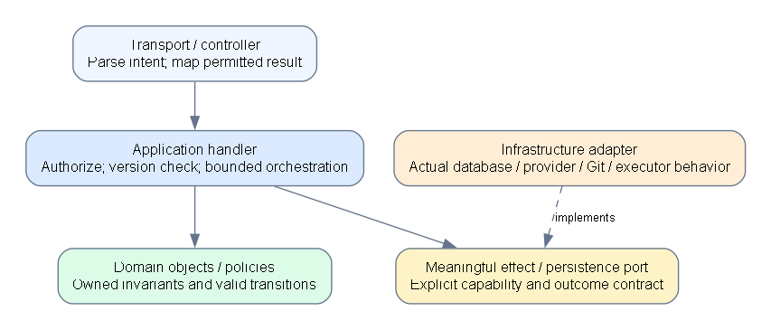
- [Selected publication class design](https://github.com/Farhad-V/Web-Resumefolio/blob/1f2acaa351ac306cb57cbe4fe9742e8bd90720d9/docs/MVP/SDLC/04-system-design/02-detailed-and-object-oriented-design/diagrams/publication-use-case-classes.svg) · [Editable source](https://github.com/Farhad-V/Web-Resumefolio/blob/1f2acaa351ac306cb57cbe4fe9742e8bd90720d9/docs/MVP/SDLC/04-system-design/02-detailed-and-object-oriented-design/diagrams/publication-use-case-classes.puml) · 
- [Pattern selection and review](https://github.com/Farhad-V/Web-Resumefolio/blob/1f2acaa351ac306cb57cbe4fe9742e8bd90720d9/docs/MVP/SDLC/04-system-design/02-detailed-and-object-oriented-design/diagrams/pattern-selection-route.svg) · [Editable source](https://github.com/Farhad-V/Web-Resumefolio/blob/1f2acaa351ac306cb57cbe4fe9742e8bd90720d9/docs/MVP/SDLC/04-system-design/02-detailed-and-object-oriented-design/diagrams/pattern-selection-route.dot) · 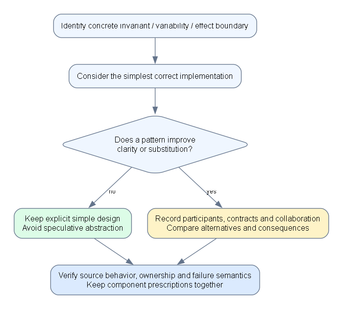

[Owning principles document](03-Detailed-Module-Design.md#design-record-02-detailed-and-object-oriented-design-01-design-principles-and-object-oriented-approach-md) · [Detailed Design index](#design-record-02-detailed-and-object-oriented-design-detailed-and-object-oriented-design-md)

Current MVP scope and selected mechanisms: [Baseline](https://github.com/Farhad-V/Web-Resumefolio/blob/1f2acaa351ac306cb57cbe4fe9742e8bd90720d9/docs/MVP/baseline/README.md). Deferred provider, advanced collaboration and workflow-execution designs are not MVP prerequisites.

<a id="design-record-02-detailed-and-object-oriented-design-diagrams-diagram-catalog-md--heading-design-evolution-and-debt"></a>

#### Design evolution and debt

- [Finding classification](https://github.com/Farhad-V/Web-Resumefolio/blob/1f2acaa351ac306cb57cbe4fe9742e8bd90720d9/docs/MVP/SDLC/04-system-design/02-detailed-and-object-oriented-design/diagrams/design-finding-classification.svg) · [DOT](https://github.com/Farhad-V/Web-Resumefolio/blob/1f2acaa351ac306cb57cbe4fe9742e8bd90720d9/docs/MVP/SDLC/04-system-design/02-detailed-and-object-oriented-design/diagrams/design-finding-classification.dot) · 
- [Change impact and verification](https://github.com/Farhad-V/Web-Resumefolio/blob/1f2acaa351ac306cb57cbe4fe9742e8bd90720d9/docs/MVP/SDLC/04-system-design/02-detailed-and-object-oriented-design/diagrams/design-change-impact-route.svg) · [DOT](https://github.com/Farhad-V/Web-Resumefolio/blob/1f2acaa351ac306cb57cbe4fe9742e8bd90720d9/docs/MVP/SDLC/04-system-design/02-detailed-and-object-oriented-design/diagrams/design-change-impact-route.dot) · 
- [Compatible data and contract evolution](https://github.com/Farhad-V/Web-Resumefolio/blob/1f2acaa351ac306cb57cbe4fe9742e8bd90720d9/docs/MVP/SDLC/04-system-design/02-detailed-and-object-oriented-design/diagrams/compatible-design-evolution.svg) · [DOT](https://github.com/Farhad-V/Web-Resumefolio/blob/1f2acaa351ac306cb57cbe4fe9742e8bd90720d9/docs/MVP/SDLC/04-system-design/02-detailed-and-object-oriented-design/diagrams/compatible-design-evolution.dot) · 

[Owning evolution procedure](#design-record-02-detailed-and-object-oriented-design-05-design-evolution-refactoring-and-technical-debt-md). Proposed procedures; no actual code debt finding or performed migration/refactoring is implied.

<a id="design-record-02-detailed-and-object-oriented-design-diagrams-diagram-catalog-md--heading-expanded-oo-principles-package"></a>

#### Expanded OO principles package

- [Before and after: separate reasons to change](https://github.com/Farhad-V/Web-Resumefolio/blob/1f2acaa351ac306cb57cbe4fe9742e8bd90720d9/docs/MVP/SDLC/04-system-design/02-detailed-and-object-oriented-design/diagrams/oo-before-after.svg) · [PlantUML](https://github.com/Farhad-V/Web-Resumefolio/blob/1f2acaa351ac306cb57cbe4fe9742e8bd90720d9/docs/MVP/SDLC/04-system-design/02-detailed-and-object-oriented-design/diagrams/oo-before-after.puml) · 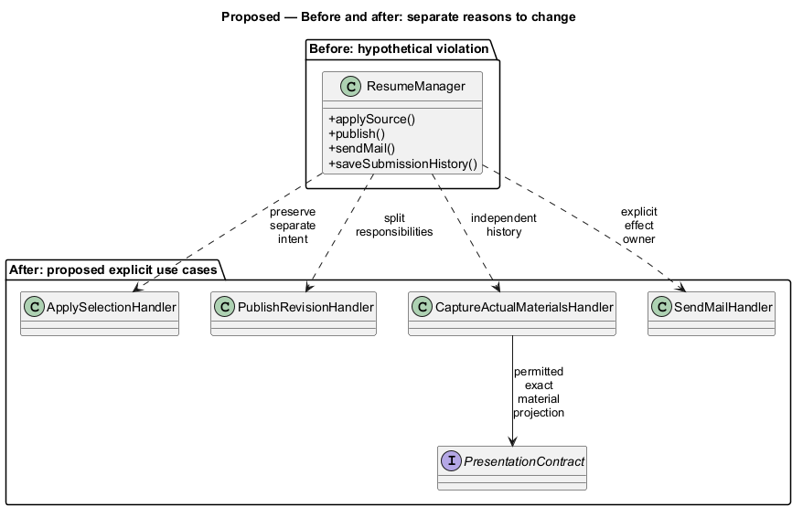
- [Object diagram: one illustrative publication collaboration](https://github.com/Farhad-V/Web-Resumefolio/blob/1f2acaa351ac306cb57cbe4fe9742e8bd90720d9/docs/MVP/SDLC/04-system-design/02-detailed-and-object-oriented-design/diagrams/oo-runtime-objects.svg) · [PlantUML](https://github.com/Farhad-V/Web-Resumefolio/blob/1f2acaa351ac306cb57cbe4fe9742e8bd90720d9/docs/MVP/SDLC/04-system-design/02-detailed-and-object-oriented-design/diagrams/oo-runtime-objects.puml) · 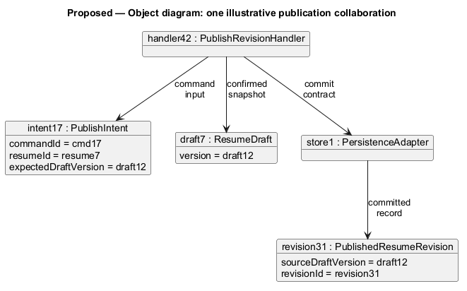
- [Package diagram: acyclic source dependencies](https://github.com/Farhad-V/Web-Resumefolio/blob/1f2acaa351ac306cb57cbe4fe9742e8bd90720d9/docs/MVP/SDLC/04-system-design/02-detailed-and-object-oriented-design/diagrams/oo-packages.svg) · [PlantUML](https://github.com/Farhad-V/Web-Resumefolio/blob/1f2acaa351ac306cb57cbe4fe9742e8bd90720d9/docs/MVP/SDLC/04-system-design/02-detailed-and-object-oriented-design/diagrams/oo-packages.puml) · 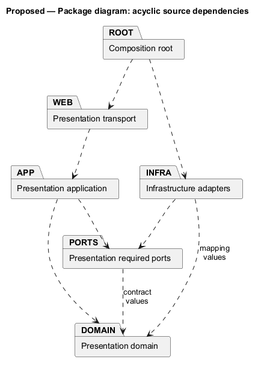
- [Dependency inversion at the persistence boundary](https://github.com/Farhad-V/Web-Resumefolio/blob/1f2acaa351ac306cb57cbe4fe9742e8bd90720d9/docs/MVP/SDLC/04-system-design/02-detailed-and-object-oriented-design/diagrams/oo-dependency-inversion.svg) · [PlantUML](https://github.com/Farhad-V/Web-Resumefolio/blob/1f2acaa351ac306cb57cbe4fe9742e8bd90720d9/docs/MVP/SDLC/04-system-design/02-detailed-and-object-oriented-design/diagrams/oo-dependency-inversion.puml) · 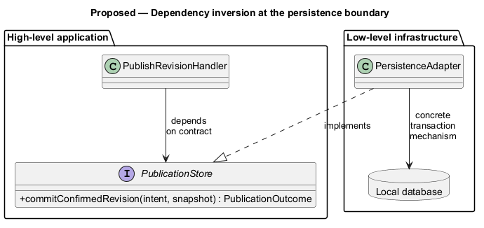
- [Inheritance versus composition: rendition variation](https://github.com/Farhad-V/Web-Resumefolio/blob/1f2acaa351ac306cb57cbe4fe9742e8bd90720d9/docs/MVP/SDLC/04-system-design/02-detailed-and-object-oriented-design/diagrams/oo-composition.svg) · [PlantUML](https://github.com/Farhad-V/Web-Resumefolio/blob/1f2acaa351ac306cb57cbe4fe9742e8bd90720d9/docs/MVP/SDLC/04-system-design/02-detailed-and-object-oriented-design/diagrams/oo-composition.puml) · 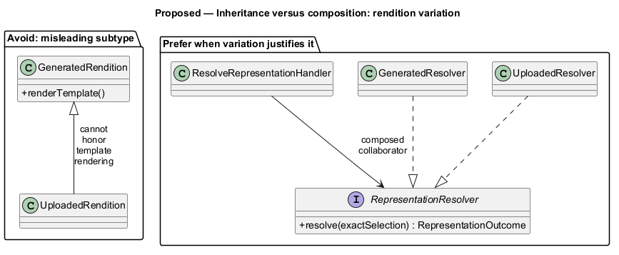
- [Interface realization and narrow consumer access](https://github.com/Farhad-V/Web-Resumefolio/blob/1f2acaa351ac306cb57cbe4fe9742e8bd90720d9/docs/MVP/SDLC/04-system-design/02-detailed-and-object-oriented-design/diagrams/oo-realization.svg) · [PlantUML](https://github.com/Farhad-V/Web-Resumefolio/blob/1f2acaa351ac306cb57cbe4fe9742e8bd90720d9/docs/MVP/SDLC/04-system-design/02-detailed-and-object-oriented-design/diagrams/oo-realization.puml) · 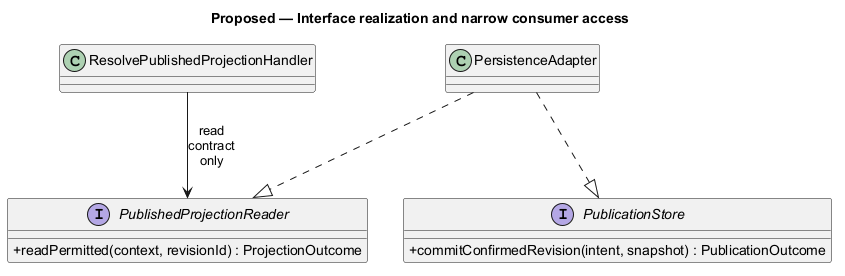
- [Coupling and cohesion: compare responsibility shapes](https://github.com/Farhad-V/Web-Resumefolio/blob/1f2acaa351ac306cb57cbe4fe9742e8bd90720d9/docs/MVP/SDLC/04-system-design/02-detailed-and-object-oriented-design/diagrams/oo-coupling-cohesion.svg) · [PlantUML](https://github.com/Farhad-V/Web-Resumefolio/blob/1f2acaa351ac306cb57cbe4fe9742e8bd90720d9/docs/MVP/SDLC/04-system-design/02-detailed-and-object-oriented-design/diagrams/oo-coupling-cohesion.puml) · 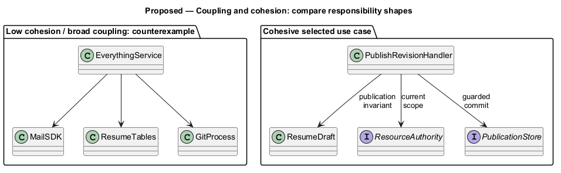
- [Sequence: explicit publication object collaboration](https://github.com/Farhad-V/Web-Resumefolio/blob/1f2acaa351ac306cb57cbe4fe9742e8bd90720d9/docs/MVP/SDLC/04-system-design/02-detailed-and-object-oriented-design/diagrams/oo-publication-sequence.svg) · [PlantUML](https://github.com/Farhad-V/Web-Resumefolio/blob/1f2acaa351ac306cb57cbe4fe9742e8bd90720d9/docs/MVP/SDLC/04-system-design/02-detailed-and-object-oriented-design/diagrams/oo-publication-sequence.puml) · 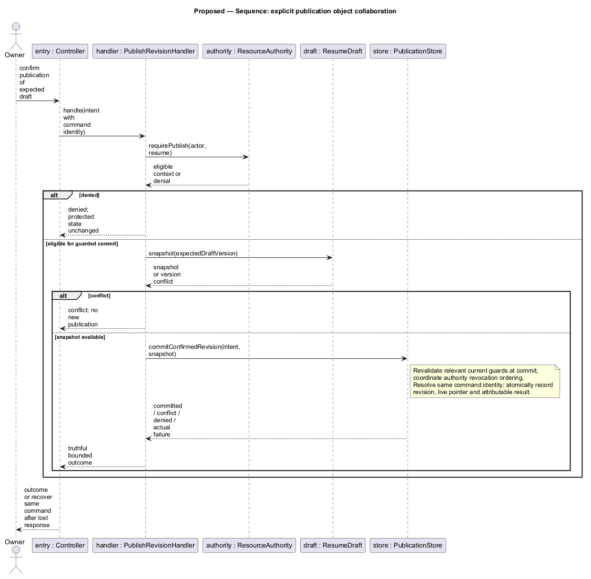
- [Conceptual domain model: independent identities](https://github.com/Farhad-V/Web-Resumefolio/blob/1f2acaa351ac306cb57cbe4fe9742e8bd90720d9/docs/MVP/SDLC/04-system-design/02-detailed-and-object-oriented-design/diagrams/oo-conceptual-domain.svg) · [PlantUML](https://github.com/Farhad-V/Web-Resumefolio/blob/1f2acaa351ac306cb57cbe4fe9742e8bd90720d9/docs/MVP/SDLC/04-system-design/02-detailed-and-object-oriented-design/diagrams/oo-conceptual-domain.puml) · 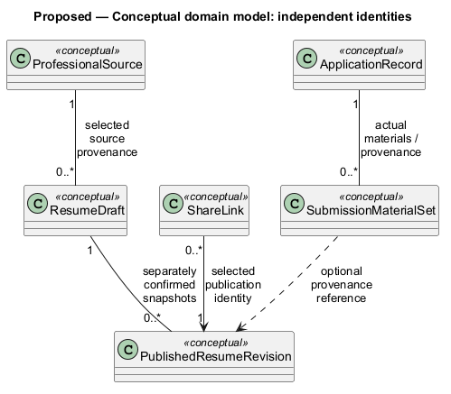
- [Law of Demeter: request an intention, avoid navigation chains](https://github.com/Farhad-V/Web-Resumefolio/blob/1f2acaa351ac306cb57cbe4fe9742e8bd90720d9/docs/MVP/SDLC/04-system-design/02-detailed-and-object-oriented-design/diagrams/oo-demeter.svg) · [PlantUML](https://github.com/Farhad-V/Web-Resumefolio/blob/1f2acaa351ac306cb57cbe4fe9742e8bd90720d9/docs/MVP/SDLC/04-system-design/02-detailed-and-object-oriented-design/diagrams/oo-demeter.puml) · 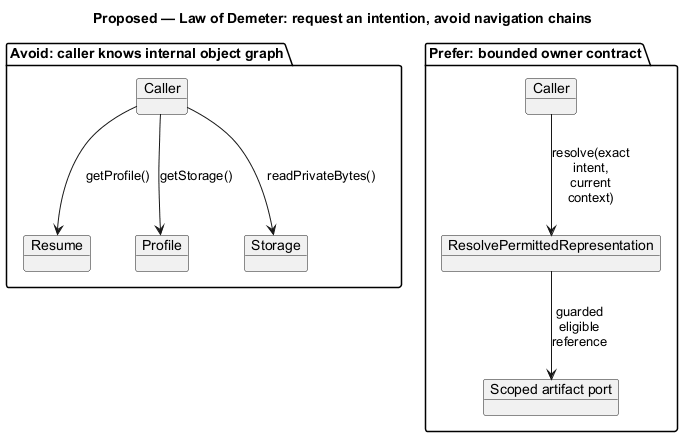
- [Optional Strategy preview: exact representation resolution](https://github.com/Farhad-V/Web-Resumefolio/blob/1f2acaa351ac306cb57cbe4fe9742e8bd90720d9/docs/MVP/SDLC/04-system-design/02-detailed-and-object-oriented-design/diagrams/oo-strategy-preview.svg) · [PlantUML](https://github.com/Farhad-V/Web-Resumefolio/blob/1f2acaa351ac306cb57cbe4fe9742e8bd90720d9/docs/MVP/SDLC/04-system-design/02-detailed-and-object-oriented-design/diagrams/oo-strategy-preview.puml) · 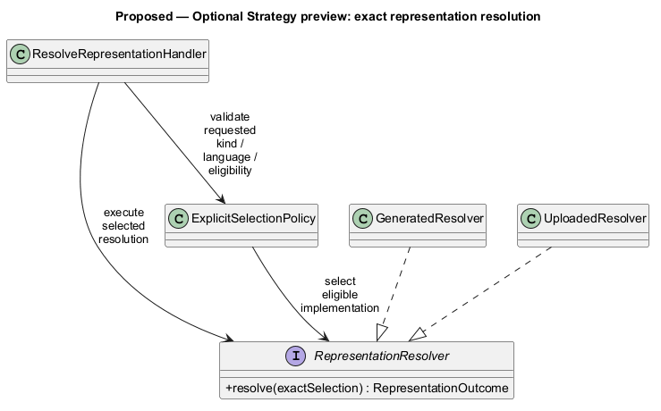

[Owning principles document, CRC/SOLID/scenario tables](03-Detailed-Module-Design.md#design-record-02-detailed-and-object-oriented-design-01-design-principles-and-object-oriented-approach-md--heading-8-object-oriented-visual-and-responsibility-package). Proposed illustrations; counterexamples are not observed defects.

<a id="design-record-02-detailed-and-object-oriented-design-diagrams-diagram-catalog-md--heading-expanded-evolution-and-debt-package"></a>

#### Expanded evolution and debt package

- [Before/after class responsibilities](https://github.com/Farhad-V/Web-Resumefolio/blob/1f2acaa351ac306cb57cbe4fe9742e8bd90720d9/docs/MVP/SDLC/04-system-design/02-detailed-and-object-oriented-design/diagrams/evolution-class-change.svg) · [PlantUML](https://github.com/Farhad-V/Web-Resumefolio/blob/1f2acaa351ac306cb57cbe4fe9742e8bd90720d9/docs/MVP/SDLC/04-system-design/02-detailed-and-object-oriented-design/diagrams/evolution-class-change.puml) · 
- [Step-by-step transformation and verification](https://github.com/Farhad-V/Web-Resumefolio/blob/1f2acaa351ac306cb57cbe4fe9742e8bd90720d9/docs/MVP/SDLC/04-system-design/02-detailed-and-object-oriented-design/diagrams/evolution-refactoring-sequence.svg) · [PlantUML](https://github.com/Farhad-V/Web-Resumefolio/blob/1f2acaa351ac306cb57cbe4fe9742e8bd90720d9/docs/MVP/SDLC/04-system-design/02-detailed-and-object-oriented-design/diagrams/evolution-refactoring-sequence.puml) · 
- [Hypothetical dependency cycle and hotspot](https://github.com/Farhad-V/Web-Resumefolio/blob/1f2acaa351ac306cb57cbe4fe9742e8bd90720d9/docs/MVP/SDLC/04-system-design/02-detailed-and-object-oriented-design/diagrams/evolution-dependency-hotspots.svg) · [PlantUML](https://github.com/Farhad-V/Web-Resumefolio/blob/1f2acaa351ac306cb57cbe4fe9742e8bd90720d9/docs/MVP/SDLC/04-system-design/02-detailed-and-object-oriented-design/diagrams/evolution-dependency-hotspots.puml) · 
- [Before/after package dependency direction](https://github.com/Farhad-V/Web-Resumefolio/blob/1f2acaa351ac306cb57cbe4fe9742e8bd90720d9/docs/MVP/SDLC/04-system-design/02-detailed-and-object-oriented-design/diagrams/evolution-package-direction.svg) · [PlantUML](https://github.com/Farhad-V/Web-Resumefolio/blob/1f2acaa351ac306cb57cbe4fe9742e8bd90720d9/docs/MVP/SDLC/04-system-design/02-detailed-and-object-oriented-design/diagrams/evolution-package-direction.puml) · 
- [Intended versus eroded architecture](https://github.com/Farhad-V/Web-Resumefolio/blob/1f2acaa351ac306cb57cbe4fe9742e8bd90720d9/docs/MVP/SDLC/04-system-design/02-detailed-and-object-oriented-design/diagrams/evolution-erosion.svg) · [PlantUML](https://github.com/Farhad-V/Web-Resumefolio/blob/1f2acaa351ac306cb57cbe4fe9742e8bd90720d9/docs/MVP/SDLC/04-system-design/02-detailed-and-object-oriented-design/diagrams/evolution-erosion.puml) · 
- [Design evolution timeline and ADR history](https://github.com/Farhad-V/Web-Resumefolio/blob/1f2acaa351ac306cb57cbe4fe9742e8bd90720d9/docs/MVP/SDLC/04-system-design/02-detailed-and-object-oriented-design/diagrams/evolution-history.svg) · [PlantUML](https://github.com/Farhad-V/Web-Resumefolio/blob/1f2acaa351ac306cb57cbe4fe9742e8bd90720d9/docs/MVP/SDLC/04-system-design/02-detailed-and-object-oriented-design/diagrams/evolution-history.puml) · 
- [Strangler facade: conditional future replacement](https://github.com/Farhad-V/Web-Resumefolio/blob/1f2acaa351ac306cb57cbe4fe9742e8bd90720d9/docs/MVP/SDLC/04-system-design/02-detailed-and-object-oriented-design/diagrams/evolution-strangler.svg) · [PlantUML](https://github.com/Farhad-V/Web-Resumefolio/blob/1f2acaa351ac306cb57cbe4fe9742e8bd90720d9/docs/MVP/SDLC/04-system-design/02-detailed-and-object-oriented-design/diagrams/evolution-strangler.puml) · 
- [Branch by abstraction inside one application](https://github.com/Farhad-V/Web-Resumefolio/blob/1f2acaa351ac306cb57cbe4fe9742e8bd90720d9/docs/MVP/SDLC/04-system-design/02-detailed-and-object-oriented-design/diagrams/evolution-branch-abstraction.svg) · [PlantUML](https://github.com/Farhad-V/Web-Resumefolio/blob/1f2acaa351ac306cb57cbe4fe9742e8bd90720d9/docs/MVP/SDLC/04-system-design/02-detailed-and-object-oriented-design/diagrams/evolution-branch-abstraction.puml) · 
- [Legacy-shaped versus target component state](https://github.com/Farhad-V/Web-Resumefolio/blob/1f2acaa351ac306cb57cbe4fe9742e8bd90720d9/docs/MVP/SDLC/04-system-design/02-detailed-and-object-oriented-design/diagrams/evolution-component-target.svg) · [PlantUML](https://github.com/Farhad-V/Web-Resumefolio/blob/1f2acaa351ac306cb57cbe4fe9742e8bd90720d9/docs/MVP/SDLC/04-system-design/02-detailed-and-object-oriented-design/diagrams/evolution-component-target.puml) · 
- [Refactoring/migration work lifecycle](https://github.com/Farhad-V/Web-Resumefolio/blob/1f2acaa351ac306cb57cbe4fe9742e8bd90720d9/docs/MVP/SDLC/04-system-design/02-detailed-and-object-oriented-design/diagrams/evolution-lifecycle.svg) · [PlantUML](https://github.com/Farhad-V/Web-Resumefolio/blob/1f2acaa351ac306cb57cbe4fe9742e8bd90720d9/docs/MVP/SDLC/04-system-design/02-detailed-and-object-oriented-design/diagrams/evolution-lifecycle.puml) · 
- [Contract-oriented verification safety net](https://github.com/Farhad-V/Web-Resumefolio/blob/1f2acaa351ac306cb57cbe4fe9742e8bd90720d9/docs/MVP/SDLC/04-system-design/02-detailed-and-object-oriented-design/diagrams/evolution-safety-net.svg) · [PlantUML](https://github.com/Farhad-V/Web-Resumefolio/blob/1f2acaa351ac306cb57cbe4fe9742e8bd90720d9/docs/MVP/SDLC/04-system-design/02-detailed-and-object-oriented-design/diagrams/evolution-safety-net.puml) · 
- [Technical debt quadrant](https://github.com/Farhad-V/Web-Resumefolio/blob/1f2acaa351ac306cb57cbe4fe9742e8bd90720d9/docs/MVP/SDLC/04-system-design/02-detailed-and-object-oriented-design/diagrams/evolution-debt-quadrant.svg) · 
- [Impact versus effort matrix](https://github.com/Farhad-V/Web-Resumefolio/blob/1f2acaa351ac306cb57cbe4fe9742e8bd90720d9/docs/MVP/SDLC/04-system-design/02-detailed-and-object-oriented-design/diagrams/evolution-impact-effort.svg) · 
- [Conceptual debt interest curve](https://github.com/Farhad-V/Web-Resumefolio/blob/1f2acaa351ac306cb57cbe4fe9742e8bd90720d9/docs/MVP/SDLC/04-system-design/02-detailed-and-object-oriented-design/diagrams/evolution-interest-curve.svg) · 
- [Illustrative churn versus complexity hotspot chart](https://github.com/Farhad-V/Web-Resumefolio/blob/1f2acaa351ac306cb57cbe4fe9742e8bd90720d9/docs/MVP/SDLC/04-system-design/02-detailed-and-object-oriented-design/diagrams/evolution-churn-complexity.svg) · 

[Generator](#design-record-02-detailed-and-object-oriented-design-diagrams-evolution-visuals-generator-py) · [Synthetic chart data](https://github.com/Farhad-V/Web-Resumefolio/blob/1f2acaa351ac306cb57cbe4fe9742e8bd90720d9/docs/MVP/SDLC/04-system-design/02-detailed-and-object-oriented-design/diagrams/evolution-chart-data.json) · [Owning procedure and tables](#design-record-02-detailed-and-object-oriented-design-05-design-evolution-refactoring-and-technical-debt-md--heading-8-evolution-and-debt-visual-package). All counterexamples/measurements are illustrative, not observed findings.

<a id="design-record-02-detailed-and-object-oriented-design-diagrams-diagram-catalog-md--heading-section-orientation-and-learning-maps"></a>

#### Section orientation and learning maps

- [Section learning path](https://github.com/Farhad-V/Web-Resumefolio/blob/1f2acaa351ac306cb57cbe4fe9742e8bd90720d9/docs/MVP/SDLC/04-system-design/02-detailed-and-object-oriented-design/diagrams/oo-index-reading-path.svg) · [PlantUML](https://github.com/Farhad-V/Web-Resumefolio/blob/1f2acaa351ac306cb57cbe4fe9742e8bd90720d9/docs/MVP/SDLC/04-system-design/02-detailed-and-object-oriented-design/diagrams/oo-index-reading-path.puml) · 
- [Principles, patterns and refactoring](https://github.com/Farhad-V/Web-Resumefolio/blob/1f2acaa351ac306cb57cbe4fe9742e8bd90720d9/docs/MVP/SDLC/04-system-design/02-detailed-and-object-oriented-design/diagrams/oo-index-concept-map.svg) · [PlantUML](https://github.com/Farhad-V/Web-Resumefolio/blob/1f2acaa351ac306cb57cbe4fe9742e8bd90720d9/docs/MVP/SDLC/04-system-design/02-detailed-and-object-oriented-design/diagrams/oo-index-concept-map.puml) · 
- [Prerequisites and reading dependencies](https://github.com/Farhad-V/Web-Resumefolio/blob/1f2acaa351ac306cb57cbe4fe9742e8bd90720d9/docs/MVP/SDLC/04-system-design/02-detailed-and-object-oriented-design/diagrams/oo-index-prerequisites.svg) · [PlantUML](https://github.com/Farhad-V/Web-Resumefolio/blob/1f2acaa351ac306cb57cbe4fe9742e8bd90720d9/docs/MVP/SDLC/04-system-design/02-detailed-and-object-oriented-design/diagrams/oo-index-prerequisites.puml) · 
- [Architecture-to-detailed-design bridge](https://github.com/Farhad-V/Web-Resumefolio/blob/1f2acaa351ac306cb57cbe4fe9742e8bd90720d9/docs/MVP/SDLC/04-system-design/02-detailed-and-object-oriented-design/diagrams/oo-index-architecture-bridge.svg) · [PlantUML](https://github.com/Farhad-V/Web-Resumefolio/blob/1f2acaa351ac306cb57cbe4fe9742e8bd90720d9/docs/MVP/SDLC/04-system-design/02-detailed-and-object-oriented-design/diagrams/oo-index-architecture-bridge.puml) · 
- [Levels of abstraction](https://github.com/Farhad-V/Web-Resumefolio/blob/1f2acaa351ac306cb57cbe4fe9742e8bd90720d9/docs/MVP/SDLC/04-system-design/02-detailed-and-object-oriented-design/diagrams/oo-index-abstraction-levels.svg) · [PlantUML](https://github.com/Farhad-V/Web-Resumefolio/blob/1f2acaa351ac306cb57cbe4fe9742e8bd90720d9/docs/MVP/SDLC/04-system-design/02-detailed-and-object-oriented-design/diagrams/oo-index-abstraction-levels.puml) · 
- [Design lifecycle and feedback](https://github.com/Farhad-V/Web-Resumefolio/blob/1f2acaa351ac306cb57cbe4fe9742e8bd90720d9/docs/MVP/SDLC/04-system-design/02-detailed-and-object-oriented-design/diagrams/oo-index-design-lifecycle.svg) · [PlantUML](https://github.com/Farhad-V/Web-Resumefolio/blob/1f2acaa351ac306cb57cbe4fe9742e8bd90720d9/docs/MVP/SDLC/04-system-design/02-detailed-and-object-oriented-design/diagrams/oo-index-design-lifecycle.puml) · 
- [Topic mind map](https://github.com/Farhad-V/Web-Resumefolio/blob/1f2acaa351ac306cb57cbe4fe9742e8bd90720d9/docs/MVP/SDLC/04-system-design/02-detailed-and-object-oriented-design/diagrams/oo-index-topic-mindmap.svg) · [PlantUML](https://github.com/Farhad-V/Web-Resumefolio/blob/1f2acaa351ac306cb57cbe4fe9742e8bd90720d9/docs/MVP/SDLC/04-system-design/02-detailed-and-object-oriented-design/diagrams/oo-index-topic-mindmap.puml) · 

[Owning section index, glossary and cheat sheet](#design-record-02-detailed-and-object-oriented-design-detailed-and-object-oriented-design-md). Reading paths are guidance, not runtime dependencies or evidence of implemented design.

<a id="design-record-02-detailed-and-object-oriented-design-diagrams-diagram-catalog-md--heading-complete-diagram-alignment--november-4"></a>

#### Complete diagram alignment — November 4

[Full project inventory and verification limits](../01-High-Level-Design/14-Appendices.md#design-record-01-software-architecture-diagrams-diagram-catalog-md). This current disposition supersedes earlier partial diagram-allocation lists.

| Editable source or visual | Current applicability | Matching exports |
| --- | --- | --- |
| [compatible-design-evolution.dot](https://github.com/Farhad-V/Web-Resumefolio/blob/1f2acaa351ac306cb57cbe4fe9742e8bd90720d9/docs/MVP/SDLC/04-system-design/02-detailed-and-object-oriented-design/diagrams/compatible-design-evolution.dot) | MVP core / cross-cutting| [SVG](https://github.com/Farhad-V/Web-Resumefolio/blob/1f2acaa351ac306cb57cbe4fe9742e8bd90720d9/docs/MVP/SDLC/04-system-design/02-detailed-and-object-oriented-design/diagrams/compatible-design-evolution.svg) ·  |
| [design-change-impact-route.dot](https://github.com/Farhad-V/Web-Resumefolio/blob/1f2acaa351ac306cb57cbe4fe9742e8bd90720d9/docs/MVP/SDLC/04-system-design/02-detailed-and-object-oriented-design/diagrams/design-change-impact-route.dot) | MVP core / cross-cutting| [SVG](https://github.com/Farhad-V/Web-Resumefolio/blob/1f2acaa351ac306cb57cbe4fe9742e8bd90720d9/docs/MVP/SDLC/04-system-design/02-detailed-and-object-oriented-design/diagrams/design-change-impact-route.svg) ·  |
| [design-finding-classification.dot](https://github.com/Farhad-V/Web-Resumefolio/blob/1f2acaa351ac306cb57cbe4fe9742e8bd90720d9/docs/MVP/SDLC/04-system-design/02-detailed-and-object-oriented-design/diagrams/design-finding-classification.dot) | MVP core / cross-cutting| [SVG](https://github.com/Farhad-V/Web-Resumefolio/blob/1f2acaa351ac306cb57cbe4fe9742e8bd90720d9/docs/MVP/SDLC/04-system-design/02-detailed-and-object-oriented-design/diagrams/design-finding-classification.svg) ·  |
| [evolution-branch-abstraction.puml](https://github.com/Farhad-V/Web-Resumefolio/blob/1f2acaa351ac306cb57cbe4fe9742e8bd90720d9/docs/MVP/SDLC/04-system-design/02-detailed-and-object-oriented-design/diagrams/evolution-branch-abstraction.puml) | Reference / design method| [SVG](https://github.com/Farhad-V/Web-Resumefolio/blob/1f2acaa351ac306cb57cbe4fe9742e8bd90720d9/docs/MVP/SDLC/04-system-design/02-detailed-and-object-oriented-design/diagrams/evolution-branch-abstraction.svg) ·  |
| [evolution-churn-complexity.svg](https://github.com/Farhad-V/Web-Resumefolio/blob/1f2acaa351ac306cb57cbe4fe9742e8bd90720d9/docs/MVP/SDLC/04-system-design/02-detailed-and-object-oriented-design/diagrams/evolution-churn-complexity.svg) | Reference / illustrative chart | [SVG](https://github.com/Farhad-V/Web-Resumefolio/blob/1f2acaa351ac306cb57cbe4fe9742e8bd90720d9/docs/MVP/SDLC/04-system-design/02-detailed-and-object-oriented-design/diagrams/evolution-churn-complexity.svg) ·  |
| [evolution-class-change.puml](https://github.com/Farhad-V/Web-Resumefolio/blob/1f2acaa351ac306cb57cbe4fe9742e8bd90720d9/docs/MVP/SDLC/04-system-design/02-detailed-and-object-oriented-design/diagrams/evolution-class-change.puml) | Reference / design method| [SVG](https://github.com/Farhad-V/Web-Resumefolio/blob/1f2acaa351ac306cb57cbe4fe9742e8bd90720d9/docs/MVP/SDLC/04-system-design/02-detailed-and-object-oriented-design/diagrams/evolution-class-change.svg) ·  |
| [evolution-component-target.puml](https://github.com/Farhad-V/Web-Resumefolio/blob/1f2acaa351ac306cb57cbe4fe9742e8bd90720d9/docs/MVP/SDLC/04-system-design/02-detailed-and-object-oriented-design/diagrams/evolution-component-target.puml) | Reference / design method| [SVG](https://github.com/Farhad-V/Web-Resumefolio/blob/1f2acaa351ac306cb57cbe4fe9742e8bd90720d9/docs/MVP/SDLC/04-system-design/02-detailed-and-object-oriented-design/diagrams/evolution-component-target.svg) ·  |
| [evolution-debt-quadrant.svg](https://github.com/Farhad-V/Web-Resumefolio/blob/1f2acaa351ac306cb57cbe4fe9742e8bd90720d9/docs/MVP/SDLC/04-system-design/02-detailed-and-object-oriented-design/diagrams/evolution-debt-quadrant.svg) | Reference / illustrative chart | [SVG](https://github.com/Farhad-V/Web-Resumefolio/blob/1f2acaa351ac306cb57cbe4fe9742e8bd90720d9/docs/MVP/SDLC/04-system-design/02-detailed-and-object-oriented-design/diagrams/evolution-debt-quadrant.svg) ·  |
| [evolution-dependency-hotspots.puml](https://github.com/Farhad-V/Web-Resumefolio/blob/1f2acaa351ac306cb57cbe4fe9742e8bd90720d9/docs/MVP/SDLC/04-system-design/02-detailed-and-object-oriented-design/diagrams/evolution-dependency-hotspots.puml) | Reference / design method| [SVG](https://github.com/Farhad-V/Web-Resumefolio/blob/1f2acaa351ac306cb57cbe4fe9742e8bd90720d9/docs/MVP/SDLC/04-system-design/02-detailed-and-object-oriented-design/diagrams/evolution-dependency-hotspots.svg) ·  |
| [evolution-erosion.puml](https://github.com/Farhad-V/Web-Resumefolio/blob/1f2acaa351ac306cb57cbe4fe9742e8bd90720d9/docs/MVP/SDLC/04-system-design/02-detailed-and-object-oriented-design/diagrams/evolution-erosion.puml) | Reference / design method| [SVG](https://github.com/Farhad-V/Web-Resumefolio/blob/1f2acaa351ac306cb57cbe4fe9742e8bd90720d9/docs/MVP/SDLC/04-system-design/02-detailed-and-object-oriented-design/diagrams/evolution-erosion.svg) ·  |
| [evolution-history.puml](https://github.com/Farhad-V/Web-Resumefolio/blob/1f2acaa351ac306cb57cbe4fe9742e8bd90720d9/docs/MVP/SDLC/04-system-design/02-detailed-and-object-oriented-design/diagrams/evolution-history.puml) | Historical / alternative| [SVG](https://github.com/Farhad-V/Web-Resumefolio/blob/1f2acaa351ac306cb57cbe4fe9742e8bd90720d9/docs/MVP/SDLC/04-system-design/02-detailed-and-object-oriented-design/diagrams/evolution-history.svg) ·  |
| [evolution-impact-effort.svg](https://github.com/Farhad-V/Web-Resumefolio/blob/1f2acaa351ac306cb57cbe4fe9742e8bd90720d9/docs/MVP/SDLC/04-system-design/02-detailed-and-object-oriented-design/diagrams/evolution-impact-effort.svg) | Reference / illustrative chart | [SVG](https://github.com/Farhad-V/Web-Resumefolio/blob/1f2acaa351ac306cb57cbe4fe9742e8bd90720d9/docs/MVP/SDLC/04-system-design/02-detailed-and-object-oriented-design/diagrams/evolution-impact-effort.svg) ·  |
| [evolution-interest-curve.svg](https://github.com/Farhad-V/Web-Resumefolio/blob/1f2acaa351ac306cb57cbe4fe9742e8bd90720d9/docs/MVP/SDLC/04-system-design/02-detailed-and-object-oriented-design/diagrams/evolution-interest-curve.svg) | Reference / illustrative chart | [SVG](https://github.com/Farhad-V/Web-Resumefolio/blob/1f2acaa351ac306cb57cbe4fe9742e8bd90720d9/docs/MVP/SDLC/04-system-design/02-detailed-and-object-oriented-design/diagrams/evolution-interest-curve.svg) ·  |
| [evolution-lifecycle.puml](https://github.com/Farhad-V/Web-Resumefolio/blob/1f2acaa351ac306cb57cbe4fe9742e8bd90720d9/docs/MVP/SDLC/04-system-design/02-detailed-and-object-oriented-design/diagrams/evolution-lifecycle.puml) | Reference / design method| [SVG](https://github.com/Farhad-V/Web-Resumefolio/blob/1f2acaa351ac306cb57cbe4fe9742e8bd90720d9/docs/MVP/SDLC/04-system-design/02-detailed-and-object-oriented-design/diagrams/evolution-lifecycle.svg) ·  |
| [evolution-package-direction.puml](https://github.com/Farhad-V/Web-Resumefolio/blob/1f2acaa351ac306cb57cbe4fe9742e8bd90720d9/docs/MVP/SDLC/04-system-design/02-detailed-and-object-oriented-design/diagrams/evolution-package-direction.puml) | Reference / design method| [SVG](https://github.com/Farhad-V/Web-Resumefolio/blob/1f2acaa351ac306cb57cbe4fe9742e8bd90720d9/docs/MVP/SDLC/04-system-design/02-detailed-and-object-oriented-design/diagrams/evolution-package-direction.svg) ·  |
| [evolution-refactoring-sequence.puml](https://github.com/Farhad-V/Web-Resumefolio/blob/1f2acaa351ac306cb57cbe4fe9742e8bd90720d9/docs/MVP/SDLC/04-system-design/02-detailed-and-object-oriented-design/diagrams/evolution-refactoring-sequence.puml) | Reference / design method| [SVG](https://github.com/Farhad-V/Web-Resumefolio/blob/1f2acaa351ac306cb57cbe4fe9742e8bd90720d9/docs/MVP/SDLC/04-system-design/02-detailed-and-object-oriented-design/diagrams/evolution-refactoring-sequence.svg) ·  |
| [evolution-safety-net.puml](https://github.com/Farhad-V/Web-Resumefolio/blob/1f2acaa351ac306cb57cbe4fe9742e8bd90720d9/docs/MVP/SDLC/04-system-design/02-detailed-and-object-oriented-design/diagrams/evolution-safety-net.puml) | Reference / design method| [SVG](https://github.com/Farhad-V/Web-Resumefolio/blob/1f2acaa351ac306cb57cbe4fe9742e8bd90720d9/docs/MVP/SDLC/04-system-design/02-detailed-and-object-oriented-design/diagrams/evolution-safety-net.svg) ·  |
| [evolution-strangler.puml](https://github.com/Farhad-V/Web-Resumefolio/blob/1f2acaa351ac306cb57cbe4fe9742e8bd90720d9/docs/MVP/SDLC/04-system-design/02-detailed-and-object-oriented-design/diagrams/evolution-strangler.puml) | Reference / design method| [SVG](https://github.com/Farhad-V/Web-Resumefolio/blob/1f2acaa351ac306cb57cbe4fe9742e8bd90720d9/docs/MVP/SDLC/04-system-design/02-detailed-and-object-oriented-design/diagrams/evolution-strangler.svg) ·  |
| [oo-before-after.puml](https://github.com/Farhad-V/Web-Resumefolio/blob/1f2acaa351ac306cb57cbe4fe9742e8bd90720d9/docs/MVP/SDLC/04-system-design/02-detailed-and-object-oriented-design/diagrams/oo-before-after.puml) | Reference / design method| [SVG](https://github.com/Farhad-V/Web-Resumefolio/blob/1f2acaa351ac306cb57cbe4fe9742e8bd90720d9/docs/MVP/SDLC/04-system-design/02-detailed-and-object-oriented-design/diagrams/oo-before-after.svg) ·  |
| [oo-composition.puml](https://github.com/Farhad-V/Web-Resumefolio/blob/1f2acaa351ac306cb57cbe4fe9742e8bd90720d9/docs/MVP/SDLC/04-system-design/02-detailed-and-object-oriented-design/diagrams/oo-composition.puml) | Reference / design method| [SVG](https://github.com/Farhad-V/Web-Resumefolio/blob/1f2acaa351ac306cb57cbe4fe9742e8bd90720d9/docs/MVP/SDLC/04-system-design/02-detailed-and-object-oriented-design/diagrams/oo-composition.svg) ·  |
| [oo-conceptual-domain.puml](https://github.com/Farhad-V/Web-Resumefolio/blob/1f2acaa351ac306cb57cbe4fe9742e8bd90720d9/docs/MVP/SDLC/04-system-design/02-detailed-and-object-oriented-design/diagrams/oo-conceptual-domain.puml) | Reference / design method| [SVG](https://github.com/Farhad-V/Web-Resumefolio/blob/1f2acaa351ac306cb57cbe4fe9742e8bd90720d9/docs/MVP/SDLC/04-system-design/02-detailed-and-object-oriented-design/diagrams/oo-conceptual-domain.svg) ·  |
| [oo-coupling-cohesion.puml](https://github.com/Farhad-V/Web-Resumefolio/blob/1f2acaa351ac306cb57cbe4fe9742e8bd90720d9/docs/MVP/SDLC/04-system-design/02-detailed-and-object-oriented-design/diagrams/oo-coupling-cohesion.puml) | Reference / design method| [SVG](https://github.com/Farhad-V/Web-Resumefolio/blob/1f2acaa351ac306cb57cbe4fe9742e8bd90720d9/docs/MVP/SDLC/04-system-design/02-detailed-and-object-oriented-design/diagrams/oo-coupling-cohesion.svg) ·  |
| [oo-demeter.puml](https://github.com/Farhad-V/Web-Resumefolio/blob/1f2acaa351ac306cb57cbe4fe9742e8bd90720d9/docs/MVP/SDLC/04-system-design/02-detailed-and-object-oriented-design/diagrams/oo-demeter.puml) | Reference / design method| [SVG](https://github.com/Farhad-V/Web-Resumefolio/blob/1f2acaa351ac306cb57cbe4fe9742e8bd90720d9/docs/MVP/SDLC/04-system-design/02-detailed-and-object-oriented-design/diagrams/oo-demeter.svg) ·  |
| [oo-dependency-inversion.puml](https://github.com/Farhad-V/Web-Resumefolio/blob/1f2acaa351ac306cb57cbe4fe9742e8bd90720d9/docs/MVP/SDLC/04-system-design/02-detailed-and-object-oriented-design/diagrams/oo-dependency-inversion.puml) | Reference / design method| [SVG](https://github.com/Farhad-V/Web-Resumefolio/blob/1f2acaa351ac306cb57cbe4fe9742e8bd90720d9/docs/MVP/SDLC/04-system-design/02-detailed-and-object-oriented-design/diagrams/oo-dependency-inversion.svg) ·  |
| [oo-index-abstraction-levels.puml](https://github.com/Farhad-V/Web-Resumefolio/blob/1f2acaa351ac306cb57cbe4fe9742e8bd90720d9/docs/MVP/SDLC/04-system-design/02-detailed-and-object-oriented-design/diagrams/oo-index-abstraction-levels.puml) | Reference / design method| [SVG](https://github.com/Farhad-V/Web-Resumefolio/blob/1f2acaa351ac306cb57cbe4fe9742e8bd90720d9/docs/MVP/SDLC/04-system-design/02-detailed-and-object-oriented-design/diagrams/oo-index-abstraction-levels.svg) ·  |
| [oo-index-architecture-bridge.puml](https://github.com/Farhad-V/Web-Resumefolio/blob/1f2acaa351ac306cb57cbe4fe9742e8bd90720d9/docs/MVP/SDLC/04-system-design/02-detailed-and-object-oriented-design/diagrams/oo-index-architecture-bridge.puml) | Reference / design method| [SVG](https://github.com/Farhad-V/Web-Resumefolio/blob/1f2acaa351ac306cb57cbe4fe9742e8bd90720d9/docs/MVP/SDLC/04-system-design/02-detailed-and-object-oriented-design/diagrams/oo-index-architecture-bridge.svg) ·  |
| [oo-index-concept-map.puml](https://github.com/Farhad-V/Web-Resumefolio/blob/1f2acaa351ac306cb57cbe4fe9742e8bd90720d9/docs/MVP/SDLC/04-system-design/02-detailed-and-object-oriented-design/diagrams/oo-index-concept-map.puml) | Reference / design method| [SVG](https://github.com/Farhad-V/Web-Resumefolio/blob/1f2acaa351ac306cb57cbe4fe9742e8bd90720d9/docs/MVP/SDLC/04-system-design/02-detailed-and-object-oriented-design/diagrams/oo-index-concept-map.svg) ·  |
| [oo-index-design-lifecycle.puml](https://github.com/Farhad-V/Web-Resumefolio/blob/1f2acaa351ac306cb57cbe4fe9742e8bd90720d9/docs/MVP/SDLC/04-system-design/02-detailed-and-object-oriented-design/diagrams/oo-index-design-lifecycle.puml) | Reference / design method| [SVG](https://github.com/Farhad-V/Web-Resumefolio/blob/1f2acaa351ac306cb57cbe4fe9742e8bd90720d9/docs/MVP/SDLC/04-system-design/02-detailed-and-object-oriented-design/diagrams/oo-index-design-lifecycle.svg) ·  |
| [oo-index-prerequisites.puml](https://github.com/Farhad-V/Web-Resumefolio/blob/1f2acaa351ac306cb57cbe4fe9742e8bd90720d9/docs/MVP/SDLC/04-system-design/02-detailed-and-object-oriented-design/diagrams/oo-index-prerequisites.puml) | Reference / design method| [SVG](https://github.com/Farhad-V/Web-Resumefolio/blob/1f2acaa351ac306cb57cbe4fe9742e8bd90720d9/docs/MVP/SDLC/04-system-design/02-detailed-and-object-oriented-design/diagrams/oo-index-prerequisites.svg) ·  |
| [oo-index-reading-path.puml](https://github.com/Farhad-V/Web-Resumefolio/blob/1f2acaa351ac306cb57cbe4fe9742e8bd90720d9/docs/MVP/SDLC/04-system-design/02-detailed-and-object-oriented-design/diagrams/oo-index-reading-path.puml) | Reference / design method| [SVG](https://github.com/Farhad-V/Web-Resumefolio/blob/1f2acaa351ac306cb57cbe4fe9742e8bd90720d9/docs/MVP/SDLC/04-system-design/02-detailed-and-object-oriented-design/diagrams/oo-index-reading-path.svg) ·  |
| [oo-index-topic-mindmap.puml](https://github.com/Farhad-V/Web-Resumefolio/blob/1f2acaa351ac306cb57cbe4fe9742e8bd90720d9/docs/MVP/SDLC/04-system-design/02-detailed-and-object-oriented-design/diagrams/oo-index-topic-mindmap.puml) | Reference / design method| [SVG](https://github.com/Farhad-V/Web-Resumefolio/blob/1f2acaa351ac306cb57cbe4fe9742e8bd90720d9/docs/MVP/SDLC/04-system-design/02-detailed-and-object-oriented-design/diagrams/oo-index-topic-mindmap.svg) ·  |
| [oo-packages.puml](https://github.com/Farhad-V/Web-Resumefolio/blob/1f2acaa351ac306cb57cbe4fe9742e8bd90720d9/docs/MVP/SDLC/04-system-design/02-detailed-and-object-oriented-design/diagrams/oo-packages.puml) | Reference / design method| [SVG](https://github.com/Farhad-V/Web-Resumefolio/blob/1f2acaa351ac306cb57cbe4fe9742e8bd90720d9/docs/MVP/SDLC/04-system-design/02-detailed-and-object-oriented-design/diagrams/oo-packages.svg) ·  |
| [oo-publication-sequence.puml](https://github.com/Farhad-V/Web-Resumefolio/blob/1f2acaa351ac306cb57cbe4fe9742e8bd90720d9/docs/MVP/SDLC/04-system-design/02-detailed-and-object-oriented-design/diagrams/oo-publication-sequence.puml) | Reference / design method| [SVG](https://github.com/Farhad-V/Web-Resumefolio/blob/1f2acaa351ac306cb57cbe4fe9742e8bd90720d9/docs/MVP/SDLC/04-system-design/02-detailed-and-object-oriented-design/diagrams/oo-publication-sequence.svg) ·  |
| [oo-realization.puml](https://github.com/Farhad-V/Web-Resumefolio/blob/1f2acaa351ac306cb57cbe4fe9742e8bd90720d9/docs/MVP/SDLC/04-system-design/02-detailed-and-object-oriented-design/diagrams/oo-realization.puml) | Reference / design method| [SVG](https://github.com/Farhad-V/Web-Resumefolio/blob/1f2acaa351ac306cb57cbe4fe9742e8bd90720d9/docs/MVP/SDLC/04-system-design/02-detailed-and-object-oriented-design/diagrams/oo-realization.svg) ·  |
| [oo-responsibility-direction.dot](https://github.com/Farhad-V/Web-Resumefolio/blob/1f2acaa351ac306cb57cbe4fe9742e8bd90720d9/docs/MVP/SDLC/04-system-design/02-detailed-and-object-oriented-design/diagrams/oo-responsibility-direction.dot) | Reference / design method| [SVG](https://github.com/Farhad-V/Web-Resumefolio/blob/1f2acaa351ac306cb57cbe4fe9742e8bd90720d9/docs/MVP/SDLC/04-system-design/02-detailed-and-object-oriented-design/diagrams/oo-responsibility-direction.svg) ·  |
| [oo-runtime-objects.puml](https://github.com/Farhad-V/Web-Resumefolio/blob/1f2acaa351ac306cb57cbe4fe9742e8bd90720d9/docs/MVP/SDLC/04-system-design/02-detailed-and-object-oriented-design/diagrams/oo-runtime-objects.puml) | Reference / design method| [SVG](https://github.com/Farhad-V/Web-Resumefolio/blob/1f2acaa351ac306cb57cbe4fe9742e8bd90720d9/docs/MVP/SDLC/04-system-design/02-detailed-and-object-oriented-design/diagrams/oo-runtime-objects.svg) ·  |
| [oo-strategy-preview.puml](https://github.com/Farhad-V/Web-Resumefolio/blob/1f2acaa351ac306cb57cbe4fe9742e8bd90720d9/docs/MVP/SDLC/04-system-design/02-detailed-and-object-oriented-design/diagrams/oo-strategy-preview.puml) | Reference / design method| [SVG](https://github.com/Farhad-V/Web-Resumefolio/blob/1f2acaa351ac306cb57cbe4fe9742e8bd90720d9/docs/MVP/SDLC/04-system-design/02-detailed-and-object-oriented-design/diagrams/oo-strategy-preview.svg) ·  |
| [pattern-selection-route.dot](https://github.com/Farhad-V/Web-Resumefolio/blob/1f2acaa351ac306cb57cbe4fe9742e8bd90720d9/docs/MVP/SDLC/04-system-design/02-detailed-and-object-oriented-design/diagrams/pattern-selection-route.dot) | Reference / design method| [SVG](https://github.com/Farhad-V/Web-Resumefolio/blob/1f2acaa351ac306cb57cbe4fe9742e8bd90720d9/docs/MVP/SDLC/04-system-design/02-detailed-and-object-oriented-design/diagrams/pattern-selection-route.svg) ·  |
| [publication-use-case-classes.puml](https://github.com/Farhad-V/Web-Resumefolio/blob/1f2acaa351ac306cb57cbe4fe9742e8bd90720d9/docs/MVP/SDLC/04-system-design/02-detailed-and-object-oriented-design/diagrams/publication-use-case-classes.puml) | Reference / design method| [SVG](https://github.com/Farhad-V/Web-Resumefolio/blob/1f2acaa351ac306cb57cbe4fe9742e8bd90720d9/docs/MVP/SDLC/04-system-design/02-detailed-and-object-oriented-design/diagrams/publication-use-case-classes.svg) ·  |

</details>

<a id="design-record-02-detailed-and-object-oriented-design-diagrams-evolution-visuals-generator-py"></a>

<details>
<summary>evolution-visuals-generator.py</summary>

```py
# Historical package-generation snapshot, November 2, 2026.
# Current UML source files and the complete diagram alignment index are authoritative.
# This legacy script also stages old document text; do not use it to republish current diagrams/docs.
# Its four generic illustrative chart definitions remain unchanged and carry no release commitment.
from pathlib import Path
import subprocess,hashlib,json,re,sys
ROOT=Path('C:/xampp/htdocs/PROJECTs/Web/Web-Resumefolio/docs/SDLC/04-system-design/03-low-level-design/02-detailed-and-object-oriented-design')
OUT=Path('output/evolution-visual-package');(OUT/'diagrams').mkdir(parents=True,exist_ok=True)
DOC='05-design-evolution-refactoring-and-technical-debt.md'
views={}
def add(n,t,c,caption):views['evolution-'+n]=(t,c,caption)
add('class-change','Before/after class responsibilities',r'''
package "Before: hypothetical broad class" {
 class ResumeManager {
  +editSource()
  +publish()
  +captureActualMaterials()
 }
}
package "After: candidate cohesive roles" {
 class ApplySelectionHandler
 class PublishRevisionHandler
 class CaptureActualMaterialsHandler
 interface PublicationStore
 PublishRevisionHandler --> PublicationStore
}
ResumeManager ..> ApplySelectionHandler : extract explicit source application
ResumeManager ..> PublishRevisionHandler : retain explicit confirmation
ResumeManager ..> CaptureActualMaterialsHandler : independent history owner
''','A hypothetical original, not a detected code smell. Extracting roles must preserve observable contracts; changing publication or history behavior is a separate behavioral decision.')
add('refactoring-sequence','Step-by-step transformation and verification',r'''
actor Engineer
participant "Current candidate" as C
participant "Contract checks" as T
participant "Adapter seam" as S
Engineer -> C : identify exact baseline and invariants
Engineer -> T : establish focused observed behavior + source obligations
T --> Engineer : results / known defects / limitations
Engineer -> C : extract smallest cohesive handler
Engineer -> T : compare normal / denied / conflict / unknown outcomes
T --> Engineer : pass or stop and correct
Engineer -> S : introduce bounded abstraction if justified
Engineer -> C : wire one compatible implementation
Engineer -> T : verify persistence races + affected integration
T --> Engineer : candidate-specific evidence
Engineer -> C : remove obsolete path only after compatibility gate
note over Engineer,T
 Proposed engineering sequence, not runtime product messages
 or evidence that a refactoring has been executed.
end note
''','Each step has a reviewable candidate and a stop/correct route. Characterization does not legitimize known requirement violations; code reversal remains conditional on data and effect compatibility.')
add('dependency-hotspots','Hypothetical dependency cycle and hotspot',r'''
component "Presentation internals" as P
component "Applications internals" as A
component "Universal helper\nbroad fan-in / policy coupling" as H #FFE0CC
component "Communication" as C
P -[#red]-> A : forbidden internal dependency
A -[#red]-> P : cycle
P --> H
A --> H
C --> H
note bottom of H
 Teaching example only. No source imports,
 fan-in counts or actual hotspot measured.
end note
''','Red edges depict an invented cycle to investigate, not actual repository dependencies. A central technical utility is not automatically debt; shared mutable business authority and change propagation require concrete evidence.')
add('package-direction','Before/after package dependency direction',r'''
package "Before: illustrative cycle" {
 package "Presentation internal" as P1
 package "Applications internal" as A1
 P1 ..> A1
 A1 ..> P1
}
package "After: candidate dependency boundary" {
 package "Applications use case" as A2
 package "Presentation public contract" as PC
 package "Presentation implementation" as P2
 A2 ..> PC : permitted projection
 P2 ..> PC : realizes contract
}
''','The target removes this selected source cycle through an owner-controlled public contract. It does not permit cross-module writes or prove that the entire application is acyclic. Runtime requests and source dependency arrows must be reviewed separately.')
add('erosion','Intended versus eroded architecture',r'''
package "Intended: owner boundary" {
 component "Consumer" as C
 interface "Public owner contract" as P
 component "Owner implementation" as O
 database "Owner state" as D
 C --> P
 O ..|> P
 O --> D
}
package "Hypothetical erosion, not observed actual state" {
 component "Consumer shortcut" as X
 database "Other owner's tables" as Y
 component "Hidden save observer" as H
 cloud "External effect" as E
 X -[#red]-> Y : bypass owner invariant
 Y -[#red]-> H
 H -[#red]-> E : implicit send / publish
}
''','An actual-versus-intended comparison requires an identified source candidate and inspected imports/effects. No actual architecture audit is asserted here; the erosion half shows the kinds of divergence to look for.')
add('history','Design evolution timeline and ADR history',r'''
rectangle "Existing proposal records\nADR-001 modular boundaries\nADR-002 publication / history\nADR-003 durable external attempts" as A
rectangle "Current documentation package\nNovember 2, 2026\nExamples and engineering procedure" as B
rectangle "Proposed evolution decision\nADR-004 compatible incremental change\nStatus: Proposed" as C
rectangle "Future candidate-specific work\nEvidence -> owner disposition\nimplementation -> verification" as D
A --> B : context, not acceptance
B --> C : records recommendation
C --> D : conditional next steps
''','This is a documentation/proposal sequence, not a fabricated release/version history. Existing ADRs remain Proposed. Future implementation and acceptance have no invented date.')
add('strangler','Strangler facade: conditional future replacement',r'''
actor Caller
component "Compatibility facade\nCurrent authority + exact routing" as F
component "Old implementation\nif an actual one is established" as O
component "New owner implementation" as N
database "Authoritative state\nidentity / history / references" as D
Caller --> F
F --> O : unchanged cohorts / operations
F --> N : explicitly migrated scope
O --> D : designated writer only
N --> D : designated writer only
note bottom of D
 One authoritative write route per operation/cohort.
 No uncontrolled dual writes or duplicated remote effects.
end note
''','A conditional pattern, not a new legacy-migration feature or authorized migration. Define routing, compatible contracts, pending work, reference protection, reconciliation and cutover evidence before any real use. Do not shadow consequential sends or deployments.')
add('branch-abstraction','Branch by abstraction inside one application',r'''
component "Unchanged caller" as C
interface "Stable bounded contract" as P
component "Old adapter" as O
component "New adapter" as N
component "Composition-root selection\nreviewed version / operation scope" as S
C --> P
O ..|> P
N ..|> P
S ..> O : first retain
S ..> N : switch after evidence gate
note bottom of S
 Selection is not permission. Resolve current authority
 and preserve command/attempt identity across coexistence.
end note
''','Introduce abstraction, retain behavior through the old adapter, verify the new adapter, switch the designated route, then retire only when old consumers/pending work permit. This is independent of creating a long-lived source-control branch.')
add('component-target','Legacy-shaped versus target component state',r'''
package "Hypothetical existing shape" {
 component "Broad resume manager\ntransport + policy + storage + effects" as M
}
package "Candidate target within modular app" {
 component "Transport" as T
 component "Presentation use cases" as P
 component "Applications capture use case" as A
 interface "Presentation projection contract" as PC
 component "Persistence / artifact adapters" as I
 T --> P
 T --> A
 A --> PC
 P ..|> PC
 P --> I
}
M ..> P : bounded extraction
M ..> A : retain actual-material ownership
''','Legacy-shaped is a hypothetical structural comparison, not an established running legacy system. The target remains a modular application; this view neither selects microservices nor authorizes moving private data.')
add('lifecycle','Refactoring/migration work lifecycle',r'''
[*] --> Identified
Identified --> Assessed : baseline + source impact
Assessed --> Planned : remedy / compatibility / evidence plan
Planned --> Changing : authorized bounded scope
Changing --> Verifying : candidate ready
Verifying --> Changing : failed checks; correct
Verifying --> Ready : required checks pass
Ready --> Closed : actual disposition + retained evidence
Changing --> Stopped : unsafe or incompatible result
Stopped --> Assessed : assess actual effects / recovery
Closed --> [*]
note right of Ready
 Not product state enums.
 Ready is not owner acceptance
 or deployment authorization.
end note
''','Proposed engineering-work states, not implementation enums. Stopping work cannot undo irreversible data or remote effects; reassess before compatible rollback, forward repair or recovery.')
add('safety-net','Contract-oriented verification safety net',r'''
rectangle "Exact candidate + source invariants\nCurrent behavior / known violations" as C
rectangle "Focused domain / handler checks\nNormal, denied, conflict, repeat, unknown" as U
rectangle "Real persistence + concurrency\nGuard ordering / revision / references" as D
rectangle "Controlled boundary integration\nProvider / Git / executor where changed" as I
rectangle "Compatibility / recovery checks\nOld-new workers, schema, pending effects" as O
rectangle "Disposition\nResults + limitations + protected state" as R
C --> U
C --> D
C --> I
C --> O
U --> R
D --> R
I --> R
O --> R
''','A coverage plan rather than a measured coverage percentage. Choose checks for affected risks; unit mocks alone do not establish persistence races, actual external idempotency, executor isolation or usable recovery.')

style='skinparam backgroundColor white\nskinparam shadowing false\nskinparam defaultFontName Arial\nskinparam classAttributeIconSize 0\n'
for n,(title,code,_) in views.items():
 mix='' if n.endswith(('sequence','lifecycle')) else 'allowmixing\n'
 (OUT/'diagrams'/f'{n}.puml').write_text('@startuml\n'+mix+'title Proposed — '+title+'\n'+style+code+'\n@enduml',encoding='utf-8')
for fmt in ('svg','png'):
 r=subprocess.run(['C:/Program Files/Eclipse Adoptium/jdk-25.0.3.9-hotspot/bin/java.exe','-DGRAPHVIZ_DOT=C:/Program Files/Graphviz/bin/dot.exe','-jar','C:/Users/fvali/AppData/Local/Resumefolio/DiagramTools/plantuml.jar','-charset','UTF-8','-t'+fmt,str((OUT/'diagrams').resolve()/'*.puml')],capture_output=True,text=True)
 assert r.returncode==0,r.stderr

# Chart data is deliberately synthetic; never infer actual debt from these examples.
import matplotlib
matplotlib.use('Agg')
import matplotlib.pyplot as plt
chart_titles={}
def save(n,title):
 n='evolution-'+n;chart_titles[n]=title
 plt.gcf().text(.5,.015,'Illustrative only — no project measurement or accepted prioritization',ha='center',fontsize=9)
 plt.tight_layout(rect=(0,.05,1,1))
 for ext in ('svg','png'):plt.savefig(OUT/'diagrams'/f'{n}.{ext}',dpi=160)
 plt.close()
fig,ax=plt.subplots(figsize=(9,5));ax.set(xlim=(0,2),ylim=(0,2),xticks=[.5,1.5],xticklabels=['Reckless','Prudent'],yticks=[.5,1.5],yticklabels=['Inadvertent','Deliberate'],title='Technical debt quadrant — classification examples')
ax.axhline(1,color='gray');ax.axvline(1,color='gray')
for x,y,t in [(.5,1.5,'Skip owner boundaries\nwithout consequence review'),(1.5,1.5,'Bounded shortcut with\nactual recorded trade-off'),(.5,.5,'Unrecognized coupling\nfrom missing design knowledge'),(1.5,.5,'New understanding reveals\na better decomposition')]:ax.text(x,y,t,ha='center',va='center',fontsize=10)
save('debt-quadrant','Technical debt quadrant')
fig,ax=plt.subplots(figsize=(8,5));ax.set(xlim=(0,2),ylim=(0,2),xticks=[.5,1.5],xticklabels=['Lower effort','Higher effort'],yticks=[.5,1.5],yticklabels=['Lower impact','Higher impact'],title='Debt impact versus effort — qualitative decision aid');ax.axhline(1,color='gray');ax.axvline(1,color='gray')
for x,y,t in [(.5,1.5,'Investigate early action'),(1.5,1.5,'Plan staged remediation'),(.5,.5,'Fit when justified'),(1.5,.5,'Challenge value / defer only\nwith actual disposition')]:ax.text(x,y,t,ha='center',va='center')
save('impact-effort','Impact versus effort matrix')
fig,ax=plt.subplots(figsize=(8,5));x=list(range(7));ax.plot(x,[1,1.3,1.8,2.5,3.5,4.8,6.5],label='Possible compounding change friction');ax.plot(x,[1,1.2,1.4,1.6,1.8,2,2.2],label='Possible bounded friction');ax.set(xlabel='Illustrative change cycles (not calendar dates)',ylabel='Relative friction (synthetic units)',title='Possible debt interest — conceptual, not a forecast');ax.legend()
save('interest-curve','Conceptual debt interest curve')
data={'status':'synthetic teaching data, not repository metrics','points':[{'label':'Example A','churn':8,'complexity':8},{'label':'Example B','churn':8,'complexity':2},{'label':'Example C','churn':2,'complexity':8},{'label':'Example D','churn':2,'complexity':2}],'interest_compounding':[1,1.3,1.8,2.5,3.5,4.8,6.5],'interest_bounded':[1,1.2,1.4,1.6,1.8,2,2.2]}
fig,ax=plt.subplots(figsize=(8,5));ax.set(xlim=(0,10),ylim=(0,10),xlabel='Synthetic relative churn',ylabel='Synthetic relative complexity',title='Churn versus complexity — how to read a hotspot chart');ax.axhline(5,color='gray',ls='--');ax.axvline(5,color='gray',ls='--')
for p in data['points']:ax.scatter(p['churn'],p['complexity'],s=90);ax.annotate(p['label'],(p['churn']+.2,p['complexity']+.2))
save('churn-complexity','Illustrative churn versus complexity hotspot chart')
(OUT/'diagrams/evolution-chart-data.json').write_text(json.dumps(data,indent=2))
# Keep the exact reproducible generator alongside its charts.
(OUT/'diagrams/evolution-visuals-generator.py').write_bytes(Path(__file__).read_bytes())

body=(ROOT/DOC).read_text(encoding='utf-8-sig')
body=body.replace('· [Evidence](#6-verification-and-completion)','· [Evidence](#6-verification-and-completion) · [Visual package](#8-evolution-and-debt-visual-package)',1)
body+='\n## 8. Evolution and debt visual package\n\nAll comparisons below are **hypothetical design examples** unless an exact inspected candidate is explicitly identified. No implementation debt, actual architecture erosion, migration, measured hotspot or completed release is established. Legacy replacement is a conditional engineering pattern, not added product scope.\n\n'
for i,(n,(title,code,caption)) in enumerate(views.items(),1):body+=f'### 8.{i} {title}\n\n\n\n[PlantUML](diagrams/{n}.puml) · [PNG](diagrams/{n}.png)\n\n{caption}\n\n'
body+='''### 8.12 Smell-to-refactoring mapping

| Indicator to investigate | Candidate remedy | Evidence and preservation check |
| --- | --- | --- |
| Broad manager with unrelated reasons to change | Extract cohesive handlers | Inspect actual callers; preserve explicit confirmation and owned invariants |
| Cyclic internal imports / cross-owner table access | Introduce owner public contract; relocate misplaced responsibility | Inspect actual import/write graph; prevent mutation bypass |
| Repeated authority logic diverges | Consolidate rule at authoritative owner | Compare exact semantics; do not merge distinct grant/consent rules |
| Long navigation chains expose private internals | Intention-revealing owner operation | Preserve exact eligibility and protected reference lifetime |
| Network call inside local transaction | Separate durable intent and attributable effect attempt | Review atomicity changes; reconcile uncertain results before repetition |
| Mutable actor/session retained in shared service | Bound context lifetime and reconstruct current authority | Exercise concurrent callers and revocation; no stale privileged identity |
| Oversized adapter interface | Split consumer-specific ports | Preserve capability and failure semantics for all affected consumers |

### 8.13 Technical debt register format and current position

This is a register **template**, not a second live backlog. No evidenced implementation debt item is allocated here. Link real future entries to the authoritative tracker and review record; open feasibility/design work remains in its owning record.

| Item / evidence | Impact if retained | Full cost to fix | Priority / disposition | Owner / closure |
| --- | --- | --- | --- | --- |
| No actual debt item established by this update | Not assessed | Not estimated | Unassigned; no accepted deferral | Farhad; requires actual finding and evidence |
| Template: stable ID + candidate + code/model locator + observed deficiency | Source criteria, exposure, recurrence and uncertainty | Analysis, implementation, migration, verification, docs and operations; estimate only after inspection | Actual urgency, rationale, authority and review trigger; link tracker/ADR | Responsible owner; exact remedied candidate, checks and remaining limits |

### 8.14 Classification, prioritization and measurement aids

'''
for n,title in chart_titles.items():body+=f'\n\n[SVG](diagrams/{n}.svg) · [PNG](diagrams/{n}.png)\n\n'
body+='''Quadrant labels classify how a deficiency arose, not whether it is acceptable. Impact/effort is qualitative: source violations and commitment-blocking security, privacy, history or recovery gates take precedence over convenience. Neither chart allocates work or authorizes deferral.

The interest curves show possible maintenance-friction shapes, not forecast hours, money, deadlines or a claim that all debt compounds. The hotspot chart contains **four invented points**, not file names or project measurements. For a real chart, fix the candidate/history window, define churn (including rename/generated-file handling), choose a compatible complexity measure and inspect the high-churn/high-complexity candidates before recording findings. High values alone do not establish debt; small frequently changed files and complex stable algorithms can be legitimate.

[Synthetic chart data](diagrams/evolution-chart-data.json) · [Reproducible package generator](diagrams/evolution-visuals-generator.py). The generator defaults to staging; its explicit publish option checks saved target hashes before writing. No measurement collection or product execution occurs.

### 8.15 Evolution decision record

See [ADR-004 — Compatible incremental design evolution](../07-design-decisions/ADR-004-compatible-incremental-design-evolution.md). **Status: Proposed.** It records the recommended procedure and alternatives; it does not accept a debt item, authorize a migration, change product behavior or establish owner approval.
'''
adr='''# ADR-004 — Compatible Incremental Design Evolution

- Status: **Proposed**
- Date: November 2, 2026
- Decision authority: Farhad
- Scope: proposed engineering procedure; no migration or implementation authorized by this record

## Context

The modular application proposal must preserve current private authority, explicit source application/publication, independent actual submission materials and attributable external effects during structural change. This documentation update establishes no inspected implementation deficiency or running legacy baseline.

## Proposed decision

Prefer the smallest compatible, evidence-led change. Identify the exact baseline and affected contracts; establish focused checks; extract one responsibility or introduce a justified abstraction; verify behavior, real persistence/concurrency and affected adapters; switch one authoritative route; retire obsolete paths only when old consumers, pending work and recovery conditions permit.

Use branch by abstraction or a strangler facade only when an actual replacement need is established. Define per-operation/cohort authority, old/new contract compatibility, command/attempt identity, protected references, reconciliation and stop conditions. Avoid uncontrolled dual writes and shadow execution of sends, Git mutations, workflows or deployments.

## Alternatives

| Option | Consequence |
| --- | --- |
| Leave unchanged | Reasonable when no evidenced deficiency/value exists; record actual implications if a finding exists |
| Incremental compatible change | Smaller assessable steps; requires temporary compatibility and disciplined retirement |
| Broad rewrite / immediate extraction | Potential structural freedom, with larger verification, migration, distributed-failure and operating burden; requires separate justification |

## Consequences and limits

Temporary adapters and coexistence add maintenance work within the total 20 project hours/week. Refactoring preserves applicable behavior; source-policy or API behavior changes need separate disposition. Reverting code cannot undo irreversible data changes or remote effects. Stop, preserve evidence and select compatible rollback, reviewed forward repair or scoped recovery according to actual state.

## Validation and disposition

Before applying to real work, identify the exact candidate, observed finding, alternatives, full effort, affected criteria, checks, compatibility/recovery route and authorized scope. Close only with actual candidate-specific results and owner disposition. This proposal has no live test, migration result or acceptance evidence.

[Owning evolution procedure](../02-detailed-and-object-oriented-design/05-design-evolution-refactoring-and-technical-debt.md) · [ADR index](design-decisions.md) · [ADR-001 modular boundaries](ADR-001-modular-application-boundaries.md) · [ADR-002 publication/history](ADR-002-explicit-publication-and-history.md) · [ADR-003 external attempts](ADR-003-durable-external-attempts.md)
'''
catalog=(ROOT/'diagrams/diagram-catalog.md').read_text(encoding='utf-8-sig')+'\n## Expanded evolution and debt package\n\n'
for n,(title,_,_) in views.items():catalog+=f'- [{title}]({n}.svg) · [PlantUML]({n}.puml) · [PNG]({n}.png)\n'
for n,title in chart_titles.items():catalog+=f'- [{title}]({n}.svg) · [PNG]({n}.png)\n'
catalog+='\n[Generator](evolution-visuals-generator.py) · [Synthetic chart data](evolution-chart-data.json) · [Owning procedure and tables](../05-design-evolution-refactoring-and-technical-debt.md#8-evolution-and-debt-visual-package). All counterexamples/measurements are illustrative, not observed findings.\n'
ADRROOT=ROOT.parent.parent / '01-high-level-design/07-design-decisions';adrname='ADR-004-compatible-incremental-design-evolution.md'
index=(ADRROOT/'design-decisions.md').read_text(encoding='utf-8-sig')+'\n## Proposed evolution procedure\n\n[ADR-004 — Compatible incremental design evolution](ADR-004-compatible-incremental-design-evolution.md) records a proposed procedure, not an accepted debt item or authorized migration.\n'
files={ROOT/DOC:body,ROOT/'diagrams/diagram-catalog.md':catalog,ADRROOT/adrname:adr,ADRROOT/'design-decisions.md':index}
manifest={}
for target,text in files.items():
 rel=target.relative_to(ROOT.parent).as_posix();p=OUT/rel;p.parent.mkdir(parents=True,exist_ok=True);p.write_text(text,encoding='utf-8');manifest[str(target)]=str(p)
for p in (OUT/'diagrams').iterdir():manifest[str(ROOT/'diagrams'/p.name)]=str(p)
count=0
for target,s in files.items():
 for link in re.findall(r'\]\(([^)]+)\)',s):
  if link.startswith('#') or '://' in link:continue
  p=(target.parent/link.split('#')[0]).resolve()
  assert str(p) in {str(Path(x).resolve()) for x in manifest} or p.exists(),link
  count+=1
if '--publish' not in sys.argv:
 baseline={}
 for t in manifest:
  p=Path(t);baseline[t]=hashlib.sha256(p.read_bytes()).hexdigest() if p.exists() else None
  if p.exists():
   b=OUT/'previous'/p.relative_to(ROOT.parent);b.parent.mkdir(parents=True,exist_ok=True);b.write_bytes(p.read_bytes())
 (OUT/'baseline.json').write_text(json.dumps(baseline,indent=2))
else:
 for t,h in json.loads((OUT/'baseline.json').read_text()).items():
  p=Path(t);assert (hashlib.sha256(p.read_bytes()).hexdigest() if p.exists() else None)==h,t
 for t,src in manifest.items():
  p=Path(t);p.parent.mkdir(parents=True,exist_ok=True);p.write_bytes(Path(src).read_bytes());assert p.read_bytes()==Path(src).read_bytes()
print(('Published' if '--publish' in sys.argv else 'Prepared'),len(manifest),'files;',count,'local links; 11 UML views, 4 charts, 2 tables and proposed ADR-004.')
```

</details>

<a id="design-record-03-component-and-module-design-02-implementation-view-and-artifacts-md"></a>

<details>
<summary>Resumefolio — Implementation View and Artifacts</summary>

<a id="design-record-03-component-and-module-design-02-implementation-view-and-artifacts-md--heading-resumefolio--implementation-view-and-artifacts"></a>

### Resumefolio — Implementation View and Artifacts

**Proposed organization:** module-oriented Laravel source, explicit exported contracts and internal implementation, a coordinated trusted application release, separately controlled operating data and evaluated external facilities.

**Status:** proposed implementation view, November 2, 2026. The source tree and artifact names below are design conventions, not files claimed to exist or a generated product implementation. Final toolchain, versions, dependency licenses, Git engine, queue and executor remain subject to evaluation and applicable acceptance gates.

[Source layout](#design-record-03-component-and-module-design-02-implementation-view-and-artifacts-md--heading-1-proposed-source-organization) · [Mappings](#design-record-03-component-and-module-design-02-implementation-view-and-artifacts-md--heading-2-component-to-artifact-mapping) · [Build](#design-record-03-component-and-module-design-02-implementation-view-and-artifacts-md--heading-3-dependency-and-build-organization) · [Configuration](#design-record-03-component-and-module-design-02-implementation-view-and-artifacts-md--heading-4-configuration-operating-data-and-generated-content) · [Release](#design-record-03-component-and-module-design-02-implementation-view-and-artifacts-md--heading-5-release-manifest-and-promotion) · [Review](#design-record-03-component-and-module-design-02-implementation-view-and-artifacts-md--heading-6-verification-and-completion) · [Essential views](#design-record-03-component-and-module-design-02-implementation-view-and-artifacts-md--heading-8-essential-implementation-and-artifact-views)

Current MVP scope and selected mechanisms: [Baseline](https://github.com/Farhad-V/Web-Resumefolio/blob/1f2acaa351ac306cb57cbe4fe9742e8bd90720d9/docs/MVP/baseline/README.md). Deferred provider, advanced collaboration and workflow-execution designs are not MVP prerequisites.

<a id="design-record-03-component-and-module-design-02-implementation-view-and-artifacts-md--heading-source-context"></a>

#### Source context

Follow [logical component boundaries](../01-High-Level-Design/14-Appendices.md#design-record-01-software-architecture-02-system-decomposition-and-boundaries-md), [module dependency rules](02-Module-Breakdown.md#design-record-03-component-and-module-design-01-modularity-dependencies-and-encapsulation-md), [runtime responsibilities](../01-High-Level-Design/14-Appendices.md#design-record-01-software-architecture-03-process-view-concurrency-and-runtime-behavior-md), [deployment nodes](../01-High-Level-Design/14-Appendices.md#design-record-01-software-architecture-04-deployment-topology-nodes-and-networks-md) and [OO guidance](03-Detailed-Module-Design.md#design-record-02-detailed-and-object-oriented-design-01-design-principles-and-object-oriented-approach-md). Components are logical owners; artifacts are physical development/release outputs; nodes are operating facilities. One-to-one mapping is not assumed.

<a id="design-record-03-component-and-module-design-02-implementation-view-and-artifacts-md--heading-1-proposed-source-organization"></a>

#### 1. Proposed source organization

[Proposed source responsibility structure](https://github.com/Farhad-V/Web-Resumefolio/blob/1f2acaa351ac306cb57cbe4fe9742e8bd90720d9/docs/MVP/SDLC/04-system-design/03-component-and-module-design/diagrams/implementation-source-structure.svg)

[Editable DOT](https://github.com/Farhad-V/Web-Resumefolio/blob/1f2acaa351ac306cb57cbe4fe9742e8bd90720d9/docs/MVP/SDLC/04-system-design/03-component-and-module-design/diagrams/implementation-source-structure.dot) · 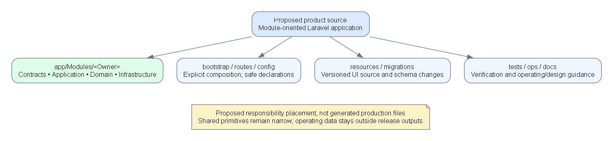

The following illustrates responsibility placement. Adapt concrete names to the evaluated framework conventions and actual component complexity before implementation. Do not create empty architectural layers merely to mirror the tree.

```text
app/
  Modules/
    IdentityAccess/
    Presentation/
    Sharing/
    Applications/
    CommunicationCalendar/
    Work/
    GitCollaboration/
    WorkflowDeployment/
    FilesOperations/
  Shared/                  # narrowly justified technical primitives
bootstrap/                 # application composition and initialization
config/                    # non-secret configuration declarations
routes/                    # HTTP/console route composition
resources/                 # shared UI assets and view source
database/migrations/       # ordered module-attributable schema changes
tests/                     # module and cross-boundary verification
ops/                       # reviewed operating/configuration templates
docs/                      # authoritative project documentation
```

<a id="design-record-03-component-and-module-design-02-implementation-view-and-artifacts-md--heading-inside-a-substantive-module"></a>

##### Inside a substantive module

```text
<Module>/
  Contracts/               # exported operations and permitted projections
  Application/             # explicit use-case orchestration
  Domain/                  # owned invariants and meaningful transitions
  Infrastructure/          # persistence and external adapters
  Http/                    # module-owned transport mapping, if needed
```

Make public/internal visibility and permitted imports enforceable through the selected toolchain/conventions. Module Contracts are not automatically public network APIs. Other modules may depend on explicit contracts, never on internal ORM mappings, storage paths or mutation-capable domain graphs. Shared must not become a universal domain model or broad service locator.

Keep framework composition registrations explicit. Route composition delegates to module-owned transport/application entry points. Shared UI infrastructure can serve several features while permission and domain state remain with their owners. Persistent worker scope must not retain another command's actor, transaction or private intent.

<a id="design-record-03-component-and-module-design-02-implementation-view-and-artifacts-md--heading-2-component-to-artifact-mapping"></a>

#### 2. Component-to-artifact mapping

[Components application artifacts and runtime placement](https://github.com/Farhad-V/Web-Resumefolio/blob/1f2acaa351ac306cb57cbe4fe9742e8bd90720d9/docs/MVP/SDLC/04-system-design/03-component-and-module-design/diagrams/component-artifact-placement.svg)

[Editable DOT](https://github.com/Farhad-V/Web-Resumefolio/blob/1f2acaa351ac306cb57cbe4fe9742e8bd90720d9/docs/MVP/SDLC/04-system-design/03-component-and-module-design/diagrams/component-artifact-placement.dot) · 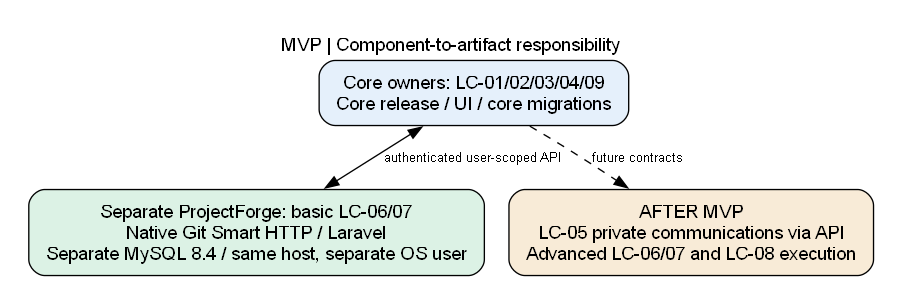

<a id="design-record-03-component-and-module-design-02-implementation-view-and-artifacts-md--heading-ia-01--trusted-application-release"></a>

##### IA-01 — Trusted application release

Realizes Identity/Access, Presentation, Sharing, Applications, Communication/Calendar, Work, Git Coordination, Workflow/Deployment Coordination and Files/Operations through their module code and contracts. Web and bounded workers/scheduler can run compatible entry points from the same application release. This does not authorize untrusted jobs inside the application identity.

The release includes application source or an evaluated deployable package, dependency resolution/lock identities, required migrations, UI build outputs and configuration/operating template identities. No final packaging technology or immutable-image mechanism is selected here.

<a id="design-record-03-component-and-module-design-02-implementation-view-and-artifacts-md--heading-ia-02--uistatic-outputs"></a>

##### IA-02 — UI/static outputs

Shared UI/view source and evaluated frontend tooling produce the actual public assets or server-side templates needed by the application. Bind outputs to the application release and compatibility manifest. Public assets exclude private resume files, repository objects, credentials and restricted diagnostic content. A frontend framework or build pipeline is not selected by this diagram.

<a id="design-record-03-component-and-module-design-02-implementation-view-and-artifacts-md--heading-ia-03--schema-migration-artifacts"></a>

##### IA-03 — Schema migration artifacts

Ordered migrations realize the evaluated physical data design, identifying component ownership and compatibility with active web/worker contracts. They are release artifacts, while the actual database contents are operating data. A downgrade script is not proof that historical data or external effects can be safely reversed.

<a id="design-record-03-component-and-module-design-02-implementation-view-and-artifacts-md--heading-ia-04--native-git-integration-artifacts"></a>

##### IA-04 — Native Git integration artifacts

Product coordination code belongs in the application release. Any selected native Git engine/package/service needs a separately identified version, configuration, transport contract and compatibility/recovery procedure. Repository objects/refs and review identities are operating data. Do not embed live repositories or real credentials in build packages.

<a id="design-record-03-component-and-module-design-02-implementation-view-and-artifacts-md--heading-ia-05--executorcontrol-artifacts"></a>

##### IA-05 — Executor/control artifacts

**After MVP.** Shared operating and recovery controls still apply where relevant.

Workflow coordination and its adapter belong in the trusted application. Any evaluated executor image/package/control service has its own identity, supported definition contract, admission/secret/output policy and operating verification. Its existence and safe configuration are not established. Deployment target artifacts are attributable job outputs, not automatically authorized product releases.

<a id="design-record-03-component-and-module-design-02-implementation-view-and-artifacts-md--heading-ia-06--operating-templates-and-release-metadata"></a>

##### IA-06 — Operating templates and release metadata

Review web/process-supervision/scheduling, private-storage, configuration and backup/recovery templates with the release. Templates identify required keys and prerequisites without real secret values. Actual effective configuration, permission grants and facilities require deployment verification.

These IA labels are local design locators, not product requirements. Physical placement is owned by the [deployment view](../01-High-Level-Design/14-Appendices.md#design-record-01-software-architecture-04-deployment-topology-nodes-and-networks-md): the trusted environment may host several artifacts/processes; native Git/executor placement remains evaluated separately; independent recovery needs its own failure-domain coverage.

<a id="design-record-03-component-and-module-design-02-implementation-view-and-artifacts-md--heading-3-dependency-and-build-organization"></a>

#### 3. Dependency and build organization

<a id="design-record-03-component-and-module-design-02-implementation-view-and-artifacts-md--heading-dependency-declarations"></a>

##### Dependency declarations

Declare direct application/runtime and development dependencies explicitly with resolved lock identities where supported. Review source, maintenance, compatibility, license obligations, required operating privileges, resource costs and release implications before adopting a package/version. Existing demo installations or prior project usage are not automatic approval. No current package/version support claim is made by this document.

Application/domain consumers depend on meaningful ports or public module contracts; infrastructure packages realize them. A package installed globally on a developer machine must not become an undocumented production prerequisite. Separate build-only tools from operating dependencies and identify generated output ownership.

<a id="design-record-03-component-and-module-design-02-implementation-view-and-artifacts-md--heading-proposed-build-sequence"></a>

##### Proposed build sequence

1. Identify source revision, intended environment/toolchain and dependency declarations/locks.
2. Resolve dependencies in a suitable controlled build environment; verify that declared compatibility and required inputs actually hold.
3. Perform static/syntax and module-boundary checks, then build selected UI/generated outputs as required.
4. Run relevant unit/domain/handler checks and real persistence/contract integration for the affected candidate. External facilities need controlled scoped evidence rather than fabricated mock-only assurance.
5. Assemble the candidate release and manifest, excluding real secrets, private data, caches tied to another environment and untrusted runtime workspaces.
6. Inspect the actual assembled output and rehearse its deployment/migrations on suitable isolated facilities before promotion.

The sequence describes required evidence, not a CI pipeline that already exists. Build determinism should be tested by comparing identified inputs/outputs under the chosen toolchain; this proposal does not claim reproducible binaries merely because lock files are present.

<a id="design-record-03-component-and-module-design-02-implementation-view-and-artifacts-md--heading-4-configuration-operating-data-and-generated-content"></a>

#### 4. Configuration operating data and generated content

<a id="design-record-03-component-and-module-design-02-implementation-view-and-artifacts-md--heading-configuration-boundary"></a>

##### Configuration boundary

Version safe key declarations, defaults that are actually accepted, format/schema and templates. Supply environment-specific values and secrets through reviewed operating mechanisms outside source control. Record effective configuration identities without leaking values. Changing a template does not change the running process; process restart/cache behavior must follow the evaluated deployment procedure.

Never commit real OAuth/client credentials, database passwords, encryption/recovery keys, deployment tokens, private correspondence or actual user artifacts. An example file can document required key names and expected meaning without providing working secrets. A schema migration or generated configuration artifact must not manufacture privileged accounts or grants implicitly.

<a id="design-record-03-component-and-module-design-02-implementation-view-and-artifacts-md--heading-operating-data-boundary"></a>

##### Operating data boundary

Preserve transactional domain state, command/attempt identities, committed pending intent, native repository state, private artifact bytes, publication/submission manifests and restricted operational evidence outside replaceable application release directories. Do not clear them through a generic clean/build script.

Runtime dispatch state may be reconstructible only if the chosen durable intent/identity design supports it. Do not classify all queues as disposable when unresolved sends/workflows/deployments depend on their records. Backup coverage and restoration retain actual authority/external reconciliation as defined in [operating recovery](../01-High-Level-Design/14-Appendices.md#design-record-06-design-quality-and-security-analysis-03-operations-backup-recovery-and-resilience-md).

<a id="design-record-03-component-and-module-design-02-implementation-view-and-artifacts-md--heading-generatedmanual-ownership"></a>

##### Generated/manual ownership

Each generated artifact needs an authoritative source, generator/toolchain identity, regeneration instructions, expected consumers and review policy. Avoid manually patching generated interface/build files while leaving their source inconsistent. Do not adopt code generation merely because FAU illustrates model-driven workflows; choose it only when useful and verifiable.

Documentation diagrams are generated from editable DOT/PlantUML sources and retained as readable SVG/PNG exports. Those are documentation outputs, not application build or product capability evidence.

<a id="design-record-03-component-and-module-design-02-implementation-view-and-artifacts-md--heading-5-release-manifest-and-promotion"></a>

#### 5. Release manifest and promotion

[Build candidate manifest and promotion route](https://github.com/Farhad-V/Web-Resumefolio/blob/1f2acaa351ac306cb57cbe4fe9742e8bd90720d9/docs/MVP/SDLC/04-system-design/03-component-and-module-design/diagrams/implementation-release-route.svg)

[Editable DOT](https://github.com/Farhad-V/Web-Resumefolio/blob/1f2acaa351ac306cb57cbe4fe9742e8bd90720d9/docs/MVP/SDLC/04-system-design/03-component-and-module-design/diagrams/implementation-release-route.dot) · 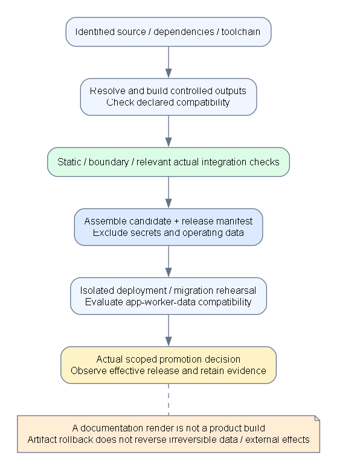

For an actual release record: source revision and dirty-state disposition; relevant dependency/toolchain identities; built artifact identities/integrity; component-to-artifact mapping; schema migration set and compatible app/worker/data versions; configuration key requirements; external engine/executor compatibility; actual verification/evidence; operating prerequisites; known risks; and rollback/forward-repair/recovery limits.

No manifest field should claim a hash, passing test or approval that was not actually produced. Final manifest format and signing/provenance mechanism need a justified implementation decision. Record what the selected mechanism actually verifies, rather than treating a checksum as authorization or origin assurance.

Promote only the identified evaluated artifact through [deployment procedures](../01-High-Level-Design/14-Appendices.md#design-record-01-software-architecture-04-deployment-topology-nodes-and-networks-md). Control incompatible in-flight workers/jobs, preserve operating data and reconcile external effects. An application artifact rollback is not an automatic database restore or an undo of sent mail, updated refs or a target deployment.

<a id="design-record-03-component-and-module-design-02-implementation-view-and-artifacts-md--heading-6-verification-and-completion"></a>

#### 6. Verification and completion

<a id="design-record-03-component-and-module-design-02-implementation-view-and-artifacts-md--heading-required-implementation-view-checks"></a>

##### Required implementation-view checks

- Each logical component maps to actual source/package elements and realizing artifacts, with exported/internal dependencies identifiable.
- Each running artifact maps to an operating environment/node and required communication/configuration path.
- Web, workers, scheduler, schema and external-adapter versions agree on active contracts and pending work.
- Build output contains required assets/migrations and excludes secrets, private operating data and untrusted workspaces.
- Actual assembled-output boot/route/module-boundary checks and relevant persistence/integration results identify the same candidate.
- Deployment, compatibility, migration and recovery limits are explicit and supported at their applicable acceptance gates.

These are future verification requirements, not tests executed by this document update. Exact namespace conventions, package definitions, build commands, chosen tools/versions, manifest format and concrete artifact hashes remain implementation-level follow-up. The existing documentation-only repository is not represented as an already built product source tree.

Use [component packages](02-Module-Breakdown.md#design-record-03-component-and-module-design-component-and-module-design-md), [data design](04-Database-Design.md#design-record-04-data-design-data-design-md), [interface design](05-API-Specification.md#design-record-05-interface-and-api-design-interface-and-api-design-md), [evolution guidance](#design-record-02-detailed-and-object-oriented-design-05-design-evolution-refactoring-and-technical-debt-md) and [design review/handoff](../01-High-Level-Design/14-Appendices.md#design-record-06-design-quality-and-security-analysis-05-design-review-traceability-and-handoff-md) to maintain a coherent candidate. Source families or artifact counts are not exact criterion completion.

<a id="design-record-03-component-and-module-design-02-implementation-view-and-artifacts-md--heading-7-fau-basis-and-diagram-reading"></a>

#### 7. FAU basis and diagram reading

FAU V07’s implementation view relates components/modules to source files and development outputs; its artifact/deployment model maps logical components to physical artifacts and nodes. V08 carries architecture inputs into component implementation prescriptions. This proposed layout is a project adaptation, not a mandatory framework filesystem or an assertion that one component equals one binary/service.

The diagrams illustrate source responsibility, artifact placement and the release evidence route. They do not select queue/Git/executor products, install facilities or prove runtime behavior. See [FAU reference map](../01-High-Level-Design/14-Appendices.md#design-record-design-references-and-coverage-md) and [diagram catalog](#design-record-03-component-and-module-design-diagrams-diagram-catalog-md).

No production source generation, dependency installation, build, migration, deployment, provider/Git mutation or baseline approval is performed in this authoring update. Advisor transport remains unavailable as previously recorded; no independent endorsement is claimed.

[Component and Module Design index](02-Module-Breakdown.md#design-record-03-component-and-module-design-component-and-module-design-md) · [Module boundary rules](02-Module-Breakdown.md#design-record-03-component-and-module-design-01-modularity-dependencies-and-encapsulation-md)

<a id="design-record-03-component-and-module-design-02-implementation-view-and-artifacts-md--heading-8-essential-implementation-and-artifact-views"></a>

#### 8. Essential implementation and artifact views

Only **three complementary diagrams** are added here; no new tables. Reuse the existing [source structure](#design-record-03-component-and-module-design-02-implementation-view-and-artifacts-md--heading-1-proposed-source-organization), [component/artifact placement](#design-record-03-component-and-module-design-02-implementation-view-and-artifacts-md--heading-2-component-to-artifact-mapping) and [release route](#design-record-03-component-and-module-design-02-implementation-view-and-artifacts-md--heading-5-release-manifest-and-promotion). These represent the proposed implementation candidate, not an inspected product code tree or completed build.

<a id="design-record-03-component-and-module-design-02-implementation-view-and-artifacts-md--heading-81-implementation-view-logical-owners-to-physical-outputs"></a>

##### 8.1 Implementation view: logical owners to physical outputs

[Implementation view: logical owners to physical outputs](https://github.com/Farhad-V/Web-Resumefolio/blob/1f2acaa351ac306cb57cbe4fe9742e8bd90720d9/docs/MVP/SDLC/04-system-design/03-component-and-module-design/diagrams/implementation-essential-overview.svg)

[Editable PlantUML](https://github.com/Farhad-V/Web-Resumefolio/blob/1f2acaa351ac306cb57cbe4fe9742e8bd90720d9/docs/MVP/SDLC/04-system-design/03-component-and-module-design/diagrams/implementation-essential-overview.puml) · 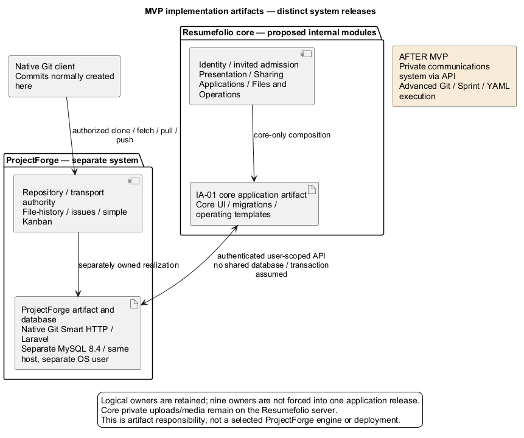

4+1 implementation-view refinement: logical responsibilities map to source elements and physical outputs, not one service or binary per owner. IA locators reuse section 2; actual source/package names, toolchain and compatibility remain proposed.

<a id="design-record-03-component-and-module-design-02-implementation-view-and-artifacts-md--heading-82-uml-style-artifacts-and-manifestation-boundaries"></a>

##### 8.2 UML-style artifacts and manifestation boundaries

[UML-style artifacts and manifestation boundaries](https://github.com/Farhad-V/Web-Resumefolio/blob/1f2acaa351ac306cb57cbe4fe9742e8bd90720d9/docs/MVP/SDLC/04-system-design/03-component-and-module-design/diagrams/implementation-essential-overview.svg)

[Editable PlantUML](https://github.com/Farhad-V/Web-Resumefolio/blob/1f2acaa351ac306cb57cbe4fe9742e8bd90720d9/docs/MVP/SDLC/04-system-design/03-component-and-module-design/diagrams/implementation-essential-overview.puml) · 

The «manifest» dependency denotes UML artifact manifestation, distinct from the release-manifest document identifying output/provenance. Git/executor artifacts are conditional evaluated prerequisites, not installed products. A checksum alone is not authorization or origin assurance.

<a id="design-record-03-component-and-module-design-02-implementation-view-and-artifacts-md--heading-83-build-dependency-order-and-candidate-evidence"></a>

##### 8.3 Build dependency order and candidate evidence

[Build dependency order and candidate evidence](https://github.com/Farhad-V/Web-Resumefolio/blob/1f2acaa351ac306cb57cbe4fe9742e8bd90720d9/docs/MVP/SDLC/04-system-design/03-component-and-module-design/diagrams/implementation-essential-build-order.svg)

[Editable PlantUML](https://github.com/Farhad-V/Web-Resumefolio/blob/1f2acaa351ac306cb57cbe4fe9742e8bd90720d9/docs/MVP/SDLC/04-system-design/03-component-and-module-design/diagrams/implementation-essential-build-order.puml) · 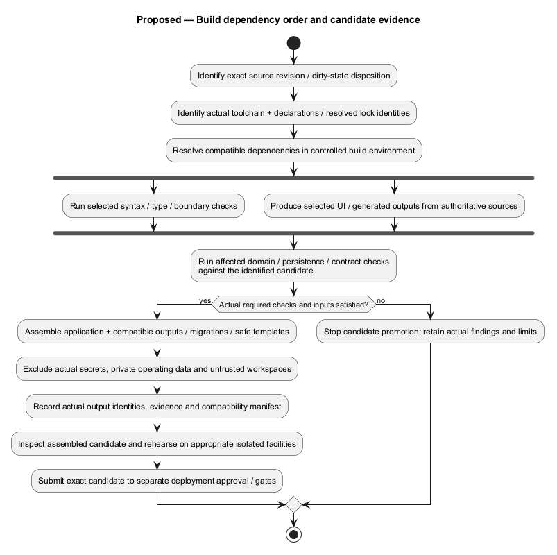

Essential build-input/order flow, not installed CI or actual commands. PHP modules are not automatically separately compiled build targets; no fabricated inter-module compilation order is imposed. Parallel branches show independent candidate tasks only where actual tooling permits; affected checks must use the intended outputs. Packaging does not publish to a selected registry or authorize deployment.

The [modularity guide](02-Module-Breakdown.md#design-record-03-component-and-module-design-01-modularity-dependencies-and-encapsulation-md--heading-8-essential-modularity-and-encapsulation-views) already supplies package direction, layers and hidden implementation. The [deployment view](../01-High-Level-Design/14-Appendices.md#design-record-01-software-architecture-04-deployment-topology-nodes-and-networks-md) owns node placement; the [Git design](03-Detailed-Module-Design.md#design-record-03-component-and-module-design-components-git-collaboration-md--heading-7-essential-git-and-collaboration-views) owns its candidate branching/review views. Duplicating them here would create competing diagrams without a new implementation question.

No monorepo/multi-repo split, third-party package graph, registry, release version scheme or separate module build target is selected. Populate actual dependency identities and code structure only after inspecting the real candidate. Unresolved Git/executor/runtime/secret/recovery mechanisms remain evidence gates; these diagrams perform no install, build, publish, migration or deployment.

</details>

<a id="design-record-03-component-and-module-design-components-diagrams-diagram-catalog-md"></a>

<details>
<summary>Resumefolio — Component-Specific Diagrams</summary>

<a id="design-record-03-component-and-module-design-components-diagrams-diagram-catalog-md--heading-resumefolio--component-specific-diagrams"></a>

### Resumefolio — Component-Specific Diagrams

Proposed implementation views; not executed product evidence.

Current MVP scope and selected mechanisms: [Baseline](https://github.com/Farhad-V/Web-Resumefolio/blob/1f2acaa351ac306cb57cbe4fe9742e8bd90720d9/docs/MVP/baseline/README.md). Deferred provider, advanced collaboration and workflow-execution designs are not MVP prerequisites.

<a id="design-record-03-component-and-module-design-components-diagrams-diagram-catalog-md--heading-manual-applications-lc-04"></a>

#### Manual Applications LC-04

- [Applications owned classes and references](https://github.com/Farhad-V/Web-Resumefolio/blob/1f2acaa351ac306cb57cbe4fe9742e8bd90720d9/docs/MVP/SDLC/04-system-design/03-component-and-module-design/components/diagrams/applications-owned-model.svg) · [PlantUML](https://github.com/Farhad-V/Web-Resumefolio/blob/1f2acaa351ac306cb57cbe4fe9742e8bd90720d9/docs/MVP/SDLC/04-system-design/03-component-and-module-design/components/diagrams/applications-owned-model.puml) · 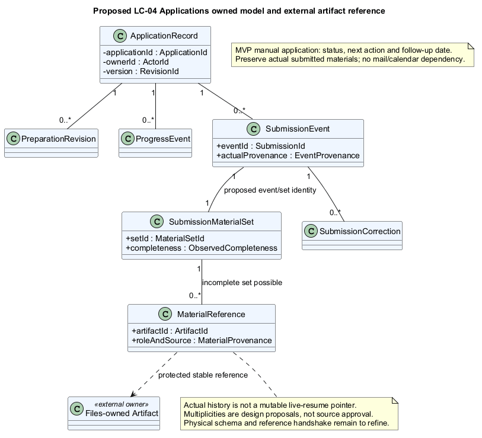
- [Actual-material capture coordination](https://github.com/Farhad-V/Web-Resumefolio/blob/1f2acaa351ac306cb57cbe4fe9742e8bd90720d9/docs/MVP/SDLC/04-system-design/03-component-and-module-design/components/diagrams/applications-capture-sequence.svg) · [PlantUML](https://github.com/Farhad-V/Web-Resumefolio/blob/1f2acaa351ac306cb57cbe4fe9742e8bd90720d9/docs/MVP/SDLC/04-system-design/03-component-and-module-design/components/diagrams/applications-capture-sequence.puml) · 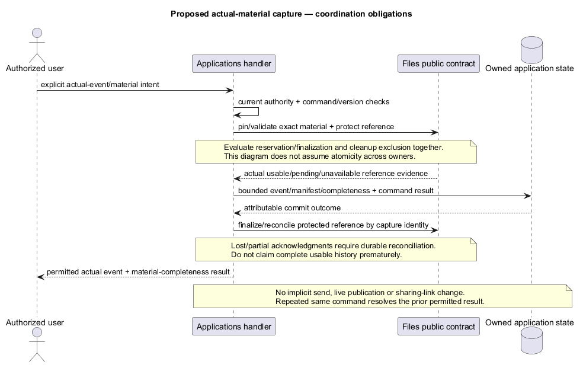

[Owning component](03-Detailed-Module-Design.md#design-record-03-component-and-module-design-components-applications-md). Source policy, physical mapping and reference coordination retain their explicit pending decisions.

<a id="design-record-03-component-and-module-design-components-diagrams-diagram-catalog-md--heading-communication-and-calendar-lc-05"></a>

#### Communication and Calendar LC-05

**After MVP.** Shared operating and recovery controls still apply where relevant.

- [Connection intent and calendar identities](https://github.com/Farhad-V/Web-Resumefolio/blob/1f2acaa351ac306cb57cbe4fe9742e8bd90720d9/docs/MVP/SDLC/04-system-design/03-component-and-module-design/components/diagrams/communication-owned-model.svg) · [PlantUML](https://github.com/Farhad-V/Web-Resumefolio/blob/1f2acaa351ac306cb57cbe4fe9742e8bd90720d9/docs/MVP/SDLC/04-system-design/03-component-and-module-design/components/diagrams/communication-owned-model.puml) · 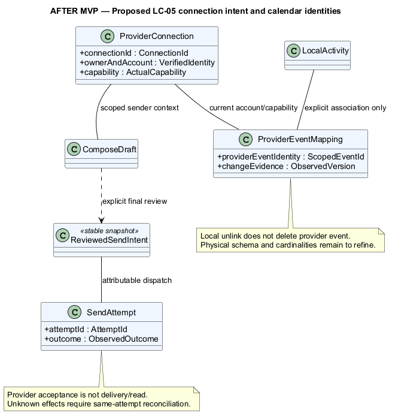
- [Reviewed send and uncertain result](https://github.com/Farhad-V/Web-Resumefolio/blob/1f2acaa351ac306cb57cbe4fe9742e8bd90720d9/docs/MVP/SDLC/04-system-design/03-component-and-module-design/components/diagrams/communication-send-sequence.svg) · [PlantUML](https://github.com/Farhad-V/Web-Resumefolio/blob/1f2acaa351ac306cb57cbe4fe9742e8bd90720d9/docs/MVP/SDLC/04-system-design/03-component-and-module-design/components/diagrams/communication-send-sequence.puml) · 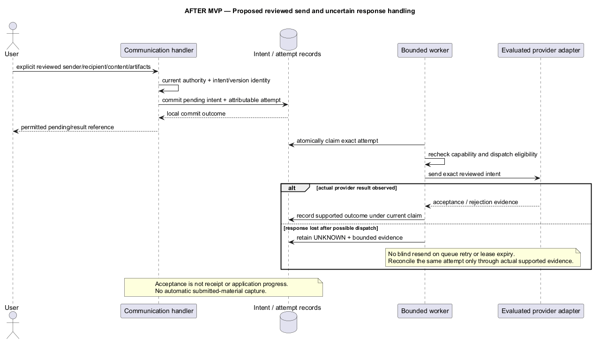
- [Local/provider calendar reconciliation](https://github.com/Farhad-V/Web-Resumefolio/blob/1f2acaa351ac306cb57cbe4fe9742e8bd90720d9/docs/MVP/SDLC/04-system-design/03-component-and-module-design/components/diagrams/calendar-reconciliation-route.svg) · [PlantUML](https://github.com/Farhad-V/Web-Resumefolio/blob/1f2acaa351ac306cb57cbe4fe9742e8bd90720d9/docs/MVP/SDLC/04-system-design/03-component-and-module-design/components/diagrams/calendar-reconciliation-route.puml) · 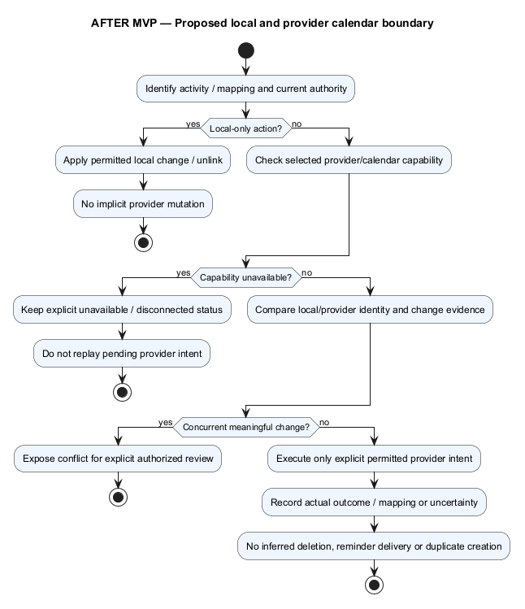

[Owning component](03-Detailed-Module-Design.md#design-record-03-component-and-module-design-components-communication-and-calendar-md). Proposed contracts; actual provider capability/source-policy acceptance and concrete schema remain explicit gates.

<a id="design-record-03-component-and-module-design-components-diagrams-diagram-catalog-md--heading-files-and-operations-lc-09"></a>

#### Files and Operations LC-09

- [Artifact accounting and protected references](https://github.com/Farhad-V/Web-Resumefolio/blob/1f2acaa351ac306cb57cbe4fe9742e8bd90720d9/docs/MVP/SDLC/04-system-design/03-component-and-module-design/components/diagrams/files-owned-model.svg) · [PlantUML](https://github.com/Farhad-V/Web-Resumefolio/blob/1f2acaa351ac306cb57cbe4fe9742e8bd90720d9/docs/MVP/SDLC/04-system-design/03-component-and-module-design/components/diagrams/files-owned-model.puml) · 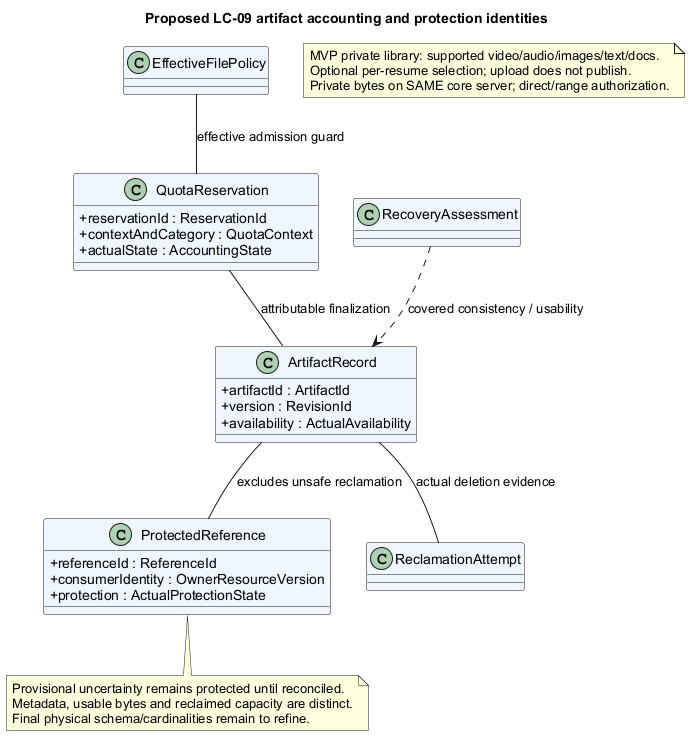
- [Admission finalization and actual usage](https://github.com/Farhad-V/Web-Resumefolio/blob/1f2acaa351ac306cb57cbe4fe9742e8bd90720d9/docs/MVP/SDLC/04-system-design/03-component-and-module-design/components/diagrams/files-admission-sequence.svg) · [PlantUML](https://github.com/Farhad-V/Web-Resumefolio/blob/1f2acaa351ac306cb57cbe4fe9742e8bd90720d9/docs/MVP/SDLC/04-system-design/03-component-and-module-design/components/diagrams/files-admission-sequence.puml) · 
- [Reference-aware reclamation guard](https://github.com/Farhad-V/Web-Resumefolio/blob/1f2acaa351ac306cb57cbe4fe9742e8bd90720d9/docs/MVP/SDLC/04-system-design/03-component-and-module-design/components/diagrams/files-reclamation-route.svg) · [PlantUML](https://github.com/Farhad-V/Web-Resumefolio/blob/1f2acaa351ac306cb57cbe4fe9742e8bd90720d9/docs/MVP/SDLC/04-system-design/03-component-and-module-design/components/diagrams/files-reclamation-route.puml) · 

[Owning component](03-Detailed-Module-Design.md#design-record-03-component-and-module-design-components-files-and-operations-md). Proposed protocols; actual quota values, schema/locking, backend and usable recovery remain pending evidence/decisions.

<a id="design-record-03-component-and-module-design-components-diagrams-diagram-catalog-md--heading-git-collaboration-lc-07"></a>

#### Git Collaboration LC-07

- [Repository revision and review identities](https://github.com/Farhad-V/Web-Resumefolio/blob/1f2acaa351ac306cb57cbe4fe9742e8bd90720d9/docs/MVP/SDLC/04-system-design/03-component-and-module-design/components/diagrams/git-owned-model.svg) · [PlantUML](https://github.com/Farhad-V/Web-Resumefolio/blob/1f2acaa351ac306cb57cbe4fe9742e8bd90720d9/docs/MVP/SDLC/04-system-design/03-component-and-module-design/components/diagrams/git-owned-model.puml) · 
- [Guarded merge and native/metadata reconciliation](https://github.com/Farhad-V/Web-Resumefolio/blob/1f2acaa351ac306cb57cbe4fe9742e8bd90720d9/docs/MVP/SDLC/04-system-design/03-component-and-module-design/components/diagrams/git-merge-sequence.svg) · [PlantUML](https://github.com/Farhad-V/Web-Resumefolio/blob/1f2acaa351ac306cb57cbe4fe9742e8bd90720d9/docs/MVP/SDLC/04-system-design/03-component-and-module-design/components/diagrams/git-merge-sequence.puml) · 

[Owning component](03-Detailed-Module-Design.md#design-record-03-component-and-module-design-components-git-collaboration-md). Proposed contracts; engine/transport and concrete cross-store/ref/policy coordination remain evaluated decisions.

<a id="design-record-03-component-and-module-design-components-diagrams-diagram-catalog-md--heading-identity-and-access-lc-01"></a>

#### Identity and Access LC-01

- [Account session and scoped authority model](https://github.com/Farhad-V/Web-Resumefolio/blob/1f2acaa351ac306cb57cbe4fe9742e8bd90720d9/docs/MVP/SDLC/04-system-design/03-component-and-module-design/components/diagrams/identity-owned-model.svg) · [PlantUML](https://github.com/Farhad-V/Web-Resumefolio/blob/1f2acaa351ac306cb57cbe4fe9742e8bd90720d9/docs/MVP/SDLC/04-system-design/03-component-and-module-design/components/diagrams/identity-owned-model.puml) · 
- [Current authority and revocation boundary](https://github.com/Farhad-V/Web-Resumefolio/blob/1f2acaa351ac306cb57cbe4fe9742e8bd90720d9/docs/MVP/SDLC/04-system-design/03-component-and-module-design/components/diagrams/identity-authorization-sequence.svg) · [PlantUML](https://github.com/Farhad-V/Web-Resumefolio/blob/1f2acaa351ac306cb57cbe4fe9742e8bd90720d9/docs/MVP/SDLC/04-system-design/03-component-and-module-design/components/diagrams/identity-authorization-sequence.puml) · 

[Owning component](03-Detailed-Module-Design.md#design-record-03-component-and-module-design-components-identity-and-access-md). Proposed enforcement structure; actual administrative policy, credential/session mechanisms and concrete synchronization remain unresolved choices.

<a id="design-record-03-component-and-module-design-components-diagrams-diagram-catalog-md--heading-professional-presentation-lc-02"></a>

#### Professional Presentation LC-02

- [Source, independent draft and publication model](https://github.com/Farhad-V/Web-Resumefolio/blob/1f2acaa351ac306cb57cbe4fe9742e8bd90720d9/docs/MVP/SDLC/04-system-design/03-component-and-module-design/components/diagrams/presentation-owned-model.svg) · [PlantUML](https://github.com/Farhad-V/Web-Resumefolio/blob/1f2acaa351ac306cb57cbe4fe9742e8bd90720d9/docs/MVP/SDLC/04-system-design/03-component-and-module-design/components/diagrams/presentation-owned-model.puml) · 
- [Selected apply and separate publication](https://github.com/Farhad-V/Web-Resumefolio/blob/1f2acaa351ac306cb57cbe4fe9742e8bd90720d9/docs/MVP/SDLC/04-system-design/03-component-and-module-design/components/diagrams/presentation-update-publication.svg) · [PlantUML](https://github.com/Farhad-V/Web-Resumefolio/blob/1f2acaa351ac306cb57cbe4fe9742e8bd90720d9/docs/MVP/SDLC/04-system-design/03-component-and-module-design/components/diagrams/presentation-update-publication.puml) · 

[Owning component](03-Detailed-Module-Design.md#design-record-03-component-and-module-design-components-professional-presentation-md). Proposed technical realization of the accepted update/publication core; detailed source policies and concrete persistence/reference mechanisms retain review status.

<a id="design-record-03-component-and-module-design-components-diagrams-diagram-catalog-md--heading-representation-and-sharing-lc-03"></a>

#### Representation and Sharing LC-03

- [Independent access and rendition state](https://github.com/Farhad-V/Web-Resumefolio/blob/1f2acaa351ac306cb57cbe4fe9742e8bd90720d9/docs/MVP/SDLC/04-system-design/03-component-and-module-design/components/diagrams/sharing-owned-model.svg) · [PlantUML](https://github.com/Farhad-V/Web-Resumefolio/blob/1f2acaa351ac306cb57cbe4fe9742e8bd90720d9/docs/MVP/SDLC/04-system-design/03-component-and-module-design/components/diagrams/sharing-owned-model.puml) · 
- [Current-authority protected retrieval](https://github.com/Farhad-V/Web-Resumefolio/blob/1f2acaa351ac306cb57cbe4fe9742e8bd90720d9/docs/MVP/SDLC/04-system-design/03-component-and-module-design/components/diagrams/sharing-protected-retrieval.svg) · [PlantUML](https://github.com/Farhad-V/Web-Resumefolio/blob/1f2acaa351ac306cb57cbe4fe9742e8bd90720d9/docs/MVP/SDLC/04-system-design/03-component-and-module-design/components/diagrams/sharing-protected-retrieval.puml) · 

[Owning component](03-Detailed-Module-Design.md#design-record-03-component-and-module-design-components-representation-and-sharing-md). Proposed representation and protected retrieval mechanisms; detailed link/session/rendition policies and serving synchronization retain review status.

<a id="design-record-03-component-and-module-design-components-diagrams-diagram-catalog-md--heading-work-management-lc-06"></a>

#### Work Management LC-06

- [Work views and coherent Sprint Backlog](https://github.com/Farhad-V/Web-Resumefolio/blob/1f2acaa351ac306cb57cbe4fe9742e8bd90720d9/docs/MVP/SDLC/04-system-design/03-component-and-module-design/components/diagrams/work-owned-model.svg) · [PlantUML](https://github.com/Farhad-V/Web-Resumefolio/blob/1f2acaa351ac306cb57cbe4fe9742e8bd90720d9/docs/MVP/SDLC/04-system-design/03-component-and-module-design/components/diagrams/work-owned-model.puml) · 
- [Guarded mutation and explicit Sprint-period close](https://github.com/Farhad-V/Web-Resumefolio/blob/1f2acaa351ac306cb57cbe4fe9742e8bd90720d9/docs/MVP/SDLC/04-system-design/03-component-and-module-design/components/diagrams/work-mutation-sprint-close.svg) · [PlantUML](https://github.com/Farhad-V/Web-Resumefolio/blob/1f2acaa351ac306cb57cbe4fe9742e8bd90720d9/docs/MVP/SDLC/04-system-design/03-component-and-module-design/components/diagrams/work-mutation-sprint-close.puml) · 

[Owning component](03-Detailed-Module-Design.md#design-record-03-component-and-module-design-components-work-management-md). Proposed work and Sprint mechanisms; detailed workflow, role, cardinality and disposition policies retain review status.

<a id="design-record-03-component-and-module-design-components-diagrams-diagram-catalog-md--heading-workflow-and-deployment-lc-08"></a>

#### Workflow and Deployment LC-08

**After MVP.** Shared operating and recovery controls still apply where relevant.

- [Coordination and execution trust boundaries](https://github.com/Farhad-V/Web-Resumefolio/blob/1f2acaa351ac306cb57cbe4fe9742e8bd90720d9/docs/MVP/SDLC/04-system-design/03-component-and-module-design/components/diagrams/workflow-trust-model.svg) · [PlantUML](https://github.com/Farhad-V/Web-Resumefolio/blob/1f2acaa351ac306cb57cbe4fe9742e8bd90720d9/docs/MVP/SDLC/04-system-design/03-component-and-module-design/components/diagrams/workflow-trust-model.puml) · 
- [Separate deployment and effect reconciliation](https://github.com/Farhad-V/Web-Resumefolio/blob/1f2acaa351ac306cb57cbe4fe9742e8bd90720d9/docs/MVP/SDLC/04-system-design/03-component-and-module-design/components/diagrams/workflow-deployment-sequence.svg) · [PlantUML](https://github.com/Farhad-V/Web-Resumefolio/blob/1f2acaa351ac306cb57cbe4fe9742e8bd90720d9/docs/MVP/SDLC/04-system-design/03-component-and-module-design/components/diagrams/workflow-deployment-sequence.puml) · 

[Owning component](03-Detailed-Module-Design.md#design-record-03-component-and-module-design-components-workflow-and-deployment-md). Proposed gated execution and separately authorized deployment; actual isolation, capacity, cleanup and recovery evidence remain enabling gates.

<a id="design-record-03-component-and-module-design-components-diagrams-diagram-catalog-md--heading-applications-context-and-logical-landscape-package"></a>

#### Applications context and logical landscape package

- [Provided and required component interfaces](https://github.com/Farhad-V/Web-Resumefolio/blob/1f2acaa351ac306cb57cbe4fe9742e8bd90720d9/docs/MVP/SDLC/04-system-design/03-component-and-module-design/components/diagrams/applications-interfaces.svg) · [PlantUML](https://github.com/Farhad-V/Web-Resumefolio/blob/1f2acaa351ac306cb57cbe4fe9742e8bd90720d9/docs/MVP/SDLC/04-system-design/03-component-and-module-design/components/diagrams/applications-interfaces.puml) · 
- [C4 Level 1: Resumefolio system context](https://github.com/Farhad-V/Web-Resumefolio/blob/1f2acaa351ac306cb57cbe4fe9742e8bd90720d9/docs/MVP/SDLC/04-system-design/01-software-architecture/diagrams/drivers-c4-system-context.svg) · [PlantUML](https://github.com/Farhad-V/Web-Resumefolio/blob/1f2acaa351ac306cb57cbe4fe9742e8bd90720d9/docs/MVP/SDLC/04-system-design/01-software-architecture/diagrams/drivers-c4-system-context.puml) · 
- [C4 Level 2: modular application and stores](https://github.com/Farhad-V/Web-Resumefolio/blob/1f2acaa351ac306cb57cbe4fe9742e8bd90720d9/docs/MVP/SDLC/04-system-design/01-software-architecture/diagrams/boundaries-c4-containers.svg) · [PlantUML](https://github.com/Farhad-V/Web-Resumefolio/blob/1f2acaa351ac306cb57cbe4fe9742e8bd90720d9/docs/MVP/SDLC/04-system-design/01-software-architecture/diagrams/boundaries-c4-containers.puml) · 
- [Logical capability landscape](../../03-System-Analysis/Diagrams/Scope-Stakeholder-Map.svg) · [PlantUML](../../03-System-Analysis/Diagrams/Scope-Stakeholder-Map.puml) · 
- [Applications inbound and outbound dependencies](https://github.com/Farhad-V/Web-Resumefolio/blob/1f2acaa351ac306cb57cbe4fe9742e8bd90720d9/docs/MVP/SDLC/04-system-design/03-component-and-module-design/components/diagrams/applications-dependencies.svg) · [PlantUML](https://github.com/Farhad-V/Web-Resumefolio/blob/1f2acaa351ac306cb57cbe4fe9742e8bd90720d9/docs/MVP/SDLC/04-system-design/03-component-and-module-design/components/diagrams/applications-dependencies.puml) · 
- [Applications layered architecture](https://github.com/Farhad-V/Web-Resumefolio/blob/1f2acaa351ac306cb57cbe4fe9742e8bd90720d9/docs/MVP/SDLC/04-system-design/03-component-and-module-design/components/diagrams/applications-layers.svg) · [PlantUML](https://github.com/Farhad-V/Web-Resumefolio/blob/1f2acaa351ac306cb57cbe4fe9742e8bd90720d9/docs/MVP/SDLC/04-system-design/03-component-and-module-design/components/diagrams/applications-layers.puml) · 
- [Internal responsibility areas within LC-04](https://github.com/Farhad-V/Web-Resumefolio/blob/1f2acaa351ac306cb57cbe4fe9742e8bd90720d9/docs/MVP/SDLC/04-system-design/03-component-and-module-design/components/diagrams/applications-internal-structure.svg) · [PlantUML](https://github.com/Farhad-V/Web-Resumefolio/blob/1f2acaa351ac306cb57cbe4fe9742e8bd90720d9/docs/MVP/SDLC/04-system-design/03-component-and-module-design/components/diagrams/applications-internal-structure.puml) · 
- [Candidate package dependencies](https://github.com/Farhad-V/Web-Resumefolio/blob/1f2acaa351ac306cb57cbe4fe9742e8bd90720d9/docs/MVP/SDLC/04-system-design/03-component-and-module-design/components/diagrams/applications-packages.svg) · [PlantUML](https://github.com/Farhad-V/Web-Resumefolio/blob/1f2acaa351ac306cb57cbe4fe9742e8bd90720d9/docs/MVP/SDLC/04-system-design/03-component-and-module-design/components/diagrams/applications-packages.puml) · 
- [Integration types and evidence boundaries](https://github.com/Farhad-V/Web-Resumefolio/blob/1f2acaa351ac306cb57cbe4fe9742e8bd90720d9/docs/MVP/SDLC/04-system-design/03-component-and-module-design/components/diagrams/applications-integration.svg) · [PlantUML](https://github.com/Farhad-V/Web-Resumefolio/blob/1f2acaa351ac306cb57cbe4fe9742e8bd90720d9/docs/MVP/SDLC/04-system-design/03-component-and-module-design/components/diagrams/applications-integration.puml) · 
- [Actual submission capture across owner contracts](https://github.com/Farhad-V/Web-Resumefolio/blob/1f2acaa351ac306cb57cbe4fe9742e8bd90720d9/docs/MVP/SDLC/04-system-design/03-component-and-module-design/components/diagrams/applications-cross-owner-sequence.svg) · [PlantUML](https://github.com/Farhad-V/Web-Resumefolio/blob/1f2acaa351ac306cb57cbe4fe9742e8bd90720d9/docs/MVP/SDLC/04-system-design/03-component-and-module-design/components/diagrams/applications-cross-owner-sequence.puml) · 
- [UML use cases for the manual Applications capability](https://github.com/Farhad-V/Web-Resumefolio/blob/1f2acaa351ac306cb57cbe4fe9742e8bd90720d9/docs/MVP/SDLC/04-system-design/03-component-and-module-design/components/diagrams/applications-use-cases.svg) · [PlantUML](https://github.com/Farhad-V/Web-Resumefolio/blob/1f2acaa351ac306cb57cbe4fe9742e8bd90720d9/docs/MVP/SDLC/04-system-design/03-component-and-module-design/components/diagrams/applications-use-cases.puml) · 
- [Optional deployment mapping of logical roles](https://github.com/Farhad-V/Web-Resumefolio/blob/1f2acaa351ac306cb57cbe4fe9742e8bd90720d9/docs/MVP/SDLC/04-system-design/01-software-architecture/diagrams/drivers-uml-deployment.svg) · [PlantUML](https://github.com/Farhad-V/Web-Resumefolio/blob/1f2acaa351ac306cb57cbe4fe9742e8bd90720d9/docs/MVP/SDLC/04-system-design/01-software-architecture/diagrams/drivers-uml-deployment.puml) · 

[Owning LC-04 document, inventory/capability/interface/stack/data/quality/lifecycle tables and decision note](03-Detailed-Module-Design.md#design-record-03-component-and-module-design-components-applications-md--heading-7-application-context-and-landscape-package). Applications means manual job applications; logical neighbors are not separate deployed software applications.

<a id="design-record-03-component-and-module-design-components-diagrams-diagram-catalog-md--heading-communication-and-calendar-expanded-package"></a>

#### Communication and calendar expanded package

**After MVP.** Shared operating and recovery controls still apply where relevant.

- [Communication and calendar interfaces](https://github.com/Farhad-V/Web-Resumefolio/blob/1f2acaa351ac306cb57cbe4fe9742e8bd90720d9/docs/MVP/SDLC/04-system-design/03-component-and-module-design/components/diagrams/comm-interfaces.svg) · [PlantUML](https://github.com/Farhad-V/Web-Resumefolio/blob/1f2acaa351ac306cb57cbe4fe9742e8bd90720d9/docs/MVP/SDLC/04-system-design/03-component-and-module-design/components/diagrams/comm-interfaces.puml) · 
- [C4 Level 1: users and external provider](../../02-Requirements-Engineering/Diagrams/Use-Cases-Mail-And-Calendar.svg) · [PlantUML](../../02-Requirements-Engineering/Diagrams/Use-Cases-Mail-And-Calendar.puml) · 
- [C4 Level 2: actual proposed runtime boundaries](../../02-Requirements-Engineering/Diagrams/Use-Cases-Mail-And-Calendar.svg) · [PlantUML](../../02-Requirements-Engineering/Diagrams/Use-Cases-Mail-And-Calendar.puml) · 
- [Owner communication and calendar use cases](https://github.com/Farhad-V/Web-Resumefolio/blob/1f2acaa351ac306cb57cbe4fe9742e8bd90720d9/docs/MVP/SDLC/04-system-design/03-component-and-module-design/components/diagrams/comm-use-cases.svg) · [PlantUML](https://github.com/Farhad-V/Web-Resumefolio/blob/1f2acaa351ac306cb57cbe4fe9742e8bd90720d9/docs/MVP/SDLC/04-system-design/03-component-and-module-design/components/diagrams/comm-use-cases.puml) · 
- [Domain classes and optional requested concepts](https://github.com/Farhad-V/Web-Resumefolio/blob/1f2acaa351ac306cb57cbe4fe9742e8bd90720d9/docs/MVP/SDLC/04-system-design/03-component-and-module-design/components/diagrams/comm-domain.svg) · [PlantUML](https://github.com/Farhad-V/Web-Resumefolio/blob/1f2acaa351ac306cb57cbe4fe9742e8bd90720d9/docs/MVP/SDLC/04-system-design/03-component-and-module-design/components/diagrams/comm-domain.puml) · 
- [Logical ERD: owned and observed records](https://github.com/Farhad-V/Web-Resumefolio/blob/1f2acaa351ac306cb57cbe4fe9742e8bd90720d9/docs/MVP/SDLC/04-system-design/03-component-and-module-design/components/diagrams/comm-erd.svg) · [PlantUML](https://github.com/Farhad-V/Web-Resumefolio/blob/1f2acaa351ac306cb57cbe4fe9742e8bd90720d9/docs/MVP/SDLC/04-system-design/03-component-and-module-design/components/diagrams/comm-erd.puml) · 
- [Reviewed send and delivery observations](https://github.com/Farhad-V/Web-Resumefolio/blob/1f2acaa351ac306cb57cbe4fe9742e8bd90720d9/docs/MVP/SDLC/04-system-design/03-component-and-module-design/components/diagrams/comm-send.svg) · [PlantUML](https://github.com/Farhad-V/Web-Resumefolio/blob/1f2acaa351ac306cb57cbe4fe9742e8bd90720d9/docs/MVP/SDLC/04-system-design/03-component-and-module-design/components/diagrams/comm-send.puml) · 
- [Conditional event creation and attendee response](https://github.com/Farhad-V/Web-Resumefolio/blob/1f2acaa351ac306cb57cbe4fe9742e8bd90720d9/docs/MVP/SDLC/04-system-design/03-component-and-module-design/components/diagrams/comm-invitation.svg) · [PlantUML](https://github.com/Farhad-V/Web-Resumefolio/blob/1f2acaa351ac306cb57cbe4fe9742e8bd90720d9/docs/MVP/SDLC/04-system-design/03-component-and-module-design/components/diagrams/comm-invitation.puml) · 
- [Reminder trigger and actual notification outcome](https://github.com/Farhad-V/Web-Resumefolio/blob/1f2acaa351ac306cb57cbe4fe9742e8bd90720d9/docs/MVP/SDLC/04-system-design/03-component-and-module-design/components/diagrams/comm-reminder.svg) · [PlantUML](https://github.com/Farhad-V/Web-Resumefolio/blob/1f2acaa351ac306cb57cbe4fe9742e8bd90720d9/docs/MVP/SDLC/04-system-design/03-component-and-module-design/components/diagrams/comm-reminder.puml) · 
- [Message and send knowledge: distinct dimensions](https://github.com/Farhad-V/Web-Resumefolio/blob/1f2acaa351ac306cb57cbe4fe9742e8bd90720d9/docs/MVP/SDLC/04-system-design/03-component-and-module-design/components/diagrams/comm-message-state.svg) · [PlantUML](https://github.com/Farhad-V/Web-Resumefolio/blob/1f2acaa351ac306cb57cbe4fe9742e8bd90720d9/docs/MVP/SDLC/04-system-design/03-component-and-module-design/components/diagrams/comm-message-state.puml) · 
- [Event status and attendee response dimensions](https://github.com/Farhad-V/Web-Resumefolio/blob/1f2acaa351ac306cb57cbe4fe9742e8bd90720d9/docs/MVP/SDLC/04-system-design/03-component-and-module-design/components/diagrams/comm-event-state.svg) · [PlantUML](https://github.com/Farhad-V/Web-Resumefolio/blob/1f2acaa351ac306cb57cbe4fe9742e8bd90720d9/docs/MVP/SDLC/04-system-design/03-component-and-module-design/components/diagrams/comm-event-state.puml) · 
- [Conditional scheduling and conflict detection](https://github.com/Farhad-V/Web-Resumefolio/blob/1f2acaa351ac306cb57cbe4fe9742e8bd90720d9/docs/MVP/SDLC/04-system-design/03-component-and-module-design/components/diagrams/comm-scheduling.svg) · [PlantUML](https://github.com/Farhad-V/Web-Resumefolio/blob/1f2acaa351ac306cb57cbe4fe9742e8bd90720d9/docs/MVP/SDLC/04-system-design/03-component-and-module-design/components/diagrams/comm-scheduling.puml) · 
- [Bounded recurrence expansion and exception identity](https://github.com/Farhad-V/Web-Resumefolio/blob/1f2acaa351ac306cb57cbe4fe9742e8bd90720d9/docs/MVP/SDLC/04-system-design/03-component-and-module-design/components/diagrams/comm-recurrence.svg) · [PlantUML](https://github.com/Farhad-V/Web-Resumefolio/blob/1f2acaa351ac306cb57cbe4fe9742e8bd90720d9/docs/MVP/SDLC/04-system-design/03-component-and-module-design/components/diagrams/comm-recurrence.puml) · 
- [Logical work flow and channel eligibility](https://github.com/Farhad-V/Web-Resumefolio/blob/1f2acaa351ac306cb57cbe4fe9742e8bd90720d9/docs/MVP/SDLC/04-system-design/03-component-and-module-design/components/diagrams/comm-notification-flow.svg) · [PlantUML](https://github.com/Farhad-V/Web-Resumefolio/blob/1f2acaa351ac306cb57cbe4fe9742e8bd90720d9/docs/MVP/SDLC/04-system-design/03-component-and-module-design/components/diagrams/comm-notification-flow.puml) · 
- [Selected scope versus protocol alternatives](https://github.com/Farhad-V/Web-Resumefolio/blob/1f2acaa351ac306cb57cbe4fe9742e8bd90720d9/docs/MVP/SDLC/04-system-design/03-component-and-module-design/components/diagrams/comm-integration-options.svg) · [PlantUML](https://github.com/Farhad-V/Web-Resumefolio/blob/1f2acaa351ac306cb57cbe4fe9742e8bd90720d9/docs/MVP/SDLC/04-system-design/03-component-and-module-design/components/diagrams/comm-integration-options.puml) · 
- [Conditional free-busy lookup](https://github.com/Farhad-V/Web-Resumefolio/blob/1f2acaa351ac306cb57cbe4fe9742e8bd90720d9/docs/MVP/SDLC/04-system-design/03-component-and-module-design/components/diagrams/comm-free-busy.svg) · [PlantUML](https://github.com/Farhad-V/Web-Resumefolio/blob/1f2acaa351ac306cb57cbe4fe9742e8bd90720d9/docs/MVP/SDLC/04-system-design/03-component-and-module-design/components/diagrams/comm-free-busy.puml) · 
- [Conditional calendar reconciliation and conflict resolution](https://github.com/Farhad-V/Web-Resumefolio/blob/1f2acaa351ac306cb57cbe4fe9742e8bd90720d9/docs/MVP/SDLC/04-system-design/03-component-and-module-design/components/diagrams/comm-sync.svg) · [PlantUML](https://github.com/Farhad-V/Web-Resumefolio/blob/1f2acaa351ac306cb57cbe4fe9742e8bd90720d9/docs/MVP/SDLC/04-system-design/03-component-and-module-design/components/diagrams/comm-sync.puml) · 
- [Optional trusted runtime placement](../../02-Requirements-Engineering/Diagrams/Use-Cases-Mail-And-Calendar.svg) · [PlantUML](../../02-Requirements-Engineering/Diagrams/Use-Cases-Mail-And-Calendar.puml) · 

[Owning LC-05 document and seven time/interface/channel/ownership/privacy/failure/quality tables](03-Detailed-Module-Design.md#design-record-03-component-and-module-design-components-communication-and-calendar-md--heading-8-communication-calendar-and-delivery-view-package). Unselected protocols/channels and conditional invitation/free-busy behavior are not new accepted capabilities.

<a id="design-record-03-component-and-module-design-components-diagrams-diagram-catalog-md--heading-files-and-operations-expanded-package"></a>

#### Files and Operations expanded package

- [Files provided and required interfaces](https://github.com/Farhad-V/Web-Resumefolio/blob/1f2acaa351ac306cb57cbe4fe9742e8bd90720d9/docs/MVP/SDLC/04-system-design/03-component-and-module-design/components/diagrams/files-interfaces.svg) · [PlantUML](https://github.com/Farhad-V/Web-Resumefolio/blob/1f2acaa351ac306cb57cbe4fe9742e8bd90720d9/docs/MVP/SDLC/04-system-design/03-component-and-module-design/components/diagrams/files-interfaces.puml) · 
- [C4 Level 1: artifact-related system context](https://github.com/Farhad-V/Web-Resumefolio/blob/1f2acaa351ac306cb57cbe4fe9742e8bd90720d9/docs/MVP/SDLC/04-system-design/03-component-and-module-design/components/diagrams/files-context.svg) · [PlantUML](https://github.com/Farhad-V/Web-Resumefolio/blob/1f2acaa351ac306cb57cbe4fe9742e8bd90720d9/docs/MVP/SDLC/04-system-design/03-component-and-module-design/components/diagrams/files-context.puml) · 
- [C4 Level 2: modular runtime and storage](https://github.com/Farhad-V/Web-Resumefolio/blob/1f2acaa351ac306cb57cbe4fe9742e8bd90720d9/docs/MVP/SDLC/04-system-design/03-component-and-module-design/components/diagrams/files-context.svg) · [PlantUML](https://github.com/Farhad-V/Web-Resumefolio/blob/1f2acaa351ac306cb57cbe4fe9742e8bd90720d9/docs/MVP/SDLC/04-system-design/03-component-and-module-design/components/diagrams/files-context.puml) · 
- [Artifact operations and separately owned sharing](https://github.com/Farhad-V/Web-Resumefolio/blob/1f2acaa351ac306cb57cbe4fe9742e8bd90720d9/docs/MVP/SDLC/04-system-design/03-component-and-module-design/components/diagrams/files-use-cases.svg) · [PlantUML](https://github.com/Farhad-V/Web-Resumefolio/blob/1f2acaa351ac306cb57cbe4fe9742e8bd90720d9/docs/MVP/SDLC/04-system-design/03-component-and-module-design/components/diagrams/files-use-cases.puml) · 
- [Artifact, reference and operation classes](https://github.com/Farhad-V/Web-Resumefolio/blob/1f2acaa351ac306cb57cbe4fe9742e8bd90720d9/docs/MVP/SDLC/04-system-design/03-component-and-module-design/components/diagrams/files-domain.svg) · [PlantUML](https://github.com/Farhad-V/Web-Resumefolio/blob/1f2acaa351ac306cb57cbe4fe9742e8bd90720d9/docs/MVP/SDLC/04-system-design/03-component-and-module-design/components/diagrams/files-domain.puml) · 
- [Logical artifact and ledger relationships](https://github.com/Farhad-V/Web-Resumefolio/blob/1f2acaa351ac306cb57cbe4fe9742e8bd90720d9/docs/MVP/SDLC/04-system-design/03-component-and-module-design/components/diagrams/files-erd.svg) · [PlantUML](https://github.com/Farhad-V/Web-Resumefolio/blob/1f2acaa351ac306cb57cbe4fe9742e8bd90720d9/docs/MVP/SDLC/04-system-design/03-component-and-module-design/components/diagrams/files-erd.puml) · 
- [Upload with conditional resumable transport](https://github.com/Farhad-V/Web-Resumefolio/blob/1f2acaa351ac306cb57cbe4fe9742e8bd90720d9/docs/MVP/SDLC/04-system-design/03-component-and-module-design/components/diagrams/files-upload.svg) · [PlantUML](https://github.com/Farhad-V/Web-Resumefolio/blob/1f2acaa351ac306cb57cbe4fe9742e8bd90720d9/docs/MVP/SDLC/04-system-design/03-component-and-module-design/components/diagrams/files-upload.puml) · 
- [Exact download and current access admission](https://github.com/Farhad-V/Web-Resumefolio/blob/1f2acaa351ac306cb57cbe4fe9742e8bd90720d9/docs/MVP/SDLC/04-system-design/03-component-and-module-design/components/diagrams/files-download.svg) · [PlantUML](https://github.com/Farhad-V/Web-Resumefolio/blob/1f2acaa351ac306cb57cbe4fe9742e8bd90720d9/docs/MVP/SDLC/04-system-design/03-component-and-module-design/components/diagrams/files-download.puml) · 
- [Share link creation and access through its owner](https://github.com/Farhad-V/Web-Resumefolio/blob/1f2acaa351ac306cb57cbe4fe9742e8bd90720d9/docs/MVP/SDLC/04-system-design/03-component-and-module-design/components/diagrams/files-share.svg) · [PlantUML](https://github.com/Farhad-V/Web-Resumefolio/blob/1f2acaa351ac306cb57cbe4fe9742e8bd90720d9/docs/MVP/SDLC/04-system-design/03-component-and-module-design/components/diagrams/files-share.puml) · 
- [Artifact usability, lifecycle and presence dimensions](https://github.com/Farhad-V/Web-Resumefolio/blob/1f2acaa351ac306cb57cbe4fe9742e8bd90720d9/docs/MVP/SDLC/04-system-design/03-component-and-module-design/components/diagrams/files-artifact-state.svg) · [PlantUML](https://github.com/Farhad-V/Web-Resumefolio/blob/1f2acaa351ac306cb57cbe4fe9742e8bd90720d9/docs/MVP/SDLC/04-system-design/03-component-and-module-design/components/diagrams/files-artifact-state.puml) · 
- [Operation and job knowledge states](https://github.com/Farhad-V/Web-Resumefolio/blob/1f2acaa351ac306cb57cbe4fe9742e8bd90720d9/docs/MVP/SDLC/04-system-design/03-component-and-module-design/components/diagrams/files-job-state.svg) · [PlantUML](https://github.com/Farhad-V/Web-Resumefolio/blob/1f2acaa351ac306cb57cbe4fe9742e8bd90720d9/docs/MVP/SDLC/04-system-design/03-component-and-module-design/components/diagrams/files-job-state.puml) · 
- [Private candidate processing pipeline](https://github.com/Farhad-V/Web-Resumefolio/blob/1f2acaa351ac306cb57cbe4fe9742e8bd90720d9/docs/MVP/SDLC/04-system-design/03-component-and-module-design/components/diagrams/files-pipeline.svg) · [PlantUML](https://github.com/Farhad-V/Web-Resumefolio/blob/1f2acaa351ac306cb57cbe4fe9742e8bd90720d9/docs/MVP/SDLC/04-system-design/03-component-and-module-design/components/diagrams/files-pipeline.puml) · 
- [Concurrent reference replacement conflict resolution](https://github.com/Farhad-V/Web-Resumefolio/blob/1f2acaa351ac306cb57cbe4fe9742e8bd90720d9/docs/MVP/SDLC/04-system-design/03-component-and-module-design/components/diagrams/files-concurrent-edits.svg) · [PlantUML](https://github.com/Farhad-V/Web-Resumefolio/blob/1f2acaa351ac306cb57cbe4fe9742e8bd90720d9/docs/MVP/SDLC/04-system-design/03-component-and-module-design/components/diagrams/files-concurrent-edits.puml) · 
- [Storage architecture options and unselected tiers](https://github.com/Farhad-V/Web-Resumefolio/blob/1f2acaa351ac306cb57cbe4fe9742e8bd90720d9/docs/MVP/SDLC/04-system-design/03-component-and-module-design/components/diagrams/files-context.svg) · [PlantUML](https://github.com/Farhad-V/Web-Resumefolio/blob/1f2acaa351ac306cb57cbe4fe9742e8bd90720d9/docs/MVP/SDLC/04-system-design/03-component-and-module-design/components/diagrams/files-context.puml) · 
- [Logical hierarchy versus canonical storage identity](https://github.com/Farhad-V/Web-Resumefolio/blob/1f2acaa351ac306cb57cbe4fe9742e8bd90720d9/docs/MVP/SDLC/04-system-design/03-component-and-module-design/components/diagrams/files-paths.svg) · [PlantUML](https://github.com/Farhad-V/Web-Resumefolio/blob/1f2acaa351ac306cb57cbe4fe9742e8bd90720d9/docs/MVP/SDLC/04-system-design/03-component-and-module-design/components/diagrams/files-paths.puml) · 
- [Version, trash, restore and physical reclaim flow](https://github.com/Farhad-V/Web-Resumefolio/blob/1f2acaa351ac306cb57cbe4fe9742e8bd90720d9/docs/MVP/SDLC/04-system-design/03-component-and-module-design/components/diagrams/files-trash.svg) · [PlantUML](https://github.com/Farhad-V/Web-Resumefolio/blob/1f2acaa351ac306cb57cbe4fe9742e8bd90720d9/docs/MVP/SDLC/04-system-design/03-component-and-module-design/components/diagrams/files-trash.puml) · 
- [Logical job lanes, reconciliation and intervention](https://github.com/Farhad-V/Web-Resumefolio/blob/1f2acaa351ac306cb57cbe4fe9742e8bd90720d9/docs/MVP/SDLC/04-system-design/03-component-and-module-design/components/diagrams/files-queues.svg) · [PlantUML](https://github.com/Farhad-V/Web-Resumefolio/blob/1f2acaa351ac306cb57cbe4fe9742e8bd90720d9/docs/MVP/SDLC/04-system-design/03-component-and-module-design/components/diagrams/files-queues.puml) · 
- [Storage and sync integration options](https://github.com/Farhad-V/Web-Resumefolio/blob/1f2acaa351ac306cb57cbe4fe9742e8bd90720d9/docs/MVP/SDLC/04-system-design/03-component-and-module-design/components/diagrams/files-context.svg) · [PlantUML](https://github.com/Farhad-V/Web-Resumefolio/blob/1f2acaa351ac306cb57cbe4fe9742e8bd90720d9/docs/MVP/SDLC/04-system-design/03-component-and-module-design/components/diagrams/files-context.puml) · 
- [Optional deployment mapping for Files capabilities](https://github.com/Farhad-V/Web-Resumefolio/blob/1f2acaa351ac306cb57cbe4fe9742e8bd90720d9/docs/MVP/SDLC/04-system-design/01-software-architecture/diagrams/drivers-uml-deployment.svg) · [PlantUML](https://github.com/Farhad-V/Web-Resumefolio/blob/1f2acaa351ac306cb57cbe4fe9742e8bd90720d9/docs/MVP/SDLC/04-system-design/01-software-architecture/diagrams/drivers-uml-deployment.puml) · 

[Owning LC-09 document and seven interface/permission/audit/policy/failure/ownership/quality tables](03-Detailed-Module-Design.md#design-record-03-component-and-module-design-components-files-and-operations-md--heading-8-files-storage-and-operations-view-package). Conditional folder/transport/backend/processing views are not new scope or installed facilities.

<a id="design-record-03-component-and-module-design-components-diagrams-diagram-catalog-md--heading-essential-git-collaboration-views"></a>

#### Essential Git collaboration views

- [Native Git objects and references](https://github.com/Farhad-V/Web-Resumefolio/blob/1f2acaa351ac306cb57cbe4fe9742e8bd90720d9/docs/MVP/SDLC/04-system-design/03-component-and-module-design/components/diagrams/git-essential-objects.svg) · [PlantUML](https://github.com/Farhad-V/Web-Resumefolio/blob/1f2acaa351ac306cb57cbe4fe9742e8bd90720d9/docs/MVP/SDLC/04-system-design/03-component-and-module-design/components/diagrams/git-essential-objects.puml) · 
- [Commit graph: branches, merge and tag](https://github.com/Farhad-V/Web-Resumefolio/blob/1f2acaa351ac306cb57cbe4fe9742e8bd90720d9/docs/MVP/SDLC/04-system-design/03-component-and-module-design/components/diagrams/git-essential-graph.svg) · [PlantUML](https://github.com/Farhad-V/Web-Resumefolio/blob/1f2acaa351ac306cb57cbe4fe9742e8bd90720d9/docs/MVP/SDLC/04-system-design/03-component-and-module-design/components/diagrams/git-essential-graph.puml) · 
- [Candidate short-lived branch and guarded integration flow](https://github.com/Farhad-V/Web-Resumefolio/blob/1f2acaa351ac306cb57cbe4fe9742e8bd90720d9/docs/MVP/SDLC/04-system-design/03-component-and-module-design/components/diagrams/git-essential-branching.svg) · [PlantUML](https://github.com/Farhad-V/Web-Resumefolio/blob/1f2acaa351ac306cb57cbe4fe9742e8bd90720d9/docs/MVP/SDLC/04-system-design/03-component-and-module-design/components/diagrams/git-essential-branching.puml) · 
- [Pull request lifecycle and revision-bound readiness](https://github.com/Farhad-V/Web-Resumefolio/blob/1f2acaa351ac306cb57cbe4fe9742e8bd90720d9/docs/MVP/SDLC/04-system-design/03-component-and-module-design/components/diagrams/git-essential-pr-state.svg) · [PlantUML](https://github.com/Farhad-V/Web-Resumefolio/blob/1f2acaa351ac306cb57cbe4fe9742e8bd90720d9/docs/MVP/SDLC/04-system-design/03-component-and-module-design/components/diagrams/git-essential-pr-state.puml) · 
- [Push, checks, review and guarded merge](https://github.com/Farhad-V/Web-Resumefolio/blob/1f2acaa351ac306cb57cbe4fe9742e8bd90720d9/docs/MVP/SDLC/04-system-design/03-component-and-module-design/components/diagrams/git-essential-pr-sequence.svg) · [PlantUML](https://github.com/Farhad-V/Web-Resumefolio/blob/1f2acaa351ac306cb57cbe4fe9742e8bd90720d9/docs/MVP/SDLC/04-system-design/03-component-and-module-design/components/diagrams/git-essential-pr-sequence.puml) · 
- [Repository and collaboration identity model](https://github.com/Farhad-V/Web-Resumefolio/blob/1f2acaa351ac306cb57cbe4fe9742e8bd90720d9/docs/MVP/SDLC/04-system-design/03-component-and-module-design/components/diagrams/git-essential-domain.svg) · [PlantUML](https://github.com/Farhad-V/Web-Resumefolio/blob/1f2acaa351ac306cb57cbe4fe9742e8bd90720d9/docs/MVP/SDLC/04-system-design/03-component-and-module-design/components/diagrams/git-essential-domain.puml) · 
- [Git and collaboration capability boundaries](https://github.com/Farhad-V/Web-Resumefolio/blob/1f2acaa351ac306cb57cbe4fe9742e8bd90720d9/docs/MVP/SDLC/04-system-design/03-component-and-module-design/components/diagrams/git-essential-components.svg) · [PlantUML](https://github.com/Farhad-V/Web-Resumefolio/blob/1f2acaa351ac306cb57cbe4fe9742e8bd90720d9/docs/MVP/SDLC/04-system-design/03-component-and-module-design/components/diagrams/git-essential-components.puml) · 

[Owning LC-07 essential package and permission matrix](03-Detailed-Module-Design.md#design-record-03-component-and-module-design-components-git-collaboration-md--heading-7-essential-git-and-collaboration-views). Seven selected views only; native facts do not select engine, branching, review or transport policies.

<a id="design-record-03-component-and-module-design-components-diagrams-diagram-catalog-md--heading-essential-identity-and-access-views"></a>

#### Essential Identity and Access views

- [Identity responsibilities and scoped contracts](https://github.com/Farhad-V/Web-Resumefolio/blob/1f2acaa351ac306cb57cbe4fe9742e8bd90720d9/docs/MVP/SDLC/04-system-design/03-component-and-module-design/components/diagrams/identity-essential-components.svg) · [PlantUML](https://github.com/Farhad-V/Web-Resumefolio/blob/1f2acaa351ac306cb57cbe4fe9742e8bd90720d9/docs/MVP/SDLC/04-system-design/03-component-and-module-design/components/diagrams/identity-essential-components.puml) · 
- [Authentication and conditional second factor](https://github.com/Farhad-V/Web-Resumefolio/blob/1f2acaa351ac306cb57cbe4fe9742e8bd90720d9/docs/MVP/SDLC/04-system-design/03-component-and-module-design/components/diagrams/identity-essential-authentication.svg) · [PlantUML](https://github.com/Farhad-V/Web-Resumefolio/blob/1f2acaa351ac306cb57cbe4fe9742e8bd90720d9/docs/MVP/SDLC/04-system-design/03-component-and-module-design/components/diagrams/identity-essential-authentication.puml) · 
- [Authorization decision and enforcement flow](https://github.com/Farhad-V/Web-Resumefolio/blob/1f2acaa351ac306cb57cbe4fe9742e8bd90720d9/docs/MVP/SDLC/04-system-design/03-component-and-module-design/components/diagrams/identity-essential-authorization.svg) · [PlantUML](https://github.com/Farhad-V/Web-Resumefolio/blob/1f2acaa351ac306cb57cbe4fe9742e8bd90720d9/docs/MVP/SDLC/04-system-design/03-component-and-module-design/components/diagrams/identity-essential-authorization.puml) · 
- [Scoped roles, attributes and resource ownership](https://github.com/Farhad-V/Web-Resumefolio/blob/1f2acaa351ac306cb57cbe4fe9742e8bd90720d9/docs/MVP/SDLC/04-system-design/03-component-and-module-design/components/diagrams/identity-essential-access-model.svg) · [PlantUML](https://github.com/Farhad-V/Web-Resumefolio/blob/1f2acaa351ac306cb57cbe4fe9742e8bd90720d9/docs/MVP/SDLC/04-system-design/03-component-and-module-design/components/diagrams/identity-essential-access-model.puml) · 
- [Session lifecycle and separate credential scopes](https://github.com/Farhad-V/Web-Resumefolio/blob/1f2acaa351ac306cb57cbe4fe9742e8bd90720d9/docs/MVP/SDLC/04-system-design/03-component-and-module-design/components/diagrams/identity-essential-session-state.svg) · [PlantUML](https://github.com/Farhad-V/Web-Resumefolio/blob/1f2acaa351ac306cb57cbe4fe9742e8bd90720d9/docs/MVP/SDLC/04-system-design/03-component-and-module-design/components/diagrams/identity-essential-session-state.puml) · 
- [Clients, trusted application and external scopes](https://github.com/Farhad-V/Web-Resumefolio/blob/1f2acaa351ac306cb57cbe4fe9742e8bd90720d9/docs/MVP/SDLC/04-system-design/06-design-quality-and-security-analysis/diagrams/security-trust-boundaries.svg) · [PlantUML](https://github.com/Farhad-V/Web-Resumefolio/blob/1f2acaa351ac306cb57cbe4fe9742e8bd90720d9/docs/MVP/SDLC/04-system-design/06-design-quality-and-security-analysis/diagrams/security-trust-boundaries.puml) · 

[Owning LC-01 essential package and scope rationale](03-Detailed-Module-Design.md#design-record-03-component-and-module-design-components-identity-and-access-md--heading-7-essential-identity-and-access-views). Reuses the existing domain model; federation and role hierarchy are not selected.

<a id="design-record-03-component-and-module-design-components-diagrams-diagram-catalog-md--heading-essential-professional-presentation-views"></a>

#### Essential Professional Presentation views

- [Presentation ownership and provided/required contracts](https://github.com/Farhad-V/Web-Resumefolio/blob/1f2acaa351ac306cb57cbe4fe9742e8bd90720d9/docs/MVP/SDLC/04-system-design/03-component-and-module-design/components/diagrams/presentation-essential-components.svg) · [PlantUML](https://github.com/Farhad-V/Web-Resumefolio/blob/1f2acaa351ac306cb57cbe4fe9742e8bd90720d9/docs/MVP/SDLC/04-system-design/03-component-and-module-design/components/diagrams/presentation-essential-components.puml) · 
- [Essential owner and viewer intentions](https://github.com/Farhad-V/Web-Resumefolio/blob/1f2acaa351ac306cb57cbe4fe9742e8bd90720d9/docs/MVP/SDLC/04-system-design/03-component-and-module-design/components/diagrams/presentation-essential-use-cases.svg) · [PlantUML](https://github.com/Farhad-V/Web-Resumefolio/blob/1f2acaa351ac306cb57cbe4fe9742e8bd90720d9/docs/MVP/SDLC/04-system-design/03-component-and-module-design/components/diagrams/presentation-essential-use-cases.puml) · 
- [Draft, preview and immutable publication dimensions](https://github.com/Farhad-V/Web-Resumefolio/blob/1f2acaa351ac306cb57cbe4fe9742e8bd90720d9/docs/MVP/SDLC/04-system-design/03-component-and-module-design/components/diagrams/presentation-essential-lifecycle.svg) · [PlantUML](https://github.com/Farhad-V/Web-Resumefolio/blob/1f2acaa351ac306cb57cbe4fe9742e8bd90720d9/docs/MVP/SDLC/04-system-design/03-component-and-module-design/components/diagrams/presentation-essential-lifecycle.puml) · 
- [Visitor resolves an exact eligible publication](https://github.com/Farhad-V/Web-Resumefolio/blob/1f2acaa351ac306cb57cbe4fe9742e8bd90720d9/docs/MVP/SDLC/04-system-design/03-component-and-module-design/components/diagrams/presentation-essential-visitor.svg) · [PlantUML](https://github.com/Farhad-V/Web-Resumefolio/blob/1f2acaa351ac306cb57cbe4fe9742e8bd90720d9/docs/MVP/SDLC/04-system-design/03-component-and-module-design/components/diagrams/presentation-essential-visitor.puml) · 
- [Version-bound rendering inputs and separate outputs](https://github.com/Farhad-V/Web-Resumefolio/blob/1f2acaa351ac306cb57cbe4fe9742e8bd90720d9/docs/MVP/SDLC/04-system-design/03-component-and-module-design/components/diagrams/presentation-essential-rendering.svg) · [PlantUML](https://github.com/Farhad-V/Web-Resumefolio/blob/1f2acaa351ac306cb57cbe4fe9742e8bd90720d9/docs/MVP/SDLC/04-system-design/03-component-and-module-design/components/diagrams/presentation-essential-rendering.puml) · 

[Owning LC-02 essential package](03-Detailed-Module-Design.md#design-record-03-component-and-module-design-components-professional-presentation-md--heading-7-essential-presentation-views). Reuses existing domain and update/publication diagrams; no speculative CDN, analytics or social sync selection.

<a id="design-record-03-component-and-module-design-components-diagrams-diagram-catalog-md--heading-essential-representation-and-sharing-views"></a>

#### Essential Representation and Sharing views

- [Representation and sharing contracts](https://github.com/Farhad-V/Web-Resumefolio/blob/1f2acaa351ac306cb57cbe4fe9742e8bd90720d9/docs/MVP/SDLC/04-system-design/03-component-and-module-design/components/diagrams/sharing-essential-components.svg) · [PlantUML](https://github.com/Farhad-V/Web-Resumefolio/blob/1f2acaa351ac306cb57cbe4fe9742e8bd90720d9/docs/MVP/SDLC/04-system-design/03-component-and-module-design/components/diagrams/sharing-essential-components.puml) · 
- [Essential representation routes](https://github.com/Farhad-V/Web-Resumefolio/blob/1f2acaa351ac306cb57cbe4fe9742e8bd90720d9/docs/MVP/SDLC/04-system-design/03-component-and-module-design/components/diagrams/sharing-essential-formats.svg) · [PlantUML](https://github.com/Farhad-V/Web-Resumefolio/blob/1f2acaa351ac306cb57cbe4fe9742e8bd90720d9/docs/MVP/SDLC/04-system-design/03-component-and-module-design/components/diagrams/sharing-essential-formats.puml) · 
- [Link eligibility and viewer generation](https://github.com/Farhad-V/Web-Resumefolio/blob/1f2acaa351ac306cb57cbe4fe9742e8bd90720d9/docs/MVP/SDLC/04-system-design/03-component-and-module-design/components/diagrams/sharing-essential-link-state.svg) · [PlantUML](https://github.com/Farhad-V/Web-Resumefolio/blob/1f2acaa351ac306cb57cbe4fe9742e8bd90720d9/docs/MVP/SDLC/04-system-design/03-component-and-module-design/components/diagrams/sharing-essential-link-state.puml) · 
- [Create link, verify viewer and admit exact retrieval](https://github.com/Farhad-V/Web-Resumefolio/blob/1f2acaa351ac306cb57cbe4fe9742e8bd90720d9/docs/MVP/SDLC/04-system-design/03-component-and-module-design/components/diagrams/sharing-essential-link-sequence.svg) · [PlantUML](https://github.com/Farhad-V/Web-Resumefolio/blob/1f2acaa351ac306cb57cbe4fe9742e8bd90720d9/docs/MVP/SDLC/04-system-design/03-component-and-module-design/components/diagrams/sharing-essential-link-sequence.puml) · 

[Owning LC-03 essential package and two control tables](03-Detailed-Module-Design.md#design-record-03-component-and-module-design-components-representation-and-sharing-md--heading-7-essential-representation-and-sharing-views). Existing domain/retrieval views reused; no speculative channel, audience, CDN or export integration selected.

<a id="design-record-03-component-and-module-design-components-diagrams-diagram-catalog-md--heading-essential-work-management-views"></a>

#### Essential Work Management views

- [Work ownership and scoped interfaces](https://github.com/Farhad-V/Web-Resumefolio/blob/1f2acaa351ac306cb57cbe4fe9742e8bd90720d9/docs/MVP/SDLC/04-system-design/03-component-and-module-design/components/diagrams/work-essential-views.svg) · [PlantUML](https://github.com/Farhad-V/Web-Resumefolio/blob/1f2acaa351ac306cb57cbe4fe9742e8bd90720d9/docs/MVP/SDLC/04-system-design/03-component-and-module-design/components/diagrams/work-essential-views.puml) · 
- [Candidate task lifecycle versus acceptance](https://github.com/Farhad-V/Web-Resumefolio/blob/1f2acaa351ac306cb57cbe4fe9742e8bd90720d9/docs/MVP/SDLC/04-system-design/03-component-and-module-design/components/diagrams/work-essential-task-state.svg) · [PlantUML](https://github.com/Farhad-V/Web-Resumefolio/blob/1f2acaa351ac306cb57cbe4fe9742e8bd90720d9/docs/MVP/SDLC/04-system-design/03-component-and-module-design/components/diagrams/work-essential-task-state.puml) · 
- [Guarded work creation, assignment and transition](https://github.com/Farhad-V/Web-Resumefolio/blob/1f2acaa351ac306cb57cbe4fe9742e8bd90720d9/docs/MVP/SDLC/04-system-design/03-component-and-module-design/components/diagrams/work-essential-transition.svg) · [PlantUML](https://github.com/Farhad-V/Web-Resumefolio/blob/1f2acaa351ac306cb57cbe4fe9742e8bd90720d9/docs/MVP/SDLC/04-system-design/03-component-and-module-design/components/diagrams/work-essential-transition.puml) · 
- [One authoritative work model, multiple permitted projections](https://github.com/Farhad-V/Web-Resumefolio/blob/1f2acaa351ac306cb57cbe4fe9742e8bd90720d9/docs/MVP/SDLC/04-system-design/03-component-and-module-design/components/diagrams/work-essential-views.svg) · [PlantUML](https://github.com/Farhad-V/Web-Resumefolio/blob/1f2acaa351ac306cb57cbe4fe9742e8bd90720d9/docs/MVP/SDLC/04-system-design/03-component-and-module-design/components/diagrams/work-essential-views.puml) · 
- [Coherent Sprint planning, execution and review](https://github.com/Farhad-V/Web-Resumefolio/blob/1f2acaa351ac306cb57cbe4fe9742e8bd90720d9/docs/MVP/SDLC/04-system-design/03-component-and-module-design/components/diagrams/work-essential-sprint-planning.svg) · [PlantUML](https://github.com/Farhad-V/Web-Resumefolio/blob/1f2acaa351ac306cb57cbe4fe9742e8bd90720d9/docs/MVP/SDLC/04-system-design/03-component-and-module-design/components/diagrams/work-essential-sprint-planning.puml) · 

[Owning LC-06 essential package and scoped permission/integration tables](03-Detailed-Module-Design.md#design-record-03-component-and-module-design-components-work-management-md--heading-7-essential-work-management-views). Existing domain/mutation views reused; no extra generic workflow or automation scope selected.

<a id="design-record-03-component-and-module-design-components-diagrams-diagram-catalog-md--heading-workflow-executor-and-deployment-views"></a>

#### Workflow, executor and deployment views

**After MVP.** Shared operating and recovery controls still apply where relevant.

- [Coordination, executor and target contracts](https://github.com/Farhad-V/Web-Resumefolio/blob/1f2acaa351ac306cb57cbe4fe9742e8bd90720d9/docs/MVP/SDLC/04-system-design/03-component-and-module-design/components/diagrams/workflow-essential-components.svg) · [PlantUML](https://github.com/Farhad-V/Web-Resumefolio/blob/1f2acaa351ac306cb57cbe4fe9742e8bd90720d9/docs/MVP/SDLC/04-system-design/03-component-and-module-design/components/diagrams/workflow-essential-components.puml) · 
- [Candidate CI/CD path with distinct execution and deployment gates](https://github.com/Farhad-V/Web-Resumefolio/blob/1f2acaa351ac306cb57cbe4fe9742e8bd90720d9/docs/MVP/SDLC/04-system-design/03-component-and-module-design/components/diagrams/workflow-essential-pipeline.svg) · [PlantUML](https://github.com/Farhad-V/Web-Resumefolio/blob/1f2acaa351ac306cb57cbe4fe9742e8bd90720d9/docs/MVP/SDLC/04-system-design/03-component-and-module-design/components/diagrams/workflow-essential-pipeline.puml) · 
- [Run observation, cancellation and cleanup dimensions](https://github.com/Farhad-V/Web-Resumefolio/blob/1f2acaa351ac306cb57cbe4fe9742e8bd90720d9/docs/MVP/SDLC/04-system-design/03-component-and-module-design/components/diagrams/workflow-essential-run-state.svg) · [PlantUML](https://github.com/Farhad-V/Web-Resumefolio/blob/1f2acaa351ac306cb57cbe4fe9742e8bd90720d9/docs/MVP/SDLC/04-system-design/03-component-and-module-design/components/diagrams/workflow-essential-run-state.puml) · 
- [Deployment approval and actual target outcome](https://github.com/Farhad-V/Web-Resumefolio/blob/1f2acaa351ac306cb57cbe4fe9742e8bd90720d9/docs/MVP/SDLC/04-system-design/03-component-and-module-design/components/diagrams/workflow-essential-deployment-state.svg) · [PlantUML](https://github.com/Farhad-V/Web-Resumefolio/blob/1f2acaa351ac306cb57cbe4fe9742e8bd90720d9/docs/MVP/SDLC/04-system-design/03-component-and-module-design/components/diagrams/workflow-essential-deployment-state.puml) · 
- [Deployment strategy alternatives, not a selection](https://github.com/Farhad-V/Web-Resumefolio/blob/1f2acaa351ac306cb57cbe4fe9742e8bd90720d9/docs/MVP/SDLC/04-system-design/03-component-and-module-design/components/diagrams/workflow-essential-strategies.svg) · [PlantUML](https://github.com/Farhad-V/Web-Resumefolio/blob/1f2acaa351ac306cb57cbe4fe9742e8bd90720d9/docs/MVP/SDLC/04-system-design/03-component-and-module-design/components/diagrams/workflow-essential-strategies.puml) · 
- [Failed verification and safe recovery decision](https://github.com/Farhad-V/Web-Resumefolio/blob/1f2acaa351ac306cb57cbe4fe9742e8bd90720d9/docs/MVP/SDLC/04-system-design/03-component-and-module-design/components/diagrams/workflow-essential-recovery.svg) · [PlantUML](https://github.com/Farhad-V/Web-Resumefolio/blob/1f2acaa351ac306cb57cbe4fe9742e8bd90720d9/docs/MVP/SDLC/04-system-design/03-component-and-module-design/components/diagrams/workflow-essential-recovery.puml) · 
- [Conditional environment promotion and exact approval gates](https://github.com/Farhad-V/Web-Resumefolio/blob/1f2acaa351ac306cb57cbe4fe9742e8bd90720d9/docs/MVP/SDLC/04-system-design/03-component-and-module-design/components/diagrams/workflow-essential-promotion.svg) · [PlantUML](https://github.com/Farhad-V/Web-Resumefolio/blob/1f2acaa351ac306cb57cbe4fe9742e8bd90720d9/docs/MVP/SDLC/04-system-design/03-component-and-module-design/components/diagrams/workflow-essential-promotion.puml) · 
- [Runner architecture and trust isolation](https://github.com/Farhad-V/Web-Resumefolio/blob/1f2acaa351ac306cb57cbe4fe9742e8bd90720d9/docs/MVP/SDLC/04-system-design/03-component-and-module-design/components/diagrams/workflow-essential-executor.svg) · [PlantUML](https://github.com/Farhad-V/Web-Resumefolio/blob/1f2acaa351ac306cb57cbe4fe9742e8bd90720d9/docs/MVP/SDLC/04-system-design/03-component-and-module-design/components/diagrams/workflow-essential-executor.puml) · 
- [Candidate executor and deployment placement](https://github.com/Farhad-V/Web-Resumefolio/blob/1f2acaa351ac306cb57cbe4fe9742e8bd90720d9/docs/MVP/SDLC/04-system-design/03-component-and-module-design/components/diagrams/workflow-essential-topology.svg) · [PlantUML](https://github.com/Farhad-V/Web-Resumefolio/blob/1f2acaa351ac306cb57cbe4fe9742e8bd90720d9/docs/MVP/SDLC/04-system-design/03-component-and-module-design/components/diagrams/workflow-essential-topology.puml) · 

[Owning LC-08 package and scoped target-approval matrix](03-Detailed-Module-Design.md#design-record-03-component-and-module-design-components-workflow-and-deployment-md--heading-8-workflow-executor-and-deployment-views). Existing domain/deployment sequence reused; isolation, strategy, topology and approval gates are not completed by diagrams.

<a id="design-record-03-component-and-module-design-components-diagrams-diagram-catalog-md--heading-november-4-release-applicability"></a>

#### November 4 release applicability

Current MVP figures replace the former common-product boundary. Future and historical figures retain their details without committing them to MVP.

| Editable source | Current applicability |
| --- | --- |
| [applications-containers.puml](https://github.com/Farhad-V/Web-Resumefolio/blob/1f2acaa351ac306cb57cbe4fe9742e8bd90720d9/docs/MVP/SDLC/04-system-design/01-software-architecture/diagrams/boundaries-c4-containers.puml) | MVP systems|
| [applications-deployment.puml](https://github.com/Farhad-V/Web-Resumefolio/blob/1f2acaa351ac306cb57cbe4fe9742e8bd90720d9/docs/MVP/SDLC/04-system-design/01-software-architecture/diagrams/drivers-uml-deployment.puml) | MVP deployment|
| [applications-integration.puml](https://github.com/Farhad-V/Web-Resumefolio/blob/1f2acaa351ac306cb57cbe4fe9742e8bd90720d9/docs/MVP/SDLC/04-system-design/03-component-and-module-design/components/diagrams/applications-integration.puml) | MVP core / cross-cutting|
| [calendar-reconciliation-route.puml](https://github.com/Farhad-V/Web-Resumefolio/blob/1f2acaa351ac306cb57cbe4fe9742e8bd90720d9/docs/MVP/SDLC/04-system-design/03-component-and-module-design/components/diagrams/calendar-reconciliation-route.puml) | Future after MVP|
| [comm-deployment.puml](../../02-Requirements-Engineering/Diagrams/Use-Cases-Mail-And-Calendar.puml) | Future communications|
| [communication-owned-model.puml](https://github.com/Farhad-V/Web-Resumefolio/blob/1f2acaa351ac306cb57cbe4fe9742e8bd90720d9/docs/MVP/SDLC/04-system-design/03-component-and-module-design/components/diagrams/communication-owned-model.puml) | Future after MVP|
| [communication-send-sequence.puml](https://github.com/Farhad-V/Web-Resumefolio/blob/1f2acaa351ac306cb57cbe4fe9742e8bd90720d9/docs/MVP/SDLC/04-system-design/03-component-and-module-design/components/diagrams/communication-send-sequence.puml) | Future after MVP|
| [files-deployment.puml](https://github.com/Farhad-V/Web-Resumefolio/blob/1f2acaa351ac306cb57cbe4fe9742e8bd90720d9/docs/MVP/SDLC/04-system-design/01-software-architecture/diagrams/drivers-uml-deployment.puml) | MVP deployment|
| [identity-essential-trust-boundaries.puml](https://github.com/Farhad-V/Web-Resumefolio/blob/1f2acaa351ac306cb57cbe4fe9742e8bd90720d9/docs/MVP/SDLC/04-system-design/06-design-quality-and-security-analysis/diagrams/security-trust-boundaries.puml) | MVP systems|
| [work-essential-sprint-planning.puml](https://github.com/Farhad-V/Web-Resumefolio/blob/1f2acaa351ac306cb57cbe4fe9742e8bd90720d9/docs/MVP/SDLC/04-system-design/03-component-and-module-design/components/diagrams/work-essential-sprint-planning.puml) | Future after MVP|
| [work-mutation-sprint-close.puml](https://github.com/Farhad-V/Web-Resumefolio/blob/1f2acaa351ac306cb57cbe4fe9742e8bd90720d9/docs/MVP/SDLC/04-system-design/03-component-and-module-design/components/diagrams/work-mutation-sprint-close.puml) | Future after MVP|
| [workflow-deployment-sequence.puml](https://github.com/Farhad-V/Web-Resumefolio/blob/1f2acaa351ac306cb57cbe4fe9742e8bd90720d9/docs/MVP/SDLC/04-system-design/03-component-and-module-design/components/diagrams/workflow-deployment-sequence.puml) | Future after MVP|
| [workflow-essential-components.puml](https://github.com/Farhad-V/Web-Resumefolio/blob/1f2acaa351ac306cb57cbe4fe9742e8bd90720d9/docs/MVP/SDLC/04-system-design/03-component-and-module-design/components/diagrams/workflow-essential-components.puml) | Future after MVP|
| [workflow-essential-deployment-state.puml](https://github.com/Farhad-V/Web-Resumefolio/blob/1f2acaa351ac306cb57cbe4fe9742e8bd90720d9/docs/MVP/SDLC/04-system-design/03-component-and-module-design/components/diagrams/workflow-essential-deployment-state.puml) | Future after MVP|
| [workflow-essential-executor.puml](https://github.com/Farhad-V/Web-Resumefolio/blob/1f2acaa351ac306cb57cbe4fe9742e8bd90720d9/docs/MVP/SDLC/04-system-design/03-component-and-module-design/components/diagrams/workflow-essential-executor.puml) | Future after MVP|
| [workflow-essential-pipeline.puml](https://github.com/Farhad-V/Web-Resumefolio/blob/1f2acaa351ac306cb57cbe4fe9742e8bd90720d9/docs/MVP/SDLC/04-system-design/03-component-and-module-design/components/diagrams/workflow-essential-pipeline.puml) | Future after MVP|
| [workflow-essential-promotion.puml](https://github.com/Farhad-V/Web-Resumefolio/blob/1f2acaa351ac306cb57cbe4fe9742e8bd90720d9/docs/MVP/SDLC/04-system-design/03-component-and-module-design/components/diagrams/workflow-essential-promotion.puml) | Future after MVP|
| [workflow-essential-recovery.puml](https://github.com/Farhad-V/Web-Resumefolio/blob/1f2acaa351ac306cb57cbe4fe9742e8bd90720d9/docs/MVP/SDLC/04-system-design/03-component-and-module-design/components/diagrams/workflow-essential-recovery.puml) | Future after MVP|
| [workflow-essential-run-state.puml](https://github.com/Farhad-V/Web-Resumefolio/blob/1f2acaa351ac306cb57cbe4fe9742e8bd90720d9/docs/MVP/SDLC/04-system-design/03-component-and-module-design/components/diagrams/workflow-essential-run-state.puml) | Future after MVP|
| [workflow-essential-strategies.puml](https://github.com/Farhad-V/Web-Resumefolio/blob/1f2acaa351ac306cb57cbe4fe9742e8bd90720d9/docs/MVP/SDLC/04-system-design/03-component-and-module-design/components/diagrams/workflow-essential-strategies.puml) | Future after MVP|
| [workflow-essential-topology.puml](https://github.com/Farhad-V/Web-Resumefolio/blob/1f2acaa351ac306cb57cbe4fe9742e8bd90720d9/docs/MVP/SDLC/04-system-design/03-component-and-module-design/components/diagrams/workflow-essential-topology.puml) | Future after MVP|
| [workflow-trust-model.puml](https://github.com/Farhad-V/Web-Resumefolio/blob/1f2acaa351ac306cb57cbe4fe9742e8bd90720d9/docs/MVP/SDLC/04-system-design/03-component-and-module-design/components/diagrams/workflow-trust-model.puml) | Future after MVP|

| [applications-portfolio.puml](../../03-System-Analysis/Diagrams/Scope-Stakeholder-Map.puml) | MVP systems|
| [comm-containers.puml](../../02-Requirements-Engineering/Diagrams/Use-Cases-Mail-And-Calendar.puml) | Future communications|
| [comm-context.puml](../../02-Requirements-Engineering/Diagrams/Use-Cases-Mail-And-Calendar.puml) | Future communications|
| [comm-domain.puml](https://github.com/Farhad-V/Web-Resumefolio/blob/1f2acaa351ac306cb57cbe4fe9742e8bd90720d9/docs/MVP/SDLC/04-system-design/03-component-and-module-design/components/diagrams/comm-domain.puml) | Future after MVP|
| [comm-erd.puml](https://github.com/Farhad-V/Web-Resumefolio/blob/1f2acaa351ac306cb57cbe4fe9742e8bd90720d9/docs/MVP/SDLC/04-system-design/03-component-and-module-design/components/diagrams/comm-erd.puml) | Future after MVP|
| [comm-event-state.puml](https://github.com/Farhad-V/Web-Resumefolio/blob/1f2acaa351ac306cb57cbe4fe9742e8bd90720d9/docs/MVP/SDLC/04-system-design/03-component-and-module-design/components/diagrams/comm-event-state.puml) | Future after MVP|
| [comm-free-busy.puml](https://github.com/Farhad-V/Web-Resumefolio/blob/1f2acaa351ac306cb57cbe4fe9742e8bd90720d9/docs/MVP/SDLC/04-system-design/03-component-and-module-design/components/diagrams/comm-free-busy.puml) | Future after MVP|
| [comm-integration-options.puml](https://github.com/Farhad-V/Web-Resumefolio/blob/1f2acaa351ac306cb57cbe4fe9742e8bd90720d9/docs/MVP/SDLC/04-system-design/03-component-and-module-design/components/diagrams/comm-integration-options.puml) | Future after MVP|
| [comm-interfaces.puml](https://github.com/Farhad-V/Web-Resumefolio/blob/1f2acaa351ac306cb57cbe4fe9742e8bd90720d9/docs/MVP/SDLC/04-system-design/03-component-and-module-design/components/diagrams/comm-interfaces.puml) | Future after MVP|
| [comm-invitation.puml](https://github.com/Farhad-V/Web-Resumefolio/blob/1f2acaa351ac306cb57cbe4fe9742e8bd90720d9/docs/MVP/SDLC/04-system-design/03-component-and-module-design/components/diagrams/comm-invitation.puml) | Future after MVP|
| [comm-message-state.puml](https://github.com/Farhad-V/Web-Resumefolio/blob/1f2acaa351ac306cb57cbe4fe9742e8bd90720d9/docs/MVP/SDLC/04-system-design/03-component-and-module-design/components/diagrams/comm-message-state.puml) | Future after MVP|
| [comm-notification-flow.puml](https://github.com/Farhad-V/Web-Resumefolio/blob/1f2acaa351ac306cb57cbe4fe9742e8bd90720d9/docs/MVP/SDLC/04-system-design/03-component-and-module-design/components/diagrams/comm-notification-flow.puml) | Future after MVP|
| [comm-recurrence.puml](https://github.com/Farhad-V/Web-Resumefolio/blob/1f2acaa351ac306cb57cbe4fe9742e8bd90720d9/docs/MVP/SDLC/04-system-design/03-component-and-module-design/components/diagrams/comm-recurrence.puml) | Future after MVP|
| [comm-reminder.puml](https://github.com/Farhad-V/Web-Resumefolio/blob/1f2acaa351ac306cb57cbe4fe9742e8bd90720d9/docs/MVP/SDLC/04-system-design/03-component-and-module-design/components/diagrams/comm-reminder.puml) | Future after MVP|
| [comm-scheduling.puml](https://github.com/Farhad-V/Web-Resumefolio/blob/1f2acaa351ac306cb57cbe4fe9742e8bd90720d9/docs/MVP/SDLC/04-system-design/03-component-and-module-design/components/diagrams/comm-scheduling.puml) | Future after MVP|
| [comm-send.puml](https://github.com/Farhad-V/Web-Resumefolio/blob/1f2acaa351ac306cb57cbe4fe9742e8bd90720d9/docs/MVP/SDLC/04-system-design/03-component-and-module-design/components/diagrams/comm-send.puml) | Future after MVP|
| [comm-sync.puml](https://github.com/Farhad-V/Web-Resumefolio/blob/1f2acaa351ac306cb57cbe4fe9742e8bd90720d9/docs/MVP/SDLC/04-system-design/03-component-and-module-design/components/diagrams/comm-sync.puml) | Future after MVP|
| [comm-use-cases.puml](https://github.com/Farhad-V/Web-Resumefolio/blob/1f2acaa351ac306cb57cbe4fe9742e8bd90720d9/docs/MVP/SDLC/04-system-design/03-component-and-module-design/components/diagrams/comm-use-cases.puml) | Future after MVP|
| [git-essential-components.puml](https://github.com/Farhad-V/Web-Resumefolio/blob/1f2acaa351ac306cb57cbe4fe9742e8bd90720d9/docs/MVP/SDLC/04-system-design/03-component-and-module-design/components/diagrams/git-essential-components.puml) | MVP ProjectForge|
| [git-essential-domain.puml](https://github.com/Farhad-V/Web-Resumefolio/blob/1f2acaa351ac306cb57cbe4fe9742e8bd90720d9/docs/MVP/SDLC/04-system-design/03-component-and-module-design/components/diagrams/git-essential-domain.puml) | Future after MVP|
| [git-essential-pr-sequence.puml](https://github.com/Farhad-V/Web-Resumefolio/blob/1f2acaa351ac306cb57cbe4fe9742e8bd90720d9/docs/MVP/SDLC/04-system-design/03-component-and-module-design/components/diagrams/git-essential-pr-sequence.puml) | Future after MVP|
| [git-essential-pr-state.puml](https://github.com/Farhad-V/Web-Resumefolio/blob/1f2acaa351ac306cb57cbe4fe9742e8bd90720d9/docs/MVP/SDLC/04-system-design/03-component-and-module-design/components/diagrams/git-essential-pr-state.puml) | Future after MVP|
| [git-merge-sequence.puml](https://github.com/Farhad-V/Web-Resumefolio/blob/1f2acaa351ac306cb57cbe4fe9742e8bd90720d9/docs/MVP/SDLC/04-system-design/03-component-and-module-design/components/diagrams/git-merge-sequence.puml) | Future after MVP|
| [git-owned-model.puml](https://github.com/Farhad-V/Web-Resumefolio/blob/1f2acaa351ac306cb57cbe4fe9742e8bd90720d9/docs/MVP/SDLC/04-system-design/03-component-and-module-design/components/diagrams/git-owned-model.puml) | Future after MVP|
| [work-essential-components.puml](https://github.com/Farhad-V/Web-Resumefolio/blob/1f2acaa351ac306cb57cbe4fe9742e8bd90720d9/docs/MVP/SDLC/04-system-design/03-component-and-module-design/components/diagrams/work-essential-views.puml) | MVP ProjectForge|
| [work-essential-task-state.puml](https://github.com/Farhad-V/Web-Resumefolio/blob/1f2acaa351ac306cb57cbe4fe9742e8bd90720d9/docs/MVP/SDLC/04-system-design/03-component-and-module-design/components/diagrams/work-essential-task-state.puml) | Future after MVP|
| [work-essential-views.puml](https://github.com/Farhad-V/Web-Resumefolio/blob/1f2acaa351ac306cb57cbe4fe9742e8bd90720d9/docs/MVP/SDLC/04-system-design/03-component-and-module-design/components/diagrams/work-essential-views.puml) | MVP ProjectForge|
| [work-owned-model.puml](https://github.com/Farhad-V/Web-Resumefolio/blob/1f2acaa351ac306cb57cbe4fe9742e8bd90720d9/docs/MVP/SDLC/04-system-design/03-component-and-module-design/components/diagrams/work-owned-model.puml) | Future after MVP|

<a id="design-record-03-component-and-module-design-components-diagrams-diagram-catalog-md--heading-complete-diagram-alignment--november-4"></a>

#### Complete diagram alignment — November 4

[Full project inventory and verification limits](../01-High-Level-Design/14-Appendices.md#design-record-01-software-architecture-diagrams-diagram-catalog-md). This current disposition supersedes earlier partial diagram-allocation lists.

| Editable source or visual | Current applicability | Matching exports |
| --- | --- | --- |
| [applications-capture-sequence.puml](https://github.com/Farhad-V/Web-Resumefolio/blob/1f2acaa351ac306cb57cbe4fe9742e8bd90720d9/docs/MVP/SDLC/04-system-design/03-component-and-module-design/components/diagrams/applications-capture-sequence.puml) | MVP core / cross-cutting| [SVG](https://github.com/Farhad-V/Web-Resumefolio/blob/1f2acaa351ac306cb57cbe4fe9742e8bd90720d9/docs/MVP/SDLC/04-system-design/03-component-and-module-design/components/diagrams/applications-capture-sequence.svg) ·  |
| [applications-containers.puml](https://github.com/Farhad-V/Web-Resumefolio/blob/1f2acaa351ac306cb57cbe4fe9742e8bd90720d9/docs/MVP/SDLC/04-system-design/01-software-architecture/diagrams/boundaries-c4-containers.puml) | MVP systems| [SVG](https://github.com/Farhad-V/Web-Resumefolio/blob/1f2acaa351ac306cb57cbe4fe9742e8bd90720d9/docs/MVP/SDLC/04-system-design/01-software-architecture/diagrams/boundaries-c4-containers.svg) ·  |
| [applications-cross-owner-sequence.puml](https://github.com/Farhad-V/Web-Resumefolio/blob/1f2acaa351ac306cb57cbe4fe9742e8bd90720d9/docs/MVP/SDLC/04-system-design/03-component-and-module-design/components/diagrams/applications-cross-owner-sequence.puml) | MVP core / cross-cutting| [SVG](https://github.com/Farhad-V/Web-Resumefolio/blob/1f2acaa351ac306cb57cbe4fe9742e8bd90720d9/docs/MVP/SDLC/04-system-design/03-component-and-module-design/components/diagrams/applications-cross-owner-sequence.svg) ·  |
| [applications-dependencies.puml](https://github.com/Farhad-V/Web-Resumefolio/blob/1f2acaa351ac306cb57cbe4fe9742e8bd90720d9/docs/MVP/SDLC/04-system-design/03-component-and-module-design/components/diagrams/applications-dependencies.puml) | MVP core / cross-cutting| [SVG](https://github.com/Farhad-V/Web-Resumefolio/blob/1f2acaa351ac306cb57cbe4fe9742e8bd90720d9/docs/MVP/SDLC/04-system-design/03-component-and-module-design/components/diagrams/applications-dependencies.svg) ·  |
| [applications-deployment.puml](https://github.com/Farhad-V/Web-Resumefolio/blob/1f2acaa351ac306cb57cbe4fe9742e8bd90720d9/docs/MVP/SDLC/04-system-design/01-software-architecture/diagrams/drivers-uml-deployment.puml) | MVP deployment| [SVG](https://github.com/Farhad-V/Web-Resumefolio/blob/1f2acaa351ac306cb57cbe4fe9742e8bd90720d9/docs/MVP/SDLC/04-system-design/01-software-architecture/diagrams/drivers-uml-deployment.svg) ·  |
| [applications-integration.puml](https://github.com/Farhad-V/Web-Resumefolio/blob/1f2acaa351ac306cb57cbe4fe9742e8bd90720d9/docs/MVP/SDLC/04-system-design/03-component-and-module-design/components/diagrams/applications-integration.puml) | MVP core / cross-cutting| [SVG](https://github.com/Farhad-V/Web-Resumefolio/blob/1f2acaa351ac306cb57cbe4fe9742e8bd90720d9/docs/MVP/SDLC/04-system-design/03-component-and-module-design/components/diagrams/applications-integration.svg) ·  |
| [applications-interfaces.puml](https://github.com/Farhad-V/Web-Resumefolio/blob/1f2acaa351ac306cb57cbe4fe9742e8bd90720d9/docs/MVP/SDLC/04-system-design/03-component-and-module-design/components/diagrams/applications-interfaces.puml) | MVP core / cross-cutting| [SVG](https://github.com/Farhad-V/Web-Resumefolio/blob/1f2acaa351ac306cb57cbe4fe9742e8bd90720d9/docs/MVP/SDLC/04-system-design/03-component-and-module-design/components/diagrams/applications-interfaces.svg) ·  |
| [applications-internal-structure.puml](https://github.com/Farhad-V/Web-Resumefolio/blob/1f2acaa351ac306cb57cbe4fe9742e8bd90720d9/docs/MVP/SDLC/04-system-design/03-component-and-module-design/components/diagrams/applications-internal-structure.puml) | MVP core| [SVG](https://github.com/Farhad-V/Web-Resumefolio/blob/1f2acaa351ac306cb57cbe4fe9742e8bd90720d9/docs/MVP/SDLC/04-system-design/03-component-and-module-design/components/diagrams/applications-internal-structure.svg) ·  |
| [applications-layers.puml](https://github.com/Farhad-V/Web-Resumefolio/blob/1f2acaa351ac306cb57cbe4fe9742e8bd90720d9/docs/MVP/SDLC/04-system-design/03-component-and-module-design/components/diagrams/applications-layers.puml) | MVP core / cross-cutting| [SVG](https://github.com/Farhad-V/Web-Resumefolio/blob/1f2acaa351ac306cb57cbe4fe9742e8bd90720d9/docs/MVP/SDLC/04-system-design/03-component-and-module-design/components/diagrams/applications-layers.svg) ·  |
| [applications-owned-model.puml](https://github.com/Farhad-V/Web-Resumefolio/blob/1f2acaa351ac306cb57cbe4fe9742e8bd90720d9/docs/MVP/SDLC/04-system-design/03-component-and-module-design/components/diagrams/applications-owned-model.puml) | MVP core| [SVG](https://github.com/Farhad-V/Web-Resumefolio/blob/1f2acaa351ac306cb57cbe4fe9742e8bd90720d9/docs/MVP/SDLC/04-system-design/03-component-and-module-design/components/diagrams/applications-owned-model.svg) ·  |
| [applications-packages.puml](https://github.com/Farhad-V/Web-Resumefolio/blob/1f2acaa351ac306cb57cbe4fe9742e8bd90720d9/docs/MVP/SDLC/04-system-design/03-component-and-module-design/components/diagrams/applications-packages.puml) | MVP core / cross-cutting| [SVG](https://github.com/Farhad-V/Web-Resumefolio/blob/1f2acaa351ac306cb57cbe4fe9742e8bd90720d9/docs/MVP/SDLC/04-system-design/03-component-and-module-design/components/diagrams/applications-packages.svg) ·  |
| [applications-portfolio.puml](../../03-System-Analysis/Diagrams/Scope-Stakeholder-Map.puml) | MVP systems| [SVG](../../03-System-Analysis/Diagrams/Scope-Stakeholder-Map.svg) ·  |
| [applications-system-context.puml](https://github.com/Farhad-V/Web-Resumefolio/blob/1f2acaa351ac306cb57cbe4fe9742e8bd90720d9/docs/MVP/SDLC/04-system-design/01-software-architecture/diagrams/drivers-c4-system-context.puml) | MVP systems| [SVG](https://github.com/Farhad-V/Web-Resumefolio/blob/1f2acaa351ac306cb57cbe4fe9742e8bd90720d9/docs/MVP/SDLC/04-system-design/01-software-architecture/diagrams/drivers-c4-system-context.svg) ·  |
| [applications-use-cases.puml](https://github.com/Farhad-V/Web-Resumefolio/blob/1f2acaa351ac306cb57cbe4fe9742e8bd90720d9/docs/MVP/SDLC/04-system-design/03-component-and-module-design/components/diagrams/applications-use-cases.puml) | MVP core / cross-cutting| [SVG](https://github.com/Farhad-V/Web-Resumefolio/blob/1f2acaa351ac306cb57cbe4fe9742e8bd90720d9/docs/MVP/SDLC/04-system-design/03-component-and-module-design/components/diagrams/applications-use-cases.svg) ·  |
| [calendar-reconciliation-route.puml](https://github.com/Farhad-V/Web-Resumefolio/blob/1f2acaa351ac306cb57cbe4fe9742e8bd90720d9/docs/MVP/SDLC/04-system-design/03-component-and-module-design/components/diagrams/calendar-reconciliation-route.puml) | Future after MVP| [SVG](https://github.com/Farhad-V/Web-Resumefolio/blob/1f2acaa351ac306cb57cbe4fe9742e8bd90720d9/docs/MVP/SDLC/04-system-design/03-component-and-module-design/components/diagrams/calendar-reconciliation-route.svg) ·  |
| [comm-containers.puml](../../02-Requirements-Engineering/Diagrams/Use-Cases-Mail-And-Calendar.puml) | Future communications| [SVG](../../02-Requirements-Engineering/Diagrams/Use-Cases-Mail-And-Calendar.svg) ·  |
| [comm-context.puml](../../02-Requirements-Engineering/Diagrams/Use-Cases-Mail-And-Calendar.puml) | Future communications| [SVG](../../02-Requirements-Engineering/Diagrams/Use-Cases-Mail-And-Calendar.svg) ·  |
| [comm-deployment.puml](../../02-Requirements-Engineering/Diagrams/Use-Cases-Mail-And-Calendar.puml) | Future communications| [SVG](../../02-Requirements-Engineering/Diagrams/Use-Cases-Mail-And-Calendar.svg) ·  |
| [comm-domain.puml](https://github.com/Farhad-V/Web-Resumefolio/blob/1f2acaa351ac306cb57cbe4fe9742e8bd90720d9/docs/MVP/SDLC/04-system-design/03-component-and-module-design/components/diagrams/comm-domain.puml) | Future after MVP| [SVG](https://github.com/Farhad-V/Web-Resumefolio/blob/1f2acaa351ac306cb57cbe4fe9742e8bd90720d9/docs/MVP/SDLC/04-system-design/03-component-and-module-design/components/diagrams/comm-domain.svg) ·  |
| [comm-erd.puml](https://github.com/Farhad-V/Web-Resumefolio/blob/1f2acaa351ac306cb57cbe4fe9742e8bd90720d9/docs/MVP/SDLC/04-system-design/03-component-and-module-design/components/diagrams/comm-erd.puml) | Future after MVP| [SVG](https://github.com/Farhad-V/Web-Resumefolio/blob/1f2acaa351ac306cb57cbe4fe9742e8bd90720d9/docs/MVP/SDLC/04-system-design/03-component-and-module-design/components/diagrams/comm-erd.svg) ·  |
| [comm-event-state.puml](https://github.com/Farhad-V/Web-Resumefolio/blob/1f2acaa351ac306cb57cbe4fe9742e8bd90720d9/docs/MVP/SDLC/04-system-design/03-component-and-module-design/components/diagrams/comm-event-state.puml) | Future after MVP| [SVG](https://github.com/Farhad-V/Web-Resumefolio/blob/1f2acaa351ac306cb57cbe4fe9742e8bd90720d9/docs/MVP/SDLC/04-system-design/03-component-and-module-design/components/diagrams/comm-event-state.svg) ·  |
| [comm-free-busy.puml](https://github.com/Farhad-V/Web-Resumefolio/blob/1f2acaa351ac306cb57cbe4fe9742e8bd90720d9/docs/MVP/SDLC/04-system-design/03-component-and-module-design/components/diagrams/comm-free-busy.puml) | Future after MVP| [SVG](https://github.com/Farhad-V/Web-Resumefolio/blob/1f2acaa351ac306cb57cbe4fe9742e8bd90720d9/docs/MVP/SDLC/04-system-design/03-component-and-module-design/components/diagrams/comm-free-busy.svg) ·  |
| [comm-integration-options.puml](https://github.com/Farhad-V/Web-Resumefolio/blob/1f2acaa351ac306cb57cbe4fe9742e8bd90720d9/docs/MVP/SDLC/04-system-design/03-component-and-module-design/components/diagrams/comm-integration-options.puml) | Future after MVP| [SVG](https://github.com/Farhad-V/Web-Resumefolio/blob/1f2acaa351ac306cb57cbe4fe9742e8bd90720d9/docs/MVP/SDLC/04-system-design/03-component-and-module-design/components/diagrams/comm-integration-options.svg) ·  |
| [comm-interfaces.puml](https://github.com/Farhad-V/Web-Resumefolio/blob/1f2acaa351ac306cb57cbe4fe9742e8bd90720d9/docs/MVP/SDLC/04-system-design/03-component-and-module-design/components/diagrams/comm-interfaces.puml) | Future after MVP| [SVG](https://github.com/Farhad-V/Web-Resumefolio/blob/1f2acaa351ac306cb57cbe4fe9742e8bd90720d9/docs/MVP/SDLC/04-system-design/03-component-and-module-design/components/diagrams/comm-interfaces.svg) ·  |
| [comm-invitation.puml](https://github.com/Farhad-V/Web-Resumefolio/blob/1f2acaa351ac306cb57cbe4fe9742e8bd90720d9/docs/MVP/SDLC/04-system-design/03-component-and-module-design/components/diagrams/comm-invitation.puml) | Future after MVP| [SVG](https://github.com/Farhad-V/Web-Resumefolio/blob/1f2acaa351ac306cb57cbe4fe9742e8bd90720d9/docs/MVP/SDLC/04-system-design/03-component-and-module-design/components/diagrams/comm-invitation.svg) ·  |
| [comm-message-state.puml](https://github.com/Farhad-V/Web-Resumefolio/blob/1f2acaa351ac306cb57cbe4fe9742e8bd90720d9/docs/MVP/SDLC/04-system-design/03-component-and-module-design/components/diagrams/comm-message-state.puml) | Future after MVP| [SVG](https://github.com/Farhad-V/Web-Resumefolio/blob/1f2acaa351ac306cb57cbe4fe9742e8bd90720d9/docs/MVP/SDLC/04-system-design/03-component-and-module-design/components/diagrams/comm-message-state.svg) ·  |
| [comm-notification-flow.puml](https://github.com/Farhad-V/Web-Resumefolio/blob/1f2acaa351ac306cb57cbe4fe9742e8bd90720d9/docs/MVP/SDLC/04-system-design/03-component-and-module-design/components/diagrams/comm-notification-flow.puml) | Future after MVP| [SVG](https://github.com/Farhad-V/Web-Resumefolio/blob/1f2acaa351ac306cb57cbe4fe9742e8bd90720d9/docs/MVP/SDLC/04-system-design/03-component-and-module-design/components/diagrams/comm-notification-flow.svg) ·  |
| [comm-recurrence.puml](https://github.com/Farhad-V/Web-Resumefolio/blob/1f2acaa351ac306cb57cbe4fe9742e8bd90720d9/docs/MVP/SDLC/04-system-design/03-component-and-module-design/components/diagrams/comm-recurrence.puml) | Future after MVP| [SVG](https://github.com/Farhad-V/Web-Resumefolio/blob/1f2acaa351ac306cb57cbe4fe9742e8bd90720d9/docs/MVP/SDLC/04-system-design/03-component-and-module-design/components/diagrams/comm-recurrence.svg) ·  |
| [comm-reminder.puml](https://github.com/Farhad-V/Web-Resumefolio/blob/1f2acaa351ac306cb57cbe4fe9742e8bd90720d9/docs/MVP/SDLC/04-system-design/03-component-and-module-design/components/diagrams/comm-reminder.puml) | Future after MVP| [SVG](https://github.com/Farhad-V/Web-Resumefolio/blob/1f2acaa351ac306cb57cbe4fe9742e8bd90720d9/docs/MVP/SDLC/04-system-design/03-component-and-module-design/components/diagrams/comm-reminder.svg) ·  |
| [comm-scheduling.puml](https://github.com/Farhad-V/Web-Resumefolio/blob/1f2acaa351ac306cb57cbe4fe9742e8bd90720d9/docs/MVP/SDLC/04-system-design/03-component-and-module-design/components/diagrams/comm-scheduling.puml) | Future after MVP| [SVG](https://github.com/Farhad-V/Web-Resumefolio/blob/1f2acaa351ac306cb57cbe4fe9742e8bd90720d9/docs/MVP/SDLC/04-system-design/03-component-and-module-design/components/diagrams/comm-scheduling.svg) ·  |
| [comm-send.puml](https://github.com/Farhad-V/Web-Resumefolio/blob/1f2acaa351ac306cb57cbe4fe9742e8bd90720d9/docs/MVP/SDLC/04-system-design/03-component-and-module-design/components/diagrams/comm-send.puml) | Future after MVP| [SVG](https://github.com/Farhad-V/Web-Resumefolio/blob/1f2acaa351ac306cb57cbe4fe9742e8bd90720d9/docs/MVP/SDLC/04-system-design/03-component-and-module-design/components/diagrams/comm-send.svg) ·  |
| [comm-sync.puml](https://github.com/Farhad-V/Web-Resumefolio/blob/1f2acaa351ac306cb57cbe4fe9742e8bd90720d9/docs/MVP/SDLC/04-system-design/03-component-and-module-design/components/diagrams/comm-sync.puml) | Future after MVP| [SVG](https://github.com/Farhad-V/Web-Resumefolio/blob/1f2acaa351ac306cb57cbe4fe9742e8bd90720d9/docs/MVP/SDLC/04-system-design/03-component-and-module-design/components/diagrams/comm-sync.svg) ·  |
| [comm-use-cases.puml](https://github.com/Farhad-V/Web-Resumefolio/blob/1f2acaa351ac306cb57cbe4fe9742e8bd90720d9/docs/MVP/SDLC/04-system-design/03-component-and-module-design/components/diagrams/comm-use-cases.puml) | Future after MVP| [SVG](https://github.com/Farhad-V/Web-Resumefolio/blob/1f2acaa351ac306cb57cbe4fe9742e8bd90720d9/docs/MVP/SDLC/04-system-design/03-component-and-module-design/components/diagrams/comm-use-cases.svg) ·  |
| [communication-owned-model.puml](https://github.com/Farhad-V/Web-Resumefolio/blob/1f2acaa351ac306cb57cbe4fe9742e8bd90720d9/docs/MVP/SDLC/04-system-design/03-component-and-module-design/components/diagrams/communication-owned-model.puml) | Future after MVP| [SVG](https://github.com/Farhad-V/Web-Resumefolio/blob/1f2acaa351ac306cb57cbe4fe9742e8bd90720d9/docs/MVP/SDLC/04-system-design/03-component-and-module-design/components/diagrams/communication-owned-model.svg) ·  |
| [communication-send-sequence.puml](https://github.com/Farhad-V/Web-Resumefolio/blob/1f2acaa351ac306cb57cbe4fe9742e8bd90720d9/docs/MVP/SDLC/04-system-design/03-component-and-module-design/components/diagrams/communication-send-sequence.puml) | Future after MVP| [SVG](https://github.com/Farhad-V/Web-Resumefolio/blob/1f2acaa351ac306cb57cbe4fe9742e8bd90720d9/docs/MVP/SDLC/04-system-design/03-component-and-module-design/components/diagrams/communication-send-sequence.svg) ·  |
| [files-admission-sequence.puml](https://github.com/Farhad-V/Web-Resumefolio/blob/1f2acaa351ac306cb57cbe4fe9742e8bd90720d9/docs/MVP/SDLC/04-system-design/03-component-and-module-design/components/diagrams/files-admission-sequence.puml) | MVP core / cross-cutting| [SVG](https://github.com/Farhad-V/Web-Resumefolio/blob/1f2acaa351ac306cb57cbe4fe9742e8bd90720d9/docs/MVP/SDLC/04-system-design/03-component-and-module-design/components/diagrams/files-admission-sequence.svg) ·  |
| [files-artifact-state.puml](https://github.com/Farhad-V/Web-Resumefolio/blob/1f2acaa351ac306cb57cbe4fe9742e8bd90720d9/docs/MVP/SDLC/04-system-design/03-component-and-module-design/components/diagrams/files-artifact-state.puml) | MVP core / cross-cutting| [SVG](https://github.com/Farhad-V/Web-Resumefolio/blob/1f2acaa351ac306cb57cbe4fe9742e8bd90720d9/docs/MVP/SDLC/04-system-design/03-component-and-module-design/components/diagrams/files-artifact-state.svg) ·  |
| [files-concurrent-edits.puml](https://github.com/Farhad-V/Web-Resumefolio/blob/1f2acaa351ac306cb57cbe4fe9742e8bd90720d9/docs/MVP/SDLC/04-system-design/03-component-and-module-design/components/diagrams/files-concurrent-edits.puml) | MVP core / cross-cutting| [SVG](https://github.com/Farhad-V/Web-Resumefolio/blob/1f2acaa351ac306cb57cbe4fe9742e8bd90720d9/docs/MVP/SDLC/04-system-design/03-component-and-module-design/components/diagrams/files-concurrent-edits.svg) ·  |
| [files-containers.puml](https://github.com/Farhad-V/Web-Resumefolio/blob/1f2acaa351ac306cb57cbe4fe9742e8bd90720d9/docs/MVP/SDLC/04-system-design/03-component-and-module-design/components/diagrams/files-context.puml) | MVP core media| [SVG](https://github.com/Farhad-V/Web-Resumefolio/blob/1f2acaa351ac306cb57cbe4fe9742e8bd90720d9/docs/MVP/SDLC/04-system-design/03-component-and-module-design/components/diagrams/files-context.svg) ·  |
| [files-context.puml](https://github.com/Farhad-V/Web-Resumefolio/blob/1f2acaa351ac306cb57cbe4fe9742e8bd90720d9/docs/MVP/SDLC/04-system-design/03-component-and-module-design/components/diagrams/files-context.puml) | MVP core media| [SVG](https://github.com/Farhad-V/Web-Resumefolio/blob/1f2acaa351ac306cb57cbe4fe9742e8bd90720d9/docs/MVP/SDLC/04-system-design/03-component-and-module-design/components/diagrams/files-context.svg) ·  |
| [files-deployment.puml](https://github.com/Farhad-V/Web-Resumefolio/blob/1f2acaa351ac306cb57cbe4fe9742e8bd90720d9/docs/MVP/SDLC/04-system-design/01-software-architecture/diagrams/drivers-uml-deployment.puml) | MVP deployment| [SVG](https://github.com/Farhad-V/Web-Resumefolio/blob/1f2acaa351ac306cb57cbe4fe9742e8bd90720d9/docs/MVP/SDLC/04-system-design/01-software-architecture/diagrams/drivers-uml-deployment.svg) ·  |
| [files-domain.puml](https://github.com/Farhad-V/Web-Resumefolio/blob/1f2acaa351ac306cb57cbe4fe9742e8bd90720d9/docs/MVP/SDLC/04-system-design/03-component-and-module-design/components/diagrams/files-domain.puml) | MVP core / cross-cutting| [SVG](https://github.com/Farhad-V/Web-Resumefolio/blob/1f2acaa351ac306cb57cbe4fe9742e8bd90720d9/docs/MVP/SDLC/04-system-design/03-component-and-module-design/components/diagrams/files-domain.svg) ·  |
| [files-download.puml](https://github.com/Farhad-V/Web-Resumefolio/blob/1f2acaa351ac306cb57cbe4fe9742e8bd90720d9/docs/MVP/SDLC/04-system-design/03-component-and-module-design/components/diagrams/files-download.puml) | MVP core / cross-cutting| [SVG](https://github.com/Farhad-V/Web-Resumefolio/blob/1f2acaa351ac306cb57cbe4fe9742e8bd90720d9/docs/MVP/SDLC/04-system-design/03-component-and-module-design/components/diagrams/files-download.svg) ·  |
| [files-erd.puml](https://github.com/Farhad-V/Web-Resumefolio/blob/1f2acaa351ac306cb57cbe4fe9742e8bd90720d9/docs/MVP/SDLC/04-system-design/03-component-and-module-design/components/diagrams/files-erd.puml) | MVP core / cross-cutting| [SVG](https://github.com/Farhad-V/Web-Resumefolio/blob/1f2acaa351ac306cb57cbe4fe9742e8bd90720d9/docs/MVP/SDLC/04-system-design/03-component-and-module-design/components/diagrams/files-erd.svg) ·  |
| [files-integrations.puml](https://github.com/Farhad-V/Web-Resumefolio/blob/1f2acaa351ac306cb57cbe4fe9742e8bd90720d9/docs/MVP/SDLC/04-system-design/03-component-and-module-design/components/diagrams/files-context.puml) | MVP core media| [SVG](https://github.com/Farhad-V/Web-Resumefolio/blob/1f2acaa351ac306cb57cbe4fe9742e8bd90720d9/docs/MVP/SDLC/04-system-design/03-component-and-module-design/components/diagrams/files-context.svg) ·  |
| [files-interfaces.puml](https://github.com/Farhad-V/Web-Resumefolio/blob/1f2acaa351ac306cb57cbe4fe9742e8bd90720d9/docs/MVP/SDLC/04-system-design/03-component-and-module-design/components/diagrams/files-interfaces.puml) | MVP core / cross-cutting| [SVG](https://github.com/Farhad-V/Web-Resumefolio/blob/1f2acaa351ac306cb57cbe4fe9742e8bd90720d9/docs/MVP/SDLC/04-system-design/03-component-and-module-design/components/diagrams/files-interfaces.svg) ·  |
| [files-job-state.puml](https://github.com/Farhad-V/Web-Resumefolio/blob/1f2acaa351ac306cb57cbe4fe9742e8bd90720d9/docs/MVP/SDLC/04-system-design/03-component-and-module-design/components/diagrams/files-job-state.puml) | MVP core / cross-cutting| [SVG](https://github.com/Farhad-V/Web-Resumefolio/blob/1f2acaa351ac306cb57cbe4fe9742e8bd90720d9/docs/MVP/SDLC/04-system-design/03-component-and-module-design/components/diagrams/files-job-state.svg) ·  |
| [files-owned-model.puml](https://github.com/Farhad-V/Web-Resumefolio/blob/1f2acaa351ac306cb57cbe4fe9742e8bd90720d9/docs/MVP/SDLC/04-system-design/03-component-and-module-design/components/diagrams/files-owned-model.puml) | MVP core / cross-cutting| [SVG](https://github.com/Farhad-V/Web-Resumefolio/blob/1f2acaa351ac306cb57cbe4fe9742e8bd90720d9/docs/MVP/SDLC/04-system-design/03-component-and-module-design/components/diagrams/files-owned-model.svg) ·  |
| [files-paths.puml](https://github.com/Farhad-V/Web-Resumefolio/blob/1f2acaa351ac306cb57cbe4fe9742e8bd90720d9/docs/MVP/SDLC/04-system-design/03-component-and-module-design/components/diagrams/files-paths.puml) | MVP core / cross-cutting| [SVG](https://github.com/Farhad-V/Web-Resumefolio/blob/1f2acaa351ac306cb57cbe4fe9742e8bd90720d9/docs/MVP/SDLC/04-system-design/03-component-and-module-design/components/diagrams/files-paths.svg) ·  |
| [files-pipeline.puml](https://github.com/Farhad-V/Web-Resumefolio/blob/1f2acaa351ac306cb57cbe4fe9742e8bd90720d9/docs/MVP/SDLC/04-system-design/03-component-and-module-design/components/diagrams/files-pipeline.puml) | MVP core / cross-cutting| [SVG](https://github.com/Farhad-V/Web-Resumefolio/blob/1f2acaa351ac306cb57cbe4fe9742e8bd90720d9/docs/MVP/SDLC/04-system-design/03-component-and-module-design/components/diagrams/files-pipeline.svg) ·  |
| [files-queues.puml](https://github.com/Farhad-V/Web-Resumefolio/blob/1f2acaa351ac306cb57cbe4fe9742e8bd90720d9/docs/MVP/SDLC/04-system-design/03-component-and-module-design/components/diagrams/files-queues.puml) | MVP core / cross-cutting| [SVG](https://github.com/Farhad-V/Web-Resumefolio/blob/1f2acaa351ac306cb57cbe4fe9742e8bd90720d9/docs/MVP/SDLC/04-system-design/03-component-and-module-design/components/diagrams/files-queues.svg) ·  |
| [files-reclamation-route.puml](https://github.com/Farhad-V/Web-Resumefolio/blob/1f2acaa351ac306cb57cbe4fe9742e8bd90720d9/docs/MVP/SDLC/04-system-design/03-component-and-module-design/components/diagrams/files-reclamation-route.puml) | MVP core / cross-cutting| [SVG](https://github.com/Farhad-V/Web-Resumefolio/blob/1f2acaa351ac306cb57cbe4fe9742e8bd90720d9/docs/MVP/SDLC/04-system-design/03-component-and-module-design/components/diagrams/files-reclamation-route.svg) ·  |
| [files-share.puml](https://github.com/Farhad-V/Web-Resumefolio/blob/1f2acaa351ac306cb57cbe4fe9742e8bd90720d9/docs/MVP/SDLC/04-system-design/03-component-and-module-design/components/diagrams/files-share.puml) | MVP core / cross-cutting| [SVG](https://github.com/Farhad-V/Web-Resumefolio/blob/1f2acaa351ac306cb57cbe4fe9742e8bd90720d9/docs/MVP/SDLC/04-system-design/03-component-and-module-design/components/diagrams/files-share.svg) ·  |
| [files-storage-options.puml](https://github.com/Farhad-V/Web-Resumefolio/blob/1f2acaa351ac306cb57cbe4fe9742e8bd90720d9/docs/MVP/SDLC/04-system-design/03-component-and-module-design/components/diagrams/files-context.puml) | MVP core media| [SVG](https://github.com/Farhad-V/Web-Resumefolio/blob/1f2acaa351ac306cb57cbe4fe9742e8bd90720d9/docs/MVP/SDLC/04-system-design/03-component-and-module-design/components/diagrams/files-context.svg) ·  |
| [files-trash.puml](https://github.com/Farhad-V/Web-Resumefolio/blob/1f2acaa351ac306cb57cbe4fe9742e8bd90720d9/docs/MVP/SDLC/04-system-design/03-component-and-module-design/components/diagrams/files-trash.puml) | MVP core / cross-cutting| [SVG](https://github.com/Farhad-V/Web-Resumefolio/blob/1f2acaa351ac306cb57cbe4fe9742e8bd90720d9/docs/MVP/SDLC/04-system-design/03-component-and-module-design/components/diagrams/files-trash.svg) ·  |
| [files-upload.puml](https://github.com/Farhad-V/Web-Resumefolio/blob/1f2acaa351ac306cb57cbe4fe9742e8bd90720d9/docs/MVP/SDLC/04-system-design/03-component-and-module-design/components/diagrams/files-upload.puml) | MVP core / cross-cutting| [SVG](https://github.com/Farhad-V/Web-Resumefolio/blob/1f2acaa351ac306cb57cbe4fe9742e8bd90720d9/docs/MVP/SDLC/04-system-design/03-component-and-module-design/components/diagrams/files-upload.svg) ·  |
| [files-use-cases.puml](https://github.com/Farhad-V/Web-Resumefolio/blob/1f2acaa351ac306cb57cbe4fe9742e8bd90720d9/docs/MVP/SDLC/04-system-design/03-component-and-module-design/components/diagrams/files-use-cases.puml) | MVP core / cross-cutting| [SVG](https://github.com/Farhad-V/Web-Resumefolio/blob/1f2acaa351ac306cb57cbe4fe9742e8bd90720d9/docs/MVP/SDLC/04-system-design/03-component-and-module-design/components/diagrams/files-use-cases.svg) ·  |
| [git-essential-branching.puml](https://github.com/Farhad-V/Web-Resumefolio/blob/1f2acaa351ac306cb57cbe4fe9742e8bd90720d9/docs/MVP/SDLC/04-system-design/03-component-and-module-design/components/diagrams/git-essential-branching.puml) | Future after MVP| [SVG](https://github.com/Farhad-V/Web-Resumefolio/blob/1f2acaa351ac306cb57cbe4fe9742e8bd90720d9/docs/MVP/SDLC/04-system-design/03-component-and-module-design/components/diagrams/git-essential-branching.svg) ·  |
| [git-essential-components.puml](https://github.com/Farhad-V/Web-Resumefolio/blob/1f2acaa351ac306cb57cbe4fe9742e8bd90720d9/docs/MVP/SDLC/04-system-design/03-component-and-module-design/components/diagrams/git-essential-components.puml) | MVP ProjectForge| [SVG](https://github.com/Farhad-V/Web-Resumefolio/blob/1f2acaa351ac306cb57cbe4fe9742e8bd90720d9/docs/MVP/SDLC/04-system-design/03-component-and-module-design/components/diagrams/git-essential-components.svg) ·  |
| [git-essential-domain.puml](https://github.com/Farhad-V/Web-Resumefolio/blob/1f2acaa351ac306cb57cbe4fe9742e8bd90720d9/docs/MVP/SDLC/04-system-design/03-component-and-module-design/components/diagrams/git-essential-domain.puml) | Future after MVP| [SVG](https://github.com/Farhad-V/Web-Resumefolio/blob/1f2acaa351ac306cb57cbe4fe9742e8bd90720d9/docs/MVP/SDLC/04-system-design/03-component-and-module-design/components/diagrams/git-essential-domain.svg) ·  |
| [git-essential-graph.puml](https://github.com/Farhad-V/Web-Resumefolio/blob/1f2acaa351ac306cb57cbe4fe9742e8bd90720d9/docs/MVP/SDLC/04-system-design/03-component-and-module-design/components/diagrams/git-essential-graph.puml) | Reference / design method| [SVG](https://github.com/Farhad-V/Web-Resumefolio/blob/1f2acaa351ac306cb57cbe4fe9742e8bd90720d9/docs/MVP/SDLC/04-system-design/03-component-and-module-design/components/diagrams/git-essential-graph.svg) ·  |
| [git-essential-objects.puml](https://github.com/Farhad-V/Web-Resumefolio/blob/1f2acaa351ac306cb57cbe4fe9742e8bd90720d9/docs/MVP/SDLC/04-system-design/03-component-and-module-design/components/diagrams/git-essential-objects.puml) | Reference / design method| [SVG](https://github.com/Farhad-V/Web-Resumefolio/blob/1f2acaa351ac306cb57cbe4fe9742e8bd90720d9/docs/MVP/SDLC/04-system-design/03-component-and-module-design/components/diagrams/git-essential-objects.svg) ·  |
| [git-essential-pr-sequence.puml](https://github.com/Farhad-V/Web-Resumefolio/blob/1f2acaa351ac306cb57cbe4fe9742e8bd90720d9/docs/MVP/SDLC/04-system-design/03-component-and-module-design/components/diagrams/git-essential-pr-sequence.puml) | Future after MVP| [SVG](https://github.com/Farhad-V/Web-Resumefolio/blob/1f2acaa351ac306cb57cbe4fe9742e8bd90720d9/docs/MVP/SDLC/04-system-design/03-component-and-module-design/components/diagrams/git-essential-pr-sequence.svg) ·  |
| [git-essential-pr-state.puml](https://github.com/Farhad-V/Web-Resumefolio/blob/1f2acaa351ac306cb57cbe4fe9742e8bd90720d9/docs/MVP/SDLC/04-system-design/03-component-and-module-design/components/diagrams/git-essential-pr-state.puml) | Future after MVP| [SVG](https://github.com/Farhad-V/Web-Resumefolio/blob/1f2acaa351ac306cb57cbe4fe9742e8bd90720d9/docs/MVP/SDLC/04-system-design/03-component-and-module-design/components/diagrams/git-essential-pr-state.svg) ·  |
| [git-merge-sequence.puml](https://github.com/Farhad-V/Web-Resumefolio/blob/1f2acaa351ac306cb57cbe4fe9742e8bd90720d9/docs/MVP/SDLC/04-system-design/03-component-and-module-design/components/diagrams/git-merge-sequence.puml) | Future after MVP| [SVG](https://github.com/Farhad-V/Web-Resumefolio/blob/1f2acaa351ac306cb57cbe4fe9742e8bd90720d9/docs/MVP/SDLC/04-system-design/03-component-and-module-design/components/diagrams/git-merge-sequence.svg) ·  |
| [git-owned-model.puml](https://github.com/Farhad-V/Web-Resumefolio/blob/1f2acaa351ac306cb57cbe4fe9742e8bd90720d9/docs/MVP/SDLC/04-system-design/03-component-and-module-design/components/diagrams/git-owned-model.puml) | Future after MVP| [SVG](https://github.com/Farhad-V/Web-Resumefolio/blob/1f2acaa351ac306cb57cbe4fe9742e8bd90720d9/docs/MVP/SDLC/04-system-design/03-component-and-module-design/components/diagrams/git-owned-model.svg) ·  |
| [identity-authorization-sequence.puml](https://github.com/Farhad-V/Web-Resumefolio/blob/1f2acaa351ac306cb57cbe4fe9742e8bd90720d9/docs/MVP/SDLC/04-system-design/03-component-and-module-design/components/diagrams/identity-authorization-sequence.puml) | MVP core / cross-cutting| [SVG](https://github.com/Farhad-V/Web-Resumefolio/blob/1f2acaa351ac306cb57cbe4fe9742e8bd90720d9/docs/MVP/SDLC/04-system-design/03-component-and-module-design/components/diagrams/identity-authorization-sequence.svg) ·  |
| [identity-essential-access-model.puml](https://github.com/Farhad-V/Web-Resumefolio/blob/1f2acaa351ac306cb57cbe4fe9742e8bd90720d9/docs/MVP/SDLC/04-system-design/03-component-and-module-design/components/diagrams/identity-essential-access-model.puml) | MVP core / cross-cutting| [SVG](https://github.com/Farhad-V/Web-Resumefolio/blob/1f2acaa351ac306cb57cbe4fe9742e8bd90720d9/docs/MVP/SDLC/04-system-design/03-component-and-module-design/components/diagrams/identity-essential-access-model.svg) ·  |
| [identity-essential-authentication.puml](https://github.com/Farhad-V/Web-Resumefolio/blob/1f2acaa351ac306cb57cbe4fe9742e8bd90720d9/docs/MVP/SDLC/04-system-design/03-component-and-module-design/components/diagrams/identity-essential-authentication.puml) | MVP core / cross-cutting| [SVG](https://github.com/Farhad-V/Web-Resumefolio/blob/1f2acaa351ac306cb57cbe4fe9742e8bd90720d9/docs/MVP/SDLC/04-system-design/03-component-and-module-design/components/diagrams/identity-essential-authentication.svg) ·  |
| [identity-essential-authorization.puml](https://github.com/Farhad-V/Web-Resumefolio/blob/1f2acaa351ac306cb57cbe4fe9742e8bd90720d9/docs/MVP/SDLC/04-system-design/03-component-and-module-design/components/diagrams/identity-essential-authorization.puml) | MVP core / cross-cutting| [SVG](https://github.com/Farhad-V/Web-Resumefolio/blob/1f2acaa351ac306cb57cbe4fe9742e8bd90720d9/docs/MVP/SDLC/04-system-design/03-component-and-module-design/components/diagrams/identity-essential-authorization.svg) ·  |
| [identity-essential-components.puml](https://github.com/Farhad-V/Web-Resumefolio/blob/1f2acaa351ac306cb57cbe4fe9742e8bd90720d9/docs/MVP/SDLC/04-system-design/03-component-and-module-design/components/diagrams/identity-essential-components.puml) | MVP core / cross-cutting| [SVG](https://github.com/Farhad-V/Web-Resumefolio/blob/1f2acaa351ac306cb57cbe4fe9742e8bd90720d9/docs/MVP/SDLC/04-system-design/03-component-and-module-design/components/diagrams/identity-essential-components.svg) ·  |
| [identity-essential-session-state.puml](https://github.com/Farhad-V/Web-Resumefolio/blob/1f2acaa351ac306cb57cbe4fe9742e8bd90720d9/docs/MVP/SDLC/04-system-design/03-component-and-module-design/components/diagrams/identity-essential-session-state.puml) | MVP core / cross-cutting| [SVG](https://github.com/Farhad-V/Web-Resumefolio/blob/1f2acaa351ac306cb57cbe4fe9742e8bd90720d9/docs/MVP/SDLC/04-system-design/03-component-and-module-design/components/diagrams/identity-essential-session-state.svg) ·  |
| [identity-essential-trust-boundaries.puml](https://github.com/Farhad-V/Web-Resumefolio/blob/1f2acaa351ac306cb57cbe4fe9742e8bd90720d9/docs/MVP/SDLC/04-system-design/06-design-quality-and-security-analysis/diagrams/security-trust-boundaries.puml) | MVP systems| [SVG](https://github.com/Farhad-V/Web-Resumefolio/blob/1f2acaa351ac306cb57cbe4fe9742e8bd90720d9/docs/MVP/SDLC/04-system-design/06-design-quality-and-security-analysis/diagrams/security-trust-boundaries.svg) ·  |
| [identity-owned-model.puml](https://github.com/Farhad-V/Web-Resumefolio/blob/1f2acaa351ac306cb57cbe4fe9742e8bd90720d9/docs/MVP/SDLC/04-system-design/03-component-and-module-design/components/diagrams/identity-owned-model.puml) | MVP core / cross-cutting| [SVG](https://github.com/Farhad-V/Web-Resumefolio/blob/1f2acaa351ac306cb57cbe4fe9742e8bd90720d9/docs/MVP/SDLC/04-system-design/03-component-and-module-design/components/diagrams/identity-owned-model.svg) ·  |
| [presentation-essential-components.puml](https://github.com/Farhad-V/Web-Resumefolio/blob/1f2acaa351ac306cb57cbe4fe9742e8bd90720d9/docs/MVP/SDLC/04-system-design/03-component-and-module-design/components/diagrams/presentation-essential-components.puml) | MVP core / cross-cutting| [SVG](https://github.com/Farhad-V/Web-Resumefolio/blob/1f2acaa351ac306cb57cbe4fe9742e8bd90720d9/docs/MVP/SDLC/04-system-design/03-component-and-module-design/components/diagrams/presentation-essential-components.svg) ·  |
| [presentation-essential-lifecycle.puml](https://github.com/Farhad-V/Web-Resumefolio/blob/1f2acaa351ac306cb57cbe4fe9742e8bd90720d9/docs/MVP/SDLC/04-system-design/03-component-and-module-design/components/diagrams/presentation-essential-lifecycle.puml) | MVP core / cross-cutting| [SVG](https://github.com/Farhad-V/Web-Resumefolio/blob/1f2acaa351ac306cb57cbe4fe9742e8bd90720d9/docs/MVP/SDLC/04-system-design/03-component-and-module-design/components/diagrams/presentation-essential-lifecycle.svg) ·  |
| [presentation-essential-rendering.puml](https://github.com/Farhad-V/Web-Resumefolio/blob/1f2acaa351ac306cb57cbe4fe9742e8bd90720d9/docs/MVP/SDLC/04-system-design/03-component-and-module-design/components/diagrams/presentation-essential-rendering.puml) | MVP core / cross-cutting| [SVG](https://github.com/Farhad-V/Web-Resumefolio/blob/1f2acaa351ac306cb57cbe4fe9742e8bd90720d9/docs/MVP/SDLC/04-system-design/03-component-and-module-design/components/diagrams/presentation-essential-rendering.svg) ·  |
| [presentation-essential-use-cases.puml](https://github.com/Farhad-V/Web-Resumefolio/blob/1f2acaa351ac306cb57cbe4fe9742e8bd90720d9/docs/MVP/SDLC/04-system-design/03-component-and-module-design/components/diagrams/presentation-essential-use-cases.puml) | MVP core / cross-cutting| [SVG](https://github.com/Farhad-V/Web-Resumefolio/blob/1f2acaa351ac306cb57cbe4fe9742e8bd90720d9/docs/MVP/SDLC/04-system-design/03-component-and-module-design/components/diagrams/presentation-essential-use-cases.svg) ·  |
| [presentation-essential-visitor.puml](https://github.com/Farhad-V/Web-Resumefolio/blob/1f2acaa351ac306cb57cbe4fe9742e8bd90720d9/docs/MVP/SDLC/04-system-design/03-component-and-module-design/components/diagrams/presentation-essential-visitor.puml) | MVP core / cross-cutting| [SVG](https://github.com/Farhad-V/Web-Resumefolio/blob/1f2acaa351ac306cb57cbe4fe9742e8bd90720d9/docs/MVP/SDLC/04-system-design/03-component-and-module-design/components/diagrams/presentation-essential-visitor.svg) ·  |
| [presentation-owned-model.puml](https://github.com/Farhad-V/Web-Resumefolio/blob/1f2acaa351ac306cb57cbe4fe9742e8bd90720d9/docs/MVP/SDLC/04-system-design/03-component-and-module-design/components/diagrams/presentation-owned-model.puml) | MVP core / cross-cutting| [SVG](https://github.com/Farhad-V/Web-Resumefolio/blob/1f2acaa351ac306cb57cbe4fe9742e8bd90720d9/docs/MVP/SDLC/04-system-design/03-component-and-module-design/components/diagrams/presentation-owned-model.svg) ·  |
| [presentation-update-publication.puml](https://github.com/Farhad-V/Web-Resumefolio/blob/1f2acaa351ac306cb57cbe4fe9742e8bd90720d9/docs/MVP/SDLC/04-system-design/03-component-and-module-design/components/diagrams/presentation-update-publication.puml) | MVP core / cross-cutting| [SVG](https://github.com/Farhad-V/Web-Resumefolio/blob/1f2acaa351ac306cb57cbe4fe9742e8bd90720d9/docs/MVP/SDLC/04-system-design/03-component-and-module-design/components/diagrams/presentation-update-publication.svg) ·  |
| [sharing-essential-components.puml](https://github.com/Farhad-V/Web-Resumefolio/blob/1f2acaa351ac306cb57cbe4fe9742e8bd90720d9/docs/MVP/SDLC/04-system-design/03-component-and-module-design/components/diagrams/sharing-essential-components.puml) | MVP core / cross-cutting| [SVG](https://github.com/Farhad-V/Web-Resumefolio/blob/1f2acaa351ac306cb57cbe4fe9742e8bd90720d9/docs/MVP/SDLC/04-system-design/03-component-and-module-design/components/diagrams/sharing-essential-components.svg) ·  |
| [sharing-essential-formats.puml](https://github.com/Farhad-V/Web-Resumefolio/blob/1f2acaa351ac306cb57cbe4fe9742e8bd90720d9/docs/MVP/SDLC/04-system-design/03-component-and-module-design/components/diagrams/sharing-essential-formats.puml) | MVP core / cross-cutting| [SVG](https://github.com/Farhad-V/Web-Resumefolio/blob/1f2acaa351ac306cb57cbe4fe9742e8bd90720d9/docs/MVP/SDLC/04-system-design/03-component-and-module-design/components/diagrams/sharing-essential-formats.svg) ·  |
| [sharing-essential-link-sequence.puml](https://github.com/Farhad-V/Web-Resumefolio/blob/1f2acaa351ac306cb57cbe4fe9742e8bd90720d9/docs/MVP/SDLC/04-system-design/03-component-and-module-design/components/diagrams/sharing-essential-link-sequence.puml) | MVP core / cross-cutting| [SVG](https://github.com/Farhad-V/Web-Resumefolio/blob/1f2acaa351ac306cb57cbe4fe9742e8bd90720d9/docs/MVP/SDLC/04-system-design/03-component-and-module-design/components/diagrams/sharing-essential-link-sequence.svg) ·  |
| [sharing-essential-link-state.puml](https://github.com/Farhad-V/Web-Resumefolio/blob/1f2acaa351ac306cb57cbe4fe9742e8bd90720d9/docs/MVP/SDLC/04-system-design/03-component-and-module-design/components/diagrams/sharing-essential-link-state.puml) | MVP core / cross-cutting| [SVG](https://github.com/Farhad-V/Web-Resumefolio/blob/1f2acaa351ac306cb57cbe4fe9742e8bd90720d9/docs/MVP/SDLC/04-system-design/03-component-and-module-design/components/diagrams/sharing-essential-link-state.svg) ·  |
| [sharing-owned-model.puml](https://github.com/Farhad-V/Web-Resumefolio/blob/1f2acaa351ac306cb57cbe4fe9742e8bd90720d9/docs/MVP/SDLC/04-system-design/03-component-and-module-design/components/diagrams/sharing-owned-model.puml) | MVP core / cross-cutting| [SVG](https://github.com/Farhad-V/Web-Resumefolio/blob/1f2acaa351ac306cb57cbe4fe9742e8bd90720d9/docs/MVP/SDLC/04-system-design/03-component-and-module-design/components/diagrams/sharing-owned-model.svg) ·  |
| [sharing-protected-retrieval.puml](https://github.com/Farhad-V/Web-Resumefolio/blob/1f2acaa351ac306cb57cbe4fe9742e8bd90720d9/docs/MVP/SDLC/04-system-design/03-component-and-module-design/components/diagrams/sharing-protected-retrieval.puml) | MVP core / cross-cutting| [SVG](https://github.com/Farhad-V/Web-Resumefolio/blob/1f2acaa351ac306cb57cbe4fe9742e8bd90720d9/docs/MVP/SDLC/04-system-design/03-component-and-module-design/components/diagrams/sharing-protected-retrieval.svg) ·  |
| [work-essential-components.puml](https://github.com/Farhad-V/Web-Resumefolio/blob/1f2acaa351ac306cb57cbe4fe9742e8bd90720d9/docs/MVP/SDLC/04-system-design/03-component-and-module-design/components/diagrams/work-essential-views.puml) | MVP ProjectForge| [SVG](https://github.com/Farhad-V/Web-Resumefolio/blob/1f2acaa351ac306cb57cbe4fe9742e8bd90720d9/docs/MVP/SDLC/04-system-design/03-component-and-module-design/components/diagrams/work-essential-views.svg) ·  |
| [work-essential-sprint-planning.puml](https://github.com/Farhad-V/Web-Resumefolio/blob/1f2acaa351ac306cb57cbe4fe9742e8bd90720d9/docs/MVP/SDLC/04-system-design/03-component-and-module-design/components/diagrams/work-essential-sprint-planning.puml) | Future after MVP| [SVG](https://github.com/Farhad-V/Web-Resumefolio/blob/1f2acaa351ac306cb57cbe4fe9742e8bd90720d9/docs/MVP/SDLC/04-system-design/03-component-and-module-design/components/diagrams/work-essential-sprint-planning.svg) ·  |
| [work-essential-task-state.puml](https://github.com/Farhad-V/Web-Resumefolio/blob/1f2acaa351ac306cb57cbe4fe9742e8bd90720d9/docs/MVP/SDLC/04-system-design/03-component-and-module-design/components/diagrams/work-essential-task-state.puml) | Future after MVP| [SVG](https://github.com/Farhad-V/Web-Resumefolio/blob/1f2acaa351ac306cb57cbe4fe9742e8bd90720d9/docs/MVP/SDLC/04-system-design/03-component-and-module-design/components/diagrams/work-essential-task-state.svg) ·  |
| [work-essential-transition.puml](https://github.com/Farhad-V/Web-Resumefolio/blob/1f2acaa351ac306cb57cbe4fe9742e8bd90720d9/docs/MVP/SDLC/04-system-design/03-component-and-module-design/components/diagrams/work-essential-transition.puml) | MVP ProjectForge| [SVG](https://github.com/Farhad-V/Web-Resumefolio/blob/1f2acaa351ac306cb57cbe4fe9742e8bd90720d9/docs/MVP/SDLC/04-system-design/03-component-and-module-design/components/diagrams/work-essential-transition.svg) ·  |
| [work-essential-views.puml](https://github.com/Farhad-V/Web-Resumefolio/blob/1f2acaa351ac306cb57cbe4fe9742e8bd90720d9/docs/MVP/SDLC/04-system-design/03-component-and-module-design/components/diagrams/work-essential-views.puml) | MVP ProjectForge| [SVG](https://github.com/Farhad-V/Web-Resumefolio/blob/1f2acaa351ac306cb57cbe4fe9742e8bd90720d9/docs/MVP/SDLC/04-system-design/03-component-and-module-design/components/diagrams/work-essential-views.svg) ·  |
| [work-mutation-sprint-close.puml](https://github.com/Farhad-V/Web-Resumefolio/blob/1f2acaa351ac306cb57cbe4fe9742e8bd90720d9/docs/MVP/SDLC/04-system-design/03-component-and-module-design/components/diagrams/work-mutation-sprint-close.puml) | Future after MVP| [SVG](https://github.com/Farhad-V/Web-Resumefolio/blob/1f2acaa351ac306cb57cbe4fe9742e8bd90720d9/docs/MVP/SDLC/04-system-design/03-component-and-module-design/components/diagrams/work-mutation-sprint-close.svg) ·  |
| [work-owned-model.puml](https://github.com/Farhad-V/Web-Resumefolio/blob/1f2acaa351ac306cb57cbe4fe9742e8bd90720d9/docs/MVP/SDLC/04-system-design/03-component-and-module-design/components/diagrams/work-owned-model.puml) | Future after MVP| [SVG](https://github.com/Farhad-V/Web-Resumefolio/blob/1f2acaa351ac306cb57cbe4fe9742e8bd90720d9/docs/MVP/SDLC/04-system-design/03-component-and-module-design/components/diagrams/work-owned-model.svg) ·  |
| [workflow-deployment-sequence.puml](https://github.com/Farhad-V/Web-Resumefolio/blob/1f2acaa351ac306cb57cbe4fe9742e8bd90720d9/docs/MVP/SDLC/04-system-design/03-component-and-module-design/components/diagrams/workflow-deployment-sequence.puml) | Future after MVP| [SVG](https://github.com/Farhad-V/Web-Resumefolio/blob/1f2acaa351ac306cb57cbe4fe9742e8bd90720d9/docs/MVP/SDLC/04-system-design/03-component-and-module-design/components/diagrams/workflow-deployment-sequence.svg) ·  |
| [workflow-essential-components.puml](https://github.com/Farhad-V/Web-Resumefolio/blob/1f2acaa351ac306cb57cbe4fe9742e8bd90720d9/docs/MVP/SDLC/04-system-design/03-component-and-module-design/components/diagrams/workflow-essential-components.puml) | Future after MVP| [SVG](https://github.com/Farhad-V/Web-Resumefolio/blob/1f2acaa351ac306cb57cbe4fe9742e8bd90720d9/docs/MVP/SDLC/04-system-design/03-component-and-module-design/components/diagrams/workflow-essential-components.svg) ·  |
| [workflow-essential-deployment-state.puml](https://github.com/Farhad-V/Web-Resumefolio/blob/1f2acaa351ac306cb57cbe4fe9742e8bd90720d9/docs/MVP/SDLC/04-system-design/03-component-and-module-design/components/diagrams/workflow-essential-deployment-state.puml) | Future after MVP| [SVG](https://github.com/Farhad-V/Web-Resumefolio/blob/1f2acaa351ac306cb57cbe4fe9742e8bd90720d9/docs/MVP/SDLC/04-system-design/03-component-and-module-design/components/diagrams/workflow-essential-deployment-state.svg) ·  |
| [workflow-essential-executor.puml](https://github.com/Farhad-V/Web-Resumefolio/blob/1f2acaa351ac306cb57cbe4fe9742e8bd90720d9/docs/MVP/SDLC/04-system-design/03-component-and-module-design/components/diagrams/workflow-essential-executor.puml) | Future after MVP| [SVG](https://github.com/Farhad-V/Web-Resumefolio/blob/1f2acaa351ac306cb57cbe4fe9742e8bd90720d9/docs/MVP/SDLC/04-system-design/03-component-and-module-design/components/diagrams/workflow-essential-executor.svg) ·  |
| [workflow-essential-pipeline.puml](https://github.com/Farhad-V/Web-Resumefolio/blob/1f2acaa351ac306cb57cbe4fe9742e8bd90720d9/docs/MVP/SDLC/04-system-design/03-component-and-module-design/components/diagrams/workflow-essential-pipeline.puml) | Future after MVP| [SVG](https://github.com/Farhad-V/Web-Resumefolio/blob/1f2acaa351ac306cb57cbe4fe9742e8bd90720d9/docs/MVP/SDLC/04-system-design/03-component-and-module-design/components/diagrams/workflow-essential-pipeline.svg) ·  |
| [workflow-essential-promotion.puml](https://github.com/Farhad-V/Web-Resumefolio/blob/1f2acaa351ac306cb57cbe4fe9742e8bd90720d9/docs/MVP/SDLC/04-system-design/03-component-and-module-design/components/diagrams/workflow-essential-promotion.puml) | Future after MVP| [SVG](https://github.com/Farhad-V/Web-Resumefolio/blob/1f2acaa351ac306cb57cbe4fe9742e8bd90720d9/docs/MVP/SDLC/04-system-design/03-component-and-module-design/components/diagrams/workflow-essential-promotion.svg) ·  |
| [workflow-essential-recovery.puml](https://github.com/Farhad-V/Web-Resumefolio/blob/1f2acaa351ac306cb57cbe4fe9742e8bd90720d9/docs/MVP/SDLC/04-system-design/03-component-and-module-design/components/diagrams/workflow-essential-recovery.puml) | Future after MVP| [SVG](https://github.com/Farhad-V/Web-Resumefolio/blob/1f2acaa351ac306cb57cbe4fe9742e8bd90720d9/docs/MVP/SDLC/04-system-design/03-component-and-module-design/components/diagrams/workflow-essential-recovery.svg) ·  |
| [workflow-essential-run-state.puml](https://github.com/Farhad-V/Web-Resumefolio/blob/1f2acaa351ac306cb57cbe4fe9742e8bd90720d9/docs/MVP/SDLC/04-system-design/03-component-and-module-design/components/diagrams/workflow-essential-run-state.puml) | Future after MVP| [SVG](https://github.com/Farhad-V/Web-Resumefolio/blob/1f2acaa351ac306cb57cbe4fe9742e8bd90720d9/docs/MVP/SDLC/04-system-design/03-component-and-module-design/components/diagrams/workflow-essential-run-state.svg) ·  |
| [workflow-essential-strategies.puml](https://github.com/Farhad-V/Web-Resumefolio/blob/1f2acaa351ac306cb57cbe4fe9742e8bd90720d9/docs/MVP/SDLC/04-system-design/03-component-and-module-design/components/diagrams/workflow-essential-strategies.puml) | Future after MVP| [SVG](https://github.com/Farhad-V/Web-Resumefolio/blob/1f2acaa351ac306cb57cbe4fe9742e8bd90720d9/docs/MVP/SDLC/04-system-design/03-component-and-module-design/components/diagrams/workflow-essential-strategies.svg) ·  |
| [workflow-essential-topology.puml](https://github.com/Farhad-V/Web-Resumefolio/blob/1f2acaa351ac306cb57cbe4fe9742e8bd90720d9/docs/MVP/SDLC/04-system-design/03-component-and-module-design/components/diagrams/workflow-essential-topology.puml) | Future after MVP| [SVG](https://github.com/Farhad-V/Web-Resumefolio/blob/1f2acaa351ac306cb57cbe4fe9742e8bd90720d9/docs/MVP/SDLC/04-system-design/03-component-and-module-design/components/diagrams/workflow-essential-topology.svg) ·  |
| [workflow-trust-model.puml](https://github.com/Farhad-V/Web-Resumefolio/blob/1f2acaa351ac306cb57cbe4fe9742e8bd90720d9/docs/MVP/SDLC/04-system-design/03-component-and-module-design/components/diagrams/workflow-trust-model.puml) | Future after MVP| [SVG](https://github.com/Farhad-V/Web-Resumefolio/blob/1f2acaa351ac306cb57cbe4fe9742e8bd90720d9/docs/MVP/SDLC/04-system-design/03-component-and-module-design/components/diagrams/workflow-trust-model.svg) ·  |

</details>

<a id="design-record-03-component-and-module-design-diagrams-diagram-catalog-md"></a>

<details>
<summary>Resumefolio — Component and Module Design Diagrams</summary>

<a id="design-record-03-component-and-module-design-diagrams-diagram-catalog-md--heading-resumefolio--component-and-module-design-diagrams"></a>

### Resumefolio — Component and Module Design Diagrams

Proposed technical ownership/dependency views; not implemented module enforcement.

Current MVP scope and selected mechanisms: [Baseline](https://github.com/Farhad-V/Web-Resumefolio/blob/1f2acaa351ac306cb57cbe4fe9742e8bd90720d9/docs/MVP/baseline/README.md). Deferred provider, advanced collaboration and workflow-execution designs are not MVP prerequisites.

<a id="design-record-03-component-and-module-design-diagrams-diagram-catalog-md--heading-modularity-dependencies-and-encapsulation"></a>

#### Modularity dependencies and encapsulation

- [Public and private module boundary](https://github.com/Farhad-V/Web-Resumefolio/blob/1f2acaa351ac306cb57cbe4fe9742e8bd90720d9/docs/MVP/SDLC/04-system-design/03-component-and-module-design/diagrams/module-public-and-private-boundary.svg) · [DOT](https://github.com/Farhad-V/Web-Resumefolio/blob/1f2acaa351ac306cb57cbe4fe9742e8bd90720d9/docs/MVP/SDLC/04-system-design/03-component-and-module-design/diagrams/module-public-and-private-boundary.dot) · 
- [Dependency and adapter direction](https://github.com/Farhad-V/Web-Resumefolio/blob/1f2acaa351ac306cb57cbe4fe9742e8bd90720d9/docs/MVP/SDLC/04-system-design/03-component-and-module-design/diagrams/module-dependency-direction.svg) · [DOT](https://github.com/Farhad-V/Web-Resumefolio/blob/1f2acaa351ac306cb57cbe4fe9742e8bd90720d9/docs/MVP/SDLC/04-system-design/03-component-and-module-design/diagrams/module-dependency-direction.dot) · 
- [Composition and operation lifetimes](https://github.com/Farhad-V/Web-Resumefolio/blob/1f2acaa351ac306cb57cbe4fe9742e8bd90720d9/docs/MVP/SDLC/04-system-design/03-component-and-module-design/diagrams/module-composition-and-lifetimes.svg) · [DOT](https://github.com/Farhad-V/Web-Resumefolio/blob/1f2acaa351ac306cb57cbe4fe9742e8bd90720d9/docs/MVP/SDLC/04-system-design/03-component-and-module-design/diagrams/module-composition-and-lifetimes.dot) · 

[Owning module guide](02-Module-Breakdown.md#design-record-03-component-and-module-design-01-modularity-dependencies-and-encapsulation-md) · [Component index](02-Module-Breakdown.md#design-record-03-component-and-module-design-component-and-module-design-md). Diagrams show relationships rather than execution order.

<a id="design-record-03-component-and-module-design-diagrams-diagram-catalog-md--heading-implementation-view-and-artifacts"></a>

#### Implementation view and artifacts

- [Proposed source responsibility layout](https://github.com/Farhad-V/Web-Resumefolio/blob/1f2acaa351ac306cb57cbe4fe9742e8bd90720d9/docs/MVP/SDLC/04-system-design/03-component-and-module-design/diagrams/implementation-source-structure.svg) · [DOT](https://github.com/Farhad-V/Web-Resumefolio/blob/1f2acaa351ac306cb57cbe4fe9742e8bd90720d9/docs/MVP/SDLC/04-system-design/03-component-and-module-design/diagrams/implementation-source-structure.dot) · 
- [Component artifact and placement mapping](https://github.com/Farhad-V/Web-Resumefolio/blob/1f2acaa351ac306cb57cbe4fe9742e8bd90720d9/docs/MVP/SDLC/04-system-design/03-component-and-module-design/diagrams/component-artifact-placement.svg) · [DOT](https://github.com/Farhad-V/Web-Resumefolio/blob/1f2acaa351ac306cb57cbe4fe9742e8bd90720d9/docs/MVP/SDLC/04-system-design/03-component-and-module-design/diagrams/component-artifact-placement.dot) · 
- [Build and release evidence route](https://github.com/Farhad-V/Web-Resumefolio/blob/1f2acaa351ac306cb57cbe4fe9742e8bd90720d9/docs/MVP/SDLC/04-system-design/03-component-and-module-design/diagrams/implementation-release-route.svg) · [DOT](https://github.com/Farhad-V/Web-Resumefolio/blob/1f2acaa351ac306cb57cbe4fe9742e8bd90720d9/docs/MVP/SDLC/04-system-design/03-component-and-module-design/diagrams/implementation-release-route.dot) · 

[Owning implementation view](#design-record-03-component-and-module-design-02-implementation-view-and-artifacts-md). Proposed organization and evidence route, not existing built software.

<a id="design-record-03-component-and-module-design-diagrams-diagram-catalog-md--heading-essential-modularity-and-encapsulation-views"></a>

#### Essential modularity and encapsulation views

- [Owner packages and source dependency direction](https://github.com/Farhad-V/Web-Resumefolio/blob/1f2acaa351ac306cb57cbe4fe9742e8bd90720d9/docs/MVP/SDLC/04-system-design/03-component-and-module-design/diagrams/modularity-essential-packages.svg) · [PlantUML](https://github.com/Farhad-V/Web-Resumefolio/blob/1f2acaa351ac306cb57cbe4fe9742e8bd90720d9/docs/MVP/SDLC/04-system-design/03-component-and-module-design/diagrams/modularity-essential-packages.puml) · 
- [Allowed layers and forbidden bypasses](https://github.com/Farhad-V/Web-Resumefolio/blob/1f2acaa351ac306cb57cbe4fe9742e8bd90720d9/docs/MVP/SDLC/04-system-design/03-component-and-module-design/diagrams/modularity-essential-layers.svg) · [PlantUML](https://github.com/Farhad-V/Web-Resumefolio/blob/1f2acaa351ac306cb57cbe4fe9742e8bd90720d9/docs/MVP/SDLC/04-system-design/03-component-and-module-design/diagrams/modularity-essential-layers.puml) · 
- [Public contract and hidden implementation](https://github.com/Farhad-V/Web-Resumefolio/blob/1f2acaa351ac306cb57cbe4fe9742e8bd90720d9/docs/MVP/SDLC/04-system-design/03-component-and-module-design/diagrams/modularity-essential-encapsulation.svg) · [PlantUML](https://github.com/Farhad-V/Web-Resumefolio/blob/1f2acaa351ac306cb57cbe4fe9742e8bd90720d9/docs/MVP/SDLC/04-system-design/03-component-and-module-design/diagrams/modularity-essential-encapsulation.puml) · 
- [Tangled versus owner-controlled dependencies](https://github.com/Farhad-V/Web-Resumefolio/blob/1f2acaa351ac306cb57cbe4fe9742e8bd90720d9/docs/MVP/SDLC/04-system-design/03-component-and-module-design/diagrams/modularity-essential-before-after.svg) · [PlantUML](https://github.com/Farhad-V/Web-Resumefolio/blob/1f2acaa351ac306cb57cbe4fe9742e8bd90720d9/docs/MVP/SDLC/04-system-design/03-component-and-module-design/diagrams/modularity-essential-before-after.puml) · 

[Owning modularity guide and four boundary/dependency/fitness tables](02-Module-Breakdown.md#design-record-03-component-and-module-design-01-modularity-dependencies-and-encapsulation-md--heading-8-essential-modularity-and-encapsulation-views). Intended edges/counterexamples are not measured imports or actual hotspot findings.

<a id="design-record-03-component-and-module-design-diagrams-diagram-catalog-md--heading-essential-implementation-and-artifact-views"></a>

#### Essential implementation and artifact views

- [Implementation view: logical owners to physical outputs](https://github.com/Farhad-V/Web-Resumefolio/blob/1f2acaa351ac306cb57cbe4fe9742e8bd90720d9/docs/MVP/SDLC/04-system-design/03-component-and-module-design/diagrams/implementation-essential-overview.svg) · [PlantUML](https://github.com/Farhad-V/Web-Resumefolio/blob/1f2acaa351ac306cb57cbe4fe9742e8bd90720d9/docs/MVP/SDLC/04-system-design/03-component-and-module-design/diagrams/implementation-essential-overview.puml) · 
- [UML-style artifacts and manifestation boundaries](https://github.com/Farhad-V/Web-Resumefolio/blob/1f2acaa351ac306cb57cbe4fe9742e8bd90720d9/docs/MVP/SDLC/04-system-design/03-component-and-module-design/diagrams/implementation-essential-overview.svg) · [PlantUML](https://github.com/Farhad-V/Web-Resumefolio/blob/1f2acaa351ac306cb57cbe4fe9742e8bd90720d9/docs/MVP/SDLC/04-system-design/03-component-and-module-design/diagrams/implementation-essential-overview.puml) · 
- [Build dependency order and candidate evidence](https://github.com/Farhad-V/Web-Resumefolio/blob/1f2acaa351ac306cb57cbe4fe9742e8bd90720d9/docs/MVP/SDLC/04-system-design/03-component-and-module-design/diagrams/implementation-essential-build-order.svg) · [PlantUML](https://github.com/Farhad-V/Web-Resumefolio/blob/1f2acaa351ac306cb57cbe4fe9742e8bd90720d9/docs/MVP/SDLC/04-system-design/03-component-and-module-design/diagrams/implementation-essential-build-order.puml) · 

[Owning implementation view](#design-record-03-component-and-module-design-02-implementation-view-and-artifacts-md--heading-8-essential-implementation-and-artifact-views). Three complementary views only; existing source/artifact/deployment diagrams reused.

<a id="design-record-03-component-and-module-design-diagrams-diagram-catalog-md--heading-november-4-release-applicability"></a>

#### November 4 release applicability

Current MVP figures replace the former common-product boundary. Future and historical figures retain their details without committing them to MVP.

| Editable source | Current applicability |
| --- | --- |
| [component-artifact-placement.dot](https://github.com/Farhad-V/Web-Resumefolio/blob/1f2acaa351ac306cb57cbe4fe9742e8bd90720d9/docs/MVP/SDLC/04-system-design/03-component-and-module-design/diagrams/component-artifact-placement.dot) | MVP systems|
| [module-dependency-direction.dot](https://github.com/Farhad-V/Web-Resumefolio/blob/1f2acaa351ac306cb57cbe4fe9742e8bd90720d9/docs/MVP/SDLC/04-system-design/03-component-and-module-design/diagrams/module-dependency-direction.dot) | Method / document navigation|

<a id="design-record-03-component-and-module-design-diagrams-diagram-catalog-md--heading-complete-diagram-alignment--november-4"></a>

#### Complete diagram alignment — November 4

[Full project inventory and verification limits](../01-High-Level-Design/14-Appendices.md#design-record-01-software-architecture-diagrams-diagram-catalog-md). This current disposition supersedes earlier partial diagram-allocation lists.

| Editable source or visual | Current applicability | Matching exports |
| --- | --- | --- |
| [component-artifact-placement.dot](https://github.com/Farhad-V/Web-Resumefolio/blob/1f2acaa351ac306cb57cbe4fe9742e8bd90720d9/docs/MVP/SDLC/04-system-design/03-component-and-module-design/diagrams/component-artifact-placement.dot) | MVP systems| [SVG](https://github.com/Farhad-V/Web-Resumefolio/blob/1f2acaa351ac306cb57cbe4fe9742e8bd90720d9/docs/MVP/SDLC/04-system-design/03-component-and-module-design/diagrams/component-artifact-placement.svg) ·  |
| [implementation-essential-artifacts.puml](https://github.com/Farhad-V/Web-Resumefolio/blob/1f2acaa351ac306cb57cbe4fe9742e8bd90720d9/docs/MVP/SDLC/04-system-design/03-component-and-module-design/diagrams/implementation-essential-overview.puml) | MVP systems| [SVG](https://github.com/Farhad-V/Web-Resumefolio/blob/1f2acaa351ac306cb57cbe4fe9742e8bd90720d9/docs/MVP/SDLC/04-system-design/03-component-and-module-design/diagrams/implementation-essential-overview.svg) ·  |
| [implementation-essential-build-order.puml](https://github.com/Farhad-V/Web-Resumefolio/blob/1f2acaa351ac306cb57cbe4fe9742e8bd90720d9/docs/MVP/SDLC/04-system-design/03-component-and-module-design/diagrams/implementation-essential-build-order.puml) | MVP core / cross-cutting| [SVG](https://github.com/Farhad-V/Web-Resumefolio/blob/1f2acaa351ac306cb57cbe4fe9742e8bd90720d9/docs/MVP/SDLC/04-system-design/03-component-and-module-design/diagrams/implementation-essential-build-order.svg) ·  |
| [implementation-essential-overview.puml](https://github.com/Farhad-V/Web-Resumefolio/blob/1f2acaa351ac306cb57cbe4fe9742e8bd90720d9/docs/MVP/SDLC/04-system-design/03-component-and-module-design/diagrams/implementation-essential-overview.puml) | MVP systems| [SVG](https://github.com/Farhad-V/Web-Resumefolio/blob/1f2acaa351ac306cb57cbe4fe9742e8bd90720d9/docs/MVP/SDLC/04-system-design/03-component-and-module-design/diagrams/implementation-essential-overview.svg) ·  |
| [implementation-release-route.dot](https://github.com/Farhad-V/Web-Resumefolio/blob/1f2acaa351ac306cb57cbe4fe9742e8bd90720d9/docs/MVP/SDLC/04-system-design/03-component-and-module-design/diagrams/implementation-release-route.dot) | MVP core / cross-cutting| [SVG](https://github.com/Farhad-V/Web-Resumefolio/blob/1f2acaa351ac306cb57cbe4fe9742e8bd90720d9/docs/MVP/SDLC/04-system-design/03-component-and-module-design/diagrams/implementation-release-route.svg) ·  |
| [implementation-source-structure.dot](https://github.com/Farhad-V/Web-Resumefolio/blob/1f2acaa351ac306cb57cbe4fe9742e8bd90720d9/docs/MVP/SDLC/04-system-design/03-component-and-module-design/diagrams/implementation-source-structure.dot) | MVP core / cross-cutting| [SVG](https://github.com/Farhad-V/Web-Resumefolio/blob/1f2acaa351ac306cb57cbe4fe9742e8bd90720d9/docs/MVP/SDLC/04-system-design/03-component-and-module-design/diagrams/implementation-source-structure.svg) ·  |
| [modularity-essential-before-after.puml](https://github.com/Farhad-V/Web-Resumefolio/blob/1f2acaa351ac306cb57cbe4fe9742e8bd90720d9/docs/MVP/SDLC/04-system-design/03-component-and-module-design/diagrams/modularity-essential-before-after.puml) | Reference / design method| [SVG](https://github.com/Farhad-V/Web-Resumefolio/blob/1f2acaa351ac306cb57cbe4fe9742e8bd90720d9/docs/MVP/SDLC/04-system-design/03-component-and-module-design/diagrams/modularity-essential-before-after.svg) ·  |
| [modularity-essential-encapsulation.puml](https://github.com/Farhad-V/Web-Resumefolio/blob/1f2acaa351ac306cb57cbe4fe9742e8bd90720d9/docs/MVP/SDLC/04-system-design/03-component-and-module-design/diagrams/modularity-essential-encapsulation.puml) | MVP core / cross-cutting| [SVG](https://github.com/Farhad-V/Web-Resumefolio/blob/1f2acaa351ac306cb57cbe4fe9742e8bd90720d9/docs/MVP/SDLC/04-system-design/03-component-and-module-design/diagrams/modularity-essential-encapsulation.svg) ·  |
| [modularity-essential-layers.puml](https://github.com/Farhad-V/Web-Resumefolio/blob/1f2acaa351ac306cb57cbe4fe9742e8bd90720d9/docs/MVP/SDLC/04-system-design/03-component-and-module-design/diagrams/modularity-essential-layers.puml) | MVP core / cross-cutting| [SVG](https://github.com/Farhad-V/Web-Resumefolio/blob/1f2acaa351ac306cb57cbe4fe9742e8bd90720d9/docs/MVP/SDLC/04-system-design/03-component-and-module-design/diagrams/modularity-essential-layers.svg) ·  |
| [modularity-essential-packages.puml](https://github.com/Farhad-V/Web-Resumefolio/blob/1f2acaa351ac306cb57cbe4fe9742e8bd90720d9/docs/MVP/SDLC/04-system-design/03-component-and-module-design/diagrams/modularity-essential-packages.puml) | MVP core / cross-cutting| [SVG](https://github.com/Farhad-V/Web-Resumefolio/blob/1f2acaa351ac306cb57cbe4fe9742e8bd90720d9/docs/MVP/SDLC/04-system-design/03-component-and-module-design/diagrams/modularity-essential-packages.svg) ·  |
| [module-composition-and-lifetimes.dot](https://github.com/Farhad-V/Web-Resumefolio/blob/1f2acaa351ac306cb57cbe4fe9742e8bd90720d9/docs/MVP/SDLC/04-system-design/03-component-and-module-design/diagrams/module-composition-and-lifetimes.dot) | MVP core / cross-cutting| [SVG](https://github.com/Farhad-V/Web-Resumefolio/blob/1f2acaa351ac306cb57cbe4fe9742e8bd90720d9/docs/MVP/SDLC/04-system-design/03-component-and-module-design/diagrams/module-composition-and-lifetimes.svg) ·  |
| [module-dependency-direction.dot](https://github.com/Farhad-V/Web-Resumefolio/blob/1f2acaa351ac306cb57cbe4fe9742e8bd90720d9/docs/MVP/SDLC/04-system-design/03-component-and-module-design/diagrams/module-dependency-direction.dot) | Method / document navigation| [SVG](https://github.com/Farhad-V/Web-Resumefolio/blob/1f2acaa351ac306cb57cbe4fe9742e8bd90720d9/docs/MVP/SDLC/04-system-design/03-component-and-module-design/diagrams/module-dependency-direction.svg) ·  |
| [module-public-and-private-boundary.dot](https://github.com/Farhad-V/Web-Resumefolio/blob/1f2acaa351ac306cb57cbe4fe9742e8bd90720d9/docs/MVP/SDLC/04-system-design/03-component-and-module-design/diagrams/module-public-and-private-boundary.dot) | MVP core / cross-cutting| [SVG](https://github.com/Farhad-V/Web-Resumefolio/blob/1f2acaa351ac306cb57cbe4fe9742e8bd90720d9/docs/MVP/SDLC/04-system-design/03-component-and-module-design/diagrams/module-public-and-private-boundary.svg) ·  |

</details>

## Design assets

- [compatible-design-evolution.dot](https://github.com/Farhad-V/Web-Resumefolio/blob/1f2acaa351ac306cb57cbe4fe9742e8bd90720d9/docs/MVP/SDLC/04-system-design/02-detailed-and-object-oriented-design/diagrams/compatible-design-evolution.dot)
- 
- [compatible-design-evolution.svg](https://github.com/Farhad-V/Web-Resumefolio/blob/1f2acaa351ac306cb57cbe4fe9742e8bd90720d9/docs/MVP/SDLC/04-system-design/02-detailed-and-object-oriented-design/diagrams/compatible-design-evolution.svg)
- [design-change-impact-route.dot](https://github.com/Farhad-V/Web-Resumefolio/blob/1f2acaa351ac306cb57cbe4fe9742e8bd90720d9/docs/MVP/SDLC/04-system-design/02-detailed-and-object-oriented-design/diagrams/design-change-impact-route.dot)
- 
- [design-change-impact-route.svg](https://github.com/Farhad-V/Web-Resumefolio/blob/1f2acaa351ac306cb57cbe4fe9742e8bd90720d9/docs/MVP/SDLC/04-system-design/02-detailed-and-object-oriented-design/diagrams/design-change-impact-route.svg)
- [design-finding-classification.dot](https://github.com/Farhad-V/Web-Resumefolio/blob/1f2acaa351ac306cb57cbe4fe9742e8bd90720d9/docs/MVP/SDLC/04-system-design/02-detailed-and-object-oriented-design/diagrams/design-finding-classification.dot)
- 
- [design-finding-classification.svg](https://github.com/Farhad-V/Web-Resumefolio/blob/1f2acaa351ac306cb57cbe4fe9742e8bd90720d9/docs/MVP/SDLC/04-system-design/02-detailed-and-object-oriented-design/diagrams/design-finding-classification.svg)
- 
- [evolution-branch-abstraction.puml](https://github.com/Farhad-V/Web-Resumefolio/blob/1f2acaa351ac306cb57cbe4fe9742e8bd90720d9/docs/MVP/SDLC/04-system-design/02-detailed-and-object-oriented-design/diagrams/evolution-branch-abstraction.puml)
- [evolution-branch-abstraction.svg](https://github.com/Farhad-V/Web-Resumefolio/blob/1f2acaa351ac306cb57cbe4fe9742e8bd90720d9/docs/MVP/SDLC/04-system-design/02-detailed-and-object-oriented-design/diagrams/evolution-branch-abstraction.svg)
- [evolution-chart-data.json](https://github.com/Farhad-V/Web-Resumefolio/blob/1f2acaa351ac306cb57cbe4fe9742e8bd90720d9/docs/MVP/SDLC/04-system-design/02-detailed-and-object-oriented-design/diagrams/evolution-chart-data.json)
- 
- [evolution-churn-complexity.svg](https://github.com/Farhad-V/Web-Resumefolio/blob/1f2acaa351ac306cb57cbe4fe9742e8bd90720d9/docs/MVP/SDLC/04-system-design/02-detailed-and-object-oriented-design/diagrams/evolution-churn-complexity.svg)
- 
- [evolution-class-change.puml](https://github.com/Farhad-V/Web-Resumefolio/blob/1f2acaa351ac306cb57cbe4fe9742e8bd90720d9/docs/MVP/SDLC/04-system-design/02-detailed-and-object-oriented-design/diagrams/evolution-class-change.puml)
- [evolution-class-change.svg](https://github.com/Farhad-V/Web-Resumefolio/blob/1f2acaa351ac306cb57cbe4fe9742e8bd90720d9/docs/MVP/SDLC/04-system-design/02-detailed-and-object-oriented-design/diagrams/evolution-class-change.svg)
- 
- [evolution-component-target.puml](https://github.com/Farhad-V/Web-Resumefolio/blob/1f2acaa351ac306cb57cbe4fe9742e8bd90720d9/docs/MVP/SDLC/04-system-design/02-detailed-and-object-oriented-design/diagrams/evolution-component-target.puml)
- [evolution-component-target.svg](https://github.com/Farhad-V/Web-Resumefolio/blob/1f2acaa351ac306cb57cbe4fe9742e8bd90720d9/docs/MVP/SDLC/04-system-design/02-detailed-and-object-oriented-design/diagrams/evolution-component-target.svg)
- 
- [evolution-debt-quadrant.svg](https://github.com/Farhad-V/Web-Resumefolio/blob/1f2acaa351ac306cb57cbe4fe9742e8bd90720d9/docs/MVP/SDLC/04-system-design/02-detailed-and-object-oriented-design/diagrams/evolution-debt-quadrant.svg)
- 
- [evolution-dependency-hotspots.puml](https://github.com/Farhad-V/Web-Resumefolio/blob/1f2acaa351ac306cb57cbe4fe9742e8bd90720d9/docs/MVP/SDLC/04-system-design/02-detailed-and-object-oriented-design/diagrams/evolution-dependency-hotspots.puml)
- [evolution-dependency-hotspots.svg](https://github.com/Farhad-V/Web-Resumefolio/blob/1f2acaa351ac306cb57cbe4fe9742e8bd90720d9/docs/MVP/SDLC/04-system-design/02-detailed-and-object-oriented-design/diagrams/evolution-dependency-hotspots.svg)
- 
- [evolution-erosion.puml](https://github.com/Farhad-V/Web-Resumefolio/blob/1f2acaa351ac306cb57cbe4fe9742e8bd90720d9/docs/MVP/SDLC/04-system-design/02-detailed-and-object-oriented-design/diagrams/evolution-erosion.puml)
- [evolution-erosion.svg](https://github.com/Farhad-V/Web-Resumefolio/blob/1f2acaa351ac306cb57cbe4fe9742e8bd90720d9/docs/MVP/SDLC/04-system-design/02-detailed-and-object-oriented-design/diagrams/evolution-erosion.svg)
- 
- [evolution-history.puml](https://github.com/Farhad-V/Web-Resumefolio/blob/1f2acaa351ac306cb57cbe4fe9742e8bd90720d9/docs/MVP/SDLC/04-system-design/02-detailed-and-object-oriented-design/diagrams/evolution-history.puml)
- [evolution-history.svg](https://github.com/Farhad-V/Web-Resumefolio/blob/1f2acaa351ac306cb57cbe4fe9742e8bd90720d9/docs/MVP/SDLC/04-system-design/02-detailed-and-object-oriented-design/diagrams/evolution-history.svg)
- 
- [evolution-impact-effort.svg](https://github.com/Farhad-V/Web-Resumefolio/blob/1f2acaa351ac306cb57cbe4fe9742e8bd90720d9/docs/MVP/SDLC/04-system-design/02-detailed-and-object-oriented-design/diagrams/evolution-impact-effort.svg)
- 
- [evolution-interest-curve.svg](https://github.com/Farhad-V/Web-Resumefolio/blob/1f2acaa351ac306cb57cbe4fe9742e8bd90720d9/docs/MVP/SDLC/04-system-design/02-detailed-and-object-oriented-design/diagrams/evolution-interest-curve.svg)
- 
- [evolution-lifecycle.puml](https://github.com/Farhad-V/Web-Resumefolio/blob/1f2acaa351ac306cb57cbe4fe9742e8bd90720d9/docs/MVP/SDLC/04-system-design/02-detailed-and-object-oriented-design/diagrams/evolution-lifecycle.puml)
- [evolution-lifecycle.svg](https://github.com/Farhad-V/Web-Resumefolio/blob/1f2acaa351ac306cb57cbe4fe9742e8bd90720d9/docs/MVP/SDLC/04-system-design/02-detailed-and-object-oriented-design/diagrams/evolution-lifecycle.svg)
- 
- [evolution-package-direction.puml](https://github.com/Farhad-V/Web-Resumefolio/blob/1f2acaa351ac306cb57cbe4fe9742e8bd90720d9/docs/MVP/SDLC/04-system-design/02-detailed-and-object-oriented-design/diagrams/evolution-package-direction.puml)
- [evolution-package-direction.svg](https://github.com/Farhad-V/Web-Resumefolio/blob/1f2acaa351ac306cb57cbe4fe9742e8bd90720d9/docs/MVP/SDLC/04-system-design/02-detailed-and-object-oriented-design/diagrams/evolution-package-direction.svg)
- 
- [evolution-refactoring-sequence.puml](https://github.com/Farhad-V/Web-Resumefolio/blob/1f2acaa351ac306cb57cbe4fe9742e8bd90720d9/docs/MVP/SDLC/04-system-design/02-detailed-and-object-oriented-design/diagrams/evolution-refactoring-sequence.puml)
- [evolution-refactoring-sequence.svg](https://github.com/Farhad-V/Web-Resumefolio/blob/1f2acaa351ac306cb57cbe4fe9742e8bd90720d9/docs/MVP/SDLC/04-system-design/02-detailed-and-object-oriented-design/diagrams/evolution-refactoring-sequence.svg)
- 
- [evolution-safety-net.puml](https://github.com/Farhad-V/Web-Resumefolio/blob/1f2acaa351ac306cb57cbe4fe9742e8bd90720d9/docs/MVP/SDLC/04-system-design/02-detailed-and-object-oriented-design/diagrams/evolution-safety-net.puml)
- [evolution-safety-net.svg](https://github.com/Farhad-V/Web-Resumefolio/blob/1f2acaa351ac306cb57cbe4fe9742e8bd90720d9/docs/MVP/SDLC/04-system-design/02-detailed-and-object-oriented-design/diagrams/evolution-safety-net.svg)
- 
- [evolution-strangler.puml](https://github.com/Farhad-V/Web-Resumefolio/blob/1f2acaa351ac306cb57cbe4fe9742e8bd90720d9/docs/MVP/SDLC/04-system-design/02-detailed-and-object-oriented-design/diagrams/evolution-strangler.puml)
- [evolution-strangler.svg](https://github.com/Farhad-V/Web-Resumefolio/blob/1f2acaa351ac306cb57cbe4fe9742e8bd90720d9/docs/MVP/SDLC/04-system-design/02-detailed-and-object-oriented-design/diagrams/evolution-strangler.svg)
- 
- [oo-before-after.puml](https://github.com/Farhad-V/Web-Resumefolio/blob/1f2acaa351ac306cb57cbe4fe9742e8bd90720d9/docs/MVP/SDLC/04-system-design/02-detailed-and-object-oriented-design/diagrams/oo-before-after.puml)
- [oo-before-after.svg](https://github.com/Farhad-V/Web-Resumefolio/blob/1f2acaa351ac306cb57cbe4fe9742e8bd90720d9/docs/MVP/SDLC/04-system-design/02-detailed-and-object-oriented-design/diagrams/oo-before-after.svg)
- 
- [oo-composition.puml](https://github.com/Farhad-V/Web-Resumefolio/blob/1f2acaa351ac306cb57cbe4fe9742e8bd90720d9/docs/MVP/SDLC/04-system-design/02-detailed-and-object-oriented-design/diagrams/oo-composition.puml)
- [oo-composition.svg](https://github.com/Farhad-V/Web-Resumefolio/blob/1f2acaa351ac306cb57cbe4fe9742e8bd90720d9/docs/MVP/SDLC/04-system-design/02-detailed-and-object-oriented-design/diagrams/oo-composition.svg)
- 
- [oo-conceptual-domain.puml](https://github.com/Farhad-V/Web-Resumefolio/blob/1f2acaa351ac306cb57cbe4fe9742e8bd90720d9/docs/MVP/SDLC/04-system-design/02-detailed-and-object-oriented-design/diagrams/oo-conceptual-domain.puml)
- [oo-conceptual-domain.svg](https://github.com/Farhad-V/Web-Resumefolio/blob/1f2acaa351ac306cb57cbe4fe9742e8bd90720d9/docs/MVP/SDLC/04-system-design/02-detailed-and-object-oriented-design/diagrams/oo-conceptual-domain.svg)
- 
- [oo-coupling-cohesion.puml](https://github.com/Farhad-V/Web-Resumefolio/blob/1f2acaa351ac306cb57cbe4fe9742e8bd90720d9/docs/MVP/SDLC/04-system-design/02-detailed-and-object-oriented-design/diagrams/oo-coupling-cohesion.puml)
- [oo-coupling-cohesion.svg](https://github.com/Farhad-V/Web-Resumefolio/blob/1f2acaa351ac306cb57cbe4fe9742e8bd90720d9/docs/MVP/SDLC/04-system-design/02-detailed-and-object-oriented-design/diagrams/oo-coupling-cohesion.svg)
- 
- [oo-demeter.puml](https://github.com/Farhad-V/Web-Resumefolio/blob/1f2acaa351ac306cb57cbe4fe9742e8bd90720d9/docs/MVP/SDLC/04-system-design/02-detailed-and-object-oriented-design/diagrams/oo-demeter.puml)
- [oo-demeter.svg](https://github.com/Farhad-V/Web-Resumefolio/blob/1f2acaa351ac306cb57cbe4fe9742e8bd90720d9/docs/MVP/SDLC/04-system-design/02-detailed-and-object-oriented-design/diagrams/oo-demeter.svg)
- 
- [oo-dependency-inversion.puml](https://github.com/Farhad-V/Web-Resumefolio/blob/1f2acaa351ac306cb57cbe4fe9742e8bd90720d9/docs/MVP/SDLC/04-system-design/02-detailed-and-object-oriented-design/diagrams/oo-dependency-inversion.puml)
- [oo-dependency-inversion.svg](https://github.com/Farhad-V/Web-Resumefolio/blob/1f2acaa351ac306cb57cbe4fe9742e8bd90720d9/docs/MVP/SDLC/04-system-design/02-detailed-and-object-oriented-design/diagrams/oo-dependency-inversion.svg)
- 
- [oo-index-abstraction-levels.puml](https://github.com/Farhad-V/Web-Resumefolio/blob/1f2acaa351ac306cb57cbe4fe9742e8bd90720d9/docs/MVP/SDLC/04-system-design/02-detailed-and-object-oriented-design/diagrams/oo-index-abstraction-levels.puml)
- [oo-index-abstraction-levels.svg](https://github.com/Farhad-V/Web-Resumefolio/blob/1f2acaa351ac306cb57cbe4fe9742e8bd90720d9/docs/MVP/SDLC/04-system-design/02-detailed-and-object-oriented-design/diagrams/oo-index-abstraction-levels.svg)
- 
- [oo-index-architecture-bridge.puml](https://github.com/Farhad-V/Web-Resumefolio/blob/1f2acaa351ac306cb57cbe4fe9742e8bd90720d9/docs/MVP/SDLC/04-system-design/02-detailed-and-object-oriented-design/diagrams/oo-index-architecture-bridge.puml)
- [oo-index-architecture-bridge.svg](https://github.com/Farhad-V/Web-Resumefolio/blob/1f2acaa351ac306cb57cbe4fe9742e8bd90720d9/docs/MVP/SDLC/04-system-design/02-detailed-and-object-oriented-design/diagrams/oo-index-architecture-bridge.svg)
- 
- [oo-index-concept-map.puml](https://github.com/Farhad-V/Web-Resumefolio/blob/1f2acaa351ac306cb57cbe4fe9742e8bd90720d9/docs/MVP/SDLC/04-system-design/02-detailed-and-object-oriented-design/diagrams/oo-index-concept-map.puml)
- [oo-index-concept-map.svg](https://github.com/Farhad-V/Web-Resumefolio/blob/1f2acaa351ac306cb57cbe4fe9742e8bd90720d9/docs/MVP/SDLC/04-system-design/02-detailed-and-object-oriented-design/diagrams/oo-index-concept-map.svg)
- 
- [oo-index-design-lifecycle.puml](https://github.com/Farhad-V/Web-Resumefolio/blob/1f2acaa351ac306cb57cbe4fe9742e8bd90720d9/docs/MVP/SDLC/04-system-design/02-detailed-and-object-oriented-design/diagrams/oo-index-design-lifecycle.puml)
- [oo-index-design-lifecycle.svg](https://github.com/Farhad-V/Web-Resumefolio/blob/1f2acaa351ac306cb57cbe4fe9742e8bd90720d9/docs/MVP/SDLC/04-system-design/02-detailed-and-object-oriented-design/diagrams/oo-index-design-lifecycle.svg)
- 
- [oo-index-prerequisites.puml](https://github.com/Farhad-V/Web-Resumefolio/blob/1f2acaa351ac306cb57cbe4fe9742e8bd90720d9/docs/MVP/SDLC/04-system-design/02-detailed-and-object-oriented-design/diagrams/oo-index-prerequisites.puml)
- [oo-index-prerequisites.svg](https://github.com/Farhad-V/Web-Resumefolio/blob/1f2acaa351ac306cb57cbe4fe9742e8bd90720d9/docs/MVP/SDLC/04-system-design/02-detailed-and-object-oriented-design/diagrams/oo-index-prerequisites.svg)
- 
- [oo-index-reading-path.puml](https://github.com/Farhad-V/Web-Resumefolio/blob/1f2acaa351ac306cb57cbe4fe9742e8bd90720d9/docs/MVP/SDLC/04-system-design/02-detailed-and-object-oriented-design/diagrams/oo-index-reading-path.puml)
- [oo-index-reading-path.svg](https://github.com/Farhad-V/Web-Resumefolio/blob/1f2acaa351ac306cb57cbe4fe9742e8bd90720d9/docs/MVP/SDLC/04-system-design/02-detailed-and-object-oriented-design/diagrams/oo-index-reading-path.svg)
- 
- [oo-index-topic-mindmap.puml](https://github.com/Farhad-V/Web-Resumefolio/blob/1f2acaa351ac306cb57cbe4fe9742e8bd90720d9/docs/MVP/SDLC/04-system-design/02-detailed-and-object-oriented-design/diagrams/oo-index-topic-mindmap.puml)
- [oo-index-topic-mindmap.svg](https://github.com/Farhad-V/Web-Resumefolio/blob/1f2acaa351ac306cb57cbe4fe9742e8bd90720d9/docs/MVP/SDLC/04-system-design/02-detailed-and-object-oriented-design/diagrams/oo-index-topic-mindmap.svg)
- 
- [oo-packages.puml](https://github.com/Farhad-V/Web-Resumefolio/blob/1f2acaa351ac306cb57cbe4fe9742e8bd90720d9/docs/MVP/SDLC/04-system-design/02-detailed-and-object-oriented-design/diagrams/oo-packages.puml)
- [oo-packages.svg](https://github.com/Farhad-V/Web-Resumefolio/blob/1f2acaa351ac306cb57cbe4fe9742e8bd90720d9/docs/MVP/SDLC/04-system-design/02-detailed-and-object-oriented-design/diagrams/oo-packages.svg)
- 
- [oo-publication-sequence.puml](https://github.com/Farhad-V/Web-Resumefolio/blob/1f2acaa351ac306cb57cbe4fe9742e8bd90720d9/docs/MVP/SDLC/04-system-design/02-detailed-and-object-oriented-design/diagrams/oo-publication-sequence.puml)
- [oo-publication-sequence.svg](https://github.com/Farhad-V/Web-Resumefolio/blob/1f2acaa351ac306cb57cbe4fe9742e8bd90720d9/docs/MVP/SDLC/04-system-design/02-detailed-and-object-oriented-design/diagrams/oo-publication-sequence.svg)
- 
- [oo-realization.puml](https://github.com/Farhad-V/Web-Resumefolio/blob/1f2acaa351ac306cb57cbe4fe9742e8bd90720d9/docs/MVP/SDLC/04-system-design/02-detailed-and-object-oriented-design/diagrams/oo-realization.puml)
- [oo-realization.svg](https://github.com/Farhad-V/Web-Resumefolio/blob/1f2acaa351ac306cb57cbe4fe9742e8bd90720d9/docs/MVP/SDLC/04-system-design/02-detailed-and-object-oriented-design/diagrams/oo-realization.svg)
- [oo-responsibility-direction.dot](https://github.com/Farhad-V/Web-Resumefolio/blob/1f2acaa351ac306cb57cbe4fe9742e8bd90720d9/docs/MVP/SDLC/04-system-design/02-detailed-and-object-oriented-design/diagrams/oo-responsibility-direction.dot)
- 
- [oo-responsibility-direction.svg](https://github.com/Farhad-V/Web-Resumefolio/blob/1f2acaa351ac306cb57cbe4fe9742e8bd90720d9/docs/MVP/SDLC/04-system-design/02-detailed-and-object-oriented-design/diagrams/oo-responsibility-direction.svg)
- 
- [oo-runtime-objects.puml](https://github.com/Farhad-V/Web-Resumefolio/blob/1f2acaa351ac306cb57cbe4fe9742e8bd90720d9/docs/MVP/SDLC/04-system-design/02-detailed-and-object-oriented-design/diagrams/oo-runtime-objects.puml)
- [oo-runtime-objects.svg](https://github.com/Farhad-V/Web-Resumefolio/blob/1f2acaa351ac306cb57cbe4fe9742e8bd90720d9/docs/MVP/SDLC/04-system-design/02-detailed-and-object-oriented-design/diagrams/oo-runtime-objects.svg)
- 
- [oo-strategy-preview.puml](https://github.com/Farhad-V/Web-Resumefolio/blob/1f2acaa351ac306cb57cbe4fe9742e8bd90720d9/docs/MVP/SDLC/04-system-design/02-detailed-and-object-oriented-design/diagrams/oo-strategy-preview.puml)
- [oo-strategy-preview.svg](https://github.com/Farhad-V/Web-Resumefolio/blob/1f2acaa351ac306cb57cbe4fe9742e8bd90720d9/docs/MVP/SDLC/04-system-design/02-detailed-and-object-oriented-design/diagrams/oo-strategy-preview.svg)
- [pattern-selection-route.dot](https://github.com/Farhad-V/Web-Resumefolio/blob/1f2acaa351ac306cb57cbe4fe9742e8bd90720d9/docs/MVP/SDLC/04-system-design/02-detailed-and-object-oriented-design/diagrams/pattern-selection-route.dot)
- 
- [pattern-selection-route.svg](https://github.com/Farhad-V/Web-Resumefolio/blob/1f2acaa351ac306cb57cbe4fe9742e8bd90720d9/docs/MVP/SDLC/04-system-design/02-detailed-and-object-oriented-design/diagrams/pattern-selection-route.svg)
- 
- [publication-use-case-classes.puml](https://github.com/Farhad-V/Web-Resumefolio/blob/1f2acaa351ac306cb57cbe4fe9742e8bd90720d9/docs/MVP/SDLC/04-system-design/02-detailed-and-object-oriented-design/diagrams/publication-use-case-classes.puml)
- [publication-use-case-classes.svg](https://github.com/Farhad-V/Web-Resumefolio/blob/1f2acaa351ac306cb57cbe4fe9742e8bd90720d9/docs/MVP/SDLC/04-system-design/02-detailed-and-object-oriented-design/diagrams/publication-use-case-classes.svg)
- 
- [applications-capture-sequence.puml](https://github.com/Farhad-V/Web-Resumefolio/blob/1f2acaa351ac306cb57cbe4fe9742e8bd90720d9/docs/MVP/SDLC/04-system-design/03-component-and-module-design/components/diagrams/applications-capture-sequence.puml)
- [applications-capture-sequence.svg](https://github.com/Farhad-V/Web-Resumefolio/blob/1f2acaa351ac306cb57cbe4fe9742e8bd90720d9/docs/MVP/SDLC/04-system-design/03-component-and-module-design/components/diagrams/applications-capture-sequence.svg)
- 
- [applications-cross-owner-sequence.puml](https://github.com/Farhad-V/Web-Resumefolio/blob/1f2acaa351ac306cb57cbe4fe9742e8bd90720d9/docs/MVP/SDLC/04-system-design/03-component-and-module-design/components/diagrams/applications-cross-owner-sequence.puml)
- [applications-cross-owner-sequence.svg](https://github.com/Farhad-V/Web-Resumefolio/blob/1f2acaa351ac306cb57cbe4fe9742e8bd90720d9/docs/MVP/SDLC/04-system-design/03-component-and-module-design/components/diagrams/applications-cross-owner-sequence.svg)
- 
- [applications-dependencies.puml](https://github.com/Farhad-V/Web-Resumefolio/blob/1f2acaa351ac306cb57cbe4fe9742e8bd90720d9/docs/MVP/SDLC/04-system-design/03-component-and-module-design/components/diagrams/applications-dependencies.puml)
- [applications-dependencies.svg](https://github.com/Farhad-V/Web-Resumefolio/blob/1f2acaa351ac306cb57cbe4fe9742e8bd90720d9/docs/MVP/SDLC/04-system-design/03-component-and-module-design/components/diagrams/applications-dependencies.svg)
- 
- [applications-integration.puml](https://github.com/Farhad-V/Web-Resumefolio/blob/1f2acaa351ac306cb57cbe4fe9742e8bd90720d9/docs/MVP/SDLC/04-system-design/03-component-and-module-design/components/diagrams/applications-integration.puml)
- [applications-integration.svg](https://github.com/Farhad-V/Web-Resumefolio/blob/1f2acaa351ac306cb57cbe4fe9742e8bd90720d9/docs/MVP/SDLC/04-system-design/03-component-and-module-design/components/diagrams/applications-integration.svg)
- 
- [applications-interfaces.puml](https://github.com/Farhad-V/Web-Resumefolio/blob/1f2acaa351ac306cb57cbe4fe9742e8bd90720d9/docs/MVP/SDLC/04-system-design/03-component-and-module-design/components/diagrams/applications-interfaces.puml)
- [applications-interfaces.svg](https://github.com/Farhad-V/Web-Resumefolio/blob/1f2acaa351ac306cb57cbe4fe9742e8bd90720d9/docs/MVP/SDLC/04-system-design/03-component-and-module-design/components/diagrams/applications-interfaces.svg)
- 
- [applications-internal-structure.puml](https://github.com/Farhad-V/Web-Resumefolio/blob/1f2acaa351ac306cb57cbe4fe9742e8bd90720d9/docs/MVP/SDLC/04-system-design/03-component-and-module-design/components/diagrams/applications-internal-structure.puml)
- [applications-internal-structure.svg](https://github.com/Farhad-V/Web-Resumefolio/blob/1f2acaa351ac306cb57cbe4fe9742e8bd90720d9/docs/MVP/SDLC/04-system-design/03-component-and-module-design/components/diagrams/applications-internal-structure.svg)
- 
- [applications-layers.puml](https://github.com/Farhad-V/Web-Resumefolio/blob/1f2acaa351ac306cb57cbe4fe9742e8bd90720d9/docs/MVP/SDLC/04-system-design/03-component-and-module-design/components/diagrams/applications-layers.puml)
- [applications-layers.svg](https://github.com/Farhad-V/Web-Resumefolio/blob/1f2acaa351ac306cb57cbe4fe9742e8bd90720d9/docs/MVP/SDLC/04-system-design/03-component-and-module-design/components/diagrams/applications-layers.svg)
- 
- [applications-owned-model.puml](https://github.com/Farhad-V/Web-Resumefolio/blob/1f2acaa351ac306cb57cbe4fe9742e8bd90720d9/docs/MVP/SDLC/04-system-design/03-component-and-module-design/components/diagrams/applications-owned-model.puml)
- [applications-owned-model.svg](https://github.com/Farhad-V/Web-Resumefolio/blob/1f2acaa351ac306cb57cbe4fe9742e8bd90720d9/docs/MVP/SDLC/04-system-design/03-component-and-module-design/components/diagrams/applications-owned-model.svg)
- 
- [applications-packages.puml](https://github.com/Farhad-V/Web-Resumefolio/blob/1f2acaa351ac306cb57cbe4fe9742e8bd90720d9/docs/MVP/SDLC/04-system-design/03-component-and-module-design/components/diagrams/applications-packages.puml)
- [applications-packages.svg](https://github.com/Farhad-V/Web-Resumefolio/blob/1f2acaa351ac306cb57cbe4fe9742e8bd90720d9/docs/MVP/SDLC/04-system-design/03-component-and-module-design/components/diagrams/applications-packages.svg)
- 
- [applications-use-cases.puml](https://github.com/Farhad-V/Web-Resumefolio/blob/1f2acaa351ac306cb57cbe4fe9742e8bd90720d9/docs/MVP/SDLC/04-system-design/03-component-and-module-design/components/diagrams/applications-use-cases.puml)
- [applications-use-cases.svg](https://github.com/Farhad-V/Web-Resumefolio/blob/1f2acaa351ac306cb57cbe4fe9742e8bd90720d9/docs/MVP/SDLC/04-system-design/03-component-and-module-design/components/diagrams/applications-use-cases.svg)
- 
- [calendar-reconciliation-route.puml](https://github.com/Farhad-V/Web-Resumefolio/blob/1f2acaa351ac306cb57cbe4fe9742e8bd90720d9/docs/MVP/SDLC/04-system-design/03-component-and-module-design/components/diagrams/calendar-reconciliation-route.puml)
- [calendar-reconciliation-route.svg](https://github.com/Farhad-V/Web-Resumefolio/blob/1f2acaa351ac306cb57cbe4fe9742e8bd90720d9/docs/MVP/SDLC/04-system-design/03-component-and-module-design/components/diagrams/calendar-reconciliation-route.svg)
- 
- [comm-domain.puml](https://github.com/Farhad-V/Web-Resumefolio/blob/1f2acaa351ac306cb57cbe4fe9742e8bd90720d9/docs/MVP/SDLC/04-system-design/03-component-and-module-design/components/diagrams/comm-domain.puml)
- [comm-domain.svg](https://github.com/Farhad-V/Web-Resumefolio/blob/1f2acaa351ac306cb57cbe4fe9742e8bd90720d9/docs/MVP/SDLC/04-system-design/03-component-and-module-design/components/diagrams/comm-domain.svg)
- 
- [comm-erd.puml](https://github.com/Farhad-V/Web-Resumefolio/blob/1f2acaa351ac306cb57cbe4fe9742e8bd90720d9/docs/MVP/SDLC/04-system-design/03-component-and-module-design/components/diagrams/comm-erd.puml)
- [comm-erd.svg](https://github.com/Farhad-V/Web-Resumefolio/blob/1f2acaa351ac306cb57cbe4fe9742e8bd90720d9/docs/MVP/SDLC/04-system-design/03-component-and-module-design/components/diagrams/comm-erd.svg)
- 
- [comm-event-state.puml](https://github.com/Farhad-V/Web-Resumefolio/blob/1f2acaa351ac306cb57cbe4fe9742e8bd90720d9/docs/MVP/SDLC/04-system-design/03-component-and-module-design/components/diagrams/comm-event-state.puml)
- [comm-event-state.svg](https://github.com/Farhad-V/Web-Resumefolio/blob/1f2acaa351ac306cb57cbe4fe9742e8bd90720d9/docs/MVP/SDLC/04-system-design/03-component-and-module-design/components/diagrams/comm-event-state.svg)
- 
- [comm-free-busy.puml](https://github.com/Farhad-V/Web-Resumefolio/blob/1f2acaa351ac306cb57cbe4fe9742e8bd90720d9/docs/MVP/SDLC/04-system-design/03-component-and-module-design/components/diagrams/comm-free-busy.puml)
- [comm-free-busy.svg](https://github.com/Farhad-V/Web-Resumefolio/blob/1f2acaa351ac306cb57cbe4fe9742e8bd90720d9/docs/MVP/SDLC/04-system-design/03-component-and-module-design/components/diagrams/comm-free-busy.svg)
- 
- [comm-integration-options.puml](https://github.com/Farhad-V/Web-Resumefolio/blob/1f2acaa351ac306cb57cbe4fe9742e8bd90720d9/docs/MVP/SDLC/04-system-design/03-component-and-module-design/components/diagrams/comm-integration-options.puml)
- [comm-integration-options.svg](https://github.com/Farhad-V/Web-Resumefolio/blob/1f2acaa351ac306cb57cbe4fe9742e8bd90720d9/docs/MVP/SDLC/04-system-design/03-component-and-module-design/components/diagrams/comm-integration-options.svg)
- 
- [comm-interfaces.puml](https://github.com/Farhad-V/Web-Resumefolio/blob/1f2acaa351ac306cb57cbe4fe9742e8bd90720d9/docs/MVP/SDLC/04-system-design/03-component-and-module-design/components/diagrams/comm-interfaces.puml)
- [comm-interfaces.svg](https://github.com/Farhad-V/Web-Resumefolio/blob/1f2acaa351ac306cb57cbe4fe9742e8bd90720d9/docs/MVP/SDLC/04-system-design/03-component-and-module-design/components/diagrams/comm-interfaces.svg)
- 
- [comm-invitation.puml](https://github.com/Farhad-V/Web-Resumefolio/blob/1f2acaa351ac306cb57cbe4fe9742e8bd90720d9/docs/MVP/SDLC/04-system-design/03-component-and-module-design/components/diagrams/comm-invitation.puml)
- [comm-invitation.svg](https://github.com/Farhad-V/Web-Resumefolio/blob/1f2acaa351ac306cb57cbe4fe9742e8bd90720d9/docs/MVP/SDLC/04-system-design/03-component-and-module-design/components/diagrams/comm-invitation.svg)
- 
- [comm-message-state.puml](https://github.com/Farhad-V/Web-Resumefolio/blob/1f2acaa351ac306cb57cbe4fe9742e8bd90720d9/docs/MVP/SDLC/04-system-design/03-component-and-module-design/components/diagrams/comm-message-state.puml)
- [comm-message-state.svg](https://github.com/Farhad-V/Web-Resumefolio/blob/1f2acaa351ac306cb57cbe4fe9742e8bd90720d9/docs/MVP/SDLC/04-system-design/03-component-and-module-design/components/diagrams/comm-message-state.svg)
- 
- [comm-notification-flow.puml](https://github.com/Farhad-V/Web-Resumefolio/blob/1f2acaa351ac306cb57cbe4fe9742e8bd90720d9/docs/MVP/SDLC/04-system-design/03-component-and-module-design/components/diagrams/comm-notification-flow.puml)
- [comm-notification-flow.svg](https://github.com/Farhad-V/Web-Resumefolio/blob/1f2acaa351ac306cb57cbe4fe9742e8bd90720d9/docs/MVP/SDLC/04-system-design/03-component-and-module-design/components/diagrams/comm-notification-flow.svg)
- 
- [comm-recurrence.puml](https://github.com/Farhad-V/Web-Resumefolio/blob/1f2acaa351ac306cb57cbe4fe9742e8bd90720d9/docs/MVP/SDLC/04-system-design/03-component-and-module-design/components/diagrams/comm-recurrence.puml)
- [comm-recurrence.svg](https://github.com/Farhad-V/Web-Resumefolio/blob/1f2acaa351ac306cb57cbe4fe9742e8bd90720d9/docs/MVP/SDLC/04-system-design/03-component-and-module-design/components/diagrams/comm-recurrence.svg)
- 
- [comm-reminder.puml](https://github.com/Farhad-V/Web-Resumefolio/blob/1f2acaa351ac306cb57cbe4fe9742e8bd90720d9/docs/MVP/SDLC/04-system-design/03-component-and-module-design/components/diagrams/comm-reminder.puml)
- [comm-reminder.svg](https://github.com/Farhad-V/Web-Resumefolio/blob/1f2acaa351ac306cb57cbe4fe9742e8bd90720d9/docs/MVP/SDLC/04-system-design/03-component-and-module-design/components/diagrams/comm-reminder.svg)
- 
- [comm-scheduling.puml](https://github.com/Farhad-V/Web-Resumefolio/blob/1f2acaa351ac306cb57cbe4fe9742e8bd90720d9/docs/MVP/SDLC/04-system-design/03-component-and-module-design/components/diagrams/comm-scheduling.puml)
- [comm-scheduling.svg](https://github.com/Farhad-V/Web-Resumefolio/blob/1f2acaa351ac306cb57cbe4fe9742e8bd90720d9/docs/MVP/SDLC/04-system-design/03-component-and-module-design/components/diagrams/comm-scheduling.svg)
- 
- [comm-send.puml](https://github.com/Farhad-V/Web-Resumefolio/blob/1f2acaa351ac306cb57cbe4fe9742e8bd90720d9/docs/MVP/SDLC/04-system-design/03-component-and-module-design/components/diagrams/comm-send.puml)
- [comm-send.svg](https://github.com/Farhad-V/Web-Resumefolio/blob/1f2acaa351ac306cb57cbe4fe9742e8bd90720d9/docs/MVP/SDLC/04-system-design/03-component-and-module-design/components/diagrams/comm-send.svg)
- 
- [comm-sync.puml](https://github.com/Farhad-V/Web-Resumefolio/blob/1f2acaa351ac306cb57cbe4fe9742e8bd90720d9/docs/MVP/SDLC/04-system-design/03-component-and-module-design/components/diagrams/comm-sync.puml)
- [comm-sync.svg](https://github.com/Farhad-V/Web-Resumefolio/blob/1f2acaa351ac306cb57cbe4fe9742e8bd90720d9/docs/MVP/SDLC/04-system-design/03-component-and-module-design/components/diagrams/comm-sync.svg)
- 
- [comm-use-cases.puml](https://github.com/Farhad-V/Web-Resumefolio/blob/1f2acaa351ac306cb57cbe4fe9742e8bd90720d9/docs/MVP/SDLC/04-system-design/03-component-and-module-design/components/diagrams/comm-use-cases.puml)
- [comm-use-cases.svg](https://github.com/Farhad-V/Web-Resumefolio/blob/1f2acaa351ac306cb57cbe4fe9742e8bd90720d9/docs/MVP/SDLC/04-system-design/03-component-and-module-design/components/diagrams/comm-use-cases.svg)
- 
- [communication-owned-model.puml](https://github.com/Farhad-V/Web-Resumefolio/blob/1f2acaa351ac306cb57cbe4fe9742e8bd90720d9/docs/MVP/SDLC/04-system-design/03-component-and-module-design/components/diagrams/communication-owned-model.puml)
- [communication-owned-model.svg](https://github.com/Farhad-V/Web-Resumefolio/blob/1f2acaa351ac306cb57cbe4fe9742e8bd90720d9/docs/MVP/SDLC/04-system-design/03-component-and-module-design/components/diagrams/communication-owned-model.svg)
- 
- [communication-send-sequence.puml](https://github.com/Farhad-V/Web-Resumefolio/blob/1f2acaa351ac306cb57cbe4fe9742e8bd90720d9/docs/MVP/SDLC/04-system-design/03-component-and-module-design/components/diagrams/communication-send-sequence.puml)
- [communication-send-sequence.svg](https://github.com/Farhad-V/Web-Resumefolio/blob/1f2acaa351ac306cb57cbe4fe9742e8bd90720d9/docs/MVP/SDLC/04-system-design/03-component-and-module-design/components/diagrams/communication-send-sequence.svg)
- 
- [files-admission-sequence.puml](https://github.com/Farhad-V/Web-Resumefolio/blob/1f2acaa351ac306cb57cbe4fe9742e8bd90720d9/docs/MVP/SDLC/04-system-design/03-component-and-module-design/components/diagrams/files-admission-sequence.puml)
- [files-admission-sequence.svg](https://github.com/Farhad-V/Web-Resumefolio/blob/1f2acaa351ac306cb57cbe4fe9742e8bd90720d9/docs/MVP/SDLC/04-system-design/03-component-and-module-design/components/diagrams/files-admission-sequence.svg)
- 
- [files-artifact-state.puml](https://github.com/Farhad-V/Web-Resumefolio/blob/1f2acaa351ac306cb57cbe4fe9742e8bd90720d9/docs/MVP/SDLC/04-system-design/03-component-and-module-design/components/diagrams/files-artifact-state.puml)
- [files-artifact-state.svg](https://github.com/Farhad-V/Web-Resumefolio/blob/1f2acaa351ac306cb57cbe4fe9742e8bd90720d9/docs/MVP/SDLC/04-system-design/03-component-and-module-design/components/diagrams/files-artifact-state.svg)
- 
- [files-concurrent-edits.puml](https://github.com/Farhad-V/Web-Resumefolio/blob/1f2acaa351ac306cb57cbe4fe9742e8bd90720d9/docs/MVP/SDLC/04-system-design/03-component-and-module-design/components/diagrams/files-concurrent-edits.puml)
- [files-concurrent-edits.svg](https://github.com/Farhad-V/Web-Resumefolio/blob/1f2acaa351ac306cb57cbe4fe9742e8bd90720d9/docs/MVP/SDLC/04-system-design/03-component-and-module-design/components/diagrams/files-concurrent-edits.svg)
- 
- [files-context.puml](https://github.com/Farhad-V/Web-Resumefolio/blob/1f2acaa351ac306cb57cbe4fe9742e8bd90720d9/docs/MVP/SDLC/04-system-design/03-component-and-module-design/components/diagrams/files-context.puml)
- [files-context.svg](https://github.com/Farhad-V/Web-Resumefolio/blob/1f2acaa351ac306cb57cbe4fe9742e8bd90720d9/docs/MVP/SDLC/04-system-design/03-component-and-module-design/components/diagrams/files-context.svg)
- 
- [files-domain.puml](https://github.com/Farhad-V/Web-Resumefolio/blob/1f2acaa351ac306cb57cbe4fe9742e8bd90720d9/docs/MVP/SDLC/04-system-design/03-component-and-module-design/components/diagrams/files-domain.puml)
- [files-domain.svg](https://github.com/Farhad-V/Web-Resumefolio/blob/1f2acaa351ac306cb57cbe4fe9742e8bd90720d9/docs/MVP/SDLC/04-system-design/03-component-and-module-design/components/diagrams/files-domain.svg)
- 
- [files-download.puml](https://github.com/Farhad-V/Web-Resumefolio/blob/1f2acaa351ac306cb57cbe4fe9742e8bd90720d9/docs/MVP/SDLC/04-system-design/03-component-and-module-design/components/diagrams/files-download.puml)
- [files-download.svg](https://github.com/Farhad-V/Web-Resumefolio/blob/1f2acaa351ac306cb57cbe4fe9742e8bd90720d9/docs/MVP/SDLC/04-system-design/03-component-and-module-design/components/diagrams/files-download.svg)
- 
- [files-erd.puml](https://github.com/Farhad-V/Web-Resumefolio/blob/1f2acaa351ac306cb57cbe4fe9742e8bd90720d9/docs/MVP/SDLC/04-system-design/03-component-and-module-design/components/diagrams/files-erd.puml)
- [files-erd.svg](https://github.com/Farhad-V/Web-Resumefolio/blob/1f2acaa351ac306cb57cbe4fe9742e8bd90720d9/docs/MVP/SDLC/04-system-design/03-component-and-module-design/components/diagrams/files-erd.svg)
- 
- [files-interfaces.puml](https://github.com/Farhad-V/Web-Resumefolio/blob/1f2acaa351ac306cb57cbe4fe9742e8bd90720d9/docs/MVP/SDLC/04-system-design/03-component-and-module-design/components/diagrams/files-interfaces.puml)
- [files-interfaces.svg](https://github.com/Farhad-V/Web-Resumefolio/blob/1f2acaa351ac306cb57cbe4fe9742e8bd90720d9/docs/MVP/SDLC/04-system-design/03-component-and-module-design/components/diagrams/files-interfaces.svg)
- 
- [files-job-state.puml](https://github.com/Farhad-V/Web-Resumefolio/blob/1f2acaa351ac306cb57cbe4fe9742e8bd90720d9/docs/MVP/SDLC/04-system-design/03-component-and-module-design/components/diagrams/files-job-state.puml)
- [files-job-state.svg](https://github.com/Farhad-V/Web-Resumefolio/blob/1f2acaa351ac306cb57cbe4fe9742e8bd90720d9/docs/MVP/SDLC/04-system-design/03-component-and-module-design/components/diagrams/files-job-state.svg)
- 
- [files-owned-model.puml](https://github.com/Farhad-V/Web-Resumefolio/blob/1f2acaa351ac306cb57cbe4fe9742e8bd90720d9/docs/MVP/SDLC/04-system-design/03-component-and-module-design/components/diagrams/files-owned-model.puml)
- [files-owned-model.svg](https://github.com/Farhad-V/Web-Resumefolio/blob/1f2acaa351ac306cb57cbe4fe9742e8bd90720d9/docs/MVP/SDLC/04-system-design/03-component-and-module-design/components/diagrams/files-owned-model.svg)
- 
- [files-paths.puml](https://github.com/Farhad-V/Web-Resumefolio/blob/1f2acaa351ac306cb57cbe4fe9742e8bd90720d9/docs/MVP/SDLC/04-system-design/03-component-and-module-design/components/diagrams/files-paths.puml)
- [files-paths.svg](https://github.com/Farhad-V/Web-Resumefolio/blob/1f2acaa351ac306cb57cbe4fe9742e8bd90720d9/docs/MVP/SDLC/04-system-design/03-component-and-module-design/components/diagrams/files-paths.svg)
- 
- [files-pipeline.puml](https://github.com/Farhad-V/Web-Resumefolio/blob/1f2acaa351ac306cb57cbe4fe9742e8bd90720d9/docs/MVP/SDLC/04-system-design/03-component-and-module-design/components/diagrams/files-pipeline.puml)
- [files-pipeline.svg](https://github.com/Farhad-V/Web-Resumefolio/blob/1f2acaa351ac306cb57cbe4fe9742e8bd90720d9/docs/MVP/SDLC/04-system-design/03-component-and-module-design/components/diagrams/files-pipeline.svg)
- 
- [files-queues.puml](https://github.com/Farhad-V/Web-Resumefolio/blob/1f2acaa351ac306cb57cbe4fe9742e8bd90720d9/docs/MVP/SDLC/04-system-design/03-component-and-module-design/components/diagrams/files-queues.puml)
- [files-queues.svg](https://github.com/Farhad-V/Web-Resumefolio/blob/1f2acaa351ac306cb57cbe4fe9742e8bd90720d9/docs/MVP/SDLC/04-system-design/03-component-and-module-design/components/diagrams/files-queues.svg)
- 
- [files-reclamation-route.puml](https://github.com/Farhad-V/Web-Resumefolio/blob/1f2acaa351ac306cb57cbe4fe9742e8bd90720d9/docs/MVP/SDLC/04-system-design/03-component-and-module-design/components/diagrams/files-reclamation-route.puml)
- [files-reclamation-route.svg](https://github.com/Farhad-V/Web-Resumefolio/blob/1f2acaa351ac306cb57cbe4fe9742e8bd90720d9/docs/MVP/SDLC/04-system-design/03-component-and-module-design/components/diagrams/files-reclamation-route.svg)
- 
- [files-share.puml](https://github.com/Farhad-V/Web-Resumefolio/blob/1f2acaa351ac306cb57cbe4fe9742e8bd90720d9/docs/MVP/SDLC/04-system-design/03-component-and-module-design/components/diagrams/files-share.puml)
- [files-share.svg](https://github.com/Farhad-V/Web-Resumefolio/blob/1f2acaa351ac306cb57cbe4fe9742e8bd90720d9/docs/MVP/SDLC/04-system-design/03-component-and-module-design/components/diagrams/files-share.svg)
- 
- [files-trash.puml](https://github.com/Farhad-V/Web-Resumefolio/blob/1f2acaa351ac306cb57cbe4fe9742e8bd90720d9/docs/MVP/SDLC/04-system-design/03-component-and-module-design/components/diagrams/files-trash.puml)
- [files-trash.svg](https://github.com/Farhad-V/Web-Resumefolio/blob/1f2acaa351ac306cb57cbe4fe9742e8bd90720d9/docs/MVP/SDLC/04-system-design/03-component-and-module-design/components/diagrams/files-trash.svg)
- 
- [files-upload.puml](https://github.com/Farhad-V/Web-Resumefolio/blob/1f2acaa351ac306cb57cbe4fe9742e8bd90720d9/docs/MVP/SDLC/04-system-design/03-component-and-module-design/components/diagrams/files-upload.puml)
- [files-upload.svg](https://github.com/Farhad-V/Web-Resumefolio/blob/1f2acaa351ac306cb57cbe4fe9742e8bd90720d9/docs/MVP/SDLC/04-system-design/03-component-and-module-design/components/diagrams/files-upload.svg)
- 
- [files-use-cases.puml](https://github.com/Farhad-V/Web-Resumefolio/blob/1f2acaa351ac306cb57cbe4fe9742e8bd90720d9/docs/MVP/SDLC/04-system-design/03-component-and-module-design/components/diagrams/files-use-cases.puml)
- [files-use-cases.svg](https://github.com/Farhad-V/Web-Resumefolio/blob/1f2acaa351ac306cb57cbe4fe9742e8bd90720d9/docs/MVP/SDLC/04-system-design/03-component-and-module-design/components/diagrams/files-use-cases.svg)
- 
- [git-essential-branching.puml](https://github.com/Farhad-V/Web-Resumefolio/blob/1f2acaa351ac306cb57cbe4fe9742e8bd90720d9/docs/MVP/SDLC/04-system-design/03-component-and-module-design/components/diagrams/git-essential-branching.puml)
- [git-essential-branching.svg](https://github.com/Farhad-V/Web-Resumefolio/blob/1f2acaa351ac306cb57cbe4fe9742e8bd90720d9/docs/MVP/SDLC/04-system-design/03-component-and-module-design/components/diagrams/git-essential-branching.svg)
- 
- [git-essential-components.puml](https://github.com/Farhad-V/Web-Resumefolio/blob/1f2acaa351ac306cb57cbe4fe9742e8bd90720d9/docs/MVP/SDLC/04-system-design/03-component-and-module-design/components/diagrams/git-essential-components.puml)
- [git-essential-components.svg](https://github.com/Farhad-V/Web-Resumefolio/blob/1f2acaa351ac306cb57cbe4fe9742e8bd90720d9/docs/MVP/SDLC/04-system-design/03-component-and-module-design/components/diagrams/git-essential-components.svg)
- 
- [git-essential-domain.puml](https://github.com/Farhad-V/Web-Resumefolio/blob/1f2acaa351ac306cb57cbe4fe9742e8bd90720d9/docs/MVP/SDLC/04-system-design/03-component-and-module-design/components/diagrams/git-essential-domain.puml)
- [git-essential-domain.svg](https://github.com/Farhad-V/Web-Resumefolio/blob/1f2acaa351ac306cb57cbe4fe9742e8bd90720d9/docs/MVP/SDLC/04-system-design/03-component-and-module-design/components/diagrams/git-essential-domain.svg)
- 
- [git-essential-graph.puml](https://github.com/Farhad-V/Web-Resumefolio/blob/1f2acaa351ac306cb57cbe4fe9742e8bd90720d9/docs/MVP/SDLC/04-system-design/03-component-and-module-design/components/diagrams/git-essential-graph.puml)
- [git-essential-graph.svg](https://github.com/Farhad-V/Web-Resumefolio/blob/1f2acaa351ac306cb57cbe4fe9742e8bd90720d9/docs/MVP/SDLC/04-system-design/03-component-and-module-design/components/diagrams/git-essential-graph.svg)
- 
- [git-essential-objects.puml](https://github.com/Farhad-V/Web-Resumefolio/blob/1f2acaa351ac306cb57cbe4fe9742e8bd90720d9/docs/MVP/SDLC/04-system-design/03-component-and-module-design/components/diagrams/git-essential-objects.puml)
- [git-essential-objects.svg](https://github.com/Farhad-V/Web-Resumefolio/blob/1f2acaa351ac306cb57cbe4fe9742e8bd90720d9/docs/MVP/SDLC/04-system-design/03-component-and-module-design/components/diagrams/git-essential-objects.svg)
- 
- [git-essential-pr-sequence.puml](https://github.com/Farhad-V/Web-Resumefolio/blob/1f2acaa351ac306cb57cbe4fe9742e8bd90720d9/docs/MVP/SDLC/04-system-design/03-component-and-module-design/components/diagrams/git-essential-pr-sequence.puml)
- [git-essential-pr-sequence.svg](https://github.com/Farhad-V/Web-Resumefolio/blob/1f2acaa351ac306cb57cbe4fe9742e8bd90720d9/docs/MVP/SDLC/04-system-design/03-component-and-module-design/components/diagrams/git-essential-pr-sequence.svg)
- 
- [git-essential-pr-state.puml](https://github.com/Farhad-V/Web-Resumefolio/blob/1f2acaa351ac306cb57cbe4fe9742e8bd90720d9/docs/MVP/SDLC/04-system-design/03-component-and-module-design/components/diagrams/git-essential-pr-state.puml)
- [git-essential-pr-state.svg](https://github.com/Farhad-V/Web-Resumefolio/blob/1f2acaa351ac306cb57cbe4fe9742e8bd90720d9/docs/MVP/SDLC/04-system-design/03-component-and-module-design/components/diagrams/git-essential-pr-state.svg)
- 
- [git-merge-sequence.puml](https://github.com/Farhad-V/Web-Resumefolio/blob/1f2acaa351ac306cb57cbe4fe9742e8bd90720d9/docs/MVP/SDLC/04-system-design/03-component-and-module-design/components/diagrams/git-merge-sequence.puml)
- [git-merge-sequence.svg](https://github.com/Farhad-V/Web-Resumefolio/blob/1f2acaa351ac306cb57cbe4fe9742e8bd90720d9/docs/MVP/SDLC/04-system-design/03-component-and-module-design/components/diagrams/git-merge-sequence.svg)
- 
- [git-owned-model.puml](https://github.com/Farhad-V/Web-Resumefolio/blob/1f2acaa351ac306cb57cbe4fe9742e8bd90720d9/docs/MVP/SDLC/04-system-design/03-component-and-module-design/components/diagrams/git-owned-model.puml)
- [git-owned-model.svg](https://github.com/Farhad-V/Web-Resumefolio/blob/1f2acaa351ac306cb57cbe4fe9742e8bd90720d9/docs/MVP/SDLC/04-system-design/03-component-and-module-design/components/diagrams/git-owned-model.svg)
- 
- [identity-authorization-sequence.puml](https://github.com/Farhad-V/Web-Resumefolio/blob/1f2acaa351ac306cb57cbe4fe9742e8bd90720d9/docs/MVP/SDLC/04-system-design/03-component-and-module-design/components/diagrams/identity-authorization-sequence.puml)
- [identity-authorization-sequence.svg](https://github.com/Farhad-V/Web-Resumefolio/blob/1f2acaa351ac306cb57cbe4fe9742e8bd90720d9/docs/MVP/SDLC/04-system-design/03-component-and-module-design/components/diagrams/identity-authorization-sequence.svg)
- 
- [identity-essential-access-model.puml](https://github.com/Farhad-V/Web-Resumefolio/blob/1f2acaa351ac306cb57cbe4fe9742e8bd90720d9/docs/MVP/SDLC/04-system-design/03-component-and-module-design/components/diagrams/identity-essential-access-model.puml)
- [identity-essential-access-model.svg](https://github.com/Farhad-V/Web-Resumefolio/blob/1f2acaa351ac306cb57cbe4fe9742e8bd90720d9/docs/MVP/SDLC/04-system-design/03-component-and-module-design/components/diagrams/identity-essential-access-model.svg)
- 
- [identity-essential-authentication.puml](https://github.com/Farhad-V/Web-Resumefolio/blob/1f2acaa351ac306cb57cbe4fe9742e8bd90720d9/docs/MVP/SDLC/04-system-design/03-component-and-module-design/components/diagrams/identity-essential-authentication.puml)
- [identity-essential-authentication.svg](https://github.com/Farhad-V/Web-Resumefolio/blob/1f2acaa351ac306cb57cbe4fe9742e8bd90720d9/docs/MVP/SDLC/04-system-design/03-component-and-module-design/components/diagrams/identity-essential-authentication.svg)
- 
- [identity-essential-authorization.puml](https://github.com/Farhad-V/Web-Resumefolio/blob/1f2acaa351ac306cb57cbe4fe9742e8bd90720d9/docs/MVP/SDLC/04-system-design/03-component-and-module-design/components/diagrams/identity-essential-authorization.puml)
- [identity-essential-authorization.svg](https://github.com/Farhad-V/Web-Resumefolio/blob/1f2acaa351ac306cb57cbe4fe9742e8bd90720d9/docs/MVP/SDLC/04-system-design/03-component-and-module-design/components/diagrams/identity-essential-authorization.svg)
- 
- [identity-essential-components.puml](https://github.com/Farhad-V/Web-Resumefolio/blob/1f2acaa351ac306cb57cbe4fe9742e8bd90720d9/docs/MVP/SDLC/04-system-design/03-component-and-module-design/components/diagrams/identity-essential-components.puml)
- [identity-essential-components.svg](https://github.com/Farhad-V/Web-Resumefolio/blob/1f2acaa351ac306cb57cbe4fe9742e8bd90720d9/docs/MVP/SDLC/04-system-design/03-component-and-module-design/components/diagrams/identity-essential-components.svg)
- 
- [identity-essential-session-state.puml](https://github.com/Farhad-V/Web-Resumefolio/blob/1f2acaa351ac306cb57cbe4fe9742e8bd90720d9/docs/MVP/SDLC/04-system-design/03-component-and-module-design/components/diagrams/identity-essential-session-state.puml)
- [identity-essential-session-state.svg](https://github.com/Farhad-V/Web-Resumefolio/blob/1f2acaa351ac306cb57cbe4fe9742e8bd90720d9/docs/MVP/SDLC/04-system-design/03-component-and-module-design/components/diagrams/identity-essential-session-state.svg)
- 
- [identity-owned-model.puml](https://github.com/Farhad-V/Web-Resumefolio/blob/1f2acaa351ac306cb57cbe4fe9742e8bd90720d9/docs/MVP/SDLC/04-system-design/03-component-and-module-design/components/diagrams/identity-owned-model.puml)
- [identity-owned-model.svg](https://github.com/Farhad-V/Web-Resumefolio/blob/1f2acaa351ac306cb57cbe4fe9742e8bd90720d9/docs/MVP/SDLC/04-system-design/03-component-and-module-design/components/diagrams/identity-owned-model.svg)
- 
- [presentation-essential-components.puml](https://github.com/Farhad-V/Web-Resumefolio/blob/1f2acaa351ac306cb57cbe4fe9742e8bd90720d9/docs/MVP/SDLC/04-system-design/03-component-and-module-design/components/diagrams/presentation-essential-components.puml)
- [presentation-essential-components.svg](https://github.com/Farhad-V/Web-Resumefolio/blob/1f2acaa351ac306cb57cbe4fe9742e8bd90720d9/docs/MVP/SDLC/04-system-design/03-component-and-module-design/components/diagrams/presentation-essential-components.svg)
- 
- [presentation-essential-lifecycle.puml](https://github.com/Farhad-V/Web-Resumefolio/blob/1f2acaa351ac306cb57cbe4fe9742e8bd90720d9/docs/MVP/SDLC/04-system-design/03-component-and-module-design/components/diagrams/presentation-essential-lifecycle.puml)
- [presentation-essential-lifecycle.svg](https://github.com/Farhad-V/Web-Resumefolio/blob/1f2acaa351ac306cb57cbe4fe9742e8bd90720d9/docs/MVP/SDLC/04-system-design/03-component-and-module-design/components/diagrams/presentation-essential-lifecycle.svg)
- 
- [presentation-essential-rendering.puml](https://github.com/Farhad-V/Web-Resumefolio/blob/1f2acaa351ac306cb57cbe4fe9742e8bd90720d9/docs/MVP/SDLC/04-system-design/03-component-and-module-design/components/diagrams/presentation-essential-rendering.puml)
- [presentation-essential-rendering.svg](https://github.com/Farhad-V/Web-Resumefolio/blob/1f2acaa351ac306cb57cbe4fe9742e8bd90720d9/docs/MVP/SDLC/04-system-design/03-component-and-module-design/components/diagrams/presentation-essential-rendering.svg)
- 
- [presentation-essential-use-cases.puml](https://github.com/Farhad-V/Web-Resumefolio/blob/1f2acaa351ac306cb57cbe4fe9742e8bd90720d9/docs/MVP/SDLC/04-system-design/03-component-and-module-design/components/diagrams/presentation-essential-use-cases.puml)
- [presentation-essential-use-cases.svg](https://github.com/Farhad-V/Web-Resumefolio/blob/1f2acaa351ac306cb57cbe4fe9742e8bd90720d9/docs/MVP/SDLC/04-system-design/03-component-and-module-design/components/diagrams/presentation-essential-use-cases.svg)
- 
- [presentation-essential-visitor.puml](https://github.com/Farhad-V/Web-Resumefolio/blob/1f2acaa351ac306cb57cbe4fe9742e8bd90720d9/docs/MVP/SDLC/04-system-design/03-component-and-module-design/components/diagrams/presentation-essential-visitor.puml)
- [presentation-essential-visitor.svg](https://github.com/Farhad-V/Web-Resumefolio/blob/1f2acaa351ac306cb57cbe4fe9742e8bd90720d9/docs/MVP/SDLC/04-system-design/03-component-and-module-design/components/diagrams/presentation-essential-visitor.svg)
- 
- [presentation-owned-model.puml](https://github.com/Farhad-V/Web-Resumefolio/blob/1f2acaa351ac306cb57cbe4fe9742e8bd90720d9/docs/MVP/SDLC/04-system-design/03-component-and-module-design/components/diagrams/presentation-owned-model.puml)
- [presentation-owned-model.svg](https://github.com/Farhad-V/Web-Resumefolio/blob/1f2acaa351ac306cb57cbe4fe9742e8bd90720d9/docs/MVP/SDLC/04-system-design/03-component-and-module-design/components/diagrams/presentation-owned-model.svg)
- 
- [presentation-update-publication.puml](https://github.com/Farhad-V/Web-Resumefolio/blob/1f2acaa351ac306cb57cbe4fe9742e8bd90720d9/docs/MVP/SDLC/04-system-design/03-component-and-module-design/components/diagrams/presentation-update-publication.puml)
- [presentation-update-publication.svg](https://github.com/Farhad-V/Web-Resumefolio/blob/1f2acaa351ac306cb57cbe4fe9742e8bd90720d9/docs/MVP/SDLC/04-system-design/03-component-and-module-design/components/diagrams/presentation-update-publication.svg)
- 
- [sharing-essential-components.puml](https://github.com/Farhad-V/Web-Resumefolio/blob/1f2acaa351ac306cb57cbe4fe9742e8bd90720d9/docs/MVP/SDLC/04-system-design/03-component-and-module-design/components/diagrams/sharing-essential-components.puml)
- [sharing-essential-components.svg](https://github.com/Farhad-V/Web-Resumefolio/blob/1f2acaa351ac306cb57cbe4fe9742e8bd90720d9/docs/MVP/SDLC/04-system-design/03-component-and-module-design/components/diagrams/sharing-essential-components.svg)
- 
- [sharing-essential-formats.puml](https://github.com/Farhad-V/Web-Resumefolio/blob/1f2acaa351ac306cb57cbe4fe9742e8bd90720d9/docs/MVP/SDLC/04-system-design/03-component-and-module-design/components/diagrams/sharing-essential-formats.puml)
- [sharing-essential-formats.svg](https://github.com/Farhad-V/Web-Resumefolio/blob/1f2acaa351ac306cb57cbe4fe9742e8bd90720d9/docs/MVP/SDLC/04-system-design/03-component-and-module-design/components/diagrams/sharing-essential-formats.svg)
- 
- [sharing-essential-link-sequence.puml](https://github.com/Farhad-V/Web-Resumefolio/blob/1f2acaa351ac306cb57cbe4fe9742e8bd90720d9/docs/MVP/SDLC/04-system-design/03-component-and-module-design/components/diagrams/sharing-essential-link-sequence.puml)
- [sharing-essential-link-sequence.svg](https://github.com/Farhad-V/Web-Resumefolio/blob/1f2acaa351ac306cb57cbe4fe9742e8bd90720d9/docs/MVP/SDLC/04-system-design/03-component-and-module-design/components/diagrams/sharing-essential-link-sequence.svg)
- 
- [sharing-essential-link-state.puml](https://github.com/Farhad-V/Web-Resumefolio/blob/1f2acaa351ac306cb57cbe4fe9742e8bd90720d9/docs/MVP/SDLC/04-system-design/03-component-and-module-design/components/diagrams/sharing-essential-link-state.puml)
- [sharing-essential-link-state.svg](https://github.com/Farhad-V/Web-Resumefolio/blob/1f2acaa351ac306cb57cbe4fe9742e8bd90720d9/docs/MVP/SDLC/04-system-design/03-component-and-module-design/components/diagrams/sharing-essential-link-state.svg)
- 
- [sharing-owned-model.puml](https://github.com/Farhad-V/Web-Resumefolio/blob/1f2acaa351ac306cb57cbe4fe9742e8bd90720d9/docs/MVP/SDLC/04-system-design/03-component-and-module-design/components/diagrams/sharing-owned-model.puml)
- [sharing-owned-model.svg](https://github.com/Farhad-V/Web-Resumefolio/blob/1f2acaa351ac306cb57cbe4fe9742e8bd90720d9/docs/MVP/SDLC/04-system-design/03-component-and-module-design/components/diagrams/sharing-owned-model.svg)
- 
- [sharing-protected-retrieval.puml](https://github.com/Farhad-V/Web-Resumefolio/blob/1f2acaa351ac306cb57cbe4fe9742e8bd90720d9/docs/MVP/SDLC/04-system-design/03-component-and-module-design/components/diagrams/sharing-protected-retrieval.puml)
- [sharing-protected-retrieval.svg](https://github.com/Farhad-V/Web-Resumefolio/blob/1f2acaa351ac306cb57cbe4fe9742e8bd90720d9/docs/MVP/SDLC/04-system-design/03-component-and-module-design/components/diagrams/sharing-protected-retrieval.svg)
- 
- [work-essential-sprint-planning.puml](https://github.com/Farhad-V/Web-Resumefolio/blob/1f2acaa351ac306cb57cbe4fe9742e8bd90720d9/docs/MVP/SDLC/04-system-design/03-component-and-module-design/components/diagrams/work-essential-sprint-planning.puml)
- [work-essential-sprint-planning.svg](https://github.com/Farhad-V/Web-Resumefolio/blob/1f2acaa351ac306cb57cbe4fe9742e8bd90720d9/docs/MVP/SDLC/04-system-design/03-component-and-module-design/components/diagrams/work-essential-sprint-planning.svg)
- 
- [work-essential-task-state.puml](https://github.com/Farhad-V/Web-Resumefolio/blob/1f2acaa351ac306cb57cbe4fe9742e8bd90720d9/docs/MVP/SDLC/04-system-design/03-component-and-module-design/components/diagrams/work-essential-task-state.puml)
- [work-essential-task-state.svg](https://github.com/Farhad-V/Web-Resumefolio/blob/1f2acaa351ac306cb57cbe4fe9742e8bd90720d9/docs/MVP/SDLC/04-system-design/03-component-and-module-design/components/diagrams/work-essential-task-state.svg)
- 
- [work-essential-transition.puml](https://github.com/Farhad-V/Web-Resumefolio/blob/1f2acaa351ac306cb57cbe4fe9742e8bd90720d9/docs/MVP/SDLC/04-system-design/03-component-and-module-design/components/diagrams/work-essential-transition.puml)
- [work-essential-transition.svg](https://github.com/Farhad-V/Web-Resumefolio/blob/1f2acaa351ac306cb57cbe4fe9742e8bd90720d9/docs/MVP/SDLC/04-system-design/03-component-and-module-design/components/diagrams/work-essential-transition.svg)
- 
- [work-essential-views.puml](https://github.com/Farhad-V/Web-Resumefolio/blob/1f2acaa351ac306cb57cbe4fe9742e8bd90720d9/docs/MVP/SDLC/04-system-design/03-component-and-module-design/components/diagrams/work-essential-views.puml)
- [work-essential-views.svg](https://github.com/Farhad-V/Web-Resumefolio/blob/1f2acaa351ac306cb57cbe4fe9742e8bd90720d9/docs/MVP/SDLC/04-system-design/03-component-and-module-design/components/diagrams/work-essential-views.svg)
- 
- [work-mutation-sprint-close.puml](https://github.com/Farhad-V/Web-Resumefolio/blob/1f2acaa351ac306cb57cbe4fe9742e8bd90720d9/docs/MVP/SDLC/04-system-design/03-component-and-module-design/components/diagrams/work-mutation-sprint-close.puml)
- [work-mutation-sprint-close.svg](https://github.com/Farhad-V/Web-Resumefolio/blob/1f2acaa351ac306cb57cbe4fe9742e8bd90720d9/docs/MVP/SDLC/04-system-design/03-component-and-module-design/components/diagrams/work-mutation-sprint-close.svg)
- 
- [work-owned-model.puml](https://github.com/Farhad-V/Web-Resumefolio/blob/1f2acaa351ac306cb57cbe4fe9742e8bd90720d9/docs/MVP/SDLC/04-system-design/03-component-and-module-design/components/diagrams/work-owned-model.puml)
- [work-owned-model.svg](https://github.com/Farhad-V/Web-Resumefolio/blob/1f2acaa351ac306cb57cbe4fe9742e8bd90720d9/docs/MVP/SDLC/04-system-design/03-component-and-module-design/components/diagrams/work-owned-model.svg)
- 
- [workflow-deployment-sequence.puml](https://github.com/Farhad-V/Web-Resumefolio/blob/1f2acaa351ac306cb57cbe4fe9742e8bd90720d9/docs/MVP/SDLC/04-system-design/03-component-and-module-design/components/diagrams/workflow-deployment-sequence.puml)
- [workflow-deployment-sequence.svg](https://github.com/Farhad-V/Web-Resumefolio/blob/1f2acaa351ac306cb57cbe4fe9742e8bd90720d9/docs/MVP/SDLC/04-system-design/03-component-and-module-design/components/diagrams/workflow-deployment-sequence.svg)
- 
- [workflow-essential-components.puml](https://github.com/Farhad-V/Web-Resumefolio/blob/1f2acaa351ac306cb57cbe4fe9742e8bd90720d9/docs/MVP/SDLC/04-system-design/03-component-and-module-design/components/diagrams/workflow-essential-components.puml)
- [workflow-essential-components.svg](https://github.com/Farhad-V/Web-Resumefolio/blob/1f2acaa351ac306cb57cbe4fe9742e8bd90720d9/docs/MVP/SDLC/04-system-design/03-component-and-module-design/components/diagrams/workflow-essential-components.svg)
- 
- [workflow-essential-deployment-state.puml](https://github.com/Farhad-V/Web-Resumefolio/blob/1f2acaa351ac306cb57cbe4fe9742e8bd90720d9/docs/MVP/SDLC/04-system-design/03-component-and-module-design/components/diagrams/workflow-essential-deployment-state.puml)
- [workflow-essential-deployment-state.svg](https://github.com/Farhad-V/Web-Resumefolio/blob/1f2acaa351ac306cb57cbe4fe9742e8bd90720d9/docs/MVP/SDLC/04-system-design/03-component-and-module-design/components/diagrams/workflow-essential-deployment-state.svg)
- 
- [workflow-essential-executor.puml](https://github.com/Farhad-V/Web-Resumefolio/blob/1f2acaa351ac306cb57cbe4fe9742e8bd90720d9/docs/MVP/SDLC/04-system-design/03-component-and-module-design/components/diagrams/workflow-essential-executor.puml)
- [workflow-essential-executor.svg](https://github.com/Farhad-V/Web-Resumefolio/blob/1f2acaa351ac306cb57cbe4fe9742e8bd90720d9/docs/MVP/SDLC/04-system-design/03-component-and-module-design/components/diagrams/workflow-essential-executor.svg)
- 
- [workflow-essential-pipeline.puml](https://github.com/Farhad-V/Web-Resumefolio/blob/1f2acaa351ac306cb57cbe4fe9742e8bd90720d9/docs/MVP/SDLC/04-system-design/03-component-and-module-design/components/diagrams/workflow-essential-pipeline.puml)
- [workflow-essential-pipeline.svg](https://github.com/Farhad-V/Web-Resumefolio/blob/1f2acaa351ac306cb57cbe4fe9742e8bd90720d9/docs/MVP/SDLC/04-system-design/03-component-and-module-design/components/diagrams/workflow-essential-pipeline.svg)
- 
- [workflow-essential-promotion.puml](https://github.com/Farhad-V/Web-Resumefolio/blob/1f2acaa351ac306cb57cbe4fe9742e8bd90720d9/docs/MVP/SDLC/04-system-design/03-component-and-module-design/components/diagrams/workflow-essential-promotion.puml)
- [workflow-essential-promotion.svg](https://github.com/Farhad-V/Web-Resumefolio/blob/1f2acaa351ac306cb57cbe4fe9742e8bd90720d9/docs/MVP/SDLC/04-system-design/03-component-and-module-design/components/diagrams/workflow-essential-promotion.svg)
- 
- [workflow-essential-recovery.puml](https://github.com/Farhad-V/Web-Resumefolio/blob/1f2acaa351ac306cb57cbe4fe9742e8bd90720d9/docs/MVP/SDLC/04-system-design/03-component-and-module-design/components/diagrams/workflow-essential-recovery.puml)
- [workflow-essential-recovery.svg](https://github.com/Farhad-V/Web-Resumefolio/blob/1f2acaa351ac306cb57cbe4fe9742e8bd90720d9/docs/MVP/SDLC/04-system-design/03-component-and-module-design/components/diagrams/workflow-essential-recovery.svg)
- 
- [workflow-essential-run-state.puml](https://github.com/Farhad-V/Web-Resumefolio/blob/1f2acaa351ac306cb57cbe4fe9742e8bd90720d9/docs/MVP/SDLC/04-system-design/03-component-and-module-design/components/diagrams/workflow-essential-run-state.puml)
- [workflow-essential-run-state.svg](https://github.com/Farhad-V/Web-Resumefolio/blob/1f2acaa351ac306cb57cbe4fe9742e8bd90720d9/docs/MVP/SDLC/04-system-design/03-component-and-module-design/components/diagrams/workflow-essential-run-state.svg)
- 
- [workflow-essential-strategies.puml](https://github.com/Farhad-V/Web-Resumefolio/blob/1f2acaa351ac306cb57cbe4fe9742e8bd90720d9/docs/MVP/SDLC/04-system-design/03-component-and-module-design/components/diagrams/workflow-essential-strategies.puml)
- [workflow-essential-strategies.svg](https://github.com/Farhad-V/Web-Resumefolio/blob/1f2acaa351ac306cb57cbe4fe9742e8bd90720d9/docs/MVP/SDLC/04-system-design/03-component-and-module-design/components/diagrams/workflow-essential-strategies.svg)
- 
- [workflow-essential-topology.puml](https://github.com/Farhad-V/Web-Resumefolio/blob/1f2acaa351ac306cb57cbe4fe9742e8bd90720d9/docs/MVP/SDLC/04-system-design/03-component-and-module-design/components/diagrams/workflow-essential-topology.puml)
- [workflow-essential-topology.svg](https://github.com/Farhad-V/Web-Resumefolio/blob/1f2acaa351ac306cb57cbe4fe9742e8bd90720d9/docs/MVP/SDLC/04-system-design/03-component-and-module-design/components/diagrams/workflow-essential-topology.svg)
- 
- [workflow-trust-model.puml](https://github.com/Farhad-V/Web-Resumefolio/blob/1f2acaa351ac306cb57cbe4fe9742e8bd90720d9/docs/MVP/SDLC/04-system-design/03-component-and-module-design/components/diagrams/workflow-trust-model.puml)
- [workflow-trust-model.svg](https://github.com/Farhad-V/Web-Resumefolio/blob/1f2acaa351ac306cb57cbe4fe9742e8bd90720d9/docs/MVP/SDLC/04-system-design/03-component-and-module-design/components/diagrams/workflow-trust-model.svg)
- [component-artifact-placement.dot](https://github.com/Farhad-V/Web-Resumefolio/blob/1f2acaa351ac306cb57cbe4fe9742e8bd90720d9/docs/MVP/SDLC/04-system-design/03-component-and-module-design/diagrams/component-artifact-placement.dot)
- 
- [component-artifact-placement.svg](https://github.com/Farhad-V/Web-Resumefolio/blob/1f2acaa351ac306cb57cbe4fe9742e8bd90720d9/docs/MVP/SDLC/04-system-design/03-component-and-module-design/diagrams/component-artifact-placement.svg)
- 
- [implementation-essential-build-order.puml](https://github.com/Farhad-V/Web-Resumefolio/blob/1f2acaa351ac306cb57cbe4fe9742e8bd90720d9/docs/MVP/SDLC/04-system-design/03-component-and-module-design/diagrams/implementation-essential-build-order.puml)
- [implementation-essential-build-order.svg](https://github.com/Farhad-V/Web-Resumefolio/blob/1f2acaa351ac306cb57cbe4fe9742e8bd90720d9/docs/MVP/SDLC/04-system-design/03-component-and-module-design/diagrams/implementation-essential-build-order.svg)
- 
- [implementation-essential-overview.puml](https://github.com/Farhad-V/Web-Resumefolio/blob/1f2acaa351ac306cb57cbe4fe9742e8bd90720d9/docs/MVP/SDLC/04-system-design/03-component-and-module-design/diagrams/implementation-essential-overview.puml)
- [implementation-essential-overview.svg](https://github.com/Farhad-V/Web-Resumefolio/blob/1f2acaa351ac306cb57cbe4fe9742e8bd90720d9/docs/MVP/SDLC/04-system-design/03-component-and-module-design/diagrams/implementation-essential-overview.svg)
- [implementation-release-route.dot](https://github.com/Farhad-V/Web-Resumefolio/blob/1f2acaa351ac306cb57cbe4fe9742e8bd90720d9/docs/MVP/SDLC/04-system-design/03-component-and-module-design/diagrams/implementation-release-route.dot)
- 
- [implementation-release-route.svg](https://github.com/Farhad-V/Web-Resumefolio/blob/1f2acaa351ac306cb57cbe4fe9742e8bd90720d9/docs/MVP/SDLC/04-system-design/03-component-and-module-design/diagrams/implementation-release-route.svg)
- [implementation-source-structure.dot](https://github.com/Farhad-V/Web-Resumefolio/blob/1f2acaa351ac306cb57cbe4fe9742e8bd90720d9/docs/MVP/SDLC/04-system-design/03-component-and-module-design/diagrams/implementation-source-structure.dot)
- 
- [implementation-source-structure.svg](https://github.com/Farhad-V/Web-Resumefolio/blob/1f2acaa351ac306cb57cbe4fe9742e8bd90720d9/docs/MVP/SDLC/04-system-design/03-component-and-module-design/diagrams/implementation-source-structure.svg)
- 
- [modularity-essential-before-after.puml](https://github.com/Farhad-V/Web-Resumefolio/blob/1f2acaa351ac306cb57cbe4fe9742e8bd90720d9/docs/MVP/SDLC/04-system-design/03-component-and-module-design/diagrams/modularity-essential-before-after.puml)
- [modularity-essential-before-after.svg](https://github.com/Farhad-V/Web-Resumefolio/blob/1f2acaa351ac306cb57cbe4fe9742e8bd90720d9/docs/MVP/SDLC/04-system-design/03-component-and-module-design/diagrams/modularity-essential-before-after.svg)
- 
- [modularity-essential-encapsulation.puml](https://github.com/Farhad-V/Web-Resumefolio/blob/1f2acaa351ac306cb57cbe4fe9742e8bd90720d9/docs/MVP/SDLC/04-system-design/03-component-and-module-design/diagrams/modularity-essential-encapsulation.puml)
- [modularity-essential-encapsulation.svg](https://github.com/Farhad-V/Web-Resumefolio/blob/1f2acaa351ac306cb57cbe4fe9742e8bd90720d9/docs/MVP/SDLC/04-system-design/03-component-and-module-design/diagrams/modularity-essential-encapsulation.svg)
- 
- [modularity-essential-layers.puml](https://github.com/Farhad-V/Web-Resumefolio/blob/1f2acaa351ac306cb57cbe4fe9742e8bd90720d9/docs/MVP/SDLC/04-system-design/03-component-and-module-design/diagrams/modularity-essential-layers.puml)
- [modularity-essential-layers.svg](https://github.com/Farhad-V/Web-Resumefolio/blob/1f2acaa351ac306cb57cbe4fe9742e8bd90720d9/docs/MVP/SDLC/04-system-design/03-component-and-module-design/diagrams/modularity-essential-layers.svg)
- 
- [modularity-essential-packages.puml](https://github.com/Farhad-V/Web-Resumefolio/blob/1f2acaa351ac306cb57cbe4fe9742e8bd90720d9/docs/MVP/SDLC/04-system-design/03-component-and-module-design/diagrams/modularity-essential-packages.puml)
- [modularity-essential-packages.svg](https://github.com/Farhad-V/Web-Resumefolio/blob/1f2acaa351ac306cb57cbe4fe9742e8bd90720d9/docs/MVP/SDLC/04-system-design/03-component-and-module-design/diagrams/modularity-essential-packages.svg)
- [module-composition-and-lifetimes.dot](https://github.com/Farhad-V/Web-Resumefolio/blob/1f2acaa351ac306cb57cbe4fe9742e8bd90720d9/docs/MVP/SDLC/04-system-design/03-component-and-module-design/diagrams/module-composition-and-lifetimes.dot)
- 
- [module-composition-and-lifetimes.svg](https://github.com/Farhad-V/Web-Resumefolio/blob/1f2acaa351ac306cb57cbe4fe9742e8bd90720d9/docs/MVP/SDLC/04-system-design/03-component-and-module-design/diagrams/module-composition-and-lifetimes.svg)
- [module-dependency-direction.dot](https://github.com/Farhad-V/Web-Resumefolio/blob/1f2acaa351ac306cb57cbe4fe9742e8bd90720d9/docs/MVP/SDLC/04-system-design/03-component-and-module-design/diagrams/module-dependency-direction.dot)
- 
- [module-dependency-direction.svg](https://github.com/Farhad-V/Web-Resumefolio/blob/1f2acaa351ac306cb57cbe4fe9742e8bd90720d9/docs/MVP/SDLC/04-system-design/03-component-and-module-design/diagrams/module-dependency-direction.svg)
- [module-public-and-private-boundary.dot](https://github.com/Farhad-V/Web-Resumefolio/blob/1f2acaa351ac306cb57cbe4fe9742e8bd90720d9/docs/MVP/SDLC/04-system-design/03-component-and-module-design/diagrams/module-public-and-private-boundary.dot)
- 
- [module-public-and-private-boundary.svg](https://github.com/Farhad-V/Web-Resumefolio/blob/1f2acaa351ac306cb57cbe4fe9742e8bd90720d9/docs/MVP/SDLC/04-system-design/03-component-and-module-design/diagrams/module-public-and-private-boundary.svg)
- 
- [data-essential-conceptual.puml](https://github.com/Farhad-V/Web-Resumefolio/blob/1f2acaa351ac306cb57cbe4fe9742e8bd90720d9/docs/MVP/SDLC/04-system-design/04-data-design/diagrams/data-essential-conceptual.puml)
- [data-essential-conceptual.svg](https://github.com/Farhad-V/Web-Resumefolio/blob/1f2acaa351ac306cb57cbe4fe9742e8bd90720d9/docs/MVP/SDLC/04-system-design/04-data-design/diagrams/data-essential-conceptual.svg)
- 
- [data-essential-levels.puml](https://github.com/Farhad-V/Web-Resumefolio/blob/1f2acaa351ac306cb57cbe4fe9742e8bd90720d9/docs/MVP/SDLC/04-system-design/04-data-design/diagrams/data-essential-levels.puml)
- [data-essential-levels.svg](https://github.com/Farhad-V/Web-Resumefolio/blob/1f2acaa351ac306cb57cbe4fe9742e8bd90720d9/docs/MVP/SDLC/04-system-design/04-data-design/diagrams/data-essential-levels.svg)
- 
- [data-essential-logical.puml](https://github.com/Farhad-V/Web-Resumefolio/blob/1f2acaa351ac306cb57cbe4fe9742e8bd90720d9/docs/MVP/SDLC/04-system-design/04-data-design/diagrams/data-essential-logical.puml)
- [data-essential-logical.svg](https://github.com/Farhad-V/Web-Resumefolio/blob/1f2acaa351ac306cb57cbe4fe9742e8bd90720d9/docs/MVP/SDLC/04-system-design/04-data-design/diagrams/data-essential-logical.svg)
- 
- [data-essential-normalization.puml](https://github.com/Farhad-V/Web-Resumefolio/blob/1f2acaa351ac306cb57cbe4fe9742e8bd90720d9/docs/MVP/SDLC/04-system-design/04-data-design/diagrams/data-essential-normalization.puml)
- [data-essential-normalization.svg](https://github.com/Farhad-V/Web-Resumefolio/blob/1f2acaa351ac306cb57cbe4fe9742e8bd90720d9/docs/MVP/SDLC/04-system-design/04-data-design/diagrams/data-essential-normalization.svg)
- 
- [data-essential-physical.puml](https://github.com/Farhad-V/Web-Resumefolio/blob/1f2acaa351ac306cb57cbe4fe9742e8bd90720d9/docs/MVP/SDLC/04-system-design/04-data-design/diagrams/data-essential-physical.puml)
- [data-essential-physical.svg](https://github.com/Farhad-V/Web-Resumefolio/blob/1f2acaa351ac306cb57cbe4fe9742e8bd90720d9/docs/MVP/SDLC/04-system-design/04-data-design/diagrams/data-essential-physical.svg)
- 
- [data-logical-revisions-and-references.puml](https://github.com/Farhad-V/Web-Resumefolio/blob/1f2acaa351ac306cb57cbe4fe9742e8bd90720d9/docs/MVP/SDLC/04-system-design/04-data-design/diagrams/data-logical-revisions-and-references.puml)
- [data-logical-revisions-and-references.svg](https://github.com/Farhad-V/Web-Resumefolio/blob/1f2acaa351ac306cb57cbe4fe9742e8bd90720d9/docs/MVP/SDLC/04-system-design/04-data-design/diagrams/data-logical-revisions-and-references.svg)
- 
- [data-physical-enforcement-map.puml](https://github.com/Farhad-V/Web-Resumefolio/blob/1f2acaa351ac306cb57cbe4fe9742e8bd90720d9/docs/MVP/SDLC/04-system-design/04-data-design/diagrams/data-physical-enforcement-map.puml)
- [data-physical-enforcement-map.svg](https://github.com/Farhad-V/Web-Resumefolio/blob/1f2acaa351ac306cb57cbe4fe9742e8bd90720d9/docs/MVP/SDLC/04-system-design/04-data-design/diagrams/data-physical-enforcement-map.svg)
- 
- [persistence-artifact-lifecycle.puml](https://github.com/Farhad-V/Web-Resumefolio/blob/1f2acaa351ac306cb57cbe4fe9742e8bd90720d9/docs/MVP/SDLC/04-system-design/04-data-design/diagrams/persistence-artifact-lifecycle.puml)
- [persistence-artifact-lifecycle.svg](https://github.com/Farhad-V/Web-Resumefolio/blob/1f2acaa351ac306cb57cbe4fe9742e8bd90720d9/docs/MVP/SDLC/04-system-design/04-data-design/diagrams/persistence-artifact-lifecycle.svg)
- 
- [persistence-essential-architecture.puml](https://github.com/Farhad-V/Web-Resumefolio/blob/1f2acaa351ac306cb57cbe4fe9742e8bd90720d9/docs/MVP/SDLC/04-system-design/04-data-design/diagrams/persistence-essential-architecture.puml)
- [persistence-essential-architecture.svg](https://github.com/Farhad-V/Web-Resumefolio/blob/1f2acaa351ac306cb57cbe4fe9742e8bd90720d9/docs/MVP/SDLC/04-system-design/04-data-design/diagrams/persistence-essential-architecture.svg)
- 
- [persistence-essential-deletion.puml](https://github.com/Farhad-V/Web-Resumefolio/blob/1f2acaa351ac306cb57cbe4fe9742e8bd90720d9/docs/MVP/SDLC/04-system-design/04-data-design/diagrams/persistence-essential-deletion.puml)
- [persistence-essential-deletion.svg](https://github.com/Farhad-V/Web-Resumefolio/blob/1f2acaa351ac306cb57cbe4fe9742e8bd90720d9/docs/MVP/SDLC/04-system-design/04-data-design/diagrams/persistence-essential-deletion.svg)
- 
- [persistence-essential-invalidation.puml](https://github.com/Farhad-V/Web-Resumefolio/blob/1f2acaa351ac306cb57cbe4fe9742e8bd90720d9/docs/MVP/SDLC/04-system-design/04-data-design/diagrams/persistence-essential-invalidation.puml)
- [persistence-essential-invalidation.svg](https://github.com/Farhad-V/Web-Resumefolio/blob/1f2acaa351ac306cb57cbe4fe9742e8bd90720d9/docs/MVP/SDLC/04-system-design/04-data-design/diagrams/persistence-essential-invalidation.svg)
- 
- [persistence-essential-read.puml](https://github.com/Farhad-V/Web-Resumefolio/blob/1f2acaa351ac306cb57cbe4fe9742e8bd90720d9/docs/MVP/SDLC/04-system-design/04-data-design/diagrams/persistence-essential-read.puml)
- [persistence-essential-read.svg](https://github.com/Farhad-V/Web-Resumefolio/blob/1f2acaa351ac306cb57cbe4fe9742e8bd90720d9/docs/MVP/SDLC/04-system-design/04-data-design/diagrams/persistence-essential-read.svg)
- 
- [persistence-essential-recovery.puml](https://github.com/Farhad-V/Web-Resumefolio/blob/1f2acaa351ac306cb57cbe4fe9742e8bd90720d9/docs/MVP/SDLC/04-system-design/04-data-design/diagrams/persistence-essential-recovery.puml)
- [persistence-essential-recovery.svg](https://github.com/Farhad-V/Web-Resumefolio/blob/1f2acaa351ac306cb57cbe4fe9742e8bd90720d9/docs/MVP/SDLC/04-system-design/04-data-design/diagrams/persistence-essential-recovery.svg)
- 
- [persistence-essential-write.puml](https://github.com/Farhad-V/Web-Resumefolio/blob/1f2acaa351ac306cb57cbe4fe9742e8bd90720d9/docs/MVP/SDLC/04-system-design/04-data-design/diagrams/persistence-essential-write.puml)
- [persistence-essential-write.svg](https://github.com/Farhad-V/Web-Resumefolio/blob/1f2acaa351ac306cb57cbe4fe9742e8bd90720d9/docs/MVP/SDLC/04-system-design/04-data-design/diagrams/persistence-essential-write.svg)
- 
- [persistence-protected-cache-flow.puml](https://github.com/Farhad-V/Web-Resumefolio/blob/1f2acaa351ac306cb57cbe4fe9742e8bd90720d9/docs/MVP/SDLC/04-system-design/04-data-design/diagrams/persistence-protected-cache-flow.puml)
- [persistence-protected-cache-flow.svg](https://github.com/Farhad-V/Web-Resumefolio/blob/1f2acaa351ac306cb57cbe4fe9742e8bd90720d9/docs/MVP/SDLC/04-system-design/04-data-design/diagrams/persistence-protected-cache-flow.svg)
- 
- [api-command-outcome-sequence.puml](https://github.com/Farhad-V/Web-Resumefolio/blob/1f2acaa351ac306cb57cbe4fe9742e8bd90720d9/docs/MVP/SDLC/04-system-design/05-interface-and-api-design/diagrams/api-command-outcome-sequence.puml)
- [api-command-outcome-sequence.svg](https://github.com/Farhad-V/Web-Resumefolio/blob/1f2acaa351ac306cb57cbe4fe9742e8bd90720d9/docs/MVP/SDLC/04-system-design/05-interface-and-api-design/diagrams/api-command-outcome-sequence.svg)
- 
- [api-contract-evolution.puml](https://github.com/Farhad-V/Web-Resumefolio/blob/1f2acaa351ac306cb57cbe4fe9742e8bd90720d9/docs/MVP/SDLC/04-system-design/05-interface-and-api-design/diagrams/api-contract-evolution.puml)
- [api-contract-evolution.svg](https://github.com/Farhad-V/Web-Resumefolio/blob/1f2acaa351ac306cb57cbe4fe9742e8bd90720d9/docs/MVP/SDLC/04-system-design/05-interface-and-api-design/diagrams/api-contract-evolution.svg)
- 
- [api-essential-boundaries.puml](https://github.com/Farhad-V/Web-Resumefolio/blob/1f2acaa351ac306cb57cbe4fe9742e8bd90720d9/docs/MVP/SDLC/04-system-design/05-interface-and-api-design/diagrams/api-essential-boundaries.puml)
- [api-essential-boundaries.svg](https://github.com/Farhad-V/Web-Resumefolio/blob/1f2acaa351ac306cb57cbe4fe9742e8bd90720d9/docs/MVP/SDLC/04-system-design/05-interface-and-api-design/diagrams/api-essential-boundaries.svg)
- 
- [api-essential-consumer-verification.puml](https://github.com/Farhad-V/Web-Resumefolio/blob/1f2acaa351ac306cb57cbe4fe9742e8bd90720d9/docs/MVP/SDLC/04-system-design/05-interface-and-api-design/diagrams/api-essential-consumer-verification.puml)
- [api-essential-consumer-verification.svg](https://github.com/Farhad-V/Web-Resumefolio/blob/1f2acaa351ac306cb57cbe4fe9742e8bd90720d9/docs/MVP/SDLC/04-system-design/05-interface-and-api-design/diagrams/api-essential-consumer-verification.svg)
- 
- [api-essential-contract-workflow.puml](https://github.com/Farhad-V/Web-Resumefolio/blob/1f2acaa351ac306cb57cbe4fe9742e8bd90720d9/docs/MVP/SDLC/04-system-design/05-interface-and-api-design/diagrams/api-essential-contract-workflow.puml)
- [api-essential-contract-workflow.svg](https://github.com/Farhad-V/Web-Resumefolio/blob/1f2acaa351ac306cb57cbe4fe9742e8bd90720d9/docs/MVP/SDLC/04-system-design/05-interface-and-api-design/diagrams/api-essential-contract-workflow.svg)
- 
- [api-essential-selection.puml](https://github.com/Farhad-V/Web-Resumefolio/blob/1f2acaa351ac306cb57cbe4fe9742e8bd90720d9/docs/MVP/SDLC/04-system-design/05-interface-and-api-design/diagrams/api-essential-selection.puml)
- [api-essential-selection.svg](https://github.com/Farhad-V/Web-Resumefolio/blob/1f2acaa351ac306cb57cbe4fe9742e8bd90720d9/docs/MVP/SDLC/04-system-design/05-interface-and-api-design/diagrams/api-essential-selection.svg)
- 
- [interaction-essential-alternates.puml](https://github.com/Farhad-V/Web-Resumefolio/blob/1f2acaa351ac306cb57cbe4fe9742e8bd90720d9/docs/MVP/SDLC/04-system-design/05-interface-and-api-design/diagrams/interaction-essential-alternates.puml)
- [interaction-essential-alternates.svg](https://github.com/Farhad-V/Web-Resumefolio/blob/1f2acaa351ac306cb57cbe4fe9742e8bd90720d9/docs/MVP/SDLC/04-system-design/05-interface-and-api-design/diagrams/interaction-essential-alternates.svg)
- 
- [interaction-essential-end-to-end.puml](https://github.com/Farhad-V/Web-Resumefolio/blob/1f2acaa351ac306cb57cbe4fe9742e8bd90720d9/docs/MVP/SDLC/04-system-design/05-interface-and-api-design/diagrams/interaction-essential-end-to-end.puml)
- [interaction-essential-end-to-end.svg](https://github.com/Farhad-V/Web-Resumefolio/blob/1f2acaa351ac306cb57cbe4fe9742e8bd90720d9/docs/MVP/SDLC/04-system-design/05-interface-and-api-design/diagrams/interaction-essential-end-to-end.svg)
- 
- [interaction-essential-realization.puml](https://github.com/Farhad-V/Web-Resumefolio/blob/1f2acaa351ac306cb57cbe4fe9742e8bd90720d9/docs/MVP/SDLC/04-system-design/05-interface-and-api-design/diagrams/interaction-essential-realization.puml)
- [interaction-essential-realization.svg](https://github.com/Farhad-V/Web-Resumefolio/blob/1f2acaa351ac306cb57cbe4fe9742e8bd90720d9/docs/MVP/SDLC/04-system-design/05-interface-and-api-design/diagrams/interaction-essential-realization.svg)
- 
- [interaction-essential-use-cases.puml](https://github.com/Farhad-V/Web-Resumefolio/blob/1f2acaa351ac306cb57cbe4fe9742e8bd90720d9/docs/MVP/SDLC/04-system-design/05-interface-and-api-design/diagrams/interaction-essential-use-cases.puml)
- [interaction-essential-use-cases.svg](https://github.com/Farhad-V/Web-Resumefolio/blob/1f2acaa351ac306cb57cbe4fe9742e8bd90720d9/docs/MVP/SDLC/04-system-design/05-interface-and-api-design/diagrams/interaction-essential-use-cases.svg)
- 
- [interaction-git-execution-deployment.puml](https://github.com/Farhad-V/Web-Resumefolio/blob/1f2acaa351ac306cb57cbe4fe9742e8bd90720d9/docs/MVP/SDLC/04-system-design/05-interface-and-api-design/diagrams/interaction-git-execution-deployment.puml)
- [interaction-git-execution-deployment.svg](https://github.com/Farhad-V/Web-Resumefolio/blob/1f2acaa351ac306cb57cbe4fe9742e8bd90720d9/docs/MVP/SDLC/04-system-design/05-interface-and-api-design/diagrams/interaction-git-execution-deployment.svg)
- 
- [interaction-isolated-recovery.puml](https://github.com/Farhad-V/Web-Resumefolio/blob/1f2acaa351ac306cb57cbe4fe9742e8bd90720d9/docs/MVP/SDLC/04-system-design/05-interface-and-api-design/diagrams/interaction-isolated-recovery.puml)
- [interaction-isolated-recovery.svg](https://github.com/Farhad-V/Web-Resumefolio/blob/1f2acaa351ac306cb57cbe4fe9742e8bd90720d9/docs/MVP/SDLC/04-system-design/05-interface-and-api-design/diagrams/interaction-isolated-recovery.svg)
