# Low-Level Design (LLD)

Part of the [Software Design Document](../../System-design-guide.md#low-level-design).

| Design concern | Resumefolio design |
| --- | --- |
| Components and operations | Keep authentication, presentation, files and applications in their owning components. Refine each operation's inputs, outputs, permission checks, guards, write boundaries and recovery behavior. Use the [component designs](#design-record-03-component-and-module-design-component-and-module-design-md) and [detailed design](#design-record-02-detailed-and-object-oriented-design-detailed-and-object-oriented-design-md). |
| Data and persistence | Distinguish editable drafts, published revisions and the original materials submitted with applications. Define relationships, keys, integrity constraints and lifecycle rules before finalizing schema and migrations. See [data models and persistence](#design-record-04-data-design-data-design-md). |
| Interfaces and failure behavior | Specify actor and resource scope, request and response shapes, denied and stale states, and retry behavior. Document the exact interface contract with the affected component and link its verification. See the [API and interface design](#design-record-05-interface-and-api-design-interface-and-api-design-md). |

## MVP physical schema design

Use isolated InnoDB databases with utf8mb4. Public identifiers use UUIDs stored as BINARY(16); timestamps are UTC DATETIME(6). Retain the user's time zone for a follow-up or due date. Resolve foreign keys only within their owning database. Use RESTRICT for protected references and immutable history. Mutable aggregates carry an unsigned version, checked in their write transaction.

| Store | Tables and core columns | Keys, integrity and access paths |
| --- | --- | --- |
| Core identity | users(id, email_normalized, password_hash, state, projectforge_entitlement); invitations(id, user_id, token_hash, expires_at, consumed_at); sessions(id, user_id, expires_at, revoked_at) | Unique normalized email and token digest. Index sessions by user and expiry. Consume an invitation atomically. The selected authentication package owns recovery and TOTP storage. |
| Core presentation | profiles(id, owner_id, version); resumes(id, owner_id, version); resume_drafts(id, resume_id, locale, version, content_json); publication_revisions(id, resume_id, locale, revision_no, snapshot_json); live_publications(resume_id, locale, publication_id) | One profile per owner, one draft and live pointer per resume/locale. Unique revision number per resume/locale. Scoped foreign key ensures the live pointer matches its resume and locale. Draft changes never mutate immutable revisions. |
| Core private media | artifacts(id, owner_id, storage_key, sha256, size_bytes, detected_mime, locale, state); artifact_reservations(id, owner_id, artifact_id, bytes, state, expires_at); publication_artifacts(publication_id, artifact_id, position); share_links(id, resume_id, password_hash, state, version) | Unique storage key; index owner/state and reservation expiry. Preserve artifact references across retries. Share authority checks the current link, live revision and selected attachment before each request. |
| Core applications | applications(id, owner_id, status, next_action, follow_up_at, follow_up_timezone, version); submission_events(id, application_id, event_no, submitted_at, context_json); submission_artifacts(event_id, artifact_id, sha256) | Index applications by owner and follow-up. Unique event number per application. Submission events append; attached artifacts retain the exact bytes and recorded digest. |
| ProjectForge accounts | forge_users(id, core_issuer, core_user_uuid, state); repositories(id, storage_key, state, version); repository_grants(repository_id, user_id, role); git_credentials(id, user_id, token_hash, expires_at, revoked_at); git_credential_scopes(credential_id, repository_id, access) | Unique issuer/user UUID, storage key and credential digest. Composite primary keys for grants and credential scopes. Index grants by user. Git refs and objects remain in private bare repositories. |
| ProjectForge issues | issues(id, repository_id, issue_no, title, body, state, priority, assignee_id, due_date, due_timezone, version); issue_events(id, issue_id, actor_id, version, event_type) | Unique issue number per repository; index repository/state and assignee. Application policy verifies the assignee is eligible for that repository. Moves keep the same issue ID and record an attributable event. |
| Both stores | idempotency_records(actor_id, operation, key_hash, payload_hash, state, expires_at); outbox(id, operation_id, payload_json, state, next_attempt_at); audit_events(id, actor_id, event_type, resource_id, occurred_at) | Unique actor/operation/key and operation IDs as appropriate. Index pending outbox rows by state and next attempt. Store only bounded, necessary metadata. Use package-provided queue/cache infrastructure where applicable. |

Use composite owner-scoped relationships for links between private resources where ownership must match. Use unique and foreign-key constraints for identities and referential integrity. Application transactions enforce lifecycle and authorization decisions that a database constraint cannot express.

**Write ordering.** Lock the owning aggregate or reservation counters in a deterministic order. Check expected version and authority before writes. For publication or submission, reserve immutable bytes, write the revision or event and outbox in the same local transaction, then finalize reservations asynchronously. Retain references while a result is pending or uncertain. Test migrations, concurrency and rollback or recovery on real MySQL before accepting the implementation.

## MVP API contracts

The versioned JSON interface is server-to-server. Browser UI uses each application's Laravel session and Inertia; native Git uses its separate authorized transport. Core signs scoped calls to ProjectForge. On every protected call, ProjectForge verifies the current Core entitlement and the local resource grant. Service credentials for Core identity status grant access only to status, never content. The paths below are proposed implementation names.

| Operation | Request | Success response and obligations |
| --- | --- | --- |
| GET /internal/v1/accounts/{userId}/projectforge-status | Status-only service credential; Core subject UUID | 200 with userId, active and entitled. Use the bounded status timeout and fail closed when the service is unavailable. |
| GET /api/v1/repositories | Scoped actor token and optional opaque cursor | 200 with permitted repository summaries and nextCursor. Stable cursor ordering; never return unauthorized repositories. |
| GET /api/v1/repositories/{repositoryId}/files | Scoped read token, immutable revision and optional repository-relative path | 200 with authorized entries and resolved revision; results contain no host path. |
| GET /api/v1/repositories/{repositoryId}/history | Scoped read token, revision and optional cursor | 200 with commit summaries for the permitted repository, resolved revision and nextCursor. |
| GET /api/v1/repositories/{repositoryId}/issues | Scoped issue-read token, optional state and cursor | 200 with repository-scoped issues, their versions and nextCursor. |
| POST /api/v1/repositories/{repositoryId}/issues | Scoped issue-write token, Idempotency-Key, title, body and optional priority, assignee and due date | 201 with stable issue ID, repository issue number and version. Issue authority does not grant Git write. |
| PATCH /api/v1/repositories/{repositoryId}/issues/{issueId} | Scoped issue-write token, Idempotency-Key, expectedVersion and changed fields | 200 with updated issue and version. Supports a fixed board move using state. A stale version produces a conflict without overwriting the later change. |

Issue states are todo, in_progress and done. Priorities are low, normal and high. An issue response contains id, number, title, state, priority, assigneeId, dueDate and version. A repository summary contains id and display name. History returns immutable revision identifiers. Dates carried as local dates include their time-zone context where applicable.

Return 401 for invalid identity, 403 for a forbidden visible action, 404 for missing or hidden resources, 409 for stale writes or mismatched idempotency payloads, 422 for invalid input and 503 when required authority cannot be checked. Errors expose a stable code and correlation ID. Do not include private content or storage paths. Bind write keys to actor, operation and payload and return the stored outcome for a matching retry. Reconcile uncertain outcomes before any repeat that could duplicate effects. Verify these contracts with allowed, denied, invalid, stale and interrupted requests.

## Detailed design records

<a id="design-record-02-detailed-and-object-oriented-design-01-design-principles-and-object-oriented-approach-md"></a>

<details>
<summary>Resumefolio — Design Principles and Object-Oriented Approach</summary>

<a id="design-record-02-detailed-and-object-oriented-design-01-design-principles-and-object-oriented-approach-md--heading-resumefolio--design-principles-and-object-oriented-approach"></a>

### Resumefolio — Design Principles and Object-Oriented Approach

**Proposed approach:** cohesive resource-owning modules, explicit use-case handlers, small invariant-preserving domain objects and adapters at external-effect boundaries. Use OO principles to make accepted behavior understandable and verifiable, not to maximize the number of classes or patterns.

**Status:** proposed detailed-design guidance, November 2, 2026. Class/interface names below illustrate technical responsibilities; they are not implemented production code, final signatures or newly accepted requirements.

[Responsibilities](#design-record-02-detailed-and-object-oriented-design-01-design-principles-and-object-oriented-approach-md--heading-1-responsibilities-and-dependency-direction) · [Principles](#design-record-02-detailed-and-object-oriented-design-01-design-principles-and-object-oriented-approach-md--heading-2-design-principles-in-this-project) · [Model](#design-record-02-detailed-and-object-oriented-design-01-design-principles-and-object-oriented-approach-md--heading-3-class-and-object-modeling) · [Patterns](#design-record-02-detailed-and-object-oriented-design-01-design-principles-and-object-oriented-approach-md--heading-4-pattern-selection-and-consequences) · [Behavior](#design-record-02-detailed-and-object-oriented-design-01-design-principles-and-object-oriented-approach-md--heading-5-operation-contracts-and-object-lifetime) · [Review](#design-record-02-detailed-and-object-oriented-design-01-design-principles-and-object-oriented-approach-md--heading-6-review-and-component-handoff) · [OO visual package](#design-record-02-detailed-and-object-oriented-design-01-design-principles-and-object-oriented-approach-md--heading-8-object-oriented-visual-and-responsibility-package)

Current MVP scope and selected mechanisms: [Baseline](https://github.com/Farhad-V/Web-Resumefolio/blob/1f2acaa351ac306cb57cbe4fe9742e8bd90720d9/docs/MVP/baseline/README.md). Deferred provider, advanced collaboration and workflow-execution designs are not MVP prerequisites.

<a id="design-record-02-detailed-and-object-oriented-design-01-design-principles-and-object-oriented-approach-md--heading-source-and-design-authority"></a>

#### Source and design authority

Follow the [accepted scope](../../01-Project-planning/01-Project-charter.md#mvp-scope), [source decisions](../../02-Requirements-engineering/01-Software-requirements-specification.md#change-and-baseline-open-questions-and-decisions), [analysis domain model](../../03-System-analysis/System-analysis.md#analysis-domain-and-information-analysis--03-domain-model-and-object-oriented-view), [operation contracts](../../03-System-analysis/System-analysis.md#analysis-business-rules-and-operation-contracts--10-domain-constraints-and-operation-contracts) and [logical component boundaries](../01-High-level-design/High-level-design.md#design-record-01-software-architecture-02-system-decomposition-and-boundaries-md). Conceptual domain classes are inputs; technical controllers, handlers, adapters and persistence mappings are design refinements, not additional business concepts.

<a id="design-record-02-detailed-and-object-oriented-design-01-design-principles-and-object-oriented-approach-md--heading-1-responsibilities-and-dependency-direction"></a>

#### 1. Responsibilities and dependency direction

[Proposed responsibility and dependency direction](https://github.com/Farhad-V/Web-Resumefolio/blob/1f2acaa351ac306cb57cbe4fe9742e8bd90720d9/docs/MVP/SDLC/04-system-design/02-detailed-and-object-oriented-design/diagrams/oo-responsibility-direction.svg)

[Editable DOT](https://github.com/Farhad-V/Web-Resumefolio/blob/1f2acaa351ac306cb57cbe4fe9742e8bd90720d9/docs/MVP/SDLC/04-system-design/02-detailed-and-object-oriented-design/diagrams/oo-responsibility-direction.dot) · 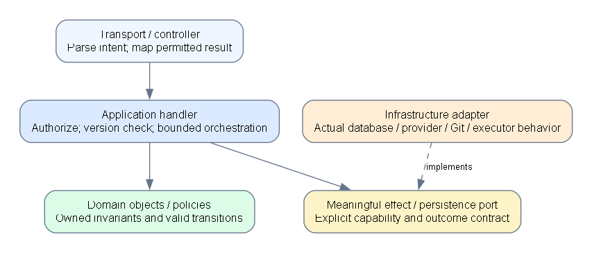

**Transport/controller:** validate transport shape, establish request identity, invoke the appropriate use case and map permitted outcomes into responses. Controllers must not directly publish, update another module’s tables or infer external success from a queue acknowledgment.

**Application handler:** orchestrate one explicit command/query, current authority, expected-version checks, bounded local transaction and attributable outcome. It coordinates domain objects and ports without hiding remote effects inside getters, ORM hooks or unrelated save operations.

**Domain object/policy:** protect owned invariants and meaningful transitions, such as selected source application, separate publication and protected actual-material identity. Keep policies independent of HTTP/session globals and provider response formats. A policy must receive enough current context; an object is not safe merely because its constructor ran once.

**Infrastructure adapter:** implement persistence, provider, native Git, rendition, artifact and executor contracts. Translate actual results into the application outcome vocabulary without inventing rollback, receipt or termination. Interfaces are justified where substitutability, volatile dependencies, verification seams or effect boundaries matter.

**Composition root:** Laravel’s dependency container wires implementations to required contracts. Do not resolve arbitrary dependencies throughout domain logic or retain a user/session identity in a shared singleton. Runtime lifetime and authority freshness remain explicit.

<a id="design-record-02-detailed-and-object-oriented-design-01-design-principles-and-object-oriented-approach-md--heading-2-design-principles-in-this-project"></a>

#### 2. Design principles in this project

<a id="design-record-02-detailed-and-object-oriented-design-01-design-principles-and-object-oriented-approach-md--heading-single-responsibility"></a>

##### Single responsibility

Keep comparison/application, publication, protected retrieval and actual submission capture as distinct use cases. A class called ResumeManager must not silently combine source updates, PDF generation, link controls and external submission. Cohesion is defined by the invariant or reason to change, not an arbitrary maximum method count.

<a id="design-record-02-detailed-and-object-oriented-design-01-design-principles-and-object-oriented-approach-md--heading-openclosed-design"></a>

##### Open/closed design

Introduce a small adapter or strategy when a real variation exists: generated versus uploaded representation, provider operations, storage or executor control. Add an implementation without rewriting the consumer’s invariant logic where feasible. Do not anticipate unlimited providers or create extension points for hypothetical features excluded from Version 1.

<a id="design-record-02-detailed-and-object-oriented-design-01-design-principles-and-object-oriented-approach-md--heading-liskov-substitution"></a>

##### Liskov substitution

Implementations of a port must preserve its documented input, outcome, failure and protected-state semantics. An uploaded-rendition adapter cannot return another language because the requested file is absent. A provider adapter cannot classify an unknown send as confirmed failure merely to fit a boolean return type.

<a id="design-record-02-detailed-and-object-oriented-design-01-design-principles-and-object-oriented-approach-md--heading-interface-segregation"></a>

##### Interface segregation

Consumers require only the operations and permitted projections they need. Split read-only publication resolution from mutation or administrative contracts where authority differs. An executor consumer must not gain unrestricted host administration through a convenient general-purpose interface.

<a id="design-record-02-detailed-and-object-oriented-design-01-design-principles-and-object-oriented-approach-md--heading-dependency-inversion"></a>

##### Dependency inversion

Use-case handlers depend on meaningful contracts at external boundaries; infrastructure realizes them. This does not require wrapping every Laravel utility or introducing a repository interface for each trivial table. Preserve clear domain ownership and make actual side effects substitutable in focused verification.

<a id="design-record-02-detailed-and-object-oriented-design-01-design-principles-and-object-oriented-approach-md--heading-dry-without-policy-confusion"></a>

##### DRY without policy confusion

One authoritative policy owner prevents inconsistent grant, quota or lifecycle rules. Similar-looking validation in two domains is not automatically the same rule: link revocation and provider consent are different authority boundaries. Share stable technical primitives, not a universal mutable business object.

<a id="design-record-02-detailed-and-object-oriented-design-01-design-principles-and-object-oriented-approach-md--heading-kiss-and-yagni"></a>

##### KISS and YAGNI

Start with the smallest design that realizes accepted scenarios and exceptional outcomes. Do not add a general event bus, event sourcing, generic workflow framework or a class per field by default. Simplicity cannot remove real Git, conditional execution, history preservation or required recovery from agreed scope.

<a id="design-record-02-detailed-and-object-oriented-design-01-design-principles-and-object-oriented-approach-md--heading-3-class-and-object-modeling"></a>

#### 3. Class and object modeling

[Illustrative publication use-case class design](https://github.com/Farhad-V/Web-Resumefolio/blob/1f2acaa351ac306cb57cbe4fe9742e8bd90720d9/docs/MVP/SDLC/04-system-design/02-detailed-and-object-oriented-design/diagrams/publication-use-case-classes.svg)

[Editable PlantUML](https://github.com/Farhad-V/Web-Resumefolio/blob/1f2acaa351ac306cb57cbe4fe9742e8bd90720d9/docs/MVP/SDLC/04-system-design/02-detailed-and-object-oriented-design/diagrams/publication-use-case-classes.puml) · 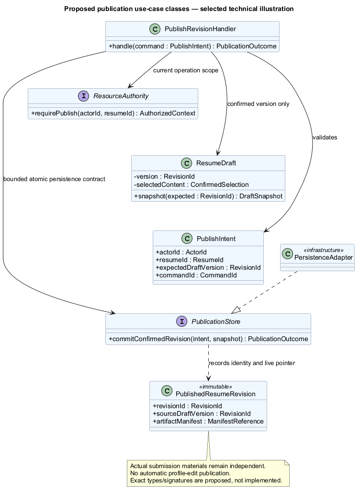

This selected technical model illustrates Presentation responsibility; it is not the complete component class model. Type and operation names remain proposals pending implementation-level signature/schema refinement.

<a id="design-record-02-detailed-and-object-oriented-design-01-design-principles-and-object-oriented-approach-md--heading-meaningful-identities-and-values"></a>

##### Meaningful identities and values

Represent actor/resource/command identity, expected revision, content language and attempt identity using validated types or equivalent explicit constraints. Avoid passing interchangeable unvalidated strings through every boundary. Keep time meaning explicit: an instant, local scheduled time and provider timezone mapping need different interpretation even if their physical representation is later shared.

<a id="design-record-02-detailed-and-object-oriented-design-01-design-principles-and-object-oriented-approach-md--heading-entities-aggregates-and-immutable-records"></a>

##### Entities aggregates and immutable records

ResumeDraft owns selected editable state and independent overrides. PublishedResumeRevision identifies the separately confirmed presentation; later edits create a different revision rather than mutate its historical identity. SubmissionMaterialSet records actual material/provenance independently. Shared bytes may be deduplicated only while reference, immutability and retention rules remain preserved.

An aggregate boundary groups state whose invariant needs local atomicity. It does not automatically mean one database table, one service or one giant object graph. Keep provider/runner/target truth outside local aggregates; represent attributable attempts and observations instead of pretending a local object controls the remote state.

<a id="design-record-02-detailed-and-object-oriented-design-01-design-principles-and-object-oriented-approach-md--heading-visibility-and-collaboration"></a>

##### Visibility and collaboration

Expose public application contracts and permitted projections. Keep domain mutation operations internal to the owning component. Avoid handing a mutable ORM entity to another module and relying on convention not to save it. Mapping persistence records into domain/query objects may be direct or explicit depending on actual complexity; do not mandate duplication for its own sake.

<a id="design-record-02-detailed-and-object-oriented-design-01-design-principles-and-object-oriented-approach-md--heading-4-pattern-selection-and-consequences"></a>

#### 4. Pattern selection and consequences

[Select a pattern for an actual design problem](https://github.com/Farhad-V/Web-Resumefolio/blob/1f2acaa351ac306cb57cbe4fe9742e8bd90720d9/docs/MVP/SDLC/04-system-design/02-detailed-and-object-oriented-design/diagrams/pattern-selection-route.svg)

[Editable DOT](https://github.com/Farhad-V/Web-Resumefolio/blob/1f2acaa351ac306cb57cbe4fe9742e8bd90720d9/docs/MVP/SDLC/04-system-design/02-detailed-and-object-oriented-design/diagrams/pattern-selection-route.dot) · 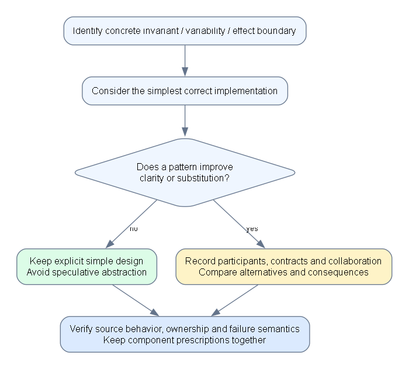

<a id="design-record-02-detailed-and-object-oriented-design-01-design-principles-and-object-oriented-approach-md--heading-adapter--external-systems-and-persistence"></a>

##### Adapter — external systems and persistence

**Problem:** provider/Git/storage/executor mechanics vary independently from product invariants. **Participants:** application port, infrastructure implementation and consumer handler. **Consequence:** consumers retain domain meaning while adapters require compatibility and error/uncertainty mapping. Do not mask different capabilities behind a misleading common success contract.

<a id="design-record-02-detailed-and-object-oriented-design-01-design-principles-and-object-oriented-approach-md--heading-strategy--selected-representation-resolution"></a>

##### Strategy — selected representation resolution

**Problem:** generated/uploaded rendition handling differs while the caller requests a specific permitted representation. **Participants:** selected resolution policy and eligible representation implementations. **Consequence:** selection remains explicit; no implementation may silently bypass language, current eligibility or availability. A simple branch is acceptable when a strategy hierarchy would add no useful separation.

<a id="design-record-02-detailed-and-object-oriented-design-01-design-principles-and-object-oriented-approach-md--heading-factory--constructing-valid-revisions-or-attempts"></a>

##### Factory — constructing valid revisions or attempts

**Problem:** creation must bind a confirmed draft version or reviewed operation intent to attributable identity. **Participants:** creation operation/factory and validated inputs. **Consequence:** consistent construction without side effects hidden in constructors. A factory does not authorize publication, send or deployment by itself.

<a id="design-record-02-detailed-and-object-oriented-design-01-design-principles-and-object-oriented-approach-md--heading-facade--a-bounded-application-use-case"></a>

##### Facade — a bounded application use case

**Problem:** one deliberate user action coordinates several internal steps. **Participants:** public handler/contract and owned collaborators. **Consequence:** a clear entry point and test seam; avoid a universal facade that centralizes all resource authority and lifecycle behavior.

<a id="design-record-02-detailed-and-object-oriented-design-01-design-principles-and-object-oriented-approach-md--heading-observer-or-domain-event--explicit-committed-reactions"></a>

##### Observer or domain event — explicit committed reactions

Use a committed event only for a named reaction with clear authority and durable dispatch needs. In-process notification is not durable delivery. A listener must not silently publish, send mail or deploy because an unrelated model was saved. Where consequential external work exists, use the [runtime attempt protocol](../01-High-level-design/High-level-design.md#design-record-01-software-architecture-03-process-view-concurrency-and-runtime-behavior-md).

<a id="design-record-02-detailed-and-object-oriented-design-01-design-principles-and-object-oriented-approach-md--heading-singleton-and-generic-abstractions--default-caution"></a>

##### Singleton and generic abstractions — default caution

Do not use a singleton to hold actor/session/transaction state, or a universal repository/service locator to bypass ownership. Stateless immutable shared configuration can have a suitable framework lifetime after compatibility evaluation. Reuse is justified by an actual contract and consumers, not a pattern checklist.

<a id="design-record-02-detailed-and-object-oriented-design-01-design-principles-and-object-oriented-approach-md--heading-5-operation-contracts-and-object-lifetime"></a>

#### 5. Operation contracts and object lifetime

For each concrete command define actor/resource context, preconditions, expected revision, admitted inputs, intended effects, protected frame, actual outcome classes and repetition/concurrency behavior. Denied/conflicting requests preserve protected state; partial/unknown external results require evidence rather than an invented unchanged-state assertion.

**Publication example:** authorize the intended resume; verify confirmed draft version; construct the intended revision; atomically update the permitted publication pointer; record attributable result. Source changes alone cannot call this operation. PDF rendering and external sending are separate explicit work. A response lost after commit resolves the same command identity rather than publishing again blindly.

Inject the clock and effect ports into handlers that need deterministic behavior. Keep transaction/unit-of-work lifetime bounded to the command. Jobs carry stable references and reviewed intent, then reconstruct current authority/capability at execution; they do not serialize an indefinitely privileged session or stale mutable ORM graph.

Release resources on completion/failure, distinguish cancellation request from confirmed stop and keep logging bounded. Do not retain credentials, provider response bodies or private artifacts inside long-lived shared service objects.

<a id="design-record-02-detailed-and-object-oriented-design-01-design-principles-and-object-oriented-approach-md--heading-6-review-and-component-handoff"></a>

#### 6. Review and component handoff

<a id="design-record-02-detailed-and-object-oriented-design-01-design-principles-and-object-oriented-approach-md--heading-focused-design-checks"></a>

##### Focused design checks

- Every class has a coherent responsibility tied to a source invariant or technical mechanism.
- Public/internal visibility and component dependency direction are explicit; no consumer writes another owner’s state.
- Substituted adapters preserve denied, unavailable, partial and unknown results as well as success.
- Source/draft/publication/actual-history identities and independent link/PDF controls remain distinct.
- Constructors/getters/observers do not hide consequential mutations or remote operations.
- Command version/identity, object lifetime, transaction scope and protected state are verifiable under races and failures.
- Patterns reduce a concrete problem; unnecessary indirection, god objects and cyclic dependencies are challenged.

These are planned review criteria, not completed product tests. Later component checks use deterministic domain/handler cases, actual database transaction/concurrency integration and controlled external-boundary verification where applicable. A mock-only test cannot establish real Git semantics, provider idempotency, executor isolation or usable recovery.

<a id="design-record-02-detailed-and-object-oriented-design-01-design-principles-and-object-oriented-approach-md--heading-where-concrete-prescriptions-belong"></a>

##### Where concrete prescriptions belong

Use the [complete component package template](#design-record-03-component-and-module-design-component-and-module-design-md) and [actual component catalog](#design-record-03-component-and-module-design-component-and-module-design-md) for signatures, computational data/classes, algorithms and technical scenarios. Link shared [data](#design-record-04-data-design-data-design-md), [interface](#design-record-05-interface-and-api-design-interface-and-api-design-md) and [security](../01-High-level-design/High-level-design.md#design-record-06-design-quality-and-security-analysis-design-quality-and-security-analysis-md) choices instead of duplicating policy.

Record significant alternatives and consequences in [design decisions](../01-High-level-design/High-level-design.md#design-record-07-design-decisions-design-decisions-md). Use [evolution and debt](#design-record-02-detailed-and-object-oriented-design-05-design-evolution-refactoring-and-technical-debt-md) for actual smells/compatibility/refactoring work, and [design review/handoff](../01-High-level-design/High-level-design.md#design-record-06-design-quality-and-security-analysis-05-design-review-traceability-and-handoff-md) for identified candidate findings and disposition.

<a id="design-record-02-detailed-and-object-oriented-design-01-design-principles-and-object-oriented-approach-md--heading-7-fau-basis-and-current-limits"></a>

#### 7. FAU basis and current limits

FAU V08 distinguishes architecture from implementation-level component models, including computational data, classes, fine-grained behavior and technical scenarios. It presents GoF/POSA patterns, examples, anti-patterns, smells and modeling conventions. SOLID/DRY/KISS/YAGNI here are supplementary project guidance, not a claim that the supplied lectures mandate every named technique. DDD remains selective and optional.

This document provides a project-specific OO approach and a selected illustrative class design. Final component-wide signatures/types, schemas, complete class diagrams, exact criterion mappings and external compatibility/feasibility remain further design work. No production class, live test, technical baseline acceptance or advisor endorsement is established by this authoring update.

[Detailed Design index](#design-record-02-detailed-and-object-oriented-design-detailed-and-object-oriented-design-md) · [Diagram catalog](#design-record-02-detailed-and-object-oriented-design-diagrams-diagram-catalog-md) · [FAU reference map](../01-High-level-design/High-level-design.md#design-record-design-references-and-coverage-md)

<a id="design-record-02-detailed-and-object-oriented-design-01-design-principles-and-object-oriented-approach-md--heading-8-object-oriented-visual-and-responsibility-package"></a>

#### 8. Object-oriented visual and responsibility package

These are selected **proposed design examples**, not implemented classes, detected code defects, complete domain coverage or accepted signatures. The existing [publication UML class diagram](#design-record-02-detailed-and-object-oriented-design-01-design-principles-and-object-oriented-approach-md--heading-3-class-and-object-modeling) supplies attributes, operations, associations and interface realization. The following views explain complementary design questions. Read arrows according to each diagram type; source dependencies, runtime messages and conceptual relationships are different.

<a id="design-record-02-detailed-and-object-oriented-design-01-design-principles-and-object-oriented-approach-md--heading-81-before-and-after-separate-reasons-to-change"></a>

##### 8.1 Before and after: separate reasons to change

[Before and after: separate reasons to change](https://github.com/Farhad-V/Web-Resumefolio/blob/1f2acaa351ac306cb57cbe4fe9742e8bd90720d9/docs/MVP/SDLC/04-system-design/02-detailed-and-object-oriented-design/diagrams/oo-before-after.svg)

[Editable PlantUML](https://github.com/Farhad-V/Web-Resumefolio/blob/1f2acaa351ac306cb57cbe4fe9742e8bd90720d9/docs/MVP/SDLC/04-system-design/02-detailed-and-object-oriented-design/diagrams/oo-before-after.puml) · 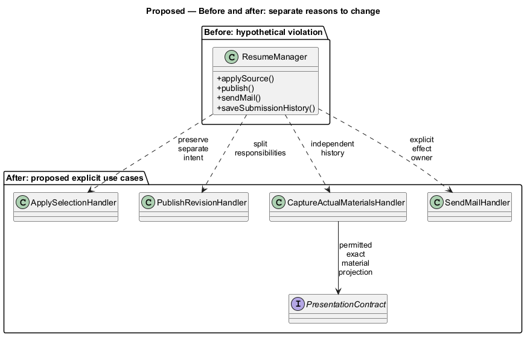

The before design is a teaching counterexample, not an observed production defect. Splitting preserves explicit source application, publication, actual history and send intent; it does not make the handlers separate services.

<a id="design-record-02-detailed-and-object-oriented-design-01-design-principles-and-object-oriented-approach-md--heading-82-object-diagram-one-illustrative-publication-collaboration"></a>

##### 8.2 Object diagram: one illustrative publication collaboration

[Object diagram: one illustrative publication collaboration](https://github.com/Farhad-V/Web-Resumefolio/blob/1f2acaa351ac306cb57cbe4fe9742e8bd90720d9/docs/MVP/SDLC/04-system-design/02-detailed-and-object-oriented-design/diagrams/oo-runtime-objects.svg)

[Editable PlantUML](https://github.com/Farhad-V/Web-Resumefolio/blob/1f2acaa351ac306cb57cbe4fe9742e8bd90720d9/docs/MVP/SDLC/04-system-design/02-detailed-and-object-oriented-design/diagrams/oo-runtime-objects.puml) · 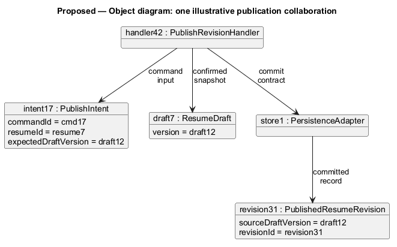

Invented identities illustrate a successful post-commit snapshot. Links represent collaboration/record relationships, not ownership of a live ORM graph or an actual runtime trace. Revision creation and pointer/result recording require the coherent guarded commit described below.

<a id="design-record-02-detailed-and-object-oriented-design-01-design-principles-and-object-oriented-approach-md--heading-83-package-diagram-acyclic-source-dependencies"></a>

##### 8.3 Package diagram: acyclic source dependencies

[Package diagram: acyclic source dependencies](https://github.com/Farhad-V/Web-Resumefolio/blob/1f2acaa351ac306cb57cbe4fe9742e8bd90720d9/docs/MVP/SDLC/04-system-design/02-detailed-and-object-oriented-design/diagrams/oo-packages.svg)

[Editable PlantUML](https://github.com/Farhad-V/Web-Resumefolio/blob/1f2acaa351ac306cb57cbe4fe9742e8bd90720d9/docs/MVP/SDLC/04-system-design/02-detailed-and-object-oriented-design/diagrams/oo-packages.puml) · 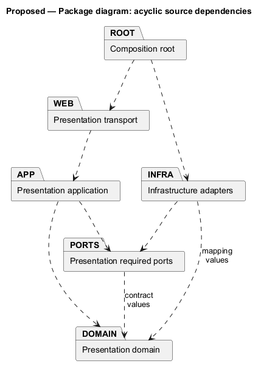

Arrows mean source dependencies. This proposed graph has no cycles; wiring belongs at the composition root. These are illustrative packages inside the modular application, not proof that current imports have been audited.

<a id="design-record-02-detailed-and-object-oriented-design-01-design-principles-and-object-oriented-approach-md--heading-84-dependency-inversion-at-the-persistence-boundary"></a>

##### 8.4 Dependency inversion at the persistence boundary

[Dependency inversion at the persistence boundary](https://github.com/Farhad-V/Web-Resumefolio/blob/1f2acaa351ac306cb57cbe4fe9742e8bd90720d9/docs/MVP/SDLC/04-system-design/02-detailed-and-object-oriented-design/diagrams/oo-dependency-inversion.svg)

[Editable PlantUML](https://github.com/Farhad-V/Web-Resumefolio/blob/1f2acaa351ac306cb57cbe4fe9742e8bd90720d9/docs/MVP/SDLC/04-system-design/02-detailed-and-object-oriented-design/diagrams/oo-dependency-inversion.puml) · 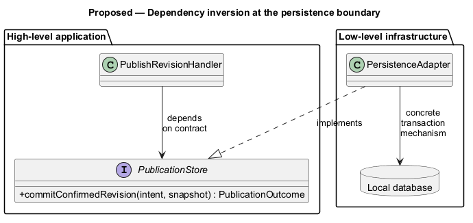

The consumer owns the meaning of the required port. Runtime calls reach an adapter, while source dependency points toward the abstraction. The port must preserve current guards, coherent local commit and repeat-command outcomes; its name alone provides no atomicity.

<a id="design-record-02-detailed-and-object-oriented-design-01-design-principles-and-object-oriented-approach-md--heading-85-inheritance-versus-composition-rendition-variation"></a>

##### 8.5 Inheritance versus composition: rendition variation

[Inheritance versus composition: rendition variation](https://github.com/Farhad-V/Web-Resumefolio/blob/1f2acaa351ac306cb57cbe4fe9742e8bd90720d9/docs/MVP/SDLC/04-system-design/02-detailed-and-object-oriented-design/diagrams/oo-composition.svg)

[Editable PlantUML](https://github.com/Farhad-V/Web-Resumefolio/blob/1f2acaa351ac306cb57cbe4fe9742e8bd90720d9/docs/MVP/SDLC/04-system-design/02-detailed-and-object-oriented-design/diagrams/oo-composition.puml) · 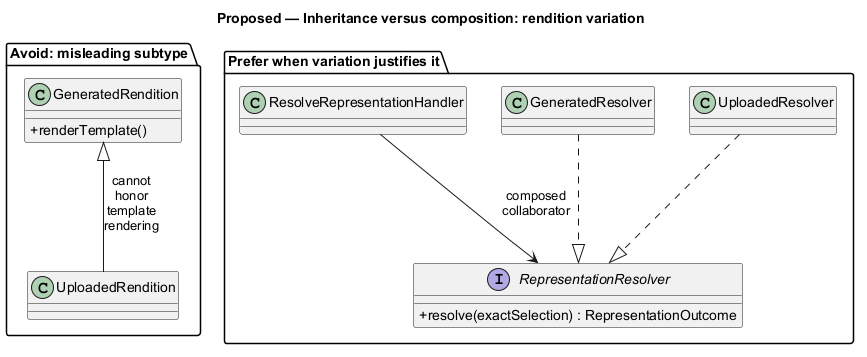

Uploaded material is not a behavioral subtype of template-generated material. Composition permits independent implementations of an exact-selection contract. Neither may silently substitute a language, rendition or unavailable file; a simple branch can be clearer when polymorphism adds no value.

<a id="design-record-02-detailed-and-object-oriented-design-01-design-principles-and-object-oriented-approach-md--heading-86-interface-realization-and-narrow-consumer-access"></a>

##### 8.6 Interface realization and narrow consumer access

[Interface realization and narrow consumer access](https://github.com/Farhad-V/Web-Resumefolio/blob/1f2acaa351ac306cb57cbe4fe9742e8bd90720d9/docs/MVP/SDLC/04-system-design/02-detailed-and-object-oriented-design/diagrams/oo-realization.svg)

[Editable PlantUML](https://github.com/Farhad-V/Web-Resumefolio/blob/1f2acaa351ac306cb57cbe4fe9742e8bd90720d9/docs/MVP/SDLC/04-system-design/02-detailed-and-object-oriented-design/diagrams/oo-realization.puml) · 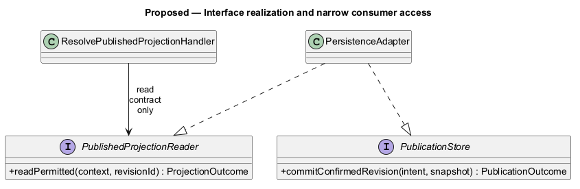

The read consumer receives only its required interface, not mutation access. Implementing both interfaces does not authorize callers; exact current resource and lifecycle checks remain required. Names are proposed design roles, not framework bindings already configured.

<a id="design-record-02-detailed-and-object-oriented-design-01-design-principles-and-object-oriented-approach-md--heading-87-coupling-and-cohesion-compare-responsibility-shapes"></a>

##### 8.7 Coupling and cohesion: compare responsibility shapes

[Coupling and cohesion: compare responsibility shapes](https://github.com/Farhad-V/Web-Resumefolio/blob/1f2acaa351ac306cb57cbe4fe9742e8bd90720d9/docs/MVP/SDLC/04-system-design/02-detailed-and-object-oriented-design/diagrams/oo-coupling-cohesion.svg)

[Editable PlantUML](https://github.com/Farhad-V/Web-Resumefolio/blob/1f2acaa351ac306cb57cbe4fe9742e8bd90720d9/docs/MVP/SDLC/04-system-design/02-detailed-and-object-oriented-design/diagrams/oo-coupling-cohesion.puml) · 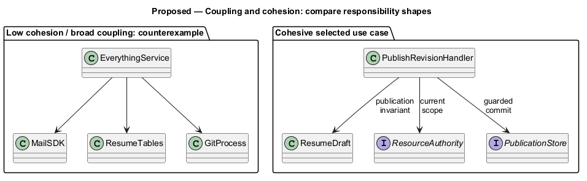

Cohesion follows one invariant and reason to change. Necessary authority and commit dependencies are deliberate coupling. Arrow count alone is not a quality score; no coupling/cohesion metrics were measured, and splitting every method into a class would not establish good design.

<a id="design-record-02-detailed-and-object-oriented-design-01-design-principles-and-object-oriented-approach-md--heading-88-sequence-explicit-publication-object-collaboration"></a>

##### 8.8 Sequence: explicit publication object collaboration

[Sequence: explicit publication object collaboration](https://github.com/Farhad-V/Web-Resumefolio/blob/1f2acaa351ac306cb57cbe4fe9742e8bd90720d9/docs/MVP/SDLC/04-system-design/02-detailed-and-object-oriented-design/diagrams/oo-publication-sequence.svg)

[Editable PlantUML](https://github.com/Farhad-V/Web-Resumefolio/blob/1f2acaa351ac306cb57cbe4fe9742e8bd90720d9/docs/MVP/SDLC/04-system-design/02-detailed-and-object-oriented-design/diagrams/oo-publication-sequence.puml) · 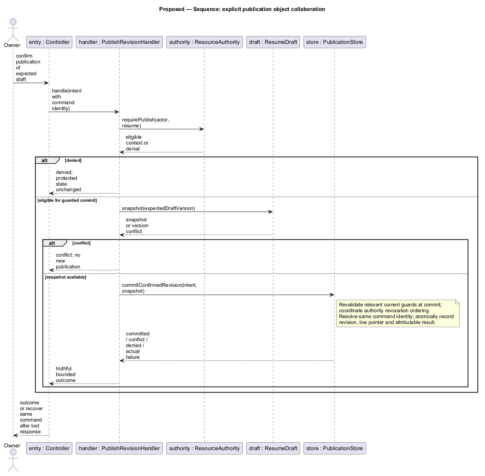

An early authority check is insufficient under races. The persistence/authority mechanism must establish the relevant admission order and expected-version guard. A lost response after a possible commit is resolved using the same command identity. No PDF generation, mail send or deployment is implicit.

<a id="design-record-02-detailed-and-object-oriented-design-01-design-principles-and-object-oriented-approach-md--heading-89-conceptual-domain-model-independent-identities"></a>

##### 8.9 Conceptual domain model: independent identities

[Conceptual domain model: independent identities](https://github.com/Farhad-V/Web-Resumefolio/blob/1f2acaa351ac306cb57cbe4fe9742e8bd90720d9/docs/MVP/SDLC/04-system-design/02-detailed-and-object-oriented-design/diagrams/oo-conceptual-domain.svg)

[Editable PlantUML](https://github.com/Farhad-V/Web-Resumefolio/blob/1f2acaa351ac306cb57cbe4fe9742e8bd90720d9/docs/MVP/SDLC/04-system-design/02-detailed-and-object-oriented-design/diagrams/oo-conceptual-domain.puml) · 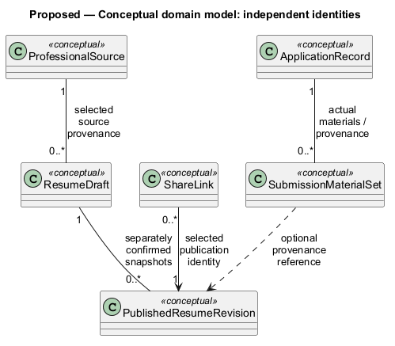

Selected conceptual excerpt, not the complete analysis model or physical schema. Multiplicities express this illustrative relationship shape and need exact scenario/schema refinement. Source provenance does not trigger propagation; submitted actual materials remain independently protected if later draft/publication/link state changes. No composition diamond implies cascade deletion.

<a id="design-record-02-detailed-and-object-oriented-design-01-design-principles-and-object-oriented-approach-md--heading-810-law-of-demeter-request-an-intention-avoid-navigation-chains"></a>

##### 8.10 Law of Demeter: request an intention, avoid navigation chains

[Law of Demeter: request an intention, avoid navigation chains](https://github.com/Farhad-V/Web-Resumefolio/blob/1f2acaa351ac306cb57cbe4fe9742e8bd90720d9/docs/MVP/SDLC/04-system-design/02-detailed-and-object-oriented-design/diagrams/oo-demeter.svg)

[Editable PlantUML](https://github.com/Farhad-V/Web-Resumefolio/blob/1f2acaa351ac306cb57cbe4fe9742e8bd90720d9/docs/MVP/SDLC/04-system-design/02-detailed-and-object-oriented-design/diagrams/oo-demeter.puml) · 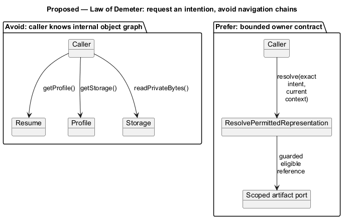

The counterexample shows caller navigation, not a justified byte-access route. An intention-revealing owner contract reduces knowledge of internal structure. Law of Demeter is a collaboration guideline; shortening a call chain cannot replace authority checks or safe artifact-reference lifetime coordination.

<a id="design-record-02-detailed-and-object-oriented-design-01-design-principles-and-object-oriented-approach-md--heading-811-optional-strategy-preview-exact-representation-resolution"></a>

##### 8.11 Optional Strategy preview: exact representation resolution

[Optional Strategy preview: exact representation resolution](https://github.com/Farhad-V/Web-Resumefolio/blob/1f2acaa351ac306cb57cbe4fe9742e8bd90720d9/docs/MVP/SDLC/04-system-design/02-detailed-and-object-oriented-design/diagrams/oo-strategy-preview.svg)

[Editable PlantUML](https://github.com/Farhad-V/Web-Resumefolio/blob/1f2acaa351ac306cb57cbe4fe9742e8bd90720d9/docs/MVP/SDLC/04-system-design/02-detailed-and-object-oriented-design/diagrams/oo-strategy-preview.puml) · 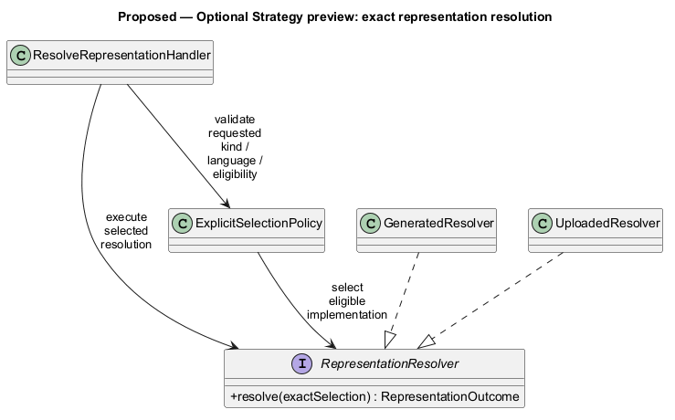

Optional design pattern preview, not a mandatory hierarchy. Strategy separates real generation/upload variation while the handler preserves exact selection and current eligibility. Unknown rendering/storage results must remain truthful; no strategy may silently publish or select a fallback.

<a id="design-record-02-detailed-and-object-oriented-design-01-design-principles-and-object-oriented-approach-md--heading-812-responsibility-table--crc-style-cards"></a>

##### 8.12 Responsibility table — CRC-style cards

Responsibilities describe proposed roles rather than final class counts. Collaborators are bounded contracts; a listed collaborator confers no blanket permission.

| Class / role | Responsibilities | Collaborators |
| --- | --- | --- |
| PublishRevisionHandler | Orchestrate explicit confirmed publication; preserve truthful outcome and command identity | ResourceAuthority, ResumeDraft, PublicationStore |
| ResumeDraft | Preserve selected editable state/overrides; supply exact expected-version snapshot | Validated intent/value objects |
| PublishedResumeRevision | Identify immutable confirmed content and provenance | PublicationStore; permitted projection contracts |
| ResourceAuthority | Supply current scoped eligibility and coordinate required admission semantics | Identity/resource policy owner; current grant state |
| PublicationStore | Guard current state and commit revision, live pointer and attributable result coherently; resolve repeated identity | PersistenceAdapter and actual local transaction mechanism |
| ResolveRepresentationHandler | Resolve the exact eligible representation without silent substitution | ExplicitSelectionPolicy, narrow resolver/artifact contracts |
| CaptureActualMaterialsHandler | Preserve independent actual submission evidence and provenance | Presentation projection contract; Files reference protection; Applications store |

<a id="design-record-02-detailed-and-object-oriented-design-01-design-principles-and-object-oriented-approach-md--heading-813-solid--violation-and-proposed-correction"></a>

##### 8.13 SOLID — violation and proposed correction

| Principle | Illustrative violation | Proposed correction and limit |
| --- | --- | --- |
| Single responsibility | ResumeManager applies source, publishes, sends and changes submission history | Separate explicit handlers and owners; keep each invariant cohesive |
| Open/closed | Every representation variation rewrites publication invariants | Introduce a narrow resolver only for real variation; avoid speculative frameworks |
| Liskov substitution | Uploaded resolver returns another language or reports unknown as failed | Preserve exact selection and documented outcome semantics across implementations |
| Interface segregation | Read consumer receives mutation and unrestricted host operations | Inject only required projection/control contracts; check current authority separately |
| Dependency inversion | Publication handler instantiates provider/database details | Depend on meaningful required ports; wire concrete adapters at composition root |

<a id="design-record-02-detailed-and-object-oriented-design-01-design-principles-and-object-oriented-approach-md--heading-814-use-case-to-class-mapping"></a>

##### 8.14 Use-case-to-class mapping

These scenario labels are design cross-references, **not newly assigned requirement IDs or exact criterion closure**. Follow the analysis operation contracts and component documents for authoritative identities and full paths.

| User intention / scenario | Proposed application entry | Domain roles / values | Important collaborators and boundary |
| --- | --- | --- | --- |
| Preview and apply selected source changes | ApplySelectionHandler | ResumeDraft, confirmed selection, expected revision | Presentation owner; preserve independent overrides and other resumes |
| Separately confirm publication | PublishRevisionHandler | PublishIntent, ResumeDraft, PublishedResumeRevision | Current ResourceAuthority and guarded PublicationStore |
| Resolve a permitted exact representation | ResolveRepresentationHandler | Exact selection, language, revision reference | Sharing eligibility and Files protection; no silent unavailable fallback |
| Capture actual submitted materials | CaptureActualMaterialsHandler | ApplicationRecord, SubmissionMaterialSet, provenance | Applications-owned commit coordinated with protected Files references |
| Explicitly send external communication | SendMailHandler | Reviewed intent and durable attempt identity | Communication owner and provider adapter; reconcile unknown effects before repetition |

<a id="design-record-02-detailed-and-object-oriented-design-01-design-principles-and-object-oriented-approach-md--heading-815-review-and-implementation-follow-through"></a>

##### 8.15 Review and implementation follow-through

Refine each selected role into the owning component's exact signatures, invariants, visibility, types and outcome vocabulary. Check dependency cycles against actual imports, substitution against failure/unknown outcomes, and publication against real transaction/revocation/version races. Verify reference protection before committing consumers and preserve actual submission evidence independently. Rendering these examples establishes readable documentation only; it does not establish runtime behavior, safe persistence, real external compatibility or measured coupling/cohesion.

</details>

<a id="design-record-02-detailed-and-object-oriented-design-05-design-evolution-refactoring-and-technical-debt-md"></a>

<details>
<summary>Resumefolio — Design Evolution Refactoring and Technical Debt</summary>

<a id="design-record-02-detailed-and-object-oriented-design-05-design-evolution-refactoring-and-technical-debt-md--heading-resumefolio--design-evolution-refactoring-and-technical-debt"></a>

### Resumefolio — Design Evolution Refactoring and Technical Debt

**Approach:** evolve the design through explicit source impact, small compatible changes and fresh verification. Preserve accepted product behavior, private authority, publication/submission identity and attributable external effects across every revision.

**Status:** proposed engineering procedure, November 2, 2026. Product implementation has not been established by this document. No code smell, accepted shortcut, measured debt cost or completed refactoring is invented here. Farhad remains the decision and delivery owner.

[Classification](#design-record-02-detailed-and-object-oriented-design-05-design-evolution-refactoring-and-technical-debt-md--heading-1-change-risk-defect-and-debt) · [Impact](#design-record-02-detailed-and-object-oriented-design-05-design-evolution-refactoring-and-technical-debt-md--heading-2-change-impact-and-decision-route) · [Refactoring](#design-record-02-detailed-and-object-oriented-design-05-design-evolution-refactoring-and-technical-debt-md--heading-3-incremental-refactoring-procedure) · [Compatibility](#design-record-02-detailed-and-object-oriented-design-05-design-evolution-refactoring-and-technical-debt-md--heading-4-data-interface-and-runtime-evolution) · [Debt records](#design-record-02-detailed-and-object-oriented-design-05-design-evolution-refactoring-and-technical-debt-md--heading-5-debt-records-prioritization-and-review) · [Evidence](#design-record-02-detailed-and-object-oriented-design-05-design-evolution-refactoring-and-technical-debt-md--heading-6-verification-and-completion) · [Visual package](#design-record-02-detailed-and-object-oriented-design-05-design-evolution-refactoring-and-technical-debt-md--heading-8-evolution-and-debt-visual-package)

Current MVP scope and selected mechanisms: [Baseline](https://github.com/Farhad-V/Web-Resumefolio/blob/1f2acaa351ac306cb57cbe4fe9742e8bd90720d9/docs/MVP/baseline/README.md). Deferred provider, advanced collaboration and workflow-execution designs are not MVP prerequisites.

<a id="design-record-02-detailed-and-object-oriented-design-05-design-evolution-refactoring-and-technical-debt-md--heading-authoritative-inputs"></a>

#### Authoritative inputs

Follow the [working method and change control](../../01-Project-planning/02-Project-management-plan.md#delivery-approach), [source questions and decisions](../../02-Requirements-engineering/01-Software-requirements-specification.md#change-and-baseline-open-questions-and-decisions), [architecture options](../01-High-level-design/High-level-design.md#design-record-01-software-architecture-01-design-drivers-and-solution-options-md), [component boundaries](../01-High-level-design/High-level-design.md#design-record-01-software-architecture-02-system-decomposition-and-boundaries-md), [OO principles](#design-record-02-detailed-and-object-oriented-design-01-design-principles-and-object-oriented-approach-md) and [design review/handoff](../01-High-level-design/High-level-design.md#design-record-06-design-quality-and-security-analysis-05-design-review-traceability-and-handoff-md).

<a id="design-record-02-detailed-and-object-oriented-design-05-design-evolution-refactoring-and-technical-debt-md--heading-1-change-risk-defect-and-debt"></a>

#### 1. Change risk defect and debt

[Classifying findings before recording debt](https://github.com/Farhad-V/Web-Resumefolio/blob/1f2acaa351ac306cb57cbe4fe9742e8bd90720d9/docs/MVP/SDLC/04-system-design/02-detailed-and-object-oriented-design/diagrams/design-finding-classification.svg)

[Editable DOT](https://github.com/Farhad-V/Web-Resumefolio/blob/1f2acaa351ac306cb57cbe4fe9742e8bd90720d9/docs/MVP/SDLC/04-system-design/02-detailed-and-object-oriented-design/diagrams/design-finding-classification.dot) · 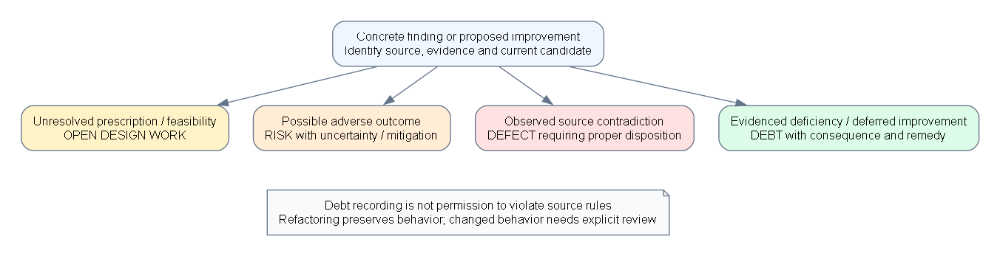

**Open design work:** a prescription, comparison or evidence task remains unresolved. Examples are executor isolation, Git engine integration, combined capacity, independent recovery facilities and exact criterion reconciliation. These are not automatically technical debt or approved omissions.

**Risk:** a possible future adverse outcome with uncertainty, impact and mitigation. Keep authoritative risk ownership in the project risk register; link relevant component/operating records rather than maintain conflicting risk scores here.

**Defect:** observed behavior or design contradicts an applicable source obligation. A broken authority check or loss of actual submitted materials is not made acceptable merely by labeling it debt. Fix or explicitly resolve the affected requirement/change decision under actual authority.

**Technical debt:** an evidenced design/implementation deficiency or deliberately deferred improvement whose ongoing consequences and remediation are identifiable. It can be deliberate or discovered; do not claim a trade-off was accepted unless the actual decision exists. Debt recording does not authorize scope reduction or bypass an execution/security/recovery gate.

**Refactoring:** change internal structure while preserving the applicable observable behavior and contracts. A changed permission policy, publication rule, API outcome or retention behavior is a behavioral change even when implemented during cleanup. Split those decisions and verification from the structural refactoring.

<a id="design-record-02-detailed-and-object-oriented-design-05-design-evolution-refactoring-and-technical-debt-md--heading-2-change-impact-and-decision-route"></a>

#### 2. Change impact and decision route

[Impact assessment through design and implementation](https://github.com/Farhad-V/Web-Resumefolio/blob/1f2acaa351ac306cb57cbe4fe9742e8bd90720d9/docs/MVP/SDLC/04-system-design/02-detailed-and-object-oriented-design/diagrams/design-change-impact-route.svg)

[Editable DOT](https://github.com/Farhad-V/Web-Resumefolio/blob/1f2acaa351ac306cb57cbe4fe9742e8bd90720d9/docs/MVP/SDLC/04-system-design/02-detailed-and-object-oriented-design/diagrams/design-change-impact-route.dot) · 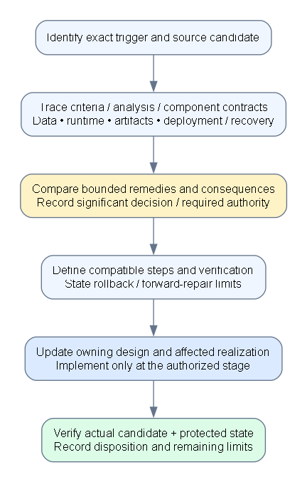

1. Identify the triggering requirement, observed defect, environment/dependency change or concrete smell. Record the current source/design revision and affected operation; avoid an unspecific “improve architecture” task.
2. Trace required behavior and protected state through analysis contracts, component responsibilities, interfaces, schemas/artifacts, jobs and deployment/recovery procedures. Determine whether the proposal is structural, behavioral, operating or a mixture.
3. Compare the smallest viable remedies and the consequences of leaving the condition unchanged. Consider compatibility, private access, concurrency, resource demand, historical identity, external effects, operational burden and full engineering time.
4. Record a consequential technical choice in an [ADR](../01-High-level-design/High-level-design.md#design-record-07-design-decisions-design-decisions-md). Material scope, spending, date or source-policy changes need the appropriate owner disposition; they are not implicit in an engineering recommendation.
5. Define bounded changes, expected outcomes, protected-state checks, compatibility/migration plan and actual rollback/forward-repair limits before consequential execution.
6. Update the authoritative owning design and affected component realizations. Execute permitted implementation/verification only at the agreed stage and record the actual candidate/evidence/disposition.

<a id="design-record-02-detailed-and-object-oriented-design-05-design-evolution-refactoring-and-technical-debt-md--heading-impact-questions-specific-to-resumefolio"></a>

##### Impact questions specific to Resumefolio

- Could the change automatically propagate a source edit into a draft, publication or actual-history record?
- Does a cache, read model, queued identity or module helper bypass current account/link/grant authority?
- Can new retry/dispatch behavior repeat a send, Git mutation, workflow or deployment with uncertain prior effect?
- Are artifact/repository identities, protected references, quotas and recoverable key/data relationships preserved?
- Do old/new web and worker versions interpret the same command payload, state and result consistently?
- Does a component extraction add network failures, operational identities or a distributed consistency problem not represented in the existing contracts?

<a id="design-record-02-detailed-and-object-oriented-design-05-design-evolution-refactoring-and-technical-debt-md--heading-3-incremental-refactoring-procedure"></a>

#### 3. Incremental refactoring procedure

<a id="design-record-02-detailed-and-object-oriented-design-05-design-evolution-refactoring-and-technical-debt-md--heading-establish-the-actual-starting-point"></a>

##### Establish the actual starting point

Identify the current code/design candidate and evidence. Record existing contract behavior with focused checks and justified limitations. Characterization checks describe what is observed; they must not silently bless an observed defect that contradicts requirements. Where no implementation exists, review/refine the design instead of claiming a code refactoring.

<a id="design-record-02-detailed-and-object-oriented-design-05-design-evolution-refactoring-and-technical-debt-md--heading-make-a-bounded-structural-change"></a>

##### Make a bounded structural change

Examples include separating a publication handler from a broad manager, introducing a real provider adapter seam, removing forbidden cross-module table writes or replacing mutable shared request state. Keep each step small enough to assess and reverse where technically possible. Do not create a service hierarchy or interfaces for hypothetical variation.

<a id="design-record-02-detailed-and-object-oriented-design-05-design-evolution-refactoring-and-technical-debt-md--heading-preserve-explicit-boundaries"></a>

##### Preserve explicit boundaries

Keep application orchestration separate from resource invariants and external adapters. Preserve denied/conflict/partial/unknown outcomes as well as success. Moving code into an observer or generic helper must not hide publication, send or deployment effects. A changed transaction boundary requires concurrency review even if method signatures remain unchanged.

<a id="design-record-02-detailed-and-object-oriented-design-05-design-evolution-refactoring-and-technical-debt-md--heading-verify-and-reconcile"></a>

##### Verify and reconcile

Run checks proportional to the changed contract and risk: domain/handler behavior, dependency direction, actual persistence/transaction races and controlled external integration where applicable. Update diagrams, operation signatures, artifact mappings and operating guidance to the same candidate. Do not close the work merely because a file rename or unit-only suite passes.

<a id="design-record-02-detailed-and-object-oriented-design-05-design-evolution-refactoring-and-technical-debt-md--heading-4-data-interface-and-runtime-evolution"></a>

#### 4. Data interface and runtime evolution

[Compatible evolution and limited reversal](https://github.com/Farhad-V/Web-Resumefolio/blob/1f2acaa351ac306cb57cbe4fe9742e8bd90720d9/docs/MVP/SDLC/04-system-design/02-detailed-and-object-oriented-design/diagrams/compatible-design-evolution.svg)

[Editable DOT](https://github.com/Farhad-V/Web-Resumefolio/blob/1f2acaa351ac306cb57cbe4fe9742e8bd90720d9/docs/MVP/SDLC/04-system-design/02-detailed-and-object-oriented-design/diagrams/compatible-design-evolution.dot) · 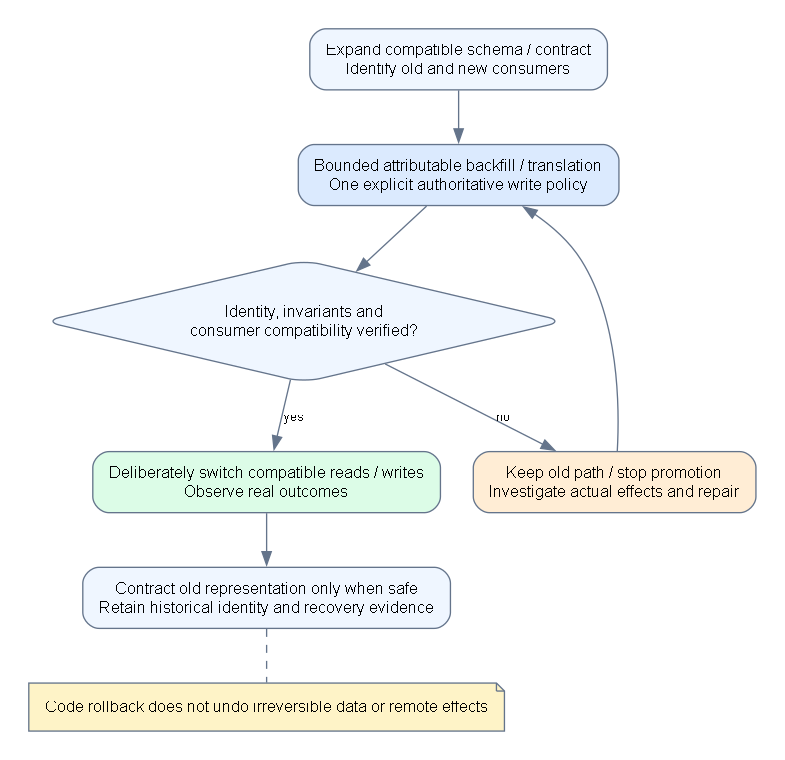

<a id="design-record-02-detailed-and-object-oriented-design-05-design-evolution-refactoring-and-technical-debt-md--heading-expand-validate-and-contract"></a>

##### Expand validate and contract

Prefer additive compatible structures/contracts when practical. Introduce a new representation behind a defined boundary; backfill or translate in bounded attributable work; validate identity/count/invariants and actual consumers; switch reads/writes deliberately; remove the old representation only after compatibility and recovery conditions permit it.

This is a pattern to evaluate, not a guarantee that dual writing is atomic. If old/new writes coexist, specify one authoritative write path, conflict/reconciliation behavior, backfill checkpoints and failure handling. Avoid deleting old data simply because a deployment succeeded.

<a id="design-record-02-detailed-and-object-oriented-design-05-design-evolution-refactoring-and-technical-debt-md--heading-published-and-submitted-identity"></a>

##### Published and submitted identity

Preserve intended publication revision, artifact language/provenance and actual submission manifests through schema/storage changes. A backfill must not substitute current live content for historical sent material. Physical deduplication may share bytes only when protected-reference and lifecycle semantics remain intact.

<a id="design-record-02-detailed-and-object-oriented-design-05-design-evolution-refactoring-and-technical-debt-md--heading-api-adapter-and-job-compatibility"></a>

##### API adapter and job compatibility

Version or translate external/persisted contracts deliberately. Identify old clients, provider results, queued payloads and pending attempts that may outlive a release. Drain, translate or retain a compatible handler as justified; do not discard unresolved consequential attempts. Current authority is reconstructed at use, not inherited indefinitely from an old serialized job.

<a id="design-record-02-detailed-and-object-oriented-design-05-design-evolution-refactoring-and-technical-debt-md--heading-component-extraction"></a>

##### Component extraction

Keep Git, provider, PDF/storage and executor integration at explicit adapters. Extract a component into an independent facility only when measured resource/isolation needs, release cadence or actual operating value justify the added cost. Define new network/credential/failure/recovery contracts first. Earlier proposed modular boundaries do not authorize a paid host or automatically make distributed operations safe.

<a id="design-record-02-detailed-and-object-oriented-design-05-design-evolution-refactoring-and-technical-debt-md--heading-rollback-and-forward-repair"></a>

##### Rollback and forward repair

Reverting application code may be possible only while schema/data/contract compatibility holds. An irreversible migration, sent message, ref update or target deployment cannot be undone by checking out an older commit. Stop further effects, retain evidence, assess what changed and select compatible rollback, reviewed forward repair or scoped recovery. Follow [deployment procedures](../01-High-level-design/High-level-design.md#design-record-01-software-architecture-04-deployment-topology-nodes-and-networks-md) and [runtime reconciliation](../01-High-level-design/High-level-design.md#design-record-01-software-architecture-03-process-view-concurrency-and-runtime-behavior-md).

<a id="design-record-02-detailed-and-object-oriented-design-05-design-evolution-refactoring-and-technical-debt-md--heading-5-debt-records-prioritization-and-review"></a>

#### 5. Debt records prioritization and review

<a id="design-record-02-detailed-and-object-oriented-design-05-design-evolution-refactoring-and-technical-debt-md--heading-current-register-position"></a>

##### Current register position

No product implementation debt item is allocated by this document. Existing execution, provider, capacity, recovery and criterion gaps remain open engineering/evidence work in their authoritative records. The following fields define how to record an actual later debt finding; they are not invented findings or accepted deferrals.

<a id="design-record-02-detailed-and-object-oriented-design-05-design-evolution-refactoring-and-technical-debt-md--heading-required-fields-for-an-actual-debt-item"></a>

##### Required fields for an actual debt item

- Stable local identifier/title, actual discovery date, source candidate and affected components/contracts.
- Concrete evidence: code/model locator, observed dependency/smell or actual accepted trade-off; distinguish observation from prediction.
- Consequences of leaving it unchanged, affected source criteria, security/privacy/data-loss implications and uncertainty.
- Proposed remedies, alternatives, migration/compatibility needs, verification and realistic full engineering effort.
- Responsible owner, decision authority, actual state and review trigger; link the authoritative work tracker and ADR where applicable.
- Closure evidence identifying the remedied candidate, actual checks and remaining limitations; retain superseded history.

Keep work descriptions and current scheduling in the [product backlog](https://github.com/Farhad-V/Web-Resumefolio/blob/1f2acaa351ac306cb57cbe4fe9742e8bd90720d9/docs/MVP/Project-Management/product-backlog.md) and actual tracker. The shared [review record](../01-High-level-design/High-level-design.md#design-record-06-design-quality-and-security-analysis-05-design-review-traceability-and-handoff-md) owns findings/disposition. This document owns the method, not a second live backlog.

<a id="design-record-02-detailed-and-object-oriented-design-05-design-evolution-refactoring-and-technical-debt-md--heading-prioritization"></a>

##### Prioritization

First identify source violations and gates that block the affected commitment. Then compare actual exposure, recurrence/change cost, coupling/blast radius, remediation effort and dependency timing. Prefer risk reduction and verified user value over cosmetic uniformity. Use 20 total project hours/week without treating documentation/testing/operations as free extra time. No fixed debt percentage, numeric score or universal threshold is adopted here.

<a id="design-record-02-detailed-and-object-oriented-design-05-design-evolution-refactoring-and-technical-debt-md--heading-smell-indicators-and-review-triggers"></a>

##### Smell indicators and review triggers

Review dependency cycles, forbidden internal imports, oversized interfaces, repeated authority/lifecycle rules, hidden external effects, long-lived mutable user state, transaction scopes around network calls and difficult-to-isolate scenarios. Coupling/cohesion metrics or change history can support a finding but cannot alone prove a design is wrong.

Reassess when a requirement changes, provider/runtime compatibility changes, combined-load evidence contradicts assumptions, an incident exposes a boundary failure, a migration touches protected history or repeated work demonstrates actual maintenance cost. A periodic checkpoint may be chosen in real planning; no fabricated calendar deadline is assigned here.

<a id="design-record-02-detailed-and-object-oriented-design-05-design-evolution-refactoring-and-technical-debt-md--heading-6-verification-and-completion"></a>

#### 6. Verification and completion

**Structural evidence:** allowed dependency direction, exported/internal boundaries, class/contract consistency and diagrams match the actual candidate.

**Behavior evidence:** source invariants and protected state remain valid for normal, denied, conflict, duplicate, partial and unknown-effect paths where applicable. Include explicit publication/history and revoked-access cases for affected changes.

**Operating evidence:** compatible app/worker/schema versions, attributable pending work, resource behavior, private storage/keys and restore/reconciliation limits are assessed where changed. Mocks alone cannot prove provider idempotency, Git refs, executor isolation or usable recovery.

**Closure:** record actual change scope, source/design/code candidate, verification method/results, debt/defect disposition and remaining limits. Supersede ADRs explicitly; do not erase historical decisions or present old source hashes as current. Whole-phase acceptance remains a separate actual owner decision.

<a id="design-record-02-detailed-and-object-oriented-design-05-design-evolution-refactoring-and-technical-debt-md--heading-7-fau-basis-and-related-records"></a>

#### 7. FAU basis and related records

FAU V07 treats architecture as an input to implementation/testing, change impact and controlled evolution. V08 discusses anti-patterns, design smells, model refactoring and conventions. This procedure adapts that teaching to Resumefolio’s accepted boundaries; the debt field set and compatibility route are project conventions, not a university-prescribed ledger.

- [OO principles and pattern guidance](#design-record-02-detailed-and-object-oriented-design-01-design-principles-and-object-oriented-approach-md)
- [Shared concern ownership](../01-High-level-design/High-level-design.md#design-record-01-software-architecture-05-cross-cutting-concerns-overview-md)
- [Component implementation packages](#design-record-03-component-and-module-design-component-and-module-design-md)
- [Data ownership and physical refinement](#design-record-04-data-design-data-design-md)
- [Operating recovery design](../01-High-level-design/High-level-design.md#design-record-06-design-quality-and-security-analysis-03-operations-backup-recovery-and-resilience-md)
- [FAU reference map](../01-High-level-design/High-level-design.md#design-record-design-references-and-coverage-md)

This update performs document and generated-diagram checks only. It executes no refactoring, migration, recovery, live security/capacity test or product release. Advisor transport remains unavailable as recorded for this candidate; no independent endorsement is claimed.

[Detailed Design index](#design-record-02-detailed-and-object-oriented-design-detailed-and-object-oriented-design-md) · [Diagram catalog](#design-record-02-detailed-and-object-oriented-design-diagrams-diagram-catalog-md)

<a id="design-record-02-detailed-and-object-oriented-design-05-design-evolution-refactoring-and-technical-debt-md--heading-8-evolution-and-debt-visual-package"></a>

#### 8. Evolution and debt visual package

All comparisons below are **hypothetical design examples** unless an exact inspected candidate is explicitly identified. No implementation debt, actual architecture erosion, migration, measured hotspot or completed release is established. Legacy replacement is a conditional engineering pattern, not added product scope.

<a id="design-record-02-detailed-and-object-oriented-design-05-design-evolution-refactoring-and-technical-debt-md--heading-81-beforeafter-class-responsibilities"></a>

##### 8.1 Before/after class responsibilities

[Before/after class responsibilities](https://github.com/Farhad-V/Web-Resumefolio/blob/1f2acaa351ac306cb57cbe4fe9742e8bd90720d9/docs/MVP/SDLC/04-system-design/02-detailed-and-object-oriented-design/diagrams/evolution-class-change.svg)

[PlantUML](https://github.com/Farhad-V/Web-Resumefolio/blob/1f2acaa351ac306cb57cbe4fe9742e8bd90720d9/docs/MVP/SDLC/04-system-design/02-detailed-and-object-oriented-design/diagrams/evolution-class-change.puml) · 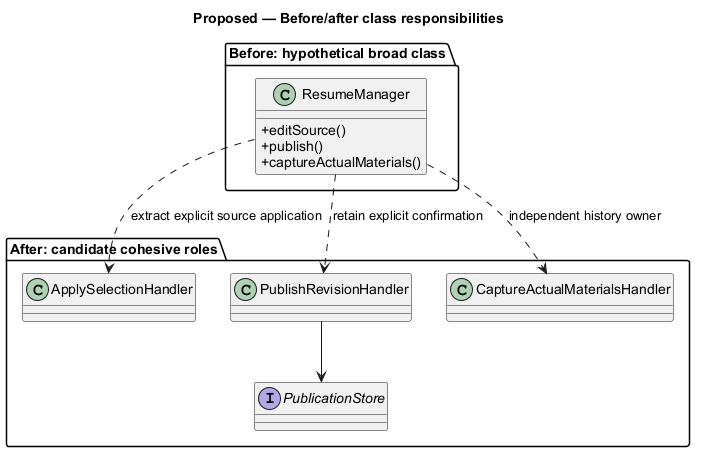

A hypothetical original, not a detected code smell. Extracting roles must preserve observable contracts; changing publication or history behavior is a separate behavioral decision.

<a id="design-record-02-detailed-and-object-oriented-design-05-design-evolution-refactoring-and-technical-debt-md--heading-82-step-by-step-transformation-and-verification"></a>

##### 8.2 Step-by-step transformation and verification

[Step-by-step transformation and verification](https://github.com/Farhad-V/Web-Resumefolio/blob/1f2acaa351ac306cb57cbe4fe9742e8bd90720d9/docs/MVP/SDLC/04-system-design/02-detailed-and-object-oriented-design/diagrams/evolution-refactoring-sequence.svg)

[PlantUML](https://github.com/Farhad-V/Web-Resumefolio/blob/1f2acaa351ac306cb57cbe4fe9742e8bd90720d9/docs/MVP/SDLC/04-system-design/02-detailed-and-object-oriented-design/diagrams/evolution-refactoring-sequence.puml) · 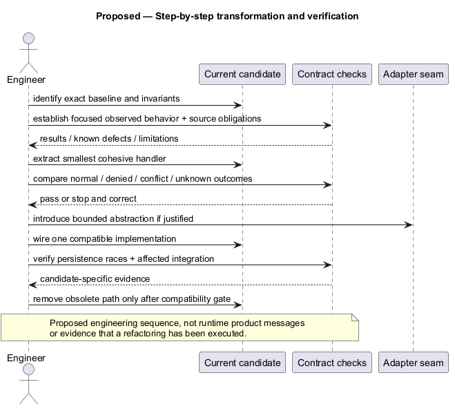

Each step has a reviewable candidate and a stop/correct route. Characterization does not legitimize known requirement violations; code reversal remains conditional on data and effect compatibility.

<a id="design-record-02-detailed-and-object-oriented-design-05-design-evolution-refactoring-and-technical-debt-md--heading-83-hypothetical-dependency-cycle-and-hotspot"></a>

##### 8.3 Hypothetical dependency cycle and hotspot

[Hypothetical dependency cycle and hotspot](https://github.com/Farhad-V/Web-Resumefolio/blob/1f2acaa351ac306cb57cbe4fe9742e8bd90720d9/docs/MVP/SDLC/04-system-design/02-detailed-and-object-oriented-design/diagrams/evolution-dependency-hotspots.svg)

[PlantUML](https://github.com/Farhad-V/Web-Resumefolio/blob/1f2acaa351ac306cb57cbe4fe9742e8bd90720d9/docs/MVP/SDLC/04-system-design/02-detailed-and-object-oriented-design/diagrams/evolution-dependency-hotspots.puml) · 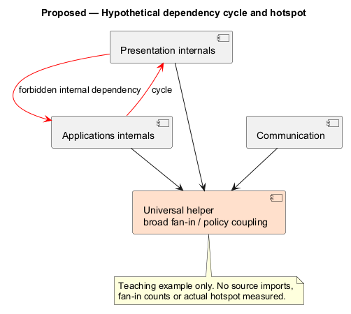

Red edges depict an invented cycle to investigate, not actual repository dependencies. A central technical utility is not automatically debt; shared mutable business authority and change propagation require concrete evidence.

<a id="design-record-02-detailed-and-object-oriented-design-05-design-evolution-refactoring-and-technical-debt-md--heading-84-beforeafter-package-dependency-direction"></a>

##### 8.4 Before/after package dependency direction

[Before/after package dependency direction](https://github.com/Farhad-V/Web-Resumefolio/blob/1f2acaa351ac306cb57cbe4fe9742e8bd90720d9/docs/MVP/SDLC/04-system-design/02-detailed-and-object-oriented-design/diagrams/evolution-package-direction.svg)

[PlantUML](https://github.com/Farhad-V/Web-Resumefolio/blob/1f2acaa351ac306cb57cbe4fe9742e8bd90720d9/docs/MVP/SDLC/04-system-design/02-detailed-and-object-oriented-design/diagrams/evolution-package-direction.puml) · 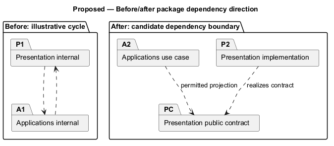

The target removes this selected source cycle through an owner-controlled public contract. It does not permit cross-module writes or prove that the entire application is acyclic. Runtime requests and source dependency arrows must be reviewed separately.

<a id="design-record-02-detailed-and-object-oriented-design-05-design-evolution-refactoring-and-technical-debt-md--heading-85-intended-versus-eroded-architecture"></a>

##### 8.5 Intended versus eroded architecture

[Intended versus eroded architecture](https://github.com/Farhad-V/Web-Resumefolio/blob/1f2acaa351ac306cb57cbe4fe9742e8bd90720d9/docs/MVP/SDLC/04-system-design/02-detailed-and-object-oriented-design/diagrams/evolution-erosion.svg)

[PlantUML](https://github.com/Farhad-V/Web-Resumefolio/blob/1f2acaa351ac306cb57cbe4fe9742e8bd90720d9/docs/MVP/SDLC/04-system-design/02-detailed-and-object-oriented-design/diagrams/evolution-erosion.puml) · 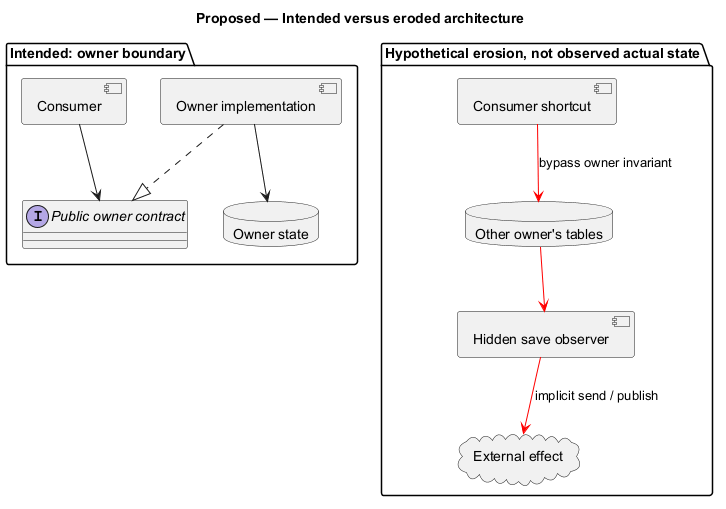

An actual-versus-intended comparison requires an identified source candidate and inspected imports/effects. No actual architecture audit is asserted here; the erosion half shows the kinds of divergence to look for.

<a id="design-record-02-detailed-and-object-oriented-design-05-design-evolution-refactoring-and-technical-debt-md--heading-86-design-evolution-timeline-and-adr-history"></a>

##### 8.6 Design evolution timeline and ADR history

[Historical or unselected alternative — Design evolution timeline and ADR history](https://github.com/Farhad-V/Web-Resumefolio/blob/1f2acaa351ac306cb57cbe4fe9742e8bd90720d9/docs/MVP/SDLC/04-system-design/02-detailed-and-object-oriented-design/diagrams/evolution-history.svg)

[PlantUML](https://github.com/Farhad-V/Web-Resumefolio/blob/1f2acaa351ac306cb57cbe4fe9742e8bd90720d9/docs/MVP/SDLC/04-system-design/02-detailed-and-object-oriented-design/diagrams/evolution-history.puml) · 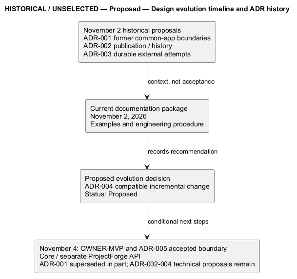

This is a documentation/proposal sequence, not a fabricated release/version history. Existing ADRs remain Proposed. Future implementation and acceptance have no invented date.

<a id="design-record-02-detailed-and-object-oriented-design-05-design-evolution-refactoring-and-technical-debt-md--heading-87-strangler-facade-conditional-future-replacement"></a>

##### 8.7 Strangler facade: conditional future replacement

[Strangler facade: conditional future replacement](https://github.com/Farhad-V/Web-Resumefolio/blob/1f2acaa351ac306cb57cbe4fe9742e8bd90720d9/docs/MVP/SDLC/04-system-design/02-detailed-and-object-oriented-design/diagrams/evolution-strangler.svg)

[PlantUML](https://github.com/Farhad-V/Web-Resumefolio/blob/1f2acaa351ac306cb57cbe4fe9742e8bd90720d9/docs/MVP/SDLC/04-system-design/02-detailed-and-object-oriented-design/diagrams/evolution-strangler.puml) · 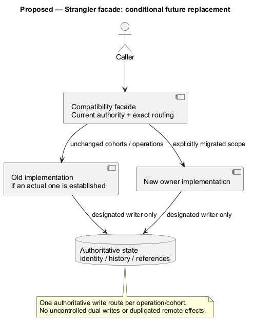

A conditional pattern, not a new legacy-migration feature or authorized migration. Define routing, compatible contracts, pending work, reference protection, reconciliation and cutover evidence before any real use. Do not shadow consequential sends or deployments.

<a id="design-record-02-detailed-and-object-oriented-design-05-design-evolution-refactoring-and-technical-debt-md--heading-88-branch-by-abstraction-inside-one-application"></a>

##### 8.8 Branch by abstraction inside one application

[Branch by abstraction inside one application](https://github.com/Farhad-V/Web-Resumefolio/blob/1f2acaa351ac306cb57cbe4fe9742e8bd90720d9/docs/MVP/SDLC/04-system-design/02-detailed-and-object-oriented-design/diagrams/evolution-branch-abstraction.svg)

[PlantUML](https://github.com/Farhad-V/Web-Resumefolio/blob/1f2acaa351ac306cb57cbe4fe9742e8bd90720d9/docs/MVP/SDLC/04-system-design/02-detailed-and-object-oriented-design/diagrams/evolution-branch-abstraction.puml) · 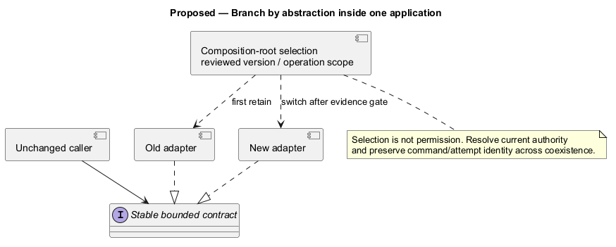

Introduce abstraction, retain behavior through the old adapter, verify the new adapter, switch the designated route, then retire only when old consumers/pending work permit. This is independent of creating a long-lived source-control branch.

<a id="design-record-02-detailed-and-object-oriented-design-05-design-evolution-refactoring-and-technical-debt-md--heading-89-legacy-shaped-versus-target-component-state"></a>

##### 8.9 Legacy-shaped versus target component state

[Legacy-shaped versus target component state](https://github.com/Farhad-V/Web-Resumefolio/blob/1f2acaa351ac306cb57cbe4fe9742e8bd90720d9/docs/MVP/SDLC/04-system-design/02-detailed-and-object-oriented-design/diagrams/evolution-component-target.svg)

[PlantUML](https://github.com/Farhad-V/Web-Resumefolio/blob/1f2acaa351ac306cb57cbe4fe9742e8bd90720d9/docs/MVP/SDLC/04-system-design/02-detailed-and-object-oriented-design/diagrams/evolution-component-target.puml) · 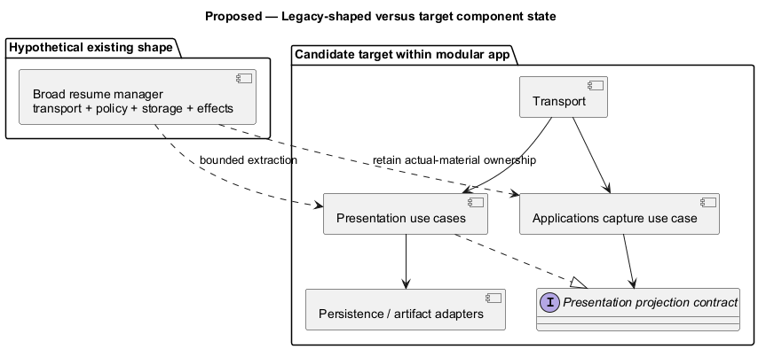

Legacy-shaped is a hypothetical structural comparison, not an established running legacy system. The target remains a modular application; this view neither selects microservices nor authorizes moving private data.

<a id="design-record-02-detailed-and-object-oriented-design-05-design-evolution-refactoring-and-technical-debt-md--heading-810-refactoringmigration-work-lifecycle"></a>

##### 8.10 Refactoring/migration work lifecycle

[Refactoring/migration work lifecycle](https://github.com/Farhad-V/Web-Resumefolio/blob/1f2acaa351ac306cb57cbe4fe9742e8bd90720d9/docs/MVP/SDLC/04-system-design/02-detailed-and-object-oriented-design/diagrams/evolution-lifecycle.svg)

[PlantUML](https://github.com/Farhad-V/Web-Resumefolio/blob/1f2acaa351ac306cb57cbe4fe9742e8bd90720d9/docs/MVP/SDLC/04-system-design/02-detailed-and-object-oriented-design/diagrams/evolution-lifecycle.puml) · 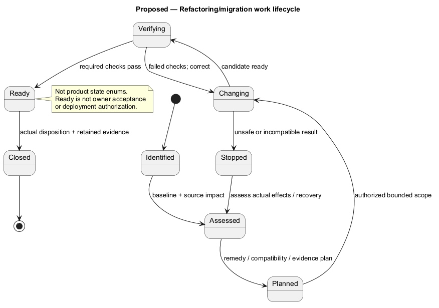

Proposed engineering-work states, not implementation enums. Stopping work cannot undo irreversible data or remote effects; reassess before compatible rollback, forward repair or recovery.

<a id="design-record-02-detailed-and-object-oriented-design-05-design-evolution-refactoring-and-technical-debt-md--heading-811-contract-oriented-verification-safety-net"></a>

##### 8.11 Contract-oriented verification safety net

[Contract-oriented verification safety net](https://github.com/Farhad-V/Web-Resumefolio/blob/1f2acaa351ac306cb57cbe4fe9742e8bd90720d9/docs/MVP/SDLC/04-system-design/02-detailed-and-object-oriented-design/diagrams/evolution-safety-net.svg)

[PlantUML](https://github.com/Farhad-V/Web-Resumefolio/blob/1f2acaa351ac306cb57cbe4fe9742e8bd90720d9/docs/MVP/SDLC/04-system-design/02-detailed-and-object-oriented-design/diagrams/evolution-safety-net.puml) · 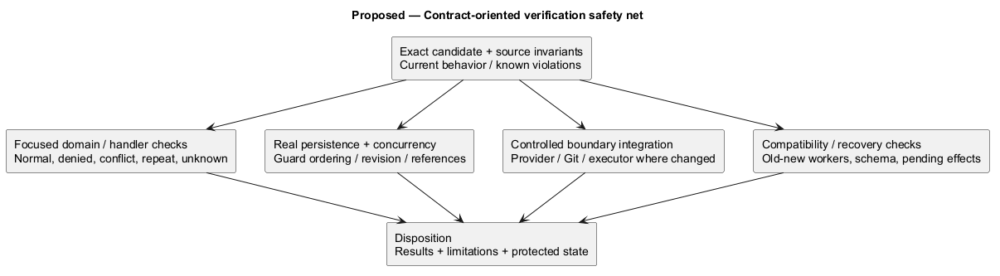

A coverage plan rather than a measured coverage percentage. Choose checks for affected risks; unit mocks alone do not establish persistence races, actual external idempotency, executor isolation or usable recovery.

<a id="design-record-02-detailed-and-object-oriented-design-05-design-evolution-refactoring-and-technical-debt-md--heading-812-smell-to-refactoring-mapping"></a>

##### 8.12 Smell-to-refactoring mapping

| Indicator to investigate | Candidate remedy | Evidence and preservation check |
| --- | --- | --- |
| Broad manager with unrelated reasons to change | Extract cohesive handlers | Inspect actual callers; preserve explicit confirmation and owned invariants |
| Cyclic internal imports / cross-owner table access | Introduce owner public contract; relocate misplaced responsibility | Inspect actual import/write graph; prevent mutation bypass |
| Repeated authority logic diverges | Consolidate rule at authoritative owner | Compare exact semantics; do not merge distinct grant/consent rules |
| Long navigation chains expose private internals | Intention-revealing owner operation | Preserve exact eligibility and protected reference lifetime |
| Network call inside local transaction | Separate durable intent and attributable effect attempt | Review atomicity changes; reconcile uncertain results before repetition |
| Mutable actor/session retained in shared service | Bound context lifetime and reconstruct current authority | Exercise concurrent callers and revocation; no stale privileged identity |
| Oversized adapter interface | Split consumer-specific ports | Preserve capability and failure semantics for all affected consumers |

<a id="design-record-02-detailed-and-object-oriented-design-05-design-evolution-refactoring-and-technical-debt-md--heading-813-technical-debt-register-format-and-current-position"></a>

##### 8.13 Technical debt register format and current position

This is a register **template**, not a second live backlog. No evidenced implementation debt item is allocated here. Link real future entries to the authoritative tracker and review record; open feasibility/design work remains in its owning record.

| Item / evidence | Impact if retained | Full cost to fix | Priority / disposition | Owner / closure |
| --- | --- | --- | --- | --- |
| No actual debt item established by this update | Not assessed | Not estimated | Unassigned; no accepted deferral | Farhad; requires actual finding and evidence |
| Template: stable ID + candidate + code/model locator + observed deficiency | Source criteria, exposure, recurrence and uncertainty | Analysis, implementation, migration, verification, docs and operations; estimate only after inspection | Actual urgency, rationale, authority and review trigger; link tracker/ADR | Responsible owner; exact remedied candidate, checks and remaining limits |

<a id="design-record-02-detailed-and-object-oriented-design-05-design-evolution-refactoring-and-technical-debt-md--heading-814-classification-prioritization-and-measurement-aids"></a>

##### 8.14 Classification, prioritization and measurement aids

[Technical debt quadrant](https://github.com/Farhad-V/Web-Resumefolio/blob/1f2acaa351ac306cb57cbe4fe9742e8bd90720d9/docs/MVP/SDLC/04-system-design/02-detailed-and-object-oriented-design/diagrams/evolution-debt-quadrant.svg)

[SVG](https://github.com/Farhad-V/Web-Resumefolio/blob/1f2acaa351ac306cb57cbe4fe9742e8bd90720d9/docs/MVP/SDLC/04-system-design/02-detailed-and-object-oriented-design/diagrams/evolution-debt-quadrant.svg) · 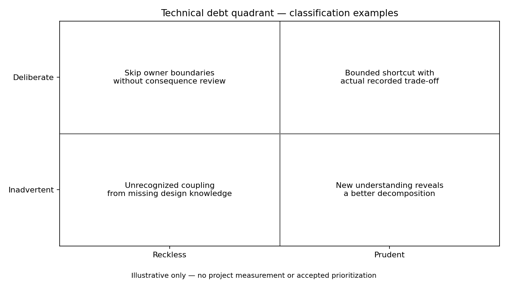

[Impact versus effort matrix](https://github.com/Farhad-V/Web-Resumefolio/blob/1f2acaa351ac306cb57cbe4fe9742e8bd90720d9/docs/MVP/SDLC/04-system-design/02-detailed-and-object-oriented-design/diagrams/evolution-impact-effort.svg)

[SVG](https://github.com/Farhad-V/Web-Resumefolio/blob/1f2acaa351ac306cb57cbe4fe9742e8bd90720d9/docs/MVP/SDLC/04-system-design/02-detailed-and-object-oriented-design/diagrams/evolution-impact-effort.svg) · 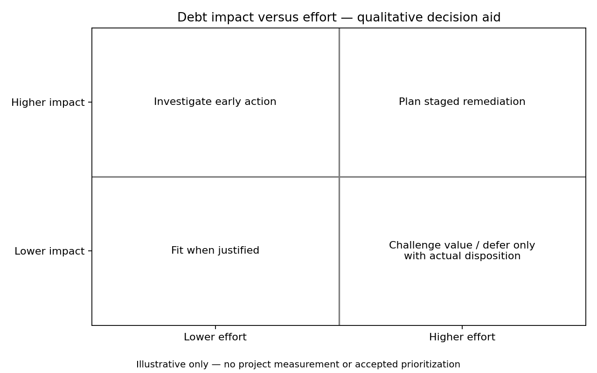

[Conceptual debt interest curve](https://github.com/Farhad-V/Web-Resumefolio/blob/1f2acaa351ac306cb57cbe4fe9742e8bd90720d9/docs/MVP/SDLC/04-system-design/02-detailed-and-object-oriented-design/diagrams/evolution-interest-curve.svg)

[SVG](https://github.com/Farhad-V/Web-Resumefolio/blob/1f2acaa351ac306cb57cbe4fe9742e8bd90720d9/docs/MVP/SDLC/04-system-design/02-detailed-and-object-oriented-design/diagrams/evolution-interest-curve.svg) · 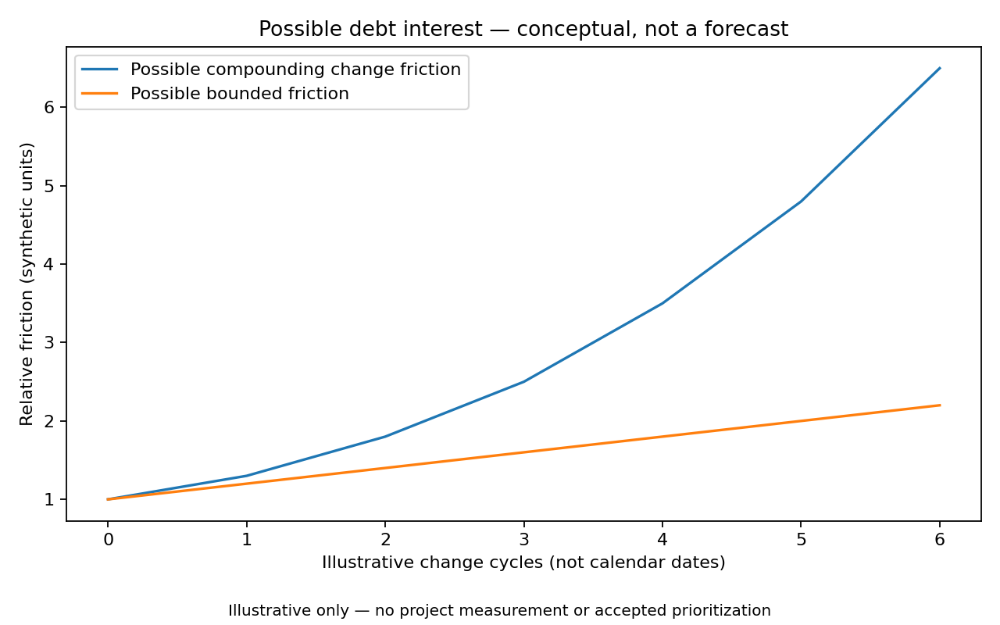

[Illustrative churn versus complexity hotspot chart](https://github.com/Farhad-V/Web-Resumefolio/blob/1f2acaa351ac306cb57cbe4fe9742e8bd90720d9/docs/MVP/SDLC/04-system-design/02-detailed-and-object-oriented-design/diagrams/evolution-churn-complexity.svg)

[SVG](https://github.com/Farhad-V/Web-Resumefolio/blob/1f2acaa351ac306cb57cbe4fe9742e8bd90720d9/docs/MVP/SDLC/04-system-design/02-detailed-and-object-oriented-design/diagrams/evolution-churn-complexity.svg) · 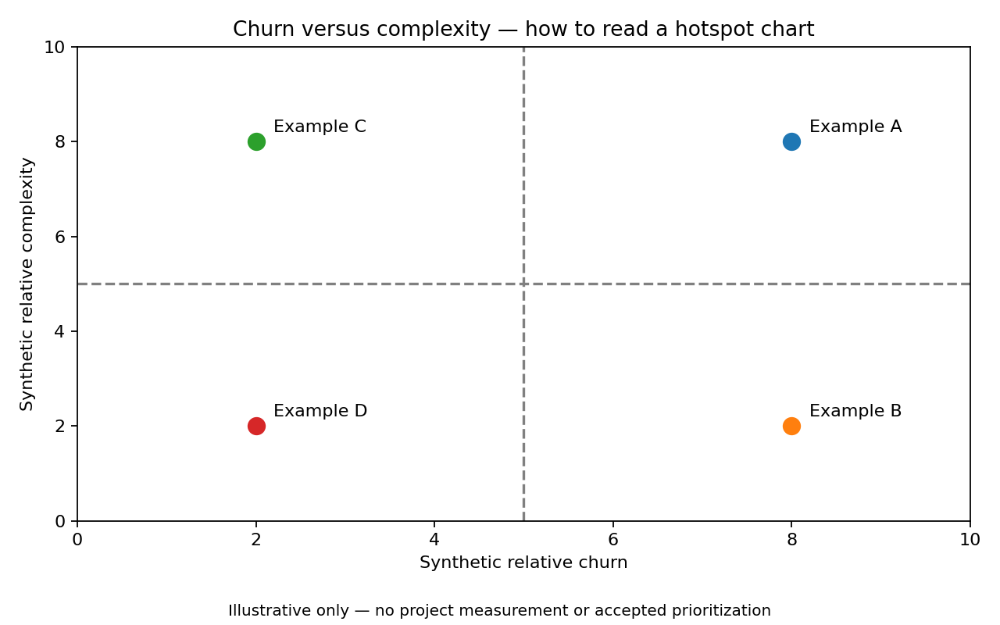

Quadrant labels classify how a deficiency arose, not whether it is acceptable. Impact/effort is qualitative: source violations and commitment-blocking security, privacy, history or recovery gates take precedence over convenience. Neither chart allocates work or authorizes deferral.

The interest curves show possible maintenance-friction shapes, not forecast hours, money, deadlines or a claim that all debt compounds. The hotspot chart contains **four invented points**, not file names or project measurements. For a real chart, fix the candidate/history window, define churn (including rename/generated-file handling), choose a compatible complexity measure and inspect the high-churn/high-complexity candidates before recording findings. High values alone do not establish debt; small frequently changed files and complex stable algorithms can be legitimate.

[Synthetic chart data](https://github.com/Farhad-V/Web-Resumefolio/blob/1f2acaa351ac306cb57cbe4fe9742e8bd90720d9/docs/MVP/SDLC/04-system-design/02-detailed-and-object-oriented-design/diagrams/evolution-chart-data.json) · [Reproducible package generator](#design-record-02-detailed-and-object-oriented-design-diagrams-evolution-visuals-generator-py). The generator defaults to staging; its explicit publish option checks saved target hashes before writing. No measurement collection or product execution occurs.

<a id="design-record-02-detailed-and-object-oriented-design-05-design-evolution-refactoring-and-technical-debt-md--heading-815-evolution-decision-record"></a>

##### 8.15 Evolution decision record

See [ADR-004 — Compatible incremental design evolution](../01-High-level-design/High-level-design.md#design-record-07-design-decisions-adr-004-compatible-incremental-design-evolution-md). **Status: Proposed.** It records the recommended procedure and alternatives; it does not accept a debt item, authorize a migration, change product behavior or establish owner approval.

</details>

<a id="design-record-02-detailed-and-object-oriented-design-detailed-and-object-oriented-design-md"></a>

<details>
<summary>Resumefolio — Detailed and Object-Oriented Design</summary>

<a id="design-record-02-detailed-and-object-oriented-design-detailed-and-object-oriented-design-md--heading-resumefolio--detailed-and-object-oriented-design"></a>

### Resumefolio — Detailed and Object-Oriented Design

Current implementation choices and scope: [Baseline](https://github.com/Farhad-V/Web-Resumefolio/blob/1f2acaa351ac306cb57cbe4fe9742e8bd90720d9/docs/MVP/baseline/README.md). Runtime verification remains subject to its gates.

**Start here to turn architecture responsibilities into understandable component designs and evolve those designs safely.** This section owns shared OO guidance and refactoring/debt procedures; actual component packages own concrete interfaces, classes, algorithms and technical scenarios.

Owner and decision authority: Farhad. Updated November 2, 2026.

**Status:** proposed design guidance. This folder has **two numbered documents, 01 and 05**; 02–04 are unused numbering gaps, not missing mandatory files. The numbering preserves stable existing links. No implementation, measured debt, migration or accepted technical baseline is established by the illustrations.

[Contents](#design-record-02-detailed-and-object-oriented-design-detailed-and-object-oriented-design-md--heading-1-contents-and-reading-order) · [Maps](#design-record-02-detailed-and-object-oriented-design-detailed-and-object-oriented-design-md--heading-2-reading-and-concept-maps) · [Example](#design-record-02-detailed-and-object-oriented-design-detailed-and-object-oriented-design-md--heading-3-shared-publication-example) · [Glossary](#design-record-02-detailed-and-object-oriented-design-detailed-and-object-oriented-design-md--heading-4-glossary) · [Cheat sheet](#design-record-02-detailed-and-object-oriented-design-detailed-and-object-oriented-design-md--heading-5-design-cheat-sheet) · [Review](#design-record-02-detailed-and-object-oriented-design-detailed-and-object-oriented-design-md--heading-6-review-and-maintenance)

<a id="design-record-02-detailed-and-object-oriented-design-detailed-and-object-oriented-design-md--heading-1-contents-and-reading-order"></a>

#### 1. Contents and reading order

| File / location | Topic | One-line summary |
| --- | --- | --- |
| [01 — Design Principles and OO Approach](#design-record-02-detailed-and-object-oriented-design-01-design-principles-and-object-oriented-approach-md) | Shared detailed-design guidance | Allocate responsibilities, apply principles/patterns, and specify object collaboration and lifetime. |
| [05 — Design Evolution, Refactoring and Technical Debt](#design-record-02-detailed-and-object-oriented-design-05-design-evolution-refactoring-and-technical-debt-md) | Assess and evolve a design | Classify findings, plan compatible changes, record actual debt and verify preserved contracts. |
| [Component packages](#design-record-03-component-and-module-design-component-and-module-design-md) | Concrete realization | Keep each component's signatures, classes, algorithms, scenarios and constraints together. |
| [Diagram catalog](#design-record-02-detailed-and-object-oriented-design-diagrams-diagram-catalog-md) | Editable visual sources and exports | Find each figure with its owner, source and readable SVG/PNG. |

Before 01, read [architecture drivers](../01-High-level-design/High-level-design.md#design-record-01-software-architecture-01-design-drivers-and-solution-options-md), [module boundaries](../01-High-level-design/High-level-design.md#design-record-01-software-architecture-02-system-decomposition-and-boundaries-md), the [analysis domain model](../../03-System-analysis/System-analysis.md#analysis-domain-and-information-analysis--03-domain-model-and-object-oriented-view) and [operation contracts](../../03-System-analysis/System-analysis.md#analysis-business-rules-and-operation-contracts--10-domain-constraints-and-operation-contracts). Requirements retain required meaning; technical design cannot silently change permissions, publication or history rules.

Use the [component template](#design-record-03-component-and-module-design-component-and-module-design-md) to realize a component. Consult shared [data](#design-record-04-data-design-data-design-md), [API](#design-record-05-interface-and-api-design-interface-and-api-design-md) and [quality/security](../01-High-level-design/High-level-design.md#design-record-06-design-quality-and-security-analysis-design-quality-and-security-analysis-md) guidance at affected boundaries. Use 05 before changing an established candidate, then link actual findings to [review/handoff](../01-High-level-design/High-level-design.md#design-record-06-design-quality-and-security-analysis-05-design-review-traceability-and-handoff-md) and significant choices to [ADRs](../01-High-level-design/High-level-design.md#design-record-07-design-decisions-design-decisions-md).

<a id="design-record-02-detailed-and-object-oriented-design-detailed-and-object-oriented-design-md--heading-2-reading-and-concept-maps"></a>

#### 2. Reading and concept maps

<a id="design-record-02-detailed-and-object-oriented-design-detailed-and-object-oriented-design-md--heading-21-section-learning-path"></a>

##### 2.1 Section learning path

[Section learning path](https://github.com/Farhad-V/Web-Resumefolio/blob/1f2acaa351ac306cb57cbe4fe9742e8bd90720d9/docs/MVP/SDLC/04-system-design/02-detailed-and-object-oriented-design/diagrams/oo-index-reading-path.svg)

[Editable PlantUML](https://github.com/Farhad-V/Web-Resumefolio/blob/1f2acaa351ac306cb57cbe4fe9742e8bd90720d9/docs/MVP/SDLC/04-system-design/02-detailed-and-object-oriented-design/diagrams/oo-index-reading-path.puml) · 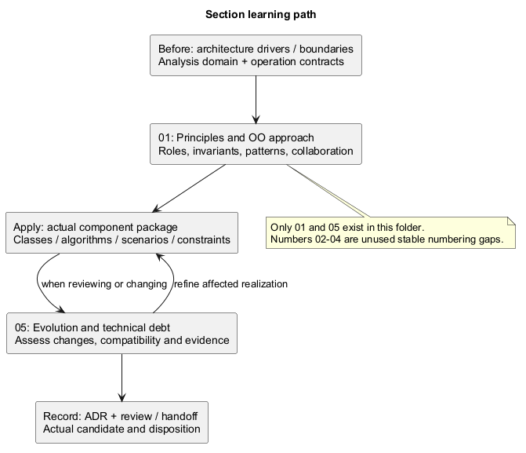

Read 01 for shared guidance; use the component package for concrete realization; use 05 when assessing or changing a design. The loop represents iterative work, not a source dependency cycle.

<a id="design-record-02-detailed-and-object-oriented-design-detailed-and-object-oriented-design-md--heading-22-principles-patterns-and-refactoring"></a>

##### 2.2 Principles, patterns and refactoring

[Principles, patterns and refactoring](https://github.com/Farhad-V/Web-Resumefolio/blob/1f2acaa351ac306cb57cbe4fe9742e8bd90720d9/docs/MVP/SDLC/04-system-design/02-detailed-and-object-oriented-design/diagrams/oo-index-concept-map.svg)

[Editable PlantUML](https://github.com/Farhad-V/Web-Resumefolio/blob/1f2acaa351ac306cb57cbe4fe9742e8bd90720d9/docs/MVP/SDLC/04-system-design/02-detailed-and-object-oriented-design/diagrams/oo-index-concept-map.puml) · 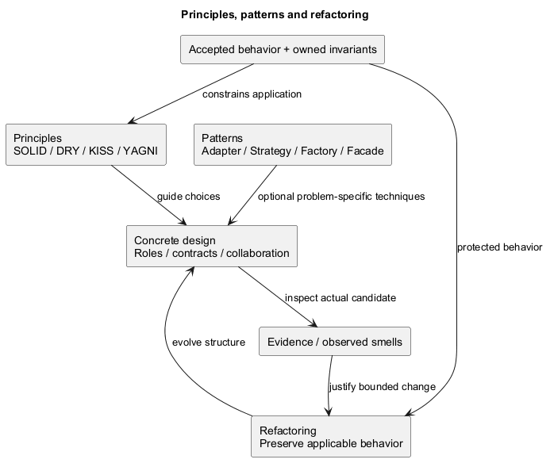

Principles guide judgment, patterns solve specific recurring problems, and refactoring changes structure. None replaces source obligations or verification; an observed defect may require a separately reviewed behavior correction.

<a id="design-record-02-detailed-and-object-oriented-design-detailed-and-object-oriented-design-md--heading-23-prerequisites-and-reading-dependencies"></a>

##### 2.3 Prerequisites and reading dependencies

[Prerequisites and reading dependencies](https://github.com/Farhad-V/Web-Resumefolio/blob/1f2acaa351ac306cb57cbe4fe9742e8bd90720d9/docs/MVP/SDLC/04-system-design/02-detailed-and-object-oriented-design/diagrams/oo-index-prerequisites.svg)

[Editable PlantUML](https://github.com/Farhad-V/Web-Resumefolio/blob/1f2acaa351ac306cb57cbe4fe9742e8bd90720d9/docs/MVP/SDLC/04-system-design/02-detailed-and-object-oriented-design/diagrams/oo-index-prerequisites.puml) · 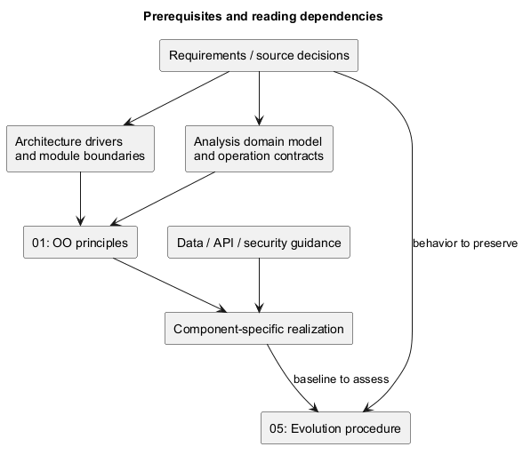

Arrows mean reading inputs, not runtime calls or code imports. Review shared data/API/security decisions alongside the affected component; an evolution proposal requires an identified baseline rather than an invented implementation.

<a id="design-record-02-detailed-and-object-oriented-design-detailed-and-object-oriented-design-md--heading-24-architecture-to-detailed-design-bridge"></a>

##### 2.4 Architecture-to-detailed-design bridge

[Architecture-to-detailed-design bridge](https://github.com/Farhad-V/Web-Resumefolio/blob/1f2acaa351ac306cb57cbe4fe9742e8bd90720d9/docs/MVP/SDLC/04-system-design/02-detailed-and-object-oriented-design/diagrams/oo-index-architecture-bridge.svg)

[Editable PlantUML](https://github.com/Farhad-V/Web-Resumefolio/blob/1f2acaa351ac306cb57cbe4fe9742e8bd90720d9/docs/MVP/SDLC/04-system-design/02-detailed-and-object-oriented-design/diagrams/oo-index-architecture-bridge.puml) · 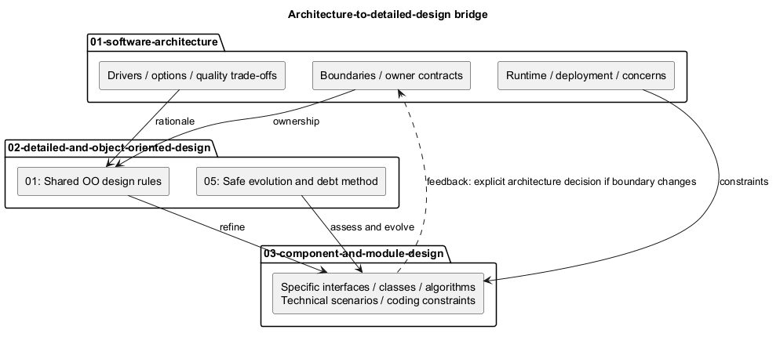

Architecture assigns system responsibilities and operating constraints. Detailed component design refines their realization. If refinement changes boundaries or quality trade-offs, update the architecture/ADR explicitly instead of silently diverging.

<a id="design-record-02-detailed-and-object-oriented-design-detailed-and-object-oriented-design-md--heading-25-levels-of-abstraction"></a>

##### 2.5 Levels of abstraction

[Levels of abstraction](https://github.com/Farhad-V/Web-Resumefolio/blob/1f2acaa351ac306cb57cbe4fe9742e8bd90720d9/docs/MVP/SDLC/04-system-design/02-detailed-and-object-oriented-design/diagrams/oo-index-abstraction-levels.svg)

[Editable PlantUML](https://github.com/Farhad-V/Web-Resumefolio/blob/1f2acaa351ac306cb57cbe4fe9742e8bd90720d9/docs/MVP/SDLC/04-system-design/02-detailed-and-object-oriented-design/diagrams/oo-index-abstraction-levels.puml) · 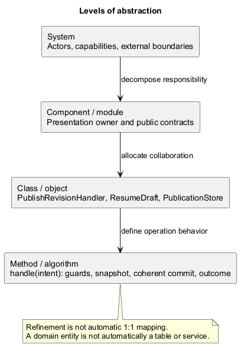

Use the level needed by the question. System/module views do not specify method algorithms, while a class diagram cannot establish deployment isolation or actual transaction correctness.

<a id="design-record-02-detailed-and-object-oriented-design-detailed-and-object-oriented-design-md--heading-26-design-lifecycle-and-feedback"></a>

##### 2.6 Design lifecycle and feedback

[Design lifecycle and feedback](https://github.com/Farhad-V/Web-Resumefolio/blob/1f2acaa351ac306cb57cbe4fe9742e8bd90720d9/docs/MVP/SDLC/04-system-design/02-detailed-and-object-oriented-design/diagrams/oo-index-design-lifecycle.svg)

[Editable PlantUML](https://github.com/Farhad-V/Web-Resumefolio/blob/1f2acaa351ac306cb57cbe4fe9742e8bd90720d9/docs/MVP/SDLC/04-system-design/02-detailed-and-object-oriented-design/diagrams/oo-index-design-lifecycle.puml) · 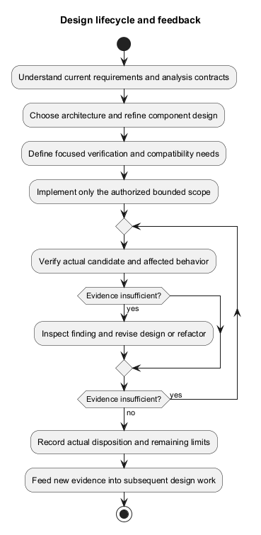

A proposed workflow, not evidence of completed implementation. Refactoring preserves applicable behavior; changed source policy or externally visible contracts need their own disposition. Failed reverification does not close the work.

<a id="design-record-02-detailed-and-object-oriented-design-detailed-and-object-oriented-design-md--heading-27-topic-mind-map"></a>

##### 2.7 Topic mind map

[Topic mind map](https://github.com/Farhad-V/Web-Resumefolio/blob/1f2acaa351ac306cb57cbe4fe9742e8bd90720d9/docs/MVP/SDLC/04-system-design/02-detailed-and-object-oriented-design/diagrams/oo-index-topic-mindmap.svg)

[Editable PlantUML](https://github.com/Farhad-V/Web-Resumefolio/blob/1f2acaa351ac306cb57cbe4fe9742e8bd90720d9/docs/MVP/SDLC/04-system-design/02-detailed-and-object-oriented-design/diagrams/oo-index-topic-mindmap.puml) · 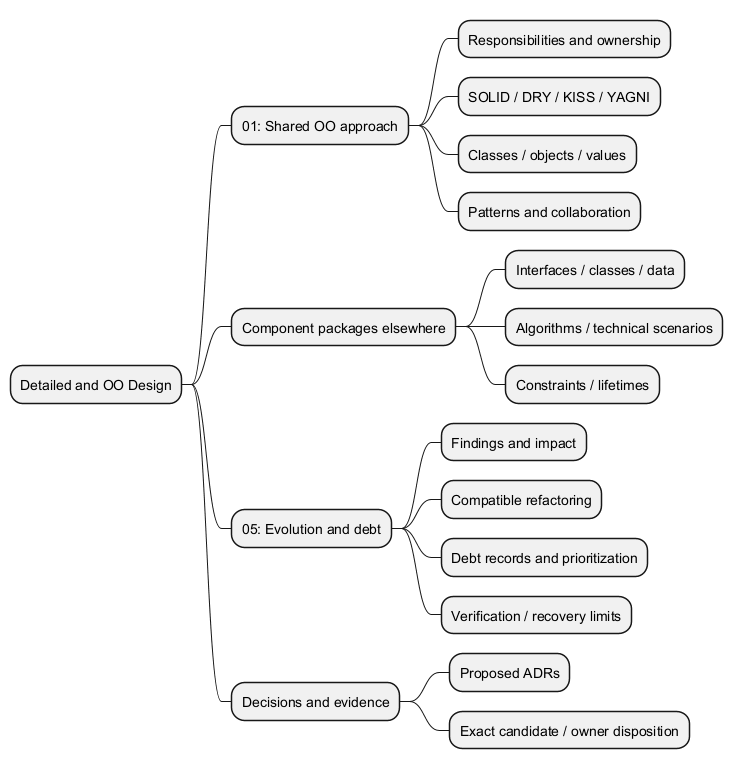

This map groups topics rather than prescribing dependencies. Component-specific details remain in the owning component package; ADRs and review evidence retain their own owners.

<a id="design-record-02-detailed-and-object-oriented-design-detailed-and-object-oriented-design-md--heading-3-shared-publication-example"></a>

#### 3. Shared publication example

[Selected proposed publication classes](https://github.com/Farhad-V/Web-Resumefolio/blob/1f2acaa351ac306cb57cbe4fe9742e8bd90720d9/docs/MVP/SDLC/04-system-design/02-detailed-and-object-oriented-design/diagrams/publication-use-case-classes.svg)

[PlantUML](https://github.com/Farhad-V/Web-Resumefolio/blob/1f2acaa351ac306cb57cbe4fe9742e8bd90720d9/docs/MVP/SDLC/04-system-design/02-detailed-and-object-oriented-design/diagrams/publication-use-case-classes.puml) · 

Use this existing small model as the running example: PublishRevisionHandler coordinates current authority, an exact draft version and PublicationStore; PublishedResumeRevision preserves the separately confirmed identity. [01](#design-record-02-detailed-and-object-oriented-design-01-design-principles-and-object-oriented-approach-md--heading-8-object-oriented-visual-and-responsibility-package) develops its objects, dependencies and collaboration. [05](#design-record-02-detailed-and-object-oriented-design-05-design-evolution-refactoring-and-technical-debt-md--heading-8-evolution-and-debt-visual-package) uses the same publication responsibility to illustrate bounded extraction and compatibility. These are related teaching views, not snapshots of implemented classes or a measured before/after refactoring.

Source edits do not automatically apply to independent resumes or publish them. Actual submitted materials remain independently protected. Early authorization alone cannot settle a race: current admission ordering, expected-version checks and coherent local commit need concrete mechanisms and verification. No mail send, PDF generation or deployment is implicit in publication.

<a id="design-record-02-detailed-and-object-oriented-design-detailed-and-object-oriented-design-md--heading-4-glossary"></a>

#### 4. Glossary

| Term | Meaning in this section |
| --- | --- |
| OO / UML | Object-oriented design / Unified Modeling Language; model responsibility and collaboration at the stated level. |
| Component / module | Logical resource-owning boundary; not automatically an independently deployed service. |
| Class / object | A defined type and a particular runtime instance of that type. |
| Entity / value object | Identity-bearing domain concept / value defined by its content and validation rules. |
| Aggregate | State grouped for an invariant requiring local consistency; not automatically one table. |
| Port / adapter | Meaningful required or provided contract / infrastructure implementation that preserves its semantics. |
| Cohesion / coupling | How closely responsibilities belong together / the dependencies between design elements. |
| SOLID | Single responsibility, open/closed, Liskov substitution, interface segregation and dependency inversion. |
| DRY / KISS / YAGNI | Avoid duplicated authoritative knowledge / keep the solution simple / avoid speculative functionality. |
| CRC | Class–Responsibility–Collaborator summary of roles and required cooperation. |
| Refactoring | Structural change preserving applicable observable behavior and contracts. |
| Technical debt | Evidenced deficiency or actual deferred improvement with identifiable ongoing consequences and remediation. |
| ADR | Architecture Decision Record; records context, alternatives, consequences and actual decision status. |
| Characterization check | Records observed behavior; does not legitimize an observed requirement violation. |

<a id="design-record-02-detailed-and-object-oriented-design-detailed-and-object-oriented-design-md--heading-5-design-cheat-sheet"></a>

#### 5. Design cheat sheet

| Category / cue | Practical response | Caution / owner |
| --- | --- | --- |
| Single responsibility / broad manager | Separate coherent use cases and resource owners | Avoid a class per method; [01](#design-record-02-detailed-and-object-oriented-design-01-design-principles-and-object-oriented-approach-md) |
| Open/closed and substitution | Isolate real variation; preserve exact input/outcome semantics | Never convert unknown effects into convenient failure or substitute unavailable content |
| Interface segregation / dependency inversion | Inject narrow meaningful contracts; wire adapters at composition root | An interface alone does not enforce authority or atomicity |
| DRY / repeated policy | Keep one authoritative owner for the same rule | Similar-looking consent and link grants may be distinct rules |
| Adapter | Translate provider, storage, Git or executor mechanics | Preserve actual capabilities, failures and uncertainty |
| Strategy | Separate real eligible representation variation | A simple branch can suffice; no silent fallback |
| Factory / Facade | Construct valid identities / expose one bounded use case | Construction does not authorize effects; avoid a universal manager |
| Observer / committed event | Use only a named authorized reaction with explicit dispatch semantics | In-process notification is not durable delivery or permission to send/publish |
| Cycle / hidden external effect / shared actor state | Inspect evidence; restore ownership and bounded lifetime | Actual finding and verification belong in [05](#design-record-02-detailed-and-object-oriented-design-05-design-evolution-refactoring-and-technical-debt-md) and review records |
| Compatibility / debt remediation | Stage bounded changes; preserve pending attempts and historical identities | No uncontrolled dual writes; code rollback cannot undo remote effects |

<a id="design-record-02-detailed-and-object-oriented-design-detailed-and-object-oriented-design-md--heading-6-review-and-maintenance"></a>

#### 6. Review and maintenance

Each component package should state responsibilities, exported/internal contracts, computational data and classes, algorithms/transaction guards, technical failure/recovery scenarios, and justified patterns/coding constraints. Shared guidance owns conventions; component records own their specific realization. Cross-link shared policy rather than copying it into competing sources.

The gallery contains proposed illustrations and synthetic teaching charts, not comprehensive implementation coverage. Verify actual dependency direction, behavior, persistence races, compatible workers/schema and affected external boundaries against an exact candidate. No measured code smell, accepted debt item, completed migration, security/capacity result or owner baseline acceptance is created by this index. [ADR-004](../01-High-level-design/High-level-design.md#design-record-07-design-decisions-adr-004-compatible-incremental-design-evolution-md) remains Proposed.

FAU V08 motivates computational data/classes, detailed dynamics, technical scenarios, patterns, smells and conventions. SOLID, the debt templates and this folder organization are supplementary project adaptations; see the [reference map](../01-High-level-design/High-level-design.md#design-record-design-references-and-coverage-md). Maintain diagrams, sources/exports, component consumers and ADRs together when shared guidance changes. Rendering and link checks establish document consistency only.

[System Design home](../../System-design-guide.md) · [Software Architecture](../01-High-level-design/High-level-design.md#design-record-01-software-architecture-software-architecture-md) · [Diagram catalog](#design-record-02-detailed-and-object-oriented-design-diagrams-diagram-catalog-md)

</details>

<a id="design-record-02-detailed-and-object-oriented-design-diagrams-diagram-catalog-md"></a>

<details>
<summary>Resumefolio — Detailed and OO Design Diagrams</summary>

<a id="design-record-02-detailed-and-object-oriented-design-diagrams-diagram-catalog-md--heading-resumefolio--detailed-and-oo-design-diagrams"></a>

### Resumefolio — Detailed and OO Design Diagrams

These are proposed technical illustrations, not implemented classes or complete component models. Read each with the owning document and refine exact signatures/types in the actual component package.

- [Responsibilities and dependency direction](https://github.com/Farhad-V/Web-Resumefolio/blob/1f2acaa351ac306cb57cbe4fe9742e8bd90720d9/docs/MVP/SDLC/04-system-design/02-detailed-and-object-oriented-design/diagrams/oo-responsibility-direction.svg) · [Editable source](https://github.com/Farhad-V/Web-Resumefolio/blob/1f2acaa351ac306cb57cbe4fe9742e8bd90720d9/docs/MVP/SDLC/04-system-design/02-detailed-and-object-oriented-design/diagrams/oo-responsibility-direction.dot) · 
- [Selected publication class design](https://github.com/Farhad-V/Web-Resumefolio/blob/1f2acaa351ac306cb57cbe4fe9742e8bd90720d9/docs/MVP/SDLC/04-system-design/02-detailed-and-object-oriented-design/diagrams/publication-use-case-classes.svg) · [Editable source](https://github.com/Farhad-V/Web-Resumefolio/blob/1f2acaa351ac306cb57cbe4fe9742e8bd90720d9/docs/MVP/SDLC/04-system-design/02-detailed-and-object-oriented-design/diagrams/publication-use-case-classes.puml) · 
- [Pattern selection and review](https://github.com/Farhad-V/Web-Resumefolio/blob/1f2acaa351ac306cb57cbe4fe9742e8bd90720d9/docs/MVP/SDLC/04-system-design/02-detailed-and-object-oriented-design/diagrams/pattern-selection-route.svg) · [Editable source](https://github.com/Farhad-V/Web-Resumefolio/blob/1f2acaa351ac306cb57cbe4fe9742e8bd90720d9/docs/MVP/SDLC/04-system-design/02-detailed-and-object-oriented-design/diagrams/pattern-selection-route.dot) · 

[Owning principles document](#design-record-02-detailed-and-object-oriented-design-01-design-principles-and-object-oriented-approach-md) · [Detailed Design index](#design-record-02-detailed-and-object-oriented-design-detailed-and-object-oriented-design-md)

Current MVP scope and selected mechanisms: [Baseline](https://github.com/Farhad-V/Web-Resumefolio/blob/1f2acaa351ac306cb57cbe4fe9742e8bd90720d9/docs/MVP/baseline/README.md). Deferred provider, advanced collaboration and workflow-execution designs are not MVP prerequisites.

<a id="design-record-02-detailed-and-object-oriented-design-diagrams-diagram-catalog-md--heading-design-evolution-and-debt"></a>

#### Design evolution and debt

- [Finding classification](https://github.com/Farhad-V/Web-Resumefolio/blob/1f2acaa351ac306cb57cbe4fe9742e8bd90720d9/docs/MVP/SDLC/04-system-design/02-detailed-and-object-oriented-design/diagrams/design-finding-classification.svg) · [DOT](https://github.com/Farhad-V/Web-Resumefolio/blob/1f2acaa351ac306cb57cbe4fe9742e8bd90720d9/docs/MVP/SDLC/04-system-design/02-detailed-and-object-oriented-design/diagrams/design-finding-classification.dot) · 
- [Change impact and verification](https://github.com/Farhad-V/Web-Resumefolio/blob/1f2acaa351ac306cb57cbe4fe9742e8bd90720d9/docs/MVP/SDLC/04-system-design/02-detailed-and-object-oriented-design/diagrams/design-change-impact-route.svg) · [DOT](https://github.com/Farhad-V/Web-Resumefolio/blob/1f2acaa351ac306cb57cbe4fe9742e8bd90720d9/docs/MVP/SDLC/04-system-design/02-detailed-and-object-oriented-design/diagrams/design-change-impact-route.dot) · 
- [Compatible data and contract evolution](https://github.com/Farhad-V/Web-Resumefolio/blob/1f2acaa351ac306cb57cbe4fe9742e8bd90720d9/docs/MVP/SDLC/04-system-design/02-detailed-and-object-oriented-design/diagrams/compatible-design-evolution.svg) · [DOT](https://github.com/Farhad-V/Web-Resumefolio/blob/1f2acaa351ac306cb57cbe4fe9742e8bd90720d9/docs/MVP/SDLC/04-system-design/02-detailed-and-object-oriented-design/diagrams/compatible-design-evolution.dot) · 

[Owning evolution procedure](#design-record-02-detailed-and-object-oriented-design-05-design-evolution-refactoring-and-technical-debt-md). Proposed procedures; no actual code debt finding or performed migration/refactoring is implied.

<a id="design-record-02-detailed-and-object-oriented-design-diagrams-diagram-catalog-md--heading-expanded-oo-principles-package"></a>

#### Expanded OO principles package

- [Before and after: separate reasons to change](https://github.com/Farhad-V/Web-Resumefolio/blob/1f2acaa351ac306cb57cbe4fe9742e8bd90720d9/docs/MVP/SDLC/04-system-design/02-detailed-and-object-oriented-design/diagrams/oo-before-after.svg) · [PlantUML](https://github.com/Farhad-V/Web-Resumefolio/blob/1f2acaa351ac306cb57cbe4fe9742e8bd90720d9/docs/MVP/SDLC/04-system-design/02-detailed-and-object-oriented-design/diagrams/oo-before-after.puml) · 
- [Object diagram: one illustrative publication collaboration](https://github.com/Farhad-V/Web-Resumefolio/blob/1f2acaa351ac306cb57cbe4fe9742e8bd90720d9/docs/MVP/SDLC/04-system-design/02-detailed-and-object-oriented-design/diagrams/oo-runtime-objects.svg) · [PlantUML](https://github.com/Farhad-V/Web-Resumefolio/blob/1f2acaa351ac306cb57cbe4fe9742e8bd90720d9/docs/MVP/SDLC/04-system-design/02-detailed-and-object-oriented-design/diagrams/oo-runtime-objects.puml) · 
- [Package diagram: acyclic source dependencies](https://github.com/Farhad-V/Web-Resumefolio/blob/1f2acaa351ac306cb57cbe4fe9742e8bd90720d9/docs/MVP/SDLC/04-system-design/02-detailed-and-object-oriented-design/diagrams/oo-packages.svg) · [PlantUML](https://github.com/Farhad-V/Web-Resumefolio/blob/1f2acaa351ac306cb57cbe4fe9742e8bd90720d9/docs/MVP/SDLC/04-system-design/02-detailed-and-object-oriented-design/diagrams/oo-packages.puml) · 
- [Dependency inversion at the persistence boundary](https://github.com/Farhad-V/Web-Resumefolio/blob/1f2acaa351ac306cb57cbe4fe9742e8bd90720d9/docs/MVP/SDLC/04-system-design/02-detailed-and-object-oriented-design/diagrams/oo-dependency-inversion.svg) · [PlantUML](https://github.com/Farhad-V/Web-Resumefolio/blob/1f2acaa351ac306cb57cbe4fe9742e8bd90720d9/docs/MVP/SDLC/04-system-design/02-detailed-and-object-oriented-design/diagrams/oo-dependency-inversion.puml) · 
- [Inheritance versus composition: rendition variation](https://github.com/Farhad-V/Web-Resumefolio/blob/1f2acaa351ac306cb57cbe4fe9742e8bd90720d9/docs/MVP/SDLC/04-system-design/02-detailed-and-object-oriented-design/diagrams/oo-composition.svg) · [PlantUML](https://github.com/Farhad-V/Web-Resumefolio/blob/1f2acaa351ac306cb57cbe4fe9742e8bd90720d9/docs/MVP/SDLC/04-system-design/02-detailed-and-object-oriented-design/diagrams/oo-composition.puml) · 
- [Interface realization and narrow consumer access](https://github.com/Farhad-V/Web-Resumefolio/blob/1f2acaa351ac306cb57cbe4fe9742e8bd90720d9/docs/MVP/SDLC/04-system-design/02-detailed-and-object-oriented-design/diagrams/oo-realization.svg) · [PlantUML](https://github.com/Farhad-V/Web-Resumefolio/blob/1f2acaa351ac306cb57cbe4fe9742e8bd90720d9/docs/MVP/SDLC/04-system-design/02-detailed-and-object-oriented-design/diagrams/oo-realization.puml) · 
- [Coupling and cohesion: compare responsibility shapes](https://github.com/Farhad-V/Web-Resumefolio/blob/1f2acaa351ac306cb57cbe4fe9742e8bd90720d9/docs/MVP/SDLC/04-system-design/02-detailed-and-object-oriented-design/diagrams/oo-coupling-cohesion.svg) · [PlantUML](https://github.com/Farhad-V/Web-Resumefolio/blob/1f2acaa351ac306cb57cbe4fe9742e8bd90720d9/docs/MVP/SDLC/04-system-design/02-detailed-and-object-oriented-design/diagrams/oo-coupling-cohesion.puml) · 
- [Sequence: explicit publication object collaboration](https://github.com/Farhad-V/Web-Resumefolio/blob/1f2acaa351ac306cb57cbe4fe9742e8bd90720d9/docs/MVP/SDLC/04-system-design/02-detailed-and-object-oriented-design/diagrams/oo-publication-sequence.svg) · [PlantUML](https://github.com/Farhad-V/Web-Resumefolio/blob/1f2acaa351ac306cb57cbe4fe9742e8bd90720d9/docs/MVP/SDLC/04-system-design/02-detailed-and-object-oriented-design/diagrams/oo-publication-sequence.puml) · 
- [Conceptual domain model: independent identities](https://github.com/Farhad-V/Web-Resumefolio/blob/1f2acaa351ac306cb57cbe4fe9742e8bd90720d9/docs/MVP/SDLC/04-system-design/02-detailed-and-object-oriented-design/diagrams/oo-conceptual-domain.svg) · [PlantUML](https://github.com/Farhad-V/Web-Resumefolio/blob/1f2acaa351ac306cb57cbe4fe9742e8bd90720d9/docs/MVP/SDLC/04-system-design/02-detailed-and-object-oriented-design/diagrams/oo-conceptual-domain.puml) · 
- [Law of Demeter: request an intention, avoid navigation chains](https://github.com/Farhad-V/Web-Resumefolio/blob/1f2acaa351ac306cb57cbe4fe9742e8bd90720d9/docs/MVP/SDLC/04-system-design/02-detailed-and-object-oriented-design/diagrams/oo-demeter.svg) · [PlantUML](https://github.com/Farhad-V/Web-Resumefolio/blob/1f2acaa351ac306cb57cbe4fe9742e8bd90720d9/docs/MVP/SDLC/04-system-design/02-detailed-and-object-oriented-design/diagrams/oo-demeter.puml) · 
- [Optional Strategy preview: exact representation resolution](https://github.com/Farhad-V/Web-Resumefolio/blob/1f2acaa351ac306cb57cbe4fe9742e8bd90720d9/docs/MVP/SDLC/04-system-design/02-detailed-and-object-oriented-design/diagrams/oo-strategy-preview.svg) · [PlantUML](https://github.com/Farhad-V/Web-Resumefolio/blob/1f2acaa351ac306cb57cbe4fe9742e8bd90720d9/docs/MVP/SDLC/04-system-design/02-detailed-and-object-oriented-design/diagrams/oo-strategy-preview.puml) · 

[Owning principles document, CRC/SOLID/scenario tables](#design-record-02-detailed-and-object-oriented-design-01-design-principles-and-object-oriented-approach-md--heading-8-object-oriented-visual-and-responsibility-package). Proposed illustrations; counterexamples are not observed defects.

<a id="design-record-02-detailed-and-object-oriented-design-diagrams-diagram-catalog-md--heading-expanded-evolution-and-debt-package"></a>

#### Expanded evolution and debt package

- [Before/after class responsibilities](https://github.com/Farhad-V/Web-Resumefolio/blob/1f2acaa351ac306cb57cbe4fe9742e8bd90720d9/docs/MVP/SDLC/04-system-design/02-detailed-and-object-oriented-design/diagrams/evolution-class-change.svg) · [PlantUML](https://github.com/Farhad-V/Web-Resumefolio/blob/1f2acaa351ac306cb57cbe4fe9742e8bd90720d9/docs/MVP/SDLC/04-system-design/02-detailed-and-object-oriented-design/diagrams/evolution-class-change.puml) · 
- [Step-by-step transformation and verification](https://github.com/Farhad-V/Web-Resumefolio/blob/1f2acaa351ac306cb57cbe4fe9742e8bd90720d9/docs/MVP/SDLC/04-system-design/02-detailed-and-object-oriented-design/diagrams/evolution-refactoring-sequence.svg) · [PlantUML](https://github.com/Farhad-V/Web-Resumefolio/blob/1f2acaa351ac306cb57cbe4fe9742e8bd90720d9/docs/MVP/SDLC/04-system-design/02-detailed-and-object-oriented-design/diagrams/evolution-refactoring-sequence.puml) · 
- [Hypothetical dependency cycle and hotspot](https://github.com/Farhad-V/Web-Resumefolio/blob/1f2acaa351ac306cb57cbe4fe9742e8bd90720d9/docs/MVP/SDLC/04-system-design/02-detailed-and-object-oriented-design/diagrams/evolution-dependency-hotspots.svg) · [PlantUML](https://github.com/Farhad-V/Web-Resumefolio/blob/1f2acaa351ac306cb57cbe4fe9742e8bd90720d9/docs/MVP/SDLC/04-system-design/02-detailed-and-object-oriented-design/diagrams/evolution-dependency-hotspots.puml) · 
- [Before/after package dependency direction](https://github.com/Farhad-V/Web-Resumefolio/blob/1f2acaa351ac306cb57cbe4fe9742e8bd90720d9/docs/MVP/SDLC/04-system-design/02-detailed-and-object-oriented-design/diagrams/evolution-package-direction.svg) · [PlantUML](https://github.com/Farhad-V/Web-Resumefolio/blob/1f2acaa351ac306cb57cbe4fe9742e8bd90720d9/docs/MVP/SDLC/04-system-design/02-detailed-and-object-oriented-design/diagrams/evolution-package-direction.puml) · 
- [Intended versus eroded architecture](https://github.com/Farhad-V/Web-Resumefolio/blob/1f2acaa351ac306cb57cbe4fe9742e8bd90720d9/docs/MVP/SDLC/04-system-design/02-detailed-and-object-oriented-design/diagrams/evolution-erosion.svg) · [PlantUML](https://github.com/Farhad-V/Web-Resumefolio/blob/1f2acaa351ac306cb57cbe4fe9742e8bd90720d9/docs/MVP/SDLC/04-system-design/02-detailed-and-object-oriented-design/diagrams/evolution-erosion.puml) · 
- [Design evolution timeline and ADR history](https://github.com/Farhad-V/Web-Resumefolio/blob/1f2acaa351ac306cb57cbe4fe9742e8bd90720d9/docs/MVP/SDLC/04-system-design/02-detailed-and-object-oriented-design/diagrams/evolution-history.svg) · [PlantUML](https://github.com/Farhad-V/Web-Resumefolio/blob/1f2acaa351ac306cb57cbe4fe9742e8bd90720d9/docs/MVP/SDLC/04-system-design/02-detailed-and-object-oriented-design/diagrams/evolution-history.puml) · 
- [Strangler facade: conditional future replacement](https://github.com/Farhad-V/Web-Resumefolio/blob/1f2acaa351ac306cb57cbe4fe9742e8bd90720d9/docs/MVP/SDLC/04-system-design/02-detailed-and-object-oriented-design/diagrams/evolution-strangler.svg) · [PlantUML](https://github.com/Farhad-V/Web-Resumefolio/blob/1f2acaa351ac306cb57cbe4fe9742e8bd90720d9/docs/MVP/SDLC/04-system-design/02-detailed-and-object-oriented-design/diagrams/evolution-strangler.puml) · 
- [Branch by abstraction inside one application](https://github.com/Farhad-V/Web-Resumefolio/blob/1f2acaa351ac306cb57cbe4fe9742e8bd90720d9/docs/MVP/SDLC/04-system-design/02-detailed-and-object-oriented-design/diagrams/evolution-branch-abstraction.svg) · [PlantUML](https://github.com/Farhad-V/Web-Resumefolio/blob/1f2acaa351ac306cb57cbe4fe9742e8bd90720d9/docs/MVP/SDLC/04-system-design/02-detailed-and-object-oriented-design/diagrams/evolution-branch-abstraction.puml) · 
- [Legacy-shaped versus target component state](https://github.com/Farhad-V/Web-Resumefolio/blob/1f2acaa351ac306cb57cbe4fe9742e8bd90720d9/docs/MVP/SDLC/04-system-design/02-detailed-and-object-oriented-design/diagrams/evolution-component-target.svg) · [PlantUML](https://github.com/Farhad-V/Web-Resumefolio/blob/1f2acaa351ac306cb57cbe4fe9742e8bd90720d9/docs/MVP/SDLC/04-system-design/02-detailed-and-object-oriented-design/diagrams/evolution-component-target.puml) · 
- [Refactoring/migration work lifecycle](https://github.com/Farhad-V/Web-Resumefolio/blob/1f2acaa351ac306cb57cbe4fe9742e8bd90720d9/docs/MVP/SDLC/04-system-design/02-detailed-and-object-oriented-design/diagrams/evolution-lifecycle.svg) · [PlantUML](https://github.com/Farhad-V/Web-Resumefolio/blob/1f2acaa351ac306cb57cbe4fe9742e8bd90720d9/docs/MVP/SDLC/04-system-design/02-detailed-and-object-oriented-design/diagrams/evolution-lifecycle.puml) · 
- [Contract-oriented verification safety net](https://github.com/Farhad-V/Web-Resumefolio/blob/1f2acaa351ac306cb57cbe4fe9742e8bd90720d9/docs/MVP/SDLC/04-system-design/02-detailed-and-object-oriented-design/diagrams/evolution-safety-net.svg) · [PlantUML](https://github.com/Farhad-V/Web-Resumefolio/blob/1f2acaa351ac306cb57cbe4fe9742e8bd90720d9/docs/MVP/SDLC/04-system-design/02-detailed-and-object-oriented-design/diagrams/evolution-safety-net.puml) · 
- [Technical debt quadrant](https://github.com/Farhad-V/Web-Resumefolio/blob/1f2acaa351ac306cb57cbe4fe9742e8bd90720d9/docs/MVP/SDLC/04-system-design/02-detailed-and-object-oriented-design/diagrams/evolution-debt-quadrant.svg) · 
- [Impact versus effort matrix](https://github.com/Farhad-V/Web-Resumefolio/blob/1f2acaa351ac306cb57cbe4fe9742e8bd90720d9/docs/MVP/SDLC/04-system-design/02-detailed-and-object-oriented-design/diagrams/evolution-impact-effort.svg) · 
- [Conceptual debt interest curve](https://github.com/Farhad-V/Web-Resumefolio/blob/1f2acaa351ac306cb57cbe4fe9742e8bd90720d9/docs/MVP/SDLC/04-system-design/02-detailed-and-object-oriented-design/diagrams/evolution-interest-curve.svg) · 
- [Illustrative churn versus complexity hotspot chart](https://github.com/Farhad-V/Web-Resumefolio/blob/1f2acaa351ac306cb57cbe4fe9742e8bd90720d9/docs/MVP/SDLC/04-system-design/02-detailed-and-object-oriented-design/diagrams/evolution-churn-complexity.svg) · 

[Generator](#design-record-02-detailed-and-object-oriented-design-diagrams-evolution-visuals-generator-py) · [Synthetic chart data](https://github.com/Farhad-V/Web-Resumefolio/blob/1f2acaa351ac306cb57cbe4fe9742e8bd90720d9/docs/MVP/SDLC/04-system-design/02-detailed-and-object-oriented-design/diagrams/evolution-chart-data.json) · [Owning procedure and tables](#design-record-02-detailed-and-object-oriented-design-05-design-evolution-refactoring-and-technical-debt-md--heading-8-evolution-and-debt-visual-package). All counterexamples/measurements are illustrative, not observed findings.

<a id="design-record-02-detailed-and-object-oriented-design-diagrams-diagram-catalog-md--heading-section-orientation-and-learning-maps"></a>

#### Section orientation and learning maps

- [Section learning path](https://github.com/Farhad-V/Web-Resumefolio/blob/1f2acaa351ac306cb57cbe4fe9742e8bd90720d9/docs/MVP/SDLC/04-system-design/02-detailed-and-object-oriented-design/diagrams/oo-index-reading-path.svg) · [PlantUML](https://github.com/Farhad-V/Web-Resumefolio/blob/1f2acaa351ac306cb57cbe4fe9742e8bd90720d9/docs/MVP/SDLC/04-system-design/02-detailed-and-object-oriented-design/diagrams/oo-index-reading-path.puml) · 
- [Principles, patterns and refactoring](https://github.com/Farhad-V/Web-Resumefolio/blob/1f2acaa351ac306cb57cbe4fe9742e8bd90720d9/docs/MVP/SDLC/04-system-design/02-detailed-and-object-oriented-design/diagrams/oo-index-concept-map.svg) · [PlantUML](https://github.com/Farhad-V/Web-Resumefolio/blob/1f2acaa351ac306cb57cbe4fe9742e8bd90720d9/docs/MVP/SDLC/04-system-design/02-detailed-and-object-oriented-design/diagrams/oo-index-concept-map.puml) · 
- [Prerequisites and reading dependencies](https://github.com/Farhad-V/Web-Resumefolio/blob/1f2acaa351ac306cb57cbe4fe9742e8bd90720d9/docs/MVP/SDLC/04-system-design/02-detailed-and-object-oriented-design/diagrams/oo-index-prerequisites.svg) · [PlantUML](https://github.com/Farhad-V/Web-Resumefolio/blob/1f2acaa351ac306cb57cbe4fe9742e8bd90720d9/docs/MVP/SDLC/04-system-design/02-detailed-and-object-oriented-design/diagrams/oo-index-prerequisites.puml) · 
- [Architecture-to-detailed-design bridge](https://github.com/Farhad-V/Web-Resumefolio/blob/1f2acaa351ac306cb57cbe4fe9742e8bd90720d9/docs/MVP/SDLC/04-system-design/02-detailed-and-object-oriented-design/diagrams/oo-index-architecture-bridge.svg) · [PlantUML](https://github.com/Farhad-V/Web-Resumefolio/blob/1f2acaa351ac306cb57cbe4fe9742e8bd90720d9/docs/MVP/SDLC/04-system-design/02-detailed-and-object-oriented-design/diagrams/oo-index-architecture-bridge.puml) · 
- [Levels of abstraction](https://github.com/Farhad-V/Web-Resumefolio/blob/1f2acaa351ac306cb57cbe4fe9742e8bd90720d9/docs/MVP/SDLC/04-system-design/02-detailed-and-object-oriented-design/diagrams/oo-index-abstraction-levels.svg) · [PlantUML](https://github.com/Farhad-V/Web-Resumefolio/blob/1f2acaa351ac306cb57cbe4fe9742e8bd90720d9/docs/MVP/SDLC/04-system-design/02-detailed-and-object-oriented-design/diagrams/oo-index-abstraction-levels.puml) · 
- [Design lifecycle and feedback](https://github.com/Farhad-V/Web-Resumefolio/blob/1f2acaa351ac306cb57cbe4fe9742e8bd90720d9/docs/MVP/SDLC/04-system-design/02-detailed-and-object-oriented-design/diagrams/oo-index-design-lifecycle.svg) · [PlantUML](https://github.com/Farhad-V/Web-Resumefolio/blob/1f2acaa351ac306cb57cbe4fe9742e8bd90720d9/docs/MVP/SDLC/04-system-design/02-detailed-and-object-oriented-design/diagrams/oo-index-design-lifecycle.puml) · 
- [Topic mind map](https://github.com/Farhad-V/Web-Resumefolio/blob/1f2acaa351ac306cb57cbe4fe9742e8bd90720d9/docs/MVP/SDLC/04-system-design/02-detailed-and-object-oriented-design/diagrams/oo-index-topic-mindmap.svg) · [PlantUML](https://github.com/Farhad-V/Web-Resumefolio/blob/1f2acaa351ac306cb57cbe4fe9742e8bd90720d9/docs/MVP/SDLC/04-system-design/02-detailed-and-object-oriented-design/diagrams/oo-index-topic-mindmap.puml) · 

[Owning section index, glossary and cheat sheet](#design-record-02-detailed-and-object-oriented-design-detailed-and-object-oriented-design-md). Reading paths are guidance, not runtime dependencies or evidence of implemented design.

<a id="design-record-02-detailed-and-object-oriented-design-diagrams-diagram-catalog-md--heading-complete-diagram-alignment--november-4"></a>

#### Complete diagram alignment — November 4

[Full project inventory and verification limits](../01-High-level-design/High-level-design.md#design-record-01-software-architecture-diagrams-diagram-catalog-md). This current disposition supersedes earlier partial diagram-allocation lists.

| Editable source or visual | Current applicability | Matching exports |
| --- | --- | --- |
| [compatible-design-evolution.dot](https://github.com/Farhad-V/Web-Resumefolio/blob/1f2acaa351ac306cb57cbe4fe9742e8bd90720d9/docs/MVP/SDLC/04-system-design/02-detailed-and-object-oriented-design/diagrams/compatible-design-evolution.dot) | MVP core / cross-cutting| [SVG](https://github.com/Farhad-V/Web-Resumefolio/blob/1f2acaa351ac306cb57cbe4fe9742e8bd90720d9/docs/MVP/SDLC/04-system-design/02-detailed-and-object-oriented-design/diagrams/compatible-design-evolution.svg) ·  |
| [design-change-impact-route.dot](https://github.com/Farhad-V/Web-Resumefolio/blob/1f2acaa351ac306cb57cbe4fe9742e8bd90720d9/docs/MVP/SDLC/04-system-design/02-detailed-and-object-oriented-design/diagrams/design-change-impact-route.dot) | MVP core / cross-cutting| [SVG](https://github.com/Farhad-V/Web-Resumefolio/blob/1f2acaa351ac306cb57cbe4fe9742e8bd90720d9/docs/MVP/SDLC/04-system-design/02-detailed-and-object-oriented-design/diagrams/design-change-impact-route.svg) ·  |
| [design-finding-classification.dot](https://github.com/Farhad-V/Web-Resumefolio/blob/1f2acaa351ac306cb57cbe4fe9742e8bd90720d9/docs/MVP/SDLC/04-system-design/02-detailed-and-object-oriented-design/diagrams/design-finding-classification.dot) | MVP core / cross-cutting| [SVG](https://github.com/Farhad-V/Web-Resumefolio/blob/1f2acaa351ac306cb57cbe4fe9742e8bd90720d9/docs/MVP/SDLC/04-system-design/02-detailed-and-object-oriented-design/diagrams/design-finding-classification.svg) ·  |
| [evolution-branch-abstraction.puml](https://github.com/Farhad-V/Web-Resumefolio/blob/1f2acaa351ac306cb57cbe4fe9742e8bd90720d9/docs/MVP/SDLC/04-system-design/02-detailed-and-object-oriented-design/diagrams/evolution-branch-abstraction.puml) | Reference / design method| [SVG](https://github.com/Farhad-V/Web-Resumefolio/blob/1f2acaa351ac306cb57cbe4fe9742e8bd90720d9/docs/MVP/SDLC/04-system-design/02-detailed-and-object-oriented-design/diagrams/evolution-branch-abstraction.svg) ·  |
| [evolution-churn-complexity.svg](https://github.com/Farhad-V/Web-Resumefolio/blob/1f2acaa351ac306cb57cbe4fe9742e8bd90720d9/docs/MVP/SDLC/04-system-design/02-detailed-and-object-oriented-design/diagrams/evolution-churn-complexity.svg) | Reference / illustrative chart | [SVG](https://github.com/Farhad-V/Web-Resumefolio/blob/1f2acaa351ac306cb57cbe4fe9742e8bd90720d9/docs/MVP/SDLC/04-system-design/02-detailed-and-object-oriented-design/diagrams/evolution-churn-complexity.svg) ·  |
| [evolution-class-change.puml](https://github.com/Farhad-V/Web-Resumefolio/blob/1f2acaa351ac306cb57cbe4fe9742e8bd90720d9/docs/MVP/SDLC/04-system-design/02-detailed-and-object-oriented-design/diagrams/evolution-class-change.puml) | Reference / design method| [SVG](https://github.com/Farhad-V/Web-Resumefolio/blob/1f2acaa351ac306cb57cbe4fe9742e8bd90720d9/docs/MVP/SDLC/04-system-design/02-detailed-and-object-oriented-design/diagrams/evolution-class-change.svg) ·  |
| [evolution-component-target.puml](https://github.com/Farhad-V/Web-Resumefolio/blob/1f2acaa351ac306cb57cbe4fe9742e8bd90720d9/docs/MVP/SDLC/04-system-design/02-detailed-and-object-oriented-design/diagrams/evolution-component-target.puml) | Reference / design method| [SVG](https://github.com/Farhad-V/Web-Resumefolio/blob/1f2acaa351ac306cb57cbe4fe9742e8bd90720d9/docs/MVP/SDLC/04-system-design/02-detailed-and-object-oriented-design/diagrams/evolution-component-target.svg) ·  |
| [evolution-debt-quadrant.svg](https://github.com/Farhad-V/Web-Resumefolio/blob/1f2acaa351ac306cb57cbe4fe9742e8bd90720d9/docs/MVP/SDLC/04-system-design/02-detailed-and-object-oriented-design/diagrams/evolution-debt-quadrant.svg) | Reference / illustrative chart | [SVG](https://github.com/Farhad-V/Web-Resumefolio/blob/1f2acaa351ac306cb57cbe4fe9742e8bd90720d9/docs/MVP/SDLC/04-system-design/02-detailed-and-object-oriented-design/diagrams/evolution-debt-quadrant.svg) ·  |
| [evolution-dependency-hotspots.puml](https://github.com/Farhad-V/Web-Resumefolio/blob/1f2acaa351ac306cb57cbe4fe9742e8bd90720d9/docs/MVP/SDLC/04-system-design/02-detailed-and-object-oriented-design/diagrams/evolution-dependency-hotspots.puml) | Reference / design method| [SVG](https://github.com/Farhad-V/Web-Resumefolio/blob/1f2acaa351ac306cb57cbe4fe9742e8bd90720d9/docs/MVP/SDLC/04-system-design/02-detailed-and-object-oriented-design/diagrams/evolution-dependency-hotspots.svg) ·  |
| [evolution-erosion.puml](https://github.com/Farhad-V/Web-Resumefolio/blob/1f2acaa351ac306cb57cbe4fe9742e8bd90720d9/docs/MVP/SDLC/04-system-design/02-detailed-and-object-oriented-design/diagrams/evolution-erosion.puml) | Reference / design method| [SVG](https://github.com/Farhad-V/Web-Resumefolio/blob/1f2acaa351ac306cb57cbe4fe9742e8bd90720d9/docs/MVP/SDLC/04-system-design/02-detailed-and-object-oriented-design/diagrams/evolution-erosion.svg) ·  |
| [evolution-history.puml](https://github.com/Farhad-V/Web-Resumefolio/blob/1f2acaa351ac306cb57cbe4fe9742e8bd90720d9/docs/MVP/SDLC/04-system-design/02-detailed-and-object-oriented-design/diagrams/evolution-history.puml) | Historical / alternative| [SVG](https://github.com/Farhad-V/Web-Resumefolio/blob/1f2acaa351ac306cb57cbe4fe9742e8bd90720d9/docs/MVP/SDLC/04-system-design/02-detailed-and-object-oriented-design/diagrams/evolution-history.svg) ·  |
| [evolution-impact-effort.svg](https://github.com/Farhad-V/Web-Resumefolio/blob/1f2acaa351ac306cb57cbe4fe9742e8bd90720d9/docs/MVP/SDLC/04-system-design/02-detailed-and-object-oriented-design/diagrams/evolution-impact-effort.svg) | Reference / illustrative chart | [SVG](https://github.com/Farhad-V/Web-Resumefolio/blob/1f2acaa351ac306cb57cbe4fe9742e8bd90720d9/docs/MVP/SDLC/04-system-design/02-detailed-and-object-oriented-design/diagrams/evolution-impact-effort.svg) ·  |
| [evolution-interest-curve.svg](https://github.com/Farhad-V/Web-Resumefolio/blob/1f2acaa351ac306cb57cbe4fe9742e8bd90720d9/docs/MVP/SDLC/04-system-design/02-detailed-and-object-oriented-design/diagrams/evolution-interest-curve.svg) | Reference / illustrative chart | [SVG](https://github.com/Farhad-V/Web-Resumefolio/blob/1f2acaa351ac306cb57cbe4fe9742e8bd90720d9/docs/MVP/SDLC/04-system-design/02-detailed-and-object-oriented-design/diagrams/evolution-interest-curve.svg) ·  |
| [evolution-lifecycle.puml](https://github.com/Farhad-V/Web-Resumefolio/blob/1f2acaa351ac306cb57cbe4fe9742e8bd90720d9/docs/MVP/SDLC/04-system-design/02-detailed-and-object-oriented-design/diagrams/evolution-lifecycle.puml) | Reference / design method| [SVG](https://github.com/Farhad-V/Web-Resumefolio/blob/1f2acaa351ac306cb57cbe4fe9742e8bd90720d9/docs/MVP/SDLC/04-system-design/02-detailed-and-object-oriented-design/diagrams/evolution-lifecycle.svg) ·  |
| [evolution-package-direction.puml](https://github.com/Farhad-V/Web-Resumefolio/blob/1f2acaa351ac306cb57cbe4fe9742e8bd90720d9/docs/MVP/SDLC/04-system-design/02-detailed-and-object-oriented-design/diagrams/evolution-package-direction.puml) | Reference / design method| [SVG](https://github.com/Farhad-V/Web-Resumefolio/blob/1f2acaa351ac306cb57cbe4fe9742e8bd90720d9/docs/MVP/SDLC/04-system-design/02-detailed-and-object-oriented-design/diagrams/evolution-package-direction.svg) ·  |
| [evolution-refactoring-sequence.puml](https://github.com/Farhad-V/Web-Resumefolio/blob/1f2acaa351ac306cb57cbe4fe9742e8bd90720d9/docs/MVP/SDLC/04-system-design/02-detailed-and-object-oriented-design/diagrams/evolution-refactoring-sequence.puml) | Reference / design method| [SVG](https://github.com/Farhad-V/Web-Resumefolio/blob/1f2acaa351ac306cb57cbe4fe9742e8bd90720d9/docs/MVP/SDLC/04-system-design/02-detailed-and-object-oriented-design/diagrams/evolution-refactoring-sequence.svg) ·  |
| [evolution-safety-net.puml](https://github.com/Farhad-V/Web-Resumefolio/blob/1f2acaa351ac306cb57cbe4fe9742e8bd90720d9/docs/MVP/SDLC/04-system-design/02-detailed-and-object-oriented-design/diagrams/evolution-safety-net.puml) | Reference / design method| [SVG](https://github.com/Farhad-V/Web-Resumefolio/blob/1f2acaa351ac306cb57cbe4fe9742e8bd90720d9/docs/MVP/SDLC/04-system-design/02-detailed-and-object-oriented-design/diagrams/evolution-safety-net.svg) ·  |
| [evolution-strangler.puml](https://github.com/Farhad-V/Web-Resumefolio/blob/1f2acaa351ac306cb57cbe4fe9742e8bd90720d9/docs/MVP/SDLC/04-system-design/02-detailed-and-object-oriented-design/diagrams/evolution-strangler.puml) | Reference / design method| [SVG](https://github.com/Farhad-V/Web-Resumefolio/blob/1f2acaa351ac306cb57cbe4fe9742e8bd90720d9/docs/MVP/SDLC/04-system-design/02-detailed-and-object-oriented-design/diagrams/evolution-strangler.svg) ·  |
| [oo-before-after.puml](https://github.com/Farhad-V/Web-Resumefolio/blob/1f2acaa351ac306cb57cbe4fe9742e8bd90720d9/docs/MVP/SDLC/04-system-design/02-detailed-and-object-oriented-design/diagrams/oo-before-after.puml) | Reference / design method| [SVG](https://github.com/Farhad-V/Web-Resumefolio/blob/1f2acaa351ac306cb57cbe4fe9742e8bd90720d9/docs/MVP/SDLC/04-system-design/02-detailed-and-object-oriented-design/diagrams/oo-before-after.svg) ·  |
| [oo-composition.puml](https://github.com/Farhad-V/Web-Resumefolio/blob/1f2acaa351ac306cb57cbe4fe9742e8bd90720d9/docs/MVP/SDLC/04-system-design/02-detailed-and-object-oriented-design/diagrams/oo-composition.puml) | Reference / design method| [SVG](https://github.com/Farhad-V/Web-Resumefolio/blob/1f2acaa351ac306cb57cbe4fe9742e8bd90720d9/docs/MVP/SDLC/04-system-design/02-detailed-and-object-oriented-design/diagrams/oo-composition.svg) ·  |
| [oo-conceptual-domain.puml](https://github.com/Farhad-V/Web-Resumefolio/blob/1f2acaa351ac306cb57cbe4fe9742e8bd90720d9/docs/MVP/SDLC/04-system-design/02-detailed-and-object-oriented-design/diagrams/oo-conceptual-domain.puml) | Reference / design method| [SVG](https://github.com/Farhad-V/Web-Resumefolio/blob/1f2acaa351ac306cb57cbe4fe9742e8bd90720d9/docs/MVP/SDLC/04-system-design/02-detailed-and-object-oriented-design/diagrams/oo-conceptual-domain.svg) ·  |
| [oo-coupling-cohesion.puml](https://github.com/Farhad-V/Web-Resumefolio/blob/1f2acaa351ac306cb57cbe4fe9742e8bd90720d9/docs/MVP/SDLC/04-system-design/02-detailed-and-object-oriented-design/diagrams/oo-coupling-cohesion.puml) | Reference / design method| [SVG](https://github.com/Farhad-V/Web-Resumefolio/blob/1f2acaa351ac306cb57cbe4fe9742e8bd90720d9/docs/MVP/SDLC/04-system-design/02-detailed-and-object-oriented-design/diagrams/oo-coupling-cohesion.svg) ·  |
| [oo-demeter.puml](https://github.com/Farhad-V/Web-Resumefolio/blob/1f2acaa351ac306cb57cbe4fe9742e8bd90720d9/docs/MVP/SDLC/04-system-design/02-detailed-and-object-oriented-design/diagrams/oo-demeter.puml) | Reference / design method| [SVG](https://github.com/Farhad-V/Web-Resumefolio/blob/1f2acaa351ac306cb57cbe4fe9742e8bd90720d9/docs/MVP/SDLC/04-system-design/02-detailed-and-object-oriented-design/diagrams/oo-demeter.svg) ·  |
| [oo-dependency-inversion.puml](https://github.com/Farhad-V/Web-Resumefolio/blob/1f2acaa351ac306cb57cbe4fe9742e8bd90720d9/docs/MVP/SDLC/04-system-design/02-detailed-and-object-oriented-design/diagrams/oo-dependency-inversion.puml) | Reference / design method| [SVG](https://github.com/Farhad-V/Web-Resumefolio/blob/1f2acaa351ac306cb57cbe4fe9742e8bd90720d9/docs/MVP/SDLC/04-system-design/02-detailed-and-object-oriented-design/diagrams/oo-dependency-inversion.svg) ·  |
| [oo-index-abstraction-levels.puml](https://github.com/Farhad-V/Web-Resumefolio/blob/1f2acaa351ac306cb57cbe4fe9742e8bd90720d9/docs/MVP/SDLC/04-system-design/02-detailed-and-object-oriented-design/diagrams/oo-index-abstraction-levels.puml) | Reference / design method| [SVG](https://github.com/Farhad-V/Web-Resumefolio/blob/1f2acaa351ac306cb57cbe4fe9742e8bd90720d9/docs/MVP/SDLC/04-system-design/02-detailed-and-object-oriented-design/diagrams/oo-index-abstraction-levels.svg) ·  |
| [oo-index-architecture-bridge.puml](https://github.com/Farhad-V/Web-Resumefolio/blob/1f2acaa351ac306cb57cbe4fe9742e8bd90720d9/docs/MVP/SDLC/04-system-design/02-detailed-and-object-oriented-design/diagrams/oo-index-architecture-bridge.puml) | Reference / design method| [SVG](https://github.com/Farhad-V/Web-Resumefolio/blob/1f2acaa351ac306cb57cbe4fe9742e8bd90720d9/docs/MVP/SDLC/04-system-design/02-detailed-and-object-oriented-design/diagrams/oo-index-architecture-bridge.svg) ·  |
| [oo-index-concept-map.puml](https://github.com/Farhad-V/Web-Resumefolio/blob/1f2acaa351ac306cb57cbe4fe9742e8bd90720d9/docs/MVP/SDLC/04-system-design/02-detailed-and-object-oriented-design/diagrams/oo-index-concept-map.puml) | Reference / design method| [SVG](https://github.com/Farhad-V/Web-Resumefolio/blob/1f2acaa351ac306cb57cbe4fe9742e8bd90720d9/docs/MVP/SDLC/04-system-design/02-detailed-and-object-oriented-design/diagrams/oo-index-concept-map.svg) ·  |
| [oo-index-design-lifecycle.puml](https://github.com/Farhad-V/Web-Resumefolio/blob/1f2acaa351ac306cb57cbe4fe9742e8bd90720d9/docs/MVP/SDLC/04-system-design/02-detailed-and-object-oriented-design/diagrams/oo-index-design-lifecycle.puml) | Reference / design method| [SVG](https://github.com/Farhad-V/Web-Resumefolio/blob/1f2acaa351ac306cb57cbe4fe9742e8bd90720d9/docs/MVP/SDLC/04-system-design/02-detailed-and-object-oriented-design/diagrams/oo-index-design-lifecycle.svg) ·  |
| [oo-index-prerequisites.puml](https://github.com/Farhad-V/Web-Resumefolio/blob/1f2acaa351ac306cb57cbe4fe9742e8bd90720d9/docs/MVP/SDLC/04-system-design/02-detailed-and-object-oriented-design/diagrams/oo-index-prerequisites.puml) | Reference / design method| [SVG](https://github.com/Farhad-V/Web-Resumefolio/blob/1f2acaa351ac306cb57cbe4fe9742e8bd90720d9/docs/MVP/SDLC/04-system-design/02-detailed-and-object-oriented-design/diagrams/oo-index-prerequisites.svg) ·  |
| [oo-index-reading-path.puml](https://github.com/Farhad-V/Web-Resumefolio/blob/1f2acaa351ac306cb57cbe4fe9742e8bd90720d9/docs/MVP/SDLC/04-system-design/02-detailed-and-object-oriented-design/diagrams/oo-index-reading-path.puml) | Reference / design method| [SVG](https://github.com/Farhad-V/Web-Resumefolio/blob/1f2acaa351ac306cb57cbe4fe9742e8bd90720d9/docs/MVP/SDLC/04-system-design/02-detailed-and-object-oriented-design/diagrams/oo-index-reading-path.svg) ·  |
| [oo-index-topic-mindmap.puml](https://github.com/Farhad-V/Web-Resumefolio/blob/1f2acaa351ac306cb57cbe4fe9742e8bd90720d9/docs/MVP/SDLC/04-system-design/02-detailed-and-object-oriented-design/diagrams/oo-index-topic-mindmap.puml) | Reference / design method| [SVG](https://github.com/Farhad-V/Web-Resumefolio/blob/1f2acaa351ac306cb57cbe4fe9742e8bd90720d9/docs/MVP/SDLC/04-system-design/02-detailed-and-object-oriented-design/diagrams/oo-index-topic-mindmap.svg) ·  |
| [oo-packages.puml](https://github.com/Farhad-V/Web-Resumefolio/blob/1f2acaa351ac306cb57cbe4fe9742e8bd90720d9/docs/MVP/SDLC/04-system-design/02-detailed-and-object-oriented-design/diagrams/oo-packages.puml) | Reference / design method| [SVG](https://github.com/Farhad-V/Web-Resumefolio/blob/1f2acaa351ac306cb57cbe4fe9742e8bd90720d9/docs/MVP/SDLC/04-system-design/02-detailed-and-object-oriented-design/diagrams/oo-packages.svg) ·  |
| [oo-publication-sequence.puml](https://github.com/Farhad-V/Web-Resumefolio/blob/1f2acaa351ac306cb57cbe4fe9742e8bd90720d9/docs/MVP/SDLC/04-system-design/02-detailed-and-object-oriented-design/diagrams/oo-publication-sequence.puml) | Reference / design method| [SVG](https://github.com/Farhad-V/Web-Resumefolio/blob/1f2acaa351ac306cb57cbe4fe9742e8bd90720d9/docs/MVP/SDLC/04-system-design/02-detailed-and-object-oriented-design/diagrams/oo-publication-sequence.svg) ·  |
| [oo-realization.puml](https://github.com/Farhad-V/Web-Resumefolio/blob/1f2acaa351ac306cb57cbe4fe9742e8bd90720d9/docs/MVP/SDLC/04-system-design/02-detailed-and-object-oriented-design/diagrams/oo-realization.puml) | Reference / design method| [SVG](https://github.com/Farhad-V/Web-Resumefolio/blob/1f2acaa351ac306cb57cbe4fe9742e8bd90720d9/docs/MVP/SDLC/04-system-design/02-detailed-and-object-oriented-design/diagrams/oo-realization.svg) ·  |
| [oo-responsibility-direction.dot](https://github.com/Farhad-V/Web-Resumefolio/blob/1f2acaa351ac306cb57cbe4fe9742e8bd90720d9/docs/MVP/SDLC/04-system-design/02-detailed-and-object-oriented-design/diagrams/oo-responsibility-direction.dot) | Reference / design method| [SVG](https://github.com/Farhad-V/Web-Resumefolio/blob/1f2acaa351ac306cb57cbe4fe9742e8bd90720d9/docs/MVP/SDLC/04-system-design/02-detailed-and-object-oriented-design/diagrams/oo-responsibility-direction.svg) ·  |
| [oo-runtime-objects.puml](https://github.com/Farhad-V/Web-Resumefolio/blob/1f2acaa351ac306cb57cbe4fe9742e8bd90720d9/docs/MVP/SDLC/04-system-design/02-detailed-and-object-oriented-design/diagrams/oo-runtime-objects.puml) | Reference / design method| [SVG](https://github.com/Farhad-V/Web-Resumefolio/blob/1f2acaa351ac306cb57cbe4fe9742e8bd90720d9/docs/MVP/SDLC/04-system-design/02-detailed-and-object-oriented-design/diagrams/oo-runtime-objects.svg) ·  |
| [oo-strategy-preview.puml](https://github.com/Farhad-V/Web-Resumefolio/blob/1f2acaa351ac306cb57cbe4fe9742e8bd90720d9/docs/MVP/SDLC/04-system-design/02-detailed-and-object-oriented-design/diagrams/oo-strategy-preview.puml) | Reference / design method| [SVG](https://github.com/Farhad-V/Web-Resumefolio/blob/1f2acaa351ac306cb57cbe4fe9742e8bd90720d9/docs/MVP/SDLC/04-system-design/02-detailed-and-object-oriented-design/diagrams/oo-strategy-preview.svg) ·  |
| [pattern-selection-route.dot](https://github.com/Farhad-V/Web-Resumefolio/blob/1f2acaa351ac306cb57cbe4fe9742e8bd90720d9/docs/MVP/SDLC/04-system-design/02-detailed-and-object-oriented-design/diagrams/pattern-selection-route.dot) | Reference / design method| [SVG](https://github.com/Farhad-V/Web-Resumefolio/blob/1f2acaa351ac306cb57cbe4fe9742e8bd90720d9/docs/MVP/SDLC/04-system-design/02-detailed-and-object-oriented-design/diagrams/pattern-selection-route.svg) ·  |
| [publication-use-case-classes.puml](https://github.com/Farhad-V/Web-Resumefolio/blob/1f2acaa351ac306cb57cbe4fe9742e8bd90720d9/docs/MVP/SDLC/04-system-design/02-detailed-and-object-oriented-design/diagrams/publication-use-case-classes.puml) | Reference / design method| [SVG](https://github.com/Farhad-V/Web-Resumefolio/blob/1f2acaa351ac306cb57cbe4fe9742e8bd90720d9/docs/MVP/SDLC/04-system-design/02-detailed-and-object-oriented-design/diagrams/publication-use-case-classes.svg) ·  |

</details>

<a id="design-record-02-detailed-and-object-oriented-design-diagrams-evolution-visuals-generator-py"></a>

<details>
<summary>evolution-visuals-generator.py</summary>

```py
# Historical package-generation snapshot, November 2, 2026.
# Current UML source files and the complete diagram alignment index are authoritative.
# This legacy script also stages old document text; do not use it to republish current diagrams/docs.
# Its four generic illustrative chart definitions remain unchanged and carry no release commitment.
from pathlib import Path
import subprocess,hashlib,json,re,sys
ROOT=Path('C:/xampp/htdocs/PROJECTs/Web/Web-Resumefolio/docs/SDLC/04-system-design/03-low-level-design/02-detailed-and-object-oriented-design')
OUT=Path('output/evolution-visual-package');(OUT/'diagrams').mkdir(parents=True,exist_ok=True)
DOC='05-design-evolution-refactoring-and-technical-debt.md'
views={}
def add(n,t,c,caption):views['evolution-'+n]=(t,c,caption)
add('class-change','Before/after class responsibilities',r'''
package "Before: hypothetical broad class" {
 class ResumeManager {
  +editSource()
  +publish()
  +captureActualMaterials()
 }
}
package "After: candidate cohesive roles" {
 class ApplySelectionHandler
 class PublishRevisionHandler
 class CaptureActualMaterialsHandler
 interface PublicationStore
 PublishRevisionHandler --> PublicationStore
}
ResumeManager ..> ApplySelectionHandler : extract explicit source application
ResumeManager ..> PublishRevisionHandler : retain explicit confirmation
ResumeManager ..> CaptureActualMaterialsHandler : independent history owner
''','A hypothetical original, not a detected code smell. Extracting roles must preserve observable contracts; changing publication or history behavior is a separate behavioral decision.')
add('refactoring-sequence','Step-by-step transformation and verification',r'''
actor Engineer
participant "Current candidate" as C
participant "Contract checks" as T
participant "Adapter seam" as S
Engineer -> C : identify exact baseline and invariants
Engineer -> T : establish focused observed behavior + source obligations
T --> Engineer : results / known defects / limitations
Engineer -> C : extract smallest cohesive handler
Engineer -> T : compare normal / denied / conflict / unknown outcomes
T --> Engineer : pass or stop and correct
Engineer -> S : introduce bounded abstraction if justified
Engineer -> C : wire one compatible implementation
Engineer -> T : verify persistence races + affected integration
T --> Engineer : candidate-specific evidence
Engineer -> C : remove obsolete path only after compatibility gate
note over Engineer,T
 Proposed engineering sequence, not runtime product messages
 or evidence that a refactoring has been executed.
end note
''','Each step has a reviewable candidate and a stop/correct route. Characterization does not legitimize known requirement violations; code reversal remains conditional on data and effect compatibility.')
add('dependency-hotspots','Hypothetical dependency cycle and hotspot',r'''
component "Presentation internals" as P
component "Applications internals" as A
component "Universal helper\nbroad fan-in / policy coupling" as H #FFE0CC
component "Communication" as C
P -[#red]-> A : forbidden internal dependency
A -[#red]-> P : cycle
P --> H
A --> H
C --> H
note bottom of H
 Teaching example only. No source imports,
 fan-in counts or actual hotspot measured.
end note
''','Red edges depict an invented cycle to investigate, not actual repository dependencies. A central technical utility is not automatically debt; shared mutable business authority and change propagation require concrete evidence.')
add('package-direction','Before/after package dependency direction',r'''
package "Before: illustrative cycle" {
 package "Presentation internal" as P1
 package "Applications internal" as A1
 P1 ..> A1
 A1 ..> P1
}
package "After: candidate dependency boundary" {
 package "Applications use case" as A2
 package "Presentation public contract" as PC
 package "Presentation implementation" as P2
 A2 ..> PC : permitted projection
 P2 ..> PC : realizes contract
}
''','The target removes this selected source cycle through an owner-controlled public contract. It does not permit cross-module writes or prove that the entire application is acyclic. Runtime requests and source dependency arrows must be reviewed separately.')
add('erosion','Intended versus eroded architecture',r'''
package "Intended: owner boundary" {
 component "Consumer" as C
 interface "Public owner contract" as P
 component "Owner implementation" as O
 database "Owner state" as D
 C --> P
 O ..|> P
 O --> D
}
package "Hypothetical erosion, not observed actual state" {
 component "Consumer shortcut" as X
 database "Other owner's tables" as Y
 component "Hidden save observer" as H
 cloud "External effect" as E
 X -[#red]-> Y : bypass owner invariant
 Y -[#red]-> H
 H -[#red]-> E : implicit send / publish
}
''','An actual-versus-intended comparison requires an identified source candidate and inspected imports/effects. No actual architecture audit is asserted here; the erosion half shows the kinds of divergence to look for.')
add('history','Design evolution timeline and ADR history',r'''
rectangle "Existing proposal records\nADR-001 modular boundaries\nADR-002 publication / history\nADR-003 durable external attempts" as A
rectangle "Current documentation package\nNovember 2, 2026\nExamples and engineering procedure" as B
rectangle "Proposed evolution decision\nADR-004 compatible incremental change\nStatus: Proposed" as C
rectangle "Future candidate-specific work\nEvidence -> owner disposition\nimplementation -> verification" as D
A --> B : context, not acceptance
B --> C : records recommendation
C --> D : conditional next steps
''','This is a documentation/proposal sequence, not a fabricated release/version history. Existing ADRs remain Proposed. Future implementation and acceptance have no invented date.')
add('strangler','Strangler facade: conditional future replacement',r'''
actor Caller
component "Compatibility facade\nCurrent authority + exact routing" as F
component "Old implementation\nif an actual one is established" as O
component "New owner implementation" as N
database "Authoritative state\nidentity / history / references" as D
Caller --> F
F --> O : unchanged cohorts / operations
F --> N : explicitly migrated scope
O --> D : designated writer only
N --> D : designated writer only
note bottom of D
 One authoritative write route per operation/cohort.
 No uncontrolled dual writes or duplicated remote effects.
end note
''','A conditional pattern, not a new legacy-migration feature or authorized migration. Define routing, compatible contracts, pending work, reference protection, reconciliation and cutover evidence before any real use. Do not shadow consequential sends or deployments.')
add('branch-abstraction','Branch by abstraction inside one application',r'''
component "Unchanged caller" as C
interface "Stable bounded contract" as P
component "Old adapter" as O
component "New adapter" as N
component "Composition-root selection\nreviewed version / operation scope" as S
C --> P
O ..|> P
N ..|> P
S ..> O : first retain
S ..> N : switch after evidence gate
note bottom of S
 Selection is not permission. Resolve current authority
 and preserve command/attempt identity across coexistence.
end note
''','Introduce abstraction, retain behavior through the old adapter, verify the new adapter, switch the designated route, then retire only when old consumers/pending work permit. This is independent of creating a long-lived source-control branch.')
add('component-target','Legacy-shaped versus target component state',r'''
package "Hypothetical existing shape" {
 component "Broad resume manager\ntransport + policy + storage + effects" as M
}
package "Candidate target within modular app" {
 component "Transport" as T
 component "Presentation use cases" as P
 component "Applications capture use case" as A
 interface "Presentation projection contract" as PC
 component "Persistence / artifact adapters" as I
 T --> P
 T --> A
 A --> PC
 P ..|> PC
 P --> I
}
M ..> P : bounded extraction
M ..> A : retain actual-material ownership
''','Legacy-shaped is a hypothetical structural comparison, not an established running legacy system. The target remains a modular application; this view neither selects microservices nor authorizes moving private data.')
add('lifecycle','Refactoring/migration work lifecycle',r'''
[*] --> Identified
Identified --> Assessed : baseline + source impact
Assessed --> Planned : remedy / compatibility / evidence plan
Planned --> Changing : authorized bounded scope
Changing --> Verifying : candidate ready
Verifying --> Changing : failed checks; correct
Verifying --> Ready : required checks pass
Ready --> Closed : actual disposition + retained evidence
Changing --> Stopped : unsafe or incompatible result
Stopped --> Assessed : assess actual effects / recovery
Closed --> [*]
note right of Ready
 Not product state enums.
 Ready is not owner acceptance
 or deployment authorization.
end note
''','Proposed engineering-work states, not implementation enums. Stopping work cannot undo irreversible data or remote effects; reassess before compatible rollback, forward repair or recovery.')
add('safety-net','Contract-oriented verification safety net',r'''
rectangle "Exact candidate + source invariants\nCurrent behavior / known violations" as C
rectangle "Focused domain / handler checks\nNormal, denied, conflict, repeat, unknown" as U
rectangle "Real persistence + concurrency\nGuard ordering / revision / references" as D
rectangle "Controlled boundary integration\nProvider / Git / executor where changed" as I
rectangle "Compatibility / recovery checks\nOld-new workers, schema, pending effects" as O
rectangle "Disposition\nResults + limitations + protected state" as R
C --> U
C --> D
C --> I
C --> O
U --> R
D --> R
I --> R
O --> R
''','A coverage plan rather than a measured coverage percentage. Choose checks for affected risks; unit mocks alone do not establish persistence races, actual external idempotency, executor isolation or usable recovery.')

style='skinparam backgroundColor white\nskinparam shadowing false\nskinparam defaultFontName Arial\nskinparam classAttributeIconSize 0\n'
for n,(title,code,_) in views.items():
 mix='' if n.endswith(('sequence','lifecycle')) else 'allowmixing\n'
 (OUT/'diagrams'/f'{n}.puml').write_text('@startuml\n'+mix+'title Proposed — '+title+'\n'+style+code+'\n@enduml',encoding='utf-8')
for fmt in ('svg','png'):
 r=subprocess.run(['C:/Program Files/Eclipse Adoptium/jdk-25.0.3.9-hotspot/bin/java.exe','-DGRAPHVIZ_DOT=C:/Program Files/Graphviz/bin/dot.exe','-jar','C:/Users/fvali/AppData/Local/Resumefolio/DiagramTools/plantuml.jar','-charset','UTF-8','-t'+fmt,str((OUT/'diagrams').resolve()/'*.puml')],capture_output=True,text=True)
 assert r.returncode==0,r.stderr

# Chart data is deliberately synthetic; never infer actual debt from these examples.
import matplotlib
matplotlib.use('Agg')
import matplotlib.pyplot as plt
chart_titles={}
def save(n,title):
 n='evolution-'+n;chart_titles[n]=title
 plt.gcf().text(.5,.015,'Illustrative only — no project measurement or accepted prioritization',ha='center',fontsize=9)
 plt.tight_layout(rect=(0,.05,1,1))
 for ext in ('svg','png'):plt.savefig(OUT/'diagrams'/f'{n}.{ext}',dpi=160)
 plt.close()
fig,ax=plt.subplots(figsize=(9,5));ax.set(xlim=(0,2),ylim=(0,2),xticks=[.5,1.5],xticklabels=['Reckless','Prudent'],yticks=[.5,1.5],yticklabels=['Inadvertent','Deliberate'],title='Technical debt quadrant — classification examples')
ax.axhline(1,color='gray');ax.axvline(1,color='gray')
for x,y,t in [(.5,1.5,'Skip owner boundaries\nwithout consequence review'),(1.5,1.5,'Bounded shortcut with\nactual recorded trade-off'),(.5,.5,'Unrecognized coupling\nfrom missing design knowledge'),(1.5,.5,'New understanding reveals\na better decomposition')]:ax.text(x,y,t,ha='center',va='center',fontsize=10)
save('debt-quadrant','Technical debt quadrant')
fig,ax=plt.subplots(figsize=(8,5));ax.set(xlim=(0,2),ylim=(0,2),xticks=[.5,1.5],xticklabels=['Lower effort','Higher effort'],yticks=[.5,1.5],yticklabels=['Lower impact','Higher impact'],title='Debt impact versus effort — qualitative decision aid');ax.axhline(1,color='gray');ax.axvline(1,color='gray')
for x,y,t in [(.5,1.5,'Investigate early action'),(1.5,1.5,'Plan staged remediation'),(.5,.5,'Fit when justified'),(1.5,.5,'Challenge value / defer only\nwith actual disposition')]:ax.text(x,y,t,ha='center',va='center')
save('impact-effort','Impact versus effort matrix')
fig,ax=plt.subplots(figsize=(8,5));x=list(range(7));ax.plot(x,[1,1.3,1.8,2.5,3.5,4.8,6.5],label='Possible compounding change friction');ax.plot(x,[1,1.2,1.4,1.6,1.8,2,2.2],label='Possible bounded friction');ax.set(xlabel='Illustrative change cycles (not calendar dates)',ylabel='Relative friction (synthetic units)',title='Possible debt interest — conceptual, not a forecast');ax.legend()
save('interest-curve','Conceptual debt interest curve')
data={'status':'synthetic teaching data, not repository metrics','points':[{'label':'Example A','churn':8,'complexity':8},{'label':'Example B','churn':8,'complexity':2},{'label':'Example C','churn':2,'complexity':8},{'label':'Example D','churn':2,'complexity':2}],'interest_compounding':[1,1.3,1.8,2.5,3.5,4.8,6.5],'interest_bounded':[1,1.2,1.4,1.6,1.8,2,2.2]}
fig,ax=plt.subplots(figsize=(8,5));ax.set(xlim=(0,10),ylim=(0,10),xlabel='Synthetic relative churn',ylabel='Synthetic relative complexity',title='Churn versus complexity — how to read a hotspot chart');ax.axhline(5,color='gray',ls='--');ax.axvline(5,color='gray',ls='--')
for p in data['points']:ax.scatter(p['churn'],p['complexity'],s=90);ax.annotate(p['label'],(p['churn']+.2,p['complexity']+.2))
save('churn-complexity','Illustrative churn versus complexity hotspot chart')
(OUT/'diagrams/evolution-chart-data.json').write_text(json.dumps(data,indent=2))
# Keep the exact reproducible generator alongside its charts.
(OUT/'diagrams/evolution-visuals-generator.py').write_bytes(Path(__file__).read_bytes())

body=(ROOT/DOC).read_text(encoding='utf-8-sig')
body=body.replace('· [Evidence](#6-verification-and-completion)','· [Evidence](#6-verification-and-completion) · [Visual package](#8-evolution-and-debt-visual-package)',1)
body+='\n## 8. Evolution and debt visual package\n\nAll comparisons below are **hypothetical design examples** unless an exact inspected candidate is explicitly identified. No implementation debt, actual architecture erosion, migration, measured hotspot or completed release is established. Legacy replacement is a conditional engineering pattern, not added product scope.\n\n'
for i,(n,(title,code,caption)) in enumerate(views.items(),1):body+=f'### 8.{i} {title}\n\n\n\n[PlantUML](diagrams/{n}.puml) · [PNG](diagrams/{n}.png)\n\n{caption}\n\n'
body+='''### 8.12 Smell-to-refactoring mapping

| Indicator to investigate | Candidate remedy | Evidence and preservation check |
| --- | --- | --- |
| Broad manager with unrelated reasons to change | Extract cohesive handlers | Inspect actual callers; preserve explicit confirmation and owned invariants |
| Cyclic internal imports / cross-owner table access | Introduce owner public contract; relocate misplaced responsibility | Inspect actual import/write graph; prevent mutation bypass |
| Repeated authority logic diverges | Consolidate rule at authoritative owner | Compare exact semantics; do not merge distinct grant/consent rules |
| Long navigation chains expose private internals | Intention-revealing owner operation | Preserve exact eligibility and protected reference lifetime |
| Network call inside local transaction | Separate durable intent and attributable effect attempt | Review atomicity changes; reconcile uncertain results before repetition |
| Mutable actor/session retained in shared service | Bound context lifetime and reconstruct current authority | Exercise concurrent callers and revocation; no stale privileged identity |
| Oversized adapter interface | Split consumer-specific ports | Preserve capability and failure semantics for all affected consumers |

### 8.13 Technical debt register format and current position

This is a register **template**, not a second live backlog. No evidenced implementation debt item is allocated here. Link real future entries to the authoritative tracker and review record; open feasibility/design work remains in its owning record.

| Item / evidence | Impact if retained | Full cost to fix | Priority / disposition | Owner / closure |
| --- | --- | --- | --- | --- |
| No actual debt item established by this update | Not assessed | Not estimated | Unassigned; no accepted deferral | Farhad; requires actual finding and evidence |
| Template: stable ID + candidate + code/model locator + observed deficiency | Source criteria, exposure, recurrence and uncertainty | Analysis, implementation, migration, verification, docs and operations; estimate only after inspection | Actual urgency, rationale, authority and review trigger; link tracker/ADR | Responsible owner; exact remedied candidate, checks and remaining limits |

### 8.14 Classification, prioritization and measurement aids

'''
for n,title in chart_titles.items():body+=f'\n\n[SVG](diagrams/{n}.svg) · [PNG](diagrams/{n}.png)\n\n'
body+='''Quadrant labels classify how a deficiency arose, not whether it is acceptable. Impact/effort is qualitative: source violations and commitment-blocking security, privacy, history or recovery gates take precedence over convenience. Neither chart allocates work or authorizes deferral.

The interest curves show possible maintenance-friction shapes, not forecast hours, money, deadlines or a claim that all debt compounds. The hotspot chart contains **four invented points**, not file names or project measurements. For a real chart, fix the candidate/history window, define churn (including rename/generated-file handling), choose a compatible complexity measure and inspect the high-churn/high-complexity candidates before recording findings. High values alone do not establish debt; small frequently changed files and complex stable algorithms can be legitimate.

[Synthetic chart data](diagrams/evolution-chart-data.json) · [Reproducible package generator](diagrams/evolution-visuals-generator.py). The generator defaults to staging; its explicit publish option checks saved target hashes before writing. No measurement collection or product execution occurs.

### 8.15 Evolution decision record

See [ADR-004 — Compatible incremental design evolution](../07-design-decisions/ADR-004-compatible-incremental-design-evolution.md). **Status: Proposed.** It records the recommended procedure and alternatives; it does not accept a debt item, authorize a migration, change product behavior or establish owner approval.
'''
adr='''# ADR-004 — Compatible Incremental Design Evolution

- Status: **Proposed**
- Date: November 2, 2026
- Decision authority: Farhad
- Scope: proposed engineering procedure; no migration or implementation authorized by this record

## Context

The modular application proposal must preserve current private authority, explicit source application/publication, independent actual submission materials and attributable external effects during structural change. This documentation update establishes no inspected implementation deficiency or running legacy baseline.

## Proposed decision

Prefer the smallest compatible, evidence-led change. Identify the exact baseline and affected contracts; establish focused checks; extract one responsibility or introduce a justified abstraction; verify behavior, real persistence/concurrency and affected adapters; switch one authoritative route; retire obsolete paths only when old consumers, pending work and recovery conditions permit.

Use branch by abstraction or a strangler facade only when an actual replacement need is established. Define per-operation/cohort authority, old/new contract compatibility, command/attempt identity, protected references, reconciliation and stop conditions. Avoid uncontrolled dual writes and shadow execution of sends, Git mutations, workflows or deployments.

## Alternatives

| Option | Consequence |
| --- | --- |
| Leave unchanged | Reasonable when no evidenced deficiency/value exists; record actual implications if a finding exists |
| Incremental compatible change | Smaller assessable steps; requires temporary compatibility and disciplined retirement |
| Broad rewrite / immediate extraction | Potential structural freedom, with larger verification, migration, distributed-failure and operating burden; requires separate justification |

## Consequences and limits

Temporary adapters and coexistence add maintenance work within the total 20 project hours/week. Refactoring preserves applicable behavior; source-policy or API behavior changes need separate disposition. Reverting code cannot undo irreversible data changes or remote effects. Stop, preserve evidence and select compatible rollback, reviewed forward repair or scoped recovery according to actual state.

## Validation and disposition

Before applying to real work, identify the exact candidate, observed finding, alternatives, full effort, affected criteria, checks, compatibility/recovery route and authorized scope. Close only with actual candidate-specific results and owner disposition. This proposal has no live test, migration result or acceptance evidence.

[Owning evolution procedure](../02-detailed-and-object-oriented-design/05-design-evolution-refactoring-and-technical-debt.md) · [ADR index](design-decisions.md) · [ADR-001 modular boundaries](ADR-001-modular-application-boundaries.md) · [ADR-002 publication/history](ADR-002-explicit-publication-and-history.md) · [ADR-003 external attempts](ADR-003-durable-external-attempts.md)
'''
catalog=(ROOT/'diagrams/diagram-catalog.md').read_text(encoding='utf-8-sig')+'\n## Expanded evolution and debt package\n\n'
for n,(title,_,_) in views.items():catalog+=f'- [{title}]({n}.svg) · [PlantUML]({n}.puml) · [PNG]({n}.png)\n'
for n,title in chart_titles.items():catalog+=f'- [{title}]({n}.svg) · [PNG]({n}.png)\n'
catalog+='\n[Generator](evolution-visuals-generator.py) · [Synthetic chart data](evolution-chart-data.json) · [Owning procedure and tables](../05-design-evolution-refactoring-and-technical-debt.md#8-evolution-and-debt-visual-package). All counterexamples/measurements are illustrative, not observed findings.\n'
ADRROOT=ROOT.parent.parent / '01-high-level-design/07-design-decisions';adrname='ADR-004-compatible-incremental-design-evolution.md'
index=(ADRROOT/'design-decisions.md').read_text(encoding='utf-8-sig')+'\n## Proposed evolution procedure\n\n[ADR-004 — Compatible incremental design evolution](ADR-004-compatible-incremental-design-evolution.md) records a proposed procedure, not an accepted debt item or authorized migration.\n'
files={ROOT/DOC:body,ROOT/'diagrams/diagram-catalog.md':catalog,ADRROOT/adrname:adr,ADRROOT/'design-decisions.md':index}
manifest={}
for target,text in files.items():
 rel=target.relative_to(ROOT.parent).as_posix();p=OUT/rel;p.parent.mkdir(parents=True,exist_ok=True);p.write_text(text,encoding='utf-8');manifest[str(target)]=str(p)
for p in (OUT/'diagrams').iterdir():manifest[str(ROOT/'diagrams'/p.name)]=str(p)
count=0
for target,s in files.items():
 for link in re.findall(r'\]\(([^)]+)\)',s):
  if link.startswith('#') or '://' in link:continue
  p=(target.parent/link.split('#')[0]).resolve()
  assert str(p) in {str(Path(x).resolve()) for x in manifest} or p.exists(),link
  count+=1
if '--publish' not in sys.argv:
 baseline={}
 for t in manifest:
  p=Path(t);baseline[t]=hashlib.sha256(p.read_bytes()).hexdigest() if p.exists() else None
  if p.exists():
   b=OUT/'previous'/p.relative_to(ROOT.parent);b.parent.mkdir(parents=True,exist_ok=True);b.write_bytes(p.read_bytes())
 (OUT/'baseline.json').write_text(json.dumps(baseline,indent=2))
else:
 for t,h in json.loads((OUT/'baseline.json').read_text()).items():
  p=Path(t);assert (hashlib.sha256(p.read_bytes()).hexdigest() if p.exists() else None)==h,t
 for t,src in manifest.items():
  p=Path(t);p.parent.mkdir(parents=True,exist_ok=True);p.write_bytes(Path(src).read_bytes());assert p.read_bytes()==Path(src).read_bytes()
print(('Published' if '--publish' in sys.argv else 'Prepared'),len(manifest),'files;',count,'local links; 11 UML views, 4 charts, 2 tables and proposed ADR-004.')
```

</details>

<a id="design-record-03-component-and-module-design-01-modularity-dependencies-and-encapsulation-md"></a>

<details>
<summary>Resumefolio — Modularity Dependencies and Encapsulation</summary>

<a id="design-record-03-component-and-module-design-01-modularity-dependencies-and-encapsulation-md--heading-resumefolio--modularity-dependencies-and-encapsulation"></a>

### Resumefolio — Modularity Dependencies and Encapsulation

**Proposed rule:** each logical module owns its domain state and invariant-enforcing operations. Consumers use explicit public contracts and permitted projections; infrastructure realizes technical ports without acquiring universal business authority.

**Status:** proposed implementation organization, November 2, 2026. No code package, selected dependency-checking tool, measured metric or accepted baseline is created here. Farhad retains decision authority.

[Boundaries](#design-record-03-component-and-module-design-01-modularity-dependencies-and-encapsulation-md--heading-1-module-boundaries-and-owned-responsibilities) · [Contracts](#design-record-03-component-and-module-design-01-modularity-dependencies-and-encapsulation-md--heading-2-public-contracts-and-internal-encapsulation) · [Dependencies](#design-record-03-component-and-module-design-01-modularity-dependencies-and-encapsulation-md--heading-3-dependency-direction-and-coordination) · [Injection](#design-record-03-component-and-module-design-01-modularity-dependencies-and-encapsulation-md--heading-4-dependency-injection-and-object-lifetime) · [Evaluation](#design-record-03-component-and-module-design-01-modularity-dependencies-and-encapsulation-md--heading-5-cohesion-coupling-and-boundary-review) · [Handoff](#design-record-03-component-and-module-design-01-modularity-dependencies-and-encapsulation-md--heading-6-implementation-handoff-and-current-limits) · [Essential views](#design-record-03-component-and-module-design-01-modularity-dependencies-and-encapsulation-md--heading-8-essential-modularity-and-encapsulation-views)

Current MVP scope and selected mechanisms: [Baseline](https://github.com/Farhad-V/Web-Resumefolio/blob/1f2acaa351ac306cb57cbe4fe9742e8bd90720d9/docs/MVP/baseline/README.md). Deferred provider, advanced collaboration and workflow-execution designs are not MVP prerequisites.

<a id="design-record-03-component-and-module-design-01-modularity-dependencies-and-encapsulation-md--heading-source-context"></a>

#### Source context

This document refines the [logical component catalog](../01-High-level-design/High-level-design.md#design-record-01-software-architecture-02-system-decomposition-and-boundaries-md), [runtime protocol](../01-High-level-design/High-level-design.md#design-record-01-software-architecture-03-process-view-concurrency-and-runtime-behavior-md) and [OO principles](#design-record-02-detailed-and-object-oriented-design-01-design-principles-and-object-oriented-approach-md). Required meanings remain in the [analysis domain model](../../03-System-analysis/System-analysis.md#analysis-domain-and-information-analysis--03-domain-model-and-object-oriented-view), [operation contracts](../../03-System-analysis/System-analysis.md#analysis-business-rules-and-operation-contracts--10-domain-constraints-and-operation-contracts) and [source decisions](../../02-Requirements-engineering/01-Software-requirements-specification.md#change-and-baseline-open-questions-and-decisions).

<a id="design-record-03-component-and-module-design-01-modularity-dependencies-and-encapsulation-md--heading-1-module-boundaries-and-owned-responsibilities"></a>

#### 1. Module boundaries and owned responsibilities

[Proposed module boundary](https://github.com/Farhad-V/Web-Resumefolio/blob/1f2acaa351ac306cb57cbe4fe9742e8bd90720d9/docs/MVP/SDLC/04-system-design/03-component-and-module-design/diagrams/module-public-and-private-boundary.svg)

[Editable DOT](https://github.com/Farhad-V/Web-Resumefolio/blob/1f2acaa351ac306cb57cbe4fe9742e8bd90720d9/docs/MVP/SDLC/04-system-design/03-component-and-module-design/diagrams/module-public-and-private-boundary.dot) · 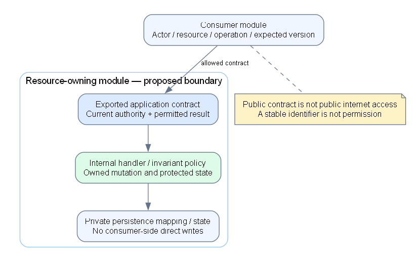

**Logical component:** a coherent architectural responsibility, such as Presentation or Sharing. **Code module:** the package structure that realizes that responsibility and makes exported/internal elements identifiable. **Deployment unit:** an artifact/process arrangement that can be installed or run. These concepts are related but are not interchangeable: several modules can share one release and database.

The nine candidate responsibility owners are Identity/Access, Presentation, Representation/Sharing, Applications, Communication/Calendar, Work, Git Collaboration, Workflow/Deployment Coordination and Files/Operations. Their [component records](#design-record-03-component-and-module-design-component-and-module-design-md) own concrete prescriptions. Do not copy a shared user/resume model into every module merely to simulate service boundaries.

Within a module, identify application contracts/handlers, invariant-enforcing domain policy, infrastructure mappings/adapters and permitted query projections. Use structure appropriate to actual complexity; folders named Domain or Application do not by themselves enforce encapsulation.

<a id="design-record-03-component-and-module-design-01-modularity-dependencies-and-encapsulation-md--heading-ownership-examples"></a>

##### Ownership examples

- Presentation owns draft mutation, overrides and publication identity; another module cannot update its live pointer directly.
- Sharing owns link eligibility/version and viewer authorization; PDF mode changes do not implicitly disable a link.
- Applications owns actual submission manifests; a new live revision cannot overwrite actual historical materials.
- Files owns usable-artifact admission, reservation accounting and protected-reference-aware reclamation; a consumer's logical unlink does not prove freed storage.
- Git owns native ref/review integration semantics; Work links do not extend grants, and a merge does not supply execution/deployment permission.

DDD bounded contexts can help explain vocabulary and invariant ownership. They remain candidate design boundaries, not an instruction to adopt event sourcing, a DDD framework or independent microservices.

<a id="design-record-03-component-and-module-design-01-modularity-dependencies-and-encapsulation-md--heading-2-public-contracts-and-internal-encapsulation"></a>

#### 2. Public contracts and internal encapsulation

<a id="design-record-03-component-and-module-design-01-modularity-dependencies-and-encapsulation-md--heading-what-a-module-exports"></a>

##### What a module exports

Export named application operations, validated request/value types, stable identifiers and permitted result projections that an actual consumer needs. Record current authority, expected version where relevant, input meaning, intended effect, protected state, result classifications and safe repetition/concurrency behavior.

Examples are ResolvePublication, RetrieveRepresentation, CaptureActualSubmission and MergeExpectedRefs. They describe responsibilities, not final language signatures. Public means consumable by another authorized module; it does not mean internet-accessible or exempt from policy.

<a id="design-record-03-component-and-module-design-01-modularity-dependencies-and-encapsulation-md--heading-what-remains-internal"></a>

##### What remains internal

Keep mutation-capable domain objects, ORM mappings, internal repositories, storage paths, provider credentials and transaction implementation private to their owner. A consumer cannot instantiate an internal handler to skip the public command boundary, reach into another module's database tables, or treat a file path as authorization.

Do not expose a mutable ORM entity across modules and rely on callers not to save it. Return a projection containing only permitted fields and explicit identity/version/provenance. A shared identifier establishes a reference, not access to the referenced content.

<a id="design-record-03-component-and-module-design-01-modularity-dependencies-and-encapsulation-md--heading-owner-side-enforcement"></a>

##### Owner-side enforcement

The resource owner verifies current actor/resource/action/lifecycle policy at the actual operation boundary. Gateway middleware can enforce common admission requirements, but cannot replace operation-specific checks. The same contract applies when called from a web controller, a worker, an administrative action or another module. Jobs reconstruct current context; an old session snapshot cannot grant indefinite authority.

<a id="design-record-03-component-and-module-design-01-modularity-dependencies-and-encapsulation-md--heading-3-dependency-direction-and-coordination"></a>

#### 3. Dependency direction and coordination

[Allowed dependencies and infrastructure realization](https://github.com/Farhad-V/Web-Resumefolio/blob/1f2acaa351ac306cb57cbe4fe9742e8bd90720d9/docs/MVP/SDLC/04-system-design/03-component-and-module-design/diagrams/module-dependency-direction.svg)

[Editable DOT](https://github.com/Farhad-V/Web-Resumefolio/blob/1f2acaa351ac306cb57cbe4fe9742e8bd90720d9/docs/MVP/SDLC/04-system-design/03-component-and-module-design/diagrams/module-dependency-direction.dot) · 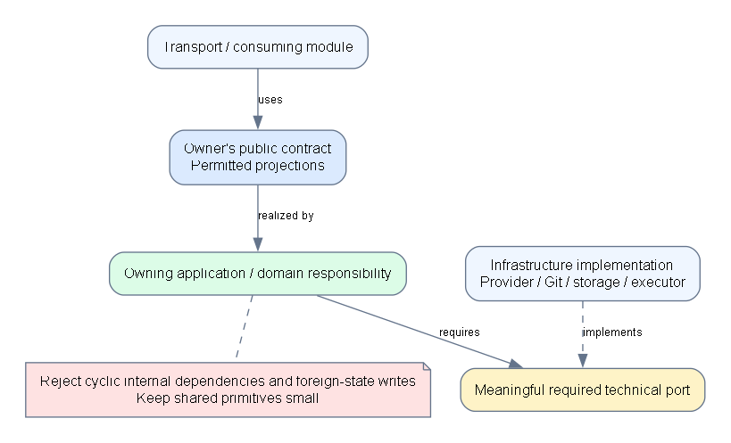

<a id="design-record-03-component-and-module-design-01-modularity-dependencies-and-encapsulation-md--heading-allowed-dependency-rules"></a>

##### Allowed dependency rules

1. Transport code invokes its owning module’s public use-case entry point; domain mutation and cross-module storage access do not belong in controllers.
2. A module consumes another module’s exported contract and permitted projection, never its internal persistence or mutable domain implementation.
3. Application/domain responsibilities depend on meaningful capability contracts where separation is useful. Provider/storage/Git/executor infrastructure implements those contracts.
4. Shared primitives stay small: explicit identifiers, outcome/clock abstractions and justified common technical capabilities. Business lifecycle/authority remains at the actual owner, not a universal Shared service.
5. Cross-module dependency cycles are a review finding. Resolve them through clearer ownership, a permitted projection or an explicit coordinating use case, rather than mutual internal service calls.
6. Technical credentials are not human authority. A worker's ability to reach storage or an executor does not authorize the requested product operation.

<a id="design-record-03-component-and-module-design-01-modularity-dependencies-and-encapsulation-md--heading-coordinating-multiple-owners"></a>

##### Coordinating multiple owners

Applications may store a correspondence identifier while Communication supplies an independently authorized summary. Neither imports the other's ORM entity. Work may associate a repository/revision without acquiring Git write access. Sharing asks Presentation for the intended publication and Files for an eligible usable artifact; each owner preserves its contract.

For changes spanning local owners, define the application orchestration, actual local consistency boundary and explicit pending work. A shared transaction may coordinate a justified local invariant, but must not become permission for arbitrary cross-module table writes. Remote mutations remain outside a local database rollback. See [runtime coordination](../01-High-level-design/High-level-design.md#design-record-01-software-architecture-03-process-view-concurrency-and-runtime-behavior-md).

<a id="design-record-03-component-and-module-design-01-modularity-dependencies-and-encapsulation-md--heading-events-and-asynchronous-dependencies"></a>

##### Events and asynchronous dependencies

An event is a named observation with identity/provenance, not automatic permission for every consumer. A confirmed Git change can be input to workflow eligibility; it cannot itself authorize execution or deployment. A saved profile cannot trigger implicit publication. Durable consequential reactions need pending-intent/attempt handling and reconciliation rather than fire-and-forget observers.

Avoid using a generic event bus to conceal a required synchronous invariant or a dependency cycle. Each reaction needs an identified owner, source rule, current authority, result/failure contract and verification path.

<a id="design-record-03-component-and-module-design-01-modularity-dependencies-and-encapsulation-md--heading-4-dependency-injection-and-object-lifetime"></a>

#### 4. Dependency injection and object lifetime

[Composition and lifetime boundaries](https://github.com/Farhad-V/Web-Resumefolio/blob/1f2acaa351ac306cb57cbe4fe9742e8bd90720d9/docs/MVP/SDLC/04-system-design/03-component-and-module-design/diagrams/module-composition-and-lifetimes.svg)

[Editable DOT](https://github.com/Farhad-V/Web-Resumefolio/blob/1f2acaa351ac306cb57cbe4fe9742e8bd90720d9/docs/MVP/SDLC/04-system-design/03-component-and-module-design/diagrams/module-composition-and-lifetimes.dot) · 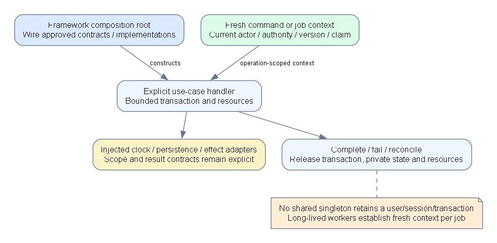

Use the framework composition root to register approved implementations and construct explicit dependencies. Controllers/handlers receive needed collaborators rather than finding arbitrary services through global lookups. Introduce a port when actual variability, effect control or verification warrants it, not simply to wrap every framework method.

**Command/request scope:** actor context, expected revision, transaction/unit of work and sensitive intent belong to the bounded operation. Do not hold them in shared static state or a singleton that can serve another user or job.

**Worker scope:** a long-lived process may reuse suitable stateless infrastructure, but each job establishes fresh command/claim/authority context and releases/reset resource state. No prior job’s credentials, ORM identity map, transaction or private payload may leak into the next operation.

**External adapters:** inject provider/native Git/storage/executor clients with explicit scope and result semantics. Keep clocks and operation identities controllable where deterministic checks need them. Replacing a client with a mock does not verify the real protocol, isolation or recovery facility.

**Lifetime verification:** evaluate actual framework/runtime lifecycle before selecting concrete registration lifetimes. Request-scoped assumptions from traditional HTTP execution must not silently carry into persistent workers. Secrets and cancellation/resource cleanup require explicit ownership on successful and exceptional paths.

<a id="design-record-03-component-and-module-design-01-modularity-dependencies-and-encapsulation-md--heading-5-cohesion-coupling-and-boundary-review"></a>

#### 5. Cohesion coupling and boundary review

<a id="design-record-03-component-and-module-design-01-modularity-dependencies-and-encapsulation-md--heading-cohesion-questions"></a>

##### Cohesion questions

Do the module’s state and operations protect a common responsibility or invariant? Can publication, link controls, actual history and file lifecycle be explained without an ambiguous all-purpose manager? Does a technical adapter change for different reasons from domain policy? A small module count or method count alone proves none of these properties.

<a id="design-record-03-component-and-module-design-01-modularity-dependencies-and-encapsulation-md--heading-coupling-indicators"></a>

##### Coupling indicators

Review forbidden internal imports/table access, cyclic dependencies, broad interfaces, excessive consumer knowledge of another owner's internals, shared mutable models and scattered policy duplication. Record actual imports/consumers/scenarios and their consequences when implementation exists. No universal coupling/cohesion score or threshold is adopted here.

A dependency count can support a diagnosis, but a shared authority contract may legitimately have many consumers. Conversely one generic service can hide extensive informal coupling. Examine semantic dependence and change impact rather than maximizing interfaces or minimizing counts mechanically.

<a id="design-record-03-component-and-module-design-01-modularity-dependencies-and-encapsulation-md--heading-planned-enforcement"></a>

##### Planned enforcement

Once a concrete source layout/toolchain exists, configure boundary checks to allow public contracts and reject forbidden internal imports/cycles. Add focused handler/domain tests, real persistence/concurrency integration and controlled external adapter checks where applicable. The dependency-checking tool and package rules are not selected or executed in this authoring task.

<a id="design-record-03-component-and-module-design-01-modularity-dependencies-and-encapsulation-md--heading-required-review-walkthroughs"></a>

##### Required review walkthroughs

- A consumer attempts to mutate another owner’s state: only the public authorized operation is permitted.
- A background task executes after a grant/link/account change: current authority and actual prior effects are reassessed.
- Presentation changes draft/publication internals: Applications retains actual history and Sharing retains its independent controls.
- A provider/renderer adapter changes: source outcome, language, denial and unknown-effect semantics remain compatible.
- A long-lived worker handles different actors: no mutable identity/credential/transaction state crosses job boundaries.
- A new event reaction is proposed: confirm it does not silently send, publish, execute or deploy without the required intent/authority.

These are review/check specifications, not observed tests or proven module enforcement.

<a id="design-record-03-component-and-module-design-01-modularity-dependencies-and-encapsulation-md--heading-6-implementation-handoff-and-current-limits"></a>

#### 6. Implementation handoff and current limits

For each actual module package, document exported/internal elements, provided/required operations, owned records/invariants, consumer projections, dependency/transaction boundaries, adapter contracts and construction/lifetime rules. Keep exact types/classes/algorithms and technical scenarios together using the [component package template](#design-record-03-component-and-module-design-component-and-module-design-md).

Map the package to the [implementation artifacts](#design-record-03-component-and-module-design-02-implementation-view-and-artifacts-md), [shared data design](#design-record-04-data-design-data-design-md), [interface contracts](#design-record-05-interface-and-api-design-interface-and-api-design-md) and [security/quality](../01-High-level-design/High-level-design.md#design-record-06-design-quality-and-security-analysis-design-quality-and-security-analysis-md). A physical schema, shared database or common release artifact must not erase logical ownership.

Significant dependency changes need [ADR rationale](../01-High-level-design/High-level-design.md#design-record-07-design-decisions-design-decisions-md) and targeted impact assessment. Record actual findings/debt under the [evolution procedure](#design-record-02-detailed-and-object-oriented-design-05-design-evolution-refactoring-and-technical-debt-md) and [design review/handoff](../01-High-level-design/High-level-design.md#design-record-06-design-quality-and-security-analysis-05-design-review-traceability-and-handoff-md). Do not label unresolved evidence as accepted debt.

Final language namespaces, framework lifetimes, allowed-import configuration, exact public signatures, complete class models and physical transaction mappings remain implementation-level design follow-up. This guide does not claim that production modules exist or that boundaries have been tested.

<a id="design-record-03-component-and-module-design-01-modularity-dependencies-and-encapsulation-md--heading-7-fau-basis-and-diagram-reading"></a>

#### 7. FAU basis and diagram reading

FAU V07 introduces abstraction, modularization, cohesion/coupling, encapsulation and component interfaces; V08 refines components into implementation classes/contracts with conventions and review. The module conventions here adapt those ideas to Resumefolio, rather than prescribe nine deployable services or a mandatory framework package tree.

The diagrams show ownership, dependency and lifetime relationships. Arrows do not mean a temporal call chain or automatic permission inheritance. Editable DOT and SVG/PNG outputs are linked in the [diagram catalog](#design-record-03-component-and-module-design-diagrams-diagram-catalog-md). See the [FAU reference map](../01-High-level-design/High-level-design.md#design-record-design-references-and-coverage-md) for source/adaptation limits.

No production source change, provider operation, migration, live security/capacity check or baseline approval is performed by this document update. Advisor transport remains unavailable as previously recorded; no independent endorsement is claimed.

[Component and Module Design index](#design-record-03-component-and-module-design-component-and-module-design-md) · [Architecture boundaries](../01-High-level-design/High-level-design.md#design-record-01-software-architecture-02-system-decomposition-and-boundaries-md)

<a id="design-record-03-component-and-module-design-01-modularity-dependencies-and-encapsulation-md--heading-8-essential-modularity-and-encapsulation-views"></a>

#### 8. Essential modularity and encapsulation views

This focused package adds **four diagrams and four reference tables**. Reuse the existing boundary, dependency and lifetime views above and the [architecture module dependency view](../01-High-level-design/High-level-design.md#design-record-01-software-architecture-02-system-decomposition-and-boundaries-md). It does not fabricate a measured whole-code dependency graph, hotspot score or populated import DSM before actual implementation/import inspection. Several logical owners can share one deployable application.

<a id="design-record-03-component-and-module-design-01-modularity-dependencies-and-encapsulation-md--heading-81-owner-packages-and-source-dependency-direction"></a>

##### 8.1 Owner packages and source dependency direction

[Owner packages and source dependency direction](https://github.com/Farhad-V/Web-Resumefolio/blob/1f2acaa351ac306cb57cbe4fe9742e8bd90720d9/docs/MVP/SDLC/04-system-design/03-component-and-module-design/diagrams/modularity-essential-packages.svg)

[Editable PlantUML](https://github.com/Farhad-V/Web-Resumefolio/blob/1f2acaa351ac306cb57cbe4fe9742e8bd90720d9/docs/MVP/SDLC/04-system-design/03-component-and-module-design/diagrams/modularity-essential-packages.puml) · 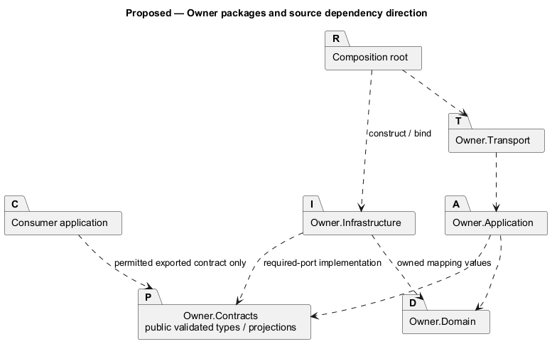

Proposed acyclic source graph, not actual namespaces or a measured import audit. Ports belong in the actual owning contract/application location selected for the codebase; the package label is illustrative. Composition root wires concrete adapters rather than domain code locating arbitrary services.

<a id="design-record-03-component-and-module-design-01-modularity-dependencies-and-encapsulation-md--heading-82-allowed-layers-and-forbidden-bypasses"></a>

##### 8.2 Allowed layers and forbidden bypasses

[Allowed layers and forbidden bypasses](https://github.com/Farhad-V/Web-Resumefolio/blob/1f2acaa351ac306cb57cbe4fe9742e8bd90720d9/docs/MVP/SDLC/04-system-design/03-component-and-module-design/diagrams/modularity-essential-layers.svg)

[Editable PlantUML](https://github.com/Farhad-V/Web-Resumefolio/blob/1f2acaa351ac306cb57cbe4fe9742e8bd90720d9/docs/MVP/SDLC/04-system-design/03-component-and-module-design/diagrams/modularity-essential-layers.puml) · 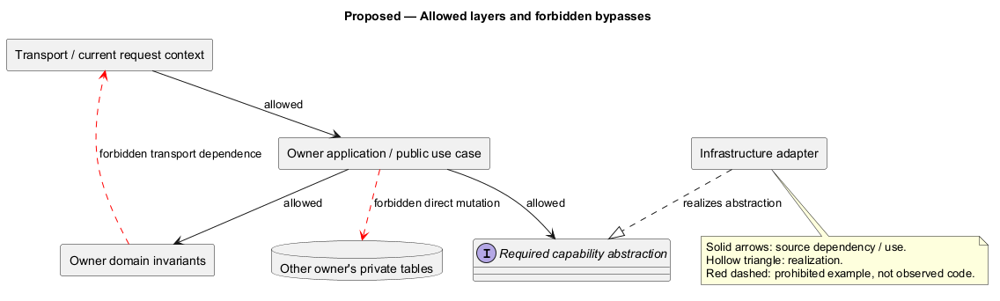

Combines layering, public boundary and dependency inversion in one essential view. Runtime calls may reach an injected adapter while source dependency points toward an abstraction. A shared database or process does not relax another owner’s write boundary.

<a id="design-record-03-component-and-module-design-01-modularity-dependencies-and-encapsulation-md--heading-83-public-contract-and-hidden-implementation"></a>

##### 8.3 Public contract and hidden implementation

[Public contract and hidden implementation](https://github.com/Farhad-V/Web-Resumefolio/blob/1f2acaa351ac306cb57cbe4fe9742e8bd90720d9/docs/MVP/SDLC/04-system-design/03-component-and-module-design/diagrams/modularity-essential-encapsulation.svg)

[Editable PlantUML](https://github.com/Farhad-V/Web-Resumefolio/blob/1f2acaa351ac306cb57cbe4fe9742e8bd90720d9/docs/MVP/SDLC/04-system-design/03-component-and-module-design/diagrams/modularity-essential-encapsulation.puml) · 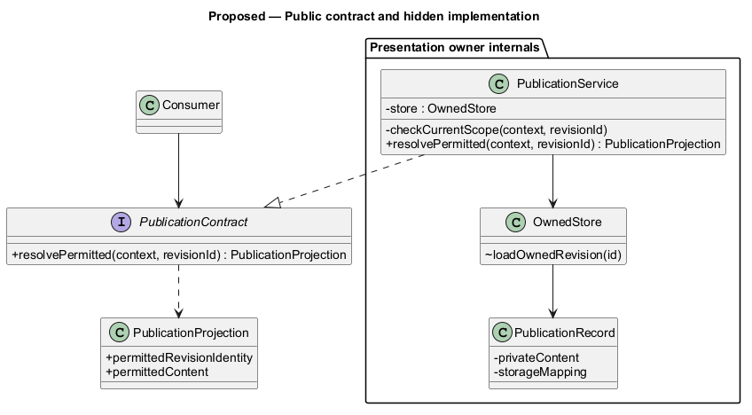

Plus marks public, minus private; tilde denotes package visibility conceptually, not a PHP access modifier. Actual module-internal visibility needs namespaces/import rules and review beyond language member visibility. Return a scoped projection rather than mutable ORM entity, credentials or raw private path. Interface access itself is not permission.

<a id="design-record-03-component-and-module-design-01-modularity-dependencies-and-encapsulation-md--heading-84-tangled-versus-owner-controlled-dependencies"></a>

##### 8.4 Tangled versus owner-controlled dependencies

[Tangled versus owner-controlled dependencies](https://github.com/Farhad-V/Web-Resumefolio/blob/1f2acaa351ac306cb57cbe4fe9742e8bd90720d9/docs/MVP/SDLC/04-system-design/03-component-and-module-design/diagrams/modularity-essential-before-after.svg)

[Editable PlantUML](https://github.com/Farhad-V/Web-Resumefolio/blob/1f2acaa351ac306cb57cbe4fe9742e8bd90720d9/docs/MVP/SDLC/04-system-design/03-component-and-module-design/diagrams/modularity-essential-before-after.puml) · 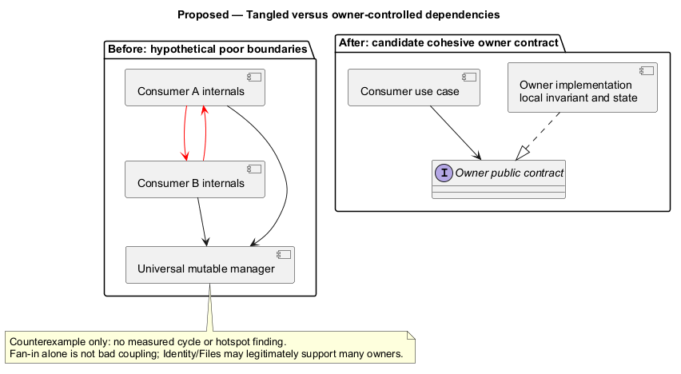

Illustrates information hiding and cohesion without claiming production smells. Removing a source cycle requires actual ownership/import analysis; a generic event bus cannot conceal an invariant dependency or authorize hidden effects. Do not split every method into an interface merely to lower arrow count.

<a id="design-record-03-component-and-module-design-01-modularity-dependencies-and-encapsulation-md--heading-85-information-hiding-and-module-secrets"></a>

##### 8.5 Information hiding and module secrets

“Secret” here means a change-prone implementation detail, not only a credential. Public examples are proposed contracts, not final signatures. Hiding internals never means hiding actual failure/unknown outcomes from consumers.

| Owner | Hidden implementation / decision | Public responsibility |
| --- | --- | --- |
| Identity | Verifiers, session backend, grant storage/invalidation mechanism | Current context and exact scoped evaluation; no raw secrets |
| Presentation | Draft/override persistence, comparison algorithm and manifest mapping | Explicit compare/apply/preview/publish; exact permitted revision projection |
| Sharing | Verifier/viewer storage, serving/invalidation mechanism | Link controls and current exact representation eligibility |
| Applications | Preparation/progress/correction mapping and consumer commit internals | Attributable actual event/material capture and permitted history |
| Communication | Provider client formats, credential handling and correlation mechanism | Explicit reviewed operations with truthful supported observations |
| Work | Ordering/mapping/persistence and cross-item Sprint guard | Coherent work mutation, explicit acceptance and period outcome |
| Git | Native backend integration, canonical storage and ref/SQL reconciliation details | Actual permitted native transfer and exact-revision review/merge |
| Workflow | Dispatch/claim/observation mechanics, workspace/secret implementation | Evidence-gated execution coordination and separate exact target intent |
| Files | Storage keys, accounting/reference/reclamation guards | Usable exact artifacts, protected-reference protocol and real accounting evidence |

<a id="design-record-03-component-and-module-design-01-modularity-dependencies-and-encapsulation-md--heading-86-dependency-kinds-to-review"></a>

##### 8.6 Dependency kinds to review

| Kind | Project example | Design / verification implication |
| --- | --- | --- |
| Source / compile-time | Applications imports Presentation's exported projection contract | Inspect actual namespace/import graph; no internal ORM/domain import |
| Runtime | Sharing invokes Files to resolve exact usable bytes | Actual authority, usability and unavailable/unknown semantics still apply |
| Data | Submission manifest retains opaque artifact and provenance identity | Cross-owner references do not grant CRUD; pin/finalize protocol must exclude cleanup races |
| Temporal | Protect exact bytes before consumer commit; finalize against actual result | Ordered steps and unknown-commit reconciliation cannot be replaced by a package diagram |
| Deployment / resource | Modules share web/worker/database/storage budgets | Logical isolation is not executor containment, independent capacity or separate failure domains |

For PHP, “compile-time” is often better described as source/load dependency: actual autoloading and runtime binding determine mechanics. A source dependency graph/DSM must state which kind its edges represent. Runtime callbacks and temporal handshakes do not automatically mean source import cycles.

<a id="design-record-03-component-and-module-design-01-modularity-dependencies-and-encapsulation-md--heading-87-public-api-surface-and-stability"></a>

##### 8.7 Public API surface and stability

| Surface | Export status | Stability / evolution obligation |
| --- | --- | --- |
| Named owner operations, validated intent/value types | Export only where an actual consumer needs them | Proposed now; actual compatibility and protected-frame semantics must be versioned/reviewed |
| Permitted result/projection and opaque identity | Export only allowed fields with actual outcome/provenance | No mutable ORM, secret or unrestricted path; identity alone conveys no access |
| Required effect/persistence port | Visible to its justified consumer/adapter/composition scope | Preserve substitution, denial, conflict, partial and unknown semantics |
| Domain mutation objects / ORM mappings / transaction helpers | Owner internal | May evolve internally while actual observable contracts/invariants remain preserved |
| Adapter credentials / storage locators / native workspace | Restricted infrastructure implementation | Never exposed through convenience DTOs/logs or broad service locator |
| Stable shared technical primitive | Shared only with named justified consumers | Keep small; no universal mutable business lifecycle/authority model |

<a id="design-record-03-component-and-module-design-01-modularity-dependencies-and-encapsulation-md--heading-88-planned-architecture-fitness-checks"></a>

##### 8.8 Planned architecture fitness checks

No analyzer, CI job or accepted threshold is installed/selected by this document. Choose tools compatible with actual manifests/runtime: ArchUnit is Java-specific and dependency-cruiser targets JavaScript/TypeScript, so neither is assumed to enforce this proposed PHP/Laravel codebase.

| Rule | Tool / method to select | Planned CI / review evidence |
| --- | --- | --- |
| Consumers import only allowed owner contracts | Actual stack-compatible import/dependency analyzer or inspected graph | Check actual namespace allowlist and prohibited internal edges |
| Source dependencies remain acyclic | Actual source-kind graph / DSM and cycle analysis | Report exact participating packages; record actual exception disposition if any |
| Public contracts preserve actual types and outcomes | Selected type/static analysis plus focused contract checks | Signature compatibility alone insufficient for behavioral substitution |
| No foreign state write or hidden consequential effect | Call/write-path review and affected persistence/integration checks | Actual code/transaction/reference evidence; text matching alone not enough |
| No mutable actor/session leaks across jobs | Actual framework binding/lifetime review and concurrent worker cases | Fresh per-operation current scope and released/reset resources |
| Diagram and implementation boundaries agree | Identified candidate import map, public API catalog and source/export checks | Reconcile drift explicitly; document renders are not runtime enforcement |

<a id="design-record-03-component-and-module-design-01-modularity-dependencies-and-encapsulation-md--heading-deliberately-omitted-duplicates"></a>

##### Deliberately omitted duplicates

Component provided/required interfaces and boundary sequences already live in the actual [component records](#design-record-03-component-and-module-design-component-and-module-design-md) and [complete template](#design-record-03-component-and-module-design-component-and-module-design-md); do not copy their contracts into a second source here. The layered view combines dependency inversion with allowed/prohibited direction; the before/after view explains coupling/cohesion without another nearly identical diagram. Populate a code DSM only after selecting actual packages, dependency kind and inspected candidate. Intended architecture links are not measured implementation imports or proof of no cycles.

No source module, dependency tool/configuration, CI check, import analysis or production mutation is created by this authoring update. Exact package/visibility enforcement, actual source graph, compatibility and owner-policy checks remain implementation/evidence work.

</details>

<a id="design-record-03-component-and-module-design-02-implementation-view-and-artifacts-md"></a>

<details>
<summary>Resumefolio — Implementation View and Artifacts</summary>

<a id="design-record-03-component-and-module-design-02-implementation-view-and-artifacts-md--heading-resumefolio--implementation-view-and-artifacts"></a>

### Resumefolio — Implementation View and Artifacts

**Proposed organization:** module-oriented Laravel source, explicit exported contracts and internal implementation, a coordinated trusted application release, separately controlled operating data and evaluated external facilities.

**Status:** proposed implementation view, November 2, 2026. The source tree and artifact names below are design conventions, not files claimed to exist or a generated product implementation. Final toolchain, versions, dependency licenses, Git engine, queue and executor remain subject to evaluation and applicable acceptance gates.

[Source layout](#design-record-03-component-and-module-design-02-implementation-view-and-artifacts-md--heading-1-proposed-source-organization) · [Mappings](#design-record-03-component-and-module-design-02-implementation-view-and-artifacts-md--heading-2-component-to-artifact-mapping) · [Build](#design-record-03-component-and-module-design-02-implementation-view-and-artifacts-md--heading-3-dependency-and-build-organization) · [Configuration](#design-record-03-component-and-module-design-02-implementation-view-and-artifacts-md--heading-4-configuration-operating-data-and-generated-content) · [Release](#design-record-03-component-and-module-design-02-implementation-view-and-artifacts-md--heading-5-release-manifest-and-promotion) · [Review](#design-record-03-component-and-module-design-02-implementation-view-and-artifacts-md--heading-6-verification-and-completion) · [Essential views](#design-record-03-component-and-module-design-02-implementation-view-and-artifacts-md--heading-8-essential-implementation-and-artifact-views)

Current MVP scope and selected mechanisms: [Baseline](https://github.com/Farhad-V/Web-Resumefolio/blob/1f2acaa351ac306cb57cbe4fe9742e8bd90720d9/docs/MVP/baseline/README.md). Deferred provider, advanced collaboration and workflow-execution designs are not MVP prerequisites.

<a id="design-record-03-component-and-module-design-02-implementation-view-and-artifacts-md--heading-source-context"></a>

#### Source context

Follow [logical component boundaries](../01-High-level-design/High-level-design.md#design-record-01-software-architecture-02-system-decomposition-and-boundaries-md), [module dependency rules](#design-record-03-component-and-module-design-01-modularity-dependencies-and-encapsulation-md), [runtime responsibilities](../01-High-level-design/High-level-design.md#design-record-01-software-architecture-03-process-view-concurrency-and-runtime-behavior-md), [deployment nodes](../01-High-level-design/High-level-design.md#design-record-01-software-architecture-04-deployment-topology-nodes-and-networks-md) and [OO guidance](#design-record-02-detailed-and-object-oriented-design-01-design-principles-and-object-oriented-approach-md). Components are logical owners; artifacts are physical development/release outputs; nodes are operating facilities. One-to-one mapping is not assumed.

<a id="design-record-03-component-and-module-design-02-implementation-view-and-artifacts-md--heading-1-proposed-source-organization"></a>

#### 1. Proposed source organization

[Proposed source responsibility structure](https://github.com/Farhad-V/Web-Resumefolio/blob/1f2acaa351ac306cb57cbe4fe9742e8bd90720d9/docs/MVP/SDLC/04-system-design/03-component-and-module-design/diagrams/implementation-source-structure.svg)

[Editable DOT](https://github.com/Farhad-V/Web-Resumefolio/blob/1f2acaa351ac306cb57cbe4fe9742e8bd90720d9/docs/MVP/SDLC/04-system-design/03-component-and-module-design/diagrams/implementation-source-structure.dot) · 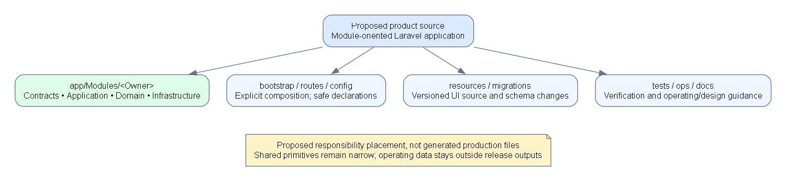

The following illustrates responsibility placement. Adapt concrete names to the evaluated framework conventions and actual component complexity before implementation. Do not create empty architectural layers merely to mirror the tree.

```text
app/
  Modules/
    IdentityAccess/
    Presentation/
    Sharing/
    Applications/
    CommunicationCalendar/
    Work/
    GitCollaboration/
    WorkflowDeployment/
    FilesOperations/
  Shared/                  # narrowly justified technical primitives
bootstrap/                 # application composition and initialization
config/                    # non-secret configuration declarations
routes/                    # HTTP/console route composition
resources/                 # shared UI assets and view source
database/migrations/       # ordered module-attributable schema changes
tests/                     # module and cross-boundary verification
ops/                       # reviewed operating/configuration templates
docs/                      # authoritative project documentation
```

<a id="design-record-03-component-and-module-design-02-implementation-view-and-artifacts-md--heading-inside-a-substantive-module"></a>

##### Inside a substantive module

```text
<Module>/
  Contracts/               # exported operations and permitted projections
  Application/             # explicit use-case orchestration
  Domain/                  # owned invariants and meaningful transitions
  Infrastructure/          # persistence and external adapters
  Http/                    # module-owned transport mapping, if needed
```

Make public/internal visibility and permitted imports enforceable through the selected toolchain/conventions. Module Contracts are not automatically public network APIs. Other modules may depend on explicit contracts, never on internal ORM mappings, storage paths or mutation-capable domain graphs. Shared must not become a universal domain model or broad service locator.

Keep framework composition registrations explicit. Route composition delegates to module-owned transport/application entry points. Shared UI infrastructure can serve several features while permission and domain state remain with their owners. Persistent worker scope must not retain another command's actor, transaction or private intent.

<a id="design-record-03-component-and-module-design-02-implementation-view-and-artifacts-md--heading-2-component-to-artifact-mapping"></a>

#### 2. Component-to-artifact mapping

[Components application artifacts and runtime placement](https://github.com/Farhad-V/Web-Resumefolio/blob/1f2acaa351ac306cb57cbe4fe9742e8bd90720d9/docs/MVP/SDLC/04-system-design/03-component-and-module-design/diagrams/component-artifact-placement.svg)

[Editable DOT](https://github.com/Farhad-V/Web-Resumefolio/blob/1f2acaa351ac306cb57cbe4fe9742e8bd90720d9/docs/MVP/SDLC/04-system-design/03-component-and-module-design/diagrams/component-artifact-placement.dot) · 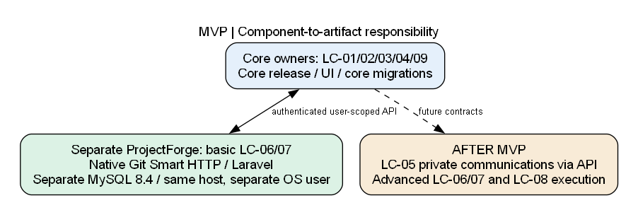

<a id="design-record-03-component-and-module-design-02-implementation-view-and-artifacts-md--heading-ia-01--trusted-application-release"></a>

##### IA-01 — Trusted application release

Realizes Identity/Access, Presentation, Sharing, Applications, Communication/Calendar, Work, Git Coordination, Workflow/Deployment Coordination and Files/Operations through their module code and contracts. Web and bounded workers/scheduler can run compatible entry points from the same application release. This does not authorize untrusted jobs inside the application identity.

The release includes application source or an evaluated deployable package, dependency resolution/lock identities, required migrations, UI build outputs and configuration/operating template identities. No final packaging technology or immutable-image mechanism is selected here.

<a id="design-record-03-component-and-module-design-02-implementation-view-and-artifacts-md--heading-ia-02--uistatic-outputs"></a>

##### IA-02 — UI/static outputs

Shared UI/view source and evaluated frontend tooling produce the actual public assets or server-side templates needed by the application. Bind outputs to the application release and compatibility manifest. Public assets exclude private resume files, repository objects, credentials and restricted diagnostic content. A frontend framework or build pipeline is not selected by this diagram.

<a id="design-record-03-component-and-module-design-02-implementation-view-and-artifacts-md--heading-ia-03--schema-migration-artifacts"></a>

##### IA-03 — Schema migration artifacts

Ordered migrations realize the evaluated physical data design, identifying component ownership and compatibility with active web/worker contracts. They are release artifacts, while the actual database contents are operating data. A downgrade script is not proof that historical data or external effects can be safely reversed.

<a id="design-record-03-component-and-module-design-02-implementation-view-and-artifacts-md--heading-ia-04--native-git-integration-artifacts"></a>

##### IA-04 — Native Git integration artifacts

Product coordination code belongs in the application release. Any selected native Git engine/package/service needs a separately identified version, configuration, transport contract and compatibility/recovery procedure. Repository objects/refs and review identities are operating data. Do not embed live repositories or real credentials in build packages.

<a id="design-record-03-component-and-module-design-02-implementation-view-and-artifacts-md--heading-ia-05--executorcontrol-artifacts"></a>

##### IA-05 — Executor/control artifacts

**After MVP.** Shared operating and recovery controls still apply where relevant.

Workflow coordination and its adapter belong in the trusted application. Any evaluated executor image/package/control service has its own identity, supported definition contract, admission/secret/output policy and operating verification. Its existence and safe configuration are not established. Deployment target artifacts are attributable job outputs, not automatically authorized product releases.

<a id="design-record-03-component-and-module-design-02-implementation-view-and-artifacts-md--heading-ia-06--operating-templates-and-release-metadata"></a>

##### IA-06 — Operating templates and release metadata

Review web/process-supervision/scheduling, private-storage, configuration and backup/recovery templates with the release. Templates identify required keys and prerequisites without real secret values. Actual effective configuration, permission grants and facilities require deployment verification.

These IA labels are local design locators, not product requirements. Physical placement is owned by the [deployment view](../01-High-level-design/High-level-design.md#design-record-01-software-architecture-04-deployment-topology-nodes-and-networks-md): the trusted environment may host several artifacts/processes; native Git/executor placement remains evaluated separately; independent recovery needs its own failure-domain coverage.

<a id="design-record-03-component-and-module-design-02-implementation-view-and-artifacts-md--heading-3-dependency-and-build-organization"></a>

#### 3. Dependency and build organization

<a id="design-record-03-component-and-module-design-02-implementation-view-and-artifacts-md--heading-dependency-declarations"></a>

##### Dependency declarations

Declare direct application/runtime and development dependencies explicitly with resolved lock identities where supported. Review source, maintenance, compatibility, license obligations, required operating privileges, resource costs and release implications before adopting a package/version. Existing demo installations or prior project usage are not automatic approval. No current package/version support claim is made by this document.

Application/domain consumers depend on meaningful ports or public module contracts; infrastructure packages realize them. A package installed globally on a developer machine must not become an undocumented production prerequisite. Separate build-only tools from operating dependencies and identify generated output ownership.

<a id="design-record-03-component-and-module-design-02-implementation-view-and-artifacts-md--heading-proposed-build-sequence"></a>

##### Proposed build sequence

1. Identify source revision, intended environment/toolchain and dependency declarations/locks.
2. Resolve dependencies in a suitable controlled build environment; verify that declared compatibility and required inputs actually hold.
3. Perform static/syntax and module-boundary checks, then build selected UI/generated outputs as required.
4. Run relevant unit/domain/handler checks and real persistence/contract integration for the affected candidate. External facilities need controlled scoped evidence rather than fabricated mock-only assurance.
5. Assemble the candidate release and manifest, excluding real secrets, private data, caches tied to another environment and untrusted runtime workspaces.
6. Inspect the actual assembled output and rehearse its deployment/migrations on suitable isolated facilities before promotion.

The sequence describes required evidence, not a CI pipeline that already exists. Build determinism should be tested by comparing identified inputs/outputs under the chosen toolchain; this proposal does not claim reproducible binaries merely because lock files are present.

<a id="design-record-03-component-and-module-design-02-implementation-view-and-artifacts-md--heading-4-configuration-operating-data-and-generated-content"></a>

#### 4. Configuration operating data and generated content

<a id="design-record-03-component-and-module-design-02-implementation-view-and-artifacts-md--heading-configuration-boundary"></a>

##### Configuration boundary

Version safe key declarations, defaults that are actually accepted, format/schema and templates. Supply environment-specific values and secrets through reviewed operating mechanisms outside source control. Record effective configuration identities without leaking values. Changing a template does not change the running process; process restart/cache behavior must follow the evaluated deployment procedure.

Never commit real OAuth/client credentials, database passwords, encryption/recovery keys, deployment tokens, private correspondence or actual user artifacts. An example file can document required key names and expected meaning without providing working secrets. A schema migration or generated configuration artifact must not manufacture privileged accounts or grants implicitly.

<a id="design-record-03-component-and-module-design-02-implementation-view-and-artifacts-md--heading-operating-data-boundary"></a>

##### Operating data boundary

Preserve transactional domain state, command/attempt identities, committed pending intent, native repository state, private artifact bytes, publication/submission manifests and restricted operational evidence outside replaceable application release directories. Do not clear them through a generic clean/build script.

Runtime dispatch state may be reconstructible only if the chosen durable intent/identity design supports it. Do not classify all queues as disposable when unresolved sends/workflows/deployments depend on their records. Backup coverage and restoration retain actual authority/external reconciliation as defined in [operating recovery](../01-High-level-design/High-level-design.md#design-record-06-design-quality-and-security-analysis-03-operations-backup-recovery-and-resilience-md).

<a id="design-record-03-component-and-module-design-02-implementation-view-and-artifacts-md--heading-generatedmanual-ownership"></a>

##### Generated/manual ownership

Each generated artifact needs an authoritative source, generator/toolchain identity, regeneration instructions, expected consumers and review policy. Avoid manually patching generated interface/build files while leaving their source inconsistent. Do not adopt code generation merely because FAU illustrates model-driven workflows; choose it only when useful and verifiable.

Documentation diagrams are generated from editable DOT/PlantUML sources and retained as readable SVG/PNG exports. Those are documentation outputs, not application build or product capability evidence.

<a id="design-record-03-component-and-module-design-02-implementation-view-and-artifacts-md--heading-5-release-manifest-and-promotion"></a>

#### 5. Release manifest and promotion

[Build candidate manifest and promotion route](https://github.com/Farhad-V/Web-Resumefolio/blob/1f2acaa351ac306cb57cbe4fe9742e8bd90720d9/docs/MVP/SDLC/04-system-design/03-component-and-module-design/diagrams/implementation-release-route.svg)

[Editable DOT](https://github.com/Farhad-V/Web-Resumefolio/blob/1f2acaa351ac306cb57cbe4fe9742e8bd90720d9/docs/MVP/SDLC/04-system-design/03-component-and-module-design/diagrams/implementation-release-route.dot) · 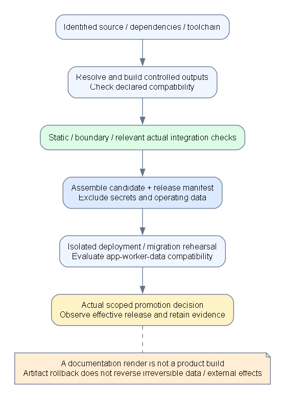

For an actual release record: source revision and dirty-state disposition; relevant dependency/toolchain identities; built artifact identities/integrity; component-to-artifact mapping; schema migration set and compatible app/worker/data versions; configuration key requirements; external engine/executor compatibility; actual verification/evidence; operating prerequisites; known risks; and rollback/forward-repair/recovery limits.

No manifest field should claim a hash, passing test or approval that was not actually produced. Final manifest format and signing/provenance mechanism need a justified implementation decision. Record what the selected mechanism actually verifies, rather than treating a checksum as authorization or origin assurance.

Promote only the identified evaluated artifact through [deployment procedures](../01-High-level-design/High-level-design.md#design-record-01-software-architecture-04-deployment-topology-nodes-and-networks-md). Control incompatible in-flight workers/jobs, preserve operating data and reconcile external effects. An application artifact rollback is not an automatic database restore or an undo of sent mail, updated refs or a target deployment.

<a id="design-record-03-component-and-module-design-02-implementation-view-and-artifacts-md--heading-6-verification-and-completion"></a>

#### 6. Verification and completion

<a id="design-record-03-component-and-module-design-02-implementation-view-and-artifacts-md--heading-required-implementation-view-checks"></a>

##### Required implementation-view checks

- Each logical component maps to actual source/package elements and realizing artifacts, with exported/internal dependencies identifiable.
- Each running artifact maps to an operating environment/node and required communication/configuration path.
- Web, workers, scheduler, schema and external-adapter versions agree on active contracts and pending work.
- Build output contains required assets/migrations and excludes secrets, private operating data and untrusted workspaces.
- Actual assembled-output boot/route/module-boundary checks and relevant persistence/integration results identify the same candidate.
- Deployment, compatibility, migration and recovery limits are explicit and supported at their applicable acceptance gates.

These are future verification requirements, not tests executed by this document update. Exact namespace conventions, package definitions, build commands, chosen tools/versions, manifest format and concrete artifact hashes remain implementation-level follow-up. The existing documentation-only repository is not represented as an already built product source tree.

Use [component packages](#design-record-03-component-and-module-design-component-and-module-design-md), [data design](#design-record-04-data-design-data-design-md), [interface design](#design-record-05-interface-and-api-design-interface-and-api-design-md), [evolution guidance](#design-record-02-detailed-and-object-oriented-design-05-design-evolution-refactoring-and-technical-debt-md) and [design review/handoff](../01-High-level-design/High-level-design.md#design-record-06-design-quality-and-security-analysis-05-design-review-traceability-and-handoff-md) to maintain a coherent candidate. Source families or artifact counts are not exact criterion completion.

<a id="design-record-03-component-and-module-design-02-implementation-view-and-artifacts-md--heading-7-fau-basis-and-diagram-reading"></a>

#### 7. FAU basis and diagram reading

FAU V07’s implementation view relates components/modules to source files and development outputs; its artifact/deployment model maps logical components to physical artifacts and nodes. V08 carries architecture inputs into component implementation prescriptions. This proposed layout is a project adaptation, not a mandatory framework filesystem or an assertion that one component equals one binary/service.

The diagrams illustrate source responsibility, artifact placement and the release evidence route. They do not select queue/Git/executor products, install facilities or prove runtime behavior. See [FAU reference map](../01-High-level-design/High-level-design.md#design-record-design-references-and-coverage-md) and [diagram catalog](#design-record-03-component-and-module-design-diagrams-diagram-catalog-md).

No production source generation, dependency installation, build, migration, deployment, provider/Git mutation or baseline approval is performed in this authoring update. Advisor transport remains unavailable as previously recorded; no independent endorsement is claimed.

[Component and Module Design index](#design-record-03-component-and-module-design-component-and-module-design-md) · [Module boundary rules](#design-record-03-component-and-module-design-01-modularity-dependencies-and-encapsulation-md)

<a id="design-record-03-component-and-module-design-02-implementation-view-and-artifacts-md--heading-8-essential-implementation-and-artifact-views"></a>

#### 8. Essential implementation and artifact views

Only **three complementary diagrams** are added here; no new tables. Reuse the existing [source structure](#design-record-03-component-and-module-design-02-implementation-view-and-artifacts-md--heading-1-proposed-source-organization), [component/artifact placement](#design-record-03-component-and-module-design-02-implementation-view-and-artifacts-md--heading-2-component-to-artifact-mapping) and [release route](#design-record-03-component-and-module-design-02-implementation-view-and-artifacts-md--heading-5-release-manifest-and-promotion). These represent the proposed implementation candidate, not an inspected product code tree or completed build.

<a id="design-record-03-component-and-module-design-02-implementation-view-and-artifacts-md--heading-81-implementation-view-logical-owners-to-physical-outputs"></a>

##### 8.1 Implementation view: logical owners to physical outputs

[Implementation view: logical owners to physical outputs](https://github.com/Farhad-V/Web-Resumefolio/blob/1f2acaa351ac306cb57cbe4fe9742e8bd90720d9/docs/MVP/SDLC/04-system-design/03-component-and-module-design/diagrams/implementation-essential-overview.svg)

[Editable PlantUML](https://github.com/Farhad-V/Web-Resumefolio/blob/1f2acaa351ac306cb57cbe4fe9742e8bd90720d9/docs/MVP/SDLC/04-system-design/03-component-and-module-design/diagrams/implementation-essential-overview.puml) · 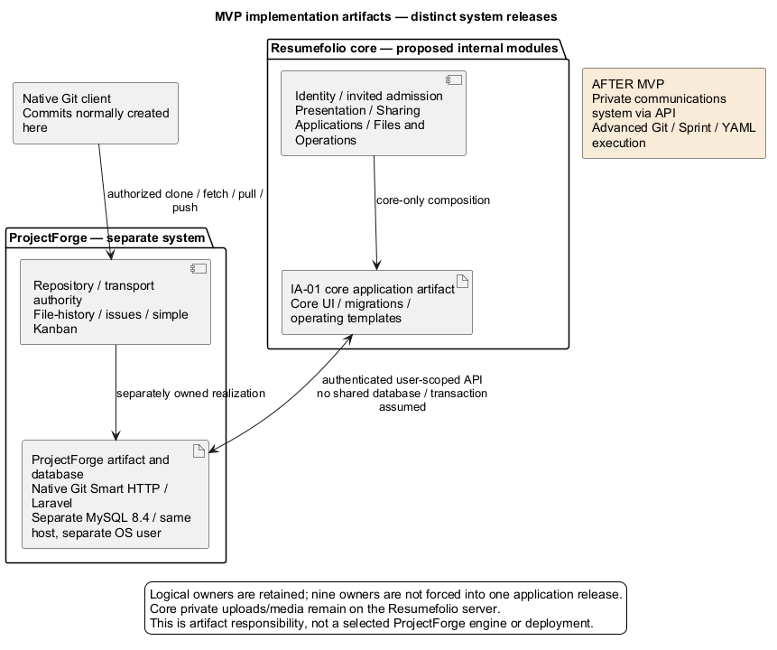

4+1 implementation-view refinement: logical responsibilities map to source elements and physical outputs, not one service or binary per owner. IA locators reuse section 2; actual source/package names, toolchain and compatibility remain proposed.

<a id="design-record-03-component-and-module-design-02-implementation-view-and-artifacts-md--heading-82-uml-style-artifacts-and-manifestation-boundaries"></a>

##### 8.2 UML-style artifacts and manifestation boundaries

[UML-style artifacts and manifestation boundaries](https://github.com/Farhad-V/Web-Resumefolio/blob/1f2acaa351ac306cb57cbe4fe9742e8bd90720d9/docs/MVP/SDLC/04-system-design/03-component-and-module-design/diagrams/implementation-essential-overview.svg)

[Editable PlantUML](https://github.com/Farhad-V/Web-Resumefolio/blob/1f2acaa351ac306cb57cbe4fe9742e8bd90720d9/docs/MVP/SDLC/04-system-design/03-component-and-module-design/diagrams/implementation-essential-overview.puml) · 

The «manifest» dependency denotes UML artifact manifestation, distinct from the release-manifest document identifying output/provenance. Git/executor artifacts are conditional evaluated prerequisites, not installed products. A checksum alone is not authorization or origin assurance.

<a id="design-record-03-component-and-module-design-02-implementation-view-and-artifacts-md--heading-83-build-dependency-order-and-candidate-evidence"></a>

##### 8.3 Build dependency order and candidate evidence

[Build dependency order and candidate evidence](https://github.com/Farhad-V/Web-Resumefolio/blob/1f2acaa351ac306cb57cbe4fe9742e8bd90720d9/docs/MVP/SDLC/04-system-design/03-component-and-module-design/diagrams/implementation-essential-build-order.svg)

[Editable PlantUML](https://github.com/Farhad-V/Web-Resumefolio/blob/1f2acaa351ac306cb57cbe4fe9742e8bd90720d9/docs/MVP/SDLC/04-system-design/03-component-and-module-design/diagrams/implementation-essential-build-order.puml) · 

Essential build-input/order flow, not installed CI or actual commands. PHP modules are not automatically separately compiled build targets; no fabricated inter-module compilation order is imposed. Parallel branches show independent candidate tasks only where actual tooling permits; affected checks must use the intended outputs. Packaging does not publish to a selected registry or authorize deployment.

The [modularity guide](#design-record-03-component-and-module-design-01-modularity-dependencies-and-encapsulation-md--heading-8-essential-modularity-and-encapsulation-views) already supplies package direction, layers and hidden implementation. The [deployment view](../01-High-level-design/High-level-design.md#design-record-01-software-architecture-04-deployment-topology-nodes-and-networks-md) owns node placement; the [Git design](#design-record-03-component-and-module-design-components-git-collaboration-md--heading-7-essential-git-and-collaboration-views) owns its candidate branching/review views. Duplicating them here would create competing diagrams without a new implementation question.

No monorepo/multi-repo split, third-party package graph, registry, release version scheme or separate module build target is selected. Populate actual dependency identities and code structure only after inspecting the real candidate. Unresolved Git/executor/runtime/secret/recovery mechanisms remain evidence gates; these diagrams perform no install, build, publish, migration or deployment.

</details>

<a id="design-record-03-component-and-module-design-component-and-module-design-md"></a>

<details>
<summary>Component and Module Design</summary>

<a id="design-record-03-component-and-module-design-component-and-module-design-md--heading-component-and-module-design"></a>

### Component and Module Design

The [Baseline](https://github.com/Farhad-V/Web-Resumefolio/blob/1f2acaa351ac306cb57cbe4fe9742e8bd90720d9/docs/MVP/baseline/README.md) selects the MVP system/technical boundaries. These project-specific records retain detailed operation, data, behavior and failure analysis; no source modules or product tests exist yet.

<a id="design-record-03-component-and-module-design-component-and-module-design-md--heading-1-reading-route"></a>

#### 1. Reading route

Start with [architecture decomposition](../01-High-level-design/High-level-design.md#design-record-01-software-architecture-02-system-decomposition-and-boundaries-md), [module/dependency rules](#design-record-03-component-and-module-design-01-modularity-dependencies-and-encapsulation-md) and [implementation artifacts](#design-record-03-component-and-module-design-02-implementation-view-and-artifacts-md), then the affected component below. Use shared [Data](#design-record-04-data-design-data-design-md), [API](#design-record-05-interface-and-api-design-interface-and-api-design-md) and [Security/Quality](../01-High-level-design/High-level-design.md#design-record-06-design-quality-and-security-analysis-design-quality-and-security-analysis-md) owners rather than copy their policies into each record.

<a id="design-record-03-component-and-module-design-component-and-module-design-md--heading-2-shared-module-and-implementation-guidance"></a>

#### 2. Shared module and implementation guidance

For each component keep responsibilities/contracts, identities/classes/data, algorithms/concurrency, failure/recovery scenarios and justified coding constraints together. Refine the existing actual record instead of creating a second generic package. Link exact source criteria and important [ADRs](../01-High-level-design/High-level-design.md#design-record-07-design-decisions-design-decisions-md); retain allowed/denied/stale/repeated/failure outcomes and their verification needs.

<a id="design-record-03-component-and-module-design-component-and-module-design-md--heading-3-proposed-component-catalog"></a>

#### 3. Proposed component catalog

Current MVP slices are governed by the Baseline. Component models may include explicitly deferred extensions; their existence does not add those features to the current Release.

<a id="design-record-03-component-and-module-design-component-and-module-design-md--heading-lc-01--identity-and-access"></a>

##### LC-01 — Identity and Access

[Component record](#design-record-03-component-and-module-design-components-identity-and-access-md). Owns accounts, invitations, sessions and scoped grant context. Resource owners still apply current operation/lifecycle rules; successful sign-in or a membership never supplies universal access.

<a id="design-record-03-component-and-module-design-component-and-module-design-md--heading-lc-02--professional-presentation"></a>

##### LC-02 — Professional Presentation

[Component record](#design-record-03-component-and-module-design-components-professional-presentation-md). Owns profiles, independent drafts/overrides, selected evidence and identified publication revisions. Selected source application and separate publication preserve independent resume content and actual history.

<a id="design-record-03-component-and-module-design-component-and-module-design-md--heading-lc-03--representation-and-sharing"></a>

##### LC-03 — Representation and Sharing

[Component record](#design-record-03-component-and-module-design-components-representation-and-sharing-md). Owns download settings, independent links and viewer authorization. Current eligibility, selected publication/language/rendition and artifact availability remain distinct; direct retrieval cannot bypass them.

<a id="design-record-03-component-and-module-design-component-and-module-design-md--heading-lc-04--manual-applications"></a>

##### LC-04 — Manual Applications

[Component record](#design-record-03-component-and-module-design-components-applications-md). Owns opportunity/preparation, manual progress and actual submission material manifests. Progress, provider acceptance and actual submitted evidence are different facts; current live content does not replace historical material.

<a id="design-record-03-component-and-module-design-component-and-module-design-md--heading-lc-05--communication-and-calendar"></a>

##### LC-05 — Communication and Calendar

**After MVP.** Shared operating and recovery controls still apply where relevant.

[Component record](#design-record-03-component-and-module-design-components-communication-and-calendar-md). Owns provider capability, local drafts/activities, attributable send attempts and synchronization mappings. Disconnect/unlink/provider mutation and uncertain effects need explicit handling rather than replay or silent conflict resolution.

<a id="design-record-03-component-and-module-design-component-and-module-design-md--heading-lc-06--work-management"></a>

##### LC-06 — Work Management

[Component record](#design-record-03-component-and-module-design-components-work-management-md). MVP owns ProjectForge issues and fixed simple Kanban, membership and safe movement. General projects/backlog/Sprints and advanced planning remain after MVP.

<a id="design-record-03-component-and-module-design-component-and-module-design-md--heading-lc-07--git-collaboration"></a>

##### LC-07 — Git Collaboration

[Component record](#design-record-03-component-and-module-design-components-git-collaboration-md). MVP owns authorized repositories, real native Git transfers, file/history and basic issues. Advanced fork/review/merge/releases are deferred; Git operations never authorize user workflow execution or production deployment.

<a id="design-record-03-component-and-module-design-component-and-module-design-md--heading-lc-08--workflow-and-deployment-coordination"></a>

##### LC-08 — Workflow and Deployment Coordination

**After MVP.** Shared operating and recovery controls still apply where relevant.

[Component record](#design-record-03-component-and-module-design-components-workflow-and-deployment-md). Owns supported workflow definitions, admitted attempts, restricted output references and separately authorized target attempts. Execution requires actual enabling evidence; cancellation intent is not confirmed termination.

<a id="design-record-03-component-and-module-design-component-and-module-design-md--heading-lc-09--files-and-operations"></a>

##### LC-09 — Files and Operations

[Component record](#design-record-03-component-and-module-design-components-files-and-operations-md). Owns admitted artifact identity/usability, quota reservations, protected-reference accounting and recovery records. Replacement, retirement, physical reclamation and usable recovery require their actual attributable outcomes.

<a id="design-record-03-component-and-module-design-component-and-module-design-md--heading-4-completing-one-component-package"></a>

#### 4. Completing one component package

Use the selected mechanisms in the Baseline. During implementation add actual operation signatures, schema/migration and code paths plus criterion-linked checks. Source/draft/publication/submission identity, current grant/link revocation, protected references and durable truthful effects must remain consistent across owners. The Core and ProjectForge retain independent DB/process/key/session/storage boundaries.

<a id="design-record-03-component-and-module-design-component-and-module-design-md--heading-5-diagram-guide"></a>

#### 5. Diagram guide

[Shared module diagrams](#design-record-03-component-and-module-design-diagrams-diagram-catalog-md) and [component diagrams](#design-record-03-component-and-module-design-components-diagrams-diagram-catalog-md) link editable sources and exports. Byte-identical views use one canonical asset; distinct models and their meanings are retained. Generic uninstantiated examples are omitted from current Documentation.

<a id="design-record-03-component-and-module-design-component-and-module-design-md--heading-6-review-and-current-limits"></a>

#### 6. Review and current limits

Review contracts against the owning requirements, current authority, data/state invariants and consumer/failure consequences. Link actual targeted results before accepting dependent capability. Security, compatibility, resource suitability and demonstrated restore remain named gates; no provider/runner/Git capability is established by a model or diagram count.

<a id="design-record-03-component-and-module-design-component-and-module-design-md--heading-7-fau-basis-and-maintenance"></a>

#### 7. FAU basis and maintenance

Keep analysis meaning separate from physical deployment/code mechanisms. Use the [reference map](../01-High-level-design/High-level-design.md#design-record-design-references-and-coverage-md), [evolution procedure](#design-record-02-detailed-and-object-oriented-design-05-design-evolution-refactoring-and-technical-debt-md) and [Design review/handoff](../01-High-level-design/High-level-design.md#design-record-06-design-quality-and-security-analysis-05-design-review-traceability-and-handoff-md) when a material interface/ownership choice changes.

</details>

<a id="design-record-03-component-and-module-design-components-applications-md"></a>

<details>
<summary>Resumefolio — Manual Applications Component Design</summary>

<a id="design-record-03-component-and-module-design-components-applications-md--heading-resumefolio--manual-applications-component-design"></a>

### Resumefolio — Manual Applications Component Design

**Responsibility:** manage private application preparation and explicitly recorded progress while preserving identifiable material actually submitted. A current resume, a live sharing link, provider acceptance and historical submitted content are different facts.

**Status:** proposed LC-04 component design, November 2, 2026. The accepted manual-application scope is preserved. Detailed fields/progress/capture/retention proposals remain subject to their source disposition; technical names and schema below are proposals, not implemented code or accepted product refinements.

[Sources](#design-record-03-component-and-module-design-components-applications-md--heading-1-source-authority-and-boundaries) · [Contracts](#design-record-03-component-and-module-design-components-applications-md--heading-2-public-operations) · [Model](#design-record-03-component-and-module-design-components-applications-md--heading-3-owned-classes-and-logical-data) · [Algorithms](#design-record-03-component-and-module-design-components-applications-md--heading-4-submission-capture-and-correction-algorithms) · [Failures](#design-record-03-component-and-module-design-components-applications-md--heading-5-concurrency-failure-and-lifecycle-scenarios) · [Review](#design-record-03-component-and-module-design-components-applications-md--heading-6-verification-and-open-decisions) · [Landscape package](#design-record-03-component-and-module-design-components-applications-md--heading-7-application-context-and-landscape-package)

Current MVP scope and selected mechanisms: [Baseline](https://github.com/Farhad-V/Web-Resumefolio/blob/1f2acaa351ac306cb57cbe4fe9742e8bd90720d9/docs/MVP/baseline/README.md). Deferred provider, advanced collaboration and workflow-execution designs are not MVP prerequisites.

<a id="design-record-03-component-and-module-design-components-applications-md--heading-1-source-authority-and-boundaries"></a>

#### 1. Source authority and boundaries

Use [APP-D01–APP-D09](../../02-Requirements-engineering/01-Software-requirements-specification.md#requirements-specification-manual-application-management), [Q-D12](../../02-Requirements-engineering/01-Software-requirements-specification.md#requirements-specification-manual-application-management--id-resolution-q-d12), [Q-D13](../../02-Requirements-engineering/01-Software-requirements-specification.md#requirements-specification-manual-application-management--id-resolution-q-d13) and [Q-D14](../../02-Requirements-engineering/01-Software-requirements-specification.md#requirements-specification-manual-application-management--id-resolution-q-d14). Those answer sections are proposed, not blanket accepted field/state/retention policy. Exact criteria retain their original wording/status.

The [analysis interaction](../../03-System-analysis/System-analysis.md#analysis-behavioral-and-scenario-analysis--06-scenario-based-view), [data](../../03-System-analysis/System-analysis.md#analysis-domain-and-information-analysis--05-data-oriented-view) and [operation contracts](../../03-System-analysis/System-analysis.md#analysis-business-rules-and-operation-contracts--10-domain-constraints-and-operation-contracts) govern meaning. Follow [architecture boundaries](../01-High-level-design/High-level-design.md#design-record-01-software-architecture-02-system-decomposition-and-boundaries-md) and [module rules](#design-record-03-component-and-module-design-01-modularity-dependencies-and-encapsulation-md).

**Own:** application/opportunity context, private preparation and cover-letter revisions, manual progress history, actual submission events/material manifests and attributable corrections.

**Do not own:** mutable source profile/resume internals, sharing-link controls, provider mailbox/calendar truth, physical artifact storage or automatic external job-portal submission. AI drafting/analysis is outside Version 1. Associations to other components carry references, not inherited grants or universal administrative access.

**Required capabilities:** Presentation exposes permitted identified preparation/source revisions; Files provides usable artifact identity and protected-reference retention; Communication/Calendar exposes permitted correspondence/activity summaries; Identity supplies context while Applications evaluates current resource-operation policy. No other component mutates Applications tables directly.

<a id="design-record-03-component-and-module-design-components-applications-md--heading-2-public-operations"></a>

#### 2. Public operations

Signatures below are implementation-level proposals. `CommandContext` means current actor/resource policy plus stable command identity where mutating; `ExpectedVersion` protects conflicting changes. Results use permitted confirmed/pending/invalid/denied/conflict/unavailable/partial/unknown meanings as applicable. Exact transport/type syntax remains tied to the evaluated language/data conventions.

<a id="design-record-03-component-and-module-design-components-applications-md--heading-savepreparationcontext-applicationid-expectedversion-preparationinput"></a>

##### SavePreparation(context, applicationId?, expectedVersion?, preparationInput)

Create or edit the intended private application preparation. Validate ownership, company/opportunity identity, manually authored cover-letter input and explicitly selected resume reference. The Q-D12 candidate requires title/company/role for a usable record but permits incomplete private drafts; preserve that proposal status rather than treat draft save as submission readiness.

Within a short local transaction, check current authority/version, persist only this application’s intended edits and an attributable command outcome. Do not mutate shared company data, the associated resume, publication or history implicitly. Missing reference permission and duplicate-company/role context require explicit handling; no global unique company/role constraint silently forbids distinct applications.

<a id="design-record-03-component-and-module-design-components-applications-md--heading-recordprogresscontext-applicationid-expectedversion-transitioninput"></a>

##### RecordProgress(context, applicationId, expectedVersion, transitionInput)

Record a deliberate progress event using the reviewed state/transition policy, actor and effective time/reason. Reject invalid/stale transitions or return a defined unresolved-policy condition. Do not infer status from an email subject, calendar invite, provider send result or the existence of a sharing link.

Q-D12 proposes Preparing, Ready, Submitted, Interview, Offer, Rejected and Withdrawn, with separate actual-submission recording before Submitted and attributable correction. These remain source proposals; do not turn them into fixed accepted implementation enums here. Submitted progress and material-set completeness remain separate dimensions even when one command coordinates their source-required relationship.

<a id="design-record-03-component-and-module-design-components-applications-md--heading-captureactualsubmissioncontext-applicationid-expectedversion-actualeventinput-materialinput"></a>

##### CaptureActualSubmission(context, applicationId, expectedVersion, actualEventInput, materialInput)

Identify a real submission event and the material actually sent through that route. Input distinguishes actual event metadata, selected actual resume/cover-letter artifacts or other source-permitted material, provenance and completeness. A manual external-portal submission can be recorded without the product sending anything. User assertion and provider observation retain distinct provenance.

Do not reconstruct actual materials from whatever live resume exists later. Return complete/partial/unavailable/pending classification according to the source contract and actual capture evidence. Do not label a historical event nonexistent merely because its material capture is incomplete; do not label a material set complete without its required usable references.

<a id="design-record-03-component-and-module-design-components-applications-md--heading-correctsubmissionrecordcontext-submissionid-expectedversion-correctioninput"></a>

##### CorrectSubmissionRecord(context, submissionId, expectedVersion, correctionInput)

Correct metadata with attributable prior/new values, actor/time/reason. An erroneous material replacement creates a version/correction relationship under the proposed Q-D14 rule; it must not erase the original recorded evidence silently. Distinguish correction from a genuinely new submission event. Current permission and lifecycle rules apply to the exact application/submission.

<a id="design-record-03-component-and-module-design-components-applications-md--heading-queries-and-related-lifecycle-operations"></a>

##### Queries and related lifecycle operations

Provide permitted list/detail/history projections with revision and material-completeness provenance. Resolve linked correspondence/calendar summaries through their owners under current access. Archive/trash/restore/purge commands require the reviewed source lifecycle policy and reference-safe Files collaboration; no hard retention duration or automatic cascading behavior is newly adopted here.

<a id="design-record-03-component-and-module-design-components-applications-md--heading-3-owned-classes-and-logical-data"></a>

#### 3. Owned classes and logical data

[Proposed Applications class and reference model](https://github.com/Farhad-V/Web-Resumefolio/blob/1f2acaa351ac306cb57cbe4fe9742e8bd90720d9/docs/MVP/SDLC/04-system-design/03-component-and-module-design/components/diagrams/applications-owned-model.svg)

[Editable PlantUML](https://github.com/Farhad-V/Web-Resumefolio/blob/1f2acaa351ac306cb57cbe4fe9742e8bd90720d9/docs/MVP/SDLC/04-system-design/03-component-and-module-design/components/diagrams/applications-owned-model.puml) · 

**ApplicationRecord:** stable application/owner identity, version, lifecycle, company/opportunity context and deliberate associations. Proposed optional fields include URL/contact/location/description/source/notes/deadline per Q-D12; exact types/limits remain physical refinement. Time-sensitive values preserve precision and timezone meaning rather than a misleading universal date string.

**PreparationRevision:** manually authored cover-letter content and identified intended resume reference, independently versioned as needed by source behavior. Preparation is not actual-history evidence. Reusing a company context must not unexpectedly change another application.

**ProgressEvent:** append-attributable actor/time/from/to/reason/context, with a projection of current progress. Corrections preserve provenance instead of rewriting the fact that an earlier event was recorded. The accepted transition policy, not class naming, governs valid changes.

**SubmissionEvent:** stable event/application identity, actual route/effective time and provenance. Repeated real submissions are distinct events; retries of recording the same command are not automatically new submissions.

**SubmissionMaterialSet and MaterialReference:** identified actual material manifest, completeness/availability observation, role/language/source version and Files-owned artifact reference where required. Physical sharing/deduplication must preserve independent actual-material identity and protected references. Missing/expired material is visible, not substituted with a new current resume.

**SubmissionCorrection:** attributable correction identity, prior/new version/reference relationship and reason. Exact retention/erasure handling follows reviewed policy and applicable evidence, not an invented immutable-forever rule.

<a id="design-record-03-component-and-module-design-components-applications-md--heading-logical-persistence-prescription"></a>

##### Logical persistence prescription

Use owner/application identity and version constraints; separate preparation, progress events, actual events, material membership and correction relationships. Enforce non-null/unique/reference integrity appropriate to actual selected fields, command identities and material roles. Index private owner/application lookup, attributable history order and unresolved capture work where justified. Avoid a uniqueness rule that collapses confirmed distinct applications or resubmissions.

External artifact ownership remains with Files; store permitted stable references and provenance, not unrestricted paths or other modules’ ORM objects. Exact engine-specific types, key sizes, collation, indexes, schema migration SQL and deletion constraints require [shared physical data refinement](#design-record-04-data-design-data-design-md). The diagram’s multiplicities describe this proposal, not new accepted source cardinalities.

<a id="design-record-03-component-and-module-design-components-applications-md--heading-4-submission-capture-and-correction-algorithms"></a>

#### 4. Submission capture and correction algorithms

[Proposed actual-material capture collaboration](https://github.com/Farhad-V/Web-Resumefolio/blob/1f2acaa351ac306cb57cbe4fe9742e8bd90720d9/docs/MVP/SDLC/04-system-design/03-component-and-module-design/components/diagrams/applications-capture-sequence.svg)

[Editable PlantUML](https://github.com/Farhad-V/Web-Resumefolio/blob/1f2acaa351ac306cb57cbe4fe9742e8bd90720d9/docs/MVP/SDLC/04-system-design/03-component-and-module-design/components/diagrams/applications-capture-sequence.puml) · 

1. Validate explicit actual-event intent, actor/application context, expected version and command identity. Check current authority before exposing prior outcome or referenced private material.
2. Bind command identity to the intended recording request. Same-intent repetition resolves the prior permitted result; changed intent under that identity conflicts rather than overwrites history.
3. Resolve exact actual material/provenance. Do not defer this by asking a worker to copy the latest live resume. If material processing is asynchronous, persist the pinned intended identity and a truthful pending/incomplete observation.
4. Establish Files-owned usable artifact/protected-reference guarantees through its evaluated public protocol. Coordinate reference reservation/finalization and local commit so cleanup cannot delete material between eligibility check and durable protection. The concrete cross-module transaction/handshake requires joint Applications/Files/data design; an unprotected read-then-insert is insufficient.
5. Under the selected local consistency guard, recheck application authority/version/lifecycle and persist the attributable submission event/material manifest/completeness plus command result. Persist any required reconciliation work durably. If the source policy coordinates progress, apply its exact rule; material completeness does not silently invent submission or progress.
6. Commit the local result, reconcile reference finalization/abandoned reservations and return permitted attributable state. Lost client response resolves the same command identity; storage/provider effects are not assumed rolled back.

Correction follows the same authority/version/identity protocol, retains the original relationship/evidence as required and records the correction separately. New actual submissions receive new event identities. Do not repurpose a correction endpoint to delete protected material or change sharing links.

**Protected frame:** source profiles/resumes/overrides/publications, independent sharing controls, unrelated applications, mailbox/calendar state, other actors’ private data and target/execution state remain unaffected unless a separate permitted command explicitly owns that effect.

<a id="design-record-03-component-and-module-design-components-applications-md--heading-5-concurrency-failure-and-lifecycle-scenarios"></a>

#### 5. Concurrency failure and lifecycle scenarios

**Concurrent preparation/progress edits:** compare expected versions and return explicit conflict rather than silently overwriting another action. Preserve entered intent for an authorized compare/reapply path.

**Actual event with incomplete material:** report known event/provenance and actual completeness separately. Do not infer false completion or silently replace unavailable bytes with the latest source. Proposed material requirements and incomplete handling remain Q-D13 review work.

**Capture versus cleanup:** enforce the evaluated protected-reference handshake. A confirmed historical reference must survive eligible source retirement. Reconcile abandoned reservations using attributable capture identity, not age alone where commit/effect is uncertain.

**Commit succeeds/response lost:** return the same permitted command result when repeated; do not create duplicate real submission history. Two deliberately distinct submissions are different events even when content matches.

**Provider send unknown or disconnected:** Communication owns attempt reconciliation. Applications can retain a permitted association/provenance but cannot translate send acceptance/unknown into receipt, Submitted progress or complete actual evidence automatically.

**Correction or deletion races:** verify current version/lifecycle and retained reference constraints. Archive removes active-list presence under policy without erasing historical identity. Trash/restore/purge, backup expiry and hard-erasure conflicts remain exact source/applicability decisions. Do not newly accept the proposed 30-day period here.

**Recovery:** restore application/events/manifests and referenced artifacts consistently; reapply current authority/deletion decisions and report missing material. Do not reactivate links/collaborators, resend mail or construct history from a different live revision.

Ordinary diagnostics use bounded actor/operation/application/event identities and result categories. Do not log cover-letter text, private artifacts, provider tokens or unrelated correspondence. User feedback distinguishes draft saved, progress recorded, actual event captured and material set pending/incomplete/complete.

<a id="design-record-03-component-and-module-design-components-applications-md--heading-6-verification-and-open-decisions"></a>

#### 6. Verification and open decisions

<a id="design-record-03-component-and-module-design-components-applications-md--heading-requirement-to-design-responsibility-map"></a>

##### Requirement-to-design responsibility map

| Source | Primary design responsibility |
|---|---|
| APP-D01–D03 | Explicit opportunity/context, selected resume and manual preparation |
| APP-D04–D05 | Reviewed manual progress and attributable actual-event recording |
| APP-D06–D07 | Independent actual materials, new events and correction provenance |
| APP-D08 | Deliberate permitted correspondence/calendar associations |
| APP-D09 | Current private access, archive/retirement/recovery and protected references |

This maps candidate intent, not completion of every source acceptance criterion. Exact criterion/path evidence and unresolved proposals must be reconciled before acceptance.

<a id="design-record-03-component-and-module-design-components-applications-md--heading-planned-focused-checks"></a>

##### Planned focused checks

- Valid/incomplete preparation, denied cross-user reference, distinct same-company applications and stale edits.
- Progress changes versus actual submission/material completeness, including denied/invalid transitions and corrections.
- Capture pinned materials, then edit/publish/retire the source; actual history remains correct.
- Duplicate same/different-intent commands, distinct resubmissions and commit/response interruption.
- Concurrent file cleanup/reservation/finalization, interrupted capture and unusable/missing artifacts.
- Metadata/material correction preserving attributable prior relationships under current policy.
- Provider unknown/disconnection and linked calendar/email changes without inferred progress or receipt.
- Isolated restore with current grants/deletion decisions and explicit missing-material status.

Use deterministic policy/handler checks and actual persistence/reference/concurrency integration. Controlled provider/storage/recovery verification is separate where authorized. No checks are executed or marked passed by this document update.

<a id="design-record-03-component-and-module-design-components-applications-md--heading-remaining-decisions"></a>

##### Remaining decisions

Q-D12/13/14 detailed field/state/capture/correction/retention dispositions; physical types/limits and constraints; exact operation signatures; Files reference handshake and local atomicity; usable material/provenance evidence; criterion-level comparison and actual review. These remain visible engineering/source decisions rather than default values.

Follow the [component template](#design-record-03-component-and-module-design-component-and-module-design-md), [runtime protocol](../01-High-level-design/High-level-design.md#design-record-01-software-architecture-03-process-view-concurrency-and-runtime-behavior-md), [interface design](#design-record-05-interface-and-api-design-interface-and-api-design-md), [security/quality](../01-High-level-design/High-level-design.md#design-record-06-design-quality-and-security-analysis-design-quality-and-security-analysis-md) and [review/handoff](../01-High-level-design/High-level-design.md#design-record-06-design-quality-and-security-analysis-05-design-review-traceability-and-handoff-md). The class/sequence diagrams are proposed technical views, not full physical schema or implemented runtime traces. No live application send/capture, migration, restoration or baseline acceptance is performed.

[Component catalog](#design-record-03-component-and-module-design-component-and-module-design-md) · [Application diagram catalog](#design-record-03-component-and-module-design-components-diagrams-diagram-catalog-md)

<a id="design-record-03-component-and-module-design-components-applications-md--heading-7-application-context-and-landscape-package"></a>

#### 7. Application context and landscape package

**Terminology:** this document owns LC-04, the **manual job-application management component**. “Application landscape” below means its place among logical Resumefolio capabilities, not a newly selected portfolio of independently deployed applications. C4 Level 1/2 retain the whole-system/application-runtime scope; module-level UML views retain logical ownership. All proposed source dispositions and feasibility gates above remain unchanged.

<a id="design-record-03-component-and-module-design-components-applications-md--heading-71-provided-and-required-component-interfaces"></a>

##### 7.1 Provided and required component interfaces

[Provided and required component interfaces](https://github.com/Farhad-V/Web-Resumefolio/blob/1f2acaa351ac306cb57cbe4fe9742e8bd90720d9/docs/MVP/SDLC/04-system-design/03-component-and-module-design/components/diagrams/applications-interfaces.svg)

[Editable PlantUML](https://github.com/Farhad-V/Web-Resumefolio/blob/1f2acaa351ac306cb57cbe4fe9742e8bd90720d9/docs/MVP/SDLC/04-system-design/03-component-and-module-design/components/diagrams/applications-interfaces.puml) · 

Provided circle and required sockets denote logical contracts, not allocated network APIs. Applications owns resource-operation policy; current Identity context does not give blanket access. Command families require exact signature refinement.

<a id="design-record-03-component-and-module-design-components-applications-md--heading-72-c4-level-1-resumefolio-system-context"></a>

##### 7.2 C4 Level 1: Resumefolio system context

[C4 Level 1: Resumefolio system context](https://github.com/Farhad-V/Web-Resumefolio/blob/1f2acaa351ac306cb57cbe4fe9742e8bd90720d9/docs/MVP/SDLC/04-system-design/01-software-architecture/diagrams/drivers-c4-system-context.svg)

[Editable PlantUML](https://github.com/Farhad-V/Web-Resumefolio/blob/1f2acaa351ac306cb57cbe4fe9742e8bd90720d9/docs/MVP/SDLC/04-system-design/01-software-architecture/diagrams/drivers-c4-system-context.puml) · 

C4-style Level 1 scope is the whole software system; LC-04 is not promoted to a separate system. Public viewers have no Applications access merely because they can view a published resume. No internal module boxes appear at this level.

<a id="design-record-03-component-and-module-design-components-applications-md--heading-73-c4-level-2-modular-application-and-stores"></a>

##### 7.3 C4 Level 2: modular application and stores

[C4 Level 2: modular application and stores](https://github.com/Farhad-V/Web-Resumefolio/blob/1f2acaa351ac306cb57cbe4fe9742e8bd90720d9/docs/MVP/SDLC/04-system-design/01-software-architecture/diagrams/boundaries-c4-containers.svg)

[Editable PlantUML](https://github.com/Farhad-V/Web-Resumefolio/blob/1f2acaa351ac306cb57cbe4fe9742e8bd90720d9/docs/MVP/SDLC/04-system-design/01-software-architecture/diagrams/boundaries-c4-containers.puml) · 

C4-style containers are applications/runtimes and data stores, not Docker units or nine services. Worker and provider facilities remain subject to enabling evidence. Sharing one database does not allow another module to write Applications state.

<a id="design-record-03-component-and-module-design-components-applications-md--heading-74-logical-capability-landscape"></a>

##### 7.4 Logical capability landscape


[Editable PlantUML](../../03-System-analysis/Diagrams/Scope-stakeholder-map.puml) · 

Portfolio-style map of nine logical modules grouped for navigation, not separate deployed applications, teams or enterprise systems. Grouping does not create new integration requirements; Work/Git/Workflow have no implied Applications lifecycle authority.

<a id="design-record-03-component-and-module-design-components-applications-md--heading-75-applications-inbound-and-outbound-dependencies"></a>

##### 7.5 Applications inbound and outbound dependencies

[Applications inbound and outbound dependencies](https://github.com/Farhad-V/Web-Resumefolio/blob/1f2acaa351ac306cb57cbe4fe9742e8bd90720d9/docs/MVP/SDLC/04-system-design/03-component-and-module-design/components/diagrams/applications-dependencies.svg)

[Editable PlantUML](https://github.com/Farhad-V/Web-Resumefolio/blob/1f2acaa351ac306cb57cbe4fe9742e8bd90720d9/docs/MVP/SDLC/04-system-design/03-component-and-module-design/components/diagrams/applications-dependencies.puml) · 

Use/dependency direction, not bidirectional state access. No consumer obtains mutable Applications ORM records. A permitted correspondence association is not automatic progress or submission capture.

<a id="design-record-03-component-and-module-design-components-applications-md--heading-76-applications-layered-architecture"></a>

##### 7.6 Applications layered architecture

[Applications layered architecture](https://github.com/Farhad-V/Web-Resumefolio/blob/1f2acaa351ac306cb57cbe4fe9742e8bd90720d9/docs/MVP/SDLC/04-system-design/03-component-and-module-design/components/diagrams/applications-layers.svg)

[Editable PlantUML](https://github.com/Farhad-V/Web-Resumefolio/blob/1f2acaa351ac306cb57cbe4fe9742e8bd90720d9/docs/MVP/SDLC/04-system-design/03-component-and-module-design/components/diagrams/applications-layers.puml) · 

Proposed role allocation, not implemented classes or selected REST routes. Domain rules must retain proposal status where Q-D12/13/14 remain unresolved. Infrastructure does not gain authority to alter another owner’s tables.

<a id="design-record-03-component-and-module-design-components-applications-md--heading-77-internal-responsibility-areas-within-lc-04"></a>

##### 7.7 Internal responsibility areas within LC-04

[Internal responsibility areas within LC-04](https://github.com/Farhad-V/Web-Resumefolio/blob/1f2acaa351ac306cb57cbe4fe9742e8bd90720d9/docs/MVP/SDLC/04-system-design/03-component-and-module-design/components/diagrams/applications-internal-structure.svg)

[Editable PlantUML](https://github.com/Farhad-V/Web-Resumefolio/blob/1f2acaa351ac306cb57cbe4fe9742e8bd90720d9/docs/MVP/SDLC/04-system-design/03-component-and-module-design/components/diagrams/applications-internal-structure.puml) · 

Internal design areas, not independently deployed sub-applications. Progress, event existence and material completeness are distinct facts; correcting one must not silently rewrite another or manufacture submitted status.

<a id="design-record-03-component-and-module-design-components-applications-md--heading-78-candidate-package-dependencies"></a>

##### 7.8 Candidate package dependencies

[Candidate package dependencies](https://github.com/Farhad-V/Web-Resumefolio/blob/1f2acaa351ac306cb57cbe4fe9742e8bd90720d9/docs/MVP/SDLC/04-system-design/03-component-and-module-design/components/diagrams/applications-packages.svg)

[Editable PlantUML](https://github.com/Farhad-V/Web-Resumefolio/blob/1f2acaa351ac306cb57cbe4fe9742e8bd90720d9/docs/MVP/SDLC/04-system-design/03-component-and-module-design/components/diagrams/applications-packages.puml) · 

Proposed namespaces; actual Laravel autoloading/folder conventions remain to inspect/select. Source dependencies must be acyclic and cross-owner access limited to exported contracts. Runtime coordination direction is not inferred from package names alone.

<a id="design-record-03-component-and-module-design-components-applications-md--heading-79-integration-types-and-evidence-boundaries"></a>

##### 7.9 Integration types and evidence boundaries

[Integration types and evidence boundaries](https://github.com/Farhad-V/Web-Resumefolio/blob/1f2acaa351ac306cb57cbe4fe9742e8bd90720d9/docs/MVP/SDLC/04-system-design/03-component-and-module-design/components/diagrams/applications-integration.svg)

[Editable PlantUML](https://github.com/Farhad-V/Web-Resumefolio/blob/1f2acaa351ac306cb57cbe4fe9742e8bd90720d9/docs/MVP/SDLC/04-system-design/03-component-and-module-design/components/diagrams/applications-integration.puml) · 

File integration is through Files-owned usable identity/reference protection, not raw private paths. Any asynchronous reconciliation needs durable attributable work; no messaging product or provider lookup guarantee is adopted.

<a id="design-record-03-component-and-module-design-components-applications-md--heading-710-actual-submission-capture-across-owner-contracts"></a>

##### 7.10 Actual submission capture across owner contracts

[Actual submission capture across owner contracts](https://github.com/Farhad-V/Web-Resumefolio/blob/1f2acaa351ac306cb57cbe4fe9742e8bd90720d9/docs/MVP/SDLC/04-system-design/03-component-and-module-design/components/diagrams/applications-cross-owner-sequence.svg)

[Editable PlantUML](https://github.com/Farhad-V/Web-Resumefolio/blob/1f2acaa351ac306cb57cbe4fe9742e8bd90720d9/docs/MVP/SDLC/04-system-design/03-component-and-module-design/components/diagrams/applications-cross-owner-sequence.puml) · 

Logical public-contract collaboration, not a proven cross-module atomic handshake. Actual reservation, consumer commit, finalization and cleanup ordering remains joint Applications/Files/data design. New real submissions differ from repeats of one recording command.

<a id="design-record-03-component-and-module-design-components-applications-md--heading-711-uml-use-cases-for-the-manual-applications-capability"></a>

##### 7.11 UML use cases for the manual Applications capability

[UML use cases for the manual Applications capability](https://github.com/Farhad-V/Web-Resumefolio/blob/1f2acaa351ac306cb57cbe4fe9742e8bd90720d9/docs/MVP/SDLC/04-system-design/03-component-and-module-design/components/diagrams/applications-use-cases.svg)

[Editable PlantUML](https://github.com/Farhad-V/Web-Resumefolio/blob/1f2acaa351ac306cb57cbe4fe9742e8bd90720d9/docs/MVP/SDLC/04-system-design/03-component-and-module-design/components/diagrams/applications-use-cases.puml) · 

Design-level use-case summary, not allocated new use-case IDs or exact criterion coverage. No automatic job-portal submission, AI drafting, universal admin access or email-inferred progress is introduced.

<a id="design-record-03-component-and-module-design-components-applications-md--heading-712-optional-deployment-mapping-of-logical-roles"></a>

##### 7.12 Optional deployment mapping of logical roles

[Optional deployment mapping of logical roles](https://github.com/Farhad-V/Web-Resumefolio/blob/1f2acaa351ac306cb57cbe4fe9742e8bd90720d9/docs/MVP/SDLC/04-system-design/01-software-architecture/diagrams/drivers-uml-deployment.svg)

[Editable PlantUML](https://github.com/Farhad-V/Web-Resumefolio/blob/1f2acaa351ac306cb57cbe4fe9742e8bd90720d9/docs/MVP/SDLC/04-system-design/01-software-architecture/diagrams/drivers-uml-deployment.puml) · 

Optional candidate mapping, not an installed topology or assertion that one host meets capacity/recovery needs. Refer to the owning deployment document; dated demo allocations are not production sizing guarantees.

<a id="design-record-03-component-and-module-design-components-applications-md--heading-713-application--module-inventory"></a>

##### 7.13 Application / module inventory

Technology is the shared proposed Laravel/OOP modular-app approach unless the owning design specifies otherwise. Criticality is a qualitative consequence classification, not accepted availability tiers. Responsible delivery/decision owner is Farhad; domain owners below are logical responsibilities, not separate staffed teams.

| Name / level | Purpose | Logical owner | Technology / status | Criticality consequence |
| --- | --- | --- | --- | --- |
| Resumefolio / software system | Full accepted V1 capabilities | Farhad | Proposed modular Laravel application | Cross-capability availability/privacy impact |
| Manual Applications / LC-04 module | Private preparation, progress and actual-material history | Applications | Same modular app; not a separate service | Wrong or lost actual history affects evidence integrity |
| Professional Presentation / module | Source, independent resumes and explicit publication | Presentation | Same candidate app | Wrong revision/content can misrepresent intent |
| Representation / Sharing / module | Exact permitted representation/link controls | Sharing | Same candidate app | Unauthorized disclosure or wrong representation |
| Communication / Calendar / module | Actual supported account/provider interactions | Communication | App adapters + conditional provider access | Duplicate/unknown effects and private correspondence exposure |
| Identity / Access / module | Current scoped context and access policy | Identity + resource owner | Actual session/auth mechanisms to refine | Protected-operation admission and privacy |
| Files / Operations / module | Usable artifact identity, protection and operations | Files | App capability + selected storage/runtime TBD | Missing/corrupt protected actual material / recovery loss |

This focused inventory lists the system, LC-04 and its relevant neighbors; the landscape diagram and component catalog include Work, Git and Workflow as separate logical owners. External job portals are outside the product boundary and are not inventoried as owned apps.

<a id="design-record-03-component-and-module-design-components-applications-md--heading-714-capability-mapping"></a>

##### 7.14 Capability mapping

`O` owns the capability; `S` supplies a required supporting contract; `—` means no primary role in this selected mapping, not a privacy exemption or exhaustive integration claim.

| Logical module | Private preparation | Manual progress | Actual event / material manifest | Current admission | Usable bytes / references | Mail/calendar truth |
| --- | --- | --- | --- | --- | --- | --- |
| Applications | O | O | O | O (resource action) | S (consumer protection) | — |
| Presentation | S (exact revision) | — | S (exact provenance) | S (owned access) | S (its consumers) | — |
| Identity | S | S | S | O (identity/scope contract) | S (current scope) | — |
| Files | S | — | S (artifact protection) | S (owned access) | O | — |
| Communication | S (permitted association) | — | S (attributable observation only) | S (owned access) | S (its attachments) | O (provider evidence, not invented receipt) |

<a id="design-record-03-component-and-module-design-components-applications-md--heading-715-interface-catalog"></a>

##### 7.15 Interface catalog

Operation names remain proposed. No REST route, broker topic, provider protocol version or public endpoint is allocated by this table.

| Application / logical owner | Interface / operation family | Protocol / exposure | Consumers |
| --- | --- | --- | --- |
| Applications | SavePreparation, RecordProgress, CaptureActualSubmission, CorrectSubmissionRecord | Proposed in-process application contracts; transport mapping TBD | Authorized UI/entry paths |
| Applications | Permitted list/detail/history and reviewed lifecycle operations | Owned query/command contracts | Authorized user flow; other consumers only if justified |
| Presentation | Exact permitted preparation/source revision projection | Public owner contract; not raw ORM/table access | Applications preparation/capture |
| Files | Usable artifact identity, reservation/finalization and safe lifecycle | Evaluated public reference protocol; concrete handshake pending | Applications material consumers |
| Identity | Current identity/scope context | Actual selected mechanism TBD | Applications owner admission |
| Communication / Calendar | Permitted correspondence/activity summary | Public owner contract; external provider handled by that owner | Explicit Applications association |

<a id="design-record-03-component-and-module-design-components-applications-md--heading-716-technology-stack"></a>

##### 7.16 Technology stack

| Layer | Proposed / observed position | Version status | Evidence needed |
| --- | --- | --- | --- |
| Application | Proposed Laravel / PHP OOP modular app | Final supported PHP/Laravel versions not selected here | Inspect actual manifests, lockfile and intended runtime |
| Demo inventory | Earlier inspected PHP 8.3 / existing Laravel / Nginx / MySQL on Ubuntu 24.04.4 | Dated observation, not accepted production baseline | Confirm actual environment and compatibility |
| Applications persistence | Owned records with version/identity guards | Engine-specific schema/types/indexes pending | Actual persistence design and concurrency checks |
| Files storage | Usable protected artifact/reference capability | Placement, keys, recovery and concrete protocol pending | Real byte/reference lifecycle and isolated restore evidence |
| Provider integration | Communication-owned mail/calendar adapter | OAuth/prerequisites and supported operations pending | Actual provider capability and authorized integration evidence |

<a id="design-record-03-component-and-module-design-components-applications-md--heading-717-data-ownership--crud-matrix"></a>

##### 7.17 Data ownership / CRUD matrix

CRUD permissions below describe **logical write ownership**, not SQL grants or unconstrained deletion. `C/R/U/D*` means owner-controlled lifecycle only; `R(contract)` means permitted projection through the owner, not direct database access. Actual retention, correction and erasure policy remains sourced/proposed as stated above.

| Logical module | Applications records/events/manifests | Presentation records/revisions | Files bytes/reference ledger | Communication records | Identity state |
| --- | --- | --- | --- | --- | --- |
| Applications | C/R/U/D* under reviewed policy | R(contract) | R(contract) + explicit reservation/finalization requests | R(contract) | R(contract) |
| Presentation | No direct access | C/R/U/D* | Public reference requests for own consumers | No implied access | R(contract) |
| Files | No direct access | No direct access | C/R/U/D*; protected references gate reclamation | No direct access | R(contract) |
| Communication | No direct mutation | No direct mutation | Public reference requests for own attachments | C/R/U/D* plus actual provider semantics | R(contract) |
| Identity | No blanket business-data access | No blanket business-data access | No blanket private-byte access | No blanket correspondence access | C/R/U/D* under actual identity policy |

SQL/shared-host placement does not merge these owners. A request to reserve a Files reference is an owned command, not permission for Applications to CRUD the Files ledger itself. Administrative access remains subject to exact source-policy reconciliation, not a universal bypass.

<a id="design-record-03-component-and-module-design-components-applications-md--heading-718-quality--nfr-scenarios"></a>

##### 7.18 Quality / NFR scenarios

No numeric availability, latency, concurrency, retention or RPO/RTO target is accepted here. Q-D25/26 and owning quality/recovery records retain their proposal/evidence status.

| Application / module | Quality attribute | Required design behavior / scenario | Target / verification status |
| --- | --- | --- | --- |
| Applications | Integrity / consistency | Preserve actual event/material identity through source edits, correction, repeat and races | Exact contracts and real persistence/reference checks pending |
| Applications + Identity | Security / privacy | Current scoped admission and permitted history projection under revocation | Actual synchronization and access checks required |
| Applications + Files | Recoverability / availability | Report missing material truthfully; restore consistent usable references/bytes/keys | Usable backups/recovery not established by this document |
| Whole modular app | Performance / capacity | Bound combined web/artifact/Git/worker demand without false completion | Agreed workload and real combined-load evidence pending; account count is not concurrency |
| Applications + Communication | Reliability | No progress or actual submission inferred from unknown send / provider acceptance | Controlled adapter/association evidence required |
| Applications UI | Usability / accessibility | Distinguish saved preparation, recorded progress, actual event and material completeness | Actual UI and agreed accessibility/browser targets need verification |

<a id="design-record-03-component-and-module-design-components-applications-md--heading-719-lifecycle-and-ownership"></a>

##### 7.19 Lifecycle and ownership

| Item | Status / version | Responsible owner / support | Retirement / change plan |
| --- | --- | --- | --- |
| LC-04 design | Proposed design candidate; no software release version allocated | Farhad; actual operating support route to establish | Compatible change with source-policy disposition and exact evidence |
| Application records/history | Source-governed lifecycle; Q-D12/13/14 detailed proposals unresolved | Applications owner | Archive/trash/correction/erasure by reviewed policy; no new 30-day default |
| Referenced actual materials | Independent protected identities; usable-byte state distinct | Applications consumer + Files owner | No cascade/age-only reservation release across unknown commit; reconcile protection |
| Linked correspondence/provider account | Owned by Communication under actual access/lifecycle | Communication + current user authority | Disconnection does not rewrite prior actual facts or authorize resend |

<a id="design-record-03-component-and-module-design-components-applications-md--heading-720-application-level-decision-note"></a>

##### 7.20 Application-level decision note

**Proposed application of existing ADRs, not a new accepted decision:** retain LC-04 within the modular application and access neighbors through public contracts ([ADR-001](../01-High-level-design/High-level-design.md#design-record-07-design-decisions-adr-001-modular-application-boundaries-md)); preserve separate publication and actual-history identities ([ADR-002](../01-High-level-design/High-level-design.md#design-record-07-design-decisions-adr-002-explicit-publication-and-history-md)); keep consequential external attempts under their owning durable reconciliation protocol ([ADR-003](../01-High-level-design/High-level-design.md#design-record-07-design-decisions-adr-003-durable-external-attempts-md)). All retain their Proposed status.

The simplest alternative to separate deployment avoids adding network/operating/consistency costs before actual evidence justifies extraction. A future independent Applications service requires a new explicit ADR covering contracts, migration, identity, protected references, resource/recovery cost and operating support; this package does not select that alternative. Refer to the [ADR template](../01-High-level-design/High-level-design.md#design-record-07-design-decisions-design-decisions-md) and [deployment owner](../01-High-level-design/High-level-design.md#design-record-01-software-architecture-04-deployment-topology-nodes-and-networks-md).

These views/tables complement the detailed class/capture algorithms above. They do not close exact acceptance criteria, accept Q-D12/13/14, select a physical topology, establish capacity or execute capture/send/recovery. Verify the actual candidate through the owning review/handoff process.

</details>

<a id="design-record-03-component-and-module-design-components-communication-and-calendar-md"></a>

<details>
<summary>Resumefolio — Communication and Calendar Component Design</summary>

<a id="design-record-03-component-and-module-design-components-communication-and-calendar-md--heading-resumefolio--communication-and-calendar-component-design"></a>

### Resumefolio — Communication and Calendar Component Design

**Responsibility:** coordinate private mail/calendar intent with explicitly authorized provider capabilities, preserve attributable outcomes and distinguish local records from provider truth. A message accepted by a provider is not proven delivered/read, and a local calendar association is not a provider mutation.

**Status:** proposed LC-05 component design, November 2, 2026. Q-D15 access remains evidence-gated; Q-D16/Q-D17 detailed behavior remains proposed in the source specification. OAuth was reported uncreated. No provider account, token, supported API/version, scope approval or actual send/synchronization result is established here.

[Authority](#design-record-03-component-and-module-design-components-communication-and-calendar-md--heading-1-source-authority-and-ownership) · [Operations](#design-record-03-component-and-module-design-components-communication-and-calendar-md--heading-2-public-operations-and-result-contracts) · [Data](#design-record-03-component-and-module-design-components-communication-and-calendar-md--heading-3-owned-classes-and-logical-data) · [Send](#design-record-03-component-and-module-design-components-communication-and-calendar-md--heading-4-reviewed-send-and-uncertain-outcome-protocol) · [Calendar](#design-record-03-component-and-module-design-components-communication-and-calendar-md--heading-5-calendar-authority-and-reconciliation) · [Recovery](#design-record-03-component-and-module-design-components-communication-and-calendar-md--heading-6-security-failure-and-recovery-boundaries) · [Review](#design-record-03-component-and-module-design-components-communication-and-calendar-md--heading-7-verification-and-open-decisions) · [Communication package](#design-record-03-component-and-module-design-components-communication-and-calendar-md--heading-8-communication-calendar-and-delivery-view-package)

Current MVP scope and selected mechanisms: [Baseline](https://github.com/Farhad-V/Web-Resumefolio/blob/1f2acaa351ac306cb57cbe4fe9742e8bd90720d9/docs/MVP/baseline/README.md). Deferred provider, advanced collaboration and workflow-execution designs are not MVP prerequisites.

<a id="design-record-03-component-and-module-design-components-communication-and-calendar-md--heading-1-source-authority-and-ownership"></a>

#### 1. Source authority and ownership

Use [EGC-D01–EGC-D12](../../02-Requirements-engineering/01-Software-requirements-specification.md#requirements-specification-email-calendar-and-google-integration), [Q-D15](../../02-Requirements-engineering/01-Software-requirements-specification.md#requirements-specification-email-calendar-and-google-integration--id-resolution-q-d15), [Q-D16](../../02-Requirements-engineering/01-Software-requirements-specification.md#requirements-specification-email-calendar-and-google-integration--id-resolution-q-d16) and [Q-D17](../../02-Requirements-engineering/01-Software-requirements-specification.md#requirements-specification-email-calendar-and-google-integration--id-resolution-q-d17). Provider scopes listed there are proposals whose current applicability, audience/verification, costs/quotas and actual capability need official-source assessment at configuration time; this design does not independently certify them.

Follow [analysis interfaces](../../03-System-analysis/System-analysis.md#analysis-interfaces-security-and-quality-analysis--12-interfaces-and-external-interactions), [states](../../03-System-analysis/System-analysis.md#analysis-behavioral-and-scenario-analysis--07-state-based-view), [operation contracts](../../03-System-analysis/System-analysis.md#analysis-business-rules-and-operation-contracts--10-domain-constraints-and-operation-contracts), [runtime protocol](../01-High-level-design/High-level-design.md#design-record-01-software-architecture-03-process-view-concurrency-and-runtime-behavior-md) and [security design](../01-High-level-design/High-level-design.md#design-record-06-design-quality-and-security-analysis-02-security-threat-modeling-and-trust-boundaries-md).

**Own:** user/provider identity and capability state; local correspondence projections and compose intent; attributable remote-draft/send operations; local activities/private notes; selected provider-event mappings and synchronization observations/conflicts.

**Do not own:** all provider mailbox/calendar state, application progress/actual submitted manifests, private artifact byte storage, user-wide permission grants or an assumed working delivery infrastructure. Application/work references remain explicit associations with independently checked access.

**Dependencies:** current actor/resource authority; evaluated mail/calendar adapters; protected artifact access; durable local pending-operation/claim mechanism; clock/time representation and actual reminder delivery capability. No product-wide service account or Codex connector is assumed to provide personal Gmail access.

<a id="design-record-03-component-and-module-design-components-communication-and-calendar-md--heading-2-public-operations-and-result-contracts"></a>

#### 2. Public operations and result contracts

The signatures below name proposed responsibilities, not final language/API syntax. Mutating operations carry current context, resource/expected version, stable command identity and intended input where appropriate. Return permitted confirmed/pending/invalid/denied/conflict/unavailable/partial/unknown outcomes with attributable references, never a boolean that hides remote uncertainty.

<a id="design-record-03-component-and-module-design-components-communication-and-calendar-md--heading-connection-and-capability-operations"></a>

##### Connection and capability operations

**ConnectSelectedAccount(context, authorizationResult):** bind verified provider identity to the intended product owner and evaluated consent/capabilities. Validate account selection and applicable callback/security protocol in the actual adapter; do not accept unverified client-supplied identity as account proof.

**DisconnectConnection(context, connectionId, expectedVersion):** stop new dependent dispatch/fetch/push work, invalidate locally usable credentials and mark retained copies/mappings disconnected/stale under source rules. Provider revocation is an actual external result, distinct from successful local disconnect. Already admitted effects may need reconciliation.

**ReconnectAndReconcile(context, connectionId, authorizationResult):** reassess actual identity/capability, then reconcile existing mappings/attempts. A different provider identity cannot silently inherit the prior mailbox context. Never replay old sends or recreate mapped events merely because access returns.

<a id="design-record-03-component-and-module-design-components-communication-and-calendar-md--heading-mail-read-compose-draft-and-reply"></a>

##### Mail read compose draft and reply

**SearchReadCorrespondence(context, connectionId, queryOrMessageReference):** authorize selected mailbox capability, bounded search/page/read and any retained local projection. Preserve provider message/thread identity, observation time and freshness/disconnection state. Render untrusted content safely; attachments require protected access.

**SaveComposeDraft(context, draftId?, expectedVersion?, content):** preserve current local edit intent and report actual save state. Remote draft persistence, if requested/supported, is a separate versioned provider operation with its own outcome. An out-of-order autosave cannot overwrite a newer edit silently.

**PrepareSend(context, draftId, expectedVersion, reviewedRecipientsAndArtifacts):** validate selected sender/account and bind exact To/Cc/Bcc, subject/body, reply/thread context and attachment identities to a reviewed intent. Content/recipient/attachment changes invalidate the prior review as required by the source policy. Reply-all is not inferred automatically.

**DispatchReviewedIntent(context, reviewedIntentId, commandId):** create/admit the attributable attempt under current authority/capability and durable dispatch rules; sending remains deliberate. **ReconcileSend(context, attemptId):** inspect only actually supported attributable provider evidence and record what is known. Do not invent a query/idempotency guarantee or infer delivery from acceptance.

<a id="design-record-03-component-and-module-design-components-communication-and-calendar-md--heading-local-activities-provider-mappings-and-reminders"></a>

##### Local activities provider mappings and reminders

**SaveLocalActivity(context, activityId?, expectedVersion?, activityInput):** create/edit local time/notes/associations without publishing remotely by default.

**PublishSelectedActivity(context, activityId, expectedVersion, selectedCalendar):** explicitly request a permitted provider event and record its attributable result/mapping. **ReconcileCalendarMapping(context, mappingId, versionContext):** apply the source field-authority/conflict rules, not implicit whole-account mirroring.

**UnlinkLocalMapping(context, mappingId, expectedVersion):** remove the local association where permitted without a provider deletion. **DeleteProviderEvent(context, mappingId, expectedVersion, explicitConfirmation):** a distinct authorized consequential operation with unknown-effect handling where needed.

**PlanOrDeliverReminder(context, activityId, versionContext):** requires the actual selected delivery facility and current eligibility. Scheduling, provider acceptance and delivery are separate facts; disconnected capability or unavailable delivery must not be labeled notified.

<a id="design-record-03-component-and-module-design-components-communication-and-calendar-md--heading-3-owned-classes-and-logical-data"></a>

#### 3. Owned classes and logical data

[After MVP — Proposed connection intent and calendar mapping model](https://github.com/Farhad-V/Web-Resumefolio/blob/1f2acaa351ac306cb57cbe4fe9742e8bd90720d9/docs/MVP/SDLC/04-system-design/03-component-and-module-design/components/diagrams/communication-owned-model.svg)

[Editable PlantUML](https://github.com/Farhad-V/Web-Resumefolio/blob/1f2acaa351ac306cb57cbe4fe9742e8bd90720d9/docs/MVP/SDLC/04-system-design/03-component-and-module-design/components/diagrams/communication-owned-model.puml) · 

**ProviderConnection:** stable product-owner/connection identity, verified provider-account identity, capability/consent observations, locally usable credential reference, lifecycle/version and relevant timestamps. Sensitive credentials remain restricted and recoverable through evaluated key procedures, not exposed through public projections.

**CorrespondenceProjection / ComposeDraft:** provider message/thread references and observed freshness, or private editable recipient/body/attachment/reply intent with version. Local projection retention/disconnected availability follows reviewed policy; a retained copy is not proof of current provider access or freshness.

**ReviewedSendIntent / SendAttempt:** exact reviewed sender/content/recipient/artifact version, command/attempt identity, current claim/dispatch evidence, provider references where supplied and acceptance/pending/partial/unknown observations. Review identity must not point to a later mutable draft version.

**LocalActivity / ProviderEventMapping:** local private fields and time semantics, selected provider/calendar/event/recurrence identity, last observed provider change evidence, field authority, sync status/conflict and connection context. Local association and provider event lifecycles remain distinct.

**ReminderIntent:** actual intended channel, subject/version/time, pending/delivery-attempt identity and attributable result. Do not add a second silent sending system that bypasses authority or uncertain-effect handling.

<a id="design-record-03-component-and-module-design-components-communication-and-calendar-md--heading-logical-persistence-and-types"></a>

##### Logical persistence and types

Scope all private records and lookups to actual owner/connection context. Uniqueness for provider message/event identities must include the actual account/calendar namespace; identical provider-looking strings across accounts are not interchangeable. Protect command/attempt identity and expected local versions against duplicate/stale updates. Persist source/observation provenance and pending intents needed for reconciliation.

Timed events retain unambiguous instant and source/display timezone. All-day calendar dates and exclusive end semantics follow the source proposal, not arbitrary midnight conversion; recurrence/exception identity is preserved. Physical engine/types, field lengths, token storage/key handling, indexes, pagination limits and concrete provider version/change facilities remain evaluated refinements, not invented schema details.

<a id="design-record-03-component-and-module-design-components-communication-and-calendar-md--heading-4-reviewed-send-and-uncertain-outcome-protocol"></a>

#### 4. Reviewed send and uncertain outcome protocol

[After MVP — Proposed reviewed send and lost-response handling](https://github.com/Farhad-V/Web-Resumefolio/blob/1f2acaa351ac306cb57cbe4fe9742e8bd90720d9/docs/MVP/SDLC/04-system-design/03-component-and-module-design/components/diagrams/communication-send-sequence.svg)

[Editable PlantUML](https://github.com/Farhad-V/Web-Resumefolio/blob/1f2acaa351ac306cb57cbe4fe9742e8bd90720d9/docs/MVP/SDLC/04-system-design/03-component-and-module-design/components/diagrams/communication-send-sequence.puml) · 

1. Resolve current owner/connection/send authority and intended draft version. Validate the final selected sender/recipient/thread/content/artifact set and bind it to an immutable reviewed intent or equivalent stable snapshot.
2. Under the selected local guard, bind a unique command identity to that intent, record an attributable pending attempt and durable dispatch state. Same-intent repeat resolves the previous permitted result; changed intent conflicts.
3. A bounded worker claims the attempt, checks relevant current authority/capability and dispatch eligibility, and sends the exact reviewed intent through the evaluated adapter outside a long database transaction. Attachment usability/authorization must match the reviewed identities; unavailable changes require explicit handling, not silent substitution.
4. Record evidence-supported provider acceptance/rejection or pending/partial/unknown outcome with a current claim check. Local fencing does not stop an old network action or establish exactly-once remote delivery.
5. If a response is lost after possible dispatch, retain unknown and reconcile the same attempt through actual authorized provider evidence. Generic queue redelivery or lease expiry must not send blindly. Further explicit retry requires the source contract’s duplication warning/decision and evidence/identity rules.
6. Show truthful status to the user. Product admission, provider acceptance, delivery, recipient read and application submission/progress remain separate facts. Applications may explicitly associate permitted correspondence; it must not receive automatic progress changes or fabricated actual-material evidence.

The send adapter must report capability and actual result semantics, not suppress uncertainty behind success/failure. Provider operations/scopes/version/quotas, duplicate detection and reconciliation mechanisms require current actual evidence before dependent acceptance.

<a id="design-record-03-component-and-module-design-components-communication-and-calendar-md--heading-5-calendar-authority-and-reconciliation"></a>

#### 5. Calendar authority and reconciliation

**After MVP.** Shared operating and recovery controls still apply where relevant.

[After MVP — Proposed local versus provider event decisions](https://github.com/Farhad-V/Web-Resumefolio/blob/1f2acaa351ac306cb57cbe4fe9742e8bd90720d9/docs/MVP/SDLC/04-system-design/03-component-and-module-design/components/diagrams/calendar-reconciliation-route.svg)

[Editable PlantUML](https://github.com/Farhad-V/Web-Resumefolio/blob/1f2acaa351ac306cb57cbe4fe9742e8bd90720d9/docs/MVP/SDLC/04-system-design/03-component-and-module-design/components/diagrams/calendar-reconciliation-route.puml) · 

**Local-only activity:** save local intent without provider effect. Explicit publish establishes a new attributable mapping only when permitted provider creation is observed. Unknown creation cannot become a fresh create on reconnect automatically.

**Imported provider event:** provider-owned fields remain authoritative under the Q-D17 proposal until an explicit permitted update succeeds. Local private notes/application associations remain local. A provider scope that technically reaches many events does not authorize indiscriminate product disclosure.

**Mapped updates:** compare local and actually available provider version/change evidence. A concurrent meaningful change becomes an explicit conflict/review, not silent last-write-wins. Resolve by an authorized choice against identified versions and record actual effect/uncertainty. No universal bidirectional policy is introduced.

**Unlink and delete:** permitted local unlink does not require silently deleting the external event. Provider deletion needs a separate explicit confirmed intent and current target-calendar authority. An external deletion marks retained local mapping state removed/unavailable according to source rules, without inventing a new local business outcome.

**Disconnect and reconnect:** stop new connection-dependent work; mark retained data stale/disconnected and invalidate local credential usability. Reconnect re-evaluates identity/capability and reconciles pending state. Do not duplicate event creation, old sends or reminder delivery. Dates/timezones/recurrence exceptions retain their actual source meaning.

<a id="design-record-03-component-and-module-design-components-communication-and-calendar-md--heading-6-security-failure-and-recovery-boundaries"></a>

#### 6. Security failure and recovery boundaries

**Private isolation:** connection/message/event references are verified under current owner/resource policy, including any actual accepted administrative rules. Associations with Applications or Work never grant whole-mailbox/calendar access. Return safe denied projections without unrelated private existence/content.

**Untrusted content:** sanitize display and protect attachments; do not execute email HTML or automatically load tracking resources under the source proposal. Attachment/reference paths and filenames are not authorization. Tokens, message bodies and private attachments do not enter ordinary logs or diagrams.

**Credential failure:** refresh/revocation/consent loss changes usable capability explicitly. A stale local token record or installed package cannot establish access. Do not bypass identity or send using another connected account as a fallback.

**Concurrency:** stale autosave, changed reviewed recipients, simultaneous send clicks, expired worker claims and local/provider edits have explicit version/intent/claim behavior. An observed remote effect is retained even when local access changes before the acknowledgment arrives; current permission still controls further action/disclosure.

**Operating recovery:** restart/resume pending state under current authority and the same attempt identities. Isolated restore checks connection/credential/key state, marks copies appropriately and reconciles effects before any new send/event/deployment-like action. Historical credentials/capabilities and restored queued work are not automatically valid. Local data deletion, provider deletion and backup expiry follow distinct reviewed policies.

**User feedback:** distinguish local draft saved, remote draft saved, send pending/accepted/unknown, local activity, mapped provider state, conflict and reminder delivery observation. Unavailable capabilities or missing artifacts are visible; never silently substitute identity, content or language.

<a id="design-record-03-component-and-module-design-components-communication-and-calendar-md--heading-7-verification-and-open-decisions"></a>

#### 7. Verification and open decisions

| Source | Primary component responsibility |
|---|---|
| EGC-D01–D02 | Selected identity/capability, explicit consent and private-resource isolation  **After MVP.** |
| EGC-D03–D06 | Read/compose/draft/send/reply and truthful attributable outcomes  **After MVP.** |
| EGC-D07–D08 | Time/recurrence meaning, local activity and explicit mapping/conflicts  **After MVP.** |
| EGC-D09–D10 | Permitted application associations and actual reminder outcomes  **After MVP.** |
| EGC-D11–D12 | Disconnect/reconnect, bounded failures/recovery and feasibility evidence  **After MVP.** |

This map associates candidate intent; it does not close every source criterion. Exact mapping and Q-D15–Q-D17 disposition remain review work.

<a id="design-record-03-component-and-module-design-components-communication-and-calendar-md--heading-planned-focused-verification"></a>

##### Planned focused verification

- Wrong-owner message/event/account references, changed grants and target-calendar authority.
- Local/remote drafts, stale autosave and changed content/recipient/artifact after final review.
- Double send, response loss before/after possible acceptance, duplicate delivery, stale worker completion and reconnect without replay.
- Explicit reply/thread/To/Cc behavior without inferred reply-all or receipt.
- Local-only publish, imported field authority, concurrent local/provider change, provider deletion versus local unlink and unknown event creation.
- Timed/all-day/timezone/recurrence cases and unavailable reminder delivery.
- Untrusted HTML/tracking/attachments, restricted diagnostics and credential privacy.
- Isolated restart/restore/disconnect handling with actual pending-effect reconciliation and current authority.

Use deterministic policy/adapter cases plus real persistence/claim concurrency and controlled provider operations when authorized. No send, account connection, scope grant, event mutation or restore test is performed here; mocks cannot certify provider access or idempotency.

<a id="design-record-03-component-and-module-design-components-communication-and-calendar-md--heading-remaining-prescriptions-and-evidence"></a>

##### Remaining prescriptions and evidence

Actual OAuth project/audience/consent/redirect/security handling, current scopes/verification/quota/cost, concrete provider versions/paging/change tokens and correlation facilities; exact class/signature/schema/type and resource limits; credential/key recovery; actual delivery/scheduler/worker operation; Q-D16/Q-D17 detailed source acceptance; exact criterion review and candidate disposition. Known OAuth setup absence is not a request for an existing project ID.

Follow [component templates](#design-record-03-component-and-module-design-component-and-module-design-md), [shared data](#design-record-04-data-design-data-design-md), [API contracts](#design-record-05-interface-and-api-design-interface-and-api-design-md), [operations/recovery](../01-High-level-design/High-level-design.md#design-record-06-design-quality-and-security-analysis-03-operations-backup-recovery-and-resilience-md) and [review/handoff](../01-High-level-design/High-level-design.md#design-record-06-design-quality-and-security-analysis-05-design-review-traceability-and-handoff-md). These technical views refine FAU component/data/dynamic modeling; they are not an accepted physical schema, complete current provider integration or baseline approval.

[Component catalog](#design-record-03-component-and-module-design-component-and-module-design-md) · [Component diagram catalog](#design-record-03-component-and-module-design-components-diagrams-diagram-catalog-md)

<a id="design-record-03-component-and-module-design-components-communication-and-calendar-md--heading-8-communication-calendar-and-delivery-view-package"></a>

#### 8. Communication, calendar and delivery view package

**After MVP.** Shared operating and recovery controls still apply where relevant.

These **proposed LC-05 views** preserve Google-oriented accepted scope and Q-D15 capability gates / Q-D16–17 proposal status. Requested chat, SMS, push, Microsoft Graph and alternate protocols are shown as unselected alternatives, not new V1 commitments. Conditional invitation/free-busy/recurrence/notification behavior needs exact source disposition and actual provider capability evidence. Diagrams allocate no endpoint, scope, library, event enum or service topology.

<a id="design-record-03-component-and-module-design-components-communication-and-calendar-md--heading-81-communication-and-calendar-interfaces"></a>

##### 8.1 Communication and calendar interfaces

**After MVP.** Shared operating and recovery controls still apply where relevant.

[After MVP — Communication and calendar interfaces](https://github.com/Farhad-V/Web-Resumefolio/blob/1f2acaa351ac306cb57cbe4fe9742e8bd90720d9/docs/MVP/SDLC/04-system-design/03-component-and-module-design/components/diagrams/comm-interfaces.svg)

[Editable PlantUML](https://github.com/Farhad-V/Web-Resumefolio/blob/1f2acaa351ac306cb57cbe4fe9742e8bd90720d9/docs/MVP/SDLC/04-system-design/03-component-and-module-design/components/diagrams/comm-interfaces.puml) · 

Logical contracts with provided circle and required sockets. Mail/calendar responsibilities are parts of LC-05, not newly selected services. Exact operations/signatures remain proposals as defined above.

<a id="design-record-03-component-and-module-design-components-communication-and-calendar-md--heading-82-c4-level-1-users-and-external-provider"></a>

##### 8.2 C4 Level 1: users and external provider


[Editable PlantUML](../../02-Requirements-engineering/Diagrams/Use-cases-mail-and-calendar.puml) · 

Whole-system C4-style context, not LC-05 as a separate software system. External correspondent interaction belongs to the provider; the product cannot infer receipt/read from its own request outcome.

<a id="design-record-03-component-and-module-design-components-communication-and-calendar-md--heading-83-c4-level-2-actual-proposed-runtime-boundaries"></a>

##### 8.3 C4 Level 2: actual proposed runtime boundaries


[Editable PlantUML](../../02-Requirements-engineering/Diagrams/Use-cases-mail-and-calendar.puml) · 

C4-style containers are web/runtime/store boundaries. Chat and separate notification services are not promoted into scope. Scheduler/worker/provider access is a pending operating capability, not configured infrastructure.

<a id="design-record-03-component-and-module-design-components-communication-and-calendar-md--heading-84-owner-communication-and-calendar-use-cases"></a>

##### 8.4 Owner communication and calendar use cases

**After MVP.** Shared operating and recovery controls still apply where relevant.

[After MVP — Owner communication and calendar use cases](https://github.com/Farhad-V/Web-Resumefolio/blob/1f2acaa351ac306cb57cbe4fe9742e8bd90720d9/docs/MVP/SDLC/04-system-design/03-component-and-module-design/components/diagrams/comm-use-cases.svg)

[Editable PlantUML](https://github.com/Farhad-V/Web-Resumefolio/blob/1f2acaa351ac306cb57cbe4fe9742e8bd90720d9/docs/MVP/SDLC/04-system-design/03-component-and-module-design/components/diagrams/comm-use-cases.puml) · 

Scenario summary, not new allocated use cases. Scheduling a local activity is not inviting attendees. Invitation creation/response, conflict lookup and reminder delivery require actual source disposition and provider capability before implementation.

<a id="design-record-03-component-and-module-design-components-communication-and-calendar-md--heading-85-domain-classes-and-optional-requested-concepts"></a>

##### 8.5 Domain classes and optional requested concepts

[After MVP — Domain classes and optional requested concepts](https://github.com/Farhad-V/Web-Resumefolio/blob/1f2acaa351ac306cb57cbe4fe9742e8bd90720d9/docs/MVP/SDLC/04-system-design/03-component-and-module-design/components/diagrams/comm-domain.svg)

[Editable PlantUML](https://github.com/Farhad-V/Web-Resumefolio/blob/1f2acaa351ac306cb57cbe4fe9742e8bd90720d9/docs/MVP/SDLC/04-system-design/03-component-and-module-design/components/diagrams/comm-domain.puml) · 

Message and Thread are provider-scoped projection identities, not claims of owned provider truth. Attendee and recurrence roles are conditional refinements. Channel denotes an explicitly selected delivery kind; the diagram creates no chat feature or push/SMS entitlement.

<a id="design-record-03-component-and-module-design-components-communication-and-calendar-md--heading-86-logical-erd-owned-and-observed-records"></a>

##### 8.6 Logical ERD: owned and observed records

[After MVP — Logical ERD: owned and observed records](https://github.com/Farhad-V/Web-Resumefolio/blob/1f2acaa351ac306cb57cbe4fe9742e8bd90720d9/docs/MVP/SDLC/04-system-design/03-component-and-module-design/components/diagrams/comm-erd.svg)

[Editable PlantUML](https://github.com/Farhad-V/Web-Resumefolio/blob/1f2acaa351ac306cb57cbe4fe9742e8bd90720d9/docs/MVP/SDLC/04-system-design/03-component-and-module-design/components/diagrams/comm-erd.puml) · 

Selected logical ERD with proposed multiplicities, not migration SQL or complete schema. Calendars/messages/threads remain provider-scoped references/projections; private local notes and mappings remain owned. Exact uniqueness, attendee retention and mapping cardinality need refinement; no cascade deletion implied.

<a id="design-record-03-component-and-module-design-components-communication-and-calendar-md--heading-87-reviewed-send-and-delivery-observations"></a>

##### 8.7 Reviewed send and delivery observations

[After MVP — Reviewed send and delivery observations](https://github.com/Farhad-V/Web-Resumefolio/blob/1f2acaa351ac306cb57cbe4fe9742e8bd90720d9/docs/MVP/SDLC/04-system-design/03-component-and-module-design/components/diagrams/comm-send.svg)

[Editable PlantUML](https://github.com/Farhad-V/Web-Resumefolio/blob/1f2acaa351ac306cb57cbe4fe9742e8bd90720d9/docs/MVP/SDLC/04-system-design/03-component-and-module-design/components/diagrams/comm-send.puml) · 

No delivery/read guarantee or provider lookup/idempotency API is invented. Reviewed content cannot refer to a later mutable draft. Exact attachment identity and current usable capability must hold at actual dispatch.

<a id="design-record-03-component-and-module-design-components-communication-and-calendar-md--heading-88-conditional-event-creation-and-attendee-response"></a>

##### 8.8 Conditional event creation and attendee response

[After MVP — Conditional event creation and attendee response](https://github.com/Farhad-V/Web-Resumefolio/blob/1f2acaa351ac306cb57cbe4fe9742e8bd90720d9/docs/MVP/SDLC/04-system-design/03-component-and-module-design/components/diagrams/comm-invitation.svg)

[Editable PlantUML](https://github.com/Farhad-V/Web-Resumefolio/blob/1f2acaa351ac306cb57cbe4fe9742e8bd90720d9/docs/MVP/SDLC/04-system-design/03-component-and-module-design/components/diagrams/comm-invitation.puml) · 

Conditional interaction, not newly accepted attendee workflow. Event mutation, invitation dispatch and attendee response are separate effects/facts. Unknown create/update must reconcile the same intent; no recreate-on-reconnect.

<a id="design-record-03-component-and-module-design-components-communication-and-calendar-md--heading-89-reminder-trigger-and-actual-notification-outcome"></a>

##### 8.9 Reminder trigger and actual notification outcome

[After MVP — Reminder trigger and actual notification outcome](https://github.com/Farhad-V/Web-Resumefolio/blob/1f2acaa351ac306cb57cbe4fe9742e8bd90720d9/docs/MVP/SDLC/04-system-design/03-component-and-module-design/components/diagrams/comm-reminder.svg)

[Editable PlantUML](https://github.com/Farhad-V/Web-Resumefolio/blob/1f2acaa351ac306cb57cbe4fe9742e8bd90720d9/docs/MVP/SDLC/04-system-design/03-component-and-module-design/components/diagrams/comm-reminder.puml) · 

Scheduler/delivery facilities are not established by this drawing. Due detection does not prove notification. Edits/cancellation and duplicate triggers need current guard/identity handling; no implicit second mail sender or unsupported fallback channel.

<a id="design-record-03-component-and-module-design-components-communication-and-calendar-md--heading-810-message-and-send-knowledge-distinct-dimensions"></a>

##### 8.10 Message and send knowledge: distinct dimensions

[After MVP — Message and send knowledge: distinct dimensions](https://github.com/Farhad-V/Web-Resumefolio/blob/1f2acaa351ac306cb57cbe4fe9742e8bd90720d9/docs/MVP/SDLC/04-system-design/03-component-and-module-design/components/diagrams/comm-message-state.svg)

[Editable PlantUML](https://github.com/Farhad-V/Web-Resumefolio/blob/1f2acaa351ac306cb57cbe4fe9742e8bd90720d9/docs/MVP/SDLC/04-system-design/03-component-and-module-design/components/diagrams/comm-message-state.puml) · 

Avoid a misleading draft→sent→delivered→read chain. Product admission, provider acceptance, receipt and read are different facts. No actual enum or unsupported delivery-tracking feature is adopted.

<a id="design-record-03-component-and-module-design-components-communication-and-calendar-md--heading-811-event-status-and-attendee-response-dimensions"></a>

##### 8.11 Event status and attendee response dimensions

[After MVP — Event status and attendee response dimensions](https://github.com/Farhad-V/Web-Resumefolio/blob/1f2acaa351ac306cb57cbe4fe9742e8bd90720d9/docs/MVP/SDLC/04-system-design/03-component-and-module-design/components/diagrams/comm-event-state.svg)

[Editable PlantUML](https://github.com/Farhad-V/Web-Resumefolio/blob/1f2acaa351ac306cb57cbe4fe9742e8bd90720d9/docs/MVP/SDLC/04-system-design/03-component-and-module-design/components/diagrams/comm-event-state.puml) · 

Orthogonal subjects shown separately. Actual supported states/transitions and field authority must be mapped from current provider evidence; no automatic authoritative transition from local notes or associations.

<a id="design-record-03-component-and-module-design-components-communication-and-calendar-md--heading-812-conditional-scheduling-and-conflict-detection"></a>

##### 8.12 Conditional scheduling and conflict detection

[After MVP — Conditional scheduling and conflict detection](https://github.com/Farhad-V/Web-Resumefolio/blob/1f2acaa351ac306cb57cbe4fe9742e8bd90720d9/docs/MVP/SDLC/04-system-design/03-component-and-module-design/components/diagrams/comm-scheduling.svg)

[Editable PlantUML](https://github.com/Farhad-V/Web-Resumefolio/blob/1f2acaa351ac306cb57cbe4fe9742e8bd90720d9/docs/MVP/SDLC/04-system-design/03-component-and-module-design/components/diagrams/comm-scheduling.puml) · 

Conflict detection/free-busy is conditional, not an established requirement or adapter feature. Lookup results are time-bounded observations and cannot reserve a slot; avoid silently moving meetings or inviting attendees.

<a id="design-record-03-component-and-module-design-components-communication-and-calendar-md--heading-813-bounded-recurrence-expansion-and-exception-identity"></a>

##### 8.13 Bounded recurrence expansion and exception identity

[After MVP — Bounded recurrence expansion and exception identity](https://github.com/Farhad-V/Web-Resumefolio/blob/1f2acaa351ac306cb57cbe4fe9742e8bd90720d9/docs/MVP/SDLC/04-system-design/03-component-and-module-design/components/diagrams/comm-recurrence.svg)

[Editable PlantUML](https://github.com/Farhad-V/Web-Resumefolio/blob/1f2acaa351ac306cb57cbe4fe9742e8bd90720d9/docs/MVP/SDLC/04-system-design/03-component-and-module-design/components/diagrams/comm-recurrence.puml) · 

Proposed projection algorithm, not an adopted recurrence library or new provider behavior. Do not infinitely expand an unbounded rule, erase original occurrence identity or convert a series wall-clock rule into a fixed UTC offset. Exact DST/exception semantics need actual source/provider evaluation.

<a id="design-record-03-component-and-module-design-components-communication-and-calendar-md--heading-814-logical-work-flow-and-channel-eligibility"></a>

##### 8.14 Logical work flow and channel eligibility

[After MVP — Logical work flow and channel eligibility](https://github.com/Farhad-V/Web-Resumefolio/blob/1f2acaa351ac306cb57cbe4fe9742e8bd90720d9/docs/MVP/SDLC/04-system-design/03-component-and-module-design/components/diagrams/comm-notification-flow.svg)

[Editable PlantUML](https://github.com/Farhad-V/Web-Resumefolio/blob/1f2acaa351ac306cb57cbe4fe9742e8bd90720d9/docs/MVP/SDLC/04-system-design/03-component-and-module-design/components/diagrams/comm-notification-flow.puml) · 

Queues denote logical durable work, not a messaging product. Retry requires operation-specific repetition evidence and a selected budget; unknown effects reconcile first. No automatic fallback from email to push/SMS/chat is selected.

<a id="design-record-03-component-and-module-design-components-communication-and-calendar-md--heading-815-selected-scope-versus-protocol-alternatives"></a>

##### 8.15 Selected scope versus protocol alternatives

[After MVP — Selected scope versus protocol alternatives](https://github.com/Farhad-V/Web-Resumefolio/blob/1f2acaa351ac306cb57cbe4fe9742e8bd90720d9/docs/MVP/SDLC/04-system-design/03-component-and-module-design/components/diagrams/comm-integration-options.svg)

[Editable PlantUML](https://github.com/Farhad-V/Web-Resumefolio/blob/1f2acaa351ac306cb57cbe4fe9742e8bd90720d9/docs/MVP/SDLC/04-system-design/03-component-and-module-design/components/diagrams/comm-integration-options.puml) · 

Requested integration vocabulary is inventoried as unselected alternatives. This document does not assert that Google uses CalDAV/SMTP for the proposed design or that Microsoft access exists. Current official capability/security/quotas must be verified at selection/configuration time.

<a id="design-record-03-component-and-module-design-components-communication-and-calendar-md--heading-816-conditional-free-busy-lookup"></a>

##### 8.16 Conditional free-busy lookup

[After MVP — Conditional free-busy lookup](https://github.com/Farhad-V/Web-Resumefolio/blob/1f2acaa351ac306cb57cbe4fe9742e8bd90720d9/docs/MVP/SDLC/04-system-design/03-component-and-module-design/components/diagrams/comm-free-busy.svg)

[Editable PlantUML](https://github.com/Farhad-V/Web-Resumefolio/blob/1f2acaa351ac306cb57cbe4fe9742e8bd90720d9/docs/MVP/SDLC/04-system-design/03-component-and-module-design/components/diagrams/comm-free-busy.puml) · 

No free-busy API or scope is certified. Disclosure of detailed titles/attendees is not justified by availability access. “No observed conflict” under partial results must not be represented as guaranteed free.

<a id="design-record-03-component-and-module-design-components-communication-and-calendar-md--heading-817-conditional-calendar-reconciliation-and-conflict-resolution"></a>

##### 8.17 Conditional calendar reconciliation and conflict resolution

**After MVP.** Shared operating and recovery controls still apply where relevant.

[After MVP — Conditional calendar reconciliation and conflict resolution](https://github.com/Farhad-V/Web-Resumefolio/blob/1f2acaa351ac306cb57cbe4fe9742e8bd90720d9/docs/MVP/SDLC/04-system-design/03-component-and-module-design/components/diagrams/comm-sync.svg)

[Editable PlantUML](https://github.com/Farhad-V/Web-Resumefolio/blob/1f2acaa351ac306cb57cbe4fe9742e8bd90720d9/docs/MVP/SDLC/04-system-design/03-component-and-module-design/components/diagrams/comm-sync.puml) · 

No universal last-write-wins, full-account mirror or sync-token mechanism is adopted. Source field authority remains Q-D17 proposed; actual provider version/change facilities require evaluation. Reconnect cannot automatically create duplicate events or replay sends.

<a id="design-record-03-component-and-module-design-components-communication-and-calendar-md--heading-818-optional-trusted-runtime-placement"></a>

##### 8.18 Optional trusted runtime placement


[Editable PlantUML](../../02-Requirements-engineering/Diagrams/Use-cases-mail-and-calendar.puml) · 

Optional candidate mapping, not configured hosts/services or verified delivery. No dedicated notification server, SMS gateway or chat service is selected. Secrets remain restricted and ordinary logs exclude tokens/content.

<a id="design-record-03-component-and-module-design-components-communication-and-calendar-md--heading-819-timezone-and-daylight-saving-semantics"></a>

##### 8.19 Timezone and daylight-saving semantics

| Case | Proposed representation / handling | Required verification / unresolved detail |
| --- | --- | --- |
| Timed one-off activity | Preserve unambiguous instant and source/display timezone, not only display string | Round-trip source intent and provider representation; exact schema pending |
| Ambiguous local time at clock rollback | Require explicit supported disambiguation; do not guess silently | Selected timezone library/provider policy and actual source behavior |
| Nonexistent local time at clock advance | Reject or obtain explicit supported adjustment under reviewed policy | No arbitrary automatic hour shift allocated |
| All-day event | Preserve date range and source-proposed exclusive end; do not convert to arbitrary UTC midnight | Date-only round-trip and display across zones |
| Recurring event | Preserve recurrence zone, rule and original occurrence identity | DST transition, exception and override cases under actual supported semantics |
| Reminder due / changed event | Derive intended due observation from exact current subject version and time meaning | Duplicate trigger, delayed worker, cancelled/changed event and current authority |

<a id="design-record-03-component-and-module-design-components-communication-and-calendar-md--heading-820-interface-catalog"></a>

##### 8.20 Interface catalog

| API / contract | Protocol / exposure | Consumer / boundary | Current selection status |
| --- | --- | --- | --- |
| LC-05 connect/read/draft/review/send/reconcile | Proposed public in-process owner contracts; transport routes TBD | Authorized UI / eligible worker | Signatures and actual adapter mapping pending |
| LC-05 local activity / mapping / reminder | Proposed owner commands/queries | Authorized local flows and actual selected scheduler | Local save separate from remote mutation and delivery |
| Selected Google adapter | Actual API/version/auth protocol to evaluate | LC-05 only under current selected-account capability | OAuth/scopes/quotas/evidence gates pending |
| Files exact protected attachment contract | Public owner reference protocol | Compose/review/send consumers | Usability, pinning and lifetime protocol requires joint refinement |
| Identity current context | Actual selected authority mechanism | LC-05 resource-operation admission | No whole-mailbox access inherited by association |
| SMTP/IMAP, CalDAV, iCalendar, Graph, webhooks | Distinct unselected integration categories | No allocated consumer or live endpoint | Evaluate only if actual source need and capability justify |

<a id="design-record-03-component-and-module-design-components-communication-and-calendar-md--heading-821-notification-channels-and-delivery-policy"></a>

##### 8.21 Notification channels and delivery policy

No numerical retry, fallback, rate, deadline or retention policy is adopted by this table.

| Channel / path | Status | Retry / uncertainty policy | Fallback | Rate / admission |
| --- | --- | --- | --- | --- |
| Explicit reviewed provider email | Source capability with actual setup still gated | Same-attempt reconciliation after uncertain effect; repeat only under actual contract | No silent other account/recipient/channel | Actual provider limits and one operation budget to evaluate |
| Reminder delivery | Source capability; actual channel/facility selection pending | Due intent, subject version and stable attempt; accepted is not delivered | Truthful unavailable/pending; no fabricated notified state | Actual scheduler/channel budget pending |
| In-product status projection | Current truthful operation/reminder state, not guaranteed push notification | Read actual recorded observation under current access | No conversion of unknown to success | Bounded permitted query policy to define |
| Push / SMS / chat | Unselected alternatives | No retry implementation or permission allocated | No automatic cross-channel fallback | No gateway/service/cost selected |

<a id="design-record-03-component-and-module-design-components-communication-and-calendar-md--heading-822-data-ownership-and-crud"></a>

##### 8.22 Data ownership and CRUD

`Owner C/R/U/D*` means owner-controlled lifecycle under actual policy, not unconstrained deletion or a SQL grant. Consumers request public operations/projections; they do not CRUD another owner's tables. Provider-side mutation requires separate exact current capability and intent.

| Data / resource | LC-05 | Other local owner / consumer | Provider boundary |
| --- | --- | --- | --- |
| Local compose / reviewed intent / attempts | Owner C/R/U/D*; retained evidence rules apply | Applications/Work get only explicit permitted associations | Provider copy/effect is separately observed |
| Message/thread projection | Owner-controlled permitted retained projection | No blanket mailbox access | Actual provider state authoritative where specified |
| Local activity / private notes | Owner C/R/U/D* | Explicit permitted association only | Local save does not publish private notes |
| Event mapping / sync observation | Owner-controlled mapping and conflict state | No direct foreign mutation | Selected event/calendar identity and field authority respected |
| Actual submission manifest / progress | No direct mutation | Applications owns C/R/U/D* | Email/event evidence never auto-creates submitted status |
| Artifact bytes / reference ledger | Public Files requests and own consumer protection | Files owns physical state/lifecycle | Provider attachment copy is separate effect |
| Credentials / key material | Restricted connection/secret handling | Identity/Operations responsibilities as actually designed | Actual revocation/consent is not assumed from local disconnect |

<a id="design-record-03-component-and-module-design-components-communication-and-calendar-md--heading-823-privacy-and-permission-matrix"></a>

##### 8.23 Privacy and permission matrix

| Subject | Visibility / access | Sharing / delegation limit | Enforcement evidence |
| --- | --- | --- | --- |
| Mailbox message/thread | Current selected owner and actual scoped capability | Application association gives no whole-mailbox disclosure | Wrong-owner IDs, current access and sanitized projection checks |
| To/Cc/Bcc and body | Exact reviewed private send intent | No recipient expansion, reply-all inference or raw payload logging | Changed recipients/content invalidate reviewed intent as sourced |
| Local private notes | Local permitted access only | Do not silently publish as provider description | Field-authority and serialization checks |
| Calendar/event | Actual selected calendar and product resource scope | Technical account scope does not imply product-wide sharing | Current calendar authority and same-account mapping checks |
| Attendee/free-busy | Conditional supported projection with freshness | Availability does not authorize titles, private notes or delegation | Exact consent/capability and safe unknown/partial handling |
| Delegated/admin access | Only exact accepted source policy and actual provider rights | No universal admin bypass or implied delegation; unresolved source conflict stays visible | Criterion-level policy reconciliation before implementation |
| Untrusted mail/attachments | Sanitized display and protected byte access | No automatic tracking-resource load or executable content trust | Actual content-handling and reference checks |

<a id="design-record-03-component-and-module-design-components-communication-and-calendar-md--heading-824-failure-and-reconciliation-table"></a>

##### 8.24 Failure and reconciliation table

| Failure / trigger | Required behavior | Recovery / protected state |
| --- | --- | --- |
| Send rejected with actual evidence | Record exact rejection; distinguish from uncertainty | Repeat only if actual repetition contract permits and current intent still eligible |
| Send/event-create response lost | Retain same attempt unknown/partial effect | Actual supported reconciliation; no blind resend/recreate on reconnect |
| Duplicate invite / reminder trigger | Resolve bound identity and current subject version | Do not dispatch twice merely due to duplicate local delivery; provider evidence still needed |
| Local/provider sync conflict | Preserve identified versions and field authority | Explicit permitted resolution; no whole-record last-write-wins |
| Disconnected / revoked account | Stop new dependent work; mark retained copies stale as sourced | Reconnect verifies same identity/capability; no replay of old effects |
| Expired worker claim | Fence stale local writes with actual guard | Local fence cannot stop remote effect; reconcile before repetition |
| DST ambiguity / recurrence exception mismatch | Preserve intent and source identity; show explicit unresolved/invalid state | Actual supported disambiguation and bounded projection; no guessed occurrence |
| Missing delivery infrastructure / attachment | Truthful unavailable/pending; no success or silent substitute | Establish actual capability/usable reference before affected work |

<a id="design-record-03-component-and-module-design-components-communication-and-calendar-md--heading-825-quality--nfr-scenarios"></a>

##### 8.25 Quality / NFR scenarios

| Attribute | Scenario / required observation | Target / status |
| --- | --- | --- |
| Delivery latency | Separate local admission, queue age, provider acceptance and any supported delivery observation | Numerical target unselected; actual supported timestamps/evidence needed |
| Availability | Degrade only affected capability; no unsafe account/channel fallback | No accepted availability target or HA facility established |
| Consistency | Same-intent duplicate, stale compose, local/provider conflict and restored pending work | Actual persistence/claim/provider evidence required |
| Privacy/security | Current account isolation, protected attachments, sanitized content and restricted secrets | Exact policy/access mechanisms and controlled verification pending |
| Time correctness | Timed/all-day/DST/recurrence exceptions round-trip as intended | Library/provider compatibility and source-policy disposition pending |
| Retention/recovery | Distinguish local projection deletion, provider deletion, attempt evidence and recoverable keys | No retention duration, backup readiness or RPO/RTO adopted |
| Capacity | Combined send/sync/reminder work remains bounded within total project resources | Workload, provider quotas, scheduler/worker and resource budgets to evaluate |

All views and tables are documentation proposals, not actual provider capability assessment, exact criterion closure or live operations. No account consent, send, event/invite mutation, reminder dispatch, sync, deployment or restore is performed. Keep Q-D15–17 status, current official-provider assessment at configuration time and actual review evidence visible.

</details>

<a id="design-record-03-component-and-module-design-components-diagrams-diagram-catalog-md"></a>

<details>
<summary>Resumefolio — Component-Specific Diagrams</summary>

<a id="design-record-03-component-and-module-design-components-diagrams-diagram-catalog-md--heading-resumefolio--component-specific-diagrams"></a>

### Resumefolio — Component-Specific Diagrams

Proposed implementation views; not executed product evidence.

Current MVP scope and selected mechanisms: [Baseline](https://github.com/Farhad-V/Web-Resumefolio/blob/1f2acaa351ac306cb57cbe4fe9742e8bd90720d9/docs/MVP/baseline/README.md). Deferred provider, advanced collaboration and workflow-execution designs are not MVP prerequisites.

<a id="design-record-03-component-and-module-design-components-diagrams-diagram-catalog-md--heading-manual-applications-lc-04"></a>

#### Manual Applications LC-04

- [Applications owned classes and references](https://github.com/Farhad-V/Web-Resumefolio/blob/1f2acaa351ac306cb57cbe4fe9742e8bd90720d9/docs/MVP/SDLC/04-system-design/03-component-and-module-design/components/diagrams/applications-owned-model.svg) · [PlantUML](https://github.com/Farhad-V/Web-Resumefolio/blob/1f2acaa351ac306cb57cbe4fe9742e8bd90720d9/docs/MVP/SDLC/04-system-design/03-component-and-module-design/components/diagrams/applications-owned-model.puml) · 
- [Actual-material capture coordination](https://github.com/Farhad-V/Web-Resumefolio/blob/1f2acaa351ac306cb57cbe4fe9742e8bd90720d9/docs/MVP/SDLC/04-system-design/03-component-and-module-design/components/diagrams/applications-capture-sequence.svg) · [PlantUML](https://github.com/Farhad-V/Web-Resumefolio/blob/1f2acaa351ac306cb57cbe4fe9742e8bd90720d9/docs/MVP/SDLC/04-system-design/03-component-and-module-design/components/diagrams/applications-capture-sequence.puml) · 

[Owning component](#design-record-03-component-and-module-design-components-applications-md). Source policy, physical mapping and reference coordination retain their explicit pending decisions.

<a id="design-record-03-component-and-module-design-components-diagrams-diagram-catalog-md--heading-communication-and-calendar-lc-05"></a>

#### Communication and Calendar LC-05

**After MVP.** Shared operating and recovery controls still apply where relevant.

- [Connection intent and calendar identities](https://github.com/Farhad-V/Web-Resumefolio/blob/1f2acaa351ac306cb57cbe4fe9742e8bd90720d9/docs/MVP/SDLC/04-system-design/03-component-and-module-design/components/diagrams/communication-owned-model.svg) · [PlantUML](https://github.com/Farhad-V/Web-Resumefolio/blob/1f2acaa351ac306cb57cbe4fe9742e8bd90720d9/docs/MVP/SDLC/04-system-design/03-component-and-module-design/components/diagrams/communication-owned-model.puml) · 
- [Reviewed send and uncertain result](https://github.com/Farhad-V/Web-Resumefolio/blob/1f2acaa351ac306cb57cbe4fe9742e8bd90720d9/docs/MVP/SDLC/04-system-design/03-component-and-module-design/components/diagrams/communication-send-sequence.svg) · [PlantUML](https://github.com/Farhad-V/Web-Resumefolio/blob/1f2acaa351ac306cb57cbe4fe9742e8bd90720d9/docs/MVP/SDLC/04-system-design/03-component-and-module-design/components/diagrams/communication-send-sequence.puml) · 
- [Local/provider calendar reconciliation](https://github.com/Farhad-V/Web-Resumefolio/blob/1f2acaa351ac306cb57cbe4fe9742e8bd90720d9/docs/MVP/SDLC/04-system-design/03-component-and-module-design/components/diagrams/calendar-reconciliation-route.svg) · [PlantUML](https://github.com/Farhad-V/Web-Resumefolio/blob/1f2acaa351ac306cb57cbe4fe9742e8bd90720d9/docs/MVP/SDLC/04-system-design/03-component-and-module-design/components/diagrams/calendar-reconciliation-route.puml) · 

[Owning component](#design-record-03-component-and-module-design-components-communication-and-calendar-md). Proposed contracts; actual provider capability/source-policy acceptance and concrete schema remain explicit gates.

<a id="design-record-03-component-and-module-design-components-diagrams-diagram-catalog-md--heading-files-and-operations-lc-09"></a>

#### Files and Operations LC-09

- [Artifact accounting and protected references](https://github.com/Farhad-V/Web-Resumefolio/blob/1f2acaa351ac306cb57cbe4fe9742e8bd90720d9/docs/MVP/SDLC/04-system-design/03-component-and-module-design/components/diagrams/files-owned-model.svg) · [PlantUML](https://github.com/Farhad-V/Web-Resumefolio/blob/1f2acaa351ac306cb57cbe4fe9742e8bd90720d9/docs/MVP/SDLC/04-system-design/03-component-and-module-design/components/diagrams/files-owned-model.puml) · 
- [Admission finalization and actual usage](https://github.com/Farhad-V/Web-Resumefolio/blob/1f2acaa351ac306cb57cbe4fe9742e8bd90720d9/docs/MVP/SDLC/04-system-design/03-component-and-module-design/components/diagrams/files-admission-sequence.svg) · [PlantUML](https://github.com/Farhad-V/Web-Resumefolio/blob/1f2acaa351ac306cb57cbe4fe9742e8bd90720d9/docs/MVP/SDLC/04-system-design/03-component-and-module-design/components/diagrams/files-admission-sequence.puml) · 
- [Reference-aware reclamation guard](https://github.com/Farhad-V/Web-Resumefolio/blob/1f2acaa351ac306cb57cbe4fe9742e8bd90720d9/docs/MVP/SDLC/04-system-design/03-component-and-module-design/components/diagrams/files-reclamation-route.svg) · [PlantUML](https://github.com/Farhad-V/Web-Resumefolio/blob/1f2acaa351ac306cb57cbe4fe9742e8bd90720d9/docs/MVP/SDLC/04-system-design/03-component-and-module-design/components/diagrams/files-reclamation-route.puml) · 

[Owning component](#design-record-03-component-and-module-design-components-files-and-operations-md). Proposed protocols; actual quota values, schema/locking, backend and usable recovery remain pending evidence/decisions.

<a id="design-record-03-component-and-module-design-components-diagrams-diagram-catalog-md--heading-git-collaboration-lc-07"></a>

#### Git Collaboration LC-07

- [Repository revision and review identities](https://github.com/Farhad-V/Web-Resumefolio/blob/1f2acaa351ac306cb57cbe4fe9742e8bd90720d9/docs/MVP/SDLC/04-system-design/03-component-and-module-design/components/diagrams/git-owned-model.svg) · [PlantUML](https://github.com/Farhad-V/Web-Resumefolio/blob/1f2acaa351ac306cb57cbe4fe9742e8bd90720d9/docs/MVP/SDLC/04-system-design/03-component-and-module-design/components/diagrams/git-owned-model.puml) · 
- [Guarded merge and native/metadata reconciliation](https://github.com/Farhad-V/Web-Resumefolio/blob/1f2acaa351ac306cb57cbe4fe9742e8bd90720d9/docs/MVP/SDLC/04-system-design/03-component-and-module-design/components/diagrams/git-merge-sequence.svg) · [PlantUML](https://github.com/Farhad-V/Web-Resumefolio/blob/1f2acaa351ac306cb57cbe4fe9742e8bd90720d9/docs/MVP/SDLC/04-system-design/03-component-and-module-design/components/diagrams/git-merge-sequence.puml) · 

[Owning component](#design-record-03-component-and-module-design-components-git-collaboration-md). Proposed contracts; engine/transport and concrete cross-store/ref/policy coordination remain evaluated decisions.

<a id="design-record-03-component-and-module-design-components-diagrams-diagram-catalog-md--heading-identity-and-access-lc-01"></a>

#### Identity and Access LC-01

- [Account session and scoped authority model](https://github.com/Farhad-V/Web-Resumefolio/blob/1f2acaa351ac306cb57cbe4fe9742e8bd90720d9/docs/MVP/SDLC/04-system-design/03-component-and-module-design/components/diagrams/identity-owned-model.svg) · [PlantUML](https://github.com/Farhad-V/Web-Resumefolio/blob/1f2acaa351ac306cb57cbe4fe9742e8bd90720d9/docs/MVP/SDLC/04-system-design/03-component-and-module-design/components/diagrams/identity-owned-model.puml) · 
- [Current authority and revocation boundary](https://github.com/Farhad-V/Web-Resumefolio/blob/1f2acaa351ac306cb57cbe4fe9742e8bd90720d9/docs/MVP/SDLC/04-system-design/03-component-and-module-design/components/diagrams/identity-authorization-sequence.svg) · [PlantUML](https://github.com/Farhad-V/Web-Resumefolio/blob/1f2acaa351ac306cb57cbe4fe9742e8bd90720d9/docs/MVP/SDLC/04-system-design/03-component-and-module-design/components/diagrams/identity-authorization-sequence.puml) · 

[Owning component](#design-record-03-component-and-module-design-components-identity-and-access-md). Proposed enforcement structure; actual administrative policy, credential/session mechanisms and concrete synchronization remain unresolved choices.

<a id="design-record-03-component-and-module-design-components-diagrams-diagram-catalog-md--heading-professional-presentation-lc-02"></a>

#### Professional Presentation LC-02

- [Source, independent draft and publication model](https://github.com/Farhad-V/Web-Resumefolio/blob/1f2acaa351ac306cb57cbe4fe9742e8bd90720d9/docs/MVP/SDLC/04-system-design/03-component-and-module-design/components/diagrams/presentation-owned-model.svg) · [PlantUML](https://github.com/Farhad-V/Web-Resumefolio/blob/1f2acaa351ac306cb57cbe4fe9742e8bd90720d9/docs/MVP/SDLC/04-system-design/03-component-and-module-design/components/diagrams/presentation-owned-model.puml) · 
- [Selected apply and separate publication](https://github.com/Farhad-V/Web-Resumefolio/blob/1f2acaa351ac306cb57cbe4fe9742e8bd90720d9/docs/MVP/SDLC/04-system-design/03-component-and-module-design/components/diagrams/presentation-update-publication.svg) · [PlantUML](https://github.com/Farhad-V/Web-Resumefolio/blob/1f2acaa351ac306cb57cbe4fe9742e8bd90720d9/docs/MVP/SDLC/04-system-design/03-component-and-module-design/components/diagrams/presentation-update-publication.puml) · 

[Owning component](#design-record-03-component-and-module-design-components-professional-presentation-md). Proposed technical realization of the accepted update/publication core; detailed source policies and concrete persistence/reference mechanisms retain review status.

<a id="design-record-03-component-and-module-design-components-diagrams-diagram-catalog-md--heading-representation-and-sharing-lc-03"></a>

#### Representation and Sharing LC-03

- [Independent access and rendition state](https://github.com/Farhad-V/Web-Resumefolio/blob/1f2acaa351ac306cb57cbe4fe9742e8bd90720d9/docs/MVP/SDLC/04-system-design/03-component-and-module-design/components/diagrams/sharing-owned-model.svg) · [PlantUML](https://github.com/Farhad-V/Web-Resumefolio/blob/1f2acaa351ac306cb57cbe4fe9742e8bd90720d9/docs/MVP/SDLC/04-system-design/03-component-and-module-design/components/diagrams/sharing-owned-model.puml) · 
- [Current-authority protected retrieval](https://github.com/Farhad-V/Web-Resumefolio/blob/1f2acaa351ac306cb57cbe4fe9742e8bd90720d9/docs/MVP/SDLC/04-system-design/03-component-and-module-design/components/diagrams/sharing-protected-retrieval.svg) · [PlantUML](https://github.com/Farhad-V/Web-Resumefolio/blob/1f2acaa351ac306cb57cbe4fe9742e8bd90720d9/docs/MVP/SDLC/04-system-design/03-component-and-module-design/components/diagrams/sharing-protected-retrieval.puml) · 

[Owning component](#design-record-03-component-and-module-design-components-representation-and-sharing-md). Proposed representation and protected retrieval mechanisms; detailed link/session/rendition policies and serving synchronization retain review status.

<a id="design-record-03-component-and-module-design-components-diagrams-diagram-catalog-md--heading-work-management-lc-06"></a>

#### Work Management LC-06

- [Work views and coherent Sprint Backlog](https://github.com/Farhad-V/Web-Resumefolio/blob/1f2acaa351ac306cb57cbe4fe9742e8bd90720d9/docs/MVP/SDLC/04-system-design/03-component-and-module-design/components/diagrams/work-owned-model.svg) · [PlantUML](https://github.com/Farhad-V/Web-Resumefolio/blob/1f2acaa351ac306cb57cbe4fe9742e8bd90720d9/docs/MVP/SDLC/04-system-design/03-component-and-module-design/components/diagrams/work-owned-model.puml) · 
- [Guarded mutation and explicit Sprint-period close](https://github.com/Farhad-V/Web-Resumefolio/blob/1f2acaa351ac306cb57cbe4fe9742e8bd90720d9/docs/MVP/SDLC/04-system-design/03-component-and-module-design/components/diagrams/work-mutation-sprint-close.svg) · [PlantUML](https://github.com/Farhad-V/Web-Resumefolio/blob/1f2acaa351ac306cb57cbe4fe9742e8bd90720d9/docs/MVP/SDLC/04-system-design/03-component-and-module-design/components/diagrams/work-mutation-sprint-close.puml) · 

[Owning component](#design-record-03-component-and-module-design-components-work-management-md). Proposed work and Sprint mechanisms; detailed workflow, role, cardinality and disposition policies retain review status.

<a id="design-record-03-component-and-module-design-components-diagrams-diagram-catalog-md--heading-workflow-and-deployment-lc-08"></a>

#### Workflow and Deployment LC-08

**After MVP.** Shared operating and recovery controls still apply where relevant.

- [Coordination and execution trust boundaries](https://github.com/Farhad-V/Web-Resumefolio/blob/1f2acaa351ac306cb57cbe4fe9742e8bd90720d9/docs/MVP/SDLC/04-system-design/03-component-and-module-design/components/diagrams/workflow-trust-model.svg) · [PlantUML](https://github.com/Farhad-V/Web-Resumefolio/blob/1f2acaa351ac306cb57cbe4fe9742e8bd90720d9/docs/MVP/SDLC/04-system-design/03-component-and-module-design/components/diagrams/workflow-trust-model.puml) · 
- [Separate deployment and effect reconciliation](https://github.com/Farhad-V/Web-Resumefolio/blob/1f2acaa351ac306cb57cbe4fe9742e8bd90720d9/docs/MVP/SDLC/04-system-design/03-component-and-module-design/components/diagrams/workflow-deployment-sequence.svg) · [PlantUML](https://github.com/Farhad-V/Web-Resumefolio/blob/1f2acaa351ac306cb57cbe4fe9742e8bd90720d9/docs/MVP/SDLC/04-system-design/03-component-and-module-design/components/diagrams/workflow-deployment-sequence.puml) · 

[Owning component](#design-record-03-component-and-module-design-components-workflow-and-deployment-md). Proposed gated execution and separately authorized deployment; actual isolation, capacity, cleanup and recovery evidence remain enabling gates.

<a id="design-record-03-component-and-module-design-components-diagrams-diagram-catalog-md--heading-applications-context-and-logical-landscape-package"></a>

#### Applications context and logical landscape package

- [Provided and required component interfaces](https://github.com/Farhad-V/Web-Resumefolio/blob/1f2acaa351ac306cb57cbe4fe9742e8bd90720d9/docs/MVP/SDLC/04-system-design/03-component-and-module-design/components/diagrams/applications-interfaces.svg) · [PlantUML](https://github.com/Farhad-V/Web-Resumefolio/blob/1f2acaa351ac306cb57cbe4fe9742e8bd90720d9/docs/MVP/SDLC/04-system-design/03-component-and-module-design/components/diagrams/applications-interfaces.puml) · 
- [C4 Level 1: Resumefolio system context](https://github.com/Farhad-V/Web-Resumefolio/blob/1f2acaa351ac306cb57cbe4fe9742e8bd90720d9/docs/MVP/SDLC/04-system-design/01-software-architecture/diagrams/drivers-c4-system-context.svg) · [PlantUML](https://github.com/Farhad-V/Web-Resumefolio/blob/1f2acaa351ac306cb57cbe4fe9742e8bd90720d9/docs/MVP/SDLC/04-system-design/01-software-architecture/diagrams/drivers-c4-system-context.puml) · 
- [C4 Level 2: modular application and stores](https://github.com/Farhad-V/Web-Resumefolio/blob/1f2acaa351ac306cb57cbe4fe9742e8bd90720d9/docs/MVP/SDLC/04-system-design/01-software-architecture/diagrams/boundaries-c4-containers.svg) · [PlantUML](https://github.com/Farhad-V/Web-Resumefolio/blob/1f2acaa351ac306cb57cbe4fe9742e8bd90720d9/docs/MVP/SDLC/04-system-design/01-software-architecture/diagrams/boundaries-c4-containers.puml) · 
- [Logical capability landscape](../../03-System-analysis/Diagrams/Scope-stakeholder-map.svg) · [PlantUML](../../03-System-analysis/Diagrams/Scope-stakeholder-map.puml) · 
- [Applications inbound and outbound dependencies](https://github.com/Farhad-V/Web-Resumefolio/blob/1f2acaa351ac306cb57cbe4fe9742e8bd90720d9/docs/MVP/SDLC/04-system-design/03-component-and-module-design/components/diagrams/applications-dependencies.svg) · [PlantUML](https://github.com/Farhad-V/Web-Resumefolio/blob/1f2acaa351ac306cb57cbe4fe9742e8bd90720d9/docs/MVP/SDLC/04-system-design/03-component-and-module-design/components/diagrams/applications-dependencies.puml) · 
- [Applications layered architecture](https://github.com/Farhad-V/Web-Resumefolio/blob/1f2acaa351ac306cb57cbe4fe9742e8bd90720d9/docs/MVP/SDLC/04-system-design/03-component-and-module-design/components/diagrams/applications-layers.svg) · [PlantUML](https://github.com/Farhad-V/Web-Resumefolio/blob/1f2acaa351ac306cb57cbe4fe9742e8bd90720d9/docs/MVP/SDLC/04-system-design/03-component-and-module-design/components/diagrams/applications-layers.puml) · 
- [Internal responsibility areas within LC-04](https://github.com/Farhad-V/Web-Resumefolio/blob/1f2acaa351ac306cb57cbe4fe9742e8bd90720d9/docs/MVP/SDLC/04-system-design/03-component-and-module-design/components/diagrams/applications-internal-structure.svg) · [PlantUML](https://github.com/Farhad-V/Web-Resumefolio/blob/1f2acaa351ac306cb57cbe4fe9742e8bd90720d9/docs/MVP/SDLC/04-system-design/03-component-and-module-design/components/diagrams/applications-internal-structure.puml) · 
- [Candidate package dependencies](https://github.com/Farhad-V/Web-Resumefolio/blob/1f2acaa351ac306cb57cbe4fe9742e8bd90720d9/docs/MVP/SDLC/04-system-design/03-component-and-module-design/components/diagrams/applications-packages.svg) · [PlantUML](https://github.com/Farhad-V/Web-Resumefolio/blob/1f2acaa351ac306cb57cbe4fe9742e8bd90720d9/docs/MVP/SDLC/04-system-design/03-component-and-module-design/components/diagrams/applications-packages.puml) · 
- [Integration types and evidence boundaries](https://github.com/Farhad-V/Web-Resumefolio/blob/1f2acaa351ac306cb57cbe4fe9742e8bd90720d9/docs/MVP/SDLC/04-system-design/03-component-and-module-design/components/diagrams/applications-integration.svg) · [PlantUML](https://github.com/Farhad-V/Web-Resumefolio/blob/1f2acaa351ac306cb57cbe4fe9742e8bd90720d9/docs/MVP/SDLC/04-system-design/03-component-and-module-design/components/diagrams/applications-integration.puml) · 
- [Actual submission capture across owner contracts](https://github.com/Farhad-V/Web-Resumefolio/blob/1f2acaa351ac306cb57cbe4fe9742e8bd90720d9/docs/MVP/SDLC/04-system-design/03-component-and-module-design/components/diagrams/applications-cross-owner-sequence.svg) · [PlantUML](https://github.com/Farhad-V/Web-Resumefolio/blob/1f2acaa351ac306cb57cbe4fe9742e8bd90720d9/docs/MVP/SDLC/04-system-design/03-component-and-module-design/components/diagrams/applications-cross-owner-sequence.puml) · 
- [UML use cases for the manual Applications capability](https://github.com/Farhad-V/Web-Resumefolio/blob/1f2acaa351ac306cb57cbe4fe9742e8bd90720d9/docs/MVP/SDLC/04-system-design/03-component-and-module-design/components/diagrams/applications-use-cases.svg) · [PlantUML](https://github.com/Farhad-V/Web-Resumefolio/blob/1f2acaa351ac306cb57cbe4fe9742e8bd90720d9/docs/MVP/SDLC/04-system-design/03-component-and-module-design/components/diagrams/applications-use-cases.puml) · 
- [Optional deployment mapping of logical roles](https://github.com/Farhad-V/Web-Resumefolio/blob/1f2acaa351ac306cb57cbe4fe9742e8bd90720d9/docs/MVP/SDLC/04-system-design/01-software-architecture/diagrams/drivers-uml-deployment.svg) · [PlantUML](https://github.com/Farhad-V/Web-Resumefolio/blob/1f2acaa351ac306cb57cbe4fe9742e8bd90720d9/docs/MVP/SDLC/04-system-design/01-software-architecture/diagrams/drivers-uml-deployment.puml) · 

[Owning LC-04 document, inventory/capability/interface/stack/data/quality/lifecycle tables and decision note](#design-record-03-component-and-module-design-components-applications-md--heading-7-application-context-and-landscape-package). Applications means manual job applications; logical neighbors are not separate deployed software applications.

<a id="design-record-03-component-and-module-design-components-diagrams-diagram-catalog-md--heading-communication-and-calendar-expanded-package"></a>

#### Communication and calendar expanded package

**After MVP.** Shared operating and recovery controls still apply where relevant.

- [Communication and calendar interfaces](https://github.com/Farhad-V/Web-Resumefolio/blob/1f2acaa351ac306cb57cbe4fe9742e8bd90720d9/docs/MVP/SDLC/04-system-design/03-component-and-module-design/components/diagrams/comm-interfaces.svg) · [PlantUML](https://github.com/Farhad-V/Web-Resumefolio/blob/1f2acaa351ac306cb57cbe4fe9742e8bd90720d9/docs/MVP/SDLC/04-system-design/03-component-and-module-design/components/diagrams/comm-interfaces.puml) · 
- [C4 Level 1: users and external provider](../../02-Requirements-engineering/Diagrams/Use-cases-mail-and-calendar.svg) · [PlantUML](../../02-Requirements-engineering/Diagrams/Use-cases-mail-and-calendar.puml) · 
- [C4 Level 2: actual proposed runtime boundaries](../../02-Requirements-engineering/Diagrams/Use-cases-mail-and-calendar.svg) · [PlantUML](../../02-Requirements-engineering/Diagrams/Use-cases-mail-and-calendar.puml) · 
- [Owner communication and calendar use cases](https://github.com/Farhad-V/Web-Resumefolio/blob/1f2acaa351ac306cb57cbe4fe9742e8bd90720d9/docs/MVP/SDLC/04-system-design/03-component-and-module-design/components/diagrams/comm-use-cases.svg) · [PlantUML](https://github.com/Farhad-V/Web-Resumefolio/blob/1f2acaa351ac306cb57cbe4fe9742e8bd90720d9/docs/MVP/SDLC/04-system-design/03-component-and-module-design/components/diagrams/comm-use-cases.puml) · 
- [Domain classes and optional requested concepts](https://github.com/Farhad-V/Web-Resumefolio/blob/1f2acaa351ac306cb57cbe4fe9742e8bd90720d9/docs/MVP/SDLC/04-system-design/03-component-and-module-design/components/diagrams/comm-domain.svg) · [PlantUML](https://github.com/Farhad-V/Web-Resumefolio/blob/1f2acaa351ac306cb57cbe4fe9742e8bd90720d9/docs/MVP/SDLC/04-system-design/03-component-and-module-design/components/diagrams/comm-domain.puml) · 
- [Logical ERD: owned and observed records](https://github.com/Farhad-V/Web-Resumefolio/blob/1f2acaa351ac306cb57cbe4fe9742e8bd90720d9/docs/MVP/SDLC/04-system-design/03-component-and-module-design/components/diagrams/comm-erd.svg) · [PlantUML](https://github.com/Farhad-V/Web-Resumefolio/blob/1f2acaa351ac306cb57cbe4fe9742e8bd90720d9/docs/MVP/SDLC/04-system-design/03-component-and-module-design/components/diagrams/comm-erd.puml) · 
- [Reviewed send and delivery observations](https://github.com/Farhad-V/Web-Resumefolio/blob/1f2acaa351ac306cb57cbe4fe9742e8bd90720d9/docs/MVP/SDLC/04-system-design/03-component-and-module-design/components/diagrams/comm-send.svg) · [PlantUML](https://github.com/Farhad-V/Web-Resumefolio/blob/1f2acaa351ac306cb57cbe4fe9742e8bd90720d9/docs/MVP/SDLC/04-system-design/03-component-and-module-design/components/diagrams/comm-send.puml) · 
- [Conditional event creation and attendee response](https://github.com/Farhad-V/Web-Resumefolio/blob/1f2acaa351ac306cb57cbe4fe9742e8bd90720d9/docs/MVP/SDLC/04-system-design/03-component-and-module-design/components/diagrams/comm-invitation.svg) · [PlantUML](https://github.com/Farhad-V/Web-Resumefolio/blob/1f2acaa351ac306cb57cbe4fe9742e8bd90720d9/docs/MVP/SDLC/04-system-design/03-component-and-module-design/components/diagrams/comm-invitation.puml) · 
- [Reminder trigger and actual notification outcome](https://github.com/Farhad-V/Web-Resumefolio/blob/1f2acaa351ac306cb57cbe4fe9742e8bd90720d9/docs/MVP/SDLC/04-system-design/03-component-and-module-design/components/diagrams/comm-reminder.svg) · [PlantUML](https://github.com/Farhad-V/Web-Resumefolio/blob/1f2acaa351ac306cb57cbe4fe9742e8bd90720d9/docs/MVP/SDLC/04-system-design/03-component-and-module-design/components/diagrams/comm-reminder.puml) · 
- [Message and send knowledge: distinct dimensions](https://github.com/Farhad-V/Web-Resumefolio/blob/1f2acaa351ac306cb57cbe4fe9742e8bd90720d9/docs/MVP/SDLC/04-system-design/03-component-and-module-design/components/diagrams/comm-message-state.svg) · [PlantUML](https://github.com/Farhad-V/Web-Resumefolio/blob/1f2acaa351ac306cb57cbe4fe9742e8bd90720d9/docs/MVP/SDLC/04-system-design/03-component-and-module-design/components/diagrams/comm-message-state.puml) · 
- [Event status and attendee response dimensions](https://github.com/Farhad-V/Web-Resumefolio/blob/1f2acaa351ac306cb57cbe4fe9742e8bd90720d9/docs/MVP/SDLC/04-system-design/03-component-and-module-design/components/diagrams/comm-event-state.svg) · [PlantUML](https://github.com/Farhad-V/Web-Resumefolio/blob/1f2acaa351ac306cb57cbe4fe9742e8bd90720d9/docs/MVP/SDLC/04-system-design/03-component-and-module-design/components/diagrams/comm-event-state.puml) · 
- [Conditional scheduling and conflict detection](https://github.com/Farhad-V/Web-Resumefolio/blob/1f2acaa351ac306cb57cbe4fe9742e8bd90720d9/docs/MVP/SDLC/04-system-design/03-component-and-module-design/components/diagrams/comm-scheduling.svg) · [PlantUML](https://github.com/Farhad-V/Web-Resumefolio/blob/1f2acaa351ac306cb57cbe4fe9742e8bd90720d9/docs/MVP/SDLC/04-system-design/03-component-and-module-design/components/diagrams/comm-scheduling.puml) · 
- [Bounded recurrence expansion and exception identity](https://github.com/Farhad-V/Web-Resumefolio/blob/1f2acaa351ac306cb57cbe4fe9742e8bd90720d9/docs/MVP/SDLC/04-system-design/03-component-and-module-design/components/diagrams/comm-recurrence.svg) · [PlantUML](https://github.com/Farhad-V/Web-Resumefolio/blob/1f2acaa351ac306cb57cbe4fe9742e8bd90720d9/docs/MVP/SDLC/04-system-design/03-component-and-module-design/components/diagrams/comm-recurrence.puml) · 
- [Logical work flow and channel eligibility](https://github.com/Farhad-V/Web-Resumefolio/blob/1f2acaa351ac306cb57cbe4fe9742e8bd90720d9/docs/MVP/SDLC/04-system-design/03-component-and-module-design/components/diagrams/comm-notification-flow.svg) · [PlantUML](https://github.com/Farhad-V/Web-Resumefolio/blob/1f2acaa351ac306cb57cbe4fe9742e8bd90720d9/docs/MVP/SDLC/04-system-design/03-component-and-module-design/components/diagrams/comm-notification-flow.puml) · 
- [Selected scope versus protocol alternatives](https://github.com/Farhad-V/Web-Resumefolio/blob/1f2acaa351ac306cb57cbe4fe9742e8bd90720d9/docs/MVP/SDLC/04-system-design/03-component-and-module-design/components/diagrams/comm-integration-options.svg) · [PlantUML](https://github.com/Farhad-V/Web-Resumefolio/blob/1f2acaa351ac306cb57cbe4fe9742e8bd90720d9/docs/MVP/SDLC/04-system-design/03-component-and-module-design/components/diagrams/comm-integration-options.puml) · 
- [Conditional free-busy lookup](https://github.com/Farhad-V/Web-Resumefolio/blob/1f2acaa351ac306cb57cbe4fe9742e8bd90720d9/docs/MVP/SDLC/04-system-design/03-component-and-module-design/components/diagrams/comm-free-busy.svg) · [PlantUML](https://github.com/Farhad-V/Web-Resumefolio/blob/1f2acaa351ac306cb57cbe4fe9742e8bd90720d9/docs/MVP/SDLC/04-system-design/03-component-and-module-design/components/diagrams/comm-free-busy.puml) · 
- [Conditional calendar reconciliation and conflict resolution](https://github.com/Farhad-V/Web-Resumefolio/blob/1f2acaa351ac306cb57cbe4fe9742e8bd90720d9/docs/MVP/SDLC/04-system-design/03-component-and-module-design/components/diagrams/comm-sync.svg) · [PlantUML](https://github.com/Farhad-V/Web-Resumefolio/blob/1f2acaa351ac306cb57cbe4fe9742e8bd90720d9/docs/MVP/SDLC/04-system-design/03-component-and-module-design/components/diagrams/comm-sync.puml) · 
- [Optional trusted runtime placement](../../02-Requirements-engineering/Diagrams/Use-cases-mail-and-calendar.svg) · [PlantUML](../../02-Requirements-engineering/Diagrams/Use-cases-mail-and-calendar.puml) · 

[Owning LC-05 document and seven time/interface/channel/ownership/privacy/failure/quality tables](#design-record-03-component-and-module-design-components-communication-and-calendar-md--heading-8-communication-calendar-and-delivery-view-package). Unselected protocols/channels and conditional invitation/free-busy behavior are not new accepted capabilities.

<a id="design-record-03-component-and-module-design-components-diagrams-diagram-catalog-md--heading-files-and-operations-expanded-package"></a>

#### Files and Operations expanded package

- [Files provided and required interfaces](https://github.com/Farhad-V/Web-Resumefolio/blob/1f2acaa351ac306cb57cbe4fe9742e8bd90720d9/docs/MVP/SDLC/04-system-design/03-component-and-module-design/components/diagrams/files-interfaces.svg) · [PlantUML](https://github.com/Farhad-V/Web-Resumefolio/blob/1f2acaa351ac306cb57cbe4fe9742e8bd90720d9/docs/MVP/SDLC/04-system-design/03-component-and-module-design/components/diagrams/files-interfaces.puml) · 
- [C4 Level 1: artifact-related system context](https://github.com/Farhad-V/Web-Resumefolio/blob/1f2acaa351ac306cb57cbe4fe9742e8bd90720d9/docs/MVP/SDLC/04-system-design/03-component-and-module-design/components/diagrams/files-context.svg) · [PlantUML](https://github.com/Farhad-V/Web-Resumefolio/blob/1f2acaa351ac306cb57cbe4fe9742e8bd90720d9/docs/MVP/SDLC/04-system-design/03-component-and-module-design/components/diagrams/files-context.puml) · 
- [C4 Level 2: modular runtime and storage](https://github.com/Farhad-V/Web-Resumefolio/blob/1f2acaa351ac306cb57cbe4fe9742e8bd90720d9/docs/MVP/SDLC/04-system-design/03-component-and-module-design/components/diagrams/files-context.svg) · [PlantUML](https://github.com/Farhad-V/Web-Resumefolio/blob/1f2acaa351ac306cb57cbe4fe9742e8bd90720d9/docs/MVP/SDLC/04-system-design/03-component-and-module-design/components/diagrams/files-context.puml) · 
- [Artifact operations and separately owned sharing](https://github.com/Farhad-V/Web-Resumefolio/blob/1f2acaa351ac306cb57cbe4fe9742e8bd90720d9/docs/MVP/SDLC/04-system-design/03-component-and-module-design/components/diagrams/files-use-cases.svg) · [PlantUML](https://github.com/Farhad-V/Web-Resumefolio/blob/1f2acaa351ac306cb57cbe4fe9742e8bd90720d9/docs/MVP/SDLC/04-system-design/03-component-and-module-design/components/diagrams/files-use-cases.puml) · 
- [Artifact, reference and operation classes](https://github.com/Farhad-V/Web-Resumefolio/blob/1f2acaa351ac306cb57cbe4fe9742e8bd90720d9/docs/MVP/SDLC/04-system-design/03-component-and-module-design/components/diagrams/files-domain.svg) · [PlantUML](https://github.com/Farhad-V/Web-Resumefolio/blob/1f2acaa351ac306cb57cbe4fe9742e8bd90720d9/docs/MVP/SDLC/04-system-design/03-component-and-module-design/components/diagrams/files-domain.puml) · 
- [Logical artifact and ledger relationships](https://github.com/Farhad-V/Web-Resumefolio/blob/1f2acaa351ac306cb57cbe4fe9742e8bd90720d9/docs/MVP/SDLC/04-system-design/03-component-and-module-design/components/diagrams/files-erd.svg) · [PlantUML](https://github.com/Farhad-V/Web-Resumefolio/blob/1f2acaa351ac306cb57cbe4fe9742e8bd90720d9/docs/MVP/SDLC/04-system-design/03-component-and-module-design/components/diagrams/files-erd.puml) · 
- [Upload with conditional resumable transport](https://github.com/Farhad-V/Web-Resumefolio/blob/1f2acaa351ac306cb57cbe4fe9742e8bd90720d9/docs/MVP/SDLC/04-system-design/03-component-and-module-design/components/diagrams/files-upload.svg) · [PlantUML](https://github.com/Farhad-V/Web-Resumefolio/blob/1f2acaa351ac306cb57cbe4fe9742e8bd90720d9/docs/MVP/SDLC/04-system-design/03-component-and-module-design/components/diagrams/files-upload.puml) · 
- [Exact download and current access admission](https://github.com/Farhad-V/Web-Resumefolio/blob/1f2acaa351ac306cb57cbe4fe9742e8bd90720d9/docs/MVP/SDLC/04-system-design/03-component-and-module-design/components/diagrams/files-download.svg) · [PlantUML](https://github.com/Farhad-V/Web-Resumefolio/blob/1f2acaa351ac306cb57cbe4fe9742e8bd90720d9/docs/MVP/SDLC/04-system-design/03-component-and-module-design/components/diagrams/files-download.puml) · 
- [Share link creation and access through its owner](https://github.com/Farhad-V/Web-Resumefolio/blob/1f2acaa351ac306cb57cbe4fe9742e8bd90720d9/docs/MVP/SDLC/04-system-design/03-component-and-module-design/components/diagrams/files-share.svg) · [PlantUML](https://github.com/Farhad-V/Web-Resumefolio/blob/1f2acaa351ac306cb57cbe4fe9742e8bd90720d9/docs/MVP/SDLC/04-system-design/03-component-and-module-design/components/diagrams/files-share.puml) · 
- [Artifact usability, lifecycle and presence dimensions](https://github.com/Farhad-V/Web-Resumefolio/blob/1f2acaa351ac306cb57cbe4fe9742e8bd90720d9/docs/MVP/SDLC/04-system-design/03-component-and-module-design/components/diagrams/files-artifact-state.svg) · [PlantUML](https://github.com/Farhad-V/Web-Resumefolio/blob/1f2acaa351ac306cb57cbe4fe9742e8bd90720d9/docs/MVP/SDLC/04-system-design/03-component-and-module-design/components/diagrams/files-artifact-state.puml) · 
- [Operation and job knowledge states](https://github.com/Farhad-V/Web-Resumefolio/blob/1f2acaa351ac306cb57cbe4fe9742e8bd90720d9/docs/MVP/SDLC/04-system-design/03-component-and-module-design/components/diagrams/files-job-state.svg) · [PlantUML](https://github.com/Farhad-V/Web-Resumefolio/blob/1f2acaa351ac306cb57cbe4fe9742e8bd90720d9/docs/MVP/SDLC/04-system-design/03-component-and-module-design/components/diagrams/files-job-state.puml) · 
- [Private candidate processing pipeline](https://github.com/Farhad-V/Web-Resumefolio/blob/1f2acaa351ac306cb57cbe4fe9742e8bd90720d9/docs/MVP/SDLC/04-system-design/03-component-and-module-design/components/diagrams/files-pipeline.svg) · [PlantUML](https://github.com/Farhad-V/Web-Resumefolio/blob/1f2acaa351ac306cb57cbe4fe9742e8bd90720d9/docs/MVP/SDLC/04-system-design/03-component-and-module-design/components/diagrams/files-pipeline.puml) · 
- [Concurrent reference replacement conflict resolution](https://github.com/Farhad-V/Web-Resumefolio/blob/1f2acaa351ac306cb57cbe4fe9742e8bd90720d9/docs/MVP/SDLC/04-system-design/03-component-and-module-design/components/diagrams/files-concurrent-edits.svg) · [PlantUML](https://github.com/Farhad-V/Web-Resumefolio/blob/1f2acaa351ac306cb57cbe4fe9742e8bd90720d9/docs/MVP/SDLC/04-system-design/03-component-and-module-design/components/diagrams/files-concurrent-edits.puml) · 
- [Storage architecture options and unselected tiers](https://github.com/Farhad-V/Web-Resumefolio/blob/1f2acaa351ac306cb57cbe4fe9742e8bd90720d9/docs/MVP/SDLC/04-system-design/03-component-and-module-design/components/diagrams/files-context.svg) · [PlantUML](https://github.com/Farhad-V/Web-Resumefolio/blob/1f2acaa351ac306cb57cbe4fe9742e8bd90720d9/docs/MVP/SDLC/04-system-design/03-component-and-module-design/components/diagrams/files-context.puml) · 
- [Logical hierarchy versus canonical storage identity](https://github.com/Farhad-V/Web-Resumefolio/blob/1f2acaa351ac306cb57cbe4fe9742e8bd90720d9/docs/MVP/SDLC/04-system-design/03-component-and-module-design/components/diagrams/files-paths.svg) · [PlantUML](https://github.com/Farhad-V/Web-Resumefolio/blob/1f2acaa351ac306cb57cbe4fe9742e8bd90720d9/docs/MVP/SDLC/04-system-design/03-component-and-module-design/components/diagrams/files-paths.puml) · 
- [Version, trash, restore and physical reclaim flow](https://github.com/Farhad-V/Web-Resumefolio/blob/1f2acaa351ac306cb57cbe4fe9742e8bd90720d9/docs/MVP/SDLC/04-system-design/03-component-and-module-design/components/diagrams/files-trash.svg) · [PlantUML](https://github.com/Farhad-V/Web-Resumefolio/blob/1f2acaa351ac306cb57cbe4fe9742e8bd90720d9/docs/MVP/SDLC/04-system-design/03-component-and-module-design/components/diagrams/files-trash.puml) · 
- [Logical job lanes, reconciliation and intervention](https://github.com/Farhad-V/Web-Resumefolio/blob/1f2acaa351ac306cb57cbe4fe9742e8bd90720d9/docs/MVP/SDLC/04-system-design/03-component-and-module-design/components/diagrams/files-queues.svg) · [PlantUML](https://github.com/Farhad-V/Web-Resumefolio/blob/1f2acaa351ac306cb57cbe4fe9742e8bd90720d9/docs/MVP/SDLC/04-system-design/03-component-and-module-design/components/diagrams/files-queues.puml) · 
- [Storage and sync integration options](https://github.com/Farhad-V/Web-Resumefolio/blob/1f2acaa351ac306cb57cbe4fe9742e8bd90720d9/docs/MVP/SDLC/04-system-design/03-component-and-module-design/components/diagrams/files-context.svg) · [PlantUML](https://github.com/Farhad-V/Web-Resumefolio/blob/1f2acaa351ac306cb57cbe4fe9742e8bd90720d9/docs/MVP/SDLC/04-system-design/03-component-and-module-design/components/diagrams/files-context.puml) · 
- [Optional deployment mapping for Files capabilities](https://github.com/Farhad-V/Web-Resumefolio/blob/1f2acaa351ac306cb57cbe4fe9742e8bd90720d9/docs/MVP/SDLC/04-system-design/01-software-architecture/diagrams/drivers-uml-deployment.svg) · [PlantUML](https://github.com/Farhad-V/Web-Resumefolio/blob/1f2acaa351ac306cb57cbe4fe9742e8bd90720d9/docs/MVP/SDLC/04-system-design/01-software-architecture/diagrams/drivers-uml-deployment.puml) · 

[Owning LC-09 document and seven interface/permission/audit/policy/failure/ownership/quality tables](#design-record-03-component-and-module-design-components-files-and-operations-md--heading-8-files-storage-and-operations-view-package). Conditional folder/transport/backend/processing views are not new scope or installed facilities.

<a id="design-record-03-component-and-module-design-components-diagrams-diagram-catalog-md--heading-essential-git-collaboration-views"></a>

#### Essential Git collaboration views

- [Native Git objects and references](https://github.com/Farhad-V/Web-Resumefolio/blob/1f2acaa351ac306cb57cbe4fe9742e8bd90720d9/docs/MVP/SDLC/04-system-design/03-component-and-module-design/components/diagrams/git-essential-objects.svg) · [PlantUML](https://github.com/Farhad-V/Web-Resumefolio/blob/1f2acaa351ac306cb57cbe4fe9742e8bd90720d9/docs/MVP/SDLC/04-system-design/03-component-and-module-design/components/diagrams/git-essential-objects.puml) · 
- [Commit graph: branches, merge and tag](https://github.com/Farhad-V/Web-Resumefolio/blob/1f2acaa351ac306cb57cbe4fe9742e8bd90720d9/docs/MVP/SDLC/04-system-design/03-component-and-module-design/components/diagrams/git-essential-graph.svg) · [PlantUML](https://github.com/Farhad-V/Web-Resumefolio/blob/1f2acaa351ac306cb57cbe4fe9742e8bd90720d9/docs/MVP/SDLC/04-system-design/03-component-and-module-design/components/diagrams/git-essential-graph.puml) · 
- [Candidate short-lived branch and guarded integration flow](https://github.com/Farhad-V/Web-Resumefolio/blob/1f2acaa351ac306cb57cbe4fe9742e8bd90720d9/docs/MVP/SDLC/04-system-design/03-component-and-module-design/components/diagrams/git-essential-branching.svg) · [PlantUML](https://github.com/Farhad-V/Web-Resumefolio/blob/1f2acaa351ac306cb57cbe4fe9742e8bd90720d9/docs/MVP/SDLC/04-system-design/03-component-and-module-design/components/diagrams/git-essential-branching.puml) · 
- [Pull request lifecycle and revision-bound readiness](https://github.com/Farhad-V/Web-Resumefolio/blob/1f2acaa351ac306cb57cbe4fe9742e8bd90720d9/docs/MVP/SDLC/04-system-design/03-component-and-module-design/components/diagrams/git-essential-pr-state.svg) · [PlantUML](https://github.com/Farhad-V/Web-Resumefolio/blob/1f2acaa351ac306cb57cbe4fe9742e8bd90720d9/docs/MVP/SDLC/04-system-design/03-component-and-module-design/components/diagrams/git-essential-pr-state.puml) · 
- [Push, checks, review and guarded merge](https://github.com/Farhad-V/Web-Resumefolio/blob/1f2acaa351ac306cb57cbe4fe9742e8bd90720d9/docs/MVP/SDLC/04-system-design/03-component-and-module-design/components/diagrams/git-essential-pr-sequence.svg) · [PlantUML](https://github.com/Farhad-V/Web-Resumefolio/blob/1f2acaa351ac306cb57cbe4fe9742e8bd90720d9/docs/MVP/SDLC/04-system-design/03-component-and-module-design/components/diagrams/git-essential-pr-sequence.puml) · 
- [Repository and collaboration identity model](https://github.com/Farhad-V/Web-Resumefolio/blob/1f2acaa351ac306cb57cbe4fe9742e8bd90720d9/docs/MVP/SDLC/04-system-design/03-component-and-module-design/components/diagrams/git-essential-domain.svg) · [PlantUML](https://github.com/Farhad-V/Web-Resumefolio/blob/1f2acaa351ac306cb57cbe4fe9742e8bd90720d9/docs/MVP/SDLC/04-system-design/03-component-and-module-design/components/diagrams/git-essential-domain.puml) · 
- [Git and collaboration capability boundaries](https://github.com/Farhad-V/Web-Resumefolio/blob/1f2acaa351ac306cb57cbe4fe9742e8bd90720d9/docs/MVP/SDLC/04-system-design/03-component-and-module-design/components/diagrams/git-essential-components.svg) · [PlantUML](https://github.com/Farhad-V/Web-Resumefolio/blob/1f2acaa351ac306cb57cbe4fe9742e8bd90720d9/docs/MVP/SDLC/04-system-design/03-component-and-module-design/components/diagrams/git-essential-components.puml) · 

[Owning LC-07 essential package and permission matrix](#design-record-03-component-and-module-design-components-git-collaboration-md--heading-7-essential-git-and-collaboration-views). Seven selected views only; native facts do not select engine, branching, review or transport policies.

<a id="design-record-03-component-and-module-design-components-diagrams-diagram-catalog-md--heading-essential-identity-and-access-views"></a>

#### Essential Identity and Access views

- [Identity responsibilities and scoped contracts](https://github.com/Farhad-V/Web-Resumefolio/blob/1f2acaa351ac306cb57cbe4fe9742e8bd90720d9/docs/MVP/SDLC/04-system-design/03-component-and-module-design/components/diagrams/identity-essential-components.svg) · [PlantUML](https://github.com/Farhad-V/Web-Resumefolio/blob/1f2acaa351ac306cb57cbe4fe9742e8bd90720d9/docs/MVP/SDLC/04-system-design/03-component-and-module-design/components/diagrams/identity-essential-components.puml) · 
- [Authentication and conditional second factor](https://github.com/Farhad-V/Web-Resumefolio/blob/1f2acaa351ac306cb57cbe4fe9742e8bd90720d9/docs/MVP/SDLC/04-system-design/03-component-and-module-design/components/diagrams/identity-essential-authentication.svg) · [PlantUML](https://github.com/Farhad-V/Web-Resumefolio/blob/1f2acaa351ac306cb57cbe4fe9742e8bd90720d9/docs/MVP/SDLC/04-system-design/03-component-and-module-design/components/diagrams/identity-essential-authentication.puml) · 
- [Authorization decision and enforcement flow](https://github.com/Farhad-V/Web-Resumefolio/blob/1f2acaa351ac306cb57cbe4fe9742e8bd90720d9/docs/MVP/SDLC/04-system-design/03-component-and-module-design/components/diagrams/identity-essential-authorization.svg) · [PlantUML](https://github.com/Farhad-V/Web-Resumefolio/blob/1f2acaa351ac306cb57cbe4fe9742e8bd90720d9/docs/MVP/SDLC/04-system-design/03-component-and-module-design/components/diagrams/identity-essential-authorization.puml) · 
- [Scoped roles, attributes and resource ownership](https://github.com/Farhad-V/Web-Resumefolio/blob/1f2acaa351ac306cb57cbe4fe9742e8bd90720d9/docs/MVP/SDLC/04-system-design/03-component-and-module-design/components/diagrams/identity-essential-access-model.svg) · [PlantUML](https://github.com/Farhad-V/Web-Resumefolio/blob/1f2acaa351ac306cb57cbe4fe9742e8bd90720d9/docs/MVP/SDLC/04-system-design/03-component-and-module-design/components/diagrams/identity-essential-access-model.puml) · 
- [Session lifecycle and separate credential scopes](https://github.com/Farhad-V/Web-Resumefolio/blob/1f2acaa351ac306cb57cbe4fe9742e8bd90720d9/docs/MVP/SDLC/04-system-design/03-component-and-module-design/components/diagrams/identity-essential-session-state.svg) · [PlantUML](https://github.com/Farhad-V/Web-Resumefolio/blob/1f2acaa351ac306cb57cbe4fe9742e8bd90720d9/docs/MVP/SDLC/04-system-design/03-component-and-module-design/components/diagrams/identity-essential-session-state.puml) · 
- [Clients, trusted application and external scopes](https://github.com/Farhad-V/Web-Resumefolio/blob/1f2acaa351ac306cb57cbe4fe9742e8bd90720d9/docs/MVP/SDLC/04-system-design/06-design-quality-and-security-analysis/diagrams/security-trust-boundaries.svg) · [PlantUML](https://github.com/Farhad-V/Web-Resumefolio/blob/1f2acaa351ac306cb57cbe4fe9742e8bd90720d9/docs/MVP/SDLC/04-system-design/06-design-quality-and-security-analysis/diagrams/security-trust-boundaries.puml) · 

[Owning LC-01 essential package and scope rationale](#design-record-03-component-and-module-design-components-identity-and-access-md--heading-7-essential-identity-and-access-views). Reuses the existing domain model; federation and role hierarchy are not selected.

<a id="design-record-03-component-and-module-design-components-diagrams-diagram-catalog-md--heading-essential-professional-presentation-views"></a>

#### Essential Professional Presentation views

- [Presentation ownership and provided/required contracts](https://github.com/Farhad-V/Web-Resumefolio/blob/1f2acaa351ac306cb57cbe4fe9742e8bd90720d9/docs/MVP/SDLC/04-system-design/03-component-and-module-design/components/diagrams/presentation-essential-components.svg) · [PlantUML](https://github.com/Farhad-V/Web-Resumefolio/blob/1f2acaa351ac306cb57cbe4fe9742e8bd90720d9/docs/MVP/SDLC/04-system-design/03-component-and-module-design/components/diagrams/presentation-essential-components.puml) · 
- [Essential owner and viewer intentions](https://github.com/Farhad-V/Web-Resumefolio/blob/1f2acaa351ac306cb57cbe4fe9742e8bd90720d9/docs/MVP/SDLC/04-system-design/03-component-and-module-design/components/diagrams/presentation-essential-use-cases.svg) · [PlantUML](https://github.com/Farhad-V/Web-Resumefolio/blob/1f2acaa351ac306cb57cbe4fe9742e8bd90720d9/docs/MVP/SDLC/04-system-design/03-component-and-module-design/components/diagrams/presentation-essential-use-cases.puml) · 
- [Draft, preview and immutable publication dimensions](https://github.com/Farhad-V/Web-Resumefolio/blob/1f2acaa351ac306cb57cbe4fe9742e8bd90720d9/docs/MVP/SDLC/04-system-design/03-component-and-module-design/components/diagrams/presentation-essential-lifecycle.svg) · [PlantUML](https://github.com/Farhad-V/Web-Resumefolio/blob/1f2acaa351ac306cb57cbe4fe9742e8bd90720d9/docs/MVP/SDLC/04-system-design/03-component-and-module-design/components/diagrams/presentation-essential-lifecycle.puml) · 
- [Visitor resolves an exact eligible publication](https://github.com/Farhad-V/Web-Resumefolio/blob/1f2acaa351ac306cb57cbe4fe9742e8bd90720d9/docs/MVP/SDLC/04-system-design/03-component-and-module-design/components/diagrams/presentation-essential-visitor.svg) · [PlantUML](https://github.com/Farhad-V/Web-Resumefolio/blob/1f2acaa351ac306cb57cbe4fe9742e8bd90720d9/docs/MVP/SDLC/04-system-design/03-component-and-module-design/components/diagrams/presentation-essential-visitor.puml) · 
- [Version-bound rendering inputs and separate outputs](https://github.com/Farhad-V/Web-Resumefolio/blob/1f2acaa351ac306cb57cbe4fe9742e8bd90720d9/docs/MVP/SDLC/04-system-design/03-component-and-module-design/components/diagrams/presentation-essential-rendering.svg) · [PlantUML](https://github.com/Farhad-V/Web-Resumefolio/blob/1f2acaa351ac306cb57cbe4fe9742e8bd90720d9/docs/MVP/SDLC/04-system-design/03-component-and-module-design/components/diagrams/presentation-essential-rendering.puml) · 

[Owning LC-02 essential package](#design-record-03-component-and-module-design-components-professional-presentation-md--heading-7-essential-presentation-views). Reuses existing domain and update/publication diagrams; no speculative CDN, analytics or social sync selection.

<a id="design-record-03-component-and-module-design-components-diagrams-diagram-catalog-md--heading-essential-representation-and-sharing-views"></a>

#### Essential Representation and Sharing views

- [Representation and sharing contracts](https://github.com/Farhad-V/Web-Resumefolio/blob/1f2acaa351ac306cb57cbe4fe9742e8bd90720d9/docs/MVP/SDLC/04-system-design/03-component-and-module-design/components/diagrams/sharing-essential-components.svg) · [PlantUML](https://github.com/Farhad-V/Web-Resumefolio/blob/1f2acaa351ac306cb57cbe4fe9742e8bd90720d9/docs/MVP/SDLC/04-system-design/03-component-and-module-design/components/diagrams/sharing-essential-components.puml) · 
- [Essential representation routes](https://github.com/Farhad-V/Web-Resumefolio/blob/1f2acaa351ac306cb57cbe4fe9742e8bd90720d9/docs/MVP/SDLC/04-system-design/03-component-and-module-design/components/diagrams/sharing-essential-formats.svg) · [PlantUML](https://github.com/Farhad-V/Web-Resumefolio/blob/1f2acaa351ac306cb57cbe4fe9742e8bd90720d9/docs/MVP/SDLC/04-system-design/03-component-and-module-design/components/diagrams/sharing-essential-formats.puml) · 
- [Link eligibility and viewer generation](https://github.com/Farhad-V/Web-Resumefolio/blob/1f2acaa351ac306cb57cbe4fe9742e8bd90720d9/docs/MVP/SDLC/04-system-design/03-component-and-module-design/components/diagrams/sharing-essential-link-state.svg) · [PlantUML](https://github.com/Farhad-V/Web-Resumefolio/blob/1f2acaa351ac306cb57cbe4fe9742e8bd90720d9/docs/MVP/SDLC/04-system-design/03-component-and-module-design/components/diagrams/sharing-essential-link-state.puml) · 
- [Create link, verify viewer and admit exact retrieval](https://github.com/Farhad-V/Web-Resumefolio/blob/1f2acaa351ac306cb57cbe4fe9742e8bd90720d9/docs/MVP/SDLC/04-system-design/03-component-and-module-design/components/diagrams/sharing-essential-link-sequence.svg) · [PlantUML](https://github.com/Farhad-V/Web-Resumefolio/blob/1f2acaa351ac306cb57cbe4fe9742e8bd90720d9/docs/MVP/SDLC/04-system-design/03-component-and-module-design/components/diagrams/sharing-essential-link-sequence.puml) · 

[Owning LC-03 essential package and two control tables](#design-record-03-component-and-module-design-components-representation-and-sharing-md--heading-7-essential-representation-and-sharing-views). Existing domain/retrieval views reused; no speculative channel, audience, CDN or export integration selected.

<a id="design-record-03-component-and-module-design-components-diagrams-diagram-catalog-md--heading-essential-work-management-views"></a>

#### Essential Work Management views

- [Work ownership and scoped interfaces](https://github.com/Farhad-V/Web-Resumefolio/blob/1f2acaa351ac306cb57cbe4fe9742e8bd90720d9/docs/MVP/SDLC/04-system-design/03-component-and-module-design/components/diagrams/work-essential-views.svg) · [PlantUML](https://github.com/Farhad-V/Web-Resumefolio/blob/1f2acaa351ac306cb57cbe4fe9742e8bd90720d9/docs/MVP/SDLC/04-system-design/03-component-and-module-design/components/diagrams/work-essential-views.puml) · 
- [Candidate task lifecycle versus acceptance](https://github.com/Farhad-V/Web-Resumefolio/blob/1f2acaa351ac306cb57cbe4fe9742e8bd90720d9/docs/MVP/SDLC/04-system-design/03-component-and-module-design/components/diagrams/work-essential-task-state.svg) · [PlantUML](https://github.com/Farhad-V/Web-Resumefolio/blob/1f2acaa351ac306cb57cbe4fe9742e8bd90720d9/docs/MVP/SDLC/04-system-design/03-component-and-module-design/components/diagrams/work-essential-task-state.puml) · 
- [Guarded work creation, assignment and transition](https://github.com/Farhad-V/Web-Resumefolio/blob/1f2acaa351ac306cb57cbe4fe9742e8bd90720d9/docs/MVP/SDLC/04-system-design/03-component-and-module-design/components/diagrams/work-essential-transition.svg) · [PlantUML](https://github.com/Farhad-V/Web-Resumefolio/blob/1f2acaa351ac306cb57cbe4fe9742e8bd90720d9/docs/MVP/SDLC/04-system-design/03-component-and-module-design/components/diagrams/work-essential-transition.puml) · 
- [One authoritative work model, multiple permitted projections](https://github.com/Farhad-V/Web-Resumefolio/blob/1f2acaa351ac306cb57cbe4fe9742e8bd90720d9/docs/MVP/SDLC/04-system-design/03-component-and-module-design/components/diagrams/work-essential-views.svg) · [PlantUML](https://github.com/Farhad-V/Web-Resumefolio/blob/1f2acaa351ac306cb57cbe4fe9742e8bd90720d9/docs/MVP/SDLC/04-system-design/03-component-and-module-design/components/diagrams/work-essential-views.puml) · 
- [Coherent Sprint planning, execution and review](https://github.com/Farhad-V/Web-Resumefolio/blob/1f2acaa351ac306cb57cbe4fe9742e8bd90720d9/docs/MVP/SDLC/04-system-design/03-component-and-module-design/components/diagrams/work-essential-sprint-planning.svg) · [PlantUML](https://github.com/Farhad-V/Web-Resumefolio/blob/1f2acaa351ac306cb57cbe4fe9742e8bd90720d9/docs/MVP/SDLC/04-system-design/03-component-and-module-design/components/diagrams/work-essential-sprint-planning.puml) · 

[Owning LC-06 essential package and scoped permission/integration tables](#design-record-03-component-and-module-design-components-work-management-md--heading-7-essential-work-management-views). Existing domain/mutation views reused; no extra generic workflow or automation scope selected.

<a id="design-record-03-component-and-module-design-components-diagrams-diagram-catalog-md--heading-workflow-executor-and-deployment-views"></a>

#### Workflow, executor and deployment views

**After MVP.** Shared operating and recovery controls still apply where relevant.

- [Coordination, executor and target contracts](https://github.com/Farhad-V/Web-Resumefolio/blob/1f2acaa351ac306cb57cbe4fe9742e8bd90720d9/docs/MVP/SDLC/04-system-design/03-component-and-module-design/components/diagrams/workflow-essential-components.svg) · [PlantUML](https://github.com/Farhad-V/Web-Resumefolio/blob/1f2acaa351ac306cb57cbe4fe9742e8bd90720d9/docs/MVP/SDLC/04-system-design/03-component-and-module-design/components/diagrams/workflow-essential-components.puml) · 
- [Candidate CI/CD path with distinct execution and deployment gates](https://github.com/Farhad-V/Web-Resumefolio/blob/1f2acaa351ac306cb57cbe4fe9742e8bd90720d9/docs/MVP/SDLC/04-system-design/03-component-and-module-design/components/diagrams/workflow-essential-pipeline.svg) · [PlantUML](https://github.com/Farhad-V/Web-Resumefolio/blob/1f2acaa351ac306cb57cbe4fe9742e8bd90720d9/docs/MVP/SDLC/04-system-design/03-component-and-module-design/components/diagrams/workflow-essential-pipeline.puml) · 
- [Run observation, cancellation and cleanup dimensions](https://github.com/Farhad-V/Web-Resumefolio/blob/1f2acaa351ac306cb57cbe4fe9742e8bd90720d9/docs/MVP/SDLC/04-system-design/03-component-and-module-design/components/diagrams/workflow-essential-run-state.svg) · [PlantUML](https://github.com/Farhad-V/Web-Resumefolio/blob/1f2acaa351ac306cb57cbe4fe9742e8bd90720d9/docs/MVP/SDLC/04-system-design/03-component-and-module-design/components/diagrams/workflow-essential-run-state.puml) · 
- [Deployment approval and actual target outcome](https://github.com/Farhad-V/Web-Resumefolio/blob/1f2acaa351ac306cb57cbe4fe9742e8bd90720d9/docs/MVP/SDLC/04-system-design/03-component-and-module-design/components/diagrams/workflow-essential-deployment-state.svg) · [PlantUML](https://github.com/Farhad-V/Web-Resumefolio/blob/1f2acaa351ac306cb57cbe4fe9742e8bd90720d9/docs/MVP/SDLC/04-system-design/03-component-and-module-design/components/diagrams/workflow-essential-deployment-state.puml) · 
- [Deployment strategy alternatives, not a selection](https://github.com/Farhad-V/Web-Resumefolio/blob/1f2acaa351ac306cb57cbe4fe9742e8bd90720d9/docs/MVP/SDLC/04-system-design/03-component-and-module-design/components/diagrams/workflow-essential-strategies.svg) · [PlantUML](https://github.com/Farhad-V/Web-Resumefolio/blob/1f2acaa351ac306cb57cbe4fe9742e8bd90720d9/docs/MVP/SDLC/04-system-design/03-component-and-module-design/components/diagrams/workflow-essential-strategies.puml) · 
- [Failed verification and safe recovery decision](https://github.com/Farhad-V/Web-Resumefolio/blob/1f2acaa351ac306cb57cbe4fe9742e8bd90720d9/docs/MVP/SDLC/04-system-design/03-component-and-module-design/components/diagrams/workflow-essential-recovery.svg) · [PlantUML](https://github.com/Farhad-V/Web-Resumefolio/blob/1f2acaa351ac306cb57cbe4fe9742e8bd90720d9/docs/MVP/SDLC/04-system-design/03-component-and-module-design/components/diagrams/workflow-essential-recovery.puml) · 
- [Conditional environment promotion and exact approval gates](https://github.com/Farhad-V/Web-Resumefolio/blob/1f2acaa351ac306cb57cbe4fe9742e8bd90720d9/docs/MVP/SDLC/04-system-design/03-component-and-module-design/components/diagrams/workflow-essential-promotion.svg) · [PlantUML](https://github.com/Farhad-V/Web-Resumefolio/blob/1f2acaa351ac306cb57cbe4fe9742e8bd90720d9/docs/MVP/SDLC/04-system-design/03-component-and-module-design/components/diagrams/workflow-essential-promotion.puml) · 
- [Runner architecture and trust isolation](https://github.com/Farhad-V/Web-Resumefolio/blob/1f2acaa351ac306cb57cbe4fe9742e8bd90720d9/docs/MVP/SDLC/04-system-design/03-component-and-module-design/components/diagrams/workflow-essential-executor.svg) · [PlantUML](https://github.com/Farhad-V/Web-Resumefolio/blob/1f2acaa351ac306cb57cbe4fe9742e8bd90720d9/docs/MVP/SDLC/04-system-design/03-component-and-module-design/components/diagrams/workflow-essential-executor.puml) · 
- [Candidate executor and deployment placement](https://github.com/Farhad-V/Web-Resumefolio/blob/1f2acaa351ac306cb57cbe4fe9742e8bd90720d9/docs/MVP/SDLC/04-system-design/03-component-and-module-design/components/diagrams/workflow-essential-topology.svg) · [PlantUML](https://github.com/Farhad-V/Web-Resumefolio/blob/1f2acaa351ac306cb57cbe4fe9742e8bd90720d9/docs/MVP/SDLC/04-system-design/03-component-and-module-design/components/diagrams/workflow-essential-topology.puml) · 

[Owning LC-08 package and scoped target-approval matrix](#design-record-03-component-and-module-design-components-workflow-and-deployment-md--heading-8-workflow-executor-and-deployment-views). Existing domain/deployment sequence reused; isolation, strategy, topology and approval gates are not completed by diagrams.

<a id="design-record-03-component-and-module-design-components-diagrams-diagram-catalog-md--heading-november-4-release-applicability"></a>

#### November 4 release applicability

Current MVP figures replace the former common-product boundary. Future and historical figures retain their details without committing them to MVP.

| Editable source | Current applicability |
| --- | --- |
| [applications-containers.puml](https://github.com/Farhad-V/Web-Resumefolio/blob/1f2acaa351ac306cb57cbe4fe9742e8bd90720d9/docs/MVP/SDLC/04-system-design/01-software-architecture/diagrams/boundaries-c4-containers.puml) | MVP systems|
| [applications-deployment.puml](https://github.com/Farhad-V/Web-Resumefolio/blob/1f2acaa351ac306cb57cbe4fe9742e8bd90720d9/docs/MVP/SDLC/04-system-design/01-software-architecture/diagrams/drivers-uml-deployment.puml) | MVP deployment|
| [applications-integration.puml](https://github.com/Farhad-V/Web-Resumefolio/blob/1f2acaa351ac306cb57cbe4fe9742e8bd90720d9/docs/MVP/SDLC/04-system-design/03-component-and-module-design/components/diagrams/applications-integration.puml) | MVP core / cross-cutting|
| [calendar-reconciliation-route.puml](https://github.com/Farhad-V/Web-Resumefolio/blob/1f2acaa351ac306cb57cbe4fe9742e8bd90720d9/docs/MVP/SDLC/04-system-design/03-component-and-module-design/components/diagrams/calendar-reconciliation-route.puml) | Future after MVP|
| [comm-deployment.puml](../../02-Requirements-engineering/Diagrams/Use-cases-mail-and-calendar.puml) | Future communications|
| [communication-owned-model.puml](https://github.com/Farhad-V/Web-Resumefolio/blob/1f2acaa351ac306cb57cbe4fe9742e8bd90720d9/docs/MVP/SDLC/04-system-design/03-component-and-module-design/components/diagrams/communication-owned-model.puml) | Future after MVP|
| [communication-send-sequence.puml](https://github.com/Farhad-V/Web-Resumefolio/blob/1f2acaa351ac306cb57cbe4fe9742e8bd90720d9/docs/MVP/SDLC/04-system-design/03-component-and-module-design/components/diagrams/communication-send-sequence.puml) | Future after MVP|
| [files-deployment.puml](https://github.com/Farhad-V/Web-Resumefolio/blob/1f2acaa351ac306cb57cbe4fe9742e8bd90720d9/docs/MVP/SDLC/04-system-design/01-software-architecture/diagrams/drivers-uml-deployment.puml) | MVP deployment|
| [identity-essential-trust-boundaries.puml](https://github.com/Farhad-V/Web-Resumefolio/blob/1f2acaa351ac306cb57cbe4fe9742e8bd90720d9/docs/MVP/SDLC/04-system-design/06-design-quality-and-security-analysis/diagrams/security-trust-boundaries.puml) | MVP systems|
| [work-essential-sprint-planning.puml](https://github.com/Farhad-V/Web-Resumefolio/blob/1f2acaa351ac306cb57cbe4fe9742e8bd90720d9/docs/MVP/SDLC/04-system-design/03-component-and-module-design/components/diagrams/work-essential-sprint-planning.puml) | Future after MVP|
| [work-mutation-sprint-close.puml](https://github.com/Farhad-V/Web-Resumefolio/blob/1f2acaa351ac306cb57cbe4fe9742e8bd90720d9/docs/MVP/SDLC/04-system-design/03-component-and-module-design/components/diagrams/work-mutation-sprint-close.puml) | Future after MVP|
| [workflow-deployment-sequence.puml](https://github.com/Farhad-V/Web-Resumefolio/blob/1f2acaa351ac306cb57cbe4fe9742e8bd90720d9/docs/MVP/SDLC/04-system-design/03-component-and-module-design/components/diagrams/workflow-deployment-sequence.puml) | Future after MVP|
| [workflow-essential-components.puml](https://github.com/Farhad-V/Web-Resumefolio/blob/1f2acaa351ac306cb57cbe4fe9742e8bd90720d9/docs/MVP/SDLC/04-system-design/03-component-and-module-design/components/diagrams/workflow-essential-components.puml) | Future after MVP|
| [workflow-essential-deployment-state.puml](https://github.com/Farhad-V/Web-Resumefolio/blob/1f2acaa351ac306cb57cbe4fe9742e8bd90720d9/docs/MVP/SDLC/04-system-design/03-component-and-module-design/components/diagrams/workflow-essential-deployment-state.puml) | Future after MVP|
| [workflow-essential-executor.puml](https://github.com/Farhad-V/Web-Resumefolio/blob/1f2acaa351ac306cb57cbe4fe9742e8bd90720d9/docs/MVP/SDLC/04-system-design/03-component-and-module-design/components/diagrams/workflow-essential-executor.puml) | Future after MVP|
| [workflow-essential-pipeline.puml](https://github.com/Farhad-V/Web-Resumefolio/blob/1f2acaa351ac306cb57cbe4fe9742e8bd90720d9/docs/MVP/SDLC/04-system-design/03-component-and-module-design/components/diagrams/workflow-essential-pipeline.puml) | Future after MVP|
| [workflow-essential-promotion.puml](https://github.com/Farhad-V/Web-Resumefolio/blob/1f2acaa351ac306cb57cbe4fe9742e8bd90720d9/docs/MVP/SDLC/04-system-design/03-component-and-module-design/components/diagrams/workflow-essential-promotion.puml) | Future after MVP|
| [workflow-essential-recovery.puml](https://github.com/Farhad-V/Web-Resumefolio/blob/1f2acaa351ac306cb57cbe4fe9742e8bd90720d9/docs/MVP/SDLC/04-system-design/03-component-and-module-design/components/diagrams/workflow-essential-recovery.puml) | Future after MVP|
| [workflow-essential-run-state.puml](https://github.com/Farhad-V/Web-Resumefolio/blob/1f2acaa351ac306cb57cbe4fe9742e8bd90720d9/docs/MVP/SDLC/04-system-design/03-component-and-module-design/components/diagrams/workflow-essential-run-state.puml) | Future after MVP|
| [workflow-essential-strategies.puml](https://github.com/Farhad-V/Web-Resumefolio/blob/1f2acaa351ac306cb57cbe4fe9742e8bd90720d9/docs/MVP/SDLC/04-system-design/03-component-and-module-design/components/diagrams/workflow-essential-strategies.puml) | Future after MVP|
| [workflow-essential-topology.puml](https://github.com/Farhad-V/Web-Resumefolio/blob/1f2acaa351ac306cb57cbe4fe9742e8bd90720d9/docs/MVP/SDLC/04-system-design/03-component-and-module-design/components/diagrams/workflow-essential-topology.puml) | Future after MVP|
| [workflow-trust-model.puml](https://github.com/Farhad-V/Web-Resumefolio/blob/1f2acaa351ac306cb57cbe4fe9742e8bd90720d9/docs/MVP/SDLC/04-system-design/03-component-and-module-design/components/diagrams/workflow-trust-model.puml) | Future after MVP|

| [applications-portfolio.puml](../../03-System-analysis/Diagrams/Scope-stakeholder-map.puml) | MVP systems|
| [comm-containers.puml](../../02-Requirements-engineering/Diagrams/Use-cases-mail-and-calendar.puml) | Future communications|
| [comm-context.puml](../../02-Requirements-engineering/Diagrams/Use-cases-mail-and-calendar.puml) | Future communications|
| [comm-domain.puml](https://github.com/Farhad-V/Web-Resumefolio/blob/1f2acaa351ac306cb57cbe4fe9742e8bd90720d9/docs/MVP/SDLC/04-system-design/03-component-and-module-design/components/diagrams/comm-domain.puml) | Future after MVP|
| [comm-erd.puml](https://github.com/Farhad-V/Web-Resumefolio/blob/1f2acaa351ac306cb57cbe4fe9742e8bd90720d9/docs/MVP/SDLC/04-system-design/03-component-and-module-design/components/diagrams/comm-erd.puml) | Future after MVP|
| [comm-event-state.puml](https://github.com/Farhad-V/Web-Resumefolio/blob/1f2acaa351ac306cb57cbe4fe9742e8bd90720d9/docs/MVP/SDLC/04-system-design/03-component-and-module-design/components/diagrams/comm-event-state.puml) | Future after MVP|
| [comm-free-busy.puml](https://github.com/Farhad-V/Web-Resumefolio/blob/1f2acaa351ac306cb57cbe4fe9742e8bd90720d9/docs/MVP/SDLC/04-system-design/03-component-and-module-design/components/diagrams/comm-free-busy.puml) | Future after MVP|
| [comm-integration-options.puml](https://github.com/Farhad-V/Web-Resumefolio/blob/1f2acaa351ac306cb57cbe4fe9742e8bd90720d9/docs/MVP/SDLC/04-system-design/03-component-and-module-design/components/diagrams/comm-integration-options.puml) | Future after MVP|
| [comm-interfaces.puml](https://github.com/Farhad-V/Web-Resumefolio/blob/1f2acaa351ac306cb57cbe4fe9742e8bd90720d9/docs/MVP/SDLC/04-system-design/03-component-and-module-design/components/diagrams/comm-interfaces.puml) | Future after MVP|
| [comm-invitation.puml](https://github.com/Farhad-V/Web-Resumefolio/blob/1f2acaa351ac306cb57cbe4fe9742e8bd90720d9/docs/MVP/SDLC/04-system-design/03-component-and-module-design/components/diagrams/comm-invitation.puml) | Future after MVP|
| [comm-message-state.puml](https://github.com/Farhad-V/Web-Resumefolio/blob/1f2acaa351ac306cb57cbe4fe9742e8bd90720d9/docs/MVP/SDLC/04-system-design/03-component-and-module-design/components/diagrams/comm-message-state.puml) | Future after MVP|
| [comm-notification-flow.puml](https://github.com/Farhad-V/Web-Resumefolio/blob/1f2acaa351ac306cb57cbe4fe9742e8bd90720d9/docs/MVP/SDLC/04-system-design/03-component-and-module-design/components/diagrams/comm-notification-flow.puml) | Future after MVP|
| [comm-recurrence.puml](https://github.com/Farhad-V/Web-Resumefolio/blob/1f2acaa351ac306cb57cbe4fe9742e8bd90720d9/docs/MVP/SDLC/04-system-design/03-component-and-module-design/components/diagrams/comm-recurrence.puml) | Future after MVP|
| [comm-reminder.puml](https://github.com/Farhad-V/Web-Resumefolio/blob/1f2acaa351ac306cb57cbe4fe9742e8bd90720d9/docs/MVP/SDLC/04-system-design/03-component-and-module-design/components/diagrams/comm-reminder.puml) | Future after MVP|
| [comm-scheduling.puml](https://github.com/Farhad-V/Web-Resumefolio/blob/1f2acaa351ac306cb57cbe4fe9742e8bd90720d9/docs/MVP/SDLC/04-system-design/03-component-and-module-design/components/diagrams/comm-scheduling.puml) | Future after MVP|
| [comm-send.puml](https://github.com/Farhad-V/Web-Resumefolio/blob/1f2acaa351ac306cb57cbe4fe9742e8bd90720d9/docs/MVP/SDLC/04-system-design/03-component-and-module-design/components/diagrams/comm-send.puml) | Future after MVP|
| [comm-sync.puml](https://github.com/Farhad-V/Web-Resumefolio/blob/1f2acaa351ac306cb57cbe4fe9742e8bd90720d9/docs/MVP/SDLC/04-system-design/03-component-and-module-design/components/diagrams/comm-sync.puml) | Future after MVP|
| [comm-use-cases.puml](https://github.com/Farhad-V/Web-Resumefolio/blob/1f2acaa351ac306cb57cbe4fe9742e8bd90720d9/docs/MVP/SDLC/04-system-design/03-component-and-module-design/components/diagrams/comm-use-cases.puml) | Future after MVP|
| [git-essential-components.puml](https://github.com/Farhad-V/Web-Resumefolio/blob/1f2acaa351ac306cb57cbe4fe9742e8bd90720d9/docs/MVP/SDLC/04-system-design/03-component-and-module-design/components/diagrams/git-essential-components.puml) | MVP ProjectForge|
| [git-essential-domain.puml](https://github.com/Farhad-V/Web-Resumefolio/blob/1f2acaa351ac306cb57cbe4fe9742e8bd90720d9/docs/MVP/SDLC/04-system-design/03-component-and-module-design/components/diagrams/git-essential-domain.puml) | Future after MVP|
| [git-essential-pr-sequence.puml](https://github.com/Farhad-V/Web-Resumefolio/blob/1f2acaa351ac306cb57cbe4fe9742e8bd90720d9/docs/MVP/SDLC/04-system-design/03-component-and-module-design/components/diagrams/git-essential-pr-sequence.puml) | Future after MVP|
| [git-essential-pr-state.puml](https://github.com/Farhad-V/Web-Resumefolio/blob/1f2acaa351ac306cb57cbe4fe9742e8bd90720d9/docs/MVP/SDLC/04-system-design/03-component-and-module-design/components/diagrams/git-essential-pr-state.puml) | Future after MVP|
| [git-merge-sequence.puml](https://github.com/Farhad-V/Web-Resumefolio/blob/1f2acaa351ac306cb57cbe4fe9742e8bd90720d9/docs/MVP/SDLC/04-system-design/03-component-and-module-design/components/diagrams/git-merge-sequence.puml) | Future after MVP|
| [git-owned-model.puml](https://github.com/Farhad-V/Web-Resumefolio/blob/1f2acaa351ac306cb57cbe4fe9742e8bd90720d9/docs/MVP/SDLC/04-system-design/03-component-and-module-design/components/diagrams/git-owned-model.puml) | Future after MVP|
| [work-essential-components.puml](https://github.com/Farhad-V/Web-Resumefolio/blob/1f2acaa351ac306cb57cbe4fe9742e8bd90720d9/docs/MVP/SDLC/04-system-design/03-component-and-module-design/components/diagrams/work-essential-views.puml) | MVP ProjectForge|
| [work-essential-task-state.puml](https://github.com/Farhad-V/Web-Resumefolio/blob/1f2acaa351ac306cb57cbe4fe9742e8bd90720d9/docs/MVP/SDLC/04-system-design/03-component-and-module-design/components/diagrams/work-essential-task-state.puml) | Future after MVP|
| [work-essential-views.puml](https://github.com/Farhad-V/Web-Resumefolio/blob/1f2acaa351ac306cb57cbe4fe9742e8bd90720d9/docs/MVP/SDLC/04-system-design/03-component-and-module-design/components/diagrams/work-essential-views.puml) | MVP ProjectForge|
| [work-owned-model.puml](https://github.com/Farhad-V/Web-Resumefolio/blob/1f2acaa351ac306cb57cbe4fe9742e8bd90720d9/docs/MVP/SDLC/04-system-design/03-component-and-module-design/components/diagrams/work-owned-model.puml) | Future after MVP|

<a id="design-record-03-component-and-module-design-components-diagrams-diagram-catalog-md--heading-complete-diagram-alignment--november-4"></a>

#### Complete diagram alignment — November 4

[Full project inventory and verification limits](../01-High-level-design/High-level-design.md#design-record-01-software-architecture-diagrams-diagram-catalog-md). This current disposition supersedes earlier partial diagram-allocation lists.

| Editable source or visual | Current applicability | Matching exports |
| --- | --- | --- |
| [applications-capture-sequence.puml](https://github.com/Farhad-V/Web-Resumefolio/blob/1f2acaa351ac306cb57cbe4fe9742e8bd90720d9/docs/MVP/SDLC/04-system-design/03-component-and-module-design/components/diagrams/applications-capture-sequence.puml) | MVP core / cross-cutting| [SVG](https://github.com/Farhad-V/Web-Resumefolio/blob/1f2acaa351ac306cb57cbe4fe9742e8bd90720d9/docs/MVP/SDLC/04-system-design/03-component-and-module-design/components/diagrams/applications-capture-sequence.svg) ·  |
| [applications-containers.puml](https://github.com/Farhad-V/Web-Resumefolio/blob/1f2acaa351ac306cb57cbe4fe9742e8bd90720d9/docs/MVP/SDLC/04-system-design/01-software-architecture/diagrams/boundaries-c4-containers.puml) | MVP systems| [SVG](https://github.com/Farhad-V/Web-Resumefolio/blob/1f2acaa351ac306cb57cbe4fe9742e8bd90720d9/docs/MVP/SDLC/04-system-design/01-software-architecture/diagrams/boundaries-c4-containers.svg) ·  |
| [applications-cross-owner-sequence.puml](https://github.com/Farhad-V/Web-Resumefolio/blob/1f2acaa351ac306cb57cbe4fe9742e8bd90720d9/docs/MVP/SDLC/04-system-design/03-component-and-module-design/components/diagrams/applications-cross-owner-sequence.puml) | MVP core / cross-cutting| [SVG](https://github.com/Farhad-V/Web-Resumefolio/blob/1f2acaa351ac306cb57cbe4fe9742e8bd90720d9/docs/MVP/SDLC/04-system-design/03-component-and-module-design/components/diagrams/applications-cross-owner-sequence.svg) ·  |
| [applications-dependencies.puml](https://github.com/Farhad-V/Web-Resumefolio/blob/1f2acaa351ac306cb57cbe4fe9742e8bd90720d9/docs/MVP/SDLC/04-system-design/03-component-and-module-design/components/diagrams/applications-dependencies.puml) | MVP core / cross-cutting| [SVG](https://github.com/Farhad-V/Web-Resumefolio/blob/1f2acaa351ac306cb57cbe4fe9742e8bd90720d9/docs/MVP/SDLC/04-system-design/03-component-and-module-design/components/diagrams/applications-dependencies.svg) ·  |
| [applications-deployment.puml](https://github.com/Farhad-V/Web-Resumefolio/blob/1f2acaa351ac306cb57cbe4fe9742e8bd90720d9/docs/MVP/SDLC/04-system-design/01-software-architecture/diagrams/drivers-uml-deployment.puml) | MVP deployment| [SVG](https://github.com/Farhad-V/Web-Resumefolio/blob/1f2acaa351ac306cb57cbe4fe9742e8bd90720d9/docs/MVP/SDLC/04-system-design/01-software-architecture/diagrams/drivers-uml-deployment.svg) ·  |
| [applications-integration.puml](https://github.com/Farhad-V/Web-Resumefolio/blob/1f2acaa351ac306cb57cbe4fe9742e8bd90720d9/docs/MVP/SDLC/04-system-design/03-component-and-module-design/components/diagrams/applications-integration.puml) | MVP core / cross-cutting| [SVG](https://github.com/Farhad-V/Web-Resumefolio/blob/1f2acaa351ac306cb57cbe4fe9742e8bd90720d9/docs/MVP/SDLC/04-system-design/03-component-and-module-design/components/diagrams/applications-integration.svg) ·  |
| [applications-interfaces.puml](https://github.com/Farhad-V/Web-Resumefolio/blob/1f2acaa351ac306cb57cbe4fe9742e8bd90720d9/docs/MVP/SDLC/04-system-design/03-component-and-module-design/components/diagrams/applications-interfaces.puml) | MVP core / cross-cutting| [SVG](https://github.com/Farhad-V/Web-Resumefolio/blob/1f2acaa351ac306cb57cbe4fe9742e8bd90720d9/docs/MVP/SDLC/04-system-design/03-component-and-module-design/components/diagrams/applications-interfaces.svg) ·  |
| [applications-internal-structure.puml](https://github.com/Farhad-V/Web-Resumefolio/blob/1f2acaa351ac306cb57cbe4fe9742e8bd90720d9/docs/MVP/SDLC/04-system-design/03-component-and-module-design/components/diagrams/applications-internal-structure.puml) | MVP core| [SVG](https://github.com/Farhad-V/Web-Resumefolio/blob/1f2acaa351ac306cb57cbe4fe9742e8bd90720d9/docs/MVP/SDLC/04-system-design/03-component-and-module-design/components/diagrams/applications-internal-structure.svg) ·  |
| [applications-layers.puml](https://github.com/Farhad-V/Web-Resumefolio/blob/1f2acaa351ac306cb57cbe4fe9742e8bd90720d9/docs/MVP/SDLC/04-system-design/03-component-and-module-design/components/diagrams/applications-layers.puml) | MVP core / cross-cutting| [SVG](https://github.com/Farhad-V/Web-Resumefolio/blob/1f2acaa351ac306cb57cbe4fe9742e8bd90720d9/docs/MVP/SDLC/04-system-design/03-component-and-module-design/components/diagrams/applications-layers.svg) ·  |
| [applications-owned-model.puml](https://github.com/Farhad-V/Web-Resumefolio/blob/1f2acaa351ac306cb57cbe4fe9742e8bd90720d9/docs/MVP/SDLC/04-system-design/03-component-and-module-design/components/diagrams/applications-owned-model.puml) | MVP core| [SVG](https://github.com/Farhad-V/Web-Resumefolio/blob/1f2acaa351ac306cb57cbe4fe9742e8bd90720d9/docs/MVP/SDLC/04-system-design/03-component-and-module-design/components/diagrams/applications-owned-model.svg) ·  |
| [applications-packages.puml](https://github.com/Farhad-V/Web-Resumefolio/blob/1f2acaa351ac306cb57cbe4fe9742e8bd90720d9/docs/MVP/SDLC/04-system-design/03-component-and-module-design/components/diagrams/applications-packages.puml) | MVP core / cross-cutting| [SVG](https://github.com/Farhad-V/Web-Resumefolio/blob/1f2acaa351ac306cb57cbe4fe9742e8bd90720d9/docs/MVP/SDLC/04-system-design/03-component-and-module-design/components/diagrams/applications-packages.svg) ·  |
| [applications-portfolio.puml](../../03-System-analysis/Diagrams/Scope-stakeholder-map.puml) | MVP systems| [SVG](../../03-System-analysis/Diagrams/Scope-stakeholder-map.svg) ·  |
| [applications-system-context.puml](https://github.com/Farhad-V/Web-Resumefolio/blob/1f2acaa351ac306cb57cbe4fe9742e8bd90720d9/docs/MVP/SDLC/04-system-design/01-software-architecture/diagrams/drivers-c4-system-context.puml) | MVP systems| [SVG](https://github.com/Farhad-V/Web-Resumefolio/blob/1f2acaa351ac306cb57cbe4fe9742e8bd90720d9/docs/MVP/SDLC/04-system-design/01-software-architecture/diagrams/drivers-c4-system-context.svg) ·  |
| [applications-use-cases.puml](https://github.com/Farhad-V/Web-Resumefolio/blob/1f2acaa351ac306cb57cbe4fe9742e8bd90720d9/docs/MVP/SDLC/04-system-design/03-component-and-module-design/components/diagrams/applications-use-cases.puml) | MVP core / cross-cutting| [SVG](https://github.com/Farhad-V/Web-Resumefolio/blob/1f2acaa351ac306cb57cbe4fe9742e8bd90720d9/docs/MVP/SDLC/04-system-design/03-component-and-module-design/components/diagrams/applications-use-cases.svg) ·  |
| [calendar-reconciliation-route.puml](https://github.com/Farhad-V/Web-Resumefolio/blob/1f2acaa351ac306cb57cbe4fe9742e8bd90720d9/docs/MVP/SDLC/04-system-design/03-component-and-module-design/components/diagrams/calendar-reconciliation-route.puml) | Future after MVP| [SVG](https://github.com/Farhad-V/Web-Resumefolio/blob/1f2acaa351ac306cb57cbe4fe9742e8bd90720d9/docs/MVP/SDLC/04-system-design/03-component-and-module-design/components/diagrams/calendar-reconciliation-route.svg) ·  |
| [comm-containers.puml](../../02-Requirements-engineering/Diagrams/Use-cases-mail-and-calendar.puml) | Future communications| [SVG](../../02-Requirements-engineering/Diagrams/Use-cases-mail-and-calendar.svg) ·  |
| [comm-context.puml](../../02-Requirements-engineering/Diagrams/Use-cases-mail-and-calendar.puml) | Future communications| [SVG](../../02-Requirements-engineering/Diagrams/Use-cases-mail-and-calendar.svg) ·  |
| [comm-deployment.puml](../../02-Requirements-engineering/Diagrams/Use-cases-mail-and-calendar.puml) | Future communications| [SVG](../../02-Requirements-engineering/Diagrams/Use-cases-mail-and-calendar.svg) ·  |
| [comm-domain.puml](https://github.com/Farhad-V/Web-Resumefolio/blob/1f2acaa351ac306cb57cbe4fe9742e8bd90720d9/docs/MVP/SDLC/04-system-design/03-component-and-module-design/components/diagrams/comm-domain.puml) | Future after MVP| [SVG](https://github.com/Farhad-V/Web-Resumefolio/blob/1f2acaa351ac306cb57cbe4fe9742e8bd90720d9/docs/MVP/SDLC/04-system-design/03-component-and-module-design/components/diagrams/comm-domain.svg) ·  |
| [comm-erd.puml](https://github.com/Farhad-V/Web-Resumefolio/blob/1f2acaa351ac306cb57cbe4fe9742e8bd90720d9/docs/MVP/SDLC/04-system-design/03-component-and-module-design/components/diagrams/comm-erd.puml) | Future after MVP| [SVG](https://github.com/Farhad-V/Web-Resumefolio/blob/1f2acaa351ac306cb57cbe4fe9742e8bd90720d9/docs/MVP/SDLC/04-system-design/03-component-and-module-design/components/diagrams/comm-erd.svg) ·  |
| [comm-event-state.puml](https://github.com/Farhad-V/Web-Resumefolio/blob/1f2acaa351ac306cb57cbe4fe9742e8bd90720d9/docs/MVP/SDLC/04-system-design/03-component-and-module-design/components/diagrams/comm-event-state.puml) | Future after MVP| [SVG](https://github.com/Farhad-V/Web-Resumefolio/blob/1f2acaa351ac306cb57cbe4fe9742e8bd90720d9/docs/MVP/SDLC/04-system-design/03-component-and-module-design/components/diagrams/comm-event-state.svg) ·  |
| [comm-free-busy.puml](https://github.com/Farhad-V/Web-Resumefolio/blob/1f2acaa351ac306cb57cbe4fe9742e8bd90720d9/docs/MVP/SDLC/04-system-design/03-component-and-module-design/components/diagrams/comm-free-busy.puml) | Future after MVP| [SVG](https://github.com/Farhad-V/Web-Resumefolio/blob/1f2acaa351ac306cb57cbe4fe9742e8bd90720d9/docs/MVP/SDLC/04-system-design/03-component-and-module-design/components/diagrams/comm-free-busy.svg) ·  |
| [comm-integration-options.puml](https://github.com/Farhad-V/Web-Resumefolio/blob/1f2acaa351ac306cb57cbe4fe9742e8bd90720d9/docs/MVP/SDLC/04-system-design/03-component-and-module-design/components/diagrams/comm-integration-options.puml) | Future after MVP| [SVG](https://github.com/Farhad-V/Web-Resumefolio/blob/1f2acaa351ac306cb57cbe4fe9742e8bd90720d9/docs/MVP/SDLC/04-system-design/03-component-and-module-design/components/diagrams/comm-integration-options.svg) ·  |
| [comm-interfaces.puml](https://github.com/Farhad-V/Web-Resumefolio/blob/1f2acaa351ac306cb57cbe4fe9742e8bd90720d9/docs/MVP/SDLC/04-system-design/03-component-and-module-design/components/diagrams/comm-interfaces.puml) | Future after MVP| [SVG](https://github.com/Farhad-V/Web-Resumefolio/blob/1f2acaa351ac306cb57cbe4fe9742e8bd90720d9/docs/MVP/SDLC/04-system-design/03-component-and-module-design/components/diagrams/comm-interfaces.svg) ·  |
| [comm-invitation.puml](https://github.com/Farhad-V/Web-Resumefolio/blob/1f2acaa351ac306cb57cbe4fe9742e8bd90720d9/docs/MVP/SDLC/04-system-design/03-component-and-module-design/components/diagrams/comm-invitation.puml) | Future after MVP| [SVG](https://github.com/Farhad-V/Web-Resumefolio/blob/1f2acaa351ac306cb57cbe4fe9742e8bd90720d9/docs/MVP/SDLC/04-system-design/03-component-and-module-design/components/diagrams/comm-invitation.svg) ·  |
| [comm-message-state.puml](https://github.com/Farhad-V/Web-Resumefolio/blob/1f2acaa351ac306cb57cbe4fe9742e8bd90720d9/docs/MVP/SDLC/04-system-design/03-component-and-module-design/components/diagrams/comm-message-state.puml) | Future after MVP| [SVG](https://github.com/Farhad-V/Web-Resumefolio/blob/1f2acaa351ac306cb57cbe4fe9742e8bd90720d9/docs/MVP/SDLC/04-system-design/03-component-and-module-design/components/diagrams/comm-message-state.svg) ·  |
| [comm-notification-flow.puml](https://github.com/Farhad-V/Web-Resumefolio/blob/1f2acaa351ac306cb57cbe4fe9742e8bd90720d9/docs/MVP/SDLC/04-system-design/03-component-and-module-design/components/diagrams/comm-notification-flow.puml) | Future after MVP| [SVG](https://github.com/Farhad-V/Web-Resumefolio/blob/1f2acaa351ac306cb57cbe4fe9742e8bd90720d9/docs/MVP/SDLC/04-system-design/03-component-and-module-design/components/diagrams/comm-notification-flow.svg) ·  |
| [comm-recurrence.puml](https://github.com/Farhad-V/Web-Resumefolio/blob/1f2acaa351ac306cb57cbe4fe9742e8bd90720d9/docs/MVP/SDLC/04-system-design/03-component-and-module-design/components/diagrams/comm-recurrence.puml) | Future after MVP| [SVG](https://github.com/Farhad-V/Web-Resumefolio/blob/1f2acaa351ac306cb57cbe4fe9742e8bd90720d9/docs/MVP/SDLC/04-system-design/03-component-and-module-design/components/diagrams/comm-recurrence.svg) ·  |
| [comm-reminder.puml](https://github.com/Farhad-V/Web-Resumefolio/blob/1f2acaa351ac306cb57cbe4fe9742e8bd90720d9/docs/MVP/SDLC/04-system-design/03-component-and-module-design/components/diagrams/comm-reminder.puml) | Future after MVP| [SVG](https://github.com/Farhad-V/Web-Resumefolio/blob/1f2acaa351ac306cb57cbe4fe9742e8bd90720d9/docs/MVP/SDLC/04-system-design/03-component-and-module-design/components/diagrams/comm-reminder.svg) ·  |
| [comm-scheduling.puml](https://github.com/Farhad-V/Web-Resumefolio/blob/1f2acaa351ac306cb57cbe4fe9742e8bd90720d9/docs/MVP/SDLC/04-system-design/03-component-and-module-design/components/diagrams/comm-scheduling.puml) | Future after MVP| [SVG](https://github.com/Farhad-V/Web-Resumefolio/blob/1f2acaa351ac306cb57cbe4fe9742e8bd90720d9/docs/MVP/SDLC/04-system-design/03-component-and-module-design/components/diagrams/comm-scheduling.svg) ·  |
| [comm-send.puml](https://github.com/Farhad-V/Web-Resumefolio/blob/1f2acaa351ac306cb57cbe4fe9742e8bd90720d9/docs/MVP/SDLC/04-system-design/03-component-and-module-design/components/diagrams/comm-send.puml) | Future after MVP| [SVG](https://github.com/Farhad-V/Web-Resumefolio/blob/1f2acaa351ac306cb57cbe4fe9742e8bd90720d9/docs/MVP/SDLC/04-system-design/03-component-and-module-design/components/diagrams/comm-send.svg) ·  |
| [comm-sync.puml](https://github.com/Farhad-V/Web-Resumefolio/blob/1f2acaa351ac306cb57cbe4fe9742e8bd90720d9/docs/MVP/SDLC/04-system-design/03-component-and-module-design/components/diagrams/comm-sync.puml) | Future after MVP| [SVG](https://github.com/Farhad-V/Web-Resumefolio/blob/1f2acaa351ac306cb57cbe4fe9742e8bd90720d9/docs/MVP/SDLC/04-system-design/03-component-and-module-design/components/diagrams/comm-sync.svg) ·  |
| [comm-use-cases.puml](https://github.com/Farhad-V/Web-Resumefolio/blob/1f2acaa351ac306cb57cbe4fe9742e8bd90720d9/docs/MVP/SDLC/04-system-design/03-component-and-module-design/components/diagrams/comm-use-cases.puml) | Future after MVP| [SVG](https://github.com/Farhad-V/Web-Resumefolio/blob/1f2acaa351ac306cb57cbe4fe9742e8bd90720d9/docs/MVP/SDLC/04-system-design/03-component-and-module-design/components/diagrams/comm-use-cases.svg) ·  |
| [communication-owned-model.puml](https://github.com/Farhad-V/Web-Resumefolio/blob/1f2acaa351ac306cb57cbe4fe9742e8bd90720d9/docs/MVP/SDLC/04-system-design/03-component-and-module-design/components/diagrams/communication-owned-model.puml) | Future after MVP| [SVG](https://github.com/Farhad-V/Web-Resumefolio/blob/1f2acaa351ac306cb57cbe4fe9742e8bd90720d9/docs/MVP/SDLC/04-system-design/03-component-and-module-design/components/diagrams/communication-owned-model.svg) ·  |
| [communication-send-sequence.puml](https://github.com/Farhad-V/Web-Resumefolio/blob/1f2acaa351ac306cb57cbe4fe9742e8bd90720d9/docs/MVP/SDLC/04-system-design/03-component-and-module-design/components/diagrams/communication-send-sequence.puml) | Future after MVP| [SVG](https://github.com/Farhad-V/Web-Resumefolio/blob/1f2acaa351ac306cb57cbe4fe9742e8bd90720d9/docs/MVP/SDLC/04-system-design/03-component-and-module-design/components/diagrams/communication-send-sequence.svg) ·  |
| [files-admission-sequence.puml](https://github.com/Farhad-V/Web-Resumefolio/blob/1f2acaa351ac306cb57cbe4fe9742e8bd90720d9/docs/MVP/SDLC/04-system-design/03-component-and-module-design/components/diagrams/files-admission-sequence.puml) | MVP core / cross-cutting| [SVG](https://github.com/Farhad-V/Web-Resumefolio/blob/1f2acaa351ac306cb57cbe4fe9742e8bd90720d9/docs/MVP/SDLC/04-system-design/03-component-and-module-design/components/diagrams/files-admission-sequence.svg) ·  |
| [files-artifact-state.puml](https://github.com/Farhad-V/Web-Resumefolio/blob/1f2acaa351ac306cb57cbe4fe9742e8bd90720d9/docs/MVP/SDLC/04-system-design/03-component-and-module-design/components/diagrams/files-artifact-state.puml) | MVP core / cross-cutting| [SVG](https://github.com/Farhad-V/Web-Resumefolio/blob/1f2acaa351ac306cb57cbe4fe9742e8bd90720d9/docs/MVP/SDLC/04-system-design/03-component-and-module-design/components/diagrams/files-artifact-state.svg) ·  |
| [files-concurrent-edits.puml](https://github.com/Farhad-V/Web-Resumefolio/blob/1f2acaa351ac306cb57cbe4fe9742e8bd90720d9/docs/MVP/SDLC/04-system-design/03-component-and-module-design/components/diagrams/files-concurrent-edits.puml) | MVP core / cross-cutting| [SVG](https://github.com/Farhad-V/Web-Resumefolio/blob/1f2acaa351ac306cb57cbe4fe9742e8bd90720d9/docs/MVP/SDLC/04-system-design/03-component-and-module-design/components/diagrams/files-concurrent-edits.svg) ·  |
| [files-containers.puml](https://github.com/Farhad-V/Web-Resumefolio/blob/1f2acaa351ac306cb57cbe4fe9742e8bd90720d9/docs/MVP/SDLC/04-system-design/03-component-and-module-design/components/diagrams/files-context.puml) | MVP core media| [SVG](https://github.com/Farhad-V/Web-Resumefolio/blob/1f2acaa351ac306cb57cbe4fe9742e8bd90720d9/docs/MVP/SDLC/04-system-design/03-component-and-module-design/components/diagrams/files-context.svg) ·  |
| [files-context.puml](https://github.com/Farhad-V/Web-Resumefolio/blob/1f2acaa351ac306cb57cbe4fe9742e8bd90720d9/docs/MVP/SDLC/04-system-design/03-component-and-module-design/components/diagrams/files-context.puml) | MVP core media| [SVG](https://github.com/Farhad-V/Web-Resumefolio/blob/1f2acaa351ac306cb57cbe4fe9742e8bd90720d9/docs/MVP/SDLC/04-system-design/03-component-and-module-design/components/diagrams/files-context.svg) ·  |
| [files-deployment.puml](https://github.com/Farhad-V/Web-Resumefolio/blob/1f2acaa351ac306cb57cbe4fe9742e8bd90720d9/docs/MVP/SDLC/04-system-design/01-software-architecture/diagrams/drivers-uml-deployment.puml) | MVP deployment| [SVG](https://github.com/Farhad-V/Web-Resumefolio/blob/1f2acaa351ac306cb57cbe4fe9742e8bd90720d9/docs/MVP/SDLC/04-system-design/01-software-architecture/diagrams/drivers-uml-deployment.svg) ·  |
| [files-domain.puml](https://github.com/Farhad-V/Web-Resumefolio/blob/1f2acaa351ac306cb57cbe4fe9742e8bd90720d9/docs/MVP/SDLC/04-system-design/03-component-and-module-design/components/diagrams/files-domain.puml) | MVP core / cross-cutting| [SVG](https://github.com/Farhad-V/Web-Resumefolio/blob/1f2acaa351ac306cb57cbe4fe9742e8bd90720d9/docs/MVP/SDLC/04-system-design/03-component-and-module-design/components/diagrams/files-domain.svg) ·  |
| [files-download.puml](https://github.com/Farhad-V/Web-Resumefolio/blob/1f2acaa351ac306cb57cbe4fe9742e8bd90720d9/docs/MVP/SDLC/04-system-design/03-component-and-module-design/components/diagrams/files-download.puml) | MVP core / cross-cutting| [SVG](https://github.com/Farhad-V/Web-Resumefolio/blob/1f2acaa351ac306cb57cbe4fe9742e8bd90720d9/docs/MVP/SDLC/04-system-design/03-component-and-module-design/components/diagrams/files-download.svg) ·  |
| [files-erd.puml](https://github.com/Farhad-V/Web-Resumefolio/blob/1f2acaa351ac306cb57cbe4fe9742e8bd90720d9/docs/MVP/SDLC/04-system-design/03-component-and-module-design/components/diagrams/files-erd.puml) | MVP core / cross-cutting| [SVG](https://github.com/Farhad-V/Web-Resumefolio/blob/1f2acaa351ac306cb57cbe4fe9742e8bd90720d9/docs/MVP/SDLC/04-system-design/03-component-and-module-design/components/diagrams/files-erd.svg) ·  |
| [files-integrations.puml](https://github.com/Farhad-V/Web-Resumefolio/blob/1f2acaa351ac306cb57cbe4fe9742e8bd90720d9/docs/MVP/SDLC/04-system-design/03-component-and-module-design/components/diagrams/files-context.puml) | MVP core media| [SVG](https://github.com/Farhad-V/Web-Resumefolio/blob/1f2acaa351ac306cb57cbe4fe9742e8bd90720d9/docs/MVP/SDLC/04-system-design/03-component-and-module-design/components/diagrams/files-context.svg) ·  |
| [files-interfaces.puml](https://github.com/Farhad-V/Web-Resumefolio/blob/1f2acaa351ac306cb57cbe4fe9742e8bd90720d9/docs/MVP/SDLC/04-system-design/03-component-and-module-design/components/diagrams/files-interfaces.puml) | MVP core / cross-cutting| [SVG](https://github.com/Farhad-V/Web-Resumefolio/blob/1f2acaa351ac306cb57cbe4fe9742e8bd90720d9/docs/MVP/SDLC/04-system-design/03-component-and-module-design/components/diagrams/files-interfaces.svg) ·  |
| [files-job-state.puml](https://github.com/Farhad-V/Web-Resumefolio/blob/1f2acaa351ac306cb57cbe4fe9742e8bd90720d9/docs/MVP/SDLC/04-system-design/03-component-and-module-design/components/diagrams/files-job-state.puml) | MVP core / cross-cutting| [SVG](https://github.com/Farhad-V/Web-Resumefolio/blob/1f2acaa351ac306cb57cbe4fe9742e8bd90720d9/docs/MVP/SDLC/04-system-design/03-component-and-module-design/components/diagrams/files-job-state.svg) ·  |
| [files-owned-model.puml](https://github.com/Farhad-V/Web-Resumefolio/blob/1f2acaa351ac306cb57cbe4fe9742e8bd90720d9/docs/MVP/SDLC/04-system-design/03-component-and-module-design/components/diagrams/files-owned-model.puml) | MVP core / cross-cutting| [SVG](https://github.com/Farhad-V/Web-Resumefolio/blob/1f2acaa351ac306cb57cbe4fe9742e8bd90720d9/docs/MVP/SDLC/04-system-design/03-component-and-module-design/components/diagrams/files-owned-model.svg) ·  |
| [files-paths.puml](https://github.com/Farhad-V/Web-Resumefolio/blob/1f2acaa351ac306cb57cbe4fe9742e8bd90720d9/docs/MVP/SDLC/04-system-design/03-component-and-module-design/components/diagrams/files-paths.puml) | MVP core / cross-cutting| [SVG](https://github.com/Farhad-V/Web-Resumefolio/blob/1f2acaa351ac306cb57cbe4fe9742e8bd90720d9/docs/MVP/SDLC/04-system-design/03-component-and-module-design/components/diagrams/files-paths.svg) ·  |
| [files-pipeline.puml](https://github.com/Farhad-V/Web-Resumefolio/blob/1f2acaa351ac306cb57cbe4fe9742e8bd90720d9/docs/MVP/SDLC/04-system-design/03-component-and-module-design/components/diagrams/files-pipeline.puml) | MVP core / cross-cutting| [SVG](https://github.com/Farhad-V/Web-Resumefolio/blob/1f2acaa351ac306cb57cbe4fe9742e8bd90720d9/docs/MVP/SDLC/04-system-design/03-component-and-module-design/components/diagrams/files-pipeline.svg) ·  |
| [files-queues.puml](https://github.com/Farhad-V/Web-Resumefolio/blob/1f2acaa351ac306cb57cbe4fe9742e8bd90720d9/docs/MVP/SDLC/04-system-design/03-component-and-module-design/components/diagrams/files-queues.puml) | MVP core / cross-cutting| [SVG](https://github.com/Farhad-V/Web-Resumefolio/blob/1f2acaa351ac306cb57cbe4fe9742e8bd90720d9/docs/MVP/SDLC/04-system-design/03-component-and-module-design/components/diagrams/files-queues.svg) ·  |
| [files-reclamation-route.puml](https://github.com/Farhad-V/Web-Resumefolio/blob/1f2acaa351ac306cb57cbe4fe9742e8bd90720d9/docs/MVP/SDLC/04-system-design/03-component-and-module-design/components/diagrams/files-reclamation-route.puml) | MVP core / cross-cutting| [SVG](https://github.com/Farhad-V/Web-Resumefolio/blob/1f2acaa351ac306cb57cbe4fe9742e8bd90720d9/docs/MVP/SDLC/04-system-design/03-component-and-module-design/components/diagrams/files-reclamation-route.svg) ·  |
| [files-share.puml](https://github.com/Farhad-V/Web-Resumefolio/blob/1f2acaa351ac306cb57cbe4fe9742e8bd90720d9/docs/MVP/SDLC/04-system-design/03-component-and-module-design/components/diagrams/files-share.puml) | MVP core / cross-cutting| [SVG](https://github.com/Farhad-V/Web-Resumefolio/blob/1f2acaa351ac306cb57cbe4fe9742e8bd90720d9/docs/MVP/SDLC/04-system-design/03-component-and-module-design/components/diagrams/files-share.svg) ·  |
| [files-storage-options.puml](https://github.com/Farhad-V/Web-Resumefolio/blob/1f2acaa351ac306cb57cbe4fe9742e8bd90720d9/docs/MVP/SDLC/04-system-design/03-component-and-module-design/components/diagrams/files-context.puml) | MVP core media| [SVG](https://github.com/Farhad-V/Web-Resumefolio/blob/1f2acaa351ac306cb57cbe4fe9742e8bd90720d9/docs/MVP/SDLC/04-system-design/03-component-and-module-design/components/diagrams/files-context.svg) ·  |
| [files-trash.puml](https://github.com/Farhad-V/Web-Resumefolio/blob/1f2acaa351ac306cb57cbe4fe9742e8bd90720d9/docs/MVP/SDLC/04-system-design/03-component-and-module-design/components/diagrams/files-trash.puml) | MVP core / cross-cutting| [SVG](https://github.com/Farhad-V/Web-Resumefolio/blob/1f2acaa351ac306cb57cbe4fe9742e8bd90720d9/docs/MVP/SDLC/04-system-design/03-component-and-module-design/components/diagrams/files-trash.svg) ·  |
| [files-upload.puml](https://github.com/Farhad-V/Web-Resumefolio/blob/1f2acaa351ac306cb57cbe4fe9742e8bd90720d9/docs/MVP/SDLC/04-system-design/03-component-and-module-design/components/diagrams/files-upload.puml) | MVP core / cross-cutting| [SVG](https://github.com/Farhad-V/Web-Resumefolio/blob/1f2acaa351ac306cb57cbe4fe9742e8bd90720d9/docs/MVP/SDLC/04-system-design/03-component-and-module-design/components/diagrams/files-upload.svg) ·  |
| [files-use-cases.puml](https://github.com/Farhad-V/Web-Resumefolio/blob/1f2acaa351ac306cb57cbe4fe9742e8bd90720d9/docs/MVP/SDLC/04-system-design/03-component-and-module-design/components/diagrams/files-use-cases.puml) | MVP core / cross-cutting| [SVG](https://github.com/Farhad-V/Web-Resumefolio/blob/1f2acaa351ac306cb57cbe4fe9742e8bd90720d9/docs/MVP/SDLC/04-system-design/03-component-and-module-design/components/diagrams/files-use-cases.svg) ·  |
| [git-essential-branching.puml](https://github.com/Farhad-V/Web-Resumefolio/blob/1f2acaa351ac306cb57cbe4fe9742e8bd90720d9/docs/MVP/SDLC/04-system-design/03-component-and-module-design/components/diagrams/git-essential-branching.puml) | Future after MVP| [SVG](https://github.com/Farhad-V/Web-Resumefolio/blob/1f2acaa351ac306cb57cbe4fe9742e8bd90720d9/docs/MVP/SDLC/04-system-design/03-component-and-module-design/components/diagrams/git-essential-branching.svg) ·  |
| [git-essential-components.puml](https://github.com/Farhad-V/Web-Resumefolio/blob/1f2acaa351ac306cb57cbe4fe9742e8bd90720d9/docs/MVP/SDLC/04-system-design/03-component-and-module-design/components/diagrams/git-essential-components.puml) | MVP ProjectForge| [SVG](https://github.com/Farhad-V/Web-Resumefolio/blob/1f2acaa351ac306cb57cbe4fe9742e8bd90720d9/docs/MVP/SDLC/04-system-design/03-component-and-module-design/components/diagrams/git-essential-components.svg) ·  |
| [git-essential-domain.puml](https://github.com/Farhad-V/Web-Resumefolio/blob/1f2acaa351ac306cb57cbe4fe9742e8bd90720d9/docs/MVP/SDLC/04-system-design/03-component-and-module-design/components/diagrams/git-essential-domain.puml) | Future after MVP| [SVG](https://github.com/Farhad-V/Web-Resumefolio/blob/1f2acaa351ac306cb57cbe4fe9742e8bd90720d9/docs/MVP/SDLC/04-system-design/03-component-and-module-design/components/diagrams/git-essential-domain.svg) ·  |
| [git-essential-graph.puml](https://github.com/Farhad-V/Web-Resumefolio/blob/1f2acaa351ac306cb57cbe4fe9742e8bd90720d9/docs/MVP/SDLC/04-system-design/03-component-and-module-design/components/diagrams/git-essential-graph.puml) | Reference / design method| [SVG](https://github.com/Farhad-V/Web-Resumefolio/blob/1f2acaa351ac306cb57cbe4fe9742e8bd90720d9/docs/MVP/SDLC/04-system-design/03-component-and-module-design/components/diagrams/git-essential-graph.svg) ·  |
| [git-essential-objects.puml](https://github.com/Farhad-V/Web-Resumefolio/blob/1f2acaa351ac306cb57cbe4fe9742e8bd90720d9/docs/MVP/SDLC/04-system-design/03-component-and-module-design/components/diagrams/git-essential-objects.puml) | Reference / design method| [SVG](https://github.com/Farhad-V/Web-Resumefolio/blob/1f2acaa351ac306cb57cbe4fe9742e8bd90720d9/docs/MVP/SDLC/04-system-design/03-component-and-module-design/components/diagrams/git-essential-objects.svg) ·  |
| [git-essential-pr-sequence.puml](https://github.com/Farhad-V/Web-Resumefolio/blob/1f2acaa351ac306cb57cbe4fe9742e8bd90720d9/docs/MVP/SDLC/04-system-design/03-component-and-module-design/components/diagrams/git-essential-pr-sequence.puml) | Future after MVP| [SVG](https://github.com/Farhad-V/Web-Resumefolio/blob/1f2acaa351ac306cb57cbe4fe9742e8bd90720d9/docs/MVP/SDLC/04-system-design/03-component-and-module-design/components/diagrams/git-essential-pr-sequence.svg) ·  |
| [git-essential-pr-state.puml](https://github.com/Farhad-V/Web-Resumefolio/blob/1f2acaa351ac306cb57cbe4fe9742e8bd90720d9/docs/MVP/SDLC/04-system-design/03-component-and-module-design/components/diagrams/git-essential-pr-state.puml) | Future after MVP| [SVG](https://github.com/Farhad-V/Web-Resumefolio/blob/1f2acaa351ac306cb57cbe4fe9742e8bd90720d9/docs/MVP/SDLC/04-system-design/03-component-and-module-design/components/diagrams/git-essential-pr-state.svg) ·  |
| [git-merge-sequence.puml](https://github.com/Farhad-V/Web-Resumefolio/blob/1f2acaa351ac306cb57cbe4fe9742e8bd90720d9/docs/MVP/SDLC/04-system-design/03-component-and-module-design/components/diagrams/git-merge-sequence.puml) | Future after MVP| [SVG](https://github.com/Farhad-V/Web-Resumefolio/blob/1f2acaa351ac306cb57cbe4fe9742e8bd90720d9/docs/MVP/SDLC/04-system-design/03-component-and-module-design/components/diagrams/git-merge-sequence.svg) ·  |
| [git-owned-model.puml](https://github.com/Farhad-V/Web-Resumefolio/blob/1f2acaa351ac306cb57cbe4fe9742e8bd90720d9/docs/MVP/SDLC/04-system-design/03-component-and-module-design/components/diagrams/git-owned-model.puml) | Future after MVP| [SVG](https://github.com/Farhad-V/Web-Resumefolio/blob/1f2acaa351ac306cb57cbe4fe9742e8bd90720d9/docs/MVP/SDLC/04-system-design/03-component-and-module-design/components/diagrams/git-owned-model.svg) ·  |
| [identity-authorization-sequence.puml](https://github.com/Farhad-V/Web-Resumefolio/blob/1f2acaa351ac306cb57cbe4fe9742e8bd90720d9/docs/MVP/SDLC/04-system-design/03-component-and-module-design/components/diagrams/identity-authorization-sequence.puml) | MVP core / cross-cutting| [SVG](https://github.com/Farhad-V/Web-Resumefolio/blob/1f2acaa351ac306cb57cbe4fe9742e8bd90720d9/docs/MVP/SDLC/04-system-design/03-component-and-module-design/components/diagrams/identity-authorization-sequence.svg) ·  |
| [identity-essential-access-model.puml](https://github.com/Farhad-V/Web-Resumefolio/blob/1f2acaa351ac306cb57cbe4fe9742e8bd90720d9/docs/MVP/SDLC/04-system-design/03-component-and-module-design/components/diagrams/identity-essential-access-model.puml) | MVP core / cross-cutting| [SVG](https://github.com/Farhad-V/Web-Resumefolio/blob/1f2acaa351ac306cb57cbe4fe9742e8bd90720d9/docs/MVP/SDLC/04-system-design/03-component-and-module-design/components/diagrams/identity-essential-access-model.svg) ·  |
| [identity-essential-authentication.puml](https://github.com/Farhad-V/Web-Resumefolio/blob/1f2acaa351ac306cb57cbe4fe9742e8bd90720d9/docs/MVP/SDLC/04-system-design/03-component-and-module-design/components/diagrams/identity-essential-authentication.puml) | MVP core / cross-cutting| [SVG](https://github.com/Farhad-V/Web-Resumefolio/blob/1f2acaa351ac306cb57cbe4fe9742e8bd90720d9/docs/MVP/SDLC/04-system-design/03-component-and-module-design/components/diagrams/identity-essential-authentication.svg) ·  |
| [identity-essential-authorization.puml](https://github.com/Farhad-V/Web-Resumefolio/blob/1f2acaa351ac306cb57cbe4fe9742e8bd90720d9/docs/MVP/SDLC/04-system-design/03-component-and-module-design/components/diagrams/identity-essential-authorization.puml) | MVP core / cross-cutting| [SVG](https://github.com/Farhad-V/Web-Resumefolio/blob/1f2acaa351ac306cb57cbe4fe9742e8bd90720d9/docs/MVP/SDLC/04-system-design/03-component-and-module-design/components/diagrams/identity-essential-authorization.svg) ·  |
| [identity-essential-components.puml](https://github.com/Farhad-V/Web-Resumefolio/blob/1f2acaa351ac306cb57cbe4fe9742e8bd90720d9/docs/MVP/SDLC/04-system-design/03-component-and-module-design/components/diagrams/identity-essential-components.puml) | MVP core / cross-cutting| [SVG](https://github.com/Farhad-V/Web-Resumefolio/blob/1f2acaa351ac306cb57cbe4fe9742e8bd90720d9/docs/MVP/SDLC/04-system-design/03-component-and-module-design/components/diagrams/identity-essential-components.svg) ·  |
| [identity-essential-session-state.puml](https://github.com/Farhad-V/Web-Resumefolio/blob/1f2acaa351ac306cb57cbe4fe9742e8bd90720d9/docs/MVP/SDLC/04-system-design/03-component-and-module-design/components/diagrams/identity-essential-session-state.puml) | MVP core / cross-cutting| [SVG](https://github.com/Farhad-V/Web-Resumefolio/blob/1f2acaa351ac306cb57cbe4fe9742e8bd90720d9/docs/MVP/SDLC/04-system-design/03-component-and-module-design/components/diagrams/identity-essential-session-state.svg) ·  |
| [identity-essential-trust-boundaries.puml](https://github.com/Farhad-V/Web-Resumefolio/blob/1f2acaa351ac306cb57cbe4fe9742e8bd90720d9/docs/MVP/SDLC/04-system-design/06-design-quality-and-security-analysis/diagrams/security-trust-boundaries.puml) | MVP systems| [SVG](https://github.com/Farhad-V/Web-Resumefolio/blob/1f2acaa351ac306cb57cbe4fe9742e8bd90720d9/docs/MVP/SDLC/04-system-design/06-design-quality-and-security-analysis/diagrams/security-trust-boundaries.svg) ·  |
| [identity-owned-model.puml](https://github.com/Farhad-V/Web-Resumefolio/blob/1f2acaa351ac306cb57cbe4fe9742e8bd90720d9/docs/MVP/SDLC/04-system-design/03-component-and-module-design/components/diagrams/identity-owned-model.puml) | MVP core / cross-cutting| [SVG](https://github.com/Farhad-V/Web-Resumefolio/blob/1f2acaa351ac306cb57cbe4fe9742e8bd90720d9/docs/MVP/SDLC/04-system-design/03-component-and-module-design/components/diagrams/identity-owned-model.svg) ·  |
| [presentation-essential-components.puml](https://github.com/Farhad-V/Web-Resumefolio/blob/1f2acaa351ac306cb57cbe4fe9742e8bd90720d9/docs/MVP/SDLC/04-system-design/03-component-and-module-design/components/diagrams/presentation-essential-components.puml) | MVP core / cross-cutting| [SVG](https://github.com/Farhad-V/Web-Resumefolio/blob/1f2acaa351ac306cb57cbe4fe9742e8bd90720d9/docs/MVP/SDLC/04-system-design/03-component-and-module-design/components/diagrams/presentation-essential-components.svg) ·  |
| [presentation-essential-lifecycle.puml](https://github.com/Farhad-V/Web-Resumefolio/blob/1f2acaa351ac306cb57cbe4fe9742e8bd90720d9/docs/MVP/SDLC/04-system-design/03-component-and-module-design/components/diagrams/presentation-essential-lifecycle.puml) | MVP core / cross-cutting| [SVG](https://github.com/Farhad-V/Web-Resumefolio/blob/1f2acaa351ac306cb57cbe4fe9742e8bd90720d9/docs/MVP/SDLC/04-system-design/03-component-and-module-design/components/diagrams/presentation-essential-lifecycle.svg) ·  |
| [presentation-essential-rendering.puml](https://github.com/Farhad-V/Web-Resumefolio/blob/1f2acaa351ac306cb57cbe4fe9742e8bd90720d9/docs/MVP/SDLC/04-system-design/03-component-and-module-design/components/diagrams/presentation-essential-rendering.puml) | MVP core / cross-cutting| [SVG](https://github.com/Farhad-V/Web-Resumefolio/blob/1f2acaa351ac306cb57cbe4fe9742e8bd90720d9/docs/MVP/SDLC/04-system-design/03-component-and-module-design/components/diagrams/presentation-essential-rendering.svg) ·  |
| [presentation-essential-use-cases.puml](https://github.com/Farhad-V/Web-Resumefolio/blob/1f2acaa351ac306cb57cbe4fe9742e8bd90720d9/docs/MVP/SDLC/04-system-design/03-component-and-module-design/components/diagrams/presentation-essential-use-cases.puml) | MVP core / cross-cutting| [SVG](https://github.com/Farhad-V/Web-Resumefolio/blob/1f2acaa351ac306cb57cbe4fe9742e8bd90720d9/docs/MVP/SDLC/04-system-design/03-component-and-module-design/components/diagrams/presentation-essential-use-cases.svg) ·  |
| [presentation-essential-visitor.puml](https://github.com/Farhad-V/Web-Resumefolio/blob/1f2acaa351ac306cb57cbe4fe9742e8bd90720d9/docs/MVP/SDLC/04-system-design/03-component-and-module-design/components/diagrams/presentation-essential-visitor.puml) | MVP core / cross-cutting| [SVG](https://github.com/Farhad-V/Web-Resumefolio/blob/1f2acaa351ac306cb57cbe4fe9742e8bd90720d9/docs/MVP/SDLC/04-system-design/03-component-and-module-design/components/diagrams/presentation-essential-visitor.svg) ·  |
| [presentation-owned-model.puml](https://github.com/Farhad-V/Web-Resumefolio/blob/1f2acaa351ac306cb57cbe4fe9742e8bd90720d9/docs/MVP/SDLC/04-system-design/03-component-and-module-design/components/diagrams/presentation-owned-model.puml) | MVP core / cross-cutting| [SVG](https://github.com/Farhad-V/Web-Resumefolio/blob/1f2acaa351ac306cb57cbe4fe9742e8bd90720d9/docs/MVP/SDLC/04-system-design/03-component-and-module-design/components/diagrams/presentation-owned-model.svg) ·  |
| [presentation-update-publication.puml](https://github.com/Farhad-V/Web-Resumefolio/blob/1f2acaa351ac306cb57cbe4fe9742e8bd90720d9/docs/MVP/SDLC/04-system-design/03-component-and-module-design/components/diagrams/presentation-update-publication.puml) | MVP core / cross-cutting| [SVG](https://github.com/Farhad-V/Web-Resumefolio/blob/1f2acaa351ac306cb57cbe4fe9742e8bd90720d9/docs/MVP/SDLC/04-system-design/03-component-and-module-design/components/diagrams/presentation-update-publication.svg) ·  |
| [sharing-essential-components.puml](https://github.com/Farhad-V/Web-Resumefolio/blob/1f2acaa351ac306cb57cbe4fe9742e8bd90720d9/docs/MVP/SDLC/04-system-design/03-component-and-module-design/components/diagrams/sharing-essential-components.puml) | MVP core / cross-cutting| [SVG](https://github.com/Farhad-V/Web-Resumefolio/blob/1f2acaa351ac306cb57cbe4fe9742e8bd90720d9/docs/MVP/SDLC/04-system-design/03-component-and-module-design/components/diagrams/sharing-essential-components.svg) ·  |
| [sharing-essential-formats.puml](https://github.com/Farhad-V/Web-Resumefolio/blob/1f2acaa351ac306cb57cbe4fe9742e8bd90720d9/docs/MVP/SDLC/04-system-design/03-component-and-module-design/components/diagrams/sharing-essential-formats.puml) | MVP core / cross-cutting| [SVG](https://github.com/Farhad-V/Web-Resumefolio/blob/1f2acaa351ac306cb57cbe4fe9742e8bd90720d9/docs/MVP/SDLC/04-system-design/03-component-and-module-design/components/diagrams/sharing-essential-formats.svg) ·  |
| [sharing-essential-link-sequence.puml](https://github.com/Farhad-V/Web-Resumefolio/blob/1f2acaa351ac306cb57cbe4fe9742e8bd90720d9/docs/MVP/SDLC/04-system-design/03-component-and-module-design/components/diagrams/sharing-essential-link-sequence.puml) | MVP core / cross-cutting| [SVG](https://github.com/Farhad-V/Web-Resumefolio/blob/1f2acaa351ac306cb57cbe4fe9742e8bd90720d9/docs/MVP/SDLC/04-system-design/03-component-and-module-design/components/diagrams/sharing-essential-link-sequence.svg) ·  |
| [sharing-essential-link-state.puml](https://github.com/Farhad-V/Web-Resumefolio/blob/1f2acaa351ac306cb57cbe4fe9742e8bd90720d9/docs/MVP/SDLC/04-system-design/03-component-and-module-design/components/diagrams/sharing-essential-link-state.puml) | MVP core / cross-cutting| [SVG](https://github.com/Farhad-V/Web-Resumefolio/blob/1f2acaa351ac306cb57cbe4fe9742e8bd90720d9/docs/MVP/SDLC/04-system-design/03-component-and-module-design/components/diagrams/sharing-essential-link-state.svg) ·  |
| [sharing-owned-model.puml](https://github.com/Farhad-V/Web-Resumefolio/blob/1f2acaa351ac306cb57cbe4fe9742e8bd90720d9/docs/MVP/SDLC/04-system-design/03-component-and-module-design/components/diagrams/sharing-owned-model.puml) | MVP core / cross-cutting| [SVG](https://github.com/Farhad-V/Web-Resumefolio/blob/1f2acaa351ac306cb57cbe4fe9742e8bd90720d9/docs/MVP/SDLC/04-system-design/03-component-and-module-design/components/diagrams/sharing-owned-model.svg) ·  |
| [sharing-protected-retrieval.puml](https://github.com/Farhad-V/Web-Resumefolio/blob/1f2acaa351ac306cb57cbe4fe9742e8bd90720d9/docs/MVP/SDLC/04-system-design/03-component-and-module-design/components/diagrams/sharing-protected-retrieval.puml) | MVP core / cross-cutting| [SVG](https://github.com/Farhad-V/Web-Resumefolio/blob/1f2acaa351ac306cb57cbe4fe9742e8bd90720d9/docs/MVP/SDLC/04-system-design/03-component-and-module-design/components/diagrams/sharing-protected-retrieval.svg) ·  |
| [work-essential-components.puml](https://github.com/Farhad-V/Web-Resumefolio/blob/1f2acaa351ac306cb57cbe4fe9742e8bd90720d9/docs/MVP/SDLC/04-system-design/03-component-and-module-design/components/diagrams/work-essential-views.puml) | MVP ProjectForge| [SVG](https://github.com/Farhad-V/Web-Resumefolio/blob/1f2acaa351ac306cb57cbe4fe9742e8bd90720d9/docs/MVP/SDLC/04-system-design/03-component-and-module-design/components/diagrams/work-essential-views.svg) ·  |
| [work-essential-sprint-planning.puml](https://github.com/Farhad-V/Web-Resumefolio/blob/1f2acaa351ac306cb57cbe4fe9742e8bd90720d9/docs/MVP/SDLC/04-system-design/03-component-and-module-design/components/diagrams/work-essential-sprint-planning.puml) | Future after MVP| [SVG](https://github.com/Farhad-V/Web-Resumefolio/blob/1f2acaa351ac306cb57cbe4fe9742e8bd90720d9/docs/MVP/SDLC/04-system-design/03-component-and-module-design/components/diagrams/work-essential-sprint-planning.svg) ·  |
| [work-essential-task-state.puml](https://github.com/Farhad-V/Web-Resumefolio/blob/1f2acaa351ac306cb57cbe4fe9742e8bd90720d9/docs/MVP/SDLC/04-system-design/03-component-and-module-design/components/diagrams/work-essential-task-state.puml) | Future after MVP| [SVG](https://github.com/Farhad-V/Web-Resumefolio/blob/1f2acaa351ac306cb57cbe4fe9742e8bd90720d9/docs/MVP/SDLC/04-system-design/03-component-and-module-design/components/diagrams/work-essential-task-state.svg) ·  |
| [work-essential-transition.puml](https://github.com/Farhad-V/Web-Resumefolio/blob/1f2acaa351ac306cb57cbe4fe9742e8bd90720d9/docs/MVP/SDLC/04-system-design/03-component-and-module-design/components/diagrams/work-essential-transition.puml) | MVP ProjectForge| [SVG](https://github.com/Farhad-V/Web-Resumefolio/blob/1f2acaa351ac306cb57cbe4fe9742e8bd90720d9/docs/MVP/SDLC/04-system-design/03-component-and-module-design/components/diagrams/work-essential-transition.svg) ·  |
| [work-essential-views.puml](https://github.com/Farhad-V/Web-Resumefolio/blob/1f2acaa351ac306cb57cbe4fe9742e8bd90720d9/docs/MVP/SDLC/04-system-design/03-component-and-module-design/components/diagrams/work-essential-views.puml) | MVP ProjectForge| [SVG](https://github.com/Farhad-V/Web-Resumefolio/blob/1f2acaa351ac306cb57cbe4fe9742e8bd90720d9/docs/MVP/SDLC/04-system-design/03-component-and-module-design/components/diagrams/work-essential-views.svg) ·  |
| [work-mutation-sprint-close.puml](https://github.com/Farhad-V/Web-Resumefolio/blob/1f2acaa351ac306cb57cbe4fe9742e8bd90720d9/docs/MVP/SDLC/04-system-design/03-component-and-module-design/components/diagrams/work-mutation-sprint-close.puml) | Future after MVP| [SVG](https://github.com/Farhad-V/Web-Resumefolio/blob/1f2acaa351ac306cb57cbe4fe9742e8bd90720d9/docs/MVP/SDLC/04-system-design/03-component-and-module-design/components/diagrams/work-mutation-sprint-close.svg) ·  |
| [work-owned-model.puml](https://github.com/Farhad-V/Web-Resumefolio/blob/1f2acaa351ac306cb57cbe4fe9742e8bd90720d9/docs/MVP/SDLC/04-system-design/03-component-and-module-design/components/diagrams/work-owned-model.puml) | Future after MVP| [SVG](https://github.com/Farhad-V/Web-Resumefolio/blob/1f2acaa351ac306cb57cbe4fe9742e8bd90720d9/docs/MVP/SDLC/04-system-design/03-component-and-module-design/components/diagrams/work-owned-model.svg) ·  |
| [workflow-deployment-sequence.puml](https://github.com/Farhad-V/Web-Resumefolio/blob/1f2acaa351ac306cb57cbe4fe9742e8bd90720d9/docs/MVP/SDLC/04-system-design/03-component-and-module-design/components/diagrams/workflow-deployment-sequence.puml) | Future after MVP| [SVG](https://github.com/Farhad-V/Web-Resumefolio/blob/1f2acaa351ac306cb57cbe4fe9742e8bd90720d9/docs/MVP/SDLC/04-system-design/03-component-and-module-design/components/diagrams/workflow-deployment-sequence.svg) ·  |
| [workflow-essential-components.puml](https://github.com/Farhad-V/Web-Resumefolio/blob/1f2acaa351ac306cb57cbe4fe9742e8bd90720d9/docs/MVP/SDLC/04-system-design/03-component-and-module-design/components/diagrams/workflow-essential-components.puml) | Future after MVP| [SVG](https://github.com/Farhad-V/Web-Resumefolio/blob/1f2acaa351ac306cb57cbe4fe9742e8bd90720d9/docs/MVP/SDLC/04-system-design/03-component-and-module-design/components/diagrams/workflow-essential-components.svg) ·  |
| [workflow-essential-deployment-state.puml](https://github.com/Farhad-V/Web-Resumefolio/blob/1f2acaa351ac306cb57cbe4fe9742e8bd90720d9/docs/MVP/SDLC/04-system-design/03-component-and-module-design/components/diagrams/workflow-essential-deployment-state.puml) | Future after MVP| [SVG](https://github.com/Farhad-V/Web-Resumefolio/blob/1f2acaa351ac306cb57cbe4fe9742e8bd90720d9/docs/MVP/SDLC/04-system-design/03-component-and-module-design/components/diagrams/workflow-essential-deployment-state.svg) ·  |
| [workflow-essential-executor.puml](https://github.com/Farhad-V/Web-Resumefolio/blob/1f2acaa351ac306cb57cbe4fe9742e8bd90720d9/docs/MVP/SDLC/04-system-design/03-component-and-module-design/components/diagrams/workflow-essential-executor.puml) | Future after MVP| [SVG](https://github.com/Farhad-V/Web-Resumefolio/blob/1f2acaa351ac306cb57cbe4fe9742e8bd90720d9/docs/MVP/SDLC/04-system-design/03-component-and-module-design/components/diagrams/workflow-essential-executor.svg) ·  |
| [workflow-essential-pipeline.puml](https://github.com/Farhad-V/Web-Resumefolio/blob/1f2acaa351ac306cb57cbe4fe9742e8bd90720d9/docs/MVP/SDLC/04-system-design/03-component-and-module-design/components/diagrams/workflow-essential-pipeline.puml) | Future after MVP| [SVG](https://github.com/Farhad-V/Web-Resumefolio/blob/1f2acaa351ac306cb57cbe4fe9742e8bd90720d9/docs/MVP/SDLC/04-system-design/03-component-and-module-design/components/diagrams/workflow-essential-pipeline.svg) ·  |
| [workflow-essential-promotion.puml](https://github.com/Farhad-V/Web-Resumefolio/blob/1f2acaa351ac306cb57cbe4fe9742e8bd90720d9/docs/MVP/SDLC/04-system-design/03-component-and-module-design/components/diagrams/workflow-essential-promotion.puml) | Future after MVP| [SVG](https://github.com/Farhad-V/Web-Resumefolio/blob/1f2acaa351ac306cb57cbe4fe9742e8bd90720d9/docs/MVP/SDLC/04-system-design/03-component-and-module-design/components/diagrams/workflow-essential-promotion.svg) ·  |
| [workflow-essential-recovery.puml](https://github.com/Farhad-V/Web-Resumefolio/blob/1f2acaa351ac306cb57cbe4fe9742e8bd90720d9/docs/MVP/SDLC/04-system-design/03-component-and-module-design/components/diagrams/workflow-essential-recovery.puml) | Future after MVP| [SVG](https://github.com/Farhad-V/Web-Resumefolio/blob/1f2acaa351ac306cb57cbe4fe9742e8bd90720d9/docs/MVP/SDLC/04-system-design/03-component-and-module-design/components/diagrams/workflow-essential-recovery.svg) ·  |
| [workflow-essential-run-state.puml](https://github.com/Farhad-V/Web-Resumefolio/blob/1f2acaa351ac306cb57cbe4fe9742e8bd90720d9/docs/MVP/SDLC/04-system-design/03-component-and-module-design/components/diagrams/workflow-essential-run-state.puml) | Future after MVP| [SVG](https://github.com/Farhad-V/Web-Resumefolio/blob/1f2acaa351ac306cb57cbe4fe9742e8bd90720d9/docs/MVP/SDLC/04-system-design/03-component-and-module-design/components/diagrams/workflow-essential-run-state.svg) ·  |
| [workflow-essential-strategies.puml](https://github.com/Farhad-V/Web-Resumefolio/blob/1f2acaa351ac306cb57cbe4fe9742e8bd90720d9/docs/MVP/SDLC/04-system-design/03-component-and-module-design/components/diagrams/workflow-essential-strategies.puml) | Future after MVP| [SVG](https://github.com/Farhad-V/Web-Resumefolio/blob/1f2acaa351ac306cb57cbe4fe9742e8bd90720d9/docs/MVP/SDLC/04-system-design/03-component-and-module-design/components/diagrams/workflow-essential-strategies.svg) ·  |
| [workflow-essential-topology.puml](https://github.com/Farhad-V/Web-Resumefolio/blob/1f2acaa351ac306cb57cbe4fe9742e8bd90720d9/docs/MVP/SDLC/04-system-design/03-component-and-module-design/components/diagrams/workflow-essential-topology.puml) | Future after MVP| [SVG](https://github.com/Farhad-V/Web-Resumefolio/blob/1f2acaa351ac306cb57cbe4fe9742e8bd90720d9/docs/MVP/SDLC/04-system-design/03-component-and-module-design/components/diagrams/workflow-essential-topology.svg) ·  |
| [workflow-trust-model.puml](https://github.com/Farhad-V/Web-Resumefolio/blob/1f2acaa351ac306cb57cbe4fe9742e8bd90720d9/docs/MVP/SDLC/04-system-design/03-component-and-module-design/components/diagrams/workflow-trust-model.puml) | Future after MVP| [SVG](https://github.com/Farhad-V/Web-Resumefolio/blob/1f2acaa351ac306cb57cbe4fe9742e8bd90720d9/docs/MVP/SDLC/04-system-design/03-component-and-module-design/components/diagrams/workflow-trust-model.svg) ·  |

</details>

<a id="design-record-03-component-and-module-design-components-files-and-operations-md"></a>

<details>
<summary>Resumefolio — Files and Operations Component Design</summary>

<a id="design-record-03-component-and-module-design-components-files-and-operations-md--heading-resumefolio--files-and-operations-component-design"></a>

### Resumefolio — Files and Operations Component Design

**Responsibility:** admit and identify usable private artifacts, account for concurrent growth, preserve protected references, replace/reclaim safely and assess recoverable operating state. Metadata creation, stored bytes, permitted retrieval and actual reclaimed capacity are different facts.

**Status:** proposed LC-09 component design, November 2, 2026. No storage backend, quota number, backup destination, recovery target or accepted physical schema is selected here. Farhad retains policy/operations decision authority within source permissions and actual resource limits.

[Authority](#design-record-03-component-and-module-design-components-files-and-operations-md--heading-1-source-authority-and-ownership) · [Contracts](#design-record-03-component-and-module-design-components-files-and-operations-md--heading-2-public-operations) · [Model](#design-record-03-component-and-module-design-components-files-and-operations-md--heading-3-owned-data-and-state-dimensions) · [Admission](#design-record-03-component-and-module-design-components-files-and-operations-md--heading-4-admission-and-accounting-protocol) · [References](#design-record-03-component-and-module-design-components-files-and-operations-md--heading-5-protected-reference-replacement-and-reclamation) · [Recovery](#design-record-03-component-and-module-design-components-files-and-operations-md--heading-6-operating-recovery-and-failure-scenarios) · [Review](#design-record-03-component-and-module-design-components-files-and-operations-md--heading-7-verification-and-open-decisions) · [Storage package](#design-record-03-component-and-module-design-components-files-and-operations-md--heading-8-files-storage-and-operations-view-package)

Current MVP scope and selected mechanisms: [Baseline](https://github.com/Farhad-V/Web-Resumefolio/blob/1f2acaa351ac306cb57cbe4fe9742e8bd90720d9/docs/MVP/baseline/README.md). Deferred provider, advanced collaboration and workflow-execution designs are not MVP prerequisites.

<a id="design-record-03-component-and-module-design-components-files-and-operations-md--heading-1-source-authority-and-ownership"></a>

#### 1. Source authority and ownership

Use [AFO-D01–AFO-D12](../../02-Requirements-engineering/01-Software-requirements-specification.md#requirements-specification-administration-files-and-operational-behavior), [Q-D24 proposed accounting/limits](../../02-Requirements-engineering/01-Software-requirements-specification.md#requirements-specification-administration-files-and-operational-behavior--id-resolution-q-d24), [quality/recovery requirements](../../02-Requirements-engineering/01-Software-requirements-specification.md#requirements-specification-quality-security-and-recovery-requirements), [source decisions](../../02-Requirements-engineering/01-Software-requirements-specification.md#change-and-baseline-open-questions-and-decisions) and [analysis data/contracts](../../03-System-analysis/System-analysis.md#analysis-business-rules-and-operation-contracts--10-domain-constraints-and-operation-contracts).

Q-D24 contains numeric starting proposals, not measured safe allocations or accepted defaults. Preserve their source status rather than implementing those values automatically. Actual workload, temporary/Git/log growth, policy ownership and operating capacity still require evaluation. Backups were reported unconfigured.

**Own:** effective file-policy versions, admission/reservation identities and accounting, private artifact metadata/usability/provenance, attributable protected-reference records, replacement/reclamation attempts and recovery assessments.

**Do not own:** Presentation publication intent, Applications actual-history meaning, Git object/ref semantics, provider truth or an unconstrained administrator bypass. Native repository storage and operating backup facilities require evaluated adapters/coordination; a file policy UI cannot safely allocate unsupported capacity.

**Consumers:** Presentation/Sharing request eligible representations; Applications registers actual-material protection; Communication/Workflow register permitted attachments/outputs; Git supplies native storage/temporary-use evidence; operating procedures consume bounded health/recovery records. All calls use current resource/action authority and permitted projections, not raw public paths or foreign table writes.

<a id="design-record-03-component-and-module-design-components-files-and-operations-md--heading-2-public-operations"></a>

#### 2. Public operations

Proposed signatures name responsibilities rather than final language/transport types. Mutations carry current actor/resource context, stable command identity and expected versions where needed. Outcomes retain confirmed/pending/denied/invalid/conflict/unavailable/partial/unknown meaning and actual evidence.

<a id="design-record-03-component-and-module-design-components-files-and-operations-md--heading-updateeffectivepolicycontext-expectedpolicyversion-proposedpolicy"></a>

##### UpdateEffectivePolicy(context, expectedPolicyVersion, proposedPolicy)

Authorize the actual policy owner, validate types/units/categories and the evaluated infrastructure envelope, then record an attributable effective version. Changing limits must not silently delete existing data, fabricate headroom or bypass protected-history rules. Evaluate outstanding reservations consistently when policy changes; exact effective-time/over-limit behavior follows the reviewed source decision.

<a id="design-record-03-component-and-module-design-components-files-and-operations-md--heading-reservegrowthcontext-quotacontext-category-intendedsize-policyversion-commandid"></a>

##### ReserveGrowth(context, quotaContext, category, intendedSize, policyVersion, commandId)

Atomically evaluate applicable per-file, account/category/global and operating-headroom guards under one consistent policy/usage view. Reserve identified capacity before making growth available. Multiple concurrent requests cannot spend the same remaining allocation. Unknown final-size work needs bounded staged admission rather than an unlimited reservation.

<a id="design-record-03-component-and-module-design-components-files-and-operations-md--heading-finalizeartifactcontext-reservationid-attemptid-actualartifactevidence"></a>

##### FinalizeArtifact(context, reservationId, attemptId, actualArtifactEvidence)

Confirm canonical storage identity, actual size/type/processing result and usable state under source policy. Reconcile actual versus reserved growth and retain attributable accounting. A completed upload transport or metadata row alone cannot certify usable content. Failed validation/processing keeps the candidate unavailable and schedules bounded cleanup/reconciliation.

<a id="design-record-03-component-and-module-design-components-files-and-operations-md--heading-resolveusableartifactcontext-artifactid-intendedrepresentation"></a>

##### ResolveUsableArtifact(context, artifactId, intendedRepresentation)

Return a permitted identity/projection or controlled delivery capability only after current authority, protected-reference context, actual availability and requested language/revision/type are checked. Sharing separately owns link eligibility; Files cannot grant access just because bytes exist. Unavailable representations never become private fallback content.

<a id="design-record-03-component-and-module-design-components-files-and-operations-md--heading-protectreference--finalizereference--releasereference"></a>

##### ProtectReference / FinalizeReference / ReleaseReference

Register attributable consumer/resource/version purpose against exact artifact identity. Protection must exclude concurrent physical deletion before another owner commits a reference. Finalization/release use stable reference/operation identity and actual consumer evidence, not an unverified notification. Uncertain reservations remain protected until reconciliation can establish a safe outcome; age alone cannot prove an abandoned reference.

<a id="design-record-03-component-and-module-design-components-files-and-operations-md--heading-replacereferencecontext-expectedreferenceversion-newartifactid"></a>

##### ReplaceReference(context, expectedReferenceVersion, newArtifactId)

Confirm new artifact usability/authority and protection before changing the owning association through its contract. Preserve the prior usable association until the intended switch is confirmed. Release an old reference only if its exact owner/version is no longer required; other publication/submission references continue protecting the artifact.

<a id="design-record-03-component-and-module-design-components-files-and-operations-md--heading-collectunreferencedbytescontext-candidateid-expectedartifactversion"></a>

##### CollectUnreferencedBytes(context, candidateId, expectedArtifactVersion)

Acquire an exclusive reclamation claim compatible with the reference-registration protocol. Recheck all relevant protected references/reservations and lifecycle policy before deletion. Record actual storage deletion outcome and only then reconcile reclaimed capacity. A logical row delete, queued cleanup or request acknowledgment is not reclaimed-byte evidence.

<a id="design-record-03-component-and-module-design-components-files-and-operations-md--heading-assessrecoverycontext-sourceidentity-isolatedtarget-coveredscope"></a>

##### AssessRecovery(context, sourceIdentity, isolatedTarget, coveredScope)

Evaluate an identified consistent recovery set, actual storage/keys/configuration coverage, integrity, current authority and external-effect reconciliation. Distinguish prerequisites missing, incomplete/failed assessment and demonstrated usable results. No restore/purchase/production switch is authorized simply by this contract.

<a id="design-record-03-component-and-module-design-components-files-and-operations-md--heading-3-owned-data-and-state-dimensions"></a>

#### 3. Owned data and state dimensions

[Proposed artifact reference and accounting identities](https://github.com/Farhad-V/Web-Resumefolio/blob/1f2acaa351ac306cb57cbe4fe9742e8bd90720d9/docs/MVP/SDLC/04-system-design/03-component-and-module-design/components/diagrams/files-owned-model.svg)

[Editable PlantUML](https://github.com/Farhad-V/Web-Resumefolio/blob/1f2acaa351ac306cb57cbe4fe9742e8bd90720d9/docs/MVP/SDLC/04-system-design/03-component-and-module-design/components/diagrams/files-owned-model.puml) · 

**EffectiveFilePolicy:** versioned scope/category, units and actual proposed/accepted limits/envelope rationale. **QuotaLedger/Reservation:** responsible context, category, attributable intended growth, outstanding/finalized/released/reconciliation status and actual accounting evidence. Physical deduplication does not erase semantic charging for responsible contexts.

**ArtifactRecord:** stable private storage identity, owner/provenance, content classification, actual byte size, expected/observed validation, usable/unavailable state and version. Canonical paths are internal implementation details. Language/rendition/source revision remain explicit when relevant.

**ProtectedReference:** exact artifact and consumer/resource/version/purpose, provisional/finalized/released/reconciliation state and command identity. **StorageAttempt/ReclamationAttempt:** actual external write/delete observations and claim/version context. **RecoveryAssessment:** identified source/target/scope, checks, measured facts, limitations and actual disposition.

Keep artifact usability, reference protection, lifecycle/trash eligibility and physical presence/accounting as separate dimensions. A retired source may still have protected published/submitted references; a failed cleanup can leave bytes even after logical unlink; a recovered metadata row may reference missing bytes.

Logical persistence needs scoped unique command/reservation/reference identities, version/claim checks, authoritative accounting updates and indexes for owner/artifact/reference/reconciliation lookup. Concrete engine/types/collation/indexes, physical storage layout and consistent DB/storage write protocol remain [data design](#design-record-04-data-design-data-design-md) refinement. The class diagram does not adopt final source cardinalities or schema.

<a id="design-record-03-component-and-module-design-components-files-and-operations-md--heading-4-admission-and-accounting-protocol"></a>

#### 4. Admission and accounting protocol

[Proposed file admission and finalization](https://github.com/Farhad-V/Web-Resumefolio/blob/1f2acaa351ac306cb57cbe4fe9742e8bd90720d9/docs/MVP/SDLC/04-system-design/03-component-and-module-design/components/diagrams/files-admission-sequence.svg)

[Editable PlantUML](https://github.com/Farhad-V/Web-Resumefolio/blob/1f2acaa351ac306cb57cbe4fe9742e8bd90720d9/docs/MVP/SDLC/04-system-design/03-component-and-module-design/components/diagrams/files-admission-sequence.puml) · 

1. Validate explicit upload/generated-output intent, resource authority, declared category/type and applicable policy version. Check real content/size through the evaluated processing path, not the filename alone.
2. Under the chosen local accounting guard, calculate applicable committed usage plus outstanding reservations and reserve attributable growth only if all relevant limits/headroom conditions permit. Record command/result identity atomically. Avoid double charging same-intent retries or undercounting shared artifacts across quota contexts.
3. Write/process into a private bounded candidate area outside long-held database locks. Restrict content/path handling; do not expose candidate bytes through a public static route. Record actual attempt identity and known byte/processing outcomes.
4. Reconcile actual size and applicable policy before usability/finalization. If actual work exceeds admitted bounds, apply the reviewed rejection/extension protocol rather than consuming unreserved capacity silently. Confirm the intended stored artifact and mark usable only on actual evidence.
5. Convert reserved to confirmed usage without a transient free-capacity window; release only genuinely unused reservation. Persist required consumer/reference work durably. Return attributable confirmed/pending/rejected/unknown state without false completion.
6. Reconcile interrupted writes, failed processing and abandoned work using evidence/identity. Physical leftover bytes and outstanding reservations count in the actual operating envelope until safely resolved. Never purge unrelated user/history/database content to recover headroom automatically.

Generated PDFs, uploads, workflow artifacts, native Git packs and diagnostics have different producers and temporary-growth behavior. They need explicit category/adapter contracts rather than a misleading one-size-fits-all byte counter. Git-native accounting/cleanup remains coordinated with the Git owner, not a raw file deletion routine.

<a id="design-record-03-component-and-module-design-components-files-and-operations-md--heading-5-protected-reference-replacement-and-reclamation"></a>

#### 5. Protected reference replacement and reclamation

[Reference protection and physical reclamation](https://github.com/Farhad-V/Web-Resumefolio/blob/1f2acaa351ac306cb57cbe4fe9742e8bd90720d9/docs/MVP/SDLC/04-system-design/03-component-and-module-design/components/diagrams/files-reclamation-route.svg)

[Editable PlantUML](https://github.com/Farhad-V/Web-Resumefolio/blob/1f2acaa351ac306cb57cbe4fe9742e8bd90720d9/docs/MVP/SDLC/04-system-design/03-component-and-module-design/components/diagrams/files-reclamation-route.puml) · 

The joint Applications/Presentation/Files protocol must serialize reference admission against physical deletion. One proposed approach is an artifact-version/state guard plus attributable provisional protection: reference registration refuses an artifact already exclusively claimed for deletion; cleanup cannot claim an artifact with unresolved or active protection. Finalize consumer identity after its commit through a durable handshake or equivalent evaluated local transaction design.

If consumer commit succeeds but acknowledgment is lost, retain protection and reconcile the same identity. If the consumer definitively did not commit, release only the corresponding provisional protection. Uncertainty must not turn into an automatic expiry that deletes actual history. This design obligation needs concrete schema/locking tests; naming a handshake does not prove it implemented.

Replacement protects/validates the new artifact first, switches the intended owner/version association, then reconciles release of the old association. Any other active publication, submission, attachment or allowed operating reference still protects the old bytes. A failed switch preserves the old usable representation; a lost result triggers reference reconciliation rather than blind swap/release.

Reclamation requires source lifecycle eligibility, current permission, no remaining active/provisional protection and an exclusive delete claim. Record actual deletion evidence, then update physical presence/usage; reconcile partial/unknown storage results without granting a new reference to an artifact whose presence is uncertain. Deduplicated storage requires reference checks across every responsible owner, not only one user's visible list.

<a id="design-record-03-component-and-module-design-components-files-and-operations-md--heading-6-operating-recovery-and-failure-scenarios"></a>

#### 6. Operating recovery and failure scenarios

**Quota race/policy change:** simultaneous admissions share a serialized effective view. Changing a limit evaluates existing usage/reservations without silent deletion or unsupported headroom. Preserve allowed read/delete/recovery behavior under actual source rules.

**Interrupted candidate write:** distinguish no confirmed usable artifact from actual leftover bytes. Keep private unavailable state and reconcile reservation/cleanup. Metadata rollback does not delete external storage bytes automatically.

**Replacement or capture uncertainty:** protect actual prior/new references until attributable owner results establish safe release. Source retirement must not delete actual application history or published evidence merely because a live draft changed.

**Cleanup failure/storage full:** record known residual bytes or unknown deletion outcome; no false reclaimed capacity. Apply bounded admission/degradation and operator feedback. Do not claim that free-space observations alone guarantee safe concurrent processing.

**Sensitive content and paths:** validate canonical permitted identifiers, restrict active content display, protect download/delivery paths and redact diagnostics. Secret/key/workspace cleanup has actual evidence/limits; a method return or container name is not proof of complete erasure/isolation.

**Recovery:** coverage includes relational state, private artifacts, native repositories where required, publication/submission manifests, operating configuration and usable keys. Restore into a suitable isolated environment, verify references/usability/current authority and reconcile external operations before promotion. Backups are not configured by this document; no RPO/RTO or destination is invented.

Follow [operations/recovery](../01-High-level-design/High-level-design.md#design-record-06-design-quality-and-security-analysis-03-operations-backup-recovery-and-resilience-md), [deployment placement](../01-High-level-design/High-level-design.md#design-record-01-software-architecture-04-deployment-topology-nodes-and-networks-md) and [runtime reconciliation](../01-High-level-design/High-level-design.md#design-record-01-software-architecture-03-process-view-concurrency-and-runtime-behavior-md) as shared procedure owners. Files coordinates actual record/artifact/recovery evidence rather than duplicating all operating policy.

<a id="design-record-03-component-and-module-design-components-files-and-operations-md--heading-7-verification-and-open-decisions"></a>

#### 7. Verification and open decisions

| Source | Primary design responsibility |
|---|---|
| AFO-D01–D04 | Versioned owner policy, evaluated limits, per-file and concurrent aggregate admission |
| AFO-D05–D07 | Content validation, resource isolation and truthful usable/failed/interrupted state |
| AFO-D08–D11 | Reference-safe replacement, operating evidence and actual bounded cleanup/reclamation |
| AFO-D12 / QSR | Version-specific operating readiness and attributable recovery/quality evidence |

This maps source intent, not completion of every acceptance criterion. Numeric Q-D24 proposals and lifecycle/source dispositions retain their actual status.

<a id="design-record-03-component-and-module-design-components-files-and-operations-md--heading-planned-checks"></a>

##### Planned checks

- Duplicate/simultaneous reservations at account/global boundaries and policy changes with active work.
- Invalid content, declared/actual size mismatch, generated/temporary growth and interrupted write/finalization.
- Direct private path/foreign artifact access, stale link/grant context and missing selected rendition.
- Capture/publication reference registration racing cleanup; lost consumer acknowledgments and stale delete claims.
- Replacement failure, retained older publication/submission, cross-owner deduplicated references and unknown deletion result.
- Storage pressure, bounded diagnostics/cleanup and native Git temporary/reclamation coordination.
- Isolated backup/restore with missing keys/bytes/references, current authority and no replay of remote effects.

Use actual persistence/accounting/concurrency tests and suitable storage/recovery observation alongside deterministic policy checks. No upload, deletion, backup, restore, stress test or product mutation is executed here.

<a id="design-record-03-component-and-module-design-components-files-and-operations-md--heading-remaining-prescriptions"></a>

##### Remaining prescriptions

Review Q-D24 numeric limits/charging/envelope and supported formats; select/evaluate storage/backend and actual resource facilities; specify concrete quota/reference/deletion guard/transaction schemas and signatures; reconcile native Git/output/log accounting; establish independent backup/key recovery; complete exact criterion mapping and actual candidate review. The protected-reference handshake is a decisive joint Applications/Files/data-model design task, not a completed mechanism.

Use [component templates](#design-record-03-component-and-module-design-component-and-module-design-md), [interface contracts](#design-record-05-interface-and-api-design-interface-and-api-design-md), [security](../01-High-level-design/High-level-design.md#design-record-06-design-quality-and-security-analysis-02-security-threat-modeling-and-trust-boundaries-md) and [review/handoff](../01-High-level-design/High-level-design.md#design-record-06-design-quality-and-security-analysis-05-design-review-traceability-and-handoff-md). These component/data/dynamic views follow the FAU refinement approach but allocate no accepted physical schema, arbitrary cleanup permission or phase approval.

[Component catalog](#design-record-03-component-and-module-design-component-and-module-design-md) · [Component diagram catalog](#design-record-03-component-and-module-design-components-diagrams-diagram-catalog-md)

<a id="design-record-03-component-and-module-design-components-files-and-operations-md--heading-8-files-storage-and-operations-view-package"></a>

#### 8. Files, storage and operations view package

These **proposed LC-09 views** refine private artifact/accounting/reference responsibilities. General folders, resumable chunks, malware scanner, thumbnails/indexing, object-storage protocols, hot/warm/cold tiers, replication, CDN and sync clients are conditional options, not newly accepted features or configured facilities. Sharing, consumer version/history, provider effects and native Git retain their own owners. Q-D24 numbers and recovery targets remain unaccepted proposals/choices.

<a id="design-record-03-component-and-module-design-components-files-and-operations-md--heading-81-files-provided-and-required-interfaces"></a>

##### 8.1 Files provided and required interfaces

[Files provided and required interfaces](https://github.com/Farhad-V/Web-Resumefolio/blob/1f2acaa351ac306cb57cbe4fe9742e8bd90720d9/docs/MVP/SDLC/04-system-design/03-component-and-module-design/components/diagrams/files-interfaces.svg)

[Editable PlantUML](https://github.com/Farhad-V/Web-Resumefolio/blob/1f2acaa351ac306cb57cbe4fe9742e8bd90720d9/docs/MVP/SDLC/04-system-design/03-component-and-module-design/components/diagrams/files-interfaces.puml) · 

Logical provided circle and required sockets; exact signatures remain proposals. Files cannot grant sharing access merely because bytes exist, nor claim a consumer committed merely from a queued notification.

<a id="design-record-03-component-and-module-design-components-files-and-operations-md--heading-82-c4-level-1-artifact-related-system-context"></a>

##### 8.2 C4 Level 1: artifact-related system context

[C4 Level 1: artifact-related system context](https://github.com/Farhad-V/Web-Resumefolio/blob/1f2acaa351ac306cb57cbe4fe9742e8bd90720d9/docs/MVP/SDLC/04-system-design/03-component-and-module-design/components/diagrams/files-context.svg)

[Editable PlantUML](https://github.com/Farhad-V/Web-Resumefolio/blob/1f2acaa351ac306cb57cbe4fe9742e8bd90720d9/docs/MVP/SDLC/04-system-design/03-component-and-module-design/components/diagrams/files-context.puml) · 

C4-style whole-system context. Internal Files/Git/Applications modules belong below Level 1. Local storage may remain inside the system boundary; external facility placement is conditional, not a selected S3/backup architecture.

<a id="design-record-03-component-and-module-design-components-files-and-operations-md--heading-83-c4-level-2-modular-runtime-and-storage"></a>

##### 8.3 C4 Level 2: modular runtime and storage

[C4 Level 2: modular runtime and storage](https://github.com/Farhad-V/Web-Resumefolio/blob/1f2acaa351ac306cb57cbe4fe9742e8bd90720d9/docs/MVP/SDLC/04-system-design/03-component-and-module-design/components/diagrams/files-context.svg)

[Editable PlantUML](https://github.com/Farhad-V/Web-Resumefolio/blob/1f2acaa351ac306cb57cbe4fe9742e8bd90720d9/docs/MVP/SDLC/04-system-design/03-component-and-module-design/components/diagrams/files-context.puml) · 

C4-style application/runtime/store boundaries, not a separately deployed file microservice. Object storage is a possible backend rather than an adopted product. Worker readiness, keys and recovery facilities need actual evidence.

<a id="design-record-03-component-and-module-design-components-files-and-operations-md--heading-84-artifact-operations-and-separately-owned-sharing"></a>

##### 8.4 Artifact operations and separately owned sharing

[Artifact operations and separately owned sharing](https://github.com/Farhad-V/Web-Resumefolio/blob/1f2acaa351ac306cb57cbe4fe9742e8bd90720d9/docs/MVP/SDLC/04-system-design/03-component-and-module-design/components/diagrams/files-use-cases.svg)

[Editable PlantUML](https://github.com/Farhad-V/Web-Resumefolio/blob/1f2acaa351ac306cb57cbe4fe9742e8bd90720d9/docs/MVP/SDLC/04-system-design/03-component-and-module-design/components/diagrams/files-use-cases.puml) · 

Use-case summary, not allocated IDs or a new generic folder/version browser. Share creation is owned elsewhere; Files supplies exact usable artifacts and guarded delivery. Restore/purge requires actual scoped authority and policy, not a universal operator role.

<a id="design-record-03-component-and-module-design-components-files-and-operations-md--heading-85-artifact-reference-and-operation-classes"></a>

##### 8.5 Artifact, reference and operation classes

[Artifact, reference and operation classes](https://github.com/Farhad-V/Web-Resumefolio/blob/1f2acaa351ac306cb57cbe4fe9742e8bd90720d9/docs/MVP/SDLC/04-system-design/03-component-and-module-design/components/diagrams/files-domain.svg)

[Editable PlantUML](https://github.com/Farhad-V/Web-Resumefolio/blob/1f2acaa351ac306cb57cbe4fe9742e8bd90720d9/docs/MVP/SDLC/04-system-design/03-component-and-module-design/components/diagrams/files-domain.puml) · 

Selected roles are proposals, not final types/cardinalities. VersionReference belongs to the relevant consumer; ShareLink is not Files-owned. Folder is notation for a conditional future grouping, not an accepted general file-manager feature.

<a id="design-record-03-component-and-module-design-components-files-and-operations-md--heading-86-logical-artifact-and-ledger-relationships"></a>

##### 8.6 Logical artifact and ledger relationships

[Logical artifact and ledger relationships](https://github.com/Farhad-V/Web-Resumefolio/blob/1f2acaa351ac306cb57cbe4fe9742e8bd90720d9/docs/MVP/SDLC/04-system-design/03-component-and-module-design/components/diagrams/files-erd.svg)

[Editable PlantUML](https://github.com/Farhad-V/Web-Resumefolio/blob/1f2acaa351ac306cb57cbe4fe9742e8bd90720d9/docs/MVP/SDLC/04-system-design/03-component-and-module-design/components/diagrams/files-erd.puml) · 

Selected logical ERD, not a full schema or accepted cardinality allocation. Actual folder/version/permission persistence is not invented; those may be labels, consumer-owned references and current policy contracts. Command uniqueness, quota accounting and reclamation guards still need concrete design.

<a id="design-record-03-component-and-module-design-components-files-and-operations-md--heading-87-upload-with-conditional-resumable-transport"></a>

##### 8.7 Upload with conditional resumable transport

[Upload with conditional resumable transport](https://github.com/Farhad-V/Web-Resumefolio/blob/1f2acaa351ac306cb57cbe4fe9742e8bd90720d9/docs/MVP/SDLC/04-system-design/03-component-and-module-design/components/diagrams/files-upload.svg)

[Editable PlantUML](https://github.com/Farhad-V/Web-Resumefolio/blob/1f2acaa351ac306cb57cbe4fe9742e8bd90720d9/docs/MVP/SDLC/04-system-design/03-component-and-module-design/components/diagrams/files-upload.puml) · 

Resumable chunks are an unselected option, not a chosen endpoint/part-size policy. Define ownership, ranges, integrity, expiration and restart semantics before use. Transport completion or metadata row alone does not make an artifact usable; leftover bytes still consume actual space.

<a id="design-record-03-component-and-module-design-components-files-and-operations-md--heading-88-exact-download-and-current-access-admission"></a>

##### 8.8 Exact download and current access admission

[Exact download and current access admission](https://github.com/Farhad-V/Web-Resumefolio/blob/1f2acaa351ac306cb57cbe4fe9742e8bd90720d9/docs/MVP/SDLC/04-system-design/03-component-and-module-design/components/diagrams/files-download.svg)

[Editable PlantUML](https://github.com/Farhad-V/Web-Resumefolio/blob/1f2acaa351ac306cb57cbe4fe9742e8bd90720d9/docs/MVP/SDLC/04-system-design/03-component-and-module-design/components/diagrams/files-download.puml) · 

The concrete delivery route and revocation/admission ordering remain to select. A controlled delivery capability must not become an indefinitely reusable raw public path. Do not substitute another language, private file or newer live revision.

<a id="design-record-03-component-and-module-design-components-files-and-operations-md--heading-89-share-link-creation-and-access-through-its-owner"></a>

##### 8.9 Share link creation and access through its owner

[Share link creation and access through its owner](https://github.com/Farhad-V/Web-Resumefolio/blob/1f2acaa351ac306cb57cbe4fe9742e8bd90720d9/docs/MVP/SDLC/04-system-design/03-component-and-module-design/components/diagrams/files-share.svg)

[Editable PlantUML](https://github.com/Farhad-V/Web-Resumefolio/blob/1f2acaa351ac306cb57cbe4fe9742e8bd90720d9/docs/MVP/SDLC/04-system-design/03-component-and-module-design/components/diagrams/files-share.puml) · 

Logical collaboration, not an allocated bearer-token format, expiration policy or raw storage URL. Sharing owns link lifecycle; Files owns usability/reference/delivery guards. Link creation does not automatically publish or change submitted evidence.

<a id="design-record-03-component-and-module-design-components-files-and-operations-md--heading-810-artifact-usability-lifecycle-and-presence-dimensions"></a>

##### 8.10 Artifact usability, lifecycle and presence dimensions

[Artifact usability, lifecycle and presence dimensions](https://github.com/Farhad-V/Web-Resumefolio/blob/1f2acaa351ac306cb57cbe4fe9742e8bd90720d9/docs/MVP/SDLC/04-system-design/03-component-and-module-design/components/diagrams/files-artifact-state.svg)

[Editable PlantUML](https://github.com/Farhad-V/Web-Resumefolio/blob/1f2acaa351ac306cb57cbe4fe9742e8bd90720d9/docs/MVP/SDLC/04-system-design/03-component-and-module-design/components/diagrams/files-artifact-state.puml) · 

Illustrative dimensions, not accepted enums or a new trash period. Physical presence/accounting and reference protection are separate; do not flatten them into a single file status. Actual deletion requires an exclusive guard and storage evidence.

<a id="design-record-03-component-and-module-design-components-files-and-operations-md--heading-811-operation-and-job-knowledge-states"></a>

##### 8.11 Operation and job knowledge states

[Operation and job knowledge states](https://github.com/Farhad-V/Web-Resumefolio/blob/1f2acaa351ac306cb57cbe4fe9742e8bd90720d9/docs/MVP/SDLC/04-system-design/03-component-and-module-design/components/diagrams/files-job-state.svg)

[Editable PlantUML](https://github.com/Farhad-V/Web-Resumefolio/blob/1f2acaa351ac306cb57cbe4fe9742e8bd90720d9/docs/MVP/SDLC/04-system-design/03-component-and-module-design/components/diagrams/files-job-state.puml) · 

Proposed operation/coordinator knowledge, not a selected queue enum. Queue acknowledgment and worker exit do not prove content usability or byte deletion. A cancellation request is not a confirmed stopped or cleaned job.

<a id="design-record-03-component-and-module-design-components-files-and-operations-md--heading-812-private-candidate-processing-pipeline"></a>

##### 8.12 Private candidate processing pipeline

[Private candidate processing pipeline](https://github.com/Farhad-V/Web-Resumefolio/blob/1f2acaa351ac306cb57cbe4fe9742e8bd90720d9/docs/MVP/SDLC/04-system-design/03-component-and-module-design/components/diagrams/files-pipeline.svg)

[Editable PlantUML](https://github.com/Farhad-V/Web-Resumefolio/blob/1f2acaa351ac306cb57cbe4fe9742e8bd90720d9/docs/MVP/SDLC/04-system-design/03-component-and-module-design/components/diagrams/files-pipeline.puml) · 

Scanning, thumbnailing and indexing are conditional, not installed features or proof of safety. If a required scanner is unavailable, do not bypass it. Fork/join is a logical view; optional derivative failure must not silently alter original usability/accounting semantics.

<a id="design-record-03-component-and-module-design-components-files-and-operations-md--heading-813-concurrent-reference-replacement-conflict-resolution"></a>

##### 8.13 Concurrent reference replacement conflict resolution

[Concurrent reference replacement conflict resolution](https://github.com/Farhad-V/Web-Resumefolio/blob/1f2acaa351ac306cb57cbe4fe9742e8bd90720d9/docs/MVP/SDLC/04-system-design/03-component-and-module-design/components/diagrams/files-concurrent-edits.svg)

[Editable PlantUML](https://github.com/Farhad-V/Web-Resumefolio/blob/1f2acaa351ac306cb57cbe4fe9742e8bd90720d9/docs/MVP/SDLC/04-system-design/03-component-and-module-design/components/diagrams/files-concurrent-edits.puml) · 

This is association/version conflict handling, not collaborative binary-file editing or automatic content merge. Unknown switch outcome retains protection until same-command reconciliation; neither age nor conflict alone proves a reference safe to release.

<a id="design-record-03-component-and-module-design-components-files-and-operations-md--heading-814-storage-architecture-options-and-unselected-tiers"></a>

##### 8.14 Storage architecture options and unselected tiers

[Storage architecture options and unselected tiers](https://github.com/Farhad-V/Web-Resumefolio/blob/1f2acaa351ac306cb57cbe4fe9742e8bd90720d9/docs/MVP/SDLC/04-system-design/03-component-and-module-design/components/diagrams/files-context.svg)

[Editable PlantUML](https://github.com/Farhad-V/Web-Resumefolio/blob/1f2acaa351ac306cb57cbe4fe9742e8bd90720d9/docs/MVP/SDLC/04-system-design/03-component-and-module-design/components/diagrams/files-context.puml) · 

Options diagram, not a selected tier/replication/CDN topology. Replication is not by itself a usable independent backup. Hot/warm/cold costs, keys, protected references, privacy and retrieval behavior require an explicit decision and evidence.

<a id="design-record-03-component-and-module-design-components-files-and-operations-md--heading-815-logical-hierarchy-versus-canonical-storage-identity"></a>

##### 8.15 Logical hierarchy versus canonical storage identity

[Logical hierarchy versus canonical storage identity](https://github.com/Farhad-V/Web-Resumefolio/blob/1f2acaa351ac306cb57cbe4fe9742e8bd90720d9/docs/MVP/SDLC/04-system-design/03-component-and-module-design/components/diagrams/files-paths.svg)

[Editable PlantUML](https://github.com/Farhad-V/Web-Resumefolio/blob/1f2acaa351ac306cb57cbe4fe9742e8bd90720d9/docs/MVP/SDLC/04-system-design/03-component-and-module-design/components/diagrams/files-paths.puml) · 

Conditional folder notation, not an accepted file-manager scope. Stable identity must survive display labels where selected. Canonicalization, traversal protection, copy charging and permission propagation need actual contracts; physical paths stay internal.

<a id="design-record-03-component-and-module-design-components-files-and-operations-md--heading-816-version-trash-restore-and-physical-reclaim-flow"></a>

##### 8.16 Version, trash, restore and physical reclaim flow

[Version, trash, restore and physical reclaim flow](https://github.com/Farhad-V/Web-Resumefolio/blob/1f2acaa351ac306cb57cbe4fe9742e8bd90720d9/docs/MVP/SDLC/04-system-design/03-component-and-module-design/components/diagrams/files-trash.svg)

[Editable PlantUML](https://github.com/Farhad-V/Web-Resumefolio/blob/1f2acaa351ac306cb57cbe4fe9742e8bd90720d9/docs/MVP/SDLC/04-system-design/03-component-and-module-design/components/diagrams/files-trash.puml) · 

No version count, retention duration or 30-day default allocated. Trash does not prove reclaimed bytes. Restoring metadata cannot create missing bytes or reactivate old permissions/links; a restore of a whole backup is a separate controlled procedure.

<a id="design-record-03-component-and-module-design-components-files-and-operations-md--heading-817-logical-job-lanes-reconciliation-and-intervention"></a>

##### 8.17 Logical job lanes, reconciliation and intervention

[Logical job lanes, reconciliation and intervention](https://github.com/Farhad-V/Web-Resumefolio/blob/1f2acaa351ac306cb57cbe4fe9742e8bd90720d9/docs/MVP/SDLC/04-system-design/03-component-and-module-design/components/diagrams/files-queues.svg)

[Editable PlantUML](https://github.com/Farhad-V/Web-Resumefolio/blob/1f2acaa351ac306cb57cbe4fe9742e8bd90720d9/docs/MVP/SDLC/04-system-design/03-component-and-module-design/components/diagrams/files-queues.puml) · 

Logical lanes are not a selected queue product, worker count or automatic dead-letter retry policy. Retry only when the actual effect contract supports it; local lease expiry cannot prove a storage write/delete never occurred. Bounded resources and cleanup remain separately observed.

<a id="design-record-03-component-and-module-design-components-files-and-operations-md--heading-818-storage-and-sync-integration-options"></a>

##### 8.18 Storage and sync integration options

[Storage and sync integration options](https://github.com/Farhad-V/Web-Resumefolio/blob/1f2acaa351ac306cb57cbe4fe9742e8bd90720d9/docs/MVP/SDLC/04-system-design/03-component-and-module-design/components/diagrams/files-context.svg)

[Editable PlantUML](https://github.com/Farhad-V/Web-Resumefolio/blob/1f2acaa351ac306cb57cbe4fe9742e8bd90720d9/docs/MVP/SDLC/04-system-design/03-component-and-module-design/components/diagrams/files-context.puml) · 

Requested integration names are alternatives, not supported features. Do not assume an “S3-compatible” label guarantees the needed atomicity/retention semantics or that external sync preserves product ownership/reference constraints.

<a id="design-record-03-component-and-module-design-components-files-and-operations-md--heading-819-optional-deployment-mapping-for-files-capabilities"></a>

##### 8.19 Optional deployment mapping for Files capabilities

[Optional deployment mapping for Files capabilities](https://github.com/Farhad-V/Web-Resumefolio/blob/1f2acaa351ac306cb57cbe4fe9742e8bd90720d9/docs/MVP/SDLC/04-system-design/01-software-architecture/diagrams/drivers-uml-deployment.svg)

[Editable PlantUML](https://github.com/Farhad-V/Web-Resumefolio/blob/1f2acaa351ac306cb57cbe4fe9742e8bd90720d9/docs/MVP/SDLC/04-system-design/01-software-architecture/diagrams/drivers-uml-deployment.puml) · 

Proposed placement, not installed infrastructure or proof that existing guest allocation is sufficient. The earlier backup absence remains explicit. No object-store account, CDN, extra host or replication service is purchased or configured.

<a id="design-record-03-component-and-module-design-components-files-and-operations-md--heading-820-interface-catalog"></a>

##### 8.20 Interface catalog

| API / owner contract | Protocol / exposure | Consumer | Status / limit |
| --- | --- | --- | --- |
| ReserveGrowth / FinalizeArtifact | Proposed in-process command contract; transport TBD | Upload / PDF / output producer | Actual accounting guard and usable evidence needed |
| ResolveUsableArtifact | Guarded owner projection / delivery capability | Presentation / Sharing / Communication | Exact identity, current authority and actual presence; no raw private URL |
| Protect / Finalize / ReleaseReference | Evaluated public consumer/reference protocol | Applications / Presentation / other actual consumers | Joint commit/finalization/deletion ordering still to specify |
| ReplaceReference | Owner-coordinated expected-version operation | Exact owning association | Preserve old usable reference until switch established |
| CollectUnreferencedBytes | Restricted explicit reclamation contract | Eligible bounded operations worker | Exclusive claim, actual deletion evidence and accounting |
| UpdateEffectivePolicy / AssessRecovery | Scoped policy / isolated-assessment command | Actual permitted policy owner/operator | No automatic spending, restore, promotion or limit acceptance |
| S3-compatible / NFS / SMB / WebDAV / sync | Unselected alternatives; no endpoint allocated | No configured adapter/client | Assess exact supported semantics before adoption |

<a id="design-record-03-component-and-module-design-components-files-and-operations-md--heading-821-permission-and-access-control-matrix"></a>

##### 8.21 Permission and access-control matrix

Roles describe **scoped responsibilities**, not implemented RBAC grants. Actual administrative source-policy conflicts remain unresolved; there is no blanket private-content operator/admin bypass.

| Role / current context | Upload / finalize | Resolve private bytes | Share | Replace / protect | Reclaim / restore |
| --- | --- | --- | --- | --- | --- |
| Authorized resource owner | Only admitted own intended resource | Current exact permitted identity | Through Sharing-owned controls only | Exact owned association and policy | Source-defined lifecycle only; not arbitrary physical purge |
| Permitted shared viewer | No implicit write | Only currently eligible exact representation | No implicit re-share/admin right | None by viewing | None |
| Authorized consuming component | Public contract under actual operation context | Permitted projection only | No link authority inherited | Own attributable reference purpose only | Request release; cannot delete Files ledger/bytes directly |
| Eligible job worker | Current bounded claim/capability only | Only operation-required scope | No implicit privilege | Current claim and consumer evidence | Explicit permitted operation with actual guards; stop distinct from cleanup |
| Scoped operations/policy role | No universal business-content permission | Only actual source-authorized diagnostic/recovery scope | No bypass | Policy and recovery responsibilities only as authorized | Actual safe assessment/reclamation scope and evidence; no assumed production restore |

<a id="design-record-03-component-and-module-design-components-files-and-operations-md--heading-822-audit-and-operations-event-template"></a>

##### 8.22 Audit and operations event template

This table specifies event categories to evaluate, not installed audit infrastructure or actual event records. Keep authoritative command/accounting/reference evidence coherent; ordinary telemetry cannot replace it. Store bounded permitted identities/categories, never private bytes, tokens or unrestricted paths.

| Event | Actor / provenance | Resource / operation identity | Timestamp meaning | Evidence / privacy requirement |
| --- | --- | --- | --- | --- |
| Policy version changed | Actual authorized policy context | Policy scope/version and bound command | Actual effective/recorded instant | Prior/new attributable rule; no fabricated capacity |
| Growth reserved/finalized/reconciled | User/producer + current claim | Reservation/category/attempt | Actual admission/result observations | Actual size/units and coherent ledger state |
| Artifact usability changed | Validating adapter / owner | Artifact/version + storage attempt | Actual validation observation | Actual outcome category; no file-content dump |
| Protection registered/finalized/released | Consumer owner + exact evidence | Artifact/reference/consumer version | Actual admission/finalization observation | Preserve unknown consumer commit; exact protected purpose |
| Reclamation attempted/observed | Eligible scoped operator/worker | Artifact/delete claim/attempt | Actual delete/result observation | Reclaimed only on actual evidence; unknown remains visible |
| Recovery assessment performed | Actual permitted assessment context | Source/candidate/isolated target/scope | Actual checks start/results | Usable records/bytes/keys checks and limitations; not copy-success alone |

<a id="design-record-03-component-and-module-design-components-files-and-operations-md--heading-823-quotas-limits-and-retention"></a>

##### 8.23 Quotas, limits and retention

| Policy dimension | Proposed rule / rationale | Value / status | Required mechanism / evidence |
| --- | --- | --- | --- |
| Per-file / account / category / global growth | Evaluate committed usage plus outstanding reservations coherently | Q-D24 starting numbers remain proposals; no defaults adopted | Actual serialized admission and full operating envelope |
| Candidate / temporary / Git / logs / derivatives | Include real concurrent temporary and residual growth | Concrete budgets pending | Producer-specific evidence and bounded work; Git native semantics retained |
| Actual size differs from declared | Reject or extend only through reviewed admitted protocol | No unbounded unknown-size allocation | Actual measured size and no transient free-capacity window |
| Physical deduplication | Preserve independent consumer identity and source-defined charging | Charging policy pending | Cross-owner reference protection and actual byte accounting |
| Trash / archive / version retention | Follow reviewed owner/source policy | No retention duration or version count allocated | Protected submitted/publication evidence and applicable erasure decisions |
| Reservation cleanup | Release only with evidence of safe no-consumer/no-effect state | No age-only expiry for unknown commit | Same-identity reconciliation and compatible exclusive deletion guard |
| Backup expiry / RPO / RTO | Independent usable recovery design | Backups unconfigured in documented inventory; targets unselected | Actual consistent source, keys, isolated restore and current authority |

<a id="design-record-03-component-and-module-design-components-files-and-operations-md--heading-824-failure-handling"></a>

##### 8.24 Failure handling

| Failure | Truthful response | Recovery / protected frame |
| --- | --- | --- |
| Partial / resumable upload interrupted | Candidate unavailable; actual residual bytes/reservation remain attributable | Same upload/attempt reconciliation; actual supported resume or bounded cleanup |
| Corrupt / invalid content | Do not finalize as usable | Preserve valid prior associations; apply actual validation/cleanup policy |
| Storage unavailable / full | Refuse/degrade affected admission/retrieval; no invented headroom | Reconcile unknown writes/deletes and actual residual usage; no unrelated purge |
| Duplicate same/different intent | Resolve same permitted result / reject identity mismatch | No double charging or history mutation; actual uniqueness/guard required |
| Reference registration races reclaim | Either protection admitted or exclusive deletion claim wins under actual protocol | Never admit a new consumer to uncertain/deleting bytes |
| Consumer commit/finalize acknowledgment lost | Retain provisional protection and uncertainty | Reconcile same consumer/command; age alone not abandonment proof |
| Replacement interrupted | Old association remains until actual switch established | Protect both where unknown; release only evidence-supported no-longer-needed reference |
| Delete response lost | Reclaimed capacity unknown, not credited as success | Observe actual backend state through supported safe mechanism |
| Restore lacks key/bytes/reference | Report incomplete/blocked recovery | No public promotion, old grant reactivation or external replay |

<a id="design-record-03-component-and-module-design-components-files-and-operations-md--heading-825-data-ownership-and-crud-boundaries"></a>

##### 8.25 Data ownership and CRUD boundaries

`Owner C/R/U/D*` denotes controlled lifecycle under actual policy, not raw SQL grants or unconditional deletion. Cross-owner references use public contracts; shared physical database/storage does not merge ownership.

| Data family | Files / Operations | Other owner / consumer | Boundary |
| --- | --- | --- | --- |
| Artifact metadata / actual storage attempts | Owner C/R/U/D* | Permitted exact identity/projection | No raw path or foreign mutation |
| Quota/policy/reservation ledger | Owner-controlled updates under actual authority | Admitted producer requests only | No direct usage counter manipulation |
| Protected reference ledger | Owner-controlled protocol and reclamation coordination | Consumer supplies exact purpose/commit evidence through contracts | Unknown protection cannot be silently expired |
| Publication / selected representation / share link | Public Files support only | Presentation / Sharing own lifecycle | Bytes existing grants no share or publication authority |
| Actual submission event/material manifest | Public Files support only | Applications owns historical meaning/corrections | No cascade from source retirement or current-live changes |
| Native repositories/refs | Coordinated storage/accounting support | Git owner controls Git-native operations | No raw cleanup that bypasses ref/object semantics |
| Recovery source/keys/configuration | Actual scoped assessment and artifact evidence | Operations/security and respective record owners | No assumed blanket content access or restored permanent privilege |

<a id="design-record-03-component-and-module-design-components-files-and-operations-md--heading-826-non-functional-scenarios-and-targets"></a>

##### 8.26 Non-functional scenarios and targets

| Attribute | Required observation / scenario | Target / acceptance status |
| --- | --- | --- |
| Throughput / latency | Combined upload/download/processing plus Git/worker load; correct admission and exact delivery | No benchmark, concurrency or latency target adopted; workload and resource budgets pending |
| Durability / integrity | Actual usable bytes and consistent protected references through interruption/corruption/recovery | No vendor durability claim or replication guarantee selected |
| Availability | Truthful affected-capability degradation; preserve safe independent operations | No HA/CDN/availability target established |
| Consistency | Concurrent reservations, replacement, reference registration and exclusive deletion | Actual database/backend guard and race evidence required |
| Security / privacy | Current exact byte access; path/content controls; restricted metadata/diagnostics | Actual delivery/revocation ordering and controlled verification needed |
| Recoverability | Consistent records/artifacts/repositories/keys and current authority in isolated restore | No configured backup destination or accepted RPO/RTO; usable evidence pending |
| Operability | Attributable pending/unknown/cleanup state, bounded resource use and usable procedures | Actual tools/runbooks and intervention thresholds to select |

These records do not establish a general document-management product, backend capability, live upload/delete/share/backup, configured processing service, accepted quota or completed criterion verification. Keep source Q-D24 and quality/recovery proposals visible; synchronize Applications/Presentation/Files reference design before dependent implementation.

<a id="design-record-03-component-and-module-design-components-files-and-operations-md--heading-mvp-private-media-flow"></a>

#### MVP private-media flow


[Editable source](../01-High-level-design/High-level-design.md#design-record-01-software-architecture-diagrams-mvp-private-media-puml) · .


<a id="design-record-03-component-and-module-design-components-files-and-operations-md--heading-mvp-library-admission-and-selected-playback-contract"></a>

#### MVP library admission and selected playback contract

1. Admit a supported upload to the owner's private library only after effective type, size and aggregate-quota validation. Persist private same-server artifact identity and truthful usable/pending/failed state; upload grants no publication or employer access.
2. An owner may deliberately select a library item for a resume draft. Reuse/selection does not remove independence of other resumes or rewrite an actual submitted set. Publish through the separate confirmation flow.
3. Resolve an employer request through current link/viewer and selected-publication authority. Apply the same check to direct files, PDFs, preview/thumbnail renditions and byte-range delivery. Never redirect to an unprotected public storage path.
4. Serve supported browser-playable uploaded media safely; unsupported formats follow explicit policy rather than silently invoking heavyweight transcoding. YouTube links refer to externally hosted playback; private uploads remain local/private.
5. Preserve protected publication/submission references during retirement/reclamation. Back up bytes, metadata and required keys consistently, and demonstrate recovery before release acceptance. Same-server primary storage does not imply same-disk-only backups.

Exact allowed MIME/extension/signature rules, numerical quotas, range/session admission behavior, playback support, backup destination and recovery targets remain to be refined and verified. No separate media infrastructure or editor is authorized by this contract.

</details>

<a id="design-record-03-component-and-module-design-components-git-collaboration-md"></a>

<details>
<summary>Resumefolio — Git Collaboration Component Design</summary>

<a id="design-record-03-component-and-module-design-components-git-collaboration-md--heading-resumefolio--git-collaboration-component-design"></a>

### Resumefolio — Git Collaboration Component Design

**Responsibility:** host actual Git repositories and coordinate repository-scoped collaboration against exact object/ref/review identities. A database row, GitHub development tool or repository web page is not evidence that product clone/fetch/push works.

**Status:** proposed LC-07 component design, November 2, 2026. Git engine, transport configuration and detailed Q-D21/Q-D22 rules remain pending evaluation/disposition. No repository, credential, live transfer, merge, workflow or deployment is created here.

[Authority](#design-record-03-component-and-module-design-components-git-collaboration-md--heading-1-source-authority-and-boundaries) · [Contracts](#design-record-03-component-and-module-design-components-git-collaboration-md--heading-2-public-operations) · [Data](#design-record-03-component-and-module-design-components-git-collaboration-md--heading-3-owned-model-and-storage-boundaries) · [Merge](#design-record-03-component-and-module-design-components-git-collaboration-md--heading-4-revision-bound-review-and-merge-protocol) · [Failure](#design-record-03-component-and-module-design-components-git-collaboration-md--heading-5-security-concurrency-and-recovery) · [Review](#design-record-03-component-and-module-design-components-git-collaboration-md--heading-6-verification-and-open-decisions) · [Essential views](#design-record-03-component-and-module-design-components-git-collaboration-md--heading-7-essential-git-and-collaboration-views)

Current MVP scope and selected mechanisms: [Baseline](https://github.com/Farhad-V/Web-Resumefolio/blob/1f2acaa351ac306cb57cbe4fe9742e8bd90720d9/docs/MVP/baseline/README.md). Deferred provider, advanced collaboration and workflow-execution designs are not MVP prerequisites.

<a id="design-record-03-component-and-module-design-components-git-collaboration-md--heading-1-source-authority-and-boundaries"></a>

#### 1. Source authority and boundaries

Use [GIT-D01–GIT-D10](../../02-Requirements-engineering/01-Software-requirements-specification.md#requirements-specification-git-hosting-and-collaboration), [Q-D21](../../02-Requirements-engineering/01-Software-requirements-specification.md#requirements-specification-git-hosting-and-collaboration--id-resolution-q-d21), [Q-D22](../../02-Requirements-engineering/01-Software-requirements-specification.md#requirements-specification-git-hosting-and-collaboration--id-resolution-q-d22), [analysis operation contracts](../../03-System-analysis/System-analysis.md#analysis-business-rules-and-operation-contracts--10-domain-constraints-and-operation-contracts) and [architecture boundaries](../01-High-level-design/High-level-design.md#design-record-01-software-architecture-02-system-decomposition-and-boundaries-md).

Q-D21 SSH/HTTPS support, repository naming/private defaults and token lifetimes are proposals, not accepted operating settings. Q-D22 reviewer/self-review rules and initial merge strategy likewise remain proposed. Preserve real Git/collaboration scope without implementing every proposal as a settled requirement.

**Own:** repository namespace/identity, grants and ref policy evaluation within source authority, native-storage association, fork provenance, pull-request/review/check context, issues/milestones and tag/release identities.

**Do not own:** Work project completion, Applications/Presentation private data, arbitrary application-host execution, workflow enabling conditions or deployment-target authority. Associations and events carry explicit identifiers, not inherited permissions.

**Required capabilities:** current identity/resource authority; evaluated Git-native backend and client transport; quota/storage/headroom evidence from Files/Operations; protected release artifact contracts; durable mutation intent/observation and operating recovery. No engine/version or transport is selected simply because Git exists on the demo.

<a id="design-record-03-component-and-module-design-components-git-collaboration-md--heading-2-public-operations"></a>

#### 2. Public operations

Operation names are proposed contracts, not final language signatures. Mutations use current actor/repository/ref context, expected revisions where relevant and stable intent identity. Return evidence-supported confirmed/denied/invalid/conflict/pending/partial/unknown results, with safe permitted projections.

<a id="design-record-03-component-and-module-design-components-git-collaboration-md--heading-createrepository--browserepository"></a>

##### CreateRepository / BrowseRepository

Validate actual namespace/name rules, ownership, initialization intent and actual capacity before creation. Coordinate native-store creation with metadata using an attributable lifecycle; a failed/unknown creation must not become a usable repository row. Browse files/history/branches only within current read authority and supported object/path handling. Treat repository content as untrusted data, never server-executable templates or arbitrary commands.

<a id="design-record-03-component-and-module-design-components-git-collaboration-md--heading-transfergitcontext-repositoryid-transportoperation-refintent"></a>

##### TransferGit(context, repositoryId, transportOperation, refIntent)

The evaluated server transport must support actual standard-client operations required by the accepted contract. Clone/fetch/push are native exchanges; client pull includes client-side fetch/integration and cannot be certified by inventing a separate database action.

Authenticate the actual client credential, resolve canonical permitted repository and recheck read/write/ref policy for the requested exchange. Browser session and Git credential contracts remain distinct. Enforce evaluated transfer/repository/temporary-growth admission. Native receive validation and ref outcomes must be surfaced honestly, including per-ref/partial results where applicable. Do not claim whole-push atomicity unless actually supported, requested and verified.

<a id="design-record-03-component-and-module-design-components-git-collaboration-md--heading-forkrepositorycontext-sourcerepositoryid-intendedowner-commandid"></a>

##### ForkRepository(context, sourceRepositoryId, intendedOwner, commandId)

Evaluate source visibility/read/fork authority, target namespace/grants and storage admission. Record upstream provenance and distinct target identity. A private fork cannot silently widen visibility. Upstream grant revocation and retained fork content require the actual source retention/access decision, not a generic assumption that copying grants perpetual rights. Reconcile partial native-copy/metadata effects before retry.

<a id="design-record-03-component-and-module-design-components-git-collaboration-md--heading-openreview--reviewrevision--mergeexpectedrefs"></a>

##### OpenReview / ReviewRevision / MergeExpectedRefs

A pull request binds source/target repository/ref identities and evaluated object revisions. Reviews/comments/checks identify the actual revision/context they concern. A review of old code is not approval of new code. Source changes invalidate revision-bound approval under the proposed policy; target changes require reevaluation/conflict checks. Missing/unknown required checks are not passing checks.

Merge rechecks current authority, source/target revisions, conflicts and required review/check evidence before a guarded Git-native target update. Closing is not merging. Proposed merge-commit/solo self-review exceptions remain Q-D22 choices; no second reviewer or chosen merge strategy is invented here.

<a id="design-record-03-component-and-module-design-components-git-collaboration-md--heading-manageissuemilestone--createtag--createrelease"></a>

##### ManageIssueMilestone / CreateTag / CreateRelease

Issues/milestones are repository-owned records, distinct from Work items with explicit associations only. Tags identify exact native revisions; release records bind evaluated tag/revision and protected assets. Mutation/replacement of published tag/asset requires explicit authorized action, history and reference-safe behavior under source policy. Release publication grants no production deployment permission.

<a id="design-record-03-component-and-module-design-components-git-collaboration-md--heading-reconcilerepositorymutation--retirerepository"></a>

##### ReconcileRepositoryMutation / RetireRepository

Reconcile an attributable repository/ref/fork/release operation against actual native and local evidence after interrupted result persistence. Retirement/cleanup respects access/lifecycle, fork/review/release references, native repository integrity and backup coverage. A deleted metadata row is not proof of safe native reclamation.

<a id="design-record-03-component-and-module-design-components-git-collaboration-md--heading-3-owned-model-and-storage-boundaries"></a>

#### 3. Owned model and storage boundaries

[After MVP — Proposed Git identity and review model](https://github.com/Farhad-V/Web-Resumefolio/blob/1f2acaa351ac306cb57cbe4fe9742e8bd90720d9/docs/MVP/SDLC/04-system-design/03-component-and-module-design/components/diagrams/git-owned-model.svg)

[Editable PlantUML](https://github.com/Farhad-V/Web-Resumefolio/blob/1f2acaa351ac306cb57cbe4fe9742e8bd90720d9/docs/MVP/SDLC/04-system-design/03-component-and-module-design/components/diagrams/git-owned-model.puml) · 

**RepositoryRecord:** stable owner/namespace/repository identity, native-store locator, lifecycle/version and source-derived access policy. Canonical paths stay internal. **RefObservation:** repository/ref name plus exact object identity and actual observation context; it is not a second authoritative ref database.

**PullRequestContext:** source/target repository/ref/revision tuple, author, actual open/closed/merged observation and intended merge operation. **ReviewEvidence / CheckEvidence:** actor/provider, exact evaluated revision/context, observed outcome and provenance. **RepositoryMutationAttempt:** stable intent, expected/observed refs, current policy evaluation, known native/local effects and reconciliation state.

**ForkProvenance, Issue, Milestone, Tag/ReleaseRecord:** distinct owner-scoped identities and explicit associations. **ReleaseAssetReference:** Files-protected artifact/provenance under actual revision/access/lifecycle policy. Do not duplicate mutable foreign ORM entities or return a raw private storage path.

Native object/ref state belongs to the evaluated Git backend; relational metadata indexes private namespace/identity, associations, review/check/attempt context and permitted projections. Engine-specific types, object format handling, collation/name constraints and native/SQL coordination require physical refinement. Do not assume every object ID has a fixed hash length or that a generic SQL transaction controls Git refs.

<a id="design-record-03-component-and-module-design-components-git-collaboration-md--heading-4-revision-bound-review-and-merge-protocol"></a>

#### 4. Revision-bound review and merge protocol

**After MVP.** Shared operating and recovery controls still apply where relevant.

[After MVP — Proposed guarded merge and metadata reconciliation](https://github.com/Farhad-V/Web-Resumefolio/blob/1f2acaa351ac306cb57cbe4fe9742e8bd90720d9/docs/MVP/SDLC/04-system-design/03-component-and-module-design/components/diagrams/git-merge-sequence.svg)

[Editable PlantUML](https://github.com/Farhad-V/Web-Resumefolio/blob/1f2acaa351ac306cb57cbe4fe9742e8bd90720d9/docs/MVP/SDLC/04-system-design/03-component-and-module-design/components/diagrams/git-merge-sequence.puml) · 

1. Validate exact current repository/source/target identity, intended strategy and stable command identity. Authorize the actual merge action/ref and disclosure under current account/grant/lifecycle policy.
2. Resolve actual native ref/object context and required review/check evidence for that context. If source/target/evidence changed, reject or explicitly reevaluate; do not silently merge a different revision. Native fetch/object discovery is not permission to update a ref.
3. Record attributable intended mutation and evaluated policy/revision context. Compute the candidate integration through the evaluated backend in controlled resources without executing repository code/hooks supplied by users.
4. Revalidate all ref/policy preconditions at the mutation boundary under the concrete coordination protocol, and compare/update the native target against its expected old value. Source movement and grant changes also need defined serialization/validation; target compare alone is not proof that every other condition stayed valid.
5. Record native success/conflict/failure evidence and reconcile pull-request/attempt metadata. Git and SQL do not share an automatically atomic commit. If a ref changed but the metadata response/commit was lost, keep attributable uncertainty and reconcile actual refs/evidence before any repeat.
6. Publish only an attributable revision notification to eligible consumers after known outcome. Workflow Coordination independently evaluates trigger/isolation/authority; Deployment independently checks the exact artifact/target action. No merge event manufactures those permissions.

<a id="design-record-03-component-and-module-design-components-git-collaboration-md--heading-native-primitive-evidence-and-its-limits"></a>

##### Native primitive evidence and its limits

The official [git-update-ref documentation](https://git-scm.com/docs/git-update-ref.html) supports expected-old-object comparison and grouped ref update preparation/commit. It also warns that concurrent readers may observe a subset of grouped modifications. This supports a proposed native guard; it does not make SQL metadata, authorization, source-review evidence or all readers globally atomic.

The official [git-receive-pack documentation](https://git-scm.com/docs/git-receive-pack) describes quarantining incoming objects until pre-receive validation and forbids pre-receive refs pointing at quarantined objects. An evaluated integration should respect that lifecycle. Quarantine is not a complete isolation, quota or backup design. Actual backend/version behavior and hooks/transport policy still need controlled validation. Sources inspected November 2, 2026; installed-runtime compatibility was not verified.

<a id="design-record-03-component-and-module-design-components-git-collaboration-md--heading-5-security-concurrency-and-recovery"></a>

#### 5. Security concurrency and recovery

**Credential/ref policy:** use evaluated individually attributable/revocable client credentials and current repository/ref permissions. The source token lifetime and SSH/HTTPS proposals need actual disposition. Never put account passwords or real tokens in URLs/logs/examples. Revocation blocks subsequent admitted operations under the defined boundary; already emitted/copied bytes cannot be recalled.

**Untrusted inputs:** validate refs, object/path references and canonical namespace independently of shell/storage syntax. Do not concatenate user input into arbitrary shell commands or execute repository-supplied hooks on the trusted host. Native Git handling, pack processing and object inspection still consume resources and require evaluated limits.

**Concurrent updates:** serialize/compare the exact intended refs and context. Two simultaneous merges/pushes may produce one accepted update and a stale conflict; they must not silently overwrite. Review and check freshness must match the actual candidate. Multi-ref partial outcomes are reported, not collapsed into universal success.

**Interrupted transfer/mutation:** object receipt, ref update, request acknowledgment and relational observation are different facts. Native failure/unknown status needs authoritative reconciliation. Repeating a mutation command must not create duplicate merge commits or ref changes blindly.

**Storage/reference lifecycle:** account for packs/temp work, retained refs, forks, release artifacts and garbage-collection delays through actual evaluated envelope/owner contracts. SQL unlink is not safe object deletion or proof of freed bytes. Do not use a generic file collector to remove reachable native objects.

**Recovery:** restore native repositories and corresponding metadata/review/release references consistently, verify integrity/current authority and reconcile unresolved ref/runner/target effects. Do not automatically relaunch workflows or deploy restored revisions. Backups/fork retention/key coverage and actual usable restore remain evidence gates.

Ordinary diagnostics retain bounded operation/repository/ref/evaluated-revision/result references without credentials, private code dumps or unrelated content. Private existence/content exposure and administrative authority follow source policy, not a new global bypass.

<a id="design-record-03-component-and-module-design-components-git-collaboration-md--heading-6-verification-and-open-decisions"></a>

#### 6. Verification and open decisions

| Source | Primary responsibility |
|---|---|
| GIT-D01–D04 | Repository ownership, current ref authority, actual client transfer and browsing |
| GIT-D05–D07 | Fork provenance, revision-bound review/checks and guarded merge  **Advanced paths after MVP; any retained core/basic path follows the release register.** |
| GIT-D08–D09 | Repository issues/milestones, exact tags/releases and protected assets |
| GIT-D10 | Lifecycle, resource feasibility and consistent recovery |

This maps candidate intent, not exact closure of all acceptance criteria.

<a id="design-record-03-component-and-module-design-components-git-collaboration-md--heading-planned-focused-verification"></a>

##### Planned focused verification

- Controlled standard-client clone/fetch/pull/push over the actually selected transports, including private denial and credential/ref revocation.
- Canonical name/ref/path/argument rejection, sensitive diagnostic handling and nonexecution of untrusted code/hooks.
- Simultaneous push/merge, stale source/target, obsolete review/check, unknown checks and protected-ref force/delete denial.
- Interrupted native update before/after actual ref mutation and lost metadata observation, without duplicate consequential replay.
- Private fork provenance/access/retention and partial copy reconciliation.
- Issue/Work association without permission inheritance; tag/release revision binding and reference-safe asset replacement.
- Pack/storage pressure, actual admission/temporary usage, repository cleanup integrity and isolated consistent restoration.
- Merge/release notification without implicit workflow or deployment authorization.

Use real isolated native Git/client/transport checks alongside policy/handler tests and actual metadata concurrency/reconciliation verification. Mocks cannot establish standard-client behavior or native ref consistency. No transfer, credential creation, merge or restore is executed by this authoring task.

<a id="design-record-03-component-and-module-design-components-git-collaboration-md--heading-remaining-decisions"></a>

##### Remaining decisions

Evaluate engine/library/service versus direct native integration, actual supported version/transport/client matrix, authentication/scope/rotation, hook/process isolation, source/target/grant coordination, native/SQL reconciliation, quotas/temp growth, fork retention and release lifecycle. Resolve detailed Q-D21/Q-D22 policy and physical signature/schema choices, record exact criterion mappings and actual candidate review before dependent implementation.

Follow [component template](#design-record-03-component-and-module-design-component-and-module-design-md), [runtime](../01-High-level-design/High-level-design.md#design-record-01-software-architecture-03-process-view-concurrency-and-runtime-behavior-md), [Files reference coordination](#design-record-03-component-and-module-design-components-files-and-operations-md), [API contracts](#design-record-05-interface-and-api-design-interface-and-api-design-md), [security](../01-High-level-design/High-level-design.md#design-record-06-design-quality-and-security-analysis-design-quality-and-security-analysis-md) and [review/handoff](../01-High-level-design/High-level-design.md#design-record-06-design-quality-and-security-analysis-05-design-review-traceability-and-handoff-md). These component/class/interaction views adapt the FAU refinement approach without claiming a selected engine, accepted schema, actual security assurance or baseline approval.

[Component catalog](#design-record-03-component-and-module-design-component-and-module-design-md) · [Component diagram catalog](#design-record-03-component-and-module-design-components-diagrams-diagram-catalog-md)

<a id="design-record-03-component-and-module-design-components-git-collaboration-md--heading-7-essential-git-and-collaboration-views"></a>

#### 7. Essential Git and collaboration views

This compact package covers the seven requested diagram topics and one permission matrix only. Native Git facts are distinguished from proposed product policy; topology/example names are synthetic. Q-D21/22 transport, reviewer, self-review and merge-strategy choices remain unresolved/proposed. No engine, CI, webhook, team model or branching policy is adopted by drawing these views.

<a id="design-record-03-component-and-module-design-components-git-collaboration-md--heading-71-native-git-objects-and-references"></a>

##### 7.1 Native Git objects and references

[Native Git objects and references](https://github.com/Farhad-V/Web-Resumefolio/blob/1f2acaa351ac306cb57cbe4fe9742e8bd90720d9/docs/MVP/SDLC/04-system-design/03-component-and-module-design/components/diagrams/git-essential-objects.svg)

[Editable PlantUML](https://github.com/Farhad-V/Web-Resumefolio/blob/1f2acaa351ac306cb57cbe4fe9742e8bd90720d9/docs/MVP/SDLC/04-system-design/03-component-and-module-design/components/diagrams/git-essential-objects.puml) · 

Native object relationships, not relational ownership. Branch refs are mutable names; refs are not a fifth object type. A lightweight tag points directly to its target without a tag object; annotated tag targets are not limited to commits. HEAD can also be detached. Object-format handling must not assume one hash length; this selected view omits gitlinks and pack layout.

<a id="design-record-03-component-and-module-design-components-git-collaboration-md--heading-72-commit-graph-branches-merge-and-tag"></a>

##### 7.2 Commit graph: branches, merge and tag

[Commit graph: branches, merge and tag](https://github.com/Farhad-V/Web-Resumefolio/blob/1f2acaa351ac306cb57cbe4fe9742e8bd90720d9/docs/MVP/SDLC/04-system-design/03-component-and-module-design/components/diagrams/git-essential-graph.svg)

[Editable PlantUML](https://github.com/Farhad-V/Web-Resumefolio/blob/1f2acaa351ac306cb57cbe4fe9742e8bd90720d9/docs/MVP/SDLC/04-system-design/03-component-and-module-design/components/diagrams/git-essential-graph.puml) · 

Synthetic topology with arrows from commit to parent, not chronological message flow. M has two parents in this example; names are illustrative, not real object IDs or an adopted merge strategy. Tag mutation/branch retirement still requires actual policy.

<a id="design-record-03-component-and-module-design-components-git-collaboration-md--heading-73-candidate-short-lived-branch-and-guarded-integration-flow"></a>

##### 7.3 Candidate short-lived branch and guarded integration flow

[After MVP — Candidate short-lived branch and guarded integration flow](https://github.com/Farhad-V/Web-Resumefolio/blob/1f2acaa351ac306cb57cbe4fe9742e8bd90720d9/docs/MVP/SDLC/04-system-design/03-component-and-module-design/components/diagrams/git-essential-branching.svg)

[Editable PlantUML](https://github.com/Farhad-V/Web-Resumefolio/blob/1f2acaa351ac306cb57cbe4fe9742e8bd90720d9/docs/MVP/SDLC/04-system-design/03-component-and-module-design/components/diagrams/git-essential-branching.puml) · 

A minimal GitHub-Flow-like candidate for this design, not a mandated repository policy or a change to this project’s development process. No Git Flow release/develop branches, required second reviewer, merge strategy or CI execution is selected. Q-D22 disposition controls actual rules.

<a id="design-record-03-component-and-module-design-components-git-collaboration-md--heading-74-pull-request-lifecycle-and-revision-bound-readiness"></a>

##### 7.4 Pull request lifecycle and revision-bound readiness

**After MVP.** Shared operating and recovery controls still apply where relevant.

[After MVP — Pull request lifecycle and revision-bound readiness](https://github.com/Farhad-V/Web-Resumefolio/blob/1f2acaa351ac306cb57cbe4fe9742e8bd90720d9/docs/MVP/SDLC/04-system-design/03-component-and-module-design/components/diagrams/git-essential-pr-state.svg)

[Editable PlantUML](https://github.com/Farhad-V/Web-Resumefolio/blob/1f2acaa351ac306cb57cbe4fe9742e8bd90720d9/docs/MVP/SDLC/04-system-design/03-component-and-module-design/components/diagrams/git-essential-pr-state.puml) · 

Review/readiness is distinct from open/closed/merged lifecycle. Draft/reopen are conditional UI refinements, not newly accepted features. Unknown native mutation does not mark Merged until actual reconciliation; closing a PR cannot undo a merge.

<a id="design-record-03-component-and-module-design-components-git-collaboration-md--heading-75-push-checks-review-and-guarded-merge"></a>

##### 7.5 Push, checks, review and guarded merge

[After MVP — Push, checks, review and guarded merge](https://github.com/Farhad-V/Web-Resumefolio/blob/1f2acaa351ac306cb57cbe4fe9742e8bd90720d9/docs/MVP/SDLC/04-system-design/03-component-and-module-design/components/diagrams/git-essential-pr-sequence.svg)

[Editable PlantUML](https://github.com/Farhad-V/Web-Resumefolio/blob/1f2acaa351ac306cb57cbe4fe9742e8bd90720d9/docs/MVP/SDLC/04-system-design/03-component-and-module-design/components/diagrams/git-essential-pr-sequence.puml) · 

No installed CI or webhook service is assumed. Checks must concern the actual merge candidate/context under the selected policy; source/target movement requires reevaluation. Native/SQL outcomes are not one atomic transaction; unknown ref mutation reconciles before repeat.

<a id="design-record-03-component-and-module-design-components-git-collaboration-md--heading-76-repository-and-collaboration-identity-model"></a>

##### 7.6 Repository and collaboration identity model

[After MVP — Repository and collaboration identity model](https://github.com/Farhad-V/Web-Resumefolio/blob/1f2acaa351ac306cb57cbe4fe9742e8bd90720d9/docs/MVP/SDLC/04-system-design/03-component-and-module-design/components/diagrams/git-essential-domain.svg)

[Editable PlantUML](https://github.com/Farhad-V/Web-Resumefolio/blob/1f2acaa351ac306cb57cbe4fe9742e8bd90720d9/docs/MVP/SDLC/04-system-design/03-component-and-module-design/components/diagrams/git-essential-domain.puml) · 

Selected class roles, not a final schema or copy of native objects into SQL. Branch names are ref observations rather than authoritative SQL branch records. Team is conditional; membership does not grant repository rights without accepted policy. No multiplicities or actual class signatures are newly allocated.

<a id="design-record-03-component-and-module-design-components-git-collaboration-md--heading-77-git-and-collaboration-capability-boundaries"></a>

##### 7.7 Git and collaboration capability boundaries

[Git and collaboration capability boundaries](https://github.com/Farhad-V/Web-Resumefolio/blob/1f2acaa351ac306cb57cbe4fe9742e8bd90720d9/docs/MVP/SDLC/04-system-design/03-component-and-module-design/components/diagrams/git-essential-components.svg)

[Editable PlantUML](https://github.com/Farhad-V/Web-Resumefolio/blob/1f2acaa351ac306cb57cbe4fe9742e8bd90720d9/docs/MVP/SDLC/04-system-design/03-component-and-module-design/components/diagrams/git-essential-components.puml) · 

Logical component boundaries, not a new deployed Git/review/CI/notification service portfolio. Native backend/transport are still to evaluate. Product hosting remains distinct from GitHub tools used to develop Resumefolio.

Native object/ref explanations follow the official [Git data model](https://git-scm.com/docs/gitdatamodel) (inspected November 2, 2026). This source explains object relationships; it does not establish installed backend compatibility, product permissions or adopted collaboration policy.

<a id="design-record-03-component-and-module-design-components-git-collaboration-md--heading-78-permission-and-branch-protection-matrix"></a>

##### 7.8 Permission and branch-protection matrix

Rows describe proposed **operation scopes**, not accepted named roles or implemented RBAC grants. Current Identity context, repository/ref policy and source lifecycle must all permit the action. No administrator, team membership, browser session or CI identity automatically bypasses private access or protected-ref rules.

| Current scoped actor | Read / clone / fetch | Push source ref | Review | Merge protected target | Configure policy / destructive ref action |
| --- | --- | --- | --- | --- | --- |
| Read-authorized participant | Only permitted repository and actual client transport | No implicit write | Only if separately eligible under actual review policy | No implicit merge | None inferred |
| Write-authorized contributor | Current permitted read | Exact allowed refs; native validation, quota and expected-ref policy | Review authority separate from authorship | Separate current merge authority and all required gates | Force/delete never inferred from ordinary write |
| Eligible reviewer | Permitted exact candidate projection | No write inferred from review | Bind evidence to exact revision/context; self-review rule pending | Approval is not merge permission | Cannot waive required gates by comment alone |
| Merge-authorized actor | Current exact source/target access | Only separately granted refs | Required evidence must remain current | Guard actual expected refs, authority, conflicts and actual required checks/review | No silent bypass for stale/unknown gates |
| Repository policy owner | Current source-authorized scope | Not a universal bypass | Actual policy applies | Exact policy and current evidence still required unless a real sourced exception exists | Only explicit authorized attributable configuration/force/delete; protected references/lifecycle still apply |
| Check/workflow identity | Minimum actual scoped capability | No implicit push/merge authority | Check evidence only for actual evaluated context | A passing check grants no merge/deploy permission | No arbitrary trusted-host execution or credentials |

**Protection rules to specify before implementation:** actual protected refs, allowed update/delete/force operations, review/self-review exceptions, required check context and freshness, target/source movement handling, individually attributable client credentials, source/target/grant synchronization and native/SQL reconciliation. Missing or unknown required evidence is not passing. Native support and exact source disposition determine the actual rule set; this matrix selects no mandatory second reviewer, merge-commit strategy or transport.

The existing detailed merge protocol remains authoritative for mutation order and uncertainty. No clone/push, credential creation, CI run, PR, merge, tag or repository policy change is executed by this documentation update.

</details>

<a id="design-record-03-component-and-module-design-components-identity-and-access-md"></a>

<details>
<summary>Resumefolio — Identity and Access Component Design</summary>

<a id="design-record-03-component-and-module-design-components-identity-and-access-md--heading-resumefolio--identity-and-access-component-design"></a>

### Resumefolio — Identity and Access Component Design

**Responsibility:** establish attributable account/session context, manage explicitly scoped grants and credential lifecycle, and support current owner-side operation authorization. Unified sign-in never grants access to unrelated private resources.

**Status:** proposed LC-01 technical design, November 2, 2026. Q-D03–Q-D05 details remain subject to source disposition. No account, grant, factor, credential, timing value or accepted security baseline is created by this update.

[Authority](#design-record-03-component-and-module-design-components-identity-and-access-md--heading-1-source-authority-and-policy-boundaries) · [Contracts](#design-record-03-component-and-module-design-components-identity-and-access-md--heading-2-public-operations) · [Data](#design-record-03-component-and-module-design-components-identity-and-access-md--heading-3-owned-model-and-sensitive-state) · [Authorization](#design-record-03-component-and-module-design-components-identity-and-access-md--heading-4-current-authority-and-revocation-protocol) · [Failures](#design-record-03-component-and-module-design-components-identity-and-access-md--heading-5-recovery-and-failure-boundaries) · [Review](#design-record-03-component-and-module-design-components-identity-and-access-md--heading-6-verification-and-open-decisions) · [Essential views](#design-record-03-component-and-module-design-components-identity-and-access-md--heading-7-essential-identity-and-access-views)

Current MVP scope and selected mechanisms: [Baseline](https://github.com/Farhad-V/Web-Resumefolio/blob/1f2acaa351ac306cb57cbe4fe9742e8bd90720d9/docs/MVP/baseline/README.md). Deferred provider, advanced collaboration and workflow-execution designs are not MVP prerequisites.

<a id="design-record-03-component-and-module-design-components-identity-and-access-md--heading-1-source-authority-and-policy-boundaries"></a>

#### 1. Source authority and policy boundaries

Use [ACC-D01–ACC-D12](../../02-Requirements-engineering/01-Software-requirements-specification.md#requirements-specification-accounts-authentication-and-permissions), [Q-D03](../../02-Requirements-engineering/01-Software-requirements-specification.md#requirements-specification-accounts-authentication-and-permissions--id-resolution-q-d03), [Q-D04](../../02-Requirements-engineering/01-Software-requirements-specification.md#requirements-specification-accounts-authentication-and-permissions--id-resolution-q-d04), [Q-D05](../../02-Requirements-engineering/01-Software-requirements-specification.md#requirements-specification-accounts-authentication-and-permissions--id-resolution-q-d05) and [actual source decisions](../../02-Requirements-engineering/01-Software-requirements-specification.md#change-and-baseline-open-questions-and-decisions). Proposed onboarding, password/factor/session timing and role rules do not become accepted through design prose.

**Administrative-policy reconciliation:** earlier source history and later proposed administrative restrictions must be reconciled at exact authority/record scope. This component does not silently replace accepted owner/admin powers with the newer “no routine private read” proposal, or infer a universal bypass. Before accepting affected administrative operations, identify the authoritative actor/resource/action matrix and record the actual disposition. The enforcement mechanism below is policy-driven and preserves that pending decision.

**Own:** account/invitation identities, authenticating credential references/verifiers, sessions, factor/recovery state, scoped grant records and attributable authority changes. **Resource owners retain:** application/presentation/file/repository lifecycle and operation-specific invariants. Identity supplies current context and policy evaluation, not unrestricted domain mutation.

Employer link authorization is separately scoped by Sharing, provider capability by Communication and client repository credentials/ref authority by Git. Where common credential storage/evaluation is reused, scope and lifecycle remain explicit rather than turning all contexts into a product session.

<a id="design-record-03-component-and-module-design-components-identity-and-access-md--heading-2-public-operations"></a>

#### 2. Public operations

Signatures are proposed responsibility contracts. Actual types, framework/libraries, secret handling, factor mechanism and policy values require evaluated implementation design. Commands carry attributable identity and expected versions where conflict matters; results disclose only permitted information.

<a id="design-record-03-component-and-module-design-components-identity-and-access-md--heading-inviteaccount--acceptinvitation"></a>

##### InviteAccount / AcceptInvitation

Authorize actual account-management authority; bind invitation to intended recipient and reviewed onboarding policy. Validate current invitation/account state and single-use/expiry conditions once accepted. Accepting an invitation does not automatically grant project/repository membership. Pending invitations, active/suspended/deletion-pending states remain distinct; exact lifecycle/periods retain source status.

<a id="design-record-03-component-and-module-design-components-identity-and-access-md--heading-establishcontext--endsession--endallsessions"></a>

##### EstablishContext / EndSession / EndAllSessions

Verify selected authentication factors and current account eligibility through evaluated mechanisms, then establish a fresh session context with protection against fixation and cross-user leakage. Store only required server-side session/credential metadata; protect cookies/transport and state-changing requests according to the actual selected web stack. Logout invalidates the relevant server-side scope, not merely a UI label or browser cookie.

Sign-out-all and password reset invalidate the source-defined account-session scope. They do not automatically revoke unrelated provider or Git credentials unless actual policy requires that separate change. Session idle/absolute values in Q-D05 are proposals, not implementation defaults. Shared sign-in across authorized areas does not imply federated OAuth or a selected SSO product.

<a id="design-record-03-component-and-module-design-components-identity-and-access-md--heading-evaluateauthoritycontext-resourcereference-operation-currentresourcestate"></a>

##### EvaluateAuthority(context, resourceReference, operation, currentResourceState)

Resolve current actor/account/session eligibility, current scoped grant/credential/link policy as applicable, and resource-owner operation/lifecycle constraints. Return a bounded decision/evaluation context with actual policy/version provenance. Missing or unresolved permission cannot become an allow. A decision is not an indefinitely reusable token independent of later state.

The owner applies the decision at the protected operation boundary. Every page/API/file/Git/background path needs the applicable check; middleware may enforce common admission, but cannot replace resource-specific checks or protect raw bypass routes by assertion alone.

<a id="design-record-03-component-and-module-design-components-identity-and-access-md--heading-changegrant--acceptmembership--transferownership"></a>

##### ChangeGrant / AcceptMembership / TransferOwnership

Validate actual grant-management authority, intended resource/recipient/scope and current lifecycle/version. Invitation is not effective membership until its source conditions hold. Ownership transfers preserve a valid responsible owner under the reviewed policy; do not silently orphan a resource or give a board invite repository/private-mail access. Record attributable prior/new context without credential values.

<a id="design-record-03-component-and-module-design-components-identity-and-access-md--heading-revokeaccess--suspendaccount"></a>

##### RevokeAccess / SuspendAccount

Change the exact account/grant/session/credential scope under authority and version guards, invalidate relevant cached/effective contexts, and record completion only at the defined consistency boundary. Resource-specific revocation must not delete unrelated owned resources or claim previously delivered bytes were recalled. Account suspension preserves data according to source rules and does not invent deletion/restoration powers.

<a id="design-record-03-component-and-module-design-components-identity-and-access-md--heading-enrollfactor--recoveraccess--resetcredential"></a>

##### EnrollFactor / RecoverAccess / ResetCredential

Use explicit identity/authority checks and evaluated verification/recovery mechanisms. Recovery cannot bypass suspension, owner protection or applicable administrative rules. Keep actual factor mechanism, owner emergency recovery, key storage and delivery prerequisites explicit. Failed/unavailable delivery or identity evidence leaves access unresolved/denied, not automatically verified. Never email plaintext passwords or log supplied secrets.

<a id="design-record-03-component-and-module-design-components-identity-and-access-md--heading-3-owned-model-and-sensitive-state"></a>

#### 3. Owned model and sensitive state

[Proposed account session and scoped-grant identities](https://github.com/Farhad-V/Web-Resumefolio/blob/1f2acaa351ac306cb57cbe4fe9742e8bd90720d9/docs/MVP/SDLC/04-system-design/03-component-and-module-design/components/diagrams/identity-owned-model.svg)

[Editable PlantUML](https://github.com/Farhad-V/Web-Resumefolio/blob/1f2acaa351ac306cb57cbe4fe9742e8bd90720d9/docs/MVP/SDLC/04-system-design/03-component-and-module-design/components/diagrams/identity-owned-model.puml) · 

**Account:** stable actor identity, actual lifecycle/version and source-defined platform role context. **Invitation:** intended recipient/account purpose, actual lifecycle and protected verifier reference. **SessionRecord:** account/context identity, actual creation/last-use/expiry/revocation state and relevant version; no unbounded privileged snapshot.

**CredentialVerifier / FactorRecoveryState:** evaluated password/factor/reset verification material and single-use/revocation semantics, restricted to the intended scope. Public projections exclude secrets, verifiers and recovery material. Exact algorithms/parameters/libraries must be selected against current authoritative guidance and actual compatibility rather than invented in this model.

**ScopedGrant:** subject, resource namespace/identity, permitted operations/role relationship, current state/version and attributable change provenance. **AuthorityChangeRecord:** actor, target, purpose and actual prior/new/result context, with source retention/audit protection. **OperationIdentity:** duplicate/expected-version coordination for consequential identity/grant commands where needed.

Persistence must isolate account/resource lookup, enforce scoped uniqueness and single-use/version conditions where required, and support current revocation evaluation. Final schema/types/normalization, factor/key lifecycle, session backend and cache coherence remain [data design](#design-record-04-data-design-data-design-md) and security refinement. A database role column alone is not a complete authorization matrix.

<a id="design-record-03-component-and-module-design-components-identity-and-access-md--heading-4-current-authority-and-revocation-protocol"></a>

#### 4. Current authority and revocation protocol

[Proposed protected-operation and revocation boundary](https://github.com/Farhad-V/Web-Resumefolio/blob/1f2acaa351ac306cb57cbe4fe9742e8bd90720d9/docs/MVP/SDLC/04-system-design/03-component-and-module-design/components/diagrams/identity-authorization-sequence.svg)

[Editable PlantUML](https://github.com/Farhad-V/Web-Resumefolio/blob/1f2acaa351ac306cb57cbe4fe9742e8bd90720d9/docs/MVP/SDLC/04-system-design/03-component-and-module-design/components/diagrams/identity-authorization-sequence.puml) · 

1. A protected owner operation resolves the actor/session/credential context and intended resource/action without trusting a client-supplied owner/role claim.
2. Evaluate current account eligibility, exact scoped policy/grant and required factor/operation conditions. The resource owner validates its current lifecycle and invariant. Use policy/version context under the chosen synchronization protocol where a mutation races a grant/account change.
3. Admit only the explicit permitted operation, preserving unrelated state and safe denial disclosure. Do not reuse a positive decision forever in a controller, job or shared singleton.
4. Revocation commits the intended version/state and invalidation scope; subsequent decisions must observe it after the reported completion boundary. Concrete synchronization/cache/worker rules must prevent stale authorizations bypassing that promise. Long-running operations recheck at required consequential stages.
5. Record actual result and bounded evidence. Effects already admitted/in flight may require reconciliation; bytes already emitted/downloaded cannot be retracted. A later request/range fetch needs current authorization.

Use request/job-scoped authority context; persistent workers reconstruct it for each operation. A provider refresh token, Git client credential, employer viewer session and internal executor credential have different scopes and do not become interchangeable because they identify the same human.

<a id="design-record-03-component-and-module-design-components-identity-and-access-md--heading-supporting-security-references"></a>

##### Supporting security references

The official [OWASP Authorization guidance](https://cheatsheetseries.owasp.org/cheatsheets/Authorization_Cheat_Sheet.html) supports default-deny policy and permission validation on every request. The [OWASP Session Management guidance](https://cheatsheetseries.owasp.org/cheatsheets/Session_Management_Cheat_Sheet.html) informs session lifecycle/invalidation and bounded lifecycle diagnostics. These inform mechanism evaluation; they do not choose Resumefolio’s administrative policy or certify implementation. Sources reviewed November 2, 2026; actual library/configuration compatibility remains unverified.

<a id="design-record-03-component-and-module-design-components-identity-and-access-md--heading-5-recovery-and-failure-boundaries"></a>

#### 5. Recovery and failure boundaries

**Wrong/private identifier:** safe denial without unrelated content/existence disclosure; owner-specific constraints apply even to background/internal callers. No global administrator/service identity is inferred.

**Grant/account change during use:** resolve actual operation-admission and revocation ordering. Do not assume an obsolete cached role or serialized job session remains valid. Already known external effects are retained for reconciliation, not overwritten as no-effect failure.

**Duplicate invitation/reset/grant command:** use attributable intent and atomic single-use/version checks where applicable. Replay must not create duplicate memberships, grant different scope or reactivate an invalidated credential. Exact token expiry/attempt/rate limits remain source/engineering decisions.

**Notification/provider unavailable:** do not accept account/email/recovery verification without actual evidence. Generic outward responses, throttling and safe recovery details follow reviewed source policy. Delivery logging is not proof that a recipient received a recovery message.

**Lost response after identity change:** resolve the same permitted recorded operation outcome under current authority; do not repeat a suspension/ownership/reset action blindly or leak credential material through result lookup.

**Restore old identity state:** reassess current account/deletion/grant/session/credential decisions and key/verifier usability; do not resurrect revoked access or replay old reset/invitation notifications automatically. Define a reviewed recovery procedure, including exceptional owner access, without creating a hidden public bypass.

Diagnostics record bounded actor/operation/resource/result and applicable policy version, not passwords, raw session IDs, reset/factor values or private data dumps. Retention/editability follow the authoritative audit/source rules, not new periods in this component.

<a id="design-record-03-component-and-module-design-components-identity-and-access-md--heading-6-verification-and-open-decisions"></a>

#### 6. Verification and open decisions

| Source | Primary component responsibility |
|---|---|
| ACC-D01–D02 | Individual identity and shared sign-in across separately authorized areas |
| ACC-D03–D05 | Current resource/action authority, private isolation and bounded collaboration |
| ACC-D06–D08 | Integration with separate employer/link and protected-retrieval controls |
| ACC-D09–D10 | Exact administrative/grant powers and attributable authority changes |
| ACC-D11–D12 | No delivery/recovery bypass; session/grant/account lifecycle enforcement |

This maps responsibility, not semantic closure of every criterion. Administrative-policy reconciliation and source Q-D03–Q-D05 disposition remain explicit.

<a id="design-record-03-component-and-module-design-components-identity-and-access-md--heading-planned-focused-checks"></a>

##### Planned focused checks

- Wrong-owner private page/API/file/Git/background references and invitation without effective membership.
- Source-defined owner/admin/ordinary/collaborator/viewer actions, including prohibited owner/peer-admin mutations and explicitly permitted exceptional powers once reconciled.
- Current session after logout/all-session reset/suspension, revoked grants/credentials and later protected/range requests.
- Grant change racing mutation/read admission and stale worker/cache contexts.
- Single-use invitation/reset/factor recovery replay, changed intent and unavailable/failed delivery without bypass.
- Separate employer/provider/Git credential scopes and long-lived worker identity leakage.
- Isolated recovery of old sessions/grants/keys with current authority and no unintended notifications.

Use actual framework/session/persistence/cache/concurrency integration alongside deterministic policy checks. A mock allow/deny test cannot establish server-side invalidation, all-route coverage or recovery safety. No live authentication, grant change, recovery or security test is performed here.

<a id="design-record-03-component-and-module-design-components-identity-and-access-md--heading-remaining-prescriptions"></a>

##### Remaining prescriptions

Reconcile actual administrative/owner authority and source policy; choose/evaluate password/factor/recovery mechanisms, session store/lifetimes, cookie/CSRF/security controls and notification facilities; specify concrete types/schema/uniqueness, version/invalidation protocol and safe key recovery; map exact criteria and review the actual candidate. No numeric timeout or password default, public-registration policy or new recovery privilege is silently accepted.

Follow [component templates](#design-record-03-component-and-module-design-component-and-module-design-md), [shared security](../01-High-level-design/High-level-design.md#design-record-06-design-quality-and-security-analysis-02-security-threat-modeling-and-trust-boundaries-md), [runtime](../01-High-level-design/High-level-design.md#design-record-01-software-architecture-03-process-view-concurrency-and-runtime-behavior-md), [interfaces](#design-record-05-interface-and-api-design-interface-and-api-design-md) and [review/handoff](../01-High-level-design/High-level-design.md#design-record-06-design-quality-and-security-analysis-05-design-review-traceability-and-handoff-md). Class/interaction diagrams adapt FAU component refinement; they establish neither final schema nor production security assurance/baseline approval.

[Component catalog](#design-record-03-component-and-module-design-component-and-module-design-md) · [Component diagram catalog](#design-record-03-component-and-module-design-components-diagrams-diagram-catalog-md)

<a id="design-record-03-component-and-module-design-components-identity-and-access-md--heading-7-essential-identity-and-access-views"></a>

#### 7. Essential identity and access views

This compact package adds **six essential diagrams** and reuses the [existing domain class model](#design-record-03-component-and-module-design-components-identity-and-access-md--heading-3-owned-model-and-sensitive-state). It adds no speculative group hierarchy, token service, standalone identity provider or duplicate permission matrix. The authoritative actor/resource/action policy and administrative reconciliation remain in the source records and section 1. Q-D03–05 proposals retain their status.

<a id="design-record-03-component-and-module-design-components-identity-and-access-md--heading-71-identity-responsibilities-and-scoped-contracts"></a>

##### 7.1 Identity responsibilities and scoped contracts

[Identity responsibilities and scoped contracts](https://github.com/Farhad-V/Web-Resumefolio/blob/1f2acaa351ac306cb57cbe4fe9742e8bd90720d9/docs/MVP/SDLC/04-system-design/03-component-and-module-design/components/diagrams/identity-essential-components.svg)

[Editable PlantUML](https://github.com/Farhad-V/Web-Resumefolio/blob/1f2acaa351ac306cb57cbe4fe9742e8bd90720d9/docs/MVP/SDLC/04-system-design/03-component-and-module-design/components/diagrams/identity-essential-components.puml) · 

Provided circles and required sockets describe logical contracts. Resource owners keep lifecycle/action invariants. Session establishment is not a blanket resource grant; exact bindings, backend and signatures remain proposed.

<a id="design-record-03-component-and-module-design-components-identity-and-access-md--heading-72-authentication-and-conditional-second-factor"></a>

##### 7.2 Authentication and conditional second factor

[Authentication and conditional second factor](https://github.com/Farhad-V/Web-Resumefolio/blob/1f2acaa351ac306cb57cbe4fe9742e8bd90720d9/docs/MVP/SDLC/04-system-design/03-component-and-module-design/components/diagrams/identity-essential-authentication.svg)

[Editable PlantUML](https://github.com/Farhad-V/Web-Resumefolio/blob/1f2acaa351ac306cb57cbe4fe9742e8bd90720d9/docs/MVP/SDLC/04-system-design/03-component-and-module-design/components/diagrams/identity-essential-authentication.puml) · 

Conditional factor branch cannot be skipped when policy requires it. Diagram does not select a factor product, password algorithm, timeout or token format. A source-required delivery/recovery proof cannot be replaced by a log entry or unavailable-facility fallback.

<a id="design-record-03-component-and-module-design-components-identity-and-access-md--heading-73-authorization-decision-and-enforcement-flow"></a>

##### 7.3 Authorization decision and enforcement flow

[Authorization decision and enforcement flow](https://github.com/Farhad-V/Web-Resumefolio/blob/1f2acaa351ac306cb57cbe4fe9742e8bd90720d9/docs/MVP/SDLC/04-system-design/03-component-and-module-design/components/diagrams/identity-essential-authorization.svg)

[Editable PlantUML](https://github.com/Farhad-V/Web-Resumefolio/blob/1f2acaa351ac306cb57cbe4fe9742e8bd90720d9/docs/MVP/SDLC/04-system-design/03-component-and-module-design/components/diagrams/identity-essential-authorization.puml) · 

PEP means policy enforcement point; PDP means policy decision point. These are responsibilities, not selected standalone products. Every protected web/API/file/Git/job boundary needs its applicable check. Actual synchronization must order revocation and admission; an early allow is not permanent authority.

<a id="design-record-03-component-and-module-design-components-identity-and-access-md--heading-74-scoped-roles-attributes-and-resource-ownership"></a>

##### 7.4 Scoped roles, attributes and resource ownership

[Scoped roles, attributes and resource ownership](https://github.com/Farhad-V/Web-Resumefolio/blob/1f2acaa351ac306cb57cbe4fe9742e8bd90720d9/docs/MVP/SDLC/04-system-design/03-component-and-module-design/components/diagrams/identity-essential-access-model.svg)

[Editable PlantUML](https://github.com/Farhad-V/Web-Resumefolio/blob/1f2acaa351ac306cb57cbe4fe9742e8bd90720d9/docs/MVP/SDLC/04-system-design/03-component-and-module-design/components/diagrams/identity-essential-access-model.puml) · 

Candidate scoped role-plus-resource-context evaluation, not adoption of a pure RBAC/ABAC engine or a new role hierarchy. Group/Team and Permission types need not be separate tables/classes unless actual sourced requirements justify them. Exact role/action matrices remain in authoritative source disposition.

<a id="design-record-03-component-and-module-design-components-identity-and-access-md--heading-75-session-lifecycle-and-separate-credential-scopes"></a>

##### 7.5 Session lifecycle and separate credential scopes

[Session lifecycle and separate credential scopes](https://github.com/Farhad-V/Web-Resumefolio/blob/1f2acaa351ac306cb57cbe4fe9742e8bd90720d9/docs/MVP/SDLC/04-system-design/03-component-and-module-design/components/diagrams/identity-essential-session-state.svg)

[Editable PlantUML](https://github.com/Farhad-V/Web-Resumefolio/blob/1f2acaa351ac306cb57cbe4fe9742e8bd90720d9/docs/MVP/SDLC/04-system-design/03-component-and-module-design/components/diagrams/identity-essential-session-state.puml) · 

Proposed session observations, not final stored enums. Revocation affects subsequent protected admission under the actual synchronization promise; it cannot recall previously emitted bytes or stop every already admitted external effect. Provider-token refresh belongs to the evaluated Communication integration, not implicit product-session refresh.

<a id="design-record-03-component-and-module-design-components-identity-and-access-md--heading-76-clients-trusted-application-and-external-scopes"></a>

##### 7.6 Clients, trusted application and external scopes

[Clients, trusted application and external scopes](https://github.com/Farhad-V/Web-Resumefolio/blob/1f2acaa351ac306cb57cbe4fe9742e8bd90720d9/docs/MVP/SDLC/04-system-design/06-design-quality-and-security-analysis/diagrams/security-trust-boundaries.svg)

[Editable PlantUML](https://github.com/Farhad-V/Web-Resumefolio/blob/1f2acaa351ac306cb57cbe4fe9742e8bd90720d9/docs/MVP/SDLC/04-system-design/06-design-quality-and-security-analysis/diagrams/security-trust-boundaries.puml) · 

User-supplied owner/role/token claims are not trusted merely because they cross an ingress. No external IdP or OAuth/OIDC login is selected; provider capability is a separate trust/credential scope. Actual TLS, credential verification, storage access and route coverage require implementation evidence.

<a id="design-record-03-component-and-module-design-components-identity-and-access-md--heading-scope-and-omitted-optional-views"></a>

##### Scope and omitted optional views

Shared product sign-in does not establish federated OAuth/OIDC login. Therefore an authorization-code/PKCE/token-refresh login diagram is omitted until actual federation need, provider/client type and authoritative protocol selection exist. Communication's provider OAuth capability remains a separate owner/evidence gate; it must not be mistaken for LC-01 product authentication. This omission does not decide against a future evaluated federation mechanism.

The existing class model already covers Account (user identity), SessionRecord, CredentialVerifier, FactorRecoveryState and ScopedGrant. Roles/permissions/policy are described by the actual scoped-grant and owner-evaluation contracts; inventing separate Group/Token entities or an unsupported role hierarchy would add no essential clarity at this stage. A final permission matrix must follow exact source disposition, including unresolved administrative powers, rather than make pending policy appear accepted in a diagram.

Mechanism guidance follows the official [OWASP Authentication](https://cheatsheetseries.owasp.org/cheatsheets/Authentication_Cheat_Sheet.html) and [OWASP Authorization](https://cheatsheetseries.owasp.org/cheatsheets/Authorization_Cheat_Sheet.html) guidance, inspected November 2, 2026. These support evaluating authentication controls, default-deny decisions and per-request permission checks; they do not choose Resumefolio's owner/admin policy or certify actual security.

No account, session, factor, grant, token, configuration or live security test is created. Actual framework/session/credential selection, all-route enforcement, revocation ordering and recovery evidence remain required before acceptance.

</details>

<a id="design-record-03-component-and-module-design-components-professional-presentation-md"></a>

<details>
<summary>Resumefolio — Professional Presentation Component Design</summary>

<a id="design-record-03-component-and-module-design-components-professional-presentation-md--heading-resumefolio--professional-presentation-component-design"></a>

### Resumefolio — Professional Presentation Component Design

**Responsibility:** maintain reusable professional information and independently tailored resumes, review selected source changes, and create explicit publication revisions without rewriting previous submissions.

**Status:** proposed LC-02 technical design, November 2, 2026. The four-point source-update/publication policy is owner-accepted; concrete schemas, field rules, rendering mechanisms and remaining policy details are not accepted by this document.

[Scope](#design-record-03-component-and-module-design-components-professional-presentation-md--heading-1-source-authority-and-component-boundaries) · [Operations](#design-record-03-component-and-module-design-components-professional-presentation-md--heading-2-public-operations) · [Model](#design-record-03-component-and-module-design-components-professional-presentation-md--heading-3-owned-model-and-invariants) · [Consistency](#design-record-03-component-and-module-design-components-professional-presentation-md--heading-4-update-and-publication-protocol) · [Failures](#design-record-03-component-and-module-design-components-professional-presentation-md--heading-5-technical-scenarios-and-failure-handling) · [Review](#design-record-03-component-and-module-design-components-professional-presentation-md--heading-6-verification-and-remaining-decisions) · [Essential views](#design-record-03-component-and-module-design-components-professional-presentation-md--heading-7-essential-presentation-views)

Current MVP scope and selected mechanisms: [Baseline](https://github.com/Farhad-V/Web-Resumefolio/blob/1f2acaa351ac306cb57cbe4fe9742e8bd90720d9/docs/MVP/baseline/README.md). Deferred provider, advanced collaboration and workflow-execution designs are not MVP prerequisites.

<a id="design-record-03-component-and-module-design-components-professional-presentation-md--heading-1-source-authority-and-component-boundaries"></a>

#### 1. Source authority and component boundaries

Use [PRP-D01–PRP-D10](../../02-Requirements-engineering/01-Software-requirements-specification.md#requirements-specification-profiles-resumes-and-portfolio), the [owner-accepted update policy](../../02-Requirements-engineering/01-Software-requirements-specification.md#change-and-baseline-open-questions-and-decisions--id-owner-accepted-profile-update-policy), [Q-D07](../../02-Requirements-engineering/01-Software-requirements-specification.md#requirements-specification-profiles-resumes-and-portfolio--id-resolution-q-d07) and [analysis operation contracts](../../03-System-analysis/System-analysis.md#analysis-business-rules-and-operation-contracts--10-domain-constraints-and-operation-contracts). The accepted core is:

1. Source changes do not automatically alter existing resumes or their published views.
2. The owner previews differences and selects/applies intended changes; resume-specific overrides and other resumes remain independent.
3. Applying/saving and publishing are separate actions, with separate owner confirmation for publication.
4. Previously submitted documents remain preserved independently of later source, resume or publication changes.

[Q-D06](../../02-Requirements-engineering/01-Software-requirements-specification.md#requirements-specification-profiles-resumes-and-portfolio--id-resolution-q-d06), [Q-D08](../../02-Requirements-engineering/01-Software-requirements-specification.md#requirements-specification-profiles-resumes-and-portfolio--id-resolution-q-d08) and [Q-D09](../../02-Requirements-engineering/01-Software-requirements-specification.md#requirements-specification-profiles-resumes-and-portfolio--id-resolution-q-d09) propose field/composition, evidence and language details. Their counts, mandatory fields, default selections, formats, fallback and source-deletion rules retain review status. English/German support does not imply automatic translation.

**Own:** reusable profile content, professional skills/projects and evidence associations, independently tailored selections/order/layout/overrides, source-comparison provenance, drafts and publication content revisions. Professional projects are distinct from Work Management projects and Git repositories.

**Collaborators:** [Identity](#design-record-03-component-and-module-design-components-identity-and-access-md) supplies current attributable authority; [Files](#design-record-03-component-and-module-design-components-files-and-operations-md) owns artifact admission, protected references and physical availability; [Representation and Sharing](#design-record-03-component-and-module-design-components-representation-and-sharing-md) owns rendition/download/link/viewer eligibility; [Applications](#design-record-03-component-and-module-design-components-applications-md) owns actual submitted-material history. Other modules consume explicit versioned contracts and do not mutate Presentation records directly.

<a id="design-record-03-component-and-module-design-components-professional-presentation-md--heading-2-public-operations"></a>

#### 2. Public operations

These are proposed application contracts, not final language signatures or API routes. Mutations include actor context, stable command identity, target identity and expected versions. Outputs contain only permitted data and actual outcome/provenance.

<a id="design-record-03-component-and-module-design-components-professional-presentation-md--heading-saveprofile--saveevidenceassociation"></a>

##### SaveProfile / SaveEvidenceAssociation

Validate current authority and expected profile/evidence version; apply reviewed field, language and reference rules. Persist only admitted changes and attributable result. New reusable content does not update existing resumes, live publications or historical submissions. Files must establish artifact usability before content references advertise availability; private evidence does not gain public access through association alone.

<a id="design-record-03-component-and-module-design-components-professional-presentation-md--heading-createresume--savedraft"></a>

##### CreateResume / SaveDraft

Create an independent resume identity and explicit source selections. Save draft-owned ordering, display/layout choice, overrides and language context under an expected draft version. Draft completeness and publishability are separate states. Do not copy edits back into the shared profile or infer an active share link. Resume duplication details remain subject to Q-D06 review.

<a id="design-record-03-component-and-module-design-components-professional-presentation-md--heading-comparesourceresumeid-expecteddraftversion-sourcerevision"></a>

##### CompareSource(resumeId, expectedDraftVersion, sourceRevision)

Read a consistent, authorized source/draft pair. Return a comparison identity containing exact versions and attributable proposed additions/changes/removals with affected selections/overrides. Comparison is read-only: it neither applies source changes nor publishes. Use stable entry/field identities where the evaluated model supports them; do not guess correspondence solely from visible text or array position.

<a id="design-record-03-component-and-module-design-components-professional-presentation-md--heading-applyselectedchangescomparisonid-selection-expecteddraftversion"></a>

##### ApplySelectedChanges(comparisonId, selection, expectedDraftVersion)

Recheck current authority and the exact compared source/draft versions. Apply only the owner-selected differences under reviewed override/source-removal rules. Preserve unrelated overrides, omitted selections, other resumes and the current publication. A changed source/draft invalidates an obsolete comparison unless an explicitly reviewed merge protocol proves the selected change remains valid. Return conflict/recomparison rather than silently overwriting new work.

<a id="design-record-03-component-and-module-design-components-professional-presentation-md--heading-previewdraft--publishrevision"></a>

##### PreviewDraft / PublishRevision

Preview resolves the explicitly selected draft revision, language, layout and permitted evidence without changing live state. Publish requires a separate explicit owner command tied to that reviewed candidate and expected draft/current-publication versions. Validate publication prerequisites and protect exact referenced artifacts before committing an immutable publication manifest and live revision pointer. Do not publish whichever draft happens to be latest when an older confirmation arrives.

Publication success establishes the selected content revision. PDF generation, delivery, download eligibility and live-link availability are separately reported by their responsible components; saving a publication record does not prove a PDF exists or an employer received it. A later draft edit cannot mutate an already published revision.

<a id="design-record-03-component-and-module-design-components-professional-presentation-md--heading-resolvepublication--retirecontent"></a>

##### ResolvePublication / RetireContent

Resolve an exact permitted publication revision and its manifest for the requesting contract. Public callers still require Sharing's current access checks. Retirement checks draft/publication/application references and reviewed lifecycle rules; it cannot physically delete protected historical bytes or silently invent replacement content. Source deletion and retention durations remain explicit decisions.

<a id="design-record-03-component-and-module-design-components-professional-presentation-md--heading-3-owned-model-and-invariants"></a>

#### 3. Owned model and invariants

[Professional source, independent draft and publication model](https://github.com/Farhad-V/Web-Resumefolio/blob/1f2acaa351ac306cb57cbe4fe9742e8bd90720d9/docs/MVP/SDLC/04-system-design/03-component-and-module-design/components/diagrams/presentation-owned-model.svg)

[Editable PlantUML](https://github.com/Farhad-V/Web-Resumefolio/blob/1f2acaa351ac306cb57cbe4fe9742e8bd90720d9/docs/MVP/SDLC/04-system-design/03-component-and-module-design/components/diagrams/presentation-owned-model.puml) · 

**ProfileRevision:** reusable semantic content with stable entry identities and explicit language context. Exact shared versus language-specific fields follow reviewed policy. **EvidenceAssociation:** intended skill/professional-project meaning and exact artifact/link reference, not storage ownership or permission to fetch arbitrary remote URLs.

**ResumeDraft:** independent selections, ordering, layout choice, overrides, version and source provenance. **Comparison:** consistent source/draft identities and proposed difference identities; persistence/expiry strategy remains open. **PublicationRevision:** immutable content/selection/language/layout manifest plus exact referenced artifact identities and provenance. The concrete manifest must preserve sufficient content and renderer/layout identity for its stated reproducibility contract; a mutable profile foreign key alone cannot provide independence.

**PublicationPointer:** current live revision for the reviewed publication/language scope. **CommandResult:** attributable operation identity, intent/version and known outcome for safe duplicate handling. Do not store secrets or entire private content dumps in diagnostics.

Core invariants:

- Profile, draft, publication and actual submission are separate revision contexts.
- Selected application of source changes preserves unrelated resume-owned state.
- Publication requires a distinct confirmed command against the intended candidate.
- Referenced evidence remains protected against concurrent reclamation; existence alone grants no viewer authority.
- Historical submission capture resolves actual material through Applications/Files contracts, not a later reconstruction from the current live resume.

Final types, aggregate boundaries, schema/constraints and snapshot-versus-version-reference choices belong to [data design](#design-record-04-data-design-data-design-md). Immutable publications do not establish indefinite retention or prohibit source-authorized retirement.

<a id="design-record-03-component-and-module-design-components-professional-presentation-md--heading-4-update-and-publication-protocol"></a>

#### 4. Update and publication protocol

[Selected apply and separate publication interaction](https://github.com/Farhad-V/Web-Resumefolio/blob/1f2acaa351ac306cb57cbe4fe9742e8bd90720d9/docs/MVP/SDLC/04-system-design/03-component-and-module-design/components/diagrams/presentation-update-publication.svg)

[Editable PlantUML](https://github.com/Farhad-V/Web-Resumefolio/blob/1f2acaa351ac306cb57cbe4fe9742e8bd90720d9/docs/MVP/SDLC/04-system-design/03-component-and-module-design/components/diagrams/presentation-update-publication.puml) · 

1. Resolve current actor/resource authority and a consistent source/draft pair. Produce a preview with exact versions and no mutation.
2. Receive explicit selected changes. Revalidate authority, selection intent and source/draft versions; execute the guarded draft transaction and record its result. An empty/invalid selection must not broaden into “apply all.”
3. Return the saved draft and its version. The existing publication remains current. Publication confirmation is a later operation with its own command identity and reviewed candidate.
4. For publication, reserve/protect exact usable evidence references through Files so cleanup cannot win between validation and commit. Recheck draft/live-pointer versions and current authority at the chosen admission boundary; atomically record the immutable manifest, new pointer and attributable result within the evaluated persistence design.
5. Finalize protected references using actual committed publication evidence. If acknowledgment is lost, retain protection and reconcile the same operation; release only after proving the consumer did not commit or no longer requires it. Exact cross-owner transaction/locking protocol remains a joint design task.
6. Supply the committed publication identity to authorized rendition/sharing consumers. Any later asynchronous processing uses that exact manifest and fresh required authority, not a serialized privileged session or mutable “latest resume.”

Use application handlers for orchestration, domain policies/value types for composition and version invariants, repositories for owned state, and injected Files/Identity contracts. Rich text/link/media rendering needs evaluated safe rendering and input/output handling; this document selects no renderer or allowed markup. Shared layout changes must not silently rewrite historical rendition claims.

<a id="design-record-03-component-and-module-design-components-professional-presentation-md--heading-5-technical-scenarios-and-failure-handling"></a>

#### 5. Technical scenarios and failure handling

**Concurrent edits or stale preview:** reject the stale expected version without partial overwrite; retain the owner's work for a clear recompare path. Exact automatic merge behavior is not accepted.

**Source removed or override exists:** show the actual relationship and reviewed conflict/removal choices. Do not delete selected resume content or replace local overrides merely because the source changed. Preserve the accepted independence boundary while unresolved deletion details are decided.

**Save fails or response is lost:** distinguish committed result, known no-change failure and unresolved outcome. Resolve a repeated command against its recorded intent/result under current authority; a reused identity with different payload is a conflict. A retry cannot publish as a side effect of resolving a draft save.

**Publication fails during reference coordination:** keep the prior live revision when no new pointer committed. Reconcile protected references using consumer evidence; do not treat a timeout as proof of rollback or prematurely reclaim artifacts. A committed publication with unavailable downstream rendition reports that distinct state truthfully.

**Evidence unavailable, replaced or unsafe:** block the affected availability claim under reviewed policy; preserve prior protected references and show the actual issue. Physical replacement, draft reference replacement and publication are separate actions. Do not fetch arbitrary evidence links server-side or execute uploaded content merely to preview it.

**Language/layout mismatch:** use explicit variant and candidate identities. No automatic translation, silent draft/publication substitution or relabeling of uploaded documents. Detailed fallback/completeness behavior remains Q-D09 review.

**Restore or retirement:** validate manifests, artifact availability, current account/grant/link authority and application-history dependencies. Restoring a database cannot prove bytes or rendering inputs are recoverable; do not automatically publish restored drafts or reactivate withdrawn sharing. Use the [operations/recovery procedure](../01-High-level-design/High-level-design.md#design-record-06-design-quality-and-security-analysis-03-operations-backup-recovery-and-resilience-md).

<a id="design-record-03-component-and-module-design-components-professional-presentation-md--heading-6-verification-and-remaining-decisions"></a>

#### 6. Verification and remaining decisions

| Source group | Component responsibility |
| --- | --- |
| PRP-D01/D02 | Reusable professional information and independent opportunity-specific composition |
| PRP-D03/D04; accepted Q-D07 core | Independent overrides, preview/select/apply and separate publication |
| PRP-D05/D06 | Evidence meaning, associations and explicit per-resume disclosure selections |
| PRP-D07 | Manually maintained language context and independent variant editing |
| PRP-D08/D09 | Truthful preview/save/publication/rendition states and admitted content |
| PRP-D10 | Reference-aware retirement and preserved submitted-material independence |

This is responsibility mapping; exact criterion closure and remaining source dispositions are pending.

<a id="design-record-03-component-and-module-design-components-professional-presentation-md--heading-planned-focused-checks"></a>

##### Planned focused checks

- Two resumes with different selections/overrides: source edits change neither until selected apply; applying one preserves the other and its publication.
- Preview and save never publish; separate confirmation publishes only the intended version, including concurrent draft/live-pointer edits.
- Stale comparisons, empty selections, deleted source entries, conflicting overrides and duplicate command identities.
- Evidence ownership/availability and protected-reference registration racing cleanup, including lost commit/finalization responses.
- Actual submitted content remains unchanged after profile, draft, layout, publication and artifact replacement operations.
- Independent English/German edits; missing variant and distinct generated/uploaded representation behavior under reviewed policy.
- Invalid/unsafe content, wrong-owner direct access, stale worker authority, retirement and isolated restoration with missing bytes.

Use deterministic composition/handler checks plus actual persistence/version/concurrency and reference-coordination integration checks. Inspect the selected renderer with representative long content, media, languages and accessibility cases once chosen. No product save, publication, upload, recovery or acceptance test is executed by this documentation update.

<a id="design-record-03-component-and-module-design-components-professional-presentation-md--heading-remaining-implementation-prescriptions"></a>

##### Remaining implementation prescriptions

Review Q-D06/Q-D08/Q-D09 and unresolved Q-D07 details; specify concrete field/entry identity and override granularity, source-deletion/reset semantics, language/publication-pointer scopes, manifest reproducibility, renderer/layout versioning and safe content policy. Evaluate actual persistence/locking, reference finalization, authorization and recovery mechanisms. Complete exact criterion mapping and candidate evidence before implementation handoff; no fixed counts, retention duration or numerical performance claim is introduced here.

Use [component templates](#design-record-03-component-and-module-design-component-and-module-design-md), [interface contracts](#design-record-05-interface-and-api-design-interface-and-api-design-md), [runtime design](../01-High-level-design/High-level-design.md#design-record-01-software-architecture-03-process-view-concurrency-and-runtime-behavior-md) and [review/handoff](../01-High-level-design/High-level-design.md#design-record-06-design-quality-and-security-analysis-05-design-review-traceability-and-handoff-md). These class and interaction views adapt the FAU component-refinement approach; they do not establish a final schema or whole-baseline acceptance.

[Component catalog](#design-record-03-component-and-module-design-component-and-module-design-md) · [Diagram catalog](#design-record-03-component-and-module-design-components-diagrams-diagram-catalog-md)

<a id="design-record-03-component-and-module-design-components-professional-presentation-md--heading-7-essential-presentation-views"></a>

#### 7. Essential presentation views

This compact package adds **five complementary diagrams**, reusing the [existing domain model](#design-record-03-component-and-module-design-components-professional-presentation-md--heading-3-owned-model-and-invariants) and [selected apply / separate publication sequence](#design-record-03-component-and-module-design-components-professional-presentation-md--heading-4-update-and-publication-protocol). The component owns reusable content, independent drafts and explicit publication revisions; it does not own viewer-link eligibility, physical storage or actual submitted-material history. Accepted four-point policy remains authoritative; remaining Q-D06/08/09 and Q-D07 details retain their source status.

<a id="design-record-03-component-and-module-design-components-professional-presentation-md--heading-71-presentation-ownership-and-providedrequired-contracts"></a>

##### 7.1 Presentation ownership and provided/required contracts

[Presentation ownership and provided/required contracts](https://github.com/Farhad-V/Web-Resumefolio/blob/1f2acaa351ac306cb57cbe4fe9742e8bd90720d9/docs/MVP/SDLC/04-system-design/03-component-and-module-design/components/diagrams/presentation-essential-components.svg)

[Editable PlantUML](https://github.com/Farhad-V/Web-Resumefolio/blob/1f2acaa351ac306cb57cbe4fe9742e8bd90720d9/docs/MVP/SDLC/04-system-design/03-component-and-module-design/components/diagrams/presentation-essential-components.puml) · 

Circle marks a provided contract; sockets mark required capabilities. Consumers obtain bounded permitted projections, not write access to Presentation internals. Rendering inputs/layout identity belong in the publication reproducibility contract; actual renderer is unselected.

<a id="design-record-03-component-and-module-design-components-professional-presentation-md--heading-72-essential-owner-and-viewer-intentions"></a>

##### 7.2 Essential owner and viewer intentions

[Essential owner and viewer intentions](https://github.com/Farhad-V/Web-Resumefolio/blob/1f2acaa351ac306cb57cbe4fe9742e8bd90720d9/docs/MVP/SDLC/04-system-design/03-component-and-module-design/components/diagrams/presentation-essential-use-cases.svg)

[Editable PlantUML](https://github.com/Farhad-V/Web-Resumefolio/blob/1f2acaa351ac306cb57cbe4fe9742e8bd90720d9/docs/MVP/SDLC/04-system-design/03-component-and-module-design/components/diagrams/presentation-essential-use-cases.puml) · 

Preserves the accepted four-point update/publication policy. Template/layout selection is part of sourced composition, not a newly selected theme marketplace. Shared links and download/export eligibility remain owned by Representation/Sharing.

<a id="design-record-03-component-and-module-design-components-professional-presentation-md--heading-73-draft-preview-and-immutable-publication-dimensions"></a>

##### 7.3 Draft, preview and immutable publication dimensions

[Draft, preview and immutable publication dimensions](https://github.com/Farhad-V/Web-Resumefolio/blob/1f2acaa351ac306cb57cbe4fe9742e8bd90720d9/docs/MVP/SDLC/04-system-design/03-component-and-module-design/components/diagrams/presentation-essential-lifecycle.svg)

[Editable PlantUML](https://github.com/Farhad-V/Web-Resumefolio/blob/1f2acaa351ac306cb57cbe4fe9742e8bd90720d9/docs/MVP/SDLC/04-system-design/03-component-and-module-design/components/diagrams/presentation-essential-lifecycle.puml) · 

Conceptual lifecycle dimensions rather than one persisted status enum. Preview never mutates live state. Publication success does not establish PDF existence or link availability; submitted material remains independent after live selection/visibility changes. Concrete withdrawal/archival behavior requires source disposition.

<a id="design-record-03-component-and-module-design-components-professional-presentation-md--heading-74-visitor-resolves-an-exact-eligible-publication"></a>

##### 7.4 Visitor resolves an exact eligible publication

[Visitor resolves an exact eligible publication](https://github.com/Farhad-V/Web-Resumefolio/blob/1f2acaa351ac306cb57cbe4fe9742e8bd90720d9/docs/MVP/SDLC/04-system-design/03-component-and-module-design/components/diagrams/presentation-essential-visitor.svg)

[Editable PlantUML](https://github.com/Farhad-V/Web-Resumefolio/blob/1f2acaa351ac306cb57cbe4fe9742e8bd90720d9/docs/MVP/SDLC/04-system-design/03-component-and-module-design/components/diagrams/presentation-essential-visitor.puml) · 

No static/CDN bypass is introduced. A cached representation can never substitute for current authorization or an unavailable requested language/revision. Actual serving, rendering and revocation ordering require evaluated mechanisms; arrows do not certify them.

<a id="design-record-03-component-and-module-design-components-professional-presentation-md--heading-75-version-bound-rendering-inputs-and-separate-outputs"></a>

##### 7.5 Version-bound rendering inputs and separate outputs

[Version-bound rendering inputs and separate outputs](https://github.com/Farhad-V/Web-Resumefolio/blob/1f2acaa351ac306cb57cbe4fe9742e8bd90720d9/docs/MVP/SDLC/04-system-design/03-component-and-module-design/components/diagrams/presentation-essential-rendering.svg)

[Editable PlantUML](https://github.com/Farhad-V/Web-Resumefolio/blob/1f2acaa351ac306cb57cbe4fe9742e8bd90720d9/docs/MVP/SDLC/04-system-design/03-component-and-module-design/components/diagrams/presentation-essential-rendering.puml) · 

Minimal rendering pipeline includes the essential template/section/style relationship without inventing a theme engine, token schema or marketplace. PDF delivery/access belongs to Representation/Sharing and Files. HTML sanitization, media handling, long content, languages and renderer compatibility need actual evaluation.

<a id="design-record-03-component-and-module-design-components-professional-presentation-md--heading-scope-of-the-essential-package"></a>

##### Scope of the essential package

The existing class model already captures professional source/entry identity, evidence associations, independent draft selections/overrides and publication manifests. The existing update/publication sequence already specifies validation, current version/authority checks, protected media references, coherent pointer/result commit and finalization/reconciliation; a second edit/publish sequence would duplicate that owner.

No speculative section-by-audience matrix is added: public/link-only/connection/private semantics must follow actual content selection and Sharing policy, not an invented social “connections” model. Likewise vCard, JSON Resume, LinkedIn/GitHub sync, CDN and analytics are not allocated as integrations. Required generated/uploaded PDF and web representation contracts remain distinct in the owning [Representation and Sharing design](#design-record-03-component-and-module-design-components-representation-and-sharing-md). No automatic translation or external profile import is implied.

Before implementation, select actual content/layout/renderer versioning, safe input/output handling and exact manifestation/reference/authority mechanisms. Check representative long content, languages, media, availability and accessibility against an actual candidate; rendering these design diagrams does not establish product behavior. No profile edit, publication, export, share change or external synchronization is performed here.

<a id="design-record-03-component-and-module-design-components-professional-presentation-md--heading-mvp-private-media-flow"></a>

#### MVP private-media flow


[Editable source](../01-High-level-design/High-level-design.md#design-record-01-software-architecture-diagrams-mvp-private-media-puml) · .

</details>

<a id="design-record-03-component-and-module-design-components-representation-and-sharing-md"></a>

<details>
<summary>Resumefolio — Representation and Sharing Component Design</summary>

<a id="design-record-03-component-and-module-design-components-representation-and-sharing-md--heading-resumefolio--representation-and-sharing-component-design"></a>

### Resumefolio — Representation and Sharing Component Design

**Responsibility:** resolve permitted published content and PDF variants, manage independent employer links and viewer contexts, and authorize protected retrieval against current policy and actual artifact availability.

**Status:** proposed LC-03 technical design, November 2, 2026. No live link, password, renderer, session mechanism or physical schema is created here. Detailed Q-D10/Q-D11 policies remain proposed; the accepted separation of source updates, draft saves, publication and submitted history remains binding.

[Boundaries](#design-record-03-component-and-module-design-components-representation-and-sharing-md--heading-1-source-authority-and-ownership) · [Operations](#design-record-03-component-and-module-design-components-representation-and-sharing-md--heading-2-public-operations) · [Model](#design-record-03-component-and-module-design-components-representation-and-sharing-md--heading-3-owned-model-and-state-dimensions) · [Retrieval](#design-record-03-component-and-module-design-components-representation-and-sharing-md--heading-4-protected-retrieval-and-revocation-protocol) · [Failures](#design-record-03-component-and-module-design-components-representation-and-sharing-md--heading-5-technical-scenarios-and-failure-handling) · [Review](#design-record-03-component-and-module-design-components-representation-and-sharing-md--heading-6-verification-and-remaining-decisions) · [Essential views](#design-record-03-component-and-module-design-components-representation-and-sharing-md--heading-7-essential-representation-and-sharing-views)

Current MVP scope and selected mechanisms: [Baseline](https://github.com/Farhad-V/Web-Resumefolio/blob/1f2acaa351ac306cb57cbe4fe9742e8bd90720d9/docs/MVP/baseline/README.md). Deferred provider, advanced collaboration and workflow-execution designs are not MVP prerequisites.

<a id="design-record-03-component-and-module-design-components-representation-and-sharing-md--heading-1-source-authority-and-ownership"></a>

#### 1. Source authority and ownership

Use [PDF-D01–PDF-D10](../../02-Requirements-engineering/01-Software-requirements-specification.md#requirements-specification-pdf-and-controlled-sharing), [Q-D10](../../02-Requirements-engineering/01-Software-requirements-specification.md#requirements-specification-pdf-and-controlled-sharing--id-resolution-q-d10), [Q-D11](../../02-Requirements-engineering/01-Software-requirements-specification.md#requirements-specification-pdf-and-controlled-sharing--id-resolution-q-d11), [account and access requirements](../../02-Requirements-engineering/01-Software-requirements-specification.md#requirements-specification-accounts-authentication-and-permissions) and the [accepted update/publication policy](../../02-Requirements-engineering/01-Software-requirements-specification.md#change-and-baseline-open-questions-and-decisions--id-owner-accepted-profile-update-policy). Accepted scope includes password-protected employer viewing without a viewer product account, selected content and protected file/PDF access, generated/uploaded download choices and owner link/password controls. Proposed numerical password/attempt/expiry rules, multiple-link details, rendition layout and session semantics do not become accepted through this design.

**Own:** per-resume download configuration, uploaded-variant associations, generated-rendition attempts and revision bindings, independent link configuration, password-verification references, scoped viewer contexts and attributable management outcomes.

**Collaborators:** [Presentation](#design-record-03-component-and-module-design-components-professional-presentation-md) owns draft/publication content and exact revision manifests; [Identity](#design-record-03-component-and-module-design-components-identity-and-access-md) supplies current account authority and evaluated authentication facilities; [Files](#design-record-03-component-and-module-design-components-files-and-operations-md) owns artifact admission, protection and delivery/storage facilities; [Applications](#design-record-03-component-and-module-design-components-applications-md) owns actual submitted material. A link is neither a product account nor proof of the viewer's real employer identity. A PDF-mode change is neither link revocation nor publication.

<a id="design-record-03-component-and-module-design-components-representation-and-sharing-md--heading-2-public-operations"></a>

#### 2. Public operations

Contracts below express proposed responsibilities, not final routes/types. Management commands carry attributable actor context, target, stable command identity and expected versions. Resolve current resource authority rather than trusting a supplied owner identity.

<a id="design-record-03-component-and-module-design-components-representation-and-sharing-md--heading-configuredownloads"></a>

##### ConfigureDownloads

Record generated/uploaded/both/neither choices and explicit uploaded-language enablement under reviewed policy. A configured option is not proof that its artifact exists. Preserve unrelated links, passwords, publication and actual submitted copies. Mode changes take effect at the defined subsequent-retrieval boundary without deleting protected bytes automatically.

<a id="design-record-03-component-and-module-design-components-representation-and-sharing-md--heading-associateuploadedpdf--requestgeneratedrendition"></a>

##### AssociateUploadedPDF / RequestGeneratedRendition

Bind an uploaded variant to its actual admitted artifact and declared language under reviewed validation policy; do not relabel another-language document. A replacement changes the usable association only after validation and availability are established, preserving the prior usable association on failure.

Generated output binds to an exact publication revision/language, renderer/layout identity and relevant inputs. Owner draft previews are separately labeled and cannot become employer publications. Record a durable attempt identity and bounded pending/processing/available/failed outcome. Repeated processing resolves the same intended work; a stale worker cannot attach an old artifact as the current revision. Concrete renderer, caching and PDF layout/accessibility criteria require evaluation.

<a id="design-record-03-component-and-module-design-components-representation-and-sharing-md--heading-createorchangelink--changelinkpassword--disablelink"></a>

##### CreateOrChangeLink / ChangeLinkPassword / DisableLink

Authorize the actual owner/manager action and validate the intended publication/content scope and expected link version. Keep link identity, enabled state, password changes, optional expiry and download configuration as distinct dimensions. Store protected verifier material through an evaluated mechanism; never log or return stored plaintext secrets. Exact creation/default/expiry/attempt-limit rules retain Q-D11 status.

Password rotation and disabling update the applicable authorization generation/version and invalidate affected viewer contexts under the reviewed policy. Re-enabling is an explicit management operation where permitted, not a side effect of changing a PDF mode. Management must not silently broaden content selection or activate an unrelated link.

<a id="design-record-03-component-and-module-design-components-representation-and-sharing-md--heading-establishviewercontext"></a>

##### EstablishViewerContext

Resolve current link eligibility and verify supplied evidence using the evaluated mechanism and abuse controls. Bind a successful viewer context to that link's current authorization generation and bounded content scope. A correct password does not authorize another link, private draft, unselected evidence or account administration. Safe failure responses avoid unnecessary private resource disclosure. Actual session lifetime, secret handling and throttling mechanisms remain implementation decisions.

<a id="design-record-03-component-and-module-design-components-representation-and-sharing-md--heading-retrieverepresentation"></a>

##### RetrieveRepresentation

Resolve the requested web/generated/uploaded representation, intended publication, language and exact artifact. Apply current link/viewer eligibility, selected content, current download mode/language and actual matching availability. Return a permitted projection/controlled delivery or an accurate unavailable/denied result. Never silently substitute a draft, another language or an older generated rendition as current.

Owner preview and Applications history access use their own current authority and explicit identities; they do not bypass employer restrictions by sharing an unprotected storage URL. Submitted-history capture uses actual material and protected references through Applications/Files rather than regenerating from the latest resume.

<a id="design-record-03-component-and-module-design-components-representation-and-sharing-md--heading-3-owned-model-and-state-dimensions"></a>

#### 3. Owned model and state dimensions

[Link, viewer context and exact rendition model](https://github.com/Farhad-V/Web-Resumefolio/blob/1f2acaa351ac306cb57cbe4fe9742e8bd90720d9/docs/MVP/SDLC/04-system-design/03-component-and-module-design/components/diagrams/sharing-owned-model.svg)

[Editable PlantUML](https://github.com/Farhad-V/Web-Resumefolio/blob/1f2acaa351ac306cb57cbe4fe9742e8bd90720d9/docs/MVP/SDLC/04-system-design/03-component-and-module-design/components/diagrams/sharing-owned-model.puml) · 

**DownloadConfiguration:** resume scope, mode, uploaded-language switches and version. **UploadedVariant:** exact artifact association, actual language, admission/availability and association version. **GeneratedRendition:** exact publication/language/render-input identity, attempt and actual output state. Artifact bytes and physical cleanup remain Files responsibilities.

**SharingLink:** independent identity, intended publication-stream/content scope, state/version and protected password-verifier reference. **ViewerContext:** link identity, authorization generation and reviewed lifecycle scope; it is not a verified employer identity. **ManagementResult:** attributable command identity, expected version, actual outcome and bounded provenance.

Do not collapse these independent facts:

- Publication exists versus a particular rendition being available.
- Download is enabled versus exact-language bytes being usable.
- Link is enabled versus this viewer context being current.
- Artifact exists versus this request being permitted to retrieve it.
- Retrieval was admitted versus delivery completed or the recipient read it.
- Downloaded copy exists versus product control over that external copy.

Final types/schema, indexing, uniqueness, verifier/session storage and atomic version checks belong to [data design](#design-record-04-data-design-data-design-md) and evaluated security design. Immutable rendition identity does not prescribe indefinite retention.

<a id="design-record-03-component-and-module-design-components-representation-and-sharing-md--heading-4-protected-retrieval-and-revocation-protocol"></a>

#### 4. Protected retrieval and revocation protocol

[Protected retrieval checks before controlled delivery](https://github.com/Farhad-V/Web-Resumefolio/blob/1f2acaa351ac306cb57cbe4fe9742e8bd90720d9/docs/MVP/SDLC/04-system-design/03-component-and-module-design/components/diagrams/sharing-protected-retrieval.svg)

[Editable PlantUML](https://github.com/Farhad-V/Web-Resumefolio/blob/1f2acaa351ac306cb57cbe4fe9742e8bd90720d9/docs/MVP/SDLC/04-system-design/03-component-and-module-design/components/diagrams/sharing-protected-retrieval.puml) · 

1. Identify the intended link, viewer context, representation and language. Resolve current link eligibility and applicable authorization generation without trusting client-supplied role/scope claims.
2. Resolve the permitted current publication under the reviewed stream policy and selected content. A viewer cannot resolve owner drafts or unrelated artifacts through identifier manipulation.
3. For PDF retrieval, evaluate current mode/language switches and the exact generated/uploaded association. Distinguish processing, unavailable, failed and denied states without leaking protected metadata.
4. Resolve the exact usable artifact and retain any necessary delivery/reference protection through Files. Before admitting bytes, apply the chosen synchronization protocol covering link/password/mode/publication changes racing retrieval. Independent reads followed by an unguarded raw-file redirect cannot establish this guarantee.
5. Deliver through the evaluated protected serving path. Subsequent requests, including range requests, require current applicable authorization. Private artifact paths, thumbnails, generated exports, cache hits and alternate endpoints must not become bypass routes.
6. Record bounded actual outcome. Already emitted or downloaded bytes cannot be recalled. Define the admission/completion boundary for in-flight transfers explicitly; later checks must observe completed revocation under the selected consistency protocol.

Any signed delivery capability, proxy/internal redirect, browser/server cache or CDN facility needs an explicit scope, expiry, invalidation and in-flight evaluation before selection. The design does not claim immediate revocation merely because a token expires later. Cache keys and response handling must preserve viewer/link/publication/language separation and avoid private cross-context disclosure.

The official [OWASP Authorization guidance](https://cheatsheetseries.owasp.org/cheatsheets/Authorization_Cheat_Sheet.html), reviewed November 2, 2026, supports permission checks on every request and protected static resources. It informs enforcement evaluation without selecting the serving mechanism or certifying this design.

Generation uses request/job-scoped authority and exact input identities, not a serialized privileged session or mutable “latest resume.” Protect artifact references before consumer commit, finalize against actual committed association evidence, and reconcile uncertain outcomes before release. A local database rollback does not undo stored bytes or renderer side effects. Follow the joint [Files reference protocol](#design-record-03-component-and-module-design-components-files-and-operations-md--heading-5-protected-reference-replacement-and-reclamation).

<a id="design-record-03-component-and-module-design-components-representation-and-sharing-md--heading-5-technical-scenarios-and-failure-handling"></a>

#### 5. Technical scenarios and failure handling

**Wrong password, disabled link or stale viewer:** safely deny; do not disclose unrelated resource details or allow a previously cached positive decision indefinitely. A different valid link/context cannot inherit this link's scope.

**Mode/password/publication change during retrieval:** use actual version/admission ordering; retry resolution or deny where appropriate. An admitted response may already have emitted bytes, so report the real boundary rather than claiming recall.

**Missing or old rendition:** expose the actual permitted state. The new web publication may be available while its generated PDF is processing under the Q-D10 proposal; do not present a previous artifact as matching the new revision. Downloading an older revision requires a separately permitted explicit context.

**Generation interruption or duplicate worker:** reconcile the same input/attempt and actual output identity. Bound temporary growth and failed cleanup through Files. A superseded result can remain protected for valid history/owner uses but cannot overwrite the current association without guarded intent.

**Upload replacement fails:** retain the prior usable association and actual failed candidate state; do not report success from upload transport alone or release references before proving they are no longer needed.

**Lost management response:** resolve the same command result under current authority. Reuse with changed intent is a conflict. Repeated password management must not create an untracked secret or falsely claim that an earlier revocation did not occur.

**Retirement or restored state:** link removal does not physically delete every artifact or historical submission. Restore manifests, bytes and verifier/key usability in isolation; reconcile current account/link/revocation decisions before promotion. Do not automatically re-enable previously disabled links. Use [operations/recovery](../01-High-level-design/High-level-design.md#design-record-06-design-quality-and-security-analysis-03-operations-backup-recovery-and-resilience-md).

Diagnostics retain bounded link/operation/revision/outcome provenance under reviewed retention, excluding supplied passwords, raw viewer/session secrets, private content dumps and claims of verified employer identity or successful reading.

<a id="design-record-03-component-and-module-design-components-representation-and-sharing-md--heading-6-verification-and-remaining-decisions"></a>

#### 6. Verification and remaining decisions

| Source group | Component responsibility |
| --- | --- |
| PDF-D01/D02 | Exact generated and independently uploaded PDF/language associations |
| PDF-D03 | Mode and uploaded-language configuration distinct from availability |
| PDF-D04–D06 | Scoped employer contexts, direct retrieval protection and owner link/password controls |
| PDF-D07 | Explicit publication/rendition identity and truthful current availability |
| PDF-D08 | Downloaded-copy limits and separate actual submitted history |
| PDF-D09/D10 | Failure-safe processing, protected references, retirement and restored access |

This maps responsibilities, not closure of every criterion or acceptance of Q-D10/Q-D11 details.

<a id="design-record-03-component-and-module-design-components-representation-and-sharing-md--heading-planned-focused-checks"></a>

##### Planned focused checks

- Four download modes across generated/uploaded availability, English/German variants and permitted/denied contexts.
- Correct/wrong password, no viewer product account, link isolation, unselected evidence and direct/alternate artifact endpoints.
- Password rotation, disabling, expiry where adopted and stale viewer contexts on later full/range/cache requests.
- Mode/publication/revocation changes racing retrieval admission; actual in-flight delivery boundaries.
- Exact publication/render identity, missing/processing/failed PDF and stale generation completion without silent fallback.
- Upload replacement failure, duplicate generation and protected-reference finalization racing cleanup or lost responses.
- Independent submitted copies and restored artifacts/link generations without unintended reactivation.

Use deterministic policy/handler checks with actual persistence/concurrency, protected serving/cache and selected renderer integration. Inspect generated PDFs with representative long multilingual text, fonts, pagination, links and media treatment once the renderer is chosen. No live link, password change, generation, download, revocation or recovery test is performed by this documentation update.

<a id="design-record-03-component-and-module-design-components-representation-and-sharing-md--heading-remaining-implementation-prescriptions"></a>

##### Remaining implementation prescriptions

Review Q-D10/Q-D11 and related session policies; choose/evaluate renderer, safe PDF processing, layout/font licensing and measurable accessibility expectations; define exact publication-stream/content selection and language behavior. Specify concrete verifier/session/abuse mechanisms, serving/cache invalidation and admission ordering, schema/types/version guards, artifact reference coordination and restoration procedure. Complete exact criterion mapping and actual candidate evidence before handoff. No numerical password/timeout/attempt default or automatic conformance claim is introduced here.

Use [component templates](#design-record-03-component-and-module-design-component-and-module-design-md), [interface contracts](#design-record-05-interface-and-api-design-interface-and-api-design-md), [runtime design](../01-High-level-design/High-level-design.md#design-record-01-software-architecture-03-process-view-concurrency-and-runtime-behavior-md), [security design](../01-High-level-design/High-level-design.md#design-record-06-design-quality-and-security-analysis-02-security-threat-modeling-and-trust-boundaries-md) and [review/handoff](../01-High-level-design/High-level-design.md#design-record-06-design-quality-and-security-analysis-05-design-review-traceability-and-handoff-md). Class and interaction views adapt the FAU component-refinement approach and establish neither a final schema nor production security assurance.

[Component catalog](#design-record-03-component-and-module-design-component-and-module-design-md) · [Diagram catalog](#design-record-03-component-and-module-design-components-diagrams-diagram-catalog-md)

<a id="design-record-03-component-and-module-design-components-representation-and-sharing-md--heading-7-essential-representation-and-sharing-views"></a>

#### 7. Essential representation and sharing views

This focused package adds **four complementary diagrams and two essential control tables**. Reuse the [existing domain model](#design-record-03-component-and-module-design-components-representation-and-sharing-md--heading-3-owned-model-and-state-dimensions) and [protected retrieval sequence](#design-record-03-component-and-module-design-components-representation-and-sharing-md--heading-4-protected-retrieval-and-revocation-protocol), which already define the detailed representation/context checks. No additional generic sharing platform, organization audience, group-sharing model or notification subsystem is allocated. Q-D10/11 detailed policy remains proposed.

<a id="design-record-03-component-and-module-design-components-representation-and-sharing-md--heading-71-representation-and-sharing-contracts"></a>

##### 7.1 Representation and sharing contracts

[Representation and sharing contracts](https://github.com/Farhad-V/Web-Resumefolio/blob/1f2acaa351ac306cb57cbe4fe9742e8bd90720d9/docs/MVP/SDLC/04-system-design/03-component-and-module-design/components/diagrams/sharing-essential-components.svg)

[Editable PlantUML](https://github.com/Farhad-V/Web-Resumefolio/blob/1f2acaa351ac306cb57cbe4fe9742e8bd90720d9/docs/MVP/SDLC/04-system-design/03-component-and-module-design/components/diagrams/sharing-essential-components.puml) · 

Provided circle and required sockets show logical capabilities. Presentation owns content/publication; Files owns actual bytes/protection. Exact rendering and current access eligibility must agree; link possession is not proof of employer identity.

<a id="design-record-03-component-and-module-design-components-representation-and-sharing-md--heading-72-essential-representation-routes"></a>

##### 7.2 Essential representation routes

[Essential representation routes](https://github.com/Farhad-V/Web-Resumefolio/blob/1f2acaa351ac306cb57cbe4fe9742e8bd90720d9/docs/MVP/SDLC/04-system-design/03-component-and-module-design/components/diagrams/sharing-essential-formats.svg)

[Editable PlantUML](https://github.com/Farhad-V/Web-Resumefolio/blob/1f2acaa351ac306cb57cbe4fe9742e8bd90720d9/docs/MVP/SDLC/04-system-design/03-component-and-module-design/components/diagrams/sharing-essential-formats.puml) · 

Generated and uploaded PDFs are different sources, not interchangeable conversion stages. New publication may exist while generation is pending; availability and current download configuration stay separate. No arbitrary-format export system or automatic translation is introduced.

<a id="design-record-03-component-and-module-design-components-representation-and-sharing-md--heading-73-link-eligibility-and-viewer-generation"></a>

##### 7.3 Link eligibility and viewer generation

[Link eligibility and viewer generation](https://github.com/Farhad-V/Web-Resumefolio/blob/1f2acaa351ac306cb57cbe4fe9742e8bd90720d9/docs/MVP/SDLC/04-system-design/03-component-and-module-design/components/diagrams/sharing-essential-link-state.svg)

[Editable PlantUML](https://github.com/Farhad-V/Web-Resumefolio/blob/1f2acaa351ac306cb57cbe4fe9742e8bd90720d9/docs/MVP/SDLC/04-system-design/03-component-and-module-design/components/diagrams/sharing-essential-link-state.puml) · 

Proposed eligibility observations, not final persisted enum, default enablement or selected expiry period. Created/configured does not necessarily mean active. Password rotation and disabling have distinct intent but both require actual viewer-context invalidation semantics.

<a id="design-record-03-component-and-module-design-components-representation-and-sharing-md--heading-74-create-link-verify-viewer-and-admit-exact-retrieval"></a>

##### 7.4 Create link, verify viewer and admit exact retrieval

[Create link, verify viewer and admit exact retrieval](https://github.com/Farhad-V/Web-Resumefolio/blob/1f2acaa351ac306cb57cbe4fe9742e8bd90720d9/docs/MVP/SDLC/04-system-design/03-component-and-module-design/components/diagrams/sharing-essential-link-sequence.svg)

[Editable PlantUML](https://github.com/Farhad-V/Web-Resumefolio/blob/1f2acaa351ac306cb57cbe4fe9742e8bd90720d9/docs/MVP/SDLC/04-system-design/03-component-and-module-design/components/diagrams/sharing-essential-link-sequence.puml) · 

Logical collaboration, not a selected session/token implementation, secret-generation policy or raw storage URL. Actual revocation and delivery ordering remains an implementation gate. Sharing does not send email or record actual submission automatically.

<a id="design-record-03-component-and-module-design-components-representation-and-sharing-md--heading-75-essential-audience-and-operation-boundaries"></a>

##### 7.5 Essential audience and operation boundaries

These rows summarize scoped contexts, not newly accepted role/audience tiers. No “connections,” organization-wide access or named-recipient verification model is inferred.

| Current context | Permitted content / action | Boundary |
| --- | --- | --- |
| Authorized owner/manager | Exact source-authorized link/download management and owner preview | Management authority checked separately; preview is not employer publication |
| Password-verified employer viewer | Only currently selected published content and enabled exact representation/language | No product account required; no verified real-employer identity, private drafts or unrelated evidence |
| Anonymous/public request | Only content explicitly permitted by actual publication/Sharing policy | A public URL does not implicitly make protected PDF bytes public |
| Applications history consumer | Exact actual material under its own current authority | Not substituted with current live publication or an unprotected employer URL |
| Disabled/expired/stale/wrong-link context | Safe denied/unavailable projection | No cached positive decision, cross-link scope inheritance or private fallback |

<a id="design-record-03-component-and-module-design-components-representation-and-sharing-md--heading-76-essential-share-security-and-delivery-constraints"></a>

##### 7.6 Essential share security and delivery constraints

No entropy number, password length, expiry, session lifetime or rate-limit default is adopted here. Select actual mechanisms through security/source disposition and verify them against the actual serving path.

| Concern | Required design constraint | Selection / verification gate |
| --- | --- | --- |
| Link identifier / secret | Evaluate unpredictability and exposure; identifiers do not replace current scoped authorization | Concrete secure generation, storage, disclosure and lookup rules pending; no raw secrets in logs |
| Password | Verify protected material through evaluated mechanism; no stored plaintext secret disclosure | Actual verifier, rotation and recovery/source policy pending |
| Expiry | Apply only if adopted, with unambiguous time and current evaluation | No duration or automatic default selected |
| Revocation / password rotation | Invalidate applicable viewer generation and subsequent admitted retrieval under defined ordering | Actual persistence/cache/serving race checks; cannot recall emitted copies |
| Abuse / rate limiting | Bound attempts/resource consumption without inventing a permissive failure path | Actual policy, mechanism and threshold evaluation pending |
| Cache / CDN / signed delivery | Exact link/viewer/publication/language separation and current eligibility; no raw bypass route | No CDN, Accept-negotiation scheme, signed URL or cache implementation selected |
| Diagnostics | Bounded permitted operation/link/revision/result metadata | Exclude passwords, raw viewer/session secrets, private bodies and unproven “read” claims |

<a id="design-record-03-component-and-module-design-components-representation-and-sharing-md--heading-essential-scope-limits"></a>

##### Essential scope limits

Web and distinct generated/uploaded PDF routes explain the present component. HTTP Accept negotiation, JSON/image exports, embed/oEmbed, organization/group sharing, social previews, webhooks and external APIs are omitted because no actual selected need/capability is established here. A new integration must receive its own sourced scope, access and compatibility assessment. Email delivery remains a separate explicit Communication operation, not an automatic side effect of creating a link.

No link/password change, PDF generation, download, revocation, cache change or external send is executed by this documentation update. Actual component signatures, current access/delivery synchronization, verifier/session/abuse facilities and protected-reference mechanisms still require candidate-specific design and verification.

<a id="design-record-03-component-and-module-design-components-representation-and-sharing-md--heading-mvp-private-media-flow"></a>

#### MVP private-media flow


[Editable source](../01-High-level-design/High-level-design.md#design-record-01-software-architecture-diagrams-mvp-private-media-puml) · .

</details>

<a id="design-record-03-component-and-module-design-components-work-management-md"></a>

<details>
<summary>Resumefolio — Work Management Component Design</summary>

<a id="design-record-03-component-and-module-design-components-work-management-md--heading-resumefolio--work-management-component-design"></a>

### Resumefolio — Work Management Component Design

**Responsibility:** manage work projects, boards, backlog items/tasks and coherent Sprint plans, with explicit completion decisions, scoped collaboration and truthful change history.

**Status:** proposed LC-06 technical design, November 2, 2026. Detailed Q-D18–Q-D20 workflow, cardinality, role and Sprint policies remain proposed. No live board, membership, task or Sprint is changed here; logical ownership does not mandate separate deployment.

[Scope](#design-record-03-component-and-module-design-components-work-management-md--heading-1-source-authority-and-boundaries) · [Operations](#design-record-03-component-and-module-design-components-work-management-md--heading-2-public-operations) · [Model](#design-record-03-component-and-module-design-components-work-management-md--heading-3-owned-model-and-invariants) · [Consistency](#design-record-03-component-and-module-design-components-work-management-md--heading-4-mutation-and-sprint-end-protocol) · [Failures](#design-record-03-component-and-module-design-components-work-management-md--heading-5-technical-scenarios-and-failure-handling) · [Review](#design-record-03-component-and-module-design-components-work-management-md--heading-6-verification-and-remaining-decisions) · [Essential views](#design-record-03-component-and-module-design-components-work-management-md--heading-7-essential-work-management-views)

Current MVP scope and selected mechanisms: [Baseline](https://github.com/Farhad-V/Web-Resumefolio/blob/1f2acaa351ac306cb57cbe4fe9742e8bd90720d9/docs/MVP/baseline/README.md). Deferred provider, advanced collaboration and workflow-execution designs are not MVP prerequisites.

<a id="design-record-03-component-and-module-design-components-work-management-md--heading-1-source-authority-and-boundaries"></a>

#### 1. Source authority and boundaries

Use [PKS-D01–PKS-D11](../../02-Requirements-engineering/01-Software-requirements-specification.md#requirements-specification-projects-kanban-and-sprints), [Q-D18](../../02-Requirements-engineering/01-Software-requirements-specification.md#requirements-specification-projects-kanban-and-sprints--id-resolution-q-d18), [Q-D19](../../02-Requirements-engineering/01-Software-requirements-specification.md#requirements-specification-projects-kanban-and-sprints--id-resolution-q-d19), [Q-D20](../../02-Requirements-engineering/01-Software-requirements-specification.md#requirements-specification-projects-kanban-and-sprints--id-resolution-q-d20) and [analysis operation contracts](../../03-System-analysis/System-analysis.md#analysis-business-rules-and-operation-contracts--10-domain-constraints-and-operation-contracts). Preserve the agreed project/Kanban/backlog/task/Sprint capability while distinguishing source-derived meanings from proposed refinements.

Canonical state names, Ready criteria, item types, priority vocabulary, one-backlog/one-active-Sprint limits, owner/editor powers, incomplete-work handling and optional cadence retain their proposal status. They are not implementation defaults established by this document. The delivery project's current GitHub board and its working cadence are not product configuration or product-test evidence.

**Own:** work-project and board configuration, column/card mapping, backlog items, tasks, assignments, ordering, work-specific membership/assignment relationships, Sprint identity and coherent Sprint Backlog, and attributable work/period outcomes. Coordinate authoritative scoped grants with Identity; do not create a second contradictory permission source.

**Collaborators:** [Identity](#design-record-03-component-and-module-design-components-identity-and-access-md) supplies current actor/grant authority; [Git](#design-record-03-component-and-module-design-components-git-collaboration-md) owns repository issues/requests/commits and repository permissions; [Communication and Calendar](#design-record-03-component-and-module-design-components-communication-and-calendar-md) owns calendar/provider effects and separately authorized reminders; [Applications](#design-record-03-component-and-module-design-components-applications-md) owns application progress; [Files](#design-record-03-component-and-module-design-components-files-and-operations-md) owns any admitted attachments and protected references.

Professional portfolio projects, work projects and Git repositories retain distinct identities. Cross-module association conveys neither access nor ownership. A work-item move, due date or commit does not by itself send mail, accept an item, alter application progress, start a workflow or deploy.

<a id="design-record-03-component-and-module-design-components-work-management-md--heading-2-public-operations"></a>

#### 2. Public operations

These proposed application contracts require concrete signatures/types after policy and persistence evaluation. Mutations carry actor context, target identities, expected relevant versions and stable command identity. Results state actual confirmed/invalid/denied/conflict/pending/unknown outcomes and permitted projections.

<a id="design-record-03-component-and-module-design-components-work-management-md--heading-createproject--configureboard"></a>

##### CreateProject / ConfigureBoard

Validate current project-management authority and reviewed structure. Create explicit project/backlog/board relationships without implicit portfolio or repository creation. Board configuration maps cards/columns to defined work semantics; presentation order or a column label alone cannot establish item acceptance.

Changing/removing an occupied column requires a reviewed target mapping and coherent updates for affected cards. Never silently discard cards or leave invalid column references. Define the transaction or explicit pending transition for large changes; report completion only after the promised invariant holds.

<a id="design-record-03-component-and-module-design-components-work-management-md--heading-refineitem--savetask--changeassignment"></a>

##### RefineItem / SaveTask / ChangeAssignment

Maintain reviewed item/task fields, criteria, parent relationships, ordering and eligible assignment under current authority and expected versions. Validate target project and membership scope; do not assign foreign/ineligible users by accepting client identifiers alone. Task progress, item acceptance and Sprint Goal outcome are separate facts. Done tasks do not automatically prove an accepted item.

<a id="design-record-03-component-and-module-design-components-work-management-md--heading-movework"></a>

##### MoveWork

Resolve the actual card target and current board/item/task versions. Validate source/destination mapping, transition and completion rules, ordering anchors and current actor scope. Apply canonical state and affected board position coherently under the chosen concurrency protocol. If one work record appears in multiple views, preserve a single authoritative state rather than diverging per-board status copies. Reordering cannot bypass completion checks.

<a id="design-record-03-component-and-module-design-components-work-management-md--heading-plansprint--changesprintplan"></a>

##### PlanSprint / ChangeSprintPlan

**After MVP.** Shared operating and recovery controls still apply where relevant.

Maintain one coherent Sprint Backlog: Sprint Goal, selected backlog items and delivery plan/tasks. A board is a view of that plan, not a second Sprint Backlog. Validate current project/item eligibility, reviewed time/date rules and allowed concurrent Sprint relationships.

Apply goal/scope/plan changes as one guarded operation when their invariants depend on each other; preserve attributable prior/new context. Rules about active-Sprint changes, confirmation, role powers, cadence and cardinality retain Q-D19 status. No calendar event or provider notification is implied by planning a Sprint.

<a id="design-record-03-component-and-module-design-components-work-management-md--heading-recordtaskcompletion--acceptitem--recordgoaloutcome"></a>

##### RecordTaskCompletion / AcceptItem / RecordGoalOutcome

Validate the actual completion or acceptance authority and evidence required by reviewed policy. Record the decision against the exact item/criteria or goal context. Distinguish reported completion, authorized acceptance, unfinished work and unknown outcome. Moving a card, exhausting tasks or reaching the end date cannot fabricate acceptance or goal achievement.

<a id="design-record-03-component-and-module-design-components-work-management-md--heading-closesprintperiod"></a>

##### CloseSprintPeriod

**After MVP.** Shared operating and recovery controls still apply where relevant.

Resolve current Sprint, plan and selected-item versions. Record period end/cancellation separately from goal outcome and item acceptance. Preserve the historical goal, selected scope, delivery plan and actual outcomes so later item changes cannot rewrite what was known at close.

Apply reviewed incomplete-work disposition explicitly. The Q-D19 return-to-backlog/no-automatic-carry-over rule remains proposed; the mechanism must support its reviewed disposition rather than silently select a next Sprint. Return a truthful outcome even when work remains incomplete. A scheduled date alone does not certify a successful Sprint.

<a id="design-record-03-component-and-module-design-components-work-management-md--heading-changemembership--associateresource--queryworksummary"></a>

##### ChangeMembership / AssociateResource / QueryWorkSummary

Coordinate work-specific membership with Identity's authoritative scoped grant lifecycle. On removal, handle assignments using reviewed clear/reassign rules while preserving attributable history. Exact transaction/invalidation protocol is a joint design task; do not report completed revocation while new protected operations still rely on stale membership.

Associations store explicit resource identity and meaning; follow-through checks target-owner authority and returns safe unavailable results for deleted/inaccessible targets. Queries count distinct authorized records with explicit filters, time-zone meaning and completeness. Do not count tasks as accepted items or invent complete totals when a required dependency is unavailable. Reporting and automatic triggers remain bounded by Q-D20 review.

<a id="design-record-03-component-and-module-design-components-work-management-md--heading-3-owned-model-and-invariants"></a>

#### 3. Owned model and invariants

[After MVP — Work project, board and coherent Sprint Backlog model](https://github.com/Farhad-V/Web-Resumefolio/blob/1f2acaa351ac306cb57cbe4fe9742e8bd90720d9/docs/MVP/SDLC/04-system-design/03-component-and-module-design/components/diagrams/work-owned-model.svg)

[Editable PlantUML](https://github.com/Farhad-V/Web-Resumefolio/blob/1f2acaa351ac306cb57cbe4fe9742e8bd90720d9/docs/MVP/SDLC/04-system-design/03-component-and-module-design/components/diagrams/work-owned-model.puml) · 

**WorkProject:** stable work identity and lifecycle/version. **Board / ColumnMapping / CardPlacement:** configured view, explicit target identity, state mapping and ordering; no independent acceptance truth. **BacklogItem:** work meaning, criteria, state/version and acceptance provenance. **Task:** explicit parent or reviewed standalone relationship, work state and assignment context.

**Sprint / SprintBacklog:** period identity, goal, selected item identities and delivery plan as one coherent logical whole. **SprintOutcomeRecord:** attributable period-end context and actual goal/item outcomes with sufficient versioned meaning to preserve history. **WorkMembership / Assignment:** project-scoped relationship coordinated with actual Identity grants, not a universal user role.

**ResourceAssociation:** target namespace/identity and intended association, not copied private data or inherited authority. **WorkChange / CommandResult:** bounded actor, intent, expected versions, prior/new outcome and stable operation identity. History representation and retention remain explicit design decisions; event sourcing is not selected by the need for history.

Core invariants:

- Board movement, canonical work state and completion/acceptance stay coherent.
- Referenced work belongs to the intended project/plan under reviewed relationship rules.
- Goal, selected items and delivery plan describe one Sprint Backlog.
- Period end, task completion, item acceptance and goal achievement remain distinct.
- Later edits or new planning do not rewrite a closed period's recorded context.
- Associations and membership changes preserve unrelated module permissions and owned data.

Final aggregate/transaction boundaries, schema/cardinalities, ordering representation, indexes and uniqueness follow [data design](#design-record-04-data-design-data-design-md). Do not put an entire project into one ever-growing in-memory aggregate by assumption, or rely on isolated row versions to enforce cross-item Sprint invariants.

<a id="design-record-03-component-and-module-design-components-work-management-md--heading-4-mutation-and-sprint-end-protocol"></a>

#### 4. Mutation and Sprint-end protocol

**After MVP.** Shared operating and recovery controls still apply where relevant.

[After MVP — Guarded work mutation and explicit Sprint-period close](https://github.com/Farhad-V/Web-Resumefolio/blob/1f2acaa351ac306cb57cbe4fe9742e8bd90720d9/docs/MVP/SDLC/04-system-design/03-component-and-module-design/components/diagrams/work-mutation-sprint-close.svg)

[Editable PlantUML](https://github.com/Farhad-V/Web-Resumefolio/blob/1f2acaa351ac306cb57cbe4fe9742e8bd90720d9/docs/MVP/SDLC/04-system-design/03-component-and-module-design/components/diagrams/work-mutation-sprint-close.puml) · 

1. Resolve current actor/project authority and intended operation. Read the relevant project/board/item/plan state and exact expected versions; reject invalid relationships before mutation.
2. Check the same command identity against its recorded intent/outcome. Return a permitted prior result for a true duplicate; changed intent under the same identity is a conflict. An unresolved response is not proof that the first operation failed.
3. Evaluate transition, assignment, ordering and Sprint invariants. Use evaluated locking/conditional updates and consistent guard ordering for all affected records. Grant revocation and concurrent plan/item changes require a defined operation-admission ordering.
4. Commit the coherent local mutation, necessary version changes and attributable result. For closing a period, preserve the exact goal/scope/plan and actual outcomes and apply only the reviewed incomplete-work disposition in that boundary or an explicit recoverable workflow.
5. Return the actual committed result. Any explicitly configured external reminder/event intent is durable and separately dispatched/reconciled through its owning contract. Local commit is not proof of a provider effect; no remote effect is implied by a normal work mutation.
6. Subsequent reads use current permitted state; persistent workers reconstruct scoped authority for each protected operation rather than reusing a serialized session. Resolve history through recorded versions/context, not the current mutable item alone.

Application handlers orchestrate current authority and persistence contracts; domain policies/value types express work and Sprint invariants; injected adapters handle permitted cross-module operations. Keep policy rules out of board-drag UI callbacks and provider adapters. A reusable transition policy may be sufficient; no generic workflow engine, mandatory CQRS or event bus is selected here.

<a id="design-record-03-component-and-module-design-components-work-management-md--heading-5-technical-scenarios-and-failure-handling"></a>

#### 5. Technical scenarios and failure handling

**Concurrent movement/order/configuration:** stale source position, destination mapping or neighboring order anchors produce conflict/reload rather than overwriting another actor's change. Concurrent moves across views cannot create contradictory canonical states or duplicate active placement where forbidden.

**Member removed during edit:** enforce actual revocation/admission ordering. Preserve past attribution without leaving invalid active assignments under reviewed policy. Do not delete a user's unrelated projects or repository access as a side effect.

**Task/item/criteria change during Sprint close:** guard the relevant versions or capture a consistent reviewed outcome. A close cannot report accepted work based on obsolete criteria or silently replace a newly edited plan. Later correction uses an attributable reviewed procedure, not destructive history rewriting.

**Incomplete Sprint:** record real period/goal/item outcomes and explicit disposition. Calendar expiry is not success; a later Sprint does not inherit unfinished work without the reviewed selection action. Preserve unfinished state and history rather than resetting work as though it never began.

**Lost response, duplicate command or failed save:** resolve actual recorded outcome under current authority before repeating. A failed local transaction leaves no claimed successful mutation; an unknown outcome remains unresolved until evidence establishes it. UI optimism must reconcile to actual server state.

**Cross-module target unavailable:** retain safe association meaning without exposing private target metadata or claiming complete reports. A commit or provider event cannot grant repository/project access or mark work complete merely because its identifier matches.

**Retirement/restoration:** check referenced items, membership, Sprint history and any artifact dependencies under reviewed rules. Restore into isolation, reconcile current authority and retained history, and prevent replay of reminders/provider actions. No retention period, cascade deletion or restoration power is invented. Follow [operations/recovery](../01-High-level-design/High-level-design.md#design-record-06-design-quality-and-security-analysis-03-operations-backup-recovery-and-resilience-md).

Diagnostics retain bounded operation/project/item/Sprint/version/outcome provenance under reviewed retention; exclude private content dumps and secrets. Distinguish partial/unavailable reports from complete authorized counts.

<a id="design-record-03-component-and-module-design-components-work-management-md--heading-6-verification-and-remaining-decisions"></a>

#### 6. Verification and remaining decisions

| Source group | Component responsibility |
| --- | --- |
| PKS-D01/D02 | Project/board context, column mapping and coherent work movement |
| PKS-D03–D05 | Backlog refinement, task relationships, assignment, ordering and dates  **Advanced paths after MVP; any retained core/basic path follows the release register.** |
| PKS-D06 | Scoped collaboration and membership/assignment change handling |
| PKS-D07/D08 | Goal, selected items and delivery plan as one coherent Sprint Backlog  **Advanced paths after MVP; any retained core/basic path follows the release register.** |
| PKS-D09 | Explicit completion/acceptance and actual Sprint-end outcomes  **Advanced paths after MVP; any retained core/basic path follows the release register.** |
| PKS-D10/D11 | Bounded associations/reports, truthful changes, retirement and recovery  **Advanced paths after MVP; any retained core/basic path follows the release register.** |

This maps responsibility, not semantic closure of every criterion or acceptance of Q-D18–Q-D20 policies.

<a id="design-record-03-component-and-module-design-components-work-management-md--heading-planned-focused-checks"></a>

##### Planned focused checks

- Cross-project references, wrong-owner/viewer mutations, revoked membership and eligible assignment under the reviewed matrix.
- Valid/invalid movements, completion checks, occupied-column remapping and coherent canonical state across multiple views.
- Simultaneous moves/reorders/refinements and board configuration changes with actual persistence/version guards.
- Goal/selected-item/plan coherence; active-Sprint edits and concurrent Sprint eligibility under reviewed rules.
- Completed tasks with unaccepted items, ended periods with unachieved goals and explicit incomplete-work disposition.
- Concurrent criteria/item/plan changes during close, repeated close requests and historical independence after later edits.
- Linked repository/calendar/application targets without inherited access, false automation or misleading report totals.
- Failed/unknown save results, duplicate identities with changed payload and isolated restore without notification replay.

Use deterministic policy/handler checks plus actual persistence/transaction/concurrency, grant invalidation and cross-module integration checks. A drag-and-drop UI test alone cannot prove canonical-state or Sprint consistency. No product mutation, notification, Sprint closure, recovery or acceptance test is executed by this documentation update.

<a id="design-record-03-component-and-module-design-components-work-management-md--heading-remaining-implementation-prescriptions"></a>

##### Remaining implementation prescriptions

Review Q-D18–Q-D20 and exact criterion dispositions; specify relationships, state/column mapping, ordering strategy, completion evidence/authority, date/time semantics, active-Sprint constraints and incomplete-work/correction rules. Define concrete signatures/schema, cross-record transaction guards, membership coordination, bounded queries, history capture and recovery. Evaluate any reminder/trigger facility separately. No mandatory cadence, product WIP/count limit or generic automation engine is introduced here.

Use [component templates](#design-record-03-component-and-module-design-component-and-module-design-md), [interface contracts](#design-record-05-interface-and-api-design-interface-and-api-design-md), [runtime design](../01-High-level-design/High-level-design.md#design-record-01-software-architecture-03-process-view-concurrency-and-runtime-behavior-md) and [review/handoff](../01-High-level-design/High-level-design.md#design-record-06-design-quality-and-security-analysis-05-design-review-traceability-and-handoff-md). Class and interaction views adapt the FAU component-refinement approach; they establish neither final physical design nor whole-baseline acceptance.

[Component catalog](#design-record-03-component-and-module-design-component-and-module-design-md) · [Diagram catalog](#design-record-03-component-and-module-design-components-diagrams-diagram-catalog-md)

<a id="design-record-03-component-and-module-design-components-work-management-md--heading-7-essential-work-management-views"></a>

#### 7. Essential work management views

This compact package adds **five complementary diagrams and two scoped reference tables**. Reuse the [existing domain model](#design-record-03-component-and-module-design-components-work-management-md--heading-3-owned-model-and-invariants) and [mutation/Sprint-close protocol](#design-record-03-component-and-module-design-components-work-management-md--heading-4-mutation-and-sprint-end-protocol). No extra task/project/search services, generic workflow engine, automatic notification/index pipeline, Epic/time-entry feature or critical-path algorithm is selected. Q-D18–20 state, role, relationship and Sprint details remain proposed.

<a id="design-record-03-component-and-module-design-components-work-management-md--heading-71-work-ownership-and-scoped-interfaces"></a>

##### 7.1 Work ownership and scoped interfaces

[Work ownership and scoped interfaces](https://github.com/Farhad-V/Web-Resumefolio/blob/1f2acaa351ac306cb57cbe4fe9742e8bd90720d9/docs/MVP/SDLC/04-system-design/03-component-and-module-design/components/diagrams/work-essential-views.svg)

[Editable PlantUML](https://github.com/Farhad-V/Web-Resumefolio/blob/1f2acaa351ac306cb57cbe4fe9742e8bd90720d9/docs/MVP/SDLC/04-system-design/03-component-and-module-design/components/diagrams/work-essential-views.puml) · 

Owner-side handlers coordinate board/work/Sprint invariants and current membership. Neighbor contracts expose only permitted Git/calendar/artifact associations; no inherited permissions, hidden automation or direct foreign-state writes.

<a id="design-record-03-component-and-module-design-components-work-management-md--heading-72-candidate-task-lifecycle-versus-acceptance"></a>

##### 7.2 Candidate task lifecycle versus acceptance

[After MVP — Candidate task lifecycle versus acceptance](https://github.com/Farhad-V/Web-Resumefolio/blob/1f2acaa351ac306cb57cbe4fe9742e8bd90720d9/docs/MVP/SDLC/04-system-design/03-component-and-module-design/components/diagrams/work-essential-task-state.svg)

[Editable PlantUML](https://github.com/Farhad-V/Web-Resumefolio/blob/1f2acaa351ac306cb57cbe4fe9742e8bd90720d9/docs/MVP/SDLC/04-system-design/03-component-and-module-design/components/diagrams/work-essential-task-state.puml) · 

No fixed implementation enums or mandatory Review column are adopted. Actual status/column mapping and transition permissions must be refined from Q-D18–20. Work transition rules are distinct from execution workflows in LC-08.

<a id="design-record-03-component-and-module-design-components-work-management-md--heading-73-guarded-work-creation-assignment-and-transition"></a>

##### 7.3 Guarded work creation, assignment and transition

[Guarded work creation, assignment and transition](https://github.com/Farhad-V/Web-Resumefolio/blob/1f2acaa351ac306cb57cbe4fe9742e8bd90720d9/docs/MVP/SDLC/04-system-design/03-component-and-module-design/components/diagrams/work-essential-transition.svg)

[Editable PlantUML](https://github.com/Farhad-V/Web-Resumefolio/blob/1f2acaa351ac306cb57cbe4fe9742e8bd90720d9/docs/MVP/SDLC/04-system-design/03-component-and-module-design/components/diagrams/work-essential-transition.puml) · 

One compact sequence covers the essential mutation collaboration; the detailed existing Sprint-close protocol remains authoritative. Actual synchronization must protect cross-record invariants and current admission. Optional downstream facilities need separate explicit intent and evidence.

<a id="design-record-03-component-and-module-design-components-work-management-md--heading-74-one-authoritative-work-model-multiple-permitted-projections"></a>

##### 7.4 One authoritative work model, multiple permitted projections

[One authoritative work model, multiple permitted projections](https://github.com/Farhad-V/Web-Resumefolio/blob/1f2acaa351ac306cb57cbe4fe9742e8bd90720d9/docs/MVP/SDLC/04-system-design/03-component-and-module-design/components/diagrams/work-essential-views.svg)

[Editable PlantUML](https://github.com/Farhad-V/Web-Resumefolio/blob/1f2acaa351ac306cb57cbe4fe9742e8bd90720d9/docs/MVP/SDLC/04-system-design/03-component-and-module-design/components/diagrams/work-essential-views.puml) · 

Kanban/list/summary responsibilities share canonical work state; timeline/calendar is an unselected view option rather than provider synchronization. Query freshness, filters, pagination and unavailable-neighbor handling need concrete design.

<a id="design-record-03-component-and-module-design-components-work-management-md--heading-75-coherent-sprint-planning-execution-and-review"></a>

##### 7.5 Coherent Sprint planning, execution and review

**After MVP.** Shared operating and recovery controls still apply where relevant.

[After MVP — Coherent Sprint planning, execution and review](https://github.com/Farhad-V/Web-Resumefolio/blob/1f2acaa351ac306cb57cbe4fe9742e8bd90720d9/docs/MVP/SDLC/04-system-design/03-component-and-module-design/components/diagrams/work-essential-sprint-planning.svg)

[Editable PlantUML](https://github.com/Farhad-V/Web-Resumefolio/blob/1f2acaa351ac306cb57cbe4fe9742e8bd90720d9/docs/MVP/SDLC/04-system-design/03-component-and-module-design/components/diagrams/work-essential-sprint-planning.puml) · 

Period end is not successful goal achievement. Return-to-backlog/no-auto-carry-over and Sprint cardinality/cadence remain Q-D19 proposals, not defaults. Actual cross-item/plan version guards and historical capture need persistence verification; no reminder/provider event is implicit.

<a id="design-record-03-component-and-module-design-components-work-management-md--heading-76-scoped-permission-summary"></a>

##### 7.6 Scoped permission summary

Rows describe capability scopes to reconcile with the actual source matrix, **not adopted RBAC roles or settled Q-D20 powers**. Account/platform role, work membership and exact resource/action policy must agree; administrative source reconciliation remains separate. Assignee status alone confers no management authority.

| Current scoped context | View | Create / refine | Assign | Transition / acceptance | Delete / lifecycle |
| --- | --- | --- | --- | --- | --- |
| Read-authorized participant | Permitted project records/projections | No implied mutation | None inferred | None inferred | None inferred |
| Edit-authorized participant | Current permitted projection | Only exact granted project/item scope | Only actual assignment power and eligible project member | Only allowed state transition; acceptance authority separate | Only actual reviewed lifecycle power |
| Project-management authority | Current actual project scope | Configure/plan only as source permits | Reviewed membership/assignment constraints | Sprint plan/close and acceptance remain explicit scoped decisions | No orphaned cards/history or unsupported cascade |
| Item-acceptance authority | Permitted exact criteria/version context | No unrelated management rights inferred | No implicit right | Accept only with actual criteria/evidence; task Done is insufficient | No implicit physical deletion |
| Background/internal caller | Actual operation-required projection | Current claim/authority only, never serialized permanent privilege | No blanket service role | Cannot infer goal success/acceptance from date or event | No automatic purge or restored permission replay |

<a id="design-record-03-component-and-module-design-components-work-management-md--heading-77-essential-association-and-integration-boundaries"></a>

##### 7.7 Essential association and integration boundaries

| Neighbor / integration | Permitted relationship | Explicit limit |
| --- | --- | --- |
| Git / pull request / commit | Exact repository-owned identity association; follow-through uses current Git access | Merge/commit/check does not automatically complete/accept work or grant repository rights |
| Workflow / CI/CD | Separate eligible trigger only if actual source/configuration permits | Work movement is not permission to execute code or deploy; target approval separate |
| Calendar / reminders | Explicit permitted local/provider association or independently authorized reminder intent | Sprint planning/end date is not automatic invite, send or notification success |
| Files / attachments | Actual admitted usable reference through Files protocol if required | No raw private path; pin before consumer commit and reconcile unknown reference finalization |
| Applications | Explicit association only where sourced | Work progress does not change application progress or actual submitted materials |
| Chat / webhooks / import-export | No selected interface or new feature allocated here | Evaluate exact source need, privacy, identity and compatibility before adding |

<a id="design-record-03-component-and-module-design-components-work-management-md--heading-why-additional-views-are-omitted"></a>

##### Why additional views are omitted

The existing domain model already explains project, board/card, backlog item/task, Sprint Backlog, assignment and association identities. Record actual parent-child rules there; block/blocked-by relationships, Epic/Subtask/Label/Comment/TimeEntry types and critical-path computation are not inferred from generic work-management examples. Likewise an actual custom-transition configuration requires source-backed allowed states/guards; the candidate task diagram is not permission to create a general automation engine.

Concrete current membership/transition checks, cross-record transaction ordering, assignment removal behavior, bounded reporting and closed-period history remain implementation prescriptions. No live task, member, board, Sprint, notification, index, CI or external integration is changed by this documentation update.

</details>

<a id="design-record-03-component-and-module-design-components-workflow-and-deployment-md"></a>

<details>
<summary>Resumefolio — Workflow and Deployment Coordination Component Design</summary>

<a id="design-record-03-component-and-module-design-components-workflow-and-deployment-md--heading-resumefolio--workflow-and-deployment-coordination-component-design"></a>

### Resumefolio — Workflow and Deployment Coordination Component Design

**Responsibility:** validate supported workflow definitions, coordinate explicitly admitted execution attempts, preserve evidence-supported outcomes, and coordinate separately authorized deployment attempts against exact artifacts and targets.

**Status:** proposed LC-08 technical design, November 2, 2026. Real execution remains subject to unresolved isolation, capacity, cleanup and operating evidence gates. No runner, workflow, secret, target or deployment is enabled by this document.

[Scope](#design-record-03-component-and-module-design-components-workflow-and-deployment-md--heading-1-source-authority-and-trust-boundaries) · [Operations](#design-record-03-component-and-module-design-components-workflow-and-deployment-md--heading-2-public-operations) · [Model](#design-record-03-component-and-module-design-components-workflow-and-deployment-md--heading-3-owned-model-and-state-dimensions) · [Execution](#design-record-03-component-and-module-design-components-workflow-and-deployment-md--heading-4-admission-dispatch-and-reconciliation-protocol) · [Deployment](#design-record-03-component-and-module-design-components-workflow-and-deployment-md--heading-5-separate-deployment-protocol) · [Failures](#design-record-03-component-and-module-design-components-workflow-and-deployment-md--heading-6-technical-scenarios-and-failure-handling) · [Review](#design-record-03-component-and-module-design-components-workflow-and-deployment-md--heading-7-verification-and-remaining-decisions) · [Workflow views](#design-record-03-component-and-module-design-components-workflow-and-deployment-md--heading-8-workflow-executor-and-deployment-views)

Current MVP scope and selected mechanisms: [Baseline](https://github.com/Farhad-V/Web-Resumefolio/blob/1f2acaa351ac306cb57cbe4fe9742e8bd90720d9/docs/MVP/baseline/README.md). Deferred provider, advanced collaboration and workflow-execution designs are not MVP prerequisites.

<a id="design-record-03-component-and-module-design-components-workflow-and-deployment-md--heading-1-source-authority-and-trust-boundaries"></a>

#### 1. Source authority and trust boundaries

Use [YML-D01–YML-D12](../../02-Requirements-engineering/01-Software-requirements-specification.md#requirements-specification-yaml-workflows-and-cicd), [Q-D23](../../02-Requirements-engineering/01-Software-requirements-specification.md#requirements-specification-yaml-workflows-and-cicd--id-resolution-q-d23), [analysis operation contracts](../../03-System-analysis/System-analysis.md#analysis-business-rules-and-operation-contracts--10-domain-constraints-and-operation-contracts) and [architecture execution boundaries](../01-High-level-design/High-level-design.md#design-record-01-software-architecture-02-system-decomposition-and-boundaries-md). Agreed real YAML execution is conditional on demonstrated safe feasibility. Definition validation alone does not satisfy that capability; a blocker neither removes scope silently nor authorizes new infrastructure spending.

Q-D23's schema keys, trigger set, run-state vocabulary and numerical resource limits are evaluation proposals. No GitHub Actions compatibility, runner product, container engine or paid service is selected here. The dated small-server observation is not execution capacity or isolation evidence.

**Own:** supported-contract versions, validated-definition provenance, trigger/admission decisions, immutable run/attempt context, executor dispatch/observation, restricted log/artifact associations, cancellation/reconciliation/cleanup state, and separately authorized deployment intent/results.

**Collaborators:** [Git](#design-record-03-component-and-module-design-components-git-collaboration-md) owns actual repository/ref/code identity and repository grants; [Identity](#design-record-03-component-and-module-design-components-identity-and-access-md) supplies current scoped authority; [Files](#design-record-03-component-and-module-design-components-files-and-operations-md) owns output admission/accounting/protected references; [Work](#design-record-03-component-and-module-design-components-work-management-md) owns work acceptance. Run success is not work-item acceptance, publication or permission to deploy.

Keep three trust boundaries explicit: trusted application coordination; untrusted workflow/code execution; privileged deployment-target operations. Untrusted code must not receive production/admin credentials, application data, other-job state or authority to approve itself. Logical module separation inside Laravel does not itself isolate executed code. Actual process/filesystem/network/resource/credential containment needs an evaluated mechanism and denial/escape evidence before enabling.

The official [OWASP CI/CD Security guidance](https://cheatsheetseries.owasp.org/cheatsheets/CI_CD_Security_Cheat_Sheet.html), reviewed November 2, 2026, informs least-privilege evaluation for pipeline secrets, resource access and executor OS identity. It does not select a runner or establish Resumefolio's isolation evidence.

<a id="design-record-03-component-and-module-design-components-workflow-and-deployment-md--heading-2-public-operations"></a>

#### 2. Public operations

Proposed contracts require concrete types/routes after evaluation. Commands include current actor context, exact resource/revision intent, stable identity and relevant expected versions. Return actual denied/invalid/blocked/pending/confirmed/partial/unknown outcomes; do not infer remote effects from local commits.

<a id="design-record-03-component-and-module-design-components-workflow-and-deployment-md--heading-validatesupporteddefinition"></a>

##### ValidateSupportedDefinition

Read the exact repository/code/definition identities under authority; parse with an evaluated safe parser and validate the versioned supported schema. Reject unsupported executable semantics and report bounded diagnostics. Validation does not execute commands, resolve arbitrary external includes or grant access to private network services. Store validation provenance against exact inputs; a later ref update cannot inherit it automatically.

<a id="design-record-03-component-and-module-design-components-workflow-and-deployment-md--heading-admitattempt"></a>

##### AdmitAttempt

Validate current trigger provenance, repository/ref/actor authority, exact definition/code inputs, permitted credentials and resource policy. Confirm the current execution-enabling evidence applies to this environment/configuration. Reserve actual concurrent capacity/output/workspace headroom before accepting runnable work; otherwise return blocked/denied without launching it.

Bind the run and attempt to immutable inputs, initiator, policy/evidence version and permitted resource/secret scope. Record durable dispatch intent atomically with admission. An event delivery is not a new authorized run merely because it is repeated; preserve source event/command identity and reviewed trigger semantics.

<a id="design-record-03-component-and-module-design-components-workflow-and-deployment-md--heading-dispatchattempt--observeattempt--reconcileattempt"></a>

##### DispatchAttempt / ObserveAttempt / ReconcileAttempt

Dispatch through an authenticated, scoped executor contract using stable attempt identity and evaluated single-launch/fencing coordination. Require attributable launch acknowledgment and executor identity, not a database Running label alone. Record observations only from the authorized executor/attempt context with guarded ordering; stale callbacks cannot overwrite a newer reconciliation decision.

An uncertain launch is not permission to launch again. Reconcile the same attempt using durable executor/workspace/effect evidence before any consequential repeat. Fresh retries create explicitly authorized new attempts and retain prior provenance; retry eligibility depends on possible side effects, not simply a Failed/Unknown label.

<a id="design-record-03-component-and-module-design-components-workflow-and-deployment-md--heading-requestcancel"></a>

##### RequestCancel

Authorize the exact active attempt and record cancellation intent separately from confirmed stop. Send an attributable request to the executor and reconcile actual running/completed effects. A completed attempt can win the race; a cancellation request cannot retroactively erase success, effects or outputs. Confirm stop only from evidence covering the intended process tree and relevant descendants/resources under the evaluated mechanism.

<a id="design-record-03-component-and-module-design-components-workflow-and-deployment-md--heading-retrieveoutput--finalizecleanup"></a>

##### RetrieveOutput / FinalizeCleanup

Resolve current repository/run/output scope before log/artifact access. Treat logs and artifacts as untrusted private content; use safe display, bounded output and evaluated secret handling. Redaction cannot make unrestricted secret injection safe. Protect exact usable output references through Files and distinguish captured/truncated/unavailable output.

Cleanup independently records workspace/process/temporary-byte outcome. A terminal run is not proof of reclaimed capacity or removed credentials. Failed/unknown cleanup retains reservation/quarantine as required by actual evidence; do not make the workspace reusable by changing a status field.

<a id="design-record-03-component-and-module-design-components-workflow-and-deployment-md--heading-deployapprovedartifact"></a>

##### DeployApprovedArtifact

Require a separate current target-specific authorization and reviewed approval bound to exact artifact/revision, target/configuration version and compatible data/recovery plan. Neither YAML, run success, a mutable branch name nor an untrusted callback constitutes deployment approval. Use the separate protocol in Section 5.

<a id="design-record-03-component-and-module-design-components-workflow-and-deployment-md--heading-3-owned-model-and-state-dimensions"></a>

#### 3. Owned model and state dimensions

[After MVP — Workflow coordination, executor and target boundaries](https://github.com/Farhad-V/Web-Resumefolio/blob/1f2acaa351ac306cb57cbe4fe9742e8bd90720d9/docs/MVP/SDLC/04-system-design/03-component-and-module-design/components/diagrams/workflow-trust-model.svg)

[Editable PlantUML](https://github.com/Farhad-V/Web-Resumefolio/blob/1f2acaa351ac306cb57cbe4fe9742e8bd90720d9/docs/MVP/SDLC/04-system-design/03-component-and-module-design/components/diagrams/workflow-trust-model.puml) · 

**SupportedContract / DefinitionValidation:** schema version, exact inputs, diagnostics and validation evidence. **RunIntent:** attributable trigger and requested immutable context. **ExecutionAttempt:** distinct identity, bound code/definition/policy/environment context, admitted resource scope and actual observed outcome. **DispatchRecord / ExecutorObservation:** stable launch identity and attributable evidence; a callback is untrusted until authenticated and scoped.

**CancellationRecord:** requested action and confirmed/unknown stop evidence. **OutputManifest:** exact admitted artifact/log identities and capture state. **CleanupRecord:** actual process/workspace/secret/reservation disposition. **DeploymentApproval / DeploymentAttempt:** separately authorized exact target/artifact/configuration intent, attempt identity and actual target observations.

Execution admission, dispatch acknowledgment, running observation, terminal outcome, cancellation intent, output availability, cleanup and deployment outcome remain separate dimensions. Q-D23's proposed Queued/Running/Succeeded/Failed/Cancelled/Unknown states cannot encode every one of these facts in one column. Preserve contradictory or late evidence for reconciliation rather than overwriting history.

Final schemas, state-transition rules, leases/fencing, callback sequencing and retention follow [data design](#design-record-04-data-design-data-design-md). No distributed exactly-once execution or transaction spanning SQL, executor, artifact store and target is claimed.

<a id="design-record-03-component-and-module-design-components-workflow-and-deployment-md--heading-4-admission-dispatch-and-reconciliation-protocol"></a>

#### 4. Admission, dispatch and reconciliation protocol

1. Resolve exact repository/code/definition and current trigger/actor authority. Validate supported semantics without executing them.
2. Check applicable enabling evidence and atomically reserve bounded concurrent capacity under actual resource/accounting policy. Record immutable admitted context and durable dispatch intent in the evaluated local transaction.
3. Dispatch the same attempt through the evaluated executor identity/deduplication protocol. Recheck authority at consequential boundaries; do not serialize an evergreen privileged session into a worker.
4. Accept only attributable observations for the intended attempt/executor generation. Maintain real pending/running/terminal/unknown facts and actual step outcomes under reviewed aggregation rules. Connection loss or elapsed coordinator timeout alone does not prove termination.
5. Admit and protect bounded outputs through Files; preserve exact code/attempt provenance. Resolve terminal execution separately from output/cleanup state and any deployment eligibility.
6. Reconcile interrupted launches, cancellation races and cleanup from actual executor/effect evidence. Release reservations only when the corresponding resources are proven releasable. Fresh retries require explicit policy/authority and known effect boundaries.

Use application handlers and state policies for orchestration, durable repositories for intents/observations and injected executor/storage/target adapters. The executor cannot become a privileged in-process application service merely for convenience. Leases without fencing do not prove an old worker stopped; concrete stale-worker exclusion and capacity accounting remain implementation gates.

<a id="design-record-03-component-and-module-design-components-workflow-and-deployment-md--heading-5-separate-deployment-protocol"></a>

#### 5. Separate deployment protocol

[After MVP — Exact approval, target attempt and unknown-effect reconciliation](https://github.com/Farhad-V/Web-Resumefolio/blob/1f2acaa351ac306cb57cbe4fe9742e8bd90720d9/docs/MVP/SDLC/04-system-design/03-component-and-module-design/components/diagrams/workflow-deployment-sequence.svg)

[Editable PlantUML](https://github.com/Farhad-V/Web-Resumefolio/blob/1f2acaa351ac306cb57cbe4fe9742e8bd90720d9/docs/MVP/SDLC/04-system-design/03-component-and-module-design/components/diagrams/workflow-deployment-sequence.puml) · 

1. Resolve an exact usable artifact and trustworthy provenance under reviewed eligibility; do not deploy a mutable artifact name or branch alias as though it identifies fixed bytes.
2. Obtain separate attributable target approval and current target authority. Validate actual configuration, data migration compatibility, maintenance/availability impact, health checks and recovery procedure. Approval must not silently transfer to changed inputs.
3. Protect the artifact and record durable deployment intent/attempt. Serialize or otherwise guard incompatible target operations with an evaluated target-generation/fencing mechanism; a coordinator lock alone may not exclude an already running remote operation.
4. Dispatch through a narrowly scoped trusted target adapter. Untrusted job code cannot receive target secrets or approve its own stage. Local SQL completion cannot prove target changes succeeded or rolled back.
5. Observe actual applied version/configuration, health and data effects. Record confirmed, failed/partial or unknown outcome with attributable evidence. Health success alone may not establish data compatibility or completion of every required step.
6. On uncertainty, freeze incompatible consequential repeats and reconcile the same target attempt. Rollback or forward recovery is a separately evaluated/authorized action; an irreversible data migration cannot be undone merely by redeploying older code. Preserve current authority and the reviewed recovery plan.

Deployment evidence never implies successful backup/restore or general release approval. Use [deployment topology](../01-High-level-design/High-level-design.md#design-record-01-software-architecture-04-deployment-topology-nodes-and-networks-md) and [operations/recovery](../01-High-level-design/High-level-design.md#design-record-06-design-quality-and-security-analysis-03-operations-backup-recovery-and-resilience-md) for shared operating responsibilities.

<a id="design-record-03-component-and-module-design-components-workflow-and-deployment-md--heading-6-technical-scenarios-and-failure-handling"></a>

#### 6. Technical scenarios and failure handling

**Enabling evidence missing or changed:** keep real execution blocked, state the unresolved resource/isolation finding and route the scope/budget conflict through existing decisions. Validation-only functionality must be labeled honestly.

**Untrusted ref/fork/definition:** resolve actual provenance and scoped credentials. Deny attempts to reach production/admin services, host paths, other jobs or unauthorized destinations using the evaluated enforcement mechanism. A container label, log redaction or schema validation is not containment evidence.

**Runner loss / lost launch acknowledgment:** preserve Unknown/pending effect context until reconciled; do not silently dispatch a duplicate, free active capacity or mark cancellation confirmed. Quarantine unresolved reusable state where necessary.

**Cancel/complete race / stale callback:** retain actual event ordering and guarded attempt identity. Do not rewrite a completed effect as no-effect Cancelled or accept an observation from a superseded executor generation.

**Secret/output incident:** stop further exposure where possible, restrict output, revoke/rotate affected credentials through their responsible authority and preserve bounded incident evidence. Already disclosed credentials are not made safe by deleting a log or replacing matching text. Actual incident response needs a reviewed procedure.

**Resource exhaustion / cleanup failure:** enforce evaluated process/output/workspace bounds and account for residual usage. Reject new work when the promised headroom is unavailable. Terminal outcome and actual reclamation remain distinct.

**Unknown deployment effect:** inspect the intended target attempt and actual applied state before repeat/recovery. Do not blindly resend deployment or call an API timeout a rollback. Preserve partial data/target evidence and prevent conflicting actions under the chosen coordination protocol.

**Restored coordinator:** reconcile current grants, pending intents, executor generations, outputs and actual target state before dispatch. Do not replay old execution/deployment automatically from restored pending rows. Isolated restore and recovery-key usability need actual evidence.

Diagnostics retain bounded attempt/revision/target/policy/result provenance with reviewed retention and access; exclude secrets, production data dumps and executable log rendering. No cleanup, retry, incident or restoration permission is invented by this documentation.

<a id="design-record-03-component-and-module-design-components-workflow-and-deployment-md--heading-7-verification-and-remaining-decisions"></a>

#### 7. Verification and remaining decisions

| Source group | Component responsibility |
| --- | --- |
| YML-D01–D03 | Supported semantics, authorized triggers and immutable run/attempt provenance  **After MVP.** |
| YML-D04–D06 | Demonstrated isolation, scoped secrets and bounded resource admission  **After MVP.** |
| YML-D07–D09 | Evidence-supported outcomes, private outputs, cancellation and reconciliation  **After MVP.** |
| YML-D10 | Separately authorized exact-artifact/target deployment and recovery  **After MVP.** |
| YML-D11/D12 | Actual cleanup, operating guidance and hard enabling-evidence gate  **After MVP.** |

This maps responsibility; exact criterion closure and Q-D23 feasibility/acceptance remain pending.

<a id="design-record-03-component-and-module-design-components-workflow-and-deployment-md--heading-planned-focused-checks"></a>

##### Planned focused checks

- Unsupported/malformed definitions, immutable revision binding, duplicate triggers and changed authority/ref context.
- Actual process/filesystem/network/admin/credential isolation, cross-job leakage and evaluated escape/denial controls in an authorized isolated test environment.
- Concurrent capacity reservations, sustained/temporary growth, output caps, timeouts and actual cleanup before capacity reuse.
- Lost launch acknowledgment, stale worker/callback, runner loss and cancel/complete races without duplicate effects.
- Restricted safe log/artifact retrieval, secret leakage paths and exact output provenance/protection.
- Approval invalidated by artifact/target/configuration changes; untrusted code unable to approve/deploy or obtain target secrets.
- Partial/unknown target effects, concurrent deployments, incompatible data migration and reviewed forward/rollback recovery.
- Restored pending attempts without replay and reconciliation against actual executor/target state.

Use deterministic policy/state checks plus actual persistence/concurrency and authorized executor/target integration evidence. Mock success cannot establish containment, process termination, resource fit or target rollback. No workflow execution, secret injection, deployment, escape test or recovery test is performed by this update.

<a id="design-record-03-component-and-module-design-components-workflow-and-deployment-md--heading-remaining-implementation-prescriptions"></a>

##### Remaining implementation prescriptions

Resolve Q-D23's actual containment mechanism, budget-compatible capacity, supported schema/triggers and numerical policy candidates. Specify concrete types/schema, dispatch identity/deduplication/fencing, observation authentication, cancellation/termination evidence, secret lifecycle, output admission and cleanup accounting. Separately evaluate target adapters, approval scope, deployment ordering, data compatibility, health checks and recovery. Record exact criterion/evidence mapping before dependent implementation/enabling; these gates are not completed by a design document.

Use [component templates](#design-record-03-component-and-module-design-component-and-module-design-md), [interface contracts](#design-record-05-interface-and-api-design-interface-and-api-design-md), [runtime design](../01-High-level-design/High-level-design.md#design-record-01-software-architecture-03-process-view-concurrency-and-runtime-behavior-md), [security design](../01-High-level-design/High-level-design.md#design-record-06-design-quality-and-security-analysis-02-security-threat-modeling-and-trust-boundaries-md) and [review/handoff](../01-High-level-design/High-level-design.md#design-record-06-design-quality-and-security-analysis-05-design-review-traceability-and-handoff-md). These views adapt the FAU component-refinement approach and establish neither final physical implementation nor phase acceptance.

[Component catalog](#design-record-03-component-and-module-design-component-and-module-design-md) · [Diagram catalog](#design-record-03-component-and-module-design-components-diagrams-diagram-catalog-md)

<a id="design-record-03-component-and-module-design-components-workflow-and-deployment-md--heading-8-workflow-executor-and-deployment-views"></a>

#### 8. Workflow, executor and deployment views

**After MVP.** Shared operating and recovery controls still apply where relevant.

This package adds **nine complementary diagrams and one permission/approval matrix**, reusing the [existing domain/trust model](#design-record-03-component-and-module-design-components-workflow-and-deployment-md--heading-3-owned-model-and-state-dimensions) and [exact-approval deployment sequence](#design-record-03-component-and-module-design-components-workflow-and-deployment-md--heading-5-separate-deployment-protocol). It covers the requested topics without duplicating those views. Q-D23 supported schema, trigger/state vocabulary, numerical limits and executor feasibility remain proposed/evidence-gated. No artifact registry, secrets manager, environment service, notification product or traffic strategy is adopted.

<a id="design-record-03-component-and-module-design-components-workflow-and-deployment-md--heading-81-coordination-executor-and-target-contracts"></a>

##### 8.1 Coordination, executor and target contracts

**After MVP.** Shared operating and recovery controls still apply where relevant.

[After MVP — Coordination, executor and target contracts](https://github.com/Farhad-V/Web-Resumefolio/blob/1f2acaa351ac306cb57cbe4fe9742e8bd90720d9/docs/MVP/SDLC/04-system-design/03-component-and-module-design/components/diagrams/workflow-essential-components.svg)

[Editable PlantUML](https://github.com/Farhad-V/Web-Resumefolio/blob/1f2acaa351ac306cb57cbe4fe9742e8bd90720d9/docs/MVP/SDLC/04-system-design/03-component-and-module-design/components/diagrams/workflow-essential-components.puml) · 

Logical provided/required contracts, not independently deployed services. Untrusted executor code cannot access privileged target credentials or authorize deployment; secrets and artifacts are scoped references, not public API payloads.

<a id="design-record-03-component-and-module-design-components-workflow-and-deployment-md--heading-82-candidate-cicd-path-with-distinct-execution-and-deployment-gates"></a>

##### 8.2 Candidate CI/CD path with distinct execution and deployment gates

**After MVP.** Shared operating and recovery controls still apply where relevant.

[After MVP — Candidate CI/CD path with distinct execution and deployment gates](https://github.com/Farhad-V/Web-Resumefolio/blob/1f2acaa351ac306cb57cbe4fe9742e8bd90720d9/docs/MVP/SDLC/04-system-design/03-component-and-module-design/components/diagrams/workflow-essential-pipeline.svg)

[Editable PlantUML](https://github.com/Farhad-V/Web-Resumefolio/blob/1f2acaa351ac306cb57cbe4fe9742e8bd90720d9/docs/MVP/SDLC/04-system-design/03-component-and-module-design/components/diagrams/workflow-essential-pipeline.puml) · 

Build/test/scan/package are candidate pipeline responsibilities, not mandatory schema keys or installed scanners. No default dev→staging→prod automation, registry or GitHub Actions compatibility is selected. Every actual execution and target operation remains evidence-gated.

<a id="design-record-03-component-and-module-design-components-workflow-and-deployment-md--heading-83-run-observation-cancellation-and-cleanup-dimensions"></a>

##### 8.3 Run observation, cancellation and cleanup dimensions

[After MVP — Run observation, cancellation and cleanup dimensions](https://github.com/Farhad-V/Web-Resumefolio/blob/1f2acaa351ac306cb57cbe4fe9742e8bd90720d9/docs/MVP/SDLC/04-system-design/03-component-and-module-design/components/diagrams/workflow-essential-run-state.svg)

[Editable PlantUML](https://github.com/Farhad-V/Web-Resumefolio/blob/1f2acaa351ac306cb57cbe4fe9742e8bd90720d9/docs/MVP/SDLC/04-system-design/03-component-and-module-design/components/diagrams/workflow-essential-run-state.puml) · 

Proposed observation vocabulary, not final Q-D23 enums. Waiting-for-approval belongs to the separate deployment intent, not a claim that all pipelines contain an approval stage. Stop requested, stop confirmed, terminal effect and reclaimed resources stay distinct.

<a id="design-record-03-component-and-module-design-components-workflow-and-deployment-md--heading-84-deployment-approval-and-actual-target-outcome"></a>

##### 8.4 Deployment approval and actual target outcome

[After MVP — Deployment approval and actual target outcome](https://github.com/Farhad-V/Web-Resumefolio/blob/1f2acaa351ac306cb57cbe4fe9742e8bd90720d9/docs/MVP/SDLC/04-system-design/03-component-and-module-design/components/diagrams/workflow-essential-deployment-state.svg)

[Editable PlantUML](https://github.com/Farhad-V/Web-Resumefolio/blob/1f2acaa351ac306cb57cbe4fe9742e8bd90720d9/docs/MVP/SDLC/04-system-design/03-component-and-module-design/components/diagrams/workflow-essential-deployment-state.puml) · 

Separate approval/readiness/target knowledge dimensions summarized in one view, not persisted enums. “Live” requires the actual defined checks; rollback/forward repair is a new authorized operation with its own failure/unknown state. Health success alone may be insufficient.

<a id="design-record-03-component-and-module-design-components-workflow-and-deployment-md--heading-85-deployment-strategy-alternatives-not-a-selection"></a>

##### 8.5 Deployment strategy alternatives, not a selection

[After MVP — Deployment strategy alternatives, not a selection](https://github.com/Farhad-V/Web-Resumefolio/blob/1f2acaa351ac306cb57cbe4fe9742e8bd90720d9/docs/MVP/SDLC/04-system-design/03-component-and-module-design/components/diagrams/workflow-essential-strategies.svg)

[Editable PlantUML](https://github.com/Farhad-V/Web-Resumefolio/blob/1f2acaa351ac306cb57cbe4fe9742e8bd90720d9/docs/MVP/SDLC/04-system-design/03-component-and-module-design/components/diagrams/workflow-essential-strategies.puml) · 

Comparison only. Existing small-host inventory does not establish multi-instance capacity, load balancers or data compatibility. No strategy, traffic-shifting mechanism, automatic expansion or paid facility is adopted; a simpler guarded replacement may be evaluated for the actual target.

<a id="design-record-03-component-and-module-design-components-workflow-and-deployment-md--heading-86-failed-verification-and-safe-recovery-decision"></a>

##### 8.6 Failed verification and safe recovery decision

[After MVP — Failed verification and safe recovery decision](https://github.com/Farhad-V/Web-Resumefolio/blob/1f2acaa351ac306cb57cbe4fe9742e8bd90720d9/docs/MVP/SDLC/04-system-design/03-component-and-module-design/components/diagrams/workflow-essential-recovery.svg)

[Editable PlantUML](https://github.com/Farhad-V/Web-Resumefolio/blob/1f2acaa351ac306cb57cbe4fe9742e8bd90720d9/docs/MVP/SDLC/04-system-design/03-component-and-module-design/components/diagrams/workflow-essential-recovery.puml) · 

No automatic rollback/notification is selected. Reverting application files cannot unsend messages, reverse all target side effects or undo an irreversible migration. A failed health probe is evidence to assess, not universal permission to restore older code.

<a id="design-record-03-component-and-module-design-components-workflow-and-deployment-md--heading-87-conditional-environment-promotion-and-exact-approval-gates"></a>

##### 8.7 Conditional environment promotion and exact approval gates

[After MVP — Conditional environment promotion and exact approval gates](https://github.com/Farhad-V/Web-Resumefolio/blob/1f2acaa351ac306cb57cbe4fe9742e8bd90720d9/docs/MVP/SDLC/04-system-design/03-component-and-module-design/components/diagrams/workflow-essential-promotion.svg)

[Editable PlantUML](https://github.com/Farhad-V/Web-Resumefolio/blob/1f2acaa351ac306cb57cbe4fe9742e8bd90720d9/docs/MVP/SDLC/04-system-design/03-component-and-module-design/components/diagrams/workflow-essential-promotion.puml) · 

Promotion is conditional and target-scoped, not an automatic deployment chain. Successful dev/staging checks do not approve production or establish recovery readiness. Changed target/configuration/artifact invalidates approval according to actual policy.

<a id="design-record-03-component-and-module-design-components-workflow-and-deployment-md--heading-88-runner-architecture-and-trust-isolation"></a>

##### 8.8 Runner architecture and trust isolation

[After MVP — Runner architecture and trust isolation](https://github.com/Farhad-V/Web-Resumefolio/blob/1f2acaa351ac306cb57cbe4fe9742e8bd90720d9/docs/MVP/SDLC/04-system-design/03-component-and-module-design/components/diagrams/workflow-essential-executor.svg)

[Editable PlantUML](https://github.com/Farhad-V/Web-Resumefolio/blob/1f2acaa351ac306cb57cbe4fe9742e8bd90720d9/docs/MVP/SDLC/04-system-design/03-component-and-module-design/components/diagrams/workflow-essential-executor.puml) · 

Logical queues/workers do not select a runner product, container engine or cache. Actual process/filesystem/network/secret/resource containment and cleanup must be demonstrated before real YAML execution. Untrusted code has no connector to privileged target operations.

<a id="design-record-03-component-and-module-design-components-workflow-and-deployment-md--heading-89-candidate-executor-and-deployment-placement"></a>

##### 8.9 Candidate executor and deployment placement

**After MVP.** Shared operating and recovery controls still apply where relevant.

[After MVP — Candidate executor and deployment placement](https://github.com/Farhad-V/Web-Resumefolio/blob/1f2acaa351ac306cb57cbe4fe9742e8bd90720d9/docs/MVP/SDLC/04-system-design/03-component-and-module-design/components/diagrams/workflow-essential-topology.svg)

[Editable PlantUML](https://github.com/Farhad-V/Web-Resumefolio/blob/1f2acaa351ac306cb57cbe4fe9742e8bd90720d9/docs/MVP/SDLC/04-system-design/03-component-and-module-design/components/diagrams/workflow-essential-topology.puml) · 

Optional node mapping, not an installed topology. Dev/staging/prod may be logical scopes; exact target identities, secrets, compatibility, resource headroom and recovery facilities require actual selection/evidence. Executor code cannot obtain target approval credentials.

<a id="design-record-03-component-and-module-design-components-workflow-and-deployment-md--heading-810-scoped-permission-and-target-approval-matrix"></a>

##### 8.10 Scoped permission and target-approval matrix

Rows describe operation scopes, not adopted global roles or a settled separation-of-duties rule. No second approver is invented for this solo-owned project. Actual policy must identify who can approve each exact environment/action; untrusted code can never approve itself or inherit production secrets from a successful run.

| Current actor / capability | Definition / run | Output / cancel | Development / staging target | Production / other protected target |
| --- | --- | --- | --- | --- |
| Repository-authorized contributor | Edit/read definitions only within Git grants; actual launch requires distinct current run admission and enabling evidence | Only permitted exact run/output scope; cancel is a request, not confirmed stop | No deployment authority inferred from write/run success | None inferred from branch, YAML, PR approval or check |
| Execution-admission authority | Exact trigger/code/definition, bounded resources and applicable evidence only | Current run scope and actual facility contract | Separate target authority/approval required even for development | Separate exact target/config/artifact approval required |
| Scoped executor identity | Only admitted attempt, workspace and actually allowed secrets | Authenticated attempt observations; no unrestricted data/output access | Cannot approve or reach privileged target by implication | No production/admin credentials, application data or approval power |
| Target-authorized approver | No additional repository/run grant implied | No extra private output scope implied | Actual established environment, exact artifact/configuration and recovery context | Actual protected-target scope, current approval and compatibility; changed inputs require reevaluation |
| Trusted deployment adapter | Only exact independently admitted target operation | Attributable actual target observations; no forged success | Narrow target credential and conflict/unknown-effect guard | Same constraint; coordinator lock alone cannot fence old remote work |
| Scoped operator / recovery authority | Only actual permitted intervention | Cleanup/resource release only from real evidence | Separately assessed compatible rollback / forward repair | No automatic rollback, old-grant restoration or replay from backups |

**Domain refinement:** the existing model uses SupportedContract/DefinitionValidation for a versioned supported pipeline definition, RunIntent/ExecutionAttempt for immutable work, OutputManifest for actual artifacts, and DeploymentApproval/DeploymentAttempt for exact target intent. Stage/Job/Step/Trigger, Environment/Release and Secret are concepts to map only where the supported contract/source requires them; do not create a generic pipeline framework or expose raw secret values merely to fill a class diagram. Supported secret handles and target configuration need separate scoped lifetime and provenance.

**Integration sequence coverage:** the existing section 5 sequence supplies exact artifact, approval, target dispatch, health/outcome observation and reconciliation. A webhook is only one possible trigger transport, not selected infrastructure or an authorization grant. Trigger provenance, duplicate delivery, current authority, real executor isolation and usable artifacts precede any separately authorized deployment.

These diagrams do not enable validation-only work as a substitute for agreed conditional real execution. Actual feasibility blockers remain visible and require scope/budget disposition without silent feature removal or infrastructure purchase. No pipeline, scan, cache, runner, secret, environment, deployment, traffic shift, rollback or notification is executed/configured by this documentation update.

</details>

<a id="design-record-03-component-and-module-design-diagrams-diagram-catalog-md"></a>

<details>
<summary>Resumefolio — Component and Module Design Diagrams</summary>

<a id="design-record-03-component-and-module-design-diagrams-diagram-catalog-md--heading-resumefolio--component-and-module-design-diagrams"></a>

### Resumefolio — Component and Module Design Diagrams

Proposed technical ownership/dependency views; not implemented module enforcement.

Current MVP scope and selected mechanisms: [Baseline](https://github.com/Farhad-V/Web-Resumefolio/blob/1f2acaa351ac306cb57cbe4fe9742e8bd90720d9/docs/MVP/baseline/README.md). Deferred provider, advanced collaboration and workflow-execution designs are not MVP prerequisites.

<a id="design-record-03-component-and-module-design-diagrams-diagram-catalog-md--heading-modularity-dependencies-and-encapsulation"></a>

#### Modularity dependencies and encapsulation

- [Public and private module boundary](https://github.com/Farhad-V/Web-Resumefolio/blob/1f2acaa351ac306cb57cbe4fe9742e8bd90720d9/docs/MVP/SDLC/04-system-design/03-component-and-module-design/diagrams/module-public-and-private-boundary.svg) · [DOT](https://github.com/Farhad-V/Web-Resumefolio/blob/1f2acaa351ac306cb57cbe4fe9742e8bd90720d9/docs/MVP/SDLC/04-system-design/03-component-and-module-design/diagrams/module-public-and-private-boundary.dot) · 
- [Dependency and adapter direction](https://github.com/Farhad-V/Web-Resumefolio/blob/1f2acaa351ac306cb57cbe4fe9742e8bd90720d9/docs/MVP/SDLC/04-system-design/03-component-and-module-design/diagrams/module-dependency-direction.svg) · [DOT](https://github.com/Farhad-V/Web-Resumefolio/blob/1f2acaa351ac306cb57cbe4fe9742e8bd90720d9/docs/MVP/SDLC/04-system-design/03-component-and-module-design/diagrams/module-dependency-direction.dot) · 
- [Composition and operation lifetimes](https://github.com/Farhad-V/Web-Resumefolio/blob/1f2acaa351ac306cb57cbe4fe9742e8bd90720d9/docs/MVP/SDLC/04-system-design/03-component-and-module-design/diagrams/module-composition-and-lifetimes.svg) · [DOT](https://github.com/Farhad-V/Web-Resumefolio/blob/1f2acaa351ac306cb57cbe4fe9742e8bd90720d9/docs/MVP/SDLC/04-system-design/03-component-and-module-design/diagrams/module-composition-and-lifetimes.dot) · 

[Owning module guide](#design-record-03-component-and-module-design-01-modularity-dependencies-and-encapsulation-md) · [Component index](#design-record-03-component-and-module-design-component-and-module-design-md). Diagrams show relationships rather than execution order.

<a id="design-record-03-component-and-module-design-diagrams-diagram-catalog-md--heading-implementation-view-and-artifacts"></a>

#### Implementation view and artifacts

- [Proposed source responsibility layout](https://github.com/Farhad-V/Web-Resumefolio/blob/1f2acaa351ac306cb57cbe4fe9742e8bd90720d9/docs/MVP/SDLC/04-system-design/03-component-and-module-design/diagrams/implementation-source-structure.svg) · [DOT](https://github.com/Farhad-V/Web-Resumefolio/blob/1f2acaa351ac306cb57cbe4fe9742e8bd90720d9/docs/MVP/SDLC/04-system-design/03-component-and-module-design/diagrams/implementation-source-structure.dot) · 
- [Component artifact and placement mapping](https://github.com/Farhad-V/Web-Resumefolio/blob/1f2acaa351ac306cb57cbe4fe9742e8bd90720d9/docs/MVP/SDLC/04-system-design/03-component-and-module-design/diagrams/component-artifact-placement.svg) · [DOT](https://github.com/Farhad-V/Web-Resumefolio/blob/1f2acaa351ac306cb57cbe4fe9742e8bd90720d9/docs/MVP/SDLC/04-system-design/03-component-and-module-design/diagrams/component-artifact-placement.dot) · 
- [Build and release evidence route](https://github.com/Farhad-V/Web-Resumefolio/blob/1f2acaa351ac306cb57cbe4fe9742e8bd90720d9/docs/MVP/SDLC/04-system-design/03-component-and-module-design/diagrams/implementation-release-route.svg) · [DOT](https://github.com/Farhad-V/Web-Resumefolio/blob/1f2acaa351ac306cb57cbe4fe9742e8bd90720d9/docs/MVP/SDLC/04-system-design/03-component-and-module-design/diagrams/implementation-release-route.dot) · 

[Owning implementation view](#design-record-03-component-and-module-design-02-implementation-view-and-artifacts-md). Proposed organization and evidence route, not existing built software.

<a id="design-record-03-component-and-module-design-diagrams-diagram-catalog-md--heading-essential-modularity-and-encapsulation-views"></a>

#### Essential modularity and encapsulation views

- [Owner packages and source dependency direction](https://github.com/Farhad-V/Web-Resumefolio/blob/1f2acaa351ac306cb57cbe4fe9742e8bd90720d9/docs/MVP/SDLC/04-system-design/03-component-and-module-design/diagrams/modularity-essential-packages.svg) · [PlantUML](https://github.com/Farhad-V/Web-Resumefolio/blob/1f2acaa351ac306cb57cbe4fe9742e8bd90720d9/docs/MVP/SDLC/04-system-design/03-component-and-module-design/diagrams/modularity-essential-packages.puml) · 
- [Allowed layers and forbidden bypasses](https://github.com/Farhad-V/Web-Resumefolio/blob/1f2acaa351ac306cb57cbe4fe9742e8bd90720d9/docs/MVP/SDLC/04-system-design/03-component-and-module-design/diagrams/modularity-essential-layers.svg) · [PlantUML](https://github.com/Farhad-V/Web-Resumefolio/blob/1f2acaa351ac306cb57cbe4fe9742e8bd90720d9/docs/MVP/SDLC/04-system-design/03-component-and-module-design/diagrams/modularity-essential-layers.puml) · 
- [Public contract and hidden implementation](https://github.com/Farhad-V/Web-Resumefolio/blob/1f2acaa351ac306cb57cbe4fe9742e8bd90720d9/docs/MVP/SDLC/04-system-design/03-component-and-module-design/diagrams/modularity-essential-encapsulation.svg) · [PlantUML](https://github.com/Farhad-V/Web-Resumefolio/blob/1f2acaa351ac306cb57cbe4fe9742e8bd90720d9/docs/MVP/SDLC/04-system-design/03-component-and-module-design/diagrams/modularity-essential-encapsulation.puml) · 
- [Tangled versus owner-controlled dependencies](https://github.com/Farhad-V/Web-Resumefolio/blob/1f2acaa351ac306cb57cbe4fe9742e8bd90720d9/docs/MVP/SDLC/04-system-design/03-component-and-module-design/diagrams/modularity-essential-before-after.svg) · [PlantUML](https://github.com/Farhad-V/Web-Resumefolio/blob/1f2acaa351ac306cb57cbe4fe9742e8bd90720d9/docs/MVP/SDLC/04-system-design/03-component-and-module-design/diagrams/modularity-essential-before-after.puml) · 

[Owning modularity guide and four boundary/dependency/fitness tables](#design-record-03-component-and-module-design-01-modularity-dependencies-and-encapsulation-md--heading-8-essential-modularity-and-encapsulation-views). Intended edges/counterexamples are not measured imports or actual hotspot findings.

<a id="design-record-03-component-and-module-design-diagrams-diagram-catalog-md--heading-essential-implementation-and-artifact-views"></a>

#### Essential implementation and artifact views

- [Implementation view: logical owners to physical outputs](https://github.com/Farhad-V/Web-Resumefolio/blob/1f2acaa351ac306cb57cbe4fe9742e8bd90720d9/docs/MVP/SDLC/04-system-design/03-component-and-module-design/diagrams/implementation-essential-overview.svg) · [PlantUML](https://github.com/Farhad-V/Web-Resumefolio/blob/1f2acaa351ac306cb57cbe4fe9742e8bd90720d9/docs/MVP/SDLC/04-system-design/03-component-and-module-design/diagrams/implementation-essential-overview.puml) · 
- [UML-style artifacts and manifestation boundaries](https://github.com/Farhad-V/Web-Resumefolio/blob/1f2acaa351ac306cb57cbe4fe9742e8bd90720d9/docs/MVP/SDLC/04-system-design/03-component-and-module-design/diagrams/implementation-essential-overview.svg) · [PlantUML](https://github.com/Farhad-V/Web-Resumefolio/blob/1f2acaa351ac306cb57cbe4fe9742e8bd90720d9/docs/MVP/SDLC/04-system-design/03-component-and-module-design/diagrams/implementation-essential-overview.puml) · 
- [Build dependency order and candidate evidence](https://github.com/Farhad-V/Web-Resumefolio/blob/1f2acaa351ac306cb57cbe4fe9742e8bd90720d9/docs/MVP/SDLC/04-system-design/03-component-and-module-design/diagrams/implementation-essential-build-order.svg) · [PlantUML](https://github.com/Farhad-V/Web-Resumefolio/blob/1f2acaa351ac306cb57cbe4fe9742e8bd90720d9/docs/MVP/SDLC/04-system-design/03-component-and-module-design/diagrams/implementation-essential-build-order.puml) · 

[Owning implementation view](#design-record-03-component-and-module-design-02-implementation-view-and-artifacts-md--heading-8-essential-implementation-and-artifact-views). Three complementary views only; existing source/artifact/deployment diagrams reused.

<a id="design-record-03-component-and-module-design-diagrams-diagram-catalog-md--heading-november-4-release-applicability"></a>

#### November 4 release applicability

Current MVP figures replace the former common-product boundary. Future and historical figures retain their details without committing them to MVP.

| Editable source | Current applicability |
| --- | --- |
| [component-artifact-placement.dot](https://github.com/Farhad-V/Web-Resumefolio/blob/1f2acaa351ac306cb57cbe4fe9742e8bd90720d9/docs/MVP/SDLC/04-system-design/03-component-and-module-design/diagrams/component-artifact-placement.dot) | MVP systems|
| [module-dependency-direction.dot](https://github.com/Farhad-V/Web-Resumefolio/blob/1f2acaa351ac306cb57cbe4fe9742e8bd90720d9/docs/MVP/SDLC/04-system-design/03-component-and-module-design/diagrams/module-dependency-direction.dot) | Method / document navigation|

<a id="design-record-03-component-and-module-design-diagrams-diagram-catalog-md--heading-complete-diagram-alignment--november-4"></a>

#### Complete diagram alignment — November 4

[Full project inventory and verification limits](../01-High-level-design/High-level-design.md#design-record-01-software-architecture-diagrams-diagram-catalog-md). This current disposition supersedes earlier partial diagram-allocation lists.

| Editable source or visual | Current applicability | Matching exports |
| --- | --- | --- |
| [component-artifact-placement.dot](https://github.com/Farhad-V/Web-Resumefolio/blob/1f2acaa351ac306cb57cbe4fe9742e8bd90720d9/docs/MVP/SDLC/04-system-design/03-component-and-module-design/diagrams/component-artifact-placement.dot) | MVP systems| [SVG](https://github.com/Farhad-V/Web-Resumefolio/blob/1f2acaa351ac306cb57cbe4fe9742e8bd90720d9/docs/MVP/SDLC/04-system-design/03-component-and-module-design/diagrams/component-artifact-placement.svg) ·  |
| [implementation-essential-artifacts.puml](https://github.com/Farhad-V/Web-Resumefolio/blob/1f2acaa351ac306cb57cbe4fe9742e8bd90720d9/docs/MVP/SDLC/04-system-design/03-component-and-module-design/diagrams/implementation-essential-overview.puml) | MVP systems| [SVG](https://github.com/Farhad-V/Web-Resumefolio/blob/1f2acaa351ac306cb57cbe4fe9742e8bd90720d9/docs/MVP/SDLC/04-system-design/03-component-and-module-design/diagrams/implementation-essential-overview.svg) ·  |
| [implementation-essential-build-order.puml](https://github.com/Farhad-V/Web-Resumefolio/blob/1f2acaa351ac306cb57cbe4fe9742e8bd90720d9/docs/MVP/SDLC/04-system-design/03-component-and-module-design/diagrams/implementation-essential-build-order.puml) | MVP core / cross-cutting| [SVG](https://github.com/Farhad-V/Web-Resumefolio/blob/1f2acaa351ac306cb57cbe4fe9742e8bd90720d9/docs/MVP/SDLC/04-system-design/03-component-and-module-design/diagrams/implementation-essential-build-order.svg) ·  |
| [implementation-essential-overview.puml](https://github.com/Farhad-V/Web-Resumefolio/blob/1f2acaa351ac306cb57cbe4fe9742e8bd90720d9/docs/MVP/SDLC/04-system-design/03-component-and-module-design/diagrams/implementation-essential-overview.puml) | MVP systems| [SVG](https://github.com/Farhad-V/Web-Resumefolio/blob/1f2acaa351ac306cb57cbe4fe9742e8bd90720d9/docs/MVP/SDLC/04-system-design/03-component-and-module-design/diagrams/implementation-essential-overview.svg) ·  |
| [implementation-release-route.dot](https://github.com/Farhad-V/Web-Resumefolio/blob/1f2acaa351ac306cb57cbe4fe9742e8bd90720d9/docs/MVP/SDLC/04-system-design/03-component-and-module-design/diagrams/implementation-release-route.dot) | MVP core / cross-cutting| [SVG](https://github.com/Farhad-V/Web-Resumefolio/blob/1f2acaa351ac306cb57cbe4fe9742e8bd90720d9/docs/MVP/SDLC/04-system-design/03-component-and-module-design/diagrams/implementation-release-route.svg) ·  |
| [implementation-source-structure.dot](https://github.com/Farhad-V/Web-Resumefolio/blob/1f2acaa351ac306cb57cbe4fe9742e8bd90720d9/docs/MVP/SDLC/04-system-design/03-component-and-module-design/diagrams/implementation-source-structure.dot) | MVP core / cross-cutting| [SVG](https://github.com/Farhad-V/Web-Resumefolio/blob/1f2acaa351ac306cb57cbe4fe9742e8bd90720d9/docs/MVP/SDLC/04-system-design/03-component-and-module-design/diagrams/implementation-source-structure.svg) ·  |
| [modularity-essential-before-after.puml](https://github.com/Farhad-V/Web-Resumefolio/blob/1f2acaa351ac306cb57cbe4fe9742e8bd90720d9/docs/MVP/SDLC/04-system-design/03-component-and-module-design/diagrams/modularity-essential-before-after.puml) | Reference / design method| [SVG](https://github.com/Farhad-V/Web-Resumefolio/blob/1f2acaa351ac306cb57cbe4fe9742e8bd90720d9/docs/MVP/SDLC/04-system-design/03-component-and-module-design/diagrams/modularity-essential-before-after.svg) ·  |
| [modularity-essential-encapsulation.puml](https://github.com/Farhad-V/Web-Resumefolio/blob/1f2acaa351ac306cb57cbe4fe9742e8bd90720d9/docs/MVP/SDLC/04-system-design/03-component-and-module-design/diagrams/modularity-essential-encapsulation.puml) | MVP core / cross-cutting| [SVG](https://github.com/Farhad-V/Web-Resumefolio/blob/1f2acaa351ac306cb57cbe4fe9742e8bd90720d9/docs/MVP/SDLC/04-system-design/03-component-and-module-design/diagrams/modularity-essential-encapsulation.svg) ·  |
| [modularity-essential-layers.puml](https://github.com/Farhad-V/Web-Resumefolio/blob/1f2acaa351ac306cb57cbe4fe9742e8bd90720d9/docs/MVP/SDLC/04-system-design/03-component-and-module-design/diagrams/modularity-essential-layers.puml) | MVP core / cross-cutting| [SVG](https://github.com/Farhad-V/Web-Resumefolio/blob/1f2acaa351ac306cb57cbe4fe9742e8bd90720d9/docs/MVP/SDLC/04-system-design/03-component-and-module-design/diagrams/modularity-essential-layers.svg) ·  |
| [modularity-essential-packages.puml](https://github.com/Farhad-V/Web-Resumefolio/blob/1f2acaa351ac306cb57cbe4fe9742e8bd90720d9/docs/MVP/SDLC/04-system-design/03-component-and-module-design/diagrams/modularity-essential-packages.puml) | MVP core / cross-cutting| [SVG](https://github.com/Farhad-V/Web-Resumefolio/blob/1f2acaa351ac306cb57cbe4fe9742e8bd90720d9/docs/MVP/SDLC/04-system-design/03-component-and-module-design/diagrams/modularity-essential-packages.svg) ·  |
| [module-composition-and-lifetimes.dot](https://github.com/Farhad-V/Web-Resumefolio/blob/1f2acaa351ac306cb57cbe4fe9742e8bd90720d9/docs/MVP/SDLC/04-system-design/03-component-and-module-design/diagrams/module-composition-and-lifetimes.dot) | MVP core / cross-cutting| [SVG](https://github.com/Farhad-V/Web-Resumefolio/blob/1f2acaa351ac306cb57cbe4fe9742e8bd90720d9/docs/MVP/SDLC/04-system-design/03-component-and-module-design/diagrams/module-composition-and-lifetimes.svg) ·  |
| [module-dependency-direction.dot](https://github.com/Farhad-V/Web-Resumefolio/blob/1f2acaa351ac306cb57cbe4fe9742e8bd90720d9/docs/MVP/SDLC/04-system-design/03-component-and-module-design/diagrams/module-dependency-direction.dot) | Method / document navigation| [SVG](https://github.com/Farhad-V/Web-Resumefolio/blob/1f2acaa351ac306cb57cbe4fe9742e8bd90720d9/docs/MVP/SDLC/04-system-design/03-component-and-module-design/diagrams/module-dependency-direction.svg) ·  |
| [module-public-and-private-boundary.dot](https://github.com/Farhad-V/Web-Resumefolio/blob/1f2acaa351ac306cb57cbe4fe9742e8bd90720d9/docs/MVP/SDLC/04-system-design/03-component-and-module-design/diagrams/module-public-and-private-boundary.dot) | MVP core / cross-cutting| [SVG](https://github.com/Farhad-V/Web-Resumefolio/blob/1f2acaa351ac306cb57cbe4fe9742e8bd90720d9/docs/MVP/SDLC/04-system-design/03-component-and-module-design/diagrams/module-public-and-private-boundary.svg) ·  |

</details>

<a id="design-record-04-data-design-01-analysis-to-logical-and-physical-data-models-md"></a>

<details>
<summary>Resumefolio — Analysis to Logical and Physical Data Models</summary>

<a id="design-record-04-data-design-01-analysis-to-logical-and-physical-data-models-md--heading-resumefolio--analysis-to-logical-and-physical-data-models"></a>

### Resumefolio — Analysis to Logical and Physical Data Models

Current implementation choices and scope: [Baseline](https://github.com/Farhad-V/Web-Resumefolio/blob/1f2acaa351ac306cb57cbe4fe9742e8bd90720d9/docs/MVP/baseline/README.md). Runtime verification remains subject to its gates.

**Purpose:** refine the conceptual information model into reviewable logical record families, integrity rules, access patterns and a physical-design specification for implementation.

**Status:** proposed technical design, November 2, 2026. This document defines a candidate relational model and physical mapping obligations, not an accepted engine, executable migration or verified schema. The accepted profile-update/publication/history behavior is preserved; unresolved source cardinalities and policies remain unresolved.

[Sources](#design-record-04-data-design-01-analysis-to-logical-and-physical-data-models-md--heading-1-analysis-to-design-contract) · [Ownership](#design-record-04-data-design-01-analysis-to-logical-and-physical-data-models-md--heading-2-logical-record-families-and-ownership) · [Revisions](#design-record-04-data-design-01-analysis-to-logical-and-physical-data-models-md--heading-3-revision-and-reference-model) · [Integrity](#design-record-04-data-design-01-analysis-to-logical-and-physical-data-models-md--heading-4-keys-relationships-and-integrity) · [Physical mapping](#design-record-04-data-design-01-analysis-to-logical-and-physical-data-models-md--heading-5-physical-representation-and-access-paths) · [Transactions](#design-record-04-data-design-01-analysis-to-logical-and-physical-data-models-md--heading-6-consistency-and-external-state) · [Handoff](#design-record-04-data-design-01-analysis-to-logical-and-physical-data-models-md--heading-7-schema-evolution-verification-and-handoff)

<a id="design-record-04-data-design-01-analysis-to-logical-and-physical-data-models-md--heading-1-analysis-to-design-contract"></a>

#### 1. Analysis-to-design contract

The [domain model](../../03-System-analysis/System-analysis.md#analysis-domain-and-information-analysis--03-domain-model-and-object-oriented-view) explains responsibilities; the [data-oriented view](../../03-System-analysis/System-analysis.md#analysis-domain-and-information-analysis--05-data-oriented-view) defines information meaning, conceptual ER relationships and integrity checks. Use the [dictionary](../../02-Requirements-engineering/01-Software-requirements-specification.md#data-definitions-data-dictionary), [glossary](../../02-Requirements-engineering/01-Software-requirements-specification.md#data-definitions-glossary), [operation contracts](../../03-System-analysis/System-analysis.md#analysis-business-rules-and-operation-contracts--10-domain-constraints-and-operation-contracts) and [source decisions](../../02-Requirements-engineering/01-Software-requirements-specification.md#change-and-baseline-open-questions-and-decisions) as authorities. This file refines them rather than creating a competing conceptual specification.

For each implementation record, trace **source concept/criterion → owning component → logical identity/relationship → invariant → physical enforcement → verification evidence**. DA-S/DA-I analysis locators and provisional requirement IDs remain source locators, not mandatory table names or final accepted requirements.

Design levels are distinct:

| Level | Question answered | Current deliverable |
| --- | --- | --- |
| Conceptual analysis | What information and meaning must remain distinct? | Existing linked analysis and dictionary |
| Logical design | Which owned records, keys, relationships and rules preserve that meaning? | Candidate families, revision model and integrity allocation below |
| Physical design | Which exact types, constraints, indexes and storage operations implement those rules on a chosen engine? | Candidate representation/access-path specification; engine-specific DDL remains gated |

Do not interpret an analysis diagram's unspecified endpoint as one-to-one or convert a P-labeled proposed count into a database constraint without source disposition. One coherent Sprint Backlog is an established meaning; one profile per account, one active Sprint and other detailed limits retain their proposal status.

<a id="design-record-04-data-design-01-analysis-to-logical-and-physical-data-models-md--heading-2-logical-record-families-and-ownership"></a>

#### 2. Logical record families and ownership

Prefer transactional relational persistence for local structured state as the current design candidate, consistent with [persistence/lifecycle guidance](#design-record-04-data-design-03-persistence-caching-and-data-lifecycle-md). A logical family can map to several tables or a justified structured value. It is not a separate database or deployment mandate.

<a id="design-record-04-data-design-01-analysis-to-logical-and-physical-data-models-md--heading-identity-and-access--lc-01"></a>

##### Identity and Access — LC-01

Account, credential/factor verification references, session/invitation state, scoped grants and attributable authority changes. Keys preserve actor/resource/action context and current eligibility. Work/repository-specific relationships coordinate with this authority; a universal role column cannot encode every resource permission. See [component design](#design-record-03-component-and-module-design-components-identity-and-access-md).

<a id="design-record-04-data-design-01-analysis-to-logical-and-physical-data-models-md--heading-professional-presentation--lc-02"></a>

##### Professional Presentation — LC-02

Profile content/revisions, stable professional entry identities, language-specific values, resume drafts, independent selections/order/overrides, comparisons and immutable publication manifests. Profile provenance does not cause live lookup to overwrite a resume. See [component design](#design-record-03-component-and-module-design-components-professional-presentation-md).

<a id="design-record-04-data-design-01-analysis-to-logical-and-physical-data-models-md--heading-representation-and-sharing--lc-03"></a>

##### Representation and Sharing — LC-03

Download configuration, independent sharing links, protected verifier references, viewer authorization generations, uploaded associations and exact-input generated-rendition attempts. Link state, PDF mode, current publication and available bytes remain separate dimensions. See [component design](#design-record-03-component-and-module-design-components-representation-and-sharing-md).

<a id="design-record-04-data-design-01-analysis-to-logical-and-physical-data-models-md--heading-manual-applications--lc-04"></a>

##### Manual Applications — LC-04

Company/opportunity/application context, authored cover letters, progress, submission events/corrections and independently preserved actual-material manifests. Actual submitted material never resolves solely through a mutable current-resume reference. See [component design](#design-record-03-component-and-module-design-components-applications-md).

<a id="design-record-04-data-design-01-analysis-to-logical-and-physical-data-models-md--heading-communication-and-calendar--lc-05"></a>

##### Communication and Calendar — LC-05

**After MVP.** Shared operating and recovery controls still apply where relevant.

Provider connections and protected credential references, locally owned notes/associations, provider-scoped message/event identities, local activities, mappings and send/synchronization/reminder attempts. Provider truth and local desired state remain distinguishable; local-only events have no fabricated provider ID. See [component design](#design-record-03-component-and-module-design-components-communication-and-calendar-md).

<a id="design-record-04-data-design-01-analysis-to-logical-and-physical-data-models-md--heading-work-management--lc-06"></a>

##### Work Management — LC-06

Work projects, boards/column mappings/card placements, items/tasks/assignments, scoped membership relationships, Sprints, coherent goal/selected-work/delivery-plan records and historical outcomes. A board is a view; card position and task completion are not item acceptance. See [component design](#design-record-03-component-and-module-design-components-work-management-md).

<a id="design-record-04-data-design-01-analysis-to-logical-and-physical-data-models-md--heading-git-collaboration--lc-07"></a>

##### Git Collaboration — LC-07

Repository namespace/ownership/storage association, grants/ref policies, forks, review requests and exact reviewed revisions, issues/milestones and releases. SQL metadata is not the authoritative Git object/ref store. See [component design](#design-record-03-component-and-module-design-components-git-collaboration-md).

<a id="design-record-04-data-design-01-analysis-to-logical-and-physical-data-models-md--heading-workflow-and-deployment--lc-08"></a>

##### Workflow and Deployment — LC-08

**After MVP.** Shared operating and recovery controls still apply where relevant.

Supported-definition validation, immutable run context, admitted execution attempts, dispatch/observations, output/cleanup associations, separate target approval and deployment attempts. Execution outcome, cancellation request, cleanup and target effect are separate facts. See [component design](#design-record-03-component-and-module-design-components-workflow-and-deployment-md).

<a id="design-record-04-data-design-01-analysis-to-logical-and-physical-data-models-md--heading-files-and-operations--lc-09"></a>

##### Files and Operations — LC-09

Artifact identity/provenance/usability, effective quota policies/reservations/accounting, protected consumer references, replacement/reclamation attempts and recovery assessments. Native Git and generated/temporary outputs need explicit evaluated accounting adapters. See [component design](#design-record-03-component-and-module-design-components-files-and-operations-md).

Cross-component reads use permitted contracts/projections; ownership does not prohibit evaluated foreign keys in a shared relational store. A foreign key provides referential integrity, not authorization or permission to mutate another component's records.

<a id="design-record-04-data-design-01-analysis-to-logical-and-physical-data-models-md--heading-3-revision-and-reference-model"></a>

#### 3. Revision and reference model

[Candidate logical model for independent content and protected artifacts](https://github.com/Farhad-V/Web-Resumefolio/blob/1f2acaa351ac306cb57cbe4fe9742e8bd90720d9/docs/MVP/SDLC/04-system-design/04-data-design/diagrams/data-logical-revisions-and-references.svg)

[Editable PlantUML](https://github.com/Farhad-V/Web-Resumefolio/blob/1f2acaa351ac306cb57cbe4fe9742e8bd90720d9/docs/MVP/SDLC/04-system-design/04-data-design/diagrams/data-logical-revisions-and-references.puml) · 

The diagram names candidate logical records; ordinary arrows express relationships, not accepted minimum/maximum cardinalities. Physical table decomposition remains a design choice.

**Stable identity versus version:** a resume/profile/item identity names the continuing resource; a revision/version names exact content or a concurrency state. Do not reuse a mutable resource ID as proof of immutable historical content. Revision numbering strategy and identifier format remain physical choices.

**Independent draft state:** represent selected entry identities, ordering and explicit override values separately from shared source values. Distinguish “no override” from an intentional empty value and omitted selection. Comparison records or issued comparison identities bind the exact source/draft versions; stale application must conflict or follow an explicitly reviewed merge rule.

**Publication manifest:** preserve sufficient exact content, selection, language, layout/render-input identity and artifact references for the promised publication behavior. A manifest may embed an immutable snapshot or reference immutable version records; it must not dereference mutable source text to reconstruct history. The accepted policy does not require retaining every intermediate keystroke forever.

**Actual material manifest:** submission events identify actual captured material with provenance and completeness state. The artifact may be safely shared by exact immutable identity if reference protection is sufficient; historical independence does not mandate duplicate physical bytes. Report incomplete capture honestly rather than synthesizing “actual submitted” material from today's publication.

**Protected reference:** consumer namespace/resource/revision/purpose identifies why an artifact cannot be reclaimed. Reserve/protect before consumer commit, finalize using actual committed consumer evidence and release only after proving it safe. An uncertain acknowledgment keeps protection pending. The concrete shared-database or cross-owner protocol must exclude the race between new reference registration and physical deletion.

**Historical work and external context:** Sprint closing preserves goal/scope/plan/outcome meaning independent of later item edits. Git reviews bind exact source/target repository revisions. Provider operations and execution/deployment attempts preserve intended versus observed external state. These cannot all be reduced to one generic “status/history” blob.

<a id="design-record-04-data-design-01-analysis-to-logical-and-physical-data-models-md--heading-4-keys-relationships-and-integrity"></a>

#### 4. Keys, relationships and integrity

<a id="design-record-04-data-design-01-analysis-to-logical-and-physical-data-models-md--heading-identity-and-scoping"></a>

##### Identity and scoping

- Use stable non-secret primary identities. Decide generated integer versus UUID/other representation after evaluating key size, exposed-ID handling and actual workloads; unguessable identity alone is not access control.
- Namespace external identifiers by provider connection/account/type or repository context. External IDs are opaque values with evaluated length and comparison semantics; do not impose numeric or case-insensitive interpretation by default.
- Scope command deduplication to the actual owner/actor/resource/operation contract. Store enough protected intent comparison to distinguish a true duplicate from reused identity with changed payload. Do not copy secrets into ordinary command/audit records for convenience.
- Use uniqueness for source-authorized identities and associations, not guessed business labels. A proposed single-profile or active-Sprint limit cannot be accepted through a unique index.

<a id="design-record-04-data-design-01-analysis-to-logical-and-physical-data-models-md--heading-referential-and-domain-constraints"></a>

##### Referential and domain constraints

Within an evaluated shared store, use foreign keys where they match lifecycle and ownership. Prevent cross-owner/project links using compatible scoped composite keys or guarded owner-side transactions, not merely a child-row FK to a globally valid ID. Use typed association tables or a resource registry with explicit lifecycle enforcement where heterogeneous grants/links are needed; a free-form `(type, id)` pair has no automatic database referential guarantee.

Define requiredness per claim: an incomplete draft can differ from a publishable revision; a queued attempt can lack a started timestamp; an unknown external outcome is not a known failure; a local event need not have a provider mapping. Represent absent/unknown/not-applicable distinctions explicitly where the domain needs them. Avoid sentinel IDs, empty timestamps and arbitrary zero values.

| Invariant | Candidate enforcement and limit |
| --- | --- |
| Required identity, valid references, source-approved uniqueness | PK/NOT NULL/FK/UNIQUE where evaluated and applicable; engine behavior must be verified |
| Valid ranges and row-local combinations | Evaluated CHECK/type constraints plus domain validation; exact engine/version support remains pending |
| Expected revision on mutation | Conditional update/lock and guarded result; no silent lost update |
| Cross-record Sprint/ordering/ownership rules | Owner-side consistent transaction and suitable lock/guard set; isolated row checks are insufficient |
| Current grants and revocation boundary | Resource-specific evaluation synchronized with admission; referential integrity alone does not authorize |
| Consumer reference versus reclamation | Shared reference/deletion guard or evaluated coordination protocol, including uncertain commit recovery |
| Remote send/Git ref/execution/target effect | Durable intent and attributable observation/reconciliation; SQL rollback cannot undo remote effects |

<a id="design-record-04-data-design-01-analysis-to-logical-and-physical-data-models-md--heading-normalization-and-justified-snapshots"></a>

##### Normalization and justified snapshots

Normalize reusable identities, ownership, grants and many-to-many selections/associations. Keep independent cardinality and ordering explicit. Do not store comma-separated foreign IDs or repeat mutable account/provider metadata across operational tables as competing truth.

Immutable publication/submission/Sprint snapshots are intentional preservation of historical meaning, not an accidental second mutable source. Cached projections/counters require an owner, provenance/version, rebuild path and stale-data behavior. Justify denormalization against measured access patterns and maintenance costs before selecting it. JSON is suitable only where its exact shape, versioning, validation, size and query/constraint limits are defined; it cannot hide core ownership and authorization relationships.

<a id="design-record-04-data-design-01-analysis-to-logical-and-physical-data-models-md--heading-5-physical-representation-and-access-paths"></a>

#### 5. Physical representation and access paths

[Logical invariant to physical storage and verification allocation](https://github.com/Farhad-V/Web-Resumefolio/blob/1f2acaa351ac306cb57cbe4fe9742e8bd90720d9/docs/MVP/SDLC/04-system-design/04-data-design/diagrams/data-physical-enforcement-map.svg)

[Editable PlantUML](https://github.com/Farhad-V/Web-Resumefolio/blob/1f2acaa351ac306cb57cbe4fe9742e8bd90720d9/docs/MVP/SDLC/04-system-design/04-data-design/diagrams/data-physical-enforcement-map.puml) · 

<a id="design-record-04-data-design-01-analysis-to-logical-and-physical-data-models-md--heading-candidate-representation-specification"></a>

##### Candidate representation specification

The following are type families and obligations, not final SQL column definitions. Evaluate actual database engine/version, transactional storage configuration, driver/ORM, collation and migration facilities before executable DDL. The observed demo MySQL installation is not engine selection or proof that the required features behave correctly.

| Logical value | Physical mapping obligation |
| --- | --- |
| Resource/revision identity | Exact PK/FK representation and compatible referenced types; no accidental coercion |
| Concurrency version | Non-null revision/counter or evaluated token with conditional-update semantics; overflow/regeneration rule |
| Language and opaque provider/Git identifier | Explicit validated domain and intentional case/comparison/length rules; no silent truncation |
| User text/structured manifest | Unicode-capable representation, reviewed size bounds and schema/version validation; safe rendering remains application work |
| Instant / local date / time zone | Distinct representations: normalized UTC instants for actual events, date-only where intended, named intended zone/local scheduling context where required |
| Size/quota/reservation | Non-negative exact integer units and evaluated range/overflow; atomic concurrent accounting |
| Credential/verifier/key reference | Evaluated protected storage and restricted projections; never plaintext secrets in diagnostics, migrations or seed data |
| Artifact/Git storage locator | Canonical private identity and metadata, not a publicly retrievable path or arbitrary user-supplied executable path |

Store private artifact bytes and native Git objects/refs through evaluated storage adapters. SQL records own their metadata, provenance, protection and known state; metadata existence is not proof that bytes, refs or keys are usable. Filesystem/object-store and SQL backup consistency needs an explicit recovery procedure.

<a id="design-record-04-data-design-01-analysis-to-logical-and-physical-data-models-md--heading-query-driven-candidate-indexes"></a>

##### Query-driven candidate indexes

- **Private resource lists:** owner/context plus relevant lifecycle/filter/order and stable pagination tie-breaker. Confirm that the query applies current permitted scope.
- **Draft/publication lookup:** resource/revision identity; current publication pointer unique within the reviewed publication/language scope. Do not infer one pointer per language until that scope is decided.
- **Reference checks:** artifact plus active/protected consumer scope and operation identity, supporting both new protection and guarded reclamation.
- **Pending operations:** dispatch/reconciliation state plus due/lease timing and stable identity; avoid scanning large private payload columns to find work.
- **Provider mappings:** connection/account/type/external identity under actual provider comparison rules.
- **Work and reviews:** project/board/order or Sprint/item selection; repository/request/evaluated revision context. Exact composite ordering follows real queries.
- **Access lookup:** canonical link locator or evaluated token-lookup representation, and scoped grant/session eligibility lookup. Indexes are not revocation or secrecy mechanisms.

For every proposed index, record actual query shape, expected selectivity/ordering, ownership filter, write cost and measured plan once an engine/candidate exists. No fixed index count, performance result, capacity claim or blanket indexing of every foreign key is asserted here.

<a id="design-record-04-data-design-01-analysis-to-logical-and-physical-data-models-md--heading-6-consistency-and-external-state"></a>

#### 6. Consistency and external state

Align with [runtime design](../01-High-level-design/High-level-design.md#design-record-01-software-architecture-03-process-view-concurrency-and-runtime-behavior-md) and the owning component's operation contracts. Select isolation/locking from actual invariants rather than a universal transaction-level slogan. Specify which records are locked, guard ordering, conflict/deadlock handling and bounded retry rules after engine evaluation.

Local transaction boundaries must preserve draft apply, publication-pointer/manifest/result updates, Sprint-plan consistency and command outcome identity. Unique constraints and conditional writes handle races that “check then insert/update” cannot safely prevent alone. Cross-record predicates and quota totals need an evaluated synchronization mechanism; optimistic versioning on one row does not protect unrelated rows automatically.

For external effects, atomically record local intent with its owned state where required, then dispatch and reconcile outside the local transaction. Durable dispatch does not promise exactly-once remote execution. Track confirmed/pending/partial/unknown effects and prevent blind resend/relaunch/redeploy after ambiguity. See [ADR-003](../01-High-level-design/High-level-design.md#design-record-07-design-decisions-adr-003-durable-external-attempts-md).

Physical cleanup requires both safe reference exclusion and actual deletion/reclamation evidence. Restoration must reconcile current authority and external state before consumers resume. Restoring old session/grant rows or pending attempts cannot silently resurrect access or replay remote actions. Retention, caching and cleanup policy remain owned by [persistence and lifecycle](#design-record-04-data-design-03-persistence-caching-and-data-lifecycle-md) and [operations/recovery](../01-High-level-design/High-level-design.md#design-record-06-design-quality-and-security-analysis-03-operations-backup-recovery-and-resilience-md).

<a id="design-record-04-data-design-01-analysis-to-logical-and-physical-data-models-md--heading-7-schema-evolution-verification-and-handoff"></a>

#### 7. Schema evolution, verification and handoff

<a id="design-record-04-data-design-01-analysis-to-logical-and-physical-data-models-md--heading-required-schema-record-before-implementation"></a>

##### Required schema record before implementation

For each owned table/structured record, supply: source criterion and component owner; purpose; exact columns/types/units; nullability by lifecycle; PK/FK/unique/check rules; deletion/update actions; authorization lookup; read/write queries and indexes; version/transaction guards; sensitive-field handling; migration/backfill/compatibility; retention/reference/recovery behavior; and focused verification evidence. Record unresolved items as gates rather than guessing SQL.

Use [ADR records](../01-High-level-design/High-level-design.md#design-record-07-design-decisions-design-decisions-md) for consequential engine/storage/schema trade-offs. [ADR-002](../01-High-level-design/High-level-design.md#design-record-07-design-decisions-adr-002-explicit-publication-and-history-md) supplies the proposed technical direction for publication/history while the underlying owner-accepted behavior remains authoritative. No new ADR acceptance is implied here.

<a id="design-record-04-data-design-01-analysis-to-logical-and-physical-data-models-md--heading-migration-and-compatibility"></a>

##### Migration and compatibility

Version schema and manifest formats explicitly. Evaluate expand/backfill/validate/switch/retire steps when readers and writers overlap; specify exact compatibility and deployment ordering. Test conversions, collation/uniqueness changes and historical-reference preservation on representative controlled data. A down migration cannot guarantee reversal of lossy transforms, deleted bytes or external effects. Destructive changes require the source-authorized lifecycle and a proven compatible recovery path, not an assumed cascade.

<a id="design-record-04-data-design-01-analysis-to-logical-and-physical-data-models-md--heading-planned-focused-checks"></a>

##### Planned focused checks

- Cross-owner/project FK/reference manipulation, scoped uniqueness, requiredness and actual engine constraint behavior.
- Two independent resumes, selected source apply, separate publication and immutable actual submission history.
- Simultaneous conditional writes, duplicate commands, publication-pointer races and coherent Sprint-close history.
- Protected-reference registration/finalization racing cleanup, including lost acknowledgment and restored state.
- Provider identity scoping, opaque identifier comparison, multilingual text, intentional empty overrides and date/time-zone meaning.
- Quota overflow/concurrent reservations, pending dispatch lookup and stale-worker observation guards.
- Migration/backfill compatibility, query plans and isolated restoration with missing bytes/keys and current authority.

Use actual engine/persistence/concurrency integration evidence alongside deterministic domain checks. In-memory tests cannot establish database collation, isolation, FK behavior or storage recovery. No migration, database mutation, schema test, restore or query benchmark is performed by this document update.

**Completion boundary:** shared logical/physical mapping guidance is populated. Final engine/DDL, policy-dependent cardinalities, reference/authority synchronization, field limits, query-plan evidence and exact criterion closure remain implementation prerequisites. Advisor consultation was unavailable because the required shell launcher was absent; this document has no independent Advisor endorsement.

The split from analysis concepts to technical persistence follows FAU's architecture/component refinement and persistence concern; this folder/table organization is a project adaptation. Use the [reference map](../01-High-level-design/High-level-design.md#design-record-design-references-and-coverage-md) and [design review/handoff](../01-High-level-design/High-level-design.md#design-record-06-design-quality-and-security-analysis-05-design-review-traceability-and-handoff-md) for coverage and acceptance.

[Data Design](#design-record-04-data-design-data-design-md) · [Diagram catalog](#design-record-04-data-design-diagrams-diagram-catalog-md)

<a id="design-record-04-data-design-01-analysis-to-logical-and-physical-data-models-md--heading-essential-data-model-diagrams"></a>

#### Essential data-model diagrams

Only **five essential complementary diagrams** are added; no new tables. They use one selected revision/pointer example to show conceptual meaning, logical structure, physical obligations and refinement. The [existing revision/reference view](#design-record-04-data-design-01-analysis-to-logical-and-physical-data-models-md--heading-3-revision-and-reference-model), [physical enforcement view](#design-record-04-data-design-01-analysis-to-logical-and-physical-data-models-md--heading-5-physical-representation-and-access-paths) and linked analysis domain/data models remain their authoritative owners. This package does not pretend to be a complete selected schema for all nine components.

<a id="design-record-04-data-design-01-analysis-to-logical-and-physical-data-models-md--heading-conceptual-identities-no-attributes-or-physical-choices"></a>

##### Conceptual identities: no attributes or physical choices

[Conceptual identities: no attributes or physical choices](https://github.com/Farhad-V/Web-Resumefolio/blob/1f2acaa351ac306cb57cbe4fe9742e8bd90720d9/docs/MVP/SDLC/04-system-design/04-data-design/diagrams/data-essential-conceptual.svg)

[Editable PlantUML](https://github.com/Farhad-V/Web-Resumefolio/blob/1f2acaa351ac306cb57cbe4fe9742e8bd90720d9/docs/MVP/SDLC/04-system-design/04-data-design/diagrams/data-essential-conceptual.puml) · 

Selected conceptual excerpt to anchor the accepted source/draft/publication/actual-history distinction. It omits attributes, keys and unaccepted cardinalities. The authoritative full conceptual model remains in analysis; this excerpt creates no additional domain entities or permission grants.

<a id="design-record-04-data-design-01-analysis-to-logical-and-physical-data-models-md--heading-logical-erd-exact-publication-and-live-selection"></a>

##### Logical ERD: exact publication and live selection

[Logical ERD: exact publication and live selection](https://github.com/Farhad-V/Web-Resumefolio/blob/1f2acaa351ac306cb57cbe4fe9742e8bd90720d9/docs/MVP/SDLC/04-system-design/04-data-design/diagrams/data-essential-logical.svg)

[Editable PlantUML](https://github.com/Farhad-V/Web-Resumefolio/blob/1f2acaa351ac306cb57cbe4fe9742e8bd90720d9/docs/MVP/SDLC/04-system-design/04-data-design/diagrams/data-essential-logical.puml) · 

Proposed selected cardinalities, not acceptance of one-profile/account or all lifecycle rules. The live selection must identify a revision belonging to the same resume. sourceDraftVersion is historical provenance, not a foreign key to a mutable current version. Command results, content-language scope and artifact reference protocol remain outside this excerpt and must be refined.

<a id="design-record-04-data-design-01-analysis-to-logical-and-physical-data-models-md--heading-physical-schema-illustration-types-scoped-keys-and-indexes"></a>

##### Physical schema illustration: types, scoped keys and indexes

[Physical schema illustration: types, scoped keys and indexes](https://github.com/Farhad-V/Web-Resumefolio/blob/1f2acaa351ac306cb57cbe4fe9742e8bd90720d9/docs/MVP/SDLC/04-system-design/04-data-design/diagrams/data-essential-physical.svg)

[Editable PlantUML](https://github.com/Farhad-V/Web-Resumefolio/blob/1f2acaa351ac306cb57cbe4fe9742e8bd90720d9/docs/MVP/SDLC/04-system-design/04-data-design/diagrams/data-essential-physical.puml) · 

SQL-style illustration consistent with the component template, not selected engine/DDL. VARCHAR(64), BIGINT, JSON and indexes are example choices, not accepted limits or a recommendation for exposed-ID encoding. Full owner FK, collation, version overflow, content validation, command identity/result storage, current authorization, language scope and protected references need actual design. Composite FK prevents selecting another resume’s revision; no cascade action is adopted. Check actual engine support and access plans before selecting indexes.

<a id="design-record-04-data-design-01-analysis-to-logical-and-physical-data-models-md--heading-conceptual-to-logical-to-physical-refinement"></a>

##### Conceptual to logical to physical refinement

[Conceptual to logical to physical refinement](https://github.com/Farhad-V/Web-Resumefolio/blob/1f2acaa351ac306cb57cbe4fe9742e8bd90720d9/docs/MVP/SDLC/04-system-design/04-data-design/diagrams/data-essential-levels.svg)

[Editable PlantUML](https://github.com/Farhad-V/Web-Resumefolio/blob/1f2acaa351ac306cb57cbe4fe9742e8bd90720d9/docs/MVP/SDLC/04-system-design/04-data-design/diagrams/data-essential-levels.puml) · 

The three levels add different information. Source proposals cannot become accepted uniqueness/cardinality rules by entering a physical diagram. Physical schema and SQL atomicity cannot govern provider effects, native Git refs or artifact bytes without their actual protocols.

<a id="design-record-04-data-design-01-analysis-to-logical-and-physical-data-models-md--heading-normalization-walkthrough-with-explicit-example-dependencies"></a>

##### Normalization walkthrough with explicit example dependencies

[Normalization walkthrough with explicit example dependencies](https://github.com/Farhad-V/Web-Resumefolio/blob/1f2acaa351ac306cb57cbe4fe9742e8bd90720d9/docs/MVP/SDLC/04-system-design/04-data-design/diagrams/data-essential-normalization.svg)

[Editable PlantUML](https://github.com/Farhad-V/Web-Resumefolio/blob/1f2acaa351ac306cb57cbe4fe9742e8bd90720d9/docs/MVP/SDLC/04-system-design/04-data-design/diagrams/data-essential-normalization.puml) · 

Synthetic teaching relation, not a discovered schema defect or adopted selection multiplicity. It assumes at most one entry per resume/entry pair solely for the exercise. A real entry may require language/version/occurrence identity. Do not use mutable Entry/Owner lookups to reconstruct immutable publication or actual submission content. Historical snapshots intentionally preserve exact old meaning and are not redundant mutable source-of-truth tables.

<a id="design-record-04-data-design-01-analysis-to-logical-and-physical-data-models-md--heading-scope-and-consistency-limits"></a>

##### Scope and consistency limits

The existing physical mapping/access-path text and tables remain unchanged; no new indexing, type, naming, denormalization or partitioning policy is selected. A separate functional-dependency diagram is unnecessary because the normalization figure states its assumed dependencies. Component-specific ORM/classes and schema excerpts stay in the [component template](#design-record-03-component-and-module-design-component-and-module-design-md) and actual owner designs. Data lifecycle/retention remains in the [persistence owner](#design-record-04-data-design-03-persistence-caching-and-data-lifecycle-md).

Actual physical selection requires identified engine/version, exact source cardinality/status, types/collation, integrity/ref actions, query plans, current authority/version guards, protected-reference coordination and usable recovery evidence. A publication pointer/result commit and independent historical artifacts must remain coherent under real concurrency; a diagram or JSON column cannot establish that. No migration, data rewrite, normalization refactor, index build or database test is executed here.

</details>

<a id="design-record-04-data-design-03-persistence-caching-and-data-lifecycle-md"></a>

<details>
<summary>Resumefolio — Persistence, Caching and Data Lifecycle</summary>

<a id="design-record-04-data-design-03-persistence-caching-and-data-lifecycle-md--heading-resumefolio--persistence-caching-and-data-lifecycle"></a>

### Resumefolio — Persistence, Caching and Data Lifecycle

Current implementation choices and scope: [Baseline](https://github.com/Farhad-V/Web-Resumefolio/blob/1f2acaa351ac306cb57cbe4fe9742e8bd90720d9/docs/MVP/baseline/README.md). Runtime verification remains subject to its gates.

**Purpose:** define how owned state, private artifacts and external observations remain consistent through normal writes, cache reuse, replacement, retirement and recovery.

**Status:** proposed shared technical design, November 2, 2026. No database/cache engine, retention duration, backup destination or numerical recovery target is accepted here. No storage facility is configured by this update.

[Scope](#design-record-04-data-design-03-persistence-caching-and-data-lifecycle-md--heading-1-authority-and-storage-responsibilities) · [Persistence](#design-record-04-data-design-03-persistence-caching-and-data-lifecycle-md--heading-2-persistence-strategy-and-consistency) · [Caching](#design-record-04-data-design-03-persistence-caching-and-data-lifecycle-md--heading-3-cache-policy-and-invalidation) · [Lifecycle](#design-record-04-data-design-03-persistence-caching-and-data-lifecycle-md--heading-4-admission-replacement-and-reclamation) · [Recovery](#design-record-04-data-design-03-persistence-caching-and-data-lifecycle-md--heading-5-backup-and-recovery-consistency) · [Review](#design-record-04-data-design-03-persistence-caching-and-data-lifecycle-md--heading-6-verification-and-implementation-handoff) · [Essential views](#design-record-04-data-design-03-persistence-caching-and-data-lifecycle-md--heading-7-essential-persistence-cache-and-recovery-views)

<a id="design-record-04-data-design-03-persistence-caching-and-data-lifecycle-md--heading-1-authority-and-storage-responsibilities"></a>

#### 1. Authority and storage responsibilities

Use [business rules and lifecycle](../../02-Requirements-engineering/01-Software-requirements-specification.md#requirements-specification-business-rules-and-data-lifecycle), [file/operating requirements](../../02-Requirements-engineering/01-Software-requirements-specification.md#requirements-specification-administration-files-and-operational-behavior), [quality/recovery requirements](../../02-Requirements-engineering/01-Software-requirements-specification.md#requirements-specification-quality-security-and-recovery-requirements), [conceptual data analysis](../../03-System-analysis/System-analysis.md#analysis-domain-and-information-analysis--05-data-oriented-view) and [source decisions](../../02-Requirements-engineering/01-Software-requirements-specification.md#change-and-baseline-open-questions-and-decisions). Detailed proposed limits/lifecycles retain their source status.

The [logical/physical model](#design-record-04-data-design-01-analysis-to-logical-and-physical-data-models-md) owns record/key/schema refinement. This document owns shared persistence, freshness and lifecycle protocols. [Files and Operations](#design-record-03-component-and-module-design-components-files-and-operations-md) owns artifact accounting/protection/reclamation; resource-owning components decide whether references remain necessary. [Operations/recovery](../01-High-level-design/High-level-design.md#design-record-06-design-quality-and-security-analysis-03-operations-backup-recovery-and-resilience-md) owns the actual backup/restore procedure and evidence.

Preserve the accepted distinctions: source edits do not update existing resumes automatically; selected apply preserves independent content; publication needs separate confirmation; actual submitted material remains independent. Retention is not unlimited merely because history must remain independent.

<a id="design-record-04-data-design-03-persistence-caching-and-data-lifecycle-md--heading-2-persistence-strategy-and-consistency"></a>

#### 2. Persistence strategy and consistency

<a id="design-record-04-data-design-03-persistence-caching-and-data-lifecycle-md--heading-candidate-storage-allocation"></a>

##### Candidate storage allocation

| State | Candidate responsibility and selection boundary |
| --- | --- |
| Owned structured records | Transactional relational store for local invariants; evaluate engine/version/driver/constraints and actual operating cost |
| Private artifacts | Evaluated private filesystem/object storage adapter with canonical identity, admission and protected references |
| Git objects/refs | Evaluated native Git storage/transport; relational metadata cannot replace native truth |
| Provider/executor/target effects | Local durable intent and attributable observations; external owner remains authoritative for actual effects |
| Rebuildable projections/cache | Derived state with explicit owner/provenance; loss cannot erase authoritative records or create access |
| Backup set | Independent protected recoverable copy of required stores/configuration/keys, with actual consistency evidence |

The demo's observed MySQL installation is an evaluation input, not engine selection. Compare a compatible relational alternative against actual transactions, migrations, operations, resource fit and team capacity before recording a consequential selection in an [ADR](../01-High-level-design/High-level-design.md#design-record-07-design-decisions-design-decisions-md). A separate distributed cache, search service or event platform is not required by this model; add dependencies only for an evidenced need.

<a id="design-record-04-data-design-03-persistence-caching-and-data-lifecycle-md--heading-write-and-read-contract"></a>

##### Write and read contract

Authorize the owned operation, validate expected versions, apply its coherent local transaction and record attributable result. Define isolation/locks/conditional writes from actual invariants, including quota totals, publication pointers, Sprint plans and grant-change ordering. Simple check-then-write is not sufficient protection against concurrent mutations.

Read models can combine permitted projections but do not acquire ownership of another component's data. Critical eligibility and version decisions use authoritative or equivalently synchronized state. A replica, cache or worker snapshot requires an explicit consistency contract before it can decide revocation, available quota or deletion safety.

Local SQL, stored bytes, Git refs and provider/target effects do not share an assumed transaction. Record durable pending intent where needed, dispatch through scoped adapters and reconcile the same attempt after ambiguity. A local rollback does not remove uploaded bytes, undo a Git ref or recall a sent message. Follow [runtime design](../01-High-level-design/High-level-design.md#design-record-01-software-architecture-03-process-view-concurrency-and-runtime-behavior-md) and [ADR-003](../01-High-level-design/High-level-design.md#design-record-07-design-decisions-adr-003-durable-external-attempts-md).

<a id="design-record-04-data-design-03-persistence-caching-and-data-lifecycle-md--heading-3-cache-policy-and-invalidation"></a>

#### 3. Cache policy and invalidation

[Current eligibility before private cached content delivery](https://github.com/Farhad-V/Web-Resumefolio/blob/1f2acaa351ac306cb57cbe4fe9742e8bd90720d9/docs/MVP/SDLC/04-system-design/04-data-design/diagrams/persistence-protected-cache-flow.svg)

[Editable PlantUML](https://github.com/Farhad-V/Web-Resumefolio/blob/1f2acaa351ac306cb57cbe4fe9742e8bd90720d9/docs/MVP/SDLC/04-system-design/04-data-design/diagrams/persistence-protected-cache-flow.puml) · 

Start with no separate distributed cache dependency unless measurements justify one. Request-local memoization must stay within the current attributable operation; persistent workers must not reuse another request's actor or positive permission decision.

<a id="design-record-04-data-design-03-persistence-caching-and-data-lifecycle-md--heading-cache-classes"></a>

##### Cache classes

- **Public static assets:** immutable content/build identity and evaluated browser/server policy; only genuinely public assets belong here.
- **Private generated renditions:** exact publication/language/layout/renderer/input identity and usable artifact association. A cache hit still passes current link/account/grant/mode eligibility before bytes are admitted.
- **Private query projections:** owner/resource/filter/version scope, explicit freshness and safe failure behavior. Never reuse one user's permitted result as another user's projection.
- **Authority/session state:** current source-defined account/link/grant generation and synchronized invalidation. A TTL alone cannot establish the promised post-revocation behavior.
- **Quota/reference/deletion state:** safety-critical authoritative coordination; a stale cached count cannot admit growth or authorize reclamation.

<a id="design-record-04-data-design-03-persistence-caching-and-data-lifecycle-md--heading-required-cache-record"></a>

##### Required cache record

For each actual cache, specify owner, payload classification, key dimensions, version/provenance, population timing, freshness bound, invalidation trigger, concurrent-fill behavior, size/eviction, failure fallback and verification. Exact TTLs and capacity values remain review/evaluation decisions, not defaults in this file.

Publish invalidation only after the authoritative local commit. If invalidation delivery can be lost, correctness must still follow from current-version validation, an evaluated atomic mechanism or an explicit repair protocol. A pre-commit invalidation followed by a concurrent stale refill cannot be treated as fresh indefinitely. Locking/single-flight may reduce duplicate work but is not proof of freshness or exclusive authority.

Negative results also need scope/freshness: cached missing language/artifact/permission can become outdated after publication or grant changes. Cache absence is not proof of deletion; a cache hit is not proof of available matching bytes. Do not substitute older publications or another language silently when an exact rendition is unavailable.

Browser/server/CDN caches, internal redirects and signed delivery capabilities need evaluated privacy, scope and revocation semantics. No delivery technology is selected here. Later full/range requests require applicable current checks; already emitted/downloaded bytes cannot be recalled. If an authority dependency is unavailable, do not serve private bytes on an unproven old allow. A safe cache miss can rebuild only through authorized owner contracts.

<a id="design-record-04-data-design-03-persistence-caching-and-data-lifecycle-md--heading-4-admission-replacement-and-reclamation"></a>

#### 4. Admission, replacement and reclamation

[Artifact lifecycle, protected references and actual reclamation](https://github.com/Farhad-V/Web-Resumefolio/blob/1f2acaa351ac306cb57cbe4fe9742e8bd90720d9/docs/MVP/SDLC/04-system-design/04-data-design/diagrams/persistence-artifact-lifecycle.svg)

[Editable PlantUML](https://github.com/Farhad-V/Web-Resumefolio/blob/1f2acaa351ac306cb57cbe4fe9742e8bd90720d9/docs/MVP/SDLC/04-system-design/04-data-design/diagrams/persistence-artifact-lifecycle.puml) · 

The figure separates logical availability, protected consumer use and physical reclamation. Exact source retirement/trash/retention rules remain open; this protocol grants no new deletion authority.

<a id="design-record-04-data-design-03-persistence-caching-and-data-lifecycle-md--heading-admit-and-protect"></a>

##### Admit and protect

1. Resolve current quota/resource policy and reserve bounded growth atomically against concurrent usage/reservations and operating headroom. Include temporary/generated/log/Git growth where applicable, not only visible uploads.
2. Stage bytes privately; validate actual size/type/processing and canonical identity. Metadata or transport success alone is not usable availability.
3. Finalize actual accounting and artifact state. Failed/interrupted writes retain known residual bytes or unknown state until reconciled; do not fabricate reclaimed capacity.
4. Protect an exact artifact reference before its consumer commits publication, historical material or another protected association. Finalize against actual committed consumer evidence. A lost acknowledgment retains protection until the consumer outcome is established.

<a id="design-record-04-data-design-03-persistence-caching-and-data-lifecycle-md--heading-replace-and-retire"></a>

##### Replace and retire

Admit/validate the replacement before switching the guarded consumer association. Preserve the prior usable association on failure. Once switched, release the old consumer reference only when no valid obligation remains; other publications/submissions/consumers may still protect the same bytes. Physical deduplication does not merge their permissions or lifecycles.

Retiring source content, removing a share link, changing a download mode and deleting physical bytes are different operations. Resource owners resolve lifecycle and history obligations under actual source authority. No cascade from source/profile/account deletion may silently destroy protected actual materials or unrelated references.

<a id="design-record-04-data-design-03-persistence-caching-and-data-lifecycle-md--heading-reclaim-safely"></a>

##### Reclaim safely

Establish reviewed retirement/retention eligibility and exclude every protected/pending reference under the concrete reference/deletion guard. Coordinate new reference registration with deletion so a stale scan cannot win a race. A prior count of zero or an old cleanup job is insufficient authority to delete.

Record a bounded reclamation attempt, perform storage deletion and reconcile actual outcome. Unknown deletion remains unknown; do not mark bytes reclaimed or release accounting from an API request alone. Handle stale locators, new protection and worker-generation races through the evaluated protocol. Release accounting only for confirmed applicable reclamation, keeping logical versus physical quantities distinct.

Actual transaction/guard schemas and storage adapter behavior remain joint Files/data-design prerequisites. Cleanup age, cache eviction or a terminal workflow label cannot prove protected references disappeared or workspace resources stopped being used.

<a id="design-record-04-data-design-03-persistence-caching-and-data-lifecycle-md--heading-5-backup-and-recovery-consistency"></a>

#### 5. Backup and recovery consistency

Define a recoverable set covering relational records, artifact bytes/manifests, native Git repositories/refs, relevant configuration identities and usable recovery keys. Record compatible versions and a recoverable point or coordinated write procedure; unrelated database/file copies do not establish consistency. Protect the backup's own access and independence from the primary failure domain.

No destination, paid service, schedule, retention duration, RPO or RTO is selected here. Existing backups-not-configured remains an operating gap. Backup success is not restore success, and redundancy/failover is not established by a proposed recovery procedure.

Recovery sequence:

1. Identify actual source/version, intended recovery scope and possible loss; restore into an isolated target with outbound effects disabled.
2. Verify schema/manifest compatibility, native repositories, actual artifact/key usability, reference/accounting integrity and recorded command/attempt context.
3. Reconcile current account/grant/link/revocation decisions rather than resurrecting access from old session rows. Rebuild disposable caches from validated authoritative state.
4. Reconcile provider, executor and deployment effects before resuming pending work. Restored pending intents cannot automatically resend mail, relaunch jobs or redeploy.
5. Measure actual recoverable/usable state and loss, record unresolved findings and follow the owning operating procedure before promotion.

Schema rollback cannot reverse deleted bytes, exposed secrets or irreversible remote/data effects. Keep a compatible forward-repair/recovery path and preserve actual observations. Detailed operating steps and authorization belong to [operations/recovery](../01-High-level-design/High-level-design.md#design-record-06-design-quality-and-security-analysis-03-operations-backup-recovery-and-resilience-md).

<a id="design-record-04-data-design-03-persistence-caching-and-data-lifecycle-md--heading-6-verification-and-implementation-handoff"></a>

#### 6. Verification and implementation handoff

<a id="design-record-04-data-design-03-persistence-caching-and-data-lifecycle-md--heading-planned-focused-checks"></a>

##### Planned focused checks

- Actual transaction/version behavior for concurrent ownership/publication/Sprint/quota changes.
- Private cache key isolation, cross-user/viewer requests, stale permission/link/mode state and later range/cache requests.
- Commit/invalidation/refill races, lost invalidation, worker context leakage and safe authority/cache outage behavior.
- Exact publication/language/rendition identity; missing/failed output without silent old-content fallback.
- Concurrent reservations, interrupted writes, failed replacement and accurate residual-byte accounting.
- New reference registration versus cleanup, lost consumer acknowledgment, shared historical references and unknown deletion outcome.
- Isolated restore with missing bytes/keys, current revocation reconciliation, cache rebuild and no remote-action replay.

Use deterministic lifecycle policies plus actual persistence/storage/cache/concurrency and authorized restore evidence. A mock deletion or cache test cannot establish physical reclamation, real revocation behavior or usable recovery. No cache, cleanup, deletion, backup, restore or product test is executed by this update.

<a id="design-record-04-data-design-03-persistence-caching-and-data-lifecycle-md--heading-required-implementation-decisions"></a>

##### Required implementation decisions

Select/evaluate actual database/storage configuration; specify transaction and reference/deletion guards; define authoritative resource/accounting ownership; document each measured cache need and exact freshness/failure contract. Review source retention/trash rules and numerical policies, establish backup coverage/keys/independent destination and obtain actual restoration evidence. Complete exact criterion mapping and record consequential choices in [ADRs](../01-High-level-design/High-level-design.md#design-record-07-design-decisions-design-decisions-md).

Shared direction is populated; concrete engine/cache/storage facilities, physical protocol verification and recovery readiness remain pending. This document refines the existing data/lifecycle plan and does not reopen accepted publication/history behavior or select new infrastructure. FAU's persistence concern and component-refinement approach are mapped in the [reference guide](../01-High-level-design/High-level-design.md#design-record-design-references-and-coverage-md).

[Data Design](#design-record-04-data-design-data-design-md) · [Logical/physical model](#design-record-04-data-design-01-analysis-to-logical-and-physical-data-models-md) · [Review/handoff](../01-High-level-design/High-level-design.md#design-record-06-design-quality-and-security-analysis-05-design-review-traceability-and-handoff-md) · [Diagram catalog](#design-record-04-data-design-diagrams-diagram-catalog-md)

<a id="design-record-04-data-design-03-persistence-caching-and-data-lifecycle-md--heading-7-essential-persistence-cache-and-recovery-views"></a>

#### 7. Essential persistence, cache and recovery views

Only **six complementary diagrams** are added; no new tables. Reuse the [existing protected-cache view](#design-record-04-data-design-03-persistence-caching-and-data-lifecycle-md--heading-3-cache-policy-and-invalidation) and [artifact lifecycle view](#design-record-04-data-design-03-persistence-caching-and-data-lifecycle-md--heading-4-admission-replacement-and-reclamation). These diagrams specify candidate correctness obligations, not selected engines, actual cache deployment, configured backup or passing integration tests.

<a id="design-record-04-data-design-03-persistence-caching-and-data-lifecycle-md--heading-71-persistence-responsibilities-and-authoritative-stores"></a>

##### 7.1 Persistence responsibilities and authoritative stores

[MVP with explicitly deferred paths — Persistence responsibilities and authoritative stores](https://github.com/Farhad-V/Web-Resumefolio/blob/1f2acaa351ac306cb57cbe4fe9742e8bd90720d9/docs/MVP/SDLC/04-system-design/04-data-design/diagrams/persistence-essential-architecture.svg)

[Editable PlantUML](https://github.com/Farhad-V/Web-Resumefolio/blob/1f2acaa351ac306cb57cbe4fe9742e8bd90720d9/docs/MVP/SDLC/04-system-design/04-data-design/diagrams/persistence-essential-architecture.puml) · 

Combines persistence allocation with store boundaries without inventing a polyglot service portfolio. Primary is a logical authority role, not a selected engine/host. A replica or derived projection cannot decide current grants, quota or deletion safety unless an actual equivalent synchronization contract is established.

<a id="design-record-04-data-design-03-persistence-caching-and-data-lifecycle-md--heading-72-guarded-write-and-post-commit-cache-coherence"></a>

##### 7.2 Guarded write and post-commit cache coherence

[Guarded write and post-commit cache coherence](https://github.com/Farhad-V/Web-Resumefolio/blob/1f2acaa351ac306cb57cbe4fe9742e8bd90720d9/docs/MVP/SDLC/04-system-design/04-data-design/diagrams/persistence-essential-write.svg)

[Editable PlantUML](https://github.com/Farhad-V/Web-Resumefolio/blob/1f2acaa351ac306cb57cbe4fe9742e8bd90720d9/docs/MVP/SDLC/04-system-design/04-data-design/diagrams/persistence-essential-write.puml) · 

No cache engine, transaction isolation level or event platform selected. If commit is uncertain, reconcile the same command identity before claiming success or failure. Invalidation mechanics must handle lost delivery and concurrent old fills; TTL alone cannot establish revocation correctness.

<a id="design-record-04-data-design-03-persistence-caching-and-data-lifecycle-md--heading-73-authorized-cache-aside-read-hit-miss-and-outage"></a>

##### 7.3 Authorized cache-aside read: hit, miss and outage

[Authorized cache-aside read: hit, miss and outage](https://github.com/Farhad-V/Web-Resumefolio/blob/1f2acaa351ac306cb57cbe4fe9742e8bd90720d9/docs/MVP/SDLC/04-system-design/04-data-design/diagrams/persistence-essential-read.svg)

[Editable PlantUML](https://github.com/Farhad-V/Web-Resumefolio/blob/1f2acaa351ac306cb57cbe4fe9742e8bd90720d9/docs/MVP/SDLC/04-system-design/04-data-design/diagrams/persistence-essential-read.puml) · 

Cache-aside is an illustrative candidate; direct authoritative reads remain the simplest baseline. Cache hit/miss is not proof of current permission, artifact presence or matching language. Cache outage may bypass only optional cache work, never required authority or usable-byte checks. No CDN/browser private-cache behavior is selected.

<a id="design-record-04-data-design-03-persistence-caching-and-data-lifecycle-md--heading-74-versioned-invalidation-and-concurrent-fill-safety"></a>

##### 7.4 Versioned invalidation and concurrent-fill safety

[Versioned invalidation and concurrent-fill safety](https://github.com/Farhad-V/Web-Resumefolio/blob/1f2acaa351ac306cb57cbe4fe9742e8bd90720d9/docs/MVP/SDLC/04-system-design/04-data-design/diagrams/persistence-essential-invalidation.svg)

[Editable PlantUML](https://github.com/Farhad-V/Web-Resumefolio/blob/1f2acaa351ac306cb57cbe4fe9742e8bd90720d9/docs/MVP/SDLC/04-system-design/04-data-design/diagrams/persistence-essential-invalidation.puml) · 

An old fill racing after invalidation must not overwrite a current-version entry or bypass current eligibility. Versioned keys still need cache bounds/eviction and actual authoritative-read ordering. TTL/repair events may support freshness/resource policy but do not replace synchronized authority/ref/quota correctness.

<a id="design-record-04-data-design-03-persistence-caching-and-data-lifecycle-md--heading-75-logical-retirement-policy-assessment-and-physical-deletion"></a>

##### 7.5 Logical retirement, policy assessment and physical deletion

[Logical retirement, policy assessment and physical deletion](https://github.com/Farhad-V/Web-Resumefolio/blob/1f2acaa351ac306cb57cbe4fe9742e8bd90720d9/docs/MVP/SDLC/04-system-design/04-data-design/diagrams/persistence-essential-deletion.svg)

[Editable PlantUML](https://github.com/Farhad-V/Web-Resumefolio/blob/1f2acaa351ac306cb57cbe4fe9742e8bd90720d9/docs/MVP/SDLC/04-system-design/04-data-design/diagrams/persistence-essential-deletion.puml) · 

No retention duration, cascade, automatic purge or legal erasure entitlement is decided by this engineering flow. A privacy/erasure request needs applicable source/legal disposition; protected history is not a blanket indefinite-retention justification. SQL unlink, cache eviction and deletion acknowledgment are not proof of byte reclamation. Backup-expiry handling requires actual policy, not invented immediate erasure.

<a id="design-record-04-data-design-03-persistence-caching-and-data-lifecycle-md--heading-76-consistent-backup-set-and-isolated-usable-restore"></a>

##### 7.6 Consistent backup set and isolated usable restore

[Consistent backup set and isolated usable restore](https://github.com/Farhad-V/Web-Resumefolio/blob/1f2acaa351ac306cb57cbe4fe9742e8bd90720d9/docs/MVP/SDLC/04-system-design/04-data-design/diagrams/persistence-essential-recovery.svg)

[Editable PlantUML](https://github.com/Farhad-V/Web-Resumefolio/blob/1f2acaa351ac306cb57cbe4fe9742e8bd90720d9/docs/MVP/SDLC/04-system-design/04-data-design/diagrams/persistence-essential-recovery.puml) · 

Recovery must stop if prerequisites/source/keys are absent. Restore success is usable consistent state, not a completed copy. Reassess current revocations/deletion decisions; never replay restored sends, workflow launches or deployments automatically. Actual recovery steps remain owned by Operations/Recovery.

<a id="design-record-04-data-design-03-persistence-caching-and-data-lifecycle-md--heading-deliberately-omitted-alternatives"></a>

##### Deliberately omitted alternatives

No replicas, sharding/partitioning, document/search store, distributed cache, tiered hot/warm/cold layout or private CDN is selected. Separate read-through/write-through/write-behind diagrams would add unchosen mechanisms rather than clarify the present baseline; write-behind is not permission to defer authoritative safety-critical state. Database buffer caches are engine internals, not an authorization facility. Replica read-your-writes/failover and tier/replication choices require actual resource, consistency and operating evidence before addition.

Physical schema remains in the [logical/physical data-model owner](#design-record-04-data-design-01-analysis-to-logical-and-physical-data-models-md--heading-essential-data-model-diagrams). Schema migration/evolution stays in the [evolution procedure](#design-record-02-detailed-and-object-oriented-design-05-design-evolution-refactoring-and-technical-debt-md), and actual backup/runbook detail in [Operations/Recovery](../01-High-level-design/High-level-design.md#design-record-06-design-quality-and-security-analysis-03-operations-backup-recovery-and-resilience-md). These references avoid another competing schema, migration policy or recovery target.

Actual implementation must establish current admission ordering, commit/invalidation/refill safety, protected-reference/deletion exclusion, residual accounting and isolated usable recovery. Numerical TTL, retention, rate, workload, isolation-level and recovery values remain pending actual selection/source disposition. This authoring performs no cache flush, deletion, backup, restore, migration, privacy-policy decision or product test.

</details>

<a id="design-record-04-data-design-data-design-md"></a>

<details>
<summary>Resumefolio — Data Design</summary>

<a id="design-record-04-data-design-data-design-md--heading-resumefolio--data-design"></a>

### Resumefolio — Data Design

Current implementation choices and scope: [Baseline](https://github.com/Farhad-V/Web-Resumefolio/blob/1f2acaa351ac306cb57cbe4fe9742e8bd90720d9/docs/MVP/baseline/README.md). Runtime verification remains subject to its gates.

**Use this folder to understand how analysis information becomes owned records, physical integrity rules and recoverable storage behavior.** It defines shared data mechanisms; each component keeps its concrete data structures and operation-specific invariants in its own design package.

Owner and decision authority: Farhad. Updated November 2, 2026.

**Current position:** both documents are populated with project-specific proposed design and **15 distinct diagrams**: seven model/refinement views and eight persistence/lifecycle views. Each has an editable PlantUML source and SVG/PNG exports. They do not establish a final database/cache/storage engine, executable schema, configured backup, accepted retention policy or verified recovery capability.

[Reading route](#design-record-04-data-design-data-design-md--heading-1-reading-route) · [Document guide](#design-record-04-data-design-data-design-md--heading-2-find-the-right-record) · [Diagrams](#design-record-04-data-design-data-design-md--heading-3-diagram-gallery-and-catalog) · [Boundaries](#design-record-04-data-design-data-design-md--heading-4-ownership-and-shared-invariants) · [Readiness](#design-record-04-data-design-data-design-md--heading-5-review-and-implementation-readiness)

<a id="design-record-04-data-design-data-design-md--heading-1-reading-route"></a>

#### 1. Reading route

1. Read the [domain model](../../03-System-analysis/System-analysis.md#analysis-domain-and-information-analysis--03-domain-model-and-object-oriented-view), [data-oriented analysis](../../03-System-analysis/System-analysis.md#analysis-domain-and-information-analysis--05-data-oriented-view) and [dictionary](../../02-Requirements-engineering/01-Software-requirements-specification.md#data-definitions-data-dictionary) for meaning, conceptual relationships and lifecycle obligations.
2. Read [Analysis to Logical and Physical Data Models](#design-record-04-data-design-01-analysis-to-logical-and-physical-data-models-md) for the nine ownership families, revision/reference model, keys, normalization, integrity allocation, candidate physical representations, query-driven indexes and migration/handoff requirements.
3. Read [Persistence, Caching and Data Lifecycle](#design-record-04-data-design-03-persistence-caching-and-data-lifecycle-md) for storage responsibility, transactions, cache freshness/invalidation, artifact admission/replacement/reclamation and recovery consistency.
4. Apply these shared rules to the [owning component package](#design-record-03-component-and-module-design-component-and-module-design-md), aligning its operation contracts with [runtime concurrency](../01-High-level-design/High-level-design.md#design-record-01-software-architecture-03-process-view-concurrency-and-runtime-behavior-md) and [interface contracts](#design-record-05-interface-and-api-design-interface-and-api-design-md).
5. Record consequential choices in [ADRs](../01-High-level-design/High-level-design.md#design-record-07-design-decisions-design-decisions-md) and actual criterion findings/evidence in [Design Review and Handoff](../01-High-level-design/High-level-design.md#design-record-06-design-quality-and-security-analysis-05-design-review-traceability-and-handoff-md).

The retained file numbers are stable locators. Schema integrity and normalization are included in document 01; the numbering does not require creating a separate file 02.

<a id="design-record-04-data-design-data-design-md--heading-2-find-the-right-record"></a>

#### 2. Find the right record

| Question | Owning record |
| --- | --- |
| How do analysis concepts map to logical records and component owners? | [01 — Analysis-to-design contract and ownership](#design-record-04-data-design-01-analysis-to-logical-and-physical-data-models-md) |
| How are drafts, publications, submitted material and artifact references kept independent? | [01 — Revision/reference model](#design-record-04-data-design-01-analysis-to-logical-and-physical-data-models-md--heading-3-revision-and-reference-model) |
| Which rules belong in keys, constraints or guarded transactions? | [01 — Integrity](#design-record-04-data-design-01-analysis-to-logical-and-physical-data-models-md--heading-4-keys-relationships-and-integrity) |
| What exact physical schema and index evidence is still required? | [01 — Physical mapping and handoff](#design-record-04-data-design-01-analysis-to-logical-and-physical-data-models-md--heading-5-physical-representation-and-access-paths) |
| What is authoritative in SQL, private storage, Git and external systems? | [03 — Persistence strategy](#design-record-04-data-design-03-persistence-caching-and-data-lifecycle-md--heading-2-persistence-strategy-and-consistency) |
| Can a private cache hit bypass current permission checks? | [03 — Cache policy](#design-record-04-data-design-03-persistence-caching-and-data-lifecycle-md--heading-3-cache-policy-and-invalidation) |
| When may references, bytes and quota accounting be released? | [03 — Lifecycle protocol](#design-record-04-data-design-03-persistence-caching-and-data-lifecycle-md--heading-4-admission-replacement-and-reclamation) |
| Who owns the actual backup/restore procedure and readiness evidence? | [Operations and Recovery](../01-High-level-design/High-level-design.md#design-record-06-design-quality-and-security-analysis-03-operations-backup-recovery-and-resilience-md) |

<a id="design-record-04-data-design-data-design-md--heading-3-diagram-gallery-and-catalog"></a>

#### 3. Diagram gallery and catalog

<a id="design-record-04-data-design-data-design-md--heading-independent-revisions-and-protected-references"></a>

##### Independent revisions and protected references

[Candidate logical revisions and protected artifact references](https://github.com/Farhad-V/Web-Resumefolio/blob/1f2acaa351ac306cb57cbe4fe9742e8bd90720d9/docs/MVP/SDLC/04-system-design/04-data-design/diagrams/data-logical-revisions-and-references.svg)

[Owning model document](#design-record-04-data-design-01-analysis-to-logical-and-physical-data-models-md) · [Editable PlantUML](https://github.com/Farhad-V/Web-Resumefolio/blob/1f2acaa351ac306cb57cbe4fe9742e8bd90720d9/docs/MVP/SDLC/04-system-design/04-data-design/diagrams/data-logical-revisions-and-references.puml) · 

This selected logical view separates reusable source, independent draft, immutable publication, actual material and artifact protection. Arrows express relationships, not accepted cardinality limits or a complete physical ERD.

<a id="design-record-04-data-design-data-design-md--heading-current-eligibility-before-private-cache-delivery"></a>

##### Current eligibility before private cache delivery

[Private cache reuse behind current eligibility](https://github.com/Farhad-V/Web-Resumefolio/blob/1f2acaa351ac306cb57cbe4fe9742e8bd90720d9/docs/MVP/SDLC/04-system-design/04-data-design/diagrams/persistence-protected-cache-flow.svg)

[Owning persistence document](#design-record-04-data-design-03-persistence-caching-and-data-lifecycle-md) · [Editable PlantUML](https://github.com/Farhad-V/Web-Resumefolio/blob/1f2acaa351ac306cb57cbe4fe9742e8bd90720d9/docs/MVP/SDLC/04-system-design/04-data-design/diagrams/persistence-protected-cache-flow.puml) · 

A cache hit neither grants access nor proves matching bytes remain usable. Actual admission/invalidation synchronization and serving facilities still require evaluation.

<a id="design-record-04-data-design-data-design-md--heading-essential-model-views--document-01"></a>

##### Essential model views — document 01

The [model diagram package](#design-record-04-data-design-01-analysis-to-logical-and-physical-data-models-md--heading-essential-data-model-diagrams) adds five complementary views to the two existing revision/reference and physical-enforcement diagrams:

- [Conceptual identities without attributes or physical choices](https://github.com/Farhad-V/Web-Resumefolio/blob/1f2acaa351ac306cb57cbe4fe9742e8bd90720d9/docs/MVP/SDLC/04-system-design/04-data-design/diagrams/data-essential-conceptual.svg) · [source](https://github.com/Farhad-V/Web-Resumefolio/blob/1f2acaa351ac306cb57cbe4fe9742e8bd90720d9/docs/MVP/SDLC/04-system-design/04-data-design/diagrams/data-essential-conceptual.puml) · 
- [Logical ERD with candidate attributes, keys and cardinalities](https://github.com/Farhad-V/Web-Resumefolio/blob/1f2acaa351ac306cb57cbe4fe9742e8bd90720d9/docs/MVP/SDLC/04-system-design/04-data-design/diagrams/data-essential-logical.svg) · [source](https://github.com/Farhad-V/Web-Resumefolio/blob/1f2acaa351ac306cb57cbe4fe9742e8bd90720d9/docs/MVP/SDLC/04-system-design/04-data-design/diagrams/data-essential-logical.puml) · 
- [Physical schema illustration with types, scoped keys and candidate indexes](https://github.com/Farhad-V/Web-Resumefolio/blob/1f2acaa351ac306cb57cbe4fe9742e8bd90720d9/docs/MVP/SDLC/04-system-design/04-data-design/diagrams/data-essential-physical.svg) · [source](https://github.com/Farhad-V/Web-Resumefolio/blob/1f2acaa351ac306cb57cbe4fe9742e8bd90720d9/docs/MVP/SDLC/04-system-design/04-data-design/diagrams/data-essential-physical.puml) · 
- [Conceptual → logical → physical refinement and verification](https://github.com/Farhad-V/Web-Resumefolio/blob/1f2acaa351ac306cb57cbe4fe9742e8bd90720d9/docs/MVP/SDLC/04-system-design/04-data-design/diagrams/data-essential-levels.svg) · [source](https://github.com/Farhad-V/Web-Resumefolio/blob/1f2acaa351ac306cb57cbe4fe9742e8bd90720d9/docs/MVP/SDLC/04-system-design/04-data-design/diagrams/data-essential-levels.puml) · 
- [Normalization walkthrough with explicit assumed functional dependencies](https://github.com/Farhad-V/Web-Resumefolio/blob/1f2acaa351ac306cb57cbe4fe9742e8bd90720d9/docs/MVP/SDLC/04-system-design/04-data-design/diagrams/data-essential-normalization.svg) · [source](https://github.com/Farhad-V/Web-Resumefolio/blob/1f2acaa351ac306cb57cbe4fe9742e8bd90720d9/docs/MVP/SDLC/04-system-design/04-data-design/diagrams/data-essential-normalization.puml) · 

The physical schema and normalization relation are labeled examples, not accepted DDL, a migration or a measured current-schema defect. Proposed multiplicities, types and indexes require actual source/engine/workload disposition. Immutable publication and actual-submission snapshots preserve historical meaning; they must not be reconstructed through mutable current source records.

<a id="design-record-04-data-design-data-design-md--heading-essential-persistence-views--document-03"></a>

##### Essential persistence views — document 03

The [persistence diagram package](#design-record-04-data-design-03-persistence-caching-and-data-lifecycle-md--heading-7-essential-persistence-cache-and-recovery-views) adds six complementary views to the two existing protected-cache and artifact-lifecycle diagrams:

- [Persistence architecture with authoritative relational state, private bytes, native Git and external effect boundaries](https://github.com/Farhad-V/Web-Resumefolio/blob/1f2acaa351ac306cb57cbe4fe9742e8bd90720d9/docs/MVP/SDLC/04-system-design/04-data-design/diagrams/persistence-essential-architecture.svg) · [source](https://github.com/Farhad-V/Web-Resumefolio/blob/1f2acaa351ac306cb57cbe4fe9742e8bd90720d9/docs/MVP/SDLC/04-system-design/04-data-design/diagrams/persistence-essential-architecture.puml) · 
- [Guarded write, actual commit observation and post-commit cache coherence](https://github.com/Farhad-V/Web-Resumefolio/blob/1f2acaa351ac306cb57cbe4fe9742e8bd90720d9/docs/MVP/SDLC/04-system-design/04-data-design/diagrams/persistence-essential-write.svg) · [source](https://github.com/Farhad-V/Web-Resumefolio/blob/1f2acaa351ac306cb57cbe4fe9742e8bd90720d9/docs/MVP/SDLC/04-system-design/04-data-design/diagrams/persistence-essential-write.puml) · 
- [Authorized cache-aside read: matching hit, miss and safe outage behavior](https://github.com/Farhad-V/Web-Resumefolio/blob/1f2acaa351ac306cb57cbe4fe9742e8bd90720d9/docs/MVP/SDLC/04-system-design/04-data-design/diagrams/persistence-essential-read.svg) · [source](https://github.com/Farhad-V/Web-Resumefolio/blob/1f2acaa351ac306cb57cbe4fe9742e8bd90720d9/docs/MVP/SDLC/04-system-design/04-data-design/diagrams/persistence-essential-read.puml) · 
- [Versioned invalidation and concurrent-fill safety](https://github.com/Farhad-V/Web-Resumefolio/blob/1f2acaa351ac306cb57cbe4fe9742e8bd90720d9/docs/MVP/SDLC/04-system-design/04-data-design/diagrams/persistence-essential-invalidation.svg) · [source](https://github.com/Farhad-V/Web-Resumefolio/blob/1f2acaa351ac306cb57cbe4fe9742e8bd90720d9/docs/MVP/SDLC/04-system-design/04-data-design/diagrams/persistence-essential-invalidation.puml) · 
- [Logical retirement, obligation assessment and guarded physical deletion](https://github.com/Farhad-V/Web-Resumefolio/blob/1f2acaa351ac306cb57cbe4fe9742e8bd90720d9/docs/MVP/SDLC/04-system-design/04-data-design/diagrams/persistence-essential-deletion.svg) · [source](https://github.com/Farhad-V/Web-Resumefolio/blob/1f2acaa351ac306cb57cbe4fe9742e8bd90720d9/docs/MVP/SDLC/04-system-design/04-data-design/diagrams/persistence-essential-deletion.puml) · 
- [Consistent recovery set and isolated usable restore](https://github.com/Farhad-V/Web-Resumefolio/blob/1f2acaa351ac306cb57cbe4fe9742e8bd90720d9/docs/MVP/SDLC/04-system-design/04-data-design/diagrams/persistence-essential-recovery.svg) · [source](https://github.com/Farhad-V/Web-Resumefolio/blob/1f2acaa351ac306cb57cbe4fe9742e8bd90720d9/docs/MVP/SDLC/04-system-design/04-data-design/diagrams/persistence-essential-recovery.puml) · 

A cache hit never replaces current authority or exact usable-artifact checks. Lost invalidation must not create a stale-allow bypass. Unknown consumer commits retain protection, and deletion acknowledgment alone does not prove reclaimed capacity. Recovery requires actual compatible records/bytes/keys/repositories and current permission/effect reconciliation.

The [complete diagram catalog](#design-record-04-data-design-diagrams-diagram-catalog-md) links **15 PlantUML sources, 15 SVGs and 15 PNGs**. Counts refer to distinct views, not repeated image links. Existing gallery figures above are reused; this README update adds no new diagram or table.

<a id="design-record-04-data-design-data-design-md--heading-reading-boundaries"></a>

##### Reading boundaries

Use the [analysis data model](../../03-System-analysis/System-analysis.md#analysis-domain-and-information-analysis--05-data-oriented-view) for authoritative conceptual meaning, the [component data template](#design-record-03-component-and-module-design-component-and-module-design-md) for component-specific class/ORM refinements, and [Operations/Recovery](../01-High-level-design/High-level-design.md#design-record-06-design-quality-and-security-analysis-03-operations-backup-recovery-and-resilience-md) for actual procedures and readiness evidence. Shared storage choices do not transfer another module's write authority.

Replicas, sharding, alternate document/search stores, distributed caches, tiered storage and CDN remain unselected options. No TTL, retention, backup schedule, RPO/RTO, physical engine or legal erasure disposition is accepted by these diagrams. Current unconfigured-backup status remains an explicit operating gap.

<a id="design-record-04-data-design-data-design-md--heading-4-ownership-and-shared-invariants"></a>

#### 4. Ownership and shared invariants

The [component catalog](#design-record-03-component-and-module-design-component-and-module-design-md) defines nine logical owners. Identity owns current access context; Presentation owns professional content and publication intent; Sharing owns links and rendition eligibility; Applications owns actual submitted material; Communication owns provider coordination; Work owns work/Sprint meaning; Git owns native repository collaboration; Workflow owns gated attempt/deployment coordination; Files owns artifact admission/accounting/protection. Detailed record allocation is in document 01.

Shared invariants to preserve:

- Source edits, selected draft application, separate confirmed publication and actual submitted history remain distinct under the [accepted owner policy](../../02-Requirements-engineering/01-Software-requirements-specification.md#change-and-baseline-open-questions-and-decisions--id-owner-accepted-profile-update-policy).
- Stable resource identity, exact revision identity and current authority are different facts; a foreign key or unguessable ID is not authorization.
- Scoped grants, private queries and cached delivery respect resource/action context and completed revocation boundaries.
- Protected/pending consumer references exclude unsafe physical reclamation; retiring a logical reference does not prove bytes or capacity were reclaimed.
- Goal, selected items and delivery plan form one coherent Sprint Backlog; board position and elapsed time cannot fabricate acceptance or goal achievement.
- SQL state, private bytes, Git refs and provider/executor/target effects require explicit coordination and truthful pending/partial/unknown outcomes.
- Restoring old data cannot automatically resurrect revoked access or replay uncertain external actions.

Component packages own exact record structures and operation realization. This folder owns shared integrity/storage conventions. Security owns threat controls, and Operations owns actual recovery procedure and evidence. Link these authorities instead of duplicating policy or inventing retention durations here.

<a id="design-record-04-data-design-data-design-md--heading-5-review-and-implementation-readiness"></a>

#### 5. Review and implementation readiness

<a id="design-record-04-data-design-data-design-md--heading-required-implementation-package"></a>

##### Required implementation package

For each schema/storage change, identify its source criterion and owner, logical meaning, exact types/units/nullability, keys and constraints, scoped access paths, query/index rationale, version/transaction guards, sensitive data handling, migration compatibility, reference/lifecycle consequences and recovery checks. Record unresolved decisions as gates.

For any cache, specify payload/key scope, authoritative provenance, freshness/invalidation, concurrent fill, capacity/eviction and safe failure behavior. For any physical cleanup, demonstrate protected-reference exclusion and actual reclamation. For recovery, validate a consistent usable set and reconcile current authority/external effects before resumption.

<a id="design-record-04-data-design-data-design-md--heading-remaining-decisions-and-evidence"></a>

##### Remaining decisions and evidence

Final engine/version/storage selection, exact DDL/types/collation/indexes, policy-dependent cardinalities/retention, reference-deletion and authorization synchronization, measured cache need and backup destination/key handling remain pending. The demo environment is evidence to evaluate, not a selected final data platform.

Use actual persistence/concurrency/storage/cache and authorized isolated recovery checks alongside domain tests. Diagram rendering and file-link checks verify documentation only; they do not establish database integrity, query performance, security or restoration readiness. No live migration, deletion, backup/restore, product-test Pass or phase approval is created by this folder's completion.

<a id="design-record-04-data-design-data-design-md--heading-6-fau-basis-and-maintenance"></a>

#### 6. FAU basis and maintenance

FAU's architecture persistence concern and component computational-data refinement inform these views. The shared folder layout, candidate relational mapping, cache records and implementation handoff checklist are project adaptations, not a university-mandated file tree. See the [reference and coverage map](../01-High-level-design/High-level-design.md#design-record-design-references-and-coverage-md).

When changing a shared rule, reconcile the source decision, owning model/lifecycle document, affected component contracts, runtime/security/operations views and ADRs. Regenerate changed diagrams, check local links and cross-view consistency, and preserve historical evidence with its original scope. Add or split files only when substantive content or ownership makes that useful.

[System Design home](../../System-design-guide.md) · [Component and Module Design](#design-record-03-component-and-module-design-component-and-module-design-md) · [Diagram catalog](#design-record-04-data-design-diagrams-diagram-catalog-md)

</details>

<a id="design-record-04-data-design-diagrams-diagram-catalog-md"></a>

<details>
<summary>Data Design — Diagram Catalog</summary>

<a id="design-record-04-data-design-diagrams-diagram-catalog-md--heading-data-design--diagram-catalog"></a>

### Data Design — Diagram Catalog

Keep editable sources and SVG/PNG exports synchronized. These are proposed technical views, not final physical schemas.

Current MVP scope and selected mechanisms: [Baseline](https://github.com/Farhad-V/Web-Resumefolio/blob/1f2acaa351ac306cb57cbe4fe9742e8bd90720d9/docs/MVP/baseline/README.md). Deferred provider, advanced collaboration and workflow-execution designs are not MVP prerequisites.

<a id="design-record-04-data-design-diagrams-diagram-catalog-md--heading-logical-and-physical-data-model-refinement"></a>

#### Logical and physical data-model refinement

- [Logical revisions and protected references](https://github.com/Farhad-V/Web-Resumefolio/blob/1f2acaa351ac306cb57cbe4fe9742e8bd90720d9/docs/MVP/SDLC/04-system-design/04-data-design/diagrams/data-logical-revisions-and-references.svg) · [PlantUML](https://github.com/Farhad-V/Web-Resumefolio/blob/1f2acaa351ac306cb57cbe4fe9742e8bd90720d9/docs/MVP/SDLC/04-system-design/04-data-design/diagrams/data-logical-revisions-and-references.puml) · 
- [Invariant enforcement and physical mapping](https://github.com/Farhad-V/Web-Resumefolio/blob/1f2acaa351ac306cb57cbe4fe9742e8bd90720d9/docs/MVP/SDLC/04-system-design/04-data-design/diagrams/data-physical-enforcement-map.svg) · [PlantUML](https://github.com/Farhad-V/Web-Resumefolio/blob/1f2acaa351ac306cb57cbe4fe9742e8bd90720d9/docs/MVP/SDLC/04-system-design/04-data-design/diagrams/data-physical-enforcement-map.puml) · 

[Owning document](#design-record-04-data-design-01-analysis-to-logical-and-physical-data-models-md). Candidate logical relationships and physical enforcement allocation. Final types, constraints, engine, policy-dependent cardinalities and coordination mechanisms remain gated.

<a id="design-record-04-data-design-diagrams-diagram-catalog-md--heading-persistence-caching-and-lifecycle"></a>

#### Persistence, caching and lifecycle

- [Current eligibility before private cache delivery](https://github.com/Farhad-V/Web-Resumefolio/blob/1f2acaa351ac306cb57cbe4fe9742e8bd90720d9/docs/MVP/SDLC/04-system-design/04-data-design/diagrams/persistence-protected-cache-flow.svg) · [PlantUML](https://github.com/Farhad-V/Web-Resumefolio/blob/1f2acaa351ac306cb57cbe4fe9742e8bd90720d9/docs/MVP/SDLC/04-system-design/04-data-design/diagrams/persistence-protected-cache-flow.puml) · 
- [Artifact protection and physical reclamation](https://github.com/Farhad-V/Web-Resumefolio/blob/1f2acaa351ac306cb57cbe4fe9742e8bd90720d9/docs/MVP/SDLC/04-system-design/04-data-design/diagrams/persistence-artifact-lifecycle.svg) · [PlantUML](https://github.com/Farhad-V/Web-Resumefolio/blob/1f2acaa351ac306cb57cbe4fe9742e8bd90720d9/docs/MVP/SDLC/04-system-design/04-data-design/diagrams/persistence-artifact-lifecycle.puml) · 

[Owning document](#design-record-04-data-design-03-persistence-caching-and-data-lifecycle-md). Proposed persistence and lifecycle protocols. Actual storage/cache facilities, freshness/guard mechanisms, retention and recovery evidence remain pending.

<a id="design-record-04-data-design-diagrams-diagram-catalog-md--heading-essential-conceptual-logical-and-physical-model-views"></a>

#### Essential conceptual, logical and physical model views

- [Conceptual identities: no attributes or physical choices](https://github.com/Farhad-V/Web-Resumefolio/blob/1f2acaa351ac306cb57cbe4fe9742e8bd90720d9/docs/MVP/SDLC/04-system-design/04-data-design/diagrams/data-essential-conceptual.svg) · [PlantUML](https://github.com/Farhad-V/Web-Resumefolio/blob/1f2acaa351ac306cb57cbe4fe9742e8bd90720d9/docs/MVP/SDLC/04-system-design/04-data-design/diagrams/data-essential-conceptual.puml) · 
- [Logical ERD: exact publication and live selection](https://github.com/Farhad-V/Web-Resumefolio/blob/1f2acaa351ac306cb57cbe4fe9742e8bd90720d9/docs/MVP/SDLC/04-system-design/04-data-design/diagrams/data-essential-logical.svg) · [PlantUML](https://github.com/Farhad-V/Web-Resumefolio/blob/1f2acaa351ac306cb57cbe4fe9742e8bd90720d9/docs/MVP/SDLC/04-system-design/04-data-design/diagrams/data-essential-logical.puml) · 
- [Physical schema illustration: types, scoped keys and indexes](https://github.com/Farhad-V/Web-Resumefolio/blob/1f2acaa351ac306cb57cbe4fe9742e8bd90720d9/docs/MVP/SDLC/04-system-design/04-data-design/diagrams/data-essential-physical.svg) · [PlantUML](https://github.com/Farhad-V/Web-Resumefolio/blob/1f2acaa351ac306cb57cbe4fe9742e8bd90720d9/docs/MVP/SDLC/04-system-design/04-data-design/diagrams/data-essential-physical.puml) · 
- [Conceptual to logical to physical refinement](https://github.com/Farhad-V/Web-Resumefolio/blob/1f2acaa351ac306cb57cbe4fe9742e8bd90720d9/docs/MVP/SDLC/04-system-design/04-data-design/diagrams/data-essential-levels.svg) · [PlantUML](https://github.com/Farhad-V/Web-Resumefolio/blob/1f2acaa351ac306cb57cbe4fe9742e8bd90720d9/docs/MVP/SDLC/04-system-design/04-data-design/diagrams/data-essential-levels.puml) · 
- [Normalization walkthrough with explicit example dependencies](https://github.com/Farhad-V/Web-Resumefolio/blob/1f2acaa351ac306cb57cbe4fe9742e8bd90720d9/docs/MVP/SDLC/04-system-design/04-data-design/diagrams/data-essential-normalization.svg) · [PlantUML](https://github.com/Farhad-V/Web-Resumefolio/blob/1f2acaa351ac306cb57cbe4fe9742e8bd90720d9/docs/MVP/SDLC/04-system-design/04-data-design/diagrams/data-essential-normalization.puml) · 

[Owning data model document](#design-record-04-data-design-01-analysis-to-logical-and-physical-data-models-md--heading-essential-data-model-diagrams). Selected examples and normalization dependencies are illustrative, not accepted schema or migrations.

<a id="design-record-04-data-design-diagrams-diagram-catalog-md--heading-essential-persistence-cache-and-recovery-views"></a>

#### Essential persistence, cache and recovery views

- [Persistence responsibilities and authoritative stores](https://github.com/Farhad-V/Web-Resumefolio/blob/1f2acaa351ac306cb57cbe4fe9742e8bd90720d9/docs/MVP/SDLC/04-system-design/04-data-design/diagrams/persistence-essential-architecture.svg) · [PlantUML](https://github.com/Farhad-V/Web-Resumefolio/blob/1f2acaa351ac306cb57cbe4fe9742e8bd90720d9/docs/MVP/SDLC/04-system-design/04-data-design/diagrams/persistence-essential-architecture.puml) · 
- [Guarded write and post-commit cache coherence](https://github.com/Farhad-V/Web-Resumefolio/blob/1f2acaa351ac306cb57cbe4fe9742e8bd90720d9/docs/MVP/SDLC/04-system-design/04-data-design/diagrams/persistence-essential-write.svg) · [PlantUML](https://github.com/Farhad-V/Web-Resumefolio/blob/1f2acaa351ac306cb57cbe4fe9742e8bd90720d9/docs/MVP/SDLC/04-system-design/04-data-design/diagrams/persistence-essential-write.puml) · 
- [Authorized cache-aside read: hit, miss and outage](https://github.com/Farhad-V/Web-Resumefolio/blob/1f2acaa351ac306cb57cbe4fe9742e8bd90720d9/docs/MVP/SDLC/04-system-design/04-data-design/diagrams/persistence-essential-read.svg) · [PlantUML](https://github.com/Farhad-V/Web-Resumefolio/blob/1f2acaa351ac306cb57cbe4fe9742e8bd90720d9/docs/MVP/SDLC/04-system-design/04-data-design/diagrams/persistence-essential-read.puml) · 
- [Versioned invalidation and concurrent-fill safety](https://github.com/Farhad-V/Web-Resumefolio/blob/1f2acaa351ac306cb57cbe4fe9742e8bd90720d9/docs/MVP/SDLC/04-system-design/04-data-design/diagrams/persistence-essential-invalidation.svg) · [PlantUML](https://github.com/Farhad-V/Web-Resumefolio/blob/1f2acaa351ac306cb57cbe4fe9742e8bd90720d9/docs/MVP/SDLC/04-system-design/04-data-design/diagrams/persistence-essential-invalidation.puml) · 
- [Logical retirement, policy assessment and physical deletion](https://github.com/Farhad-V/Web-Resumefolio/blob/1f2acaa351ac306cb57cbe4fe9742e8bd90720d9/docs/MVP/SDLC/04-system-design/04-data-design/diagrams/persistence-essential-deletion.svg) · [PlantUML](https://github.com/Farhad-V/Web-Resumefolio/blob/1f2acaa351ac306cb57cbe4fe9742e8bd90720d9/docs/MVP/SDLC/04-system-design/04-data-design/diagrams/persistence-essential-deletion.puml) · 
- [Consistent backup set and isolated usable restore](https://github.com/Farhad-V/Web-Resumefolio/blob/1f2acaa351ac306cb57cbe4fe9742e8bd90720d9/docs/MVP/SDLC/04-system-design/04-data-design/diagrams/persistence-essential-recovery.svg) · [PlantUML](https://github.com/Farhad-V/Web-Resumefolio/blob/1f2acaa351ac306cb57cbe4fe9742e8bd90720d9/docs/MVP/SDLC/04-system-design/04-data-design/diagrams/persistence-essential-recovery.puml) · 

[Owning persistence document](#design-record-04-data-design-03-persistence-caching-and-data-lifecycle-md--heading-7-essential-persistence-cache-and-recovery-views). Existing cache/lifecycle views reused; no replica/cache/backend/backup facility selected.

<a id="design-record-04-data-design-diagrams-diagram-catalog-md--heading-complete-diagram-alignment--november-4"></a>

#### Complete diagram alignment — November 4

[Full project inventory and verification limits](../01-High-level-design/High-level-design.md#design-record-01-software-architecture-diagrams-diagram-catalog-md). This current disposition supersedes earlier partial diagram-allocation lists.

| Editable source or visual | Current applicability | Matching exports |
| --- | --- | --- |
| [data-essential-conceptual.puml](https://github.com/Farhad-V/Web-Resumefolio/blob/1f2acaa351ac306cb57cbe4fe9742e8bd90720d9/docs/MVP/SDLC/04-system-design/04-data-design/diagrams/data-essential-conceptual.puml) | MVP core / cross-cutting| [SVG](https://github.com/Farhad-V/Web-Resumefolio/blob/1f2acaa351ac306cb57cbe4fe9742e8bd90720d9/docs/MVP/SDLC/04-system-design/04-data-design/diagrams/data-essential-conceptual.svg) ·  |
| [data-essential-levels.puml](https://github.com/Farhad-V/Web-Resumefolio/blob/1f2acaa351ac306cb57cbe4fe9742e8bd90720d9/docs/MVP/SDLC/04-system-design/04-data-design/diagrams/data-essential-levels.puml) | MVP core / cross-cutting| [SVG](https://github.com/Farhad-V/Web-Resumefolio/blob/1f2acaa351ac306cb57cbe4fe9742e8bd90720d9/docs/MVP/SDLC/04-system-design/04-data-design/diagrams/data-essential-levels.svg) ·  |
| [data-essential-logical.puml](https://github.com/Farhad-V/Web-Resumefolio/blob/1f2acaa351ac306cb57cbe4fe9742e8bd90720d9/docs/MVP/SDLC/04-system-design/04-data-design/diagrams/data-essential-logical.puml) | MVP core / cross-cutting| [SVG](https://github.com/Farhad-V/Web-Resumefolio/blob/1f2acaa351ac306cb57cbe4fe9742e8bd90720d9/docs/MVP/SDLC/04-system-design/04-data-design/diagrams/data-essential-logical.svg) ·  |
| [data-essential-normalization.puml](https://github.com/Farhad-V/Web-Resumefolio/blob/1f2acaa351ac306cb57cbe4fe9742e8bd90720d9/docs/MVP/SDLC/04-system-design/04-data-design/diagrams/data-essential-normalization.puml) | Reference / design method| [SVG](https://github.com/Farhad-V/Web-Resumefolio/blob/1f2acaa351ac306cb57cbe4fe9742e8bd90720d9/docs/MVP/SDLC/04-system-design/04-data-design/diagrams/data-essential-normalization.svg) ·  |
| [data-essential-physical.puml](https://github.com/Farhad-V/Web-Resumefolio/blob/1f2acaa351ac306cb57cbe4fe9742e8bd90720d9/docs/MVP/SDLC/04-system-design/04-data-design/diagrams/data-essential-physical.puml) | MVP core / cross-cutting| [SVG](https://github.com/Farhad-V/Web-Resumefolio/blob/1f2acaa351ac306cb57cbe4fe9742e8bd90720d9/docs/MVP/SDLC/04-system-design/04-data-design/diagrams/data-essential-physical.svg) ·  |
| [data-logical-revisions-and-references.puml](https://github.com/Farhad-V/Web-Resumefolio/blob/1f2acaa351ac306cb57cbe4fe9742e8bd90720d9/docs/MVP/SDLC/04-system-design/04-data-design/diagrams/data-logical-revisions-and-references.puml) | MVP core / cross-cutting| [SVG](https://github.com/Farhad-V/Web-Resumefolio/blob/1f2acaa351ac306cb57cbe4fe9742e8bd90720d9/docs/MVP/SDLC/04-system-design/04-data-design/diagrams/data-logical-revisions-and-references.svg) ·  |
| [data-physical-enforcement-map.puml](https://github.com/Farhad-V/Web-Resumefolio/blob/1f2acaa351ac306cb57cbe4fe9742e8bd90720d9/docs/MVP/SDLC/04-system-design/04-data-design/diagrams/data-physical-enforcement-map.puml) | MVP core / cross-cutting| [SVG](https://github.com/Farhad-V/Web-Resumefolio/blob/1f2acaa351ac306cb57cbe4fe9742e8bd90720d9/docs/MVP/SDLC/04-system-design/04-data-design/diagrams/data-physical-enforcement-map.svg) ·  |
| [persistence-artifact-lifecycle.puml](https://github.com/Farhad-V/Web-Resumefolio/blob/1f2acaa351ac306cb57cbe4fe9742e8bd90720d9/docs/MVP/SDLC/04-system-design/04-data-design/diagrams/persistence-artifact-lifecycle.puml) | MVP core / cross-cutting| [SVG](https://github.com/Farhad-V/Web-Resumefolio/blob/1f2acaa351ac306cb57cbe4fe9742e8bd90720d9/docs/MVP/SDLC/04-system-design/04-data-design/diagrams/persistence-artifact-lifecycle.svg) ·  |
| [persistence-essential-architecture.puml](https://github.com/Farhad-V/Web-Resumefolio/blob/1f2acaa351ac306cb57cbe4fe9742e8bd90720d9/docs/MVP/SDLC/04-system-design/04-data-design/diagrams/persistence-essential-architecture.puml) | Mixed MVP / future| [SVG](https://github.com/Farhad-V/Web-Resumefolio/blob/1f2acaa351ac306cb57cbe4fe9742e8bd90720d9/docs/MVP/SDLC/04-system-design/04-data-design/diagrams/persistence-essential-architecture.svg) ·  |
| [persistence-essential-deletion.puml](https://github.com/Farhad-V/Web-Resumefolio/blob/1f2acaa351ac306cb57cbe4fe9742e8bd90720d9/docs/MVP/SDLC/04-system-design/04-data-design/diagrams/persistence-essential-deletion.puml) | MVP core / cross-cutting| [SVG](https://github.com/Farhad-V/Web-Resumefolio/blob/1f2acaa351ac306cb57cbe4fe9742e8bd90720d9/docs/MVP/SDLC/04-system-design/04-data-design/diagrams/persistence-essential-deletion.svg) ·  |
| [persistence-essential-invalidation.puml](https://github.com/Farhad-V/Web-Resumefolio/blob/1f2acaa351ac306cb57cbe4fe9742e8bd90720d9/docs/MVP/SDLC/04-system-design/04-data-design/diagrams/persistence-essential-invalidation.puml) | MVP core / cross-cutting| [SVG](https://github.com/Farhad-V/Web-Resumefolio/blob/1f2acaa351ac306cb57cbe4fe9742e8bd90720d9/docs/MVP/SDLC/04-system-design/04-data-design/diagrams/persistence-essential-invalidation.svg) ·  |
| [persistence-essential-read.puml](https://github.com/Farhad-V/Web-Resumefolio/blob/1f2acaa351ac306cb57cbe4fe9742e8bd90720d9/docs/MVP/SDLC/04-system-design/04-data-design/diagrams/persistence-essential-read.puml) | MVP core / cross-cutting| [SVG](https://github.com/Farhad-V/Web-Resumefolio/blob/1f2acaa351ac306cb57cbe4fe9742e8bd90720d9/docs/MVP/SDLC/04-system-design/04-data-design/diagrams/persistence-essential-read.svg) ·  |
| [persistence-essential-recovery.puml](https://github.com/Farhad-V/Web-Resumefolio/blob/1f2acaa351ac306cb57cbe4fe9742e8bd90720d9/docs/MVP/SDLC/04-system-design/04-data-design/diagrams/persistence-essential-recovery.puml) | MVP core / cross-cutting| [SVG](https://github.com/Farhad-V/Web-Resumefolio/blob/1f2acaa351ac306cb57cbe4fe9742e8bd90720d9/docs/MVP/SDLC/04-system-design/04-data-design/diagrams/persistence-essential-recovery.svg) ·  |
| [persistence-essential-write.puml](https://github.com/Farhad-V/Web-Resumefolio/blob/1f2acaa351ac306cb57cbe4fe9742e8bd90720d9/docs/MVP/SDLC/04-system-design/04-data-design/diagrams/persistence-essential-write.puml) | MVP core / cross-cutting| [SVG](https://github.com/Farhad-V/Web-Resumefolio/blob/1f2acaa351ac306cb57cbe4fe9742e8bd90720d9/docs/MVP/SDLC/04-system-design/04-data-design/diagrams/persistence-essential-write.svg) ·  |
| [persistence-protected-cache-flow.puml](https://github.com/Farhad-V/Web-Resumefolio/blob/1f2acaa351ac306cb57cbe4fe9742e8bd90720d9/docs/MVP/SDLC/04-system-design/04-data-design/diagrams/persistence-protected-cache-flow.puml) | MVP core / cross-cutting| [SVG](https://github.com/Farhad-V/Web-Resumefolio/blob/1f2acaa351ac306cb57cbe4fe9742e8bd90720d9/docs/MVP/SDLC/04-system-design/04-data-design/diagrams/persistence-protected-cache-flow.svg) ·  |

</details>

<a id="design-record-05-interface-and-api-design-01-api-protocols-contracts-and-compatibility-md"></a>

<details>
<summary>Resumefolio — API Protocols, Contracts and Compatibility</summary>

<a id="design-record-05-interface-and-api-design-01-api-protocols-contracts-and-compatibility-md--heading-resumefolio--api-protocols-contracts-and-compatibility"></a>

### Resumefolio — API Protocols, Contracts and Compatibility

Current implementation choices and scope: [Baseline](https://github.com/Farhad-V/Web-Resumefolio/blob/1f2acaa351ac306cb57cbe4fe9742e8bd90720d9/docs/MVP/baseline/README.md). Runtime verification remains subject to its gates.

**Purpose:** define shared communication choices, contract contents, result semantics and compatibility rules for browser, component and external integration boundaries.

**Status:** proposed technical design, November 2, 2026. This is a shared contract specification, not an implemented route catalog, adopted frontend stack or verified provider/client compatibility matrix. Concrete signatures and payload schemas remain with their owning components.

[Scope](#design-record-05-interface-and-api-design-01-api-protocols-contracts-and-compatibility-md--heading-1-sources-and-interface-ownership) · [Protocols](#design-record-05-interface-and-api-design-01-api-protocols-contracts-and-compatibility-md--heading-2-protocol-choices-by-consumer) · [Contracts](#design-record-05-interface-and-api-design-01-api-protocols-contracts-and-compatibility-md--heading-3-required-contract-record) · [HTTP](#design-record-05-interface-and-api-design-01-api-protocols-contracts-and-compatibility-md--heading-4-http-results-and-concurrency) · [Repetition](#design-record-05-interface-and-api-design-01-api-protocols-contracts-and-compatibility-md--heading-5-command-identity-and-asynchronous-effects) · [Boundaries](#design-record-05-interface-and-api-design-01-api-protocols-contracts-and-compatibility-md--heading-6-external-and-protected-exchanges) · [Evolution](#design-record-05-interface-and-api-design-01-api-protocols-contracts-and-compatibility-md--heading-7-versioning-and-compatibility) · [Review](#design-record-05-interface-and-api-design-01-api-protocols-contracts-and-compatibility-md--heading-8-verification-and-handoff) · [Essential views](#design-record-05-interface-and-api-design-01-api-protocols-contracts-and-compatibility-md--heading-9-essential-api-and-contract-views)

<a id="design-record-05-interface-and-api-design-01-api-protocols-contracts-and-compatibility-md--heading-1-sources-and-interface-ownership"></a>

#### 1. Sources and interface ownership

Use [EIF-D01–EIF-D10 and IF-01–IF-08](../../02-Requirements-engineering/01-Software-requirements-specification.md#requirements-specification-external-interface-requirements), [analysis interfaces](../../03-System-analysis/System-analysis.md#analysis-interfaces-security-and-quality-analysis--12-interfaces-and-external-interactions), the [dictionary](../../02-Requirements-engineering/01-Software-requirements-specification.md#data-definitions-data-dictionary) and [architecture boundaries](../01-High-level-design/High-level-design.md#design-record-01-software-architecture-02-system-decomposition-and-boundaries-md). Inventory labels identify source boundaries, not new API endpoint IDs or selected transports.

The resource-owning component provides the contract and enforces its invariants. Consumers use explicit permitted identities/projections and cannot mutate private records through a shared ORM model. This folder owns shared conventions; [component designs](#design-record-03-component-and-module-design-component-and-module-design-md) own exact operations/types, [interaction realizations](#design-record-05-interface-and-api-design-03-use-case-realizations-and-interactions-md) own selected collaborations, and [runtime design](../01-High-level-design/High-level-design.md#design-record-01-software-architecture-03-process-view-concurrency-and-runtime-behavior-md) owns concurrency/reconciliation behavior.

Accepted publication/history behavior remains binding: preview/select/apply changes only the intended draft, publication needs separate owner confirmation, and actual submitted materials remain independent. API convenience cannot combine these into an implicit publish or submission action.

<a id="design-record-05-interface-and-api-design-01-api-protocols-contracts-and-compatibility-md--heading-2-protocol-choices-by-consumer"></a>

#### 2. Protocol choices by consumer

| Boundary | Candidate communication and rationale |
| --- | --- |
| Private browser UI | Same-origin HTTPS with server-side authorization; server-rendered/progressively enhanced views and HTTP/JSON commands where useful |
| Employer viewing / file retrieval | Protected HTTPS projection/controlled byte delivery, with separate viewer/link scope and exact variant eligibility |
| In-process components | Explicit language-level interfaces/value types; no HTTP hop solely to connect modules in one application |
| Background effects | Durable identified intent and scoped worker/adapter dispatch; transport remains evaluated rather than implying exactly-once messaging |
| Google provider integrations | Evaluated official provider APIs/consent/capabilities through adapters; current scopes/version/quotas require selection-time evidence |
| Git clients | Evaluated native Git-compatible transport and client credentials; browser session/JSON endpoints do not establish clone/fetch/push interoperability |
| Executor / deployment target | Authenticated attempt-scoped control/observation and separate target authority across evaluated trust boundaries |

HTTP/JSON is the current interactive-command proposal, not a mandate to expose a public REST API. GraphQL can be evaluated for evidenced client/query needs; gRPC for an evidenced separately deployed consumer and compatibility needs. Neither is needed merely because the application has components. Do not add a broker, public API, mobile client or service split without a justified requirement/decision. Actual browser support, frontend framework and transport products remain pending evaluation.

<a id="design-record-05-interface-and-api-design-01-api-protocols-contracts-and-compatibility-md--heading-3-required-contract-record"></a>

#### 3. Required contract record

Before implementation, record each provided/required operation with:

- **Identity and trace:** contract owner, consumer, source IF/EIF/domain criteria, scenario and contract revision.
- **Invocation:** operation purpose, transport/method/path or in-process signature, media type, input schema and bounded payload rules.
- **Authority:** caller/context, resource/action scope, current eligibility/revocation checks, anti-forgery mechanism where applicable and safe denial disclosure.
- **Meaning:** required/optional/nullable fields, identifiers/units, dates/instants/time zones, language/revision provenance and enum/unknown-value handling.
- **Consistency:** expected versions, command/attempt identity, transaction/admission boundary and which external effects can remain unknown.
- **Results:** actual outcome variants, permitted response projection, HTTP mapping where relevant, field errors, operation lookup and repetition/reconciliation behavior.
- **Lifecycle:** pagination/filter/order, cancellation/expiry/retention where relevant, compatibility/deprecation and verification evidence.

Validate transport shape at the boundary and domain invariants at the owner. Distinguish omitted from intentional empty/null values, especially resume overrides, patch-like updates and optional provider mappings. Do not accept arbitrary fields for mass assignment. Exposed IDs identify resources; they do not establish permission.

Pagination needs bounded page size, deterministic ordering with a stable tie-breaker and documented cursor/filter semantics. Re-evaluate authority on each page and cursor use; define concurrent-change/completeness behavior. A cursor must not grant access or reveal another user's private query. Numerical limits require reviewed resource policy.

<a id="design-record-05-interface-and-api-design-01-api-protocols-contracts-and-compatibility-md--heading-4-http-results-and-concurrency"></a>

#### 4. HTTP results and concurrency

Apply [RFC 9110 HTTP semantics](https://www.rfc-editor.org/rfc/rfc9110.html) rather than using transport success as proof of domain completion. Read-only retrieval must not trigger publication, send, deployment or other business mutations. Protocol idempotence concerns repeated intended server effect, not identical response bodies or a guarantee about remote provider behavior.

| Condition | Candidate HTTP mapping and qualification |
| --- | --- |
| Completed permitted read/command | 200 with the actual result; 201 only when its creation semantics apply; 204 only when no response content is needed |
| Accepted but incomplete operation | 202 with permitted operation reference/status lookup; acceptance does not prove eventual success |
| Malformed / unsupported / semantically invalid input | 400 / 415 / 422 as applicable, with stable safe field/problem details |
| Missing/invalid authentication or insufficient authority | 401 / 403 where applicable; 401 includes the required challenge semantics; reviewed 404 concealment may protect private existence |
| Stale conditional request / domain conflict | 412 for a failed applicable HTTP precondition; 409 for the defined state/intent conflict |
| Resource/abuse pressure | 429 or 503 where appropriate; any retry advice must not authorize blind repetition of uncertain effects |
| Internal/transport uncertainty | Appropriate 5xx/transport failure plus safe operation reconciliation; never invent an HTTP status meaning “definitely not sent” |

Final endpoint mappings and disclosure rules belong in each exact contract. Domain outcomes include confirmed, pending, denied, invalid, conflict, unavailable, partial and unknown where meaningful; they are not a mandatory universal envelope or eight new status codes. A successful operation-status lookup can return 200 while describing a failed or unresolved underlying attempt.

Use an evaluated expected-version field or applicable ETag/If-Match precondition to prevent stale writes. If using HTTP validators, scope them to the actual representation and implement their comparison semantics correctly; an arbitrary domain revision is not automatically a compliant ETag. A single resource validator may not guard a cross-record Sprint or grant-change race. Exact locking/admission remains [data/runtime design](#design-record-04-data-design-01-analysis-to-logical-and-physical-data-models-md).

For HTTP error representations, evaluate [RFC 9457 Problem Details](https://www.rfc-editor.org/rfc/rfc9457.html): stable problem type/title/status semantics with safe instance/field extensions where useful. Do not expose stack traces, storage paths, secrets or private target existence. Display text may be localized; machine codes and field identities remain stable. These standards were reviewed November 2, 2026; framework/route compatibility is not verified here.

<a id="design-record-05-interface-and-api-design-01-api-protocols-contracts-and-compatibility-md--heading-5-command-identity-and-asynchronous-effects"></a>

#### 5. Command identity and asynchronous effects

[Identified command, guarded owner mutation and safe outcome lookup](https://github.com/Farhad-V/Web-Resumefolio/blob/1f2acaa351ac306cb57cbe4fe9742e8bd90720d9/docs/MVP/SDLC/04-system-design/05-interface-and-api-design/diagrams/api-command-outcome-sequence.svg)

[Editable PlantUML](https://github.com/Farhad-V/Web-Resumefolio/blob/1f2acaa351ac306cb57cbe4fe9742e8bd90720d9/docs/MVP/SDLC/04-system-design/05-interface-and-api-design/diagrams/api-command-outcome-sequence.puml) · 

Consequential commands use a documented stable command identity scoped to the actual operation/actor/resource contract. Validate current authority before returning a prior result. Compare attributable intended payload/version context so reuse with changed intent conflicts instead of executing new work. Storage/expiry and secret-safe intent representation are explicit implementation decisions; no idempotency-header standard or infinite retention is assumed.

Commit the owned local change, result and required durable external intent coherently. A worker uses current required authority, immutable inputs and stable attempt identity; it does not carry an evergreen privileged session. Operation lookup identifies the actual command/attempt and returns only permitted bounded evidence. Polling, push feedback or callbacks need explicit ownership and compatibility; no realtime protocol is selected here.

A lost response prompts lookup/reconciliation of the same operation. A local deduplication key cannot prove a provider accepted a send, a runner did not start or a target rolled back. Do not repeat such effects blindly. Fresh retries/new attempts require explicit operation policy, current authority and known effect boundaries. Cancellation request and confirmed stop are distinct results; completion can win a race.

<a id="design-record-05-interface-and-api-design-01-api-protocols-contracts-and-compatibility-md--heading-6-external-and-protected-exchanges"></a>

#### 6. External and protected exchanges

<a id="design-record-05-interface-and-api-design-01-api-protocols-contracts-and-compatibility-md--heading-browser-and-employer-entry-paths"></a>

##### Browser and employer entry paths

Use evaluated transport/session controls and state-change protection for cookie-authenticated requests. [OWASP CSRF guidance](https://cheatsheetseries.owasp.org/cheatsheets/Cross-Site_Request_Forgery_Prevention_Cheat_Sheet.html) informs anti-forgery evaluation; same-origin deployment alone is not a complete CSRF mechanism. CORS configuration does not replace authentication, resource authorization or applicable CSRF controls. Exact framework/session/cookie compatibility remains pending.

Employer viewer context remains link-scoped and is not proof of a named employer identity. Resolve current link generation, selected content, publication/language and download eligibility before protected delivery. Apply current checks to direct paths, range/cache requests and alternate endpoints. Already emitted/downloaded bytes cannot be recalled. See [Sharing](#design-record-03-component-and-module-design-components-representation-and-sharing-md).

<a id="design-record-05-interface-and-api-design-01-api-protocols-contracts-and-compatibility-md--heading-files-and-provider-adapters"></a>

##### Files and provider adapters

Uploads distinguish transfer, admitted usable artifact and consumer association. Specify supported media, bounded streaming, replacement and unavailable/error behavior through [Files](#design-record-03-component-and-module-design-components-files-and-operations-md); do not expose raw private paths or execute uploaded previews.

Provider adapters map actual capabilities/results into local contracts without losing pending/partial/unknown meaning. Provider acceptance is not recipient delivery/reading. Consent changes, disconnect/reconnect, external IDs, time-zone mappings, throttling and reconciliation stay explicit. See [Communication](#design-record-03-component-and-module-design-components-communication-and-calendar-md). Current Google API/scopes/quotas must be verified against official sources when selecting the adapter; none is certified here.

<a id="design-record-05-interface-and-api-design-01-api-protocols-contracts-and-compatibility-md--heading-git-executor-and-target-interfaces"></a>

##### Git, executor and target interfaces

**After MVP.** Shared operating and recovery controls still apply where relevant.

Native Git clients use evaluated transport/credential/ref rules and actual client interoperability evidence; do not wrap every exchange in a JSON result envelope. See [Git](#design-record-03-component-and-module-design-components-git-collaboration-md).

Executor callbacks must be authenticated and bound to the exact attempt/generation, with stale/duplicate observation handling. Deployment approval names exact artifact/target/configuration and separate current authority. A callback, merge or run success cannot approve deployment. Actual containment and execution-enabling evidence remain gates in [Workflow and Deployment](#design-record-03-component-and-module-design-components-workflow-and-deployment-md).

<a id="design-record-05-interface-and-api-design-01-api-protocols-contracts-and-compatibility-md--heading-7-versioning-and-compatibility"></a>

#### 7. Versioning and compatibility

[Contract change, consumer compatibility and safe retirement](https://github.com/Farhad-V/Web-Resumefolio/blob/1f2acaa351ac306cb57cbe4fe9742e8bd90720d9/docs/MVP/SDLC/04-system-design/05-interface-and-api-design/diagrams/api-contract-evolution.svg)

[Editable PlantUML](https://github.com/Farhad-V/Web-Resumefolio/blob/1f2acaa351ac306cb57cbe4fe9742e8bd90720d9/docs/MVP/SDLC/04-system-design/05-interface-and-api-design/diagrams/api-contract-evolution.puml) · 

Version externally consumed contracts deliberately. Select path/header/media-type or another explicit scheme only for actual consumers; do not create an arbitrary `/v1` public API solely for internal modularity. In-process interfaces also need consumer coordination, and queued payloads may outlive the deployment that produced them.

An additive field is compatible only if actual consumers tolerate it. Changed requiredness, enum values, defaults, units, ordering, permission scope, side effects and result meaning can break consumers even when JSON shape looks similar. Do not weaken privacy or grant broader permissions to preserve an old client's convenience.

For a change, identify active browsers/clients, workers, stored pending payloads, callbacks and adapters; classify shape and semantic impact; define old/new reader-writer compatibility; migrate/backfill where needed; verify coexistence; then retire only with actual disposition. No default deprecation period or perpetual old-version support is invented. Preserve exact historical publication/submission and pending external-attempt meaning through schema/job/API changes.

<a id="design-record-05-interface-and-api-design-01-api-protocols-contracts-and-compatibility-md--heading-8-verification-and-handoff"></a>

#### 8. Verification and handoff

| Source group | Shared contract responsibility |
| --- | --- |
| EIF-D01/D02 | Reviewable operation record and clear input/feedback semantics |
| EIF-D03/D04 | Consistent authority across entry paths and protected byte exchange |
| EIF-D05–D07 | Explicit provider, native Git and executor/target boundaries |
| EIF-D08 | Operation-specific conflict, repetition, cancellation and uncertain effects |
| EIF-D09/D10 | Operating/recovery boundaries and consistent identity/time/language/lifecycle meaning |

<a id="design-record-05-interface-and-api-design-01-api-protocols-contracts-and-compatibility-md--heading-planned-focused-checks"></a>

##### Planned focused checks

- Schema/requiredness/unknown-field/media-type behavior, safe errors and exact status/precondition semantics.
- Direct wrong-owner requests, employer scope, anti-forgery paths and current permission/revocation checks.
- Stale versions, duplicate command identities, changed intent and lost responses without duplicate external effects.
- Pending-result lookup under current authority, cancellation races and authenticated stale/duplicate callbacks.
- Bounded deterministic pagination, concurrent changes, time/language/revision and private projection isolation.
- Actual Git-client/provider/serving interoperability once facilities are selected; mock success is insufficient.
- Old/new client/worker/payload coexistence, semantic compatibility and safe retirement.

Use contract tests plus actual framework/persistence/concurrency and authorized integration evidence. No live route, provider send, Git transfer, executor action, deployment or product compatibility test is performed by this update.

**Remaining prescriptions:** specify exact route/signature and payload/result schemas per owner; choose client/framework/session/security facilities; fix endpoint status/precondition/repetition contracts, resource limits and pagination; evaluate actual external versions/capabilities and callback authentication; record compatibility/migration evidence. The shared design is populated, not a complete API implementation or accepted baseline.

The FAU component-interface/use-case realization concerns inform this design; protocol conventions and this document layout are project adaptations. See the [reference map](../01-High-level-design/High-level-design.md#design-record-design-references-and-coverage-md) and [review/handoff](../01-High-level-design/High-level-design.md#design-record-06-design-quality-and-security-analysis-05-design-review-traceability-and-handoff-md).

[Interface and API Design](#design-record-05-interface-and-api-design-interface-and-api-design-md) · [Interaction realizations](#design-record-05-interface-and-api-design-03-use-case-realizations-and-interactions-md) · [Diagram catalog](#design-record-05-interface-and-api-design-diagrams-diagram-catalog-md)

<a id="design-record-05-interface-and-api-design-01-api-protocols-contracts-and-compatibility-md--heading-9-essential-api-and-contract-views"></a>

#### 9. Essential API and contract views

Only **four complementary diagrams** are added; no new tables, endpoints or schema excerpts. Reuse the existing [contract evolution diagram](#design-record-05-interface-and-api-design-01-api-protocols-contracts-and-compatibility-md--heading-7-versioning-and-compatibility) and the [interaction realization document](#design-record-05-interface-and-api-design-03-use-case-realizations-and-interactions-md) for detailed collaborations. Diagrams express candidate boundaries and engineering workflow, not selected protocols/services or tested client compatibility.

<a id="design-record-05-interface-and-api-design-01-api-protocols-contracts-and-compatibility-md--heading-91-consumers-owner-contracts-and-external-adapters"></a>

##### 9.1 Consumers, owner contracts and external adapters

[MVP with explicitly deferred paths — Consumers, owner contracts and external adapters](https://github.com/Farhad-V/Web-Resumefolio/blob/1f2acaa351ac306cb57cbe4fe9742e8bd90720d9/docs/MVP/SDLC/04-system-design/05-interface-and-api-design/diagrams/api-essential-boundaries.svg)

[Editable PlantUML](https://github.com/Farhad-V/Web-Resumefolio/blob/1f2acaa351ac306cb57cbe4fe9742e8bd90720d9/docs/MVP/SDLC/04-system-design/05-interface-and-api-design/diagrams/api-essential-boundaries.puml) · 

Essential interface landscape and provider/consumer boundary in one view. Actual authentication, anti-forgery and resource checks remain required at all applicable entry paths. Adapters preserve denied/conflict/pending/partial/unknown outcomes; a reachable technical credential is not human authority.

<a id="design-record-05-interface-and-api-design-01-api-protocols-contracts-and-compatibility-md--heading-92-protocol-selection-by-actual-boundary-need"></a>

##### 9.2 Protocol selection by actual boundary need

[MVP with explicitly deferred paths — Protocol selection by actual boundary need](https://github.com/Farhad-V/Web-Resumefolio/blob/1f2acaa351ac306cb57cbe4fe9742e8bd90720d9/docs/MVP/SDLC/04-system-design/05-interface-and-api-design/diagrams/api-essential-selection.svg)

[Editable PlantUML](https://github.com/Farhad-V/Web-Resumefolio/blob/1f2acaa351ac306cb57cbe4fe9742e8bd90720d9/docs/MVP/SDLC/04-system-design/05-interface-and-api-design/diagrams/api-essential-selection.puml) · 

Decision aid, not a product-selection benchmark. GraphQL/gRPC/WebSocket/async transport require an actual justified need, supported consumers and operating compatibility. Durable asynchronous intent is a semantic requirement where needed, not automatic selection of a messaging broker or exactly-once delivery.

<a id="design-record-05-interface-and-api-design-01-api-protocols-contracts-and-compatibility-md--heading-93-contract-first-refinement-without-mandatory-code-generation"></a>

##### 9.3 Contract-first refinement without mandatory code generation

[Contract-first refinement without mandatory code generation](https://github.com/Farhad-V/Web-Resumefolio/blob/1f2acaa351ac306cb57cbe4fe9742e8bd90720d9/docs/MVP/SDLC/04-system-design/05-interface-and-api-design/diagrams/api-essential-contract-workflow.svg)

[Editable PlantUML](https://github.com/Farhad-V/Web-Resumefolio/blob/1f2acaa351ac306cb57cbe4fe9742e8bd90720d9/docs/MVP/SDLC/04-system-design/05-interface-and-api-design/diagrams/api-essential-contract-workflow.puml) · 

OpenAPI, AsyncAPI, protobuf and GraphQL schemas are alternative representations for actual selected protocols, not four required artifacts. Mock/codegen is optional and cannot prove real authorization, external idempotency or runtime interoperability. No spec file, toolchain or production implementation is generated here.

<a id="design-record-05-interface-and-api-design-01-api-protocols-contracts-and-compatibility-md--heading-94-consumer-expectations-and-provider-verification"></a>

##### 9.4 Consumer expectations and provider verification

[Consumer expectations and provider verification](https://github.com/Farhad-V/Web-Resumefolio/blob/1f2acaa351ac306cb57cbe4fe9742e8bd90720d9/docs/MVP/SDLC/04-system-design/05-interface-and-api-design/diagrams/api-essential-consumer-verification.svg)

[Editable PlantUML](https://github.com/Farhad-V/Web-Resumefolio/blob/1f2acaa351ac306cb57cbe4fe9742e8bd90720d9/docs/MVP/SDLC/04-system-design/05-interface-and-api-design/diagrams/api-essential-consumer-verification.puml) · 

Compact consumer-driven contract-testing concept, not an installed test platform. Actual consumers must tolerate additive fields/enums where claimed; changed defaults, permission scope, effects or ordering can break compatibility even with unchanged schema. Required live/controlled evidence remains separately scoped.

<a id="design-record-05-interface-and-api-design-01-api-protocols-contracts-and-compatibility-md--heading-essential-scope-and-evolution-limits"></a>

##### Essential scope and evolution limits

No separate API landscape, HTTP-version/TLS stack or URI resource graph is added before actual transport, routes and clients are selected. A conceptual resource identity does not allocate a public URL. In-process modularity does not mandate HTTP, a gateway or `/v1` routing. HTTP/JSON remains the interactive-command proposal; native Git, protected files and external control/provider exchanges preserve their own contracts.

The existing compatibility/evolution view already owns change classification, consumer coordination and safe retirement. A real deprecation process must identify active client/worker/persisted-payload versions, truthful migration guidance, actual observation and explicit removal disposition; no calendar dates, sunset headers, universal migration window or perpetual old-version support are invented. Public API scheme, rate limits and service targets remain actual selection/source decisions.

Concrete payload/endpoint/error/repetition prescriptions belong in each owning component, preserving separate draft apply, publication and actual history. Old/new consumer coexistence must not weaken current authority, drop unresolved effects or silently reinterpret language/time/version meaning. No route/spec generation, contract test, codegen, protocol upgrade, deprecation notice or provider/native-client operation is executed by this documentation update.

<a id="design-record-05-interface-and-api-design-01-api-protocols-contracts-and-compatibility-md--heading-mvp-coreprojectforge-api-contract-refinement"></a>

#### MVP core–ProjectForge API contract refinement

The API is the integration seam between distinct systems, not an internal module call or shared database. The following are required contract subjects; endpoint paths, transport credentials, token format, versions, timeout values and error codes remain design decisions.

| Contract subject | Required observable behavior | Verification still required |
| --- | --- | --- |
| Authenticated actor and resource | Bind the actual user, action and target resource; reject impersonation, unrelated grants and universal admin bypass | Two-user allowed/denied and forged-subject cases |
| Current authority and revocation | Re-evaluate applicable account/repository/board grants; API access does not itself confer native Git credentials | Changed grant/account state and separate Git transport checks |
| Repository / file / history projection | Return only the permitted repository/revision projection; no private core library paths or unrestricted mutable models | Cross-user/private-path and exact revision checks |
| Issues and simple Kanban | Own state in ProjectForge, preserve attributable changes and truthful failures; no advanced Sprint/review/release promise | Intended issue/board flow plus stale/denied/failure cases |
| Unknown or failed result | Preserve actual local intent/observed remote outcome; reconcile before repeating a consequential request | Interrupted response and duplicate-request cases with selected mechanism |
| Independent storage/recovery | Cross-system IDs carry no shared transaction assumption; restore must reconcile references and current authority | Isolated restore and stale-reference walkthrough |

Native Git clone/fetch/pull/push is a separate ProjectForge entry contract; ordinary commits are client-created. No API method is required to create a server-side commit merely to save core data. Mail/calendar API contracts below are future-only and preserve per-user/account consent; administrator role grants no mail-reading authority.

</details>

<a id="design-record-05-interface-and-api-design-03-use-case-realizations-and-interactions-md"></a>

<details>
<summary>Resumefolio — Use-Case Realizations and Interactions</summary>

<a id="design-record-05-interface-and-api-design-03-use-case-realizations-and-interactions-md--heading-resumefolio--use-case-realizations-and-interactions"></a>

### Resumefolio — Use-Case Realizations and Interactions

Current implementation choices and scope: [Baseline](https://github.com/Farhad-V/Web-Resumefolio/blob/1f2acaa351ac306cb57cbe4fe9742e8bd90720d9/docs/MVP/baseline/README.md). Runtime verification remains subject to its gates.

**Purpose:** show how technical components collaborate to realize existing analysis scenarios without changing their goals or accepted behavior.

**Status:** proposed technical realizations, November 2, 2026. The routes and diagrams specify responsibilities and consistency obligations, not implemented endpoints, proven atomicity or executed scenario tests. Exact signatures and mechanisms remain with component owners.

[Sources](#design-record-05-interface-and-api-design-03-use-case-realizations-and-interactions-md--heading-1-source-and-realization-conventions) · [Coverage](#design-record-05-interface-and-api-design-03-use-case-realizations-and-interactions-md--heading-2-scenario-to-component-map) · [Content](#design-record-05-interface-and-api-design-03-use-case-realizations-and-interactions-md--heading-3-content-sharing-and-actual-material) · [Providers](#design-record-05-interface-and-api-design-03-use-case-realizations-and-interactions-md--heading-4-provider-interactions) · [Work and execution](#design-record-05-interface-and-api-design-03-use-case-realizations-and-interactions-md--heading-5-work-git-execution-and-deployment) · [Recovery](#design-record-05-interface-and-api-design-03-use-case-realizations-and-interactions-md--heading-6-policy-admission-and-recovery) · [Review](#design-record-05-interface-and-api-design-03-use-case-realizations-and-interactions-md--heading-7-verification-and-completion-boundary) · [Essential views](#design-record-05-interface-and-api-design-03-use-case-realizations-and-interactions-md--heading-8-essential-use-case-realization-views)

<a id="design-record-05-interface-and-api-design-03-use-case-realizations-and-interactions-md--heading-1-source-and-realization-conventions"></a>

#### 1. Source and realization conventions

Use the existing [use-case/scenario catalog](../../02-Requirements-engineering/01-Software-requirements-specification.md#scenarios-and-models-user-stories-and-scenarios), [scenario-based analysis](../../03-System-analysis/System-analysis.md#analysis-behavioral-and-scenario-analysis--06-scenario-based-view), [state-based analysis](../../03-System-analysis/System-analysis.md#analysis-behavioral-and-scenario-analysis--07-state-based-view) and [operation contracts](../../03-System-analysis/System-analysis.md#analysis-business-rules-and-operation-contracts--10-domain-constraints-and-operation-contracts). UC-D and SB-M references retain those sources' status; this document allocates no new primary use cases or acceptance.

Follow [shared API contracts](#design-record-05-interface-and-api-design-01-api-protocols-contracts-and-compatibility-md), [runtime coordination](../01-High-level-design/High-level-design.md#design-record-01-software-architecture-03-process-view-concurrency-and-runtime-behavior-md) and [data integrity](#design-record-04-data-design-01-analysis-to-logical-and-physical-data-models-md). Each protected operation resolves current actor/resource authority, expected versions and attributable intent before its owner admits effects. An arrow denotes a responsibility exchange, not a remote service, database transaction or automatic trigger.

Existing component diagrams remain the detailed owning views. The new overview and recovery view below connect them rather than replacing their contracts. Unspecified lock ordering, dispatch fencing, provider compatibility and reference/deletion guards remain implementation work.

<a id="design-record-05-interface-and-api-design-03-use-case-realizations-and-interactions-md--heading-2-scenario-to-component-map"></a>

#### 2. Scenario-to-component map

All SB-M identifiers below resolve in the linked [scenario analysis](../../03-System-analysis/System-analysis.md#analysis-behavioral-and-scenario-analysis--06-scenario-based-view). This is responsibility coverage, not criterion closure or a claim that every alternative path has an implementation sequence.

| Existing scenario family | Technical owner and detailed realization |
| --- | --- |
| UC-D01 / SB-M01 | [Presentation](#design-record-03-component-and-module-design-components-professional-presentation-md): compare/select/apply; separately confirmed publication |
| UC-D02 / SB-M02–03 | [Sharing](#design-record-03-component-and-module-design-components-representation-and-sharing-md): independent PDF configuration and link/password management |
| UC-D03 / SB-M04 | Sharing with Presentation/Files: selected, current protected representation retrieval |
| UC-D04–05 / SB-M05–06 | [Applications](#design-record-03-component-and-module-design-components-applications-md): manual preparation/progress and separate actual-material capture |
| UC-D06 / SB-M07–08 | [Communication/Calendar](#design-record-03-component-and-module-design-components-communication-and-calendar-md): read/send and explicit local/provider synchronization  **After MVP.** |
| UC-D07 / SB-M09 | [Work](#design-record-03-component-and-module-design-components-work-management-md): refinement, coherent Sprint planning and actual period outcomes |
| UC-D08 / SB-M10 | [Identity](#design-record-03-component-and-module-design-components-identity-and-access-md) with resource owner: effective membership, scoped grants and revocation |
| UC-D09 / SB-M11–12 | [Git](#design-record-03-component-and-module-design-components-git-collaboration-md): native transfers, revision-bound review and guarded ref update |
| UC-D10 / SB-M13–14 | [Workflow/Deployment](#design-record-03-component-and-module-design-components-workflow-and-deployment-md): gated execution and separate target-authorized deployment  **After MVP.** |
| UC-D11 / SB-M15 | [Files/Operations](#design-record-03-component-and-module-design-components-files-and-operations-md): effective policy, admission/accounting and restricted evidence |
| UC-D12 / SB-M16 | Files/Operations with affected owners: isolated restore, current authority and external-state reconciliation |

<a id="design-record-05-interface-and-api-design-03-use-case-realizations-and-interactions-md--heading-3-content-sharing-and-actual-material"></a>

#### 3. Content, sharing and actual material

<a id="design-record-05-interface-and-api-design-03-use-case-realizations-and-interactions-md--heading-source-update-and-separate-publication"></a>

##### Source update and separate publication

Presentation resolves authorized source/draft versions and returns read-only differences. Explicit selected apply rechecks those versions and saves only intended draft changes, preserving unrelated overrides and other resumes. Separate owner confirmation names the reviewed candidate; Presentation protects exact evidence references through Files and commits the publication manifest/live pointer/result within its defined consistency boundary.

[Selected apply and separately confirmed publication](https://github.com/Farhad-V/Web-Resumefolio/blob/1f2acaa351ac306cb57cbe4fe9742e8bd90720d9/docs/MVP/SDLC/04-system-design/03-component-and-module-design/components/diagrams/presentation-update-publication.svg)

[Owning design and editable exports](#design-record-03-component-and-module-design-components-professional-presentation-md--heading-4-update-and-publication-protocol).

Stale comparisons conflict/recompare; denied operations do not mutate. Lost save/publish responses resolve the same command outcome. Failed/unknown reference finalization retains protection until consumer evidence permits release. Draft save, publication, PDF availability and employer access remain distinct outcomes under the [accepted policy](../../02-Requirements-engineering/01-Software-requirements-specification.md#change-and-baseline-open-questions-and-decisions--id-owner-accepted-profile-update-policy).

<a id="design-record-05-interface-and-api-design-03-use-case-realizations-and-interactions-md--heading-pdflink-management-and-protected-retrieval"></a>

##### PDF/link management and protected retrieval

Sharing authorizes owner-side configuration against exact versions. Download mode changes neither rotate passwords nor disable links implicitly. Viewer context is independently link-scoped; it proves password possession under reviewed policy, not named employer identity.

At retrieval, Sharing resolves current link/viewer generation, selected publication/content, language/mode and exact matching rendition. Files supplies actual usable identity and controlled delivery. The evaluated admission protocol must cover revocation/configuration/publication races; direct paths, caches and range requests cannot bypass applicable checks. Missing variants return their permitted actual state without draft/old-language fallback. Already emitted bytes cannot be recalled.

[Protected retrieval sequence and failure cases](#design-record-03-component-and-module-design-components-representation-and-sharing-md--heading-4-protected-retrieval-and-revocation-protocol) own the detailed diagram and unresolved serving mechanism.

<a id="design-record-05-interface-and-api-design-03-use-case-realizations-and-interactions-md--heading-manual-application-and-actual-capture"></a>

##### Manual application and actual capture

Applications owns preparation/progress without implicit sending. An explicit actual-event/material command resolves exact admitted artifacts, protects references through Files and commits attributable submission/material completeness. Finalization reconciles actual committed consumer evidence. Capture does not publish, change a sharing link or certify provider receipt. Incomplete material stays labeled incomplete; later profile/publication edits cannot rewrite actual submitted material.

[Actual-material capture sequence](https://github.com/Farhad-V/Web-Resumefolio/blob/1f2acaa351ac306cb57cbe4fe9742e8bd90720d9/docs/MVP/SDLC/04-system-design/03-component-and-module-design/components/diagrams/applications-capture-sequence.svg) and [Applications design](#design-record-03-component-and-module-design-components-applications-md) define duplicate/lost-response/reference failure behavior.

<a id="design-record-05-interface-and-api-design-03-use-case-realizations-and-interactions-md--heading-4-provider-interactions"></a>

#### 4. Provider interactions

<a id="design-record-05-interface-and-api-design-03-use-case-realizations-and-interactions-md--heading-deliberate-send"></a>

##### Deliberate send

Communication validates current account/provider capability and reviewed recipient/content/attachment intent, then records durable send attempt context. The scoped worker dispatches the same attempt under the actual provider contract and records observed acceptance/failure/unknown state. Provider acceptance is not recipient delivery or reading, and does not automatically create a complete application-history capture.

On timeout/lost response, reconcile the existing attempt before any consequential repeat. An expired local worker lease or generic queue retry cannot prove no send occurred. Read-only mail access creates no send intent. [Send sequence](https://github.com/Farhad-V/Web-Resumefolio/blob/1f2acaa351ac306cb57cbe4fe9742e8bd90720d9/docs/MVP/SDLC/04-system-design/03-component-and-module-design/components/diagrams/communication-send-sequence.svg) and the [owning component](#design-record-03-component-and-module-design-components-communication-and-calendar-md) hold exact responsibilities and provider gates.

<a id="design-record-05-interface-and-api-design-03-use-case-realizations-and-interactions-md--heading-local-activity-and-selected-calendar-synchronization"></a>

##### Local activity and selected calendar synchronization

**After MVP.** Shared operating and recovery controls still apply where relevant.

Communication distinguishes locally owned event intent, provider identity/mapping and actual synchronization observations. Explicitly selected synchronization rechecks current capability, field authority, versions/time meaning and actual provider state. Local save does not imply provider success. Conflicts, disconnect/reconnect, deleted targets and ambiguous writes retain real outcomes instead of inventing agreement or repeating effects blindly.

[Calendar reconciliation route](https://github.com/Farhad-V/Web-Resumefolio/blob/1f2acaa351ac306cb57cbe4fe9742e8bd90720d9/docs/MVP/SDLC/04-system-design/03-component-and-module-design/components/diagrams/calendar-reconciliation-route.svg) is the owning view. Actual provider versions/scopes/quotas and source synchronization policies remain pending evaluation/disposition.

<a id="design-record-05-interface-and-api-design-03-use-case-realizations-and-interactions-md--heading-5-work-git-execution-and-deployment"></a>

#### 5. Work, Git, execution and deployment

**After MVP.** Shared operating and recovery controls still apply where relevant.

[After MVP — Guarded handoffs without inherited authority](https://github.com/Farhad-V/Web-Resumefolio/blob/1f2acaa351ac306cb57cbe4fe9742e8bd90720d9/docs/MVP/SDLC/04-system-design/05-interface-and-api-design/diagrams/interaction-git-execution-deployment.svg)

[Editable PlantUML](https://github.com/Farhad-V/Web-Resumefolio/blob/1f2acaa351ac306cb57cbe4fe9742e8bd90720d9/docs/MVP/SDLC/04-system-design/05-interface-and-api-design/diagrams/interaction-git-execution-deployment.puml) · 

<a id="design-record-05-interface-and-api-design-03-use-case-realizations-and-interactions-md--heading-work-and-changed-collaboration"></a>

##### Work and changed collaboration

Work validates current project/action authority, coherent item/task/board/plan relationships and relevant versions before committing. Goal, selected items and delivery plan remain one Sprint Backlog. Period-end records actual context/outcomes; task completion, item acceptance and goal achievement do not follow automatically from a column move or elapsed date.

Identity and the resource owner coordinate effective membership/grant changes and assignment consequences under reviewed policy. Invitation alone is not effective membership, and project access does not grant repository/private-mail authority. Stale contexts and grant changes racing operations need concrete synchronization. See [work mutation/Sprint-close sequence](https://github.com/Farhad-V/Web-Resumefolio/blob/1f2acaa351ac306cb57cbe4fe9742e8bd90720d9/docs/MVP/SDLC/04-system-design/03-component-and-module-design/components/diagrams/work-mutation-sprint-close.svg) and [Identity authorization sequence](https://github.com/Farhad-V/Web-Resumefolio/blob/1f2acaa351ac306cb57cbe4fe9742e8bd90720d9/docs/MVP/SDLC/04-system-design/03-component-and-module-design/components/diagrams/identity-authorization-sequence.svg).

<a id="design-record-05-interface-and-api-design-03-use-case-realizations-and-interactions-md--heading-native-git-and-revision-bound-review"></a>

##### Native Git and revision-bound review

Git authenticates actual client credentials and repository/ref scope for native transfer. Review/merge resolves exact current source/target revisions, current authority and required review/check policy. A guarded native ref update is coordinated with durable metadata observations; SQL rollback cannot undo an already changed ref. Stale revision/review produces conflict/re-evaluation, not a blind merge repeat. See [Git merge sequence](https://github.com/Farhad-V/Web-Resumefolio/blob/1f2acaa351ac306cb57cbe4fe9742e8bd90720d9/docs/MVP/SDLC/04-system-design/03-component-and-module-design/components/diagrams/git-merge-sequence.svg).

<a id="design-record-05-interface-and-api-design-03-use-case-realizations-and-interactions-md--heading-conditional-execution-and-separate-target-stage"></a>

##### Conditional execution and separate target stage

**After MVP.** Shared operating and recovery controls still apply where relevant.

A Git event may produce workflow intent only under an explicit supported authorized trigger. Workflow separately validates immutable code/definition context and actual isolation/resource/secret-enabling evidence before admission. Run identity, launch acknowledgment, terminal outcome, cancellation request, output availability and cleanup remain distinct.

Run success supplies no deployment permission. The target stage separately binds current approval to exact artifact/revision/target/configuration and recovery compatibility. Unknown executor/target effects require same-attempt reconciliation; do not relaunch/redeploy automatically. [Workflow boundaries](https://github.com/Farhad-V/Web-Resumefolio/blob/1f2acaa351ac306cb57cbe4fe9742e8bd90720d9/docs/MVP/SDLC/04-system-design/03-component-and-module-design/components/diagrams/workflow-trust-model.svg) and [deployment sequence](https://github.com/Farhad-V/Web-Resumefolio/blob/1f2acaa351ac306cb57cbe4fe9742e8bd90720d9/docs/MVP/SDLC/04-system-design/03-component-and-module-design/components/diagrams/workflow-deployment-sequence.svg) own detailed mechanisms/gates.

<a id="design-record-05-interface-and-api-design-03-use-case-realizations-and-interactions-md--heading-6-policy-admission-and-recovery"></a>

#### 6. Policy, admission and recovery

Files/Operations authorizes effective policy changes, atomically reserves concurrent growth, validates actual usable artifacts and records true accounting. Protected consumer references exclude reclamation; retiring a record or a finished workflow does not prove bytes/workspace were reclaimed. Partial/unknown storage outcomes retain evidence and applicable protection/accounting for reconciliation. See [admission sequence](https://github.com/Farhad-V/Web-Resumefolio/blob/1f2acaa351ac306cb57cbe4fe9742e8bd90720d9/docs/MVP/SDLC/04-system-design/03-component-and-module-design/components/diagrams/files-admission-sequence.svg) and [reclamation route](https://github.com/Farhad-V/Web-Resumefolio/blob/1f2acaa351ac306cb57cbe4fe9742e8bd90720d9/docs/MVP/SDLC/04-system-design/03-component-and-module-design/components/diagrams/files-reclamation-route.svg).

[MVP with explicitly deferred paths — Isolated restoration and explicit resumption gate](https://github.com/Farhad-V/Web-Resumefolio/blob/1f2acaa351ac306cb57cbe4fe9742e8bd90720d9/docs/MVP/SDLC/04-system-design/05-interface-and-api-design/diagrams/interaction-isolated-recovery.svg)

[Editable PlantUML](https://github.com/Farhad-V/Web-Resumefolio/blob/1f2acaa351ac306cb57cbe4fe9742e8bd90720d9/docs/MVP/SDLC/04-system-design/05-interface-and-api-design/diagrams/interaction-isolated-recovery.puml) · 

For UC-D12, the authorized operator identifies source/version and intended scope; Operations coordinates isolated restoration with outbound actions disabled. Affected owners verify schema/content manifests, bytes/native repositories, keys, protected references and actual current authority. Reconcile provider/executor/target effects before resuming work. Missing bytes/keys, inconsistent references or unresolved dangerous effects remain findings, not a successful usable-state claim.

Backup coverage/destination, recovery targets and promotion disposition remain in [Operations/Recovery](../01-High-level-design/High-level-design.md#design-record-06-design-quality-and-security-analysis-03-operations-backup-recovery-and-resilience-md). Restoration does not re-enable historical grants/links or replay pending remote actions automatically. No backup or recovery capability is established by this sequence.

<a id="design-record-05-interface-and-api-design-03-use-case-realizations-and-interactions-md--heading-7-verification-and-completion-boundary"></a>

#### 7. Verification and completion boundary

For each realization, record the exact source scenario/criterion, owner/consumer, candidate/environment, actor and current grants, input/state versions, command/attempt identity, expected effects and unchanged protected state, observed result and remaining limits. Cover normal, denied, invalid, conflict, partial, uncertain and recovery branches where applicable. Diagram coverage is not executed verification.

Focused preservation checks:

- Separate source apply/publication and independent actual material across later changes.
- Current authority on all entry/follow-through paths and no permission inherited from associations/events.
- Protected-reference coordination before consumer commit and safe reconciliation before release.
- Actual provider/native-ref/executor/target observations without false atomicity or blind repeat.
- Coherent work/Sprint history and recovery without access resurrection or remote replay.

Use component policy tests plus actual persistence/concurrency and authorized integration evidence. Remaining work includes exact signatures/types, synchronization/fencing, selected external compatibility, full criterion mapping and implementation-specific scenario sequences. No live product action, acceptance test, baseline approval or new policy selection is performed here.

These technical interaction views adapt FAU's use-case realization/component-collaboration approach; source goals remain in requirements/analysis. Use the [reference map](../01-High-level-design/High-level-design.md#design-record-design-references-and-coverage-md) and [review/handoff](../01-High-level-design/High-level-design.md#design-record-06-design-quality-and-security-analysis-05-design-review-traceability-and-handoff-md).

[Interface and API Design](#design-record-05-interface-and-api-design-interface-and-api-design-md) · [Contract conventions](#design-record-05-interface-and-api-design-01-api-protocols-contracts-and-compatibility-md) · [Diagram catalog](#design-record-05-interface-and-api-design-diagrams-diagram-catalog-md)

<a id="design-record-05-interface-and-api-design-03-use-case-realizations-and-interactions-md--heading-8-essential-use-case-realization-views"></a>

#### 8. Essential use-case realization views

Only **four complementary diagrams** are added; no new tables, payloads or use-case IDs. Reuse the detailed source/apply/publication, actual-material capture, provider send/calendar, Work/Identity, native Git, execution/deployment and recovery sequences already linked in sections 3–6. This prevents a second competing definition of the same collaboration.

<a id="design-record-05-interface-and-api-design-03-use-case-realizations-and-interactions-md--heading-81-selected-actors-and-use-case-boundaries"></a>

##### 8.1 Selected actors and use-case boundaries

[Selected actors and use-case boundaries](https://github.com/Farhad-V/Web-Resumefolio/blob/1f2acaa351ac306cb57cbe4fe9742e8bd90720d9/docs/MVP/SDLC/04-system-design/05-interface-and-api-design/diagrams/interaction-essential-use-cases.svg)

[Editable PlantUML](https://github.com/Farhad-V/Web-Resumefolio/blob/1f2acaa351ac306cb57cbe4fe9742e8bd90720d9/docs/MVP/SDLC/04-system-design/05-interface-and-api-design/diagrams/interaction-essential-use-cases.puml) · 

Selected existing source-family summary, not new use-case allocation or complete system coverage. No include/extend arrow joins apply, publish or capture: they are distinct deliberate goals/actions, not automatically executed substeps. Other source families remain mapped in section 2.

<a id="design-record-05-interface-and-api-design-03-use-case-realizations-and-interactions-md--heading-82-use-case-realization-through-owner-contracts"></a>

##### 8.2 Use-case realization through owner contracts

[Use-case realization through owner contracts](https://github.com/Farhad-V/Web-Resumefolio/blob/1f2acaa351ac306cb57cbe4fe9742e8bd90720d9/docs/MVP/SDLC/04-system-design/05-interface-and-api-design/diagrams/interaction-essential-realization.svg)

[Editable PlantUML](https://github.com/Farhad-V/Web-Resumefolio/blob/1f2acaa351ac306cb57cbe4fe9742e8bd90720d9/docs/MVP/SDLC/04-system-design/05-interface-and-api-design/diagrams/interaction-essential-realization.puml) · 

UML-style realization overview, not a claim that every arrow is a network API call. The existing Sharing retrieval sequence owns detailed ordering. Concrete revocation/admission/reference synchronization must still be designed and verified.

<a id="design-record-05-interface-and-api-design-03-use-case-realizations-and-interactions-md--heading-83-separate-owner-commands-across-the-content-journey"></a>

##### 8.3 Separate owner commands across the content journey

[Separate owner commands across the content journey](https://github.com/Farhad-V/Web-Resumefolio/blob/1f2acaa351ac306cb57cbe4fe9742e8bd90720d9/docs/MVP/SDLC/04-system-design/05-interface-and-api-design/diagrams/interaction-essential-end-to-end.svg)

[Editable PlantUML](https://github.com/Farhad-V/Web-Resumefolio/blob/1f2acaa351ac306cb57cbe4fe9742e8bd90720d9/docs/MVP/SDLC/04-system-design/05-interface-and-api-design/diagrams/interaction-essential-end-to-end.puml) · 

End-to-end activity spans separate commands and user decisions, not one atomic API transaction or mandatory sequence for every user. Recording a manual submission does not require this exact publication journey; actual submitted material can come from the source-permitted real route. Provider acceptance alone is not an actual submission claim.

<a id="design-record-05-interface-and-api-design-03-use-case-realizations-and-interactions-md--heading-84-alternate-paths-duplicate-commands-and-uncertain-effects"></a>

##### 8.4 Alternate paths, duplicate commands and uncertain effects

[Alternate paths, duplicate commands and uncertain effects](https://github.com/Farhad-V/Web-Resumefolio/blob/1f2acaa351ac306cb57cbe4fe9742e8bd90720d9/docs/MVP/SDLC/04-system-design/05-interface-and-api-design/diagrams/interaction-essential-alternates.svg)

[Editable PlantUML](https://github.com/Farhad-V/Web-Resumefolio/blob/1f2acaa351ac306cb57cbe4fe9742e8bd90720d9/docs/MVP/SDLC/04-system-design/05-interface-and-api-design/diagrams/interaction-essential-alternates.puml) · 

Generic exception interaction complements rather than replaces operation-specific sequences. Local commit response loss uses same-command local reconciliation; remote effects require actual adapter evidence and cannot be inferred from SQL rollback, lease expiry or timeout. No observation API, retry count or automatic effect replay is invented.

<a id="design-record-05-interface-and-api-design-03-use-case-realizations-and-interactions-md--heading-reading-and-coverage-limits"></a>

##### Reading and coverage limits

The existing scenario-to-component map owns source-family references; it is not exact criterion closure. Use-case summaries show goals, realization views show participating contracts, activity views show control flow, and sequences show message ordering/evidence. None proves a selected locking scheme, remote service deployment or atomic transaction across owners and facilities.

No generic orchestration engine, choreography bus, gateway, boundary/control/entity hierarchy or additional interaction state model is introduced solely to satisfy a diagram taxonomy. Actual operations remain owner-coordinated; events carry provenance without granting permission. Optional state/communication diagrams belong with a concrete component when they resolve a real question.

Before implementation, refine exact signatures, permitted inputs/projections, authority/version ordering, actual external capabilities and safe repetition/cancellation behavior. Validate normal/denied/conflict/partial/unknown paths and protected state against an identified candidate; numerical timeout, latency or retry budgets remain actual design decisions. No request, provider operation, ref update, workflow, deployment or live scenario test is executed by this update.

</details>

<a id="design-record-05-interface-and-api-design-diagrams-diagram-catalog-md"></a>

<details>
<summary>Interface and API Design — Diagram Catalog</summary>

<a id="design-record-05-interface-and-api-design-diagrams-diagram-catalog-md--heading-interface-and-api-design--diagram-catalog"></a>

### Interface and API Design — Diagram Catalog

Keep editable sources and SVG/PNG exports synchronized. These are proposed technical interaction and compatibility views.

Current MVP scope and selected mechanisms: [Baseline](https://github.com/Farhad-V/Web-Resumefolio/blob/1f2acaa351ac306cb57cbe4fe9742e8bd90720d9/docs/MVP/baseline/README.md). Deferred provider, advanced collaboration and workflow-execution designs are not MVP prerequisites.

<a id="design-record-05-interface-and-api-design-diagrams-diagram-catalog-md--heading-api-protocols-contracts-and-compatibility"></a>

#### API protocols, contracts and compatibility

- [Identified command and actual outcome contract](https://github.com/Farhad-V/Web-Resumefolio/blob/1f2acaa351ac306cb57cbe4fe9742e8bd90720d9/docs/MVP/SDLC/04-system-design/05-interface-and-api-design/diagrams/api-command-outcome-sequence.svg) · [PlantUML](https://github.com/Farhad-V/Web-Resumefolio/blob/1f2acaa351ac306cb57cbe4fe9742e8bd90720d9/docs/MVP/SDLC/04-system-design/05-interface-and-api-design/diagrams/api-command-outcome-sequence.puml) · 
- [Contract evolution and compatibility](https://github.com/Farhad-V/Web-Resumefolio/blob/1f2acaa351ac306cb57cbe4fe9742e8bd90720d9/docs/MVP/SDLC/04-system-design/05-interface-and-api-design/diagrams/api-contract-evolution.svg) · [PlantUML](https://github.com/Farhad-V/Web-Resumefolio/blob/1f2acaa351ac306cb57cbe4fe9742e8bd90720d9/docs/MVP/SDLC/04-system-design/05-interface-and-api-design/diagrams/api-contract-evolution.puml) · 

[Owning document](#design-record-05-interface-and-api-design-01-api-protocols-contracts-and-compatibility-md). Proposed shared contract behavior. Exact routes/types, framework and external compatibility, dispatch and transition mechanisms remain implementation work.

<a id="design-record-05-interface-and-api-design-diagrams-diagram-catalog-md--heading-use-case-realizations-and-interactions"></a>

#### Use-case realizations and interactions

- [Independent Git, execution and deployment admission](https://github.com/Farhad-V/Web-Resumefolio/blob/1f2acaa351ac306cb57cbe4fe9742e8bd90720d9/docs/MVP/SDLC/04-system-design/05-interface-and-api-design/diagrams/interaction-git-execution-deployment.svg) · [PlantUML](https://github.com/Farhad-V/Web-Resumefolio/blob/1f2acaa351ac306cb57cbe4fe9742e8bd90720d9/docs/MVP/SDLC/04-system-design/05-interface-and-api-design/diagrams/interaction-git-execution-deployment.puml) · 
- [Isolated recovery and resumption gate](https://github.com/Farhad-V/Web-Resumefolio/blob/1f2acaa351ac306cb57cbe4fe9742e8bd90720d9/docs/MVP/SDLC/04-system-design/05-interface-and-api-design/diagrams/interaction-isolated-recovery.svg) · [PlantUML](https://github.com/Farhad-V/Web-Resumefolio/blob/1f2acaa351ac306cb57cbe4fe9742e8bd90720d9/docs/MVP/SDLC/04-system-design/05-interface-and-api-design/diagrams/interaction-isolated-recovery.puml) · 

[Owning document](#design-record-05-interface-and-api-design-03-use-case-realizations-and-interactions-md). Cross-component responsibility overviews complement detailed component-owned sequences; exact synchronization, compatibility and operating evidence remain pending.

<a id="design-record-05-interface-and-api-design-diagrams-diagram-catalog-md--heading-essential-api-and-contract-views"></a>

#### Essential API and contract views

- [Consumers, owner contracts and external adapters](https://github.com/Farhad-V/Web-Resumefolio/blob/1f2acaa351ac306cb57cbe4fe9742e8bd90720d9/docs/MVP/SDLC/04-system-design/05-interface-and-api-design/diagrams/api-essential-boundaries.svg) · [PlantUML](https://github.com/Farhad-V/Web-Resumefolio/blob/1f2acaa351ac306cb57cbe4fe9742e8bd90720d9/docs/MVP/SDLC/04-system-design/05-interface-and-api-design/diagrams/api-essential-boundaries.puml) · 
- [Protocol selection by actual boundary need](https://github.com/Farhad-V/Web-Resumefolio/blob/1f2acaa351ac306cb57cbe4fe9742e8bd90720d9/docs/MVP/SDLC/04-system-design/05-interface-and-api-design/diagrams/api-essential-selection.svg) · [PlantUML](https://github.com/Farhad-V/Web-Resumefolio/blob/1f2acaa351ac306cb57cbe4fe9742e8bd90720d9/docs/MVP/SDLC/04-system-design/05-interface-and-api-design/diagrams/api-essential-selection.puml) · 
- [Contract-first refinement without mandatory code generation](https://github.com/Farhad-V/Web-Resumefolio/blob/1f2acaa351ac306cb57cbe4fe9742e8bd90720d9/docs/MVP/SDLC/04-system-design/05-interface-and-api-design/diagrams/api-essential-contract-workflow.svg) · [PlantUML](https://github.com/Farhad-V/Web-Resumefolio/blob/1f2acaa351ac306cb57cbe4fe9742e8bd90720d9/docs/MVP/SDLC/04-system-design/05-interface-and-api-design/diagrams/api-essential-contract-workflow.puml) · 
- [Consumer expectations and provider verification](https://github.com/Farhad-V/Web-Resumefolio/blob/1f2acaa351ac306cb57cbe4fe9742e8bd90720d9/docs/MVP/SDLC/04-system-design/05-interface-and-api-design/diagrams/api-essential-consumer-verification.svg) · [PlantUML](https://github.com/Farhad-V/Web-Resumefolio/blob/1f2acaa351ac306cb57cbe4fe9742e8bd90720d9/docs/MVP/SDLC/04-system-design/05-interface-and-api-design/diagrams/api-essential-consumer-verification.puml) · 

[Owning API contract guide](#design-record-05-interface-and-api-design-01-api-protocols-contracts-and-compatibility-md--heading-9-essential-api-and-contract-views). Existing evolution/interaction views reused; no protocol, gateway, schema tooling or endpoint allocated.

<a id="design-record-05-interface-and-api-design-diagrams-diagram-catalog-md--heading-essential-use-case-realization-views"></a>

#### Essential use-case realization views

- [Selected actors and use-case boundaries](https://github.com/Farhad-V/Web-Resumefolio/blob/1f2acaa351ac306cb57cbe4fe9742e8bd90720d9/docs/MVP/SDLC/04-system-design/05-interface-and-api-design/diagrams/interaction-essential-use-cases.svg) · [PlantUML](https://github.com/Farhad-V/Web-Resumefolio/blob/1f2acaa351ac306cb57cbe4fe9742e8bd90720d9/docs/MVP/SDLC/04-system-design/05-interface-and-api-design/diagrams/interaction-essential-use-cases.puml) · 
- [Use-case realization through owner contracts](https://github.com/Farhad-V/Web-Resumefolio/blob/1f2acaa351ac306cb57cbe4fe9742e8bd90720d9/docs/MVP/SDLC/04-system-design/05-interface-and-api-design/diagrams/interaction-essential-realization.svg) · [PlantUML](https://github.com/Farhad-V/Web-Resumefolio/blob/1f2acaa351ac306cb57cbe4fe9742e8bd90720d9/docs/MVP/SDLC/04-system-design/05-interface-and-api-design/diagrams/interaction-essential-realization.puml) · 
- [Separate owner commands across the content journey](https://github.com/Farhad-V/Web-Resumefolio/blob/1f2acaa351ac306cb57cbe4fe9742e8bd90720d9/docs/MVP/SDLC/04-system-design/05-interface-and-api-design/diagrams/interaction-essential-end-to-end.svg) · [PlantUML](https://github.com/Farhad-V/Web-Resumefolio/blob/1f2acaa351ac306cb57cbe4fe9742e8bd90720d9/docs/MVP/SDLC/04-system-design/05-interface-and-api-design/diagrams/interaction-essential-end-to-end.puml) · 
- [Alternate paths, duplicate commands and uncertain effects](https://github.com/Farhad-V/Web-Resumefolio/blob/1f2acaa351ac306cb57cbe4fe9742e8bd90720d9/docs/MVP/SDLC/04-system-design/05-interface-and-api-design/diagrams/interaction-essential-alternates.svg) · [PlantUML](https://github.com/Farhad-V/Web-Resumefolio/blob/1f2acaa351ac306cb57cbe4fe9742e8bd90720d9/docs/MVP/SDLC/04-system-design/05-interface-and-api-design/diagrams/interaction-essential-alternates.puml) · 

[Owning interaction guide](#design-record-05-interface-and-api-design-03-use-case-realizations-and-interactions-md--heading-8-essential-use-case-realization-views). Existing detailed component sequences reused; no new source use cases, API payloads or execution evidence allocated.

<a id="design-record-05-interface-and-api-design-diagrams-diagram-catalog-md--heading-november-4-release-applicability"></a>

#### November 4 release applicability

Current MVP figures replace the former common-product boundary. Future and historical figures retain their details without committing them to MVP.

| Editable source | Current applicability |
| --- | --- |
| [api-essential-contract-workflow.puml](https://github.com/Farhad-V/Web-Resumefolio/blob/1f2acaa351ac306cb57cbe4fe9742e8bd90720d9/docs/MVP/SDLC/04-system-design/05-interface-and-api-design/diagrams/api-essential-contract-workflow.puml) | Method / document navigation|
| [interaction-git-execution-deployment.puml](https://github.com/Farhad-V/Web-Resumefolio/blob/1f2acaa351ac306cb57cbe4fe9742e8bd90720d9/docs/MVP/SDLC/04-system-design/05-interface-and-api-design/diagrams/interaction-git-execution-deployment.puml) | Future after MVP|

<a id="design-record-05-interface-and-api-design-diagrams-diagram-catalog-md--heading-complete-diagram-alignment--november-4"></a>

#### Complete diagram alignment — November 4

[Full project inventory and verification limits](../01-High-level-design/High-level-design.md#design-record-01-software-architecture-diagrams-diagram-catalog-md). This current disposition supersedes earlier partial diagram-allocation lists.

| Editable source or visual | Current applicability | Matching exports |
| --- | --- | --- |
| [api-command-outcome-sequence.puml](https://github.com/Farhad-V/Web-Resumefolio/blob/1f2acaa351ac306cb57cbe4fe9742e8bd90720d9/docs/MVP/SDLC/04-system-design/05-interface-and-api-design/diagrams/api-command-outcome-sequence.puml) | MVP core / cross-cutting| [SVG](https://github.com/Farhad-V/Web-Resumefolio/blob/1f2acaa351ac306cb57cbe4fe9742e8bd90720d9/docs/MVP/SDLC/04-system-design/05-interface-and-api-design/diagrams/api-command-outcome-sequence.svg) ·  |
| [api-contract-evolution.puml](https://github.com/Farhad-V/Web-Resumefolio/blob/1f2acaa351ac306cb57cbe4fe9742e8bd90720d9/docs/MVP/SDLC/04-system-design/05-interface-and-api-design/diagrams/api-contract-evolution.puml) | MVP core / cross-cutting| [SVG](https://github.com/Farhad-V/Web-Resumefolio/blob/1f2acaa351ac306cb57cbe4fe9742e8bd90720d9/docs/MVP/SDLC/04-system-design/05-interface-and-api-design/diagrams/api-contract-evolution.svg) ·  |
| [api-essential-boundaries.puml](https://github.com/Farhad-V/Web-Resumefolio/blob/1f2acaa351ac306cb57cbe4fe9742e8bd90720d9/docs/MVP/SDLC/04-system-design/05-interface-and-api-design/diagrams/api-essential-boundaries.puml) | Mixed MVP / future| [SVG](https://github.com/Farhad-V/Web-Resumefolio/blob/1f2acaa351ac306cb57cbe4fe9742e8bd90720d9/docs/MVP/SDLC/04-system-design/05-interface-and-api-design/diagrams/api-essential-boundaries.svg) ·  |
| [api-essential-consumer-verification.puml](https://github.com/Farhad-V/Web-Resumefolio/blob/1f2acaa351ac306cb57cbe4fe9742e8bd90720d9/docs/MVP/SDLC/04-system-design/05-interface-and-api-design/diagrams/api-essential-consumer-verification.puml) | MVP core / cross-cutting| [SVG](https://github.com/Farhad-V/Web-Resumefolio/blob/1f2acaa351ac306cb57cbe4fe9742e8bd90720d9/docs/MVP/SDLC/04-system-design/05-interface-and-api-design/diagrams/api-essential-consumer-verification.svg) ·  |
| [api-essential-contract-workflow.puml](https://github.com/Farhad-V/Web-Resumefolio/blob/1f2acaa351ac306cb57cbe4fe9742e8bd90720d9/docs/MVP/SDLC/04-system-design/05-interface-and-api-design/diagrams/api-essential-contract-workflow.puml) | Method / document navigation| [SVG](https://github.com/Farhad-V/Web-Resumefolio/blob/1f2acaa351ac306cb57cbe4fe9742e8bd90720d9/docs/MVP/SDLC/04-system-design/05-interface-and-api-design/diagrams/api-essential-contract-workflow.svg) ·  |
| [api-essential-selection.puml](https://github.com/Farhad-V/Web-Resumefolio/blob/1f2acaa351ac306cb57cbe4fe9742e8bd90720d9/docs/MVP/SDLC/04-system-design/05-interface-and-api-design/diagrams/api-essential-selection.puml) | Mixed MVP / future| [SVG](https://github.com/Farhad-V/Web-Resumefolio/blob/1f2acaa351ac306cb57cbe4fe9742e8bd90720d9/docs/MVP/SDLC/04-system-design/05-interface-and-api-design/diagrams/api-essential-selection.svg) ·  |
| [interaction-essential-alternates.puml](https://github.com/Farhad-V/Web-Resumefolio/blob/1f2acaa351ac306cb57cbe4fe9742e8bd90720d9/docs/MVP/SDLC/04-system-design/05-interface-and-api-design/diagrams/interaction-essential-alternates.puml) | MVP core / cross-cutting| [SVG](https://github.com/Farhad-V/Web-Resumefolio/blob/1f2acaa351ac306cb57cbe4fe9742e8bd90720d9/docs/MVP/SDLC/04-system-design/05-interface-and-api-design/diagrams/interaction-essential-alternates.svg) ·  |
| [interaction-essential-end-to-end.puml](https://github.com/Farhad-V/Web-Resumefolio/blob/1f2acaa351ac306cb57cbe4fe9742e8bd90720d9/docs/MVP/SDLC/04-system-design/05-interface-and-api-design/diagrams/interaction-essential-end-to-end.puml) | MVP core / cross-cutting| [SVG](https://github.com/Farhad-V/Web-Resumefolio/blob/1f2acaa351ac306cb57cbe4fe9742e8bd90720d9/docs/MVP/SDLC/04-system-design/05-interface-and-api-design/diagrams/interaction-essential-end-to-end.svg) ·  |
| [interaction-essential-realization.puml](https://github.com/Farhad-V/Web-Resumefolio/blob/1f2acaa351ac306cb57cbe4fe9742e8bd90720d9/docs/MVP/SDLC/04-system-design/05-interface-and-api-design/diagrams/interaction-essential-realization.puml) | MVP core / cross-cutting| [SVG](https://github.com/Farhad-V/Web-Resumefolio/blob/1f2acaa351ac306cb57cbe4fe9742e8bd90720d9/docs/MVP/SDLC/04-system-design/05-interface-and-api-design/diagrams/interaction-essential-realization.svg) ·  |
| [interaction-essential-use-cases.puml](https://github.com/Farhad-V/Web-Resumefolio/blob/1f2acaa351ac306cb57cbe4fe9742e8bd90720d9/docs/MVP/SDLC/04-system-design/05-interface-and-api-design/diagrams/interaction-essential-use-cases.puml) | MVP core / cross-cutting| [SVG](https://github.com/Farhad-V/Web-Resumefolio/blob/1f2acaa351ac306cb57cbe4fe9742e8bd90720d9/docs/MVP/SDLC/04-system-design/05-interface-and-api-design/diagrams/interaction-essential-use-cases.svg) ·  |
| [interaction-git-execution-deployment.puml](https://github.com/Farhad-V/Web-Resumefolio/blob/1f2acaa351ac306cb57cbe4fe9742e8bd90720d9/docs/MVP/SDLC/04-system-design/05-interface-and-api-design/diagrams/interaction-git-execution-deployment.puml) | Future after MVP| [SVG](https://github.com/Farhad-V/Web-Resumefolio/blob/1f2acaa351ac306cb57cbe4fe9742e8bd90720d9/docs/MVP/SDLC/04-system-design/05-interface-and-api-design/diagrams/interaction-git-execution-deployment.svg) ·  |
| [interaction-isolated-recovery.puml](https://github.com/Farhad-V/Web-Resumefolio/blob/1f2acaa351ac306cb57cbe4fe9742e8bd90720d9/docs/MVP/SDLC/04-system-design/05-interface-and-api-design/diagrams/interaction-isolated-recovery.puml) | Mixed MVP / future| [SVG](https://github.com/Farhad-V/Web-Resumefolio/blob/1f2acaa351ac306cb57cbe4fe9742e8bd90720d9/docs/MVP/SDLC/04-system-design/05-interface-and-api-design/diagrams/interaction-isolated-recovery.svg) ·  |

</details>

<a id="design-record-05-interface-and-api-design-interface-and-api-design-md"></a>

<details>
<summary>Resumefolio — Interface and API Design</summary>

<a id="design-record-05-interface-and-api-design-interface-and-api-design-md--heading-resumefolio--interface-and-api-design"></a>

### Resumefolio — Interface and API Design

Current implementation choices and scope: [Baseline](https://github.com/Farhad-V/Web-Resumefolio/blob/1f2acaa351ac306cb57cbe4fe9742e8bd90720d9/docs/MVP/baseline/README.md). Runtime verification remains subject to its gates.

**Use this folder to understand communication contracts and how components collaborate to realize existing scenarios.** Shared protocol/result/compatibility conventions belong here; exact signatures and domain invariants remain with their owning components.

Owner and decision authority: Farhad. Updated November 2, 2026.

**Current position:** both documents are populated with project-specific proposed design. **Twelve local diagrams** illustrate contracts, protocol selection, consumer verification, use-case realization and safe interactions; detailed component diagrams are linked at their owning locations. No implemented route catalog, adopted frontend/API stack, verified external integration or accepted baseline is claimed.

[Reading route](#design-record-05-interface-and-api-design-interface-and-api-design-md--heading-1-reading-route) · [Document guide](#design-record-05-interface-and-api-design-interface-and-api-design-md--heading-2-find-the-right-record) · [Diagrams](#design-record-05-interface-and-api-design-interface-and-api-design-md--heading-3-diagrams-and-owning-views) · [Boundaries](#design-record-05-interface-and-api-design-interface-and-api-design-md--heading-4-ownership-and-preservation-rules) · [Readiness](#design-record-05-interface-and-api-design-interface-and-api-design-md--heading-5-review-and-current-limits)

<a id="design-record-05-interface-and-api-design-interface-and-api-design-md--heading-1-reading-route"></a>

#### 1. Reading route

1. Read [interface requirements](../../02-Requirements-engineering/01-Software-requirements-specification.md#requirements-specification-external-interface-requirements) and [analysis interfaces](../../03-System-analysis/System-analysis.md#analysis-interfaces-security-and-quality-analysis--12-interfaces-and-external-interactions) for existing boundary meanings and source status.
2. Read [API Protocols, Contracts and Compatibility](#design-record-05-interface-and-api-design-01-api-protocols-contracts-and-compatibility-md) for protocol options, required contract records, HTTP/result semantics, expected versions, command identity, protected/external exchanges and compatibility.
3. Read [Use-Case Realizations and Interactions](#design-record-05-interface-and-api-design-03-use-case-realizations-and-interactions-md) for UC-D01–UC-D12/SB-M01–SB-M16 responsibility coverage, technical routes, failure boundaries and linked component sequences.
4. Follow the [component catalog](#design-record-03-component-and-module-design-component-and-module-design-md) for concrete operations/types and the [runtime design](../01-High-level-design/High-level-design.md#design-record-01-software-architecture-03-process-view-concurrency-and-runtime-behavior-md) for concurrency and reconciliation obligations.
5. Record consequential choices in [ADRs](../01-High-level-design/High-level-design.md#design-record-07-design-decisions-design-decisions-md) and actual criterion/evidence disposition in [review/handoff](../01-High-level-design/High-level-design.md#design-record-06-design-quality-and-security-analysis-05-design-review-traceability-and-handoff-md).

The retained numbers are stable document locators. Component/external integration guidance is included in document 01; no separate file 02 is required merely to close the numbering gap.

<a id="design-record-05-interface-and-api-design-interface-and-api-design-md--heading-2-find-the-right-record"></a>

#### 2. Find the right record

| Question | Owning location |
| --- | --- |
| Which transport fits browser, local component, Git or external consumers? | [01 — Protocol choices](#design-record-05-interface-and-api-design-01-api-protocols-contracts-and-compatibility-md--heading-2-protocol-choices-by-consumer) |
| What must each operation contract specify? | [01 — Required contract record](#design-record-05-interface-and-api-design-01-api-protocols-contracts-and-compatibility-md--heading-3-required-contract-record) |
| How do HTTP results, stale writes and uncertain effects differ? | [01 — Results and repetition](#design-record-05-interface-and-api-design-01-api-protocols-contracts-and-compatibility-md) |
| How are clients, workers and stored payloads kept compatible? | [01 — Compatibility](#design-record-05-interface-and-api-design-01-api-protocols-contracts-and-compatibility-md--heading-7-versioning-and-compatibility) |
| Which components realize each existing source scenario? | [03 — Scenario map](#design-record-05-interface-and-api-design-03-use-case-realizations-and-interactions-md--heading-2-scenario-to-component-map) |
| Where are detailed publication, send, Git, work and target sequences? | [03 — Owning component links](#design-record-05-interface-and-api-design-03-use-case-realizations-and-interactions-md) |
| Where do schema/storage and threat/operating details belong? | [Data](#design-record-04-data-design-data-design-md) and [Quality/Security](../01-High-level-design/High-level-design.md#design-record-06-design-quality-and-security-analysis-design-quality-and-security-analysis-md) |

<a id="design-record-05-interface-and-api-design-interface-and-api-design-md--heading-3-diagrams-and-owning-views"></a>

#### 3. Diagrams and owning views

<a id="design-record-05-interface-and-api-design-interface-and-api-design-md--heading-identified-command-and-actual-outcome"></a>

##### Identified command and actual outcome

[Command handling and permitted outcome lookup](https://github.com/Farhad-V/Web-Resumefolio/blob/1f2acaa351ac306cb57cbe4fe9742e8bd90720d9/docs/MVP/SDLC/04-system-design/05-interface-and-api-design/diagrams/api-command-outcome-sequence.svg)

[Owning contract document](#design-record-05-interface-and-api-design-01-api-protocols-contracts-and-compatibility-md) · [PlantUML](https://github.com/Farhad-V/Web-Resumefolio/blob/1f2acaa351ac306cb57cbe4fe9742e8bd90720d9/docs/MVP/SDLC/04-system-design/05-interface-and-api-design/diagrams/api-command-outcome-sequence.puml) · 

Transport acceptance and a local commit do not certify remote completion. Lost responses resolve the same attributable operation before a consequential repeat.

<a id="design-record-05-interface-and-api-design-interface-and-api-design-md--heading-independent-git-execution-and-target-admission"></a>

##### Independent Git, execution and target admission

**After MVP.** Shared operating and recovery controls still apply where relevant.

[After MVP — Independent authority at Git, execution and deployment boundaries](https://github.com/Farhad-V/Web-Resumefolio/blob/1f2acaa351ac306cb57cbe4fe9742e8bd90720d9/docs/MVP/SDLC/04-system-design/05-interface-and-api-design/diagrams/interaction-git-execution-deployment.svg)

[Owning realizations document](#design-record-05-interface-and-api-design-03-use-case-realizations-and-interactions-md) · [PlantUML](https://github.com/Farhad-V/Web-Resumefolio/blob/1f2acaa351ac306cb57cbe4fe9742e8bd90720d9/docs/MVP/SDLC/04-system-design/05-interface-and-api-design/diagrams/interaction-git-execution-deployment.puml) · 

The overview does not prescribe automatic execution or deployment. Explicit trigger policy, actual execution-enabling evidence and separate target approval remain necessary.

<a id="design-record-05-interface-and-api-design-interface-and-api-design-md--heading-contract-guide--six-local-views"></a>

##### Contract guide — six local views

The [essential API package](#design-record-05-interface-and-api-design-01-api-protocols-contracts-and-compatibility-md--heading-9-essential-api-and-contract-views) adds four views to the existing command/outcome sequence and contract-evolution diagram:

- [Consumer/provider boundaries](https://github.com/Farhad-V/Web-Resumefolio/blob/1f2acaa351ac306cb57cbe4fe9742e8bd90720d9/docs/MVP/SDLC/04-system-design/05-interface-and-api-design/diagrams/api-essential-boundaries.svg) · [PlantUML](https://github.com/Farhad-V/Web-Resumefolio/blob/1f2acaa351ac306cb57cbe4fe9742e8bd90720d9/docs/MVP/SDLC/04-system-design/05-interface-and-api-design/diagrams/api-essential-boundaries.puml) · 
- [Protocol selection by actual consumer need](https://github.com/Farhad-V/Web-Resumefolio/blob/1f2acaa351ac306cb57cbe4fe9742e8bd90720d9/docs/MVP/SDLC/04-system-design/05-interface-and-api-design/diagrams/api-essential-selection.svg) · [PlantUML](https://github.com/Farhad-V/Web-Resumefolio/blob/1f2acaa351ac306cb57cbe4fe9742e8bd90720d9/docs/MVP/SDLC/04-system-design/05-interface-and-api-design/diagrams/api-essential-selection.puml) · 
- [Contract-first refinement](https://github.com/Farhad-V/Web-Resumefolio/blob/1f2acaa351ac306cb57cbe4fe9742e8bd90720d9/docs/MVP/SDLC/04-system-design/05-interface-and-api-design/diagrams/api-essential-contract-workflow.svg) · [PlantUML](https://github.com/Farhad-V/Web-Resumefolio/blob/1f2acaa351ac306cb57cbe4fe9742e8bd90720d9/docs/MVP/SDLC/04-system-design/05-interface-and-api-design/diagrams/api-essential-contract-workflow.puml) · 
- [Consumer expectations and provider verification](https://github.com/Farhad-V/Web-Resumefolio/blob/1f2acaa351ac306cb57cbe4fe9742e8bd90720d9/docs/MVP/SDLC/04-system-design/05-interface-and-api-design/diagrams/api-essential-consumer-verification.svg) · [PlantUML](https://github.com/Farhad-V/Web-Resumefolio/blob/1f2acaa351ac306cb57cbe4fe9742e8bd90720d9/docs/MVP/SDLC/04-system-design/05-interface-and-api-design/diagrams/api-essential-consumer-verification.puml) · 

These views select no public REST API, gateway, GraphQL/gRPC/broker, code-generation tool or versioned endpoint scheme. Module contracts can remain in-process; native Git and protected-byte/provider/control exchanges retain their actual distinct contracts. Consumer expectations cannot override accepted behavior or privacy.

<a id="design-record-05-interface-and-api-design-interface-and-api-design-md--heading-interaction-guide--six-local-views"></a>

##### Interaction guide — six local views

The [essential realization package](#design-record-05-interface-and-api-design-03-use-case-realizations-and-interactions-md--heading-8-essential-use-case-realization-views) adds four views to the existing Git/execution/deployment overview and isolated-recovery sequence:

- [Selected actors and existing use-case families](https://github.com/Farhad-V/Web-Resumefolio/blob/1f2acaa351ac306cb57cbe4fe9742e8bd90720d9/docs/MVP/SDLC/04-system-design/05-interface-and-api-design/diagrams/interaction-essential-use-cases.svg) · [PlantUML](https://github.com/Farhad-V/Web-Resumefolio/blob/1f2acaa351ac306cb57cbe4fe9742e8bd90720d9/docs/MVP/SDLC/04-system-design/05-interface-and-api-design/diagrams/interaction-essential-use-cases.puml) · 
- [Protected retrieval realized through owner contracts](https://github.com/Farhad-V/Web-Resumefolio/blob/1f2acaa351ac306cb57cbe4fe9742e8bd90720d9/docs/MVP/SDLC/04-system-design/05-interface-and-api-design/diagrams/interaction-essential-realization.svg) · [PlantUML](https://github.com/Farhad-V/Web-Resumefolio/blob/1f2acaa351ac306cb57cbe4fe9742e8bd90720d9/docs/MVP/SDLC/04-system-design/05-interface-and-api-design/diagrams/interaction-essential-realization.puml) · 
- [Separate commands across the content journey](https://github.com/Farhad-V/Web-Resumefolio/blob/1f2acaa351ac306cb57cbe4fe9742e8bd90720d9/docs/MVP/SDLC/04-system-design/05-interface-and-api-design/diagrams/interaction-essential-end-to-end.svg) · [PlantUML](https://github.com/Farhad-V/Web-Resumefolio/blob/1f2acaa351ac306cb57cbe4fe9742e8bd90720d9/docs/MVP/SDLC/04-system-design/05-interface-and-api-design/diagrams/interaction-essential-end-to-end.puml) · 
- [Alternate paths and uncertain effects](https://github.com/Farhad-V/Web-Resumefolio/blob/1f2acaa351ac306cb57cbe4fe9742e8bd90720d9/docs/MVP/SDLC/04-system-design/05-interface-and-api-design/diagrams/interaction-essential-alternates.svg) · [PlantUML](https://github.com/Farhad-V/Web-Resumefolio/blob/1f2acaa351ac306cb57cbe4fe9742e8bd90720d9/docs/MVP/SDLC/04-system-design/05-interface-and-api-design/diagrams/interaction-essential-alternates.puml) · 

Document 03 reuses the detailed component-owned publication/retrieval/capture/send/calendar/work/Git/executor/file sequences. Its scenario map describes responsibility, not exact criterion closure. The content journey spans deliberate separate actions, not one automatic publish/send/submit transaction. Generic alternate paths complement, rather than replace, each operation's actual contract.

The [complete diagram catalog](#design-record-05-interface-and-api-design-diagrams-diagram-catalog-md) contains **12 PlantUML sources, 12 SVGs and 12 PNGs**. Counts refer to distinct local views, not repeated links or component diagrams maintained elsewhere. Read captions at the stated abstraction level: arrows are not proof of remote-service deployment, automatic permission, atomicity or runtime behavior. This README update adds no table or diagram.

<a id="design-record-05-interface-and-api-design-interface-and-api-design-md--heading-4-ownership-and-preservation-rules"></a>

#### 4. Ownership and preservation rules

Requirements/analysis retain source goals and scenario meaning. This folder refines provided/required contracts and collaborations; resource owners enforce actual operations. Data design owns schema/reference integrity, runtime owns concurrency/reconciliation, security owns threat controls and Operations owns the actual recovery procedure.

Preserve these shared rules:

- Current actor/resource/action authority applies across browser, native-client, file, background and callback entry paths.
- Source preview/apply, separately confirmed publication and actual submitted material remain independent.
- Private cached/direct/range retrieval cannot silently bypass current eligibility or substitute another revision/language.
- Command identity prevents defined duplicate local intent; it does not prove remote exactly-once execution.
- Provider acceptance is not recipient receipt; cancellation request is not confirmed stop; terminal execution is not cleanup; run success is not target approval.
- Membership, resource association and emitted events convey no unrelated permissions or automatic side effects.
- Recovery reconciles current authority and actual external state before resumption, without replaying uncertain actions.

<a id="design-record-05-interface-and-api-design-interface-and-api-design-md--heading-5-review-and-current-limits"></a>

#### 5. Review and current limits

Before implementation handoff, specify exact signatures/routes and payload/result schemas, requiredness/units/language/time/revision conventions, authority and anti-forgery controls, status/precondition/error mappings, pagination/resource bounds, command/attempt repetition semantics and compatibility behavior. Each realization needs source/criterion links, current context/version checks, consistency boundary, external effects and applicable failure/recovery branches.

Verify actual framework, persistence/concurrency, protected serving and selected provider/Git/executor compatibility using suitable authorized evidence. Mock results and diagram/link checks do not establish interoperability, safe remote retries, isolation or recovery readiness. Final transport/client/framework facilities, external capabilities, synchronization and exact criterion closure remain pending.

No endpoint, provider send, repository transfer, execution, deployment, account/link change or acceptance test is performed by this documentation. Scope and baseline acceptance remain with their source authorities.

<a id="design-record-05-interface-and-api-design-interface-and-api-design-md--heading-6-fau-basis-and-maintenance"></a>

#### 6. FAU basis and maintenance

FAU's component interfaces and use-case realization views inform these documents. HTTP conventions, compatibility records and this folder structure are project adaptations, not a university-mandated API style. See the [reference map](../01-High-level-design/High-level-design.md#design-record-design-references-and-coverage-md).

When changing a contract, identify consumers and stored pending payloads, reconcile source/owner/data/runtime/security consequences, update the owning realization and ADR, regenerate affected diagrams and check local links. Preserve historical evidence and distinguish documentation checks from product verification.

[System Design home](../../System-design-guide.md) · [Component Design](#design-record-03-component-and-module-design-component-and-module-design-md) · [Diagram catalog](#design-record-05-interface-and-api-design-diagrams-diagram-catalog-md)

</details>

## Design assets

- [compatible-design-evolution.dot](https://github.com/Farhad-V/Web-Resumefolio/blob/1f2acaa351ac306cb57cbe4fe9742e8bd90720d9/docs/MVP/SDLC/04-system-design/02-detailed-and-object-oriented-design/diagrams/compatible-design-evolution.dot)
- 
- [compatible-design-evolution.svg](https://github.com/Farhad-V/Web-Resumefolio/blob/1f2acaa351ac306cb57cbe4fe9742e8bd90720d9/docs/MVP/SDLC/04-system-design/02-detailed-and-object-oriented-design/diagrams/compatible-design-evolution.svg)
- [design-change-impact-route.dot](https://github.com/Farhad-V/Web-Resumefolio/blob/1f2acaa351ac306cb57cbe4fe9742e8bd90720d9/docs/MVP/SDLC/04-system-design/02-detailed-and-object-oriented-design/diagrams/design-change-impact-route.dot)
- 
- [design-change-impact-route.svg](https://github.com/Farhad-V/Web-Resumefolio/blob/1f2acaa351ac306cb57cbe4fe9742e8bd90720d9/docs/MVP/SDLC/04-system-design/02-detailed-and-object-oriented-design/diagrams/design-change-impact-route.svg)
- [design-finding-classification.dot](https://github.com/Farhad-V/Web-Resumefolio/blob/1f2acaa351ac306cb57cbe4fe9742e8bd90720d9/docs/MVP/SDLC/04-system-design/02-detailed-and-object-oriented-design/diagrams/design-finding-classification.dot)
- 
- [design-finding-classification.svg](https://github.com/Farhad-V/Web-Resumefolio/blob/1f2acaa351ac306cb57cbe4fe9742e8bd90720d9/docs/MVP/SDLC/04-system-design/02-detailed-and-object-oriented-design/diagrams/design-finding-classification.svg)
- 
- [evolution-branch-abstraction.puml](https://github.com/Farhad-V/Web-Resumefolio/blob/1f2acaa351ac306cb57cbe4fe9742e8bd90720d9/docs/MVP/SDLC/04-system-design/02-detailed-and-object-oriented-design/diagrams/evolution-branch-abstraction.puml)
- [evolution-branch-abstraction.svg](https://github.com/Farhad-V/Web-Resumefolio/blob/1f2acaa351ac306cb57cbe4fe9742e8bd90720d9/docs/MVP/SDLC/04-system-design/02-detailed-and-object-oriented-design/diagrams/evolution-branch-abstraction.svg)
- [evolution-chart-data.json](https://github.com/Farhad-V/Web-Resumefolio/blob/1f2acaa351ac306cb57cbe4fe9742e8bd90720d9/docs/MVP/SDLC/04-system-design/02-detailed-and-object-oriented-design/diagrams/evolution-chart-data.json)
- 
- [evolution-churn-complexity.svg](https://github.com/Farhad-V/Web-Resumefolio/blob/1f2acaa351ac306cb57cbe4fe9742e8bd90720d9/docs/MVP/SDLC/04-system-design/02-detailed-and-object-oriented-design/diagrams/evolution-churn-complexity.svg)
- 
- [evolution-class-change.puml](https://github.com/Farhad-V/Web-Resumefolio/blob/1f2acaa351ac306cb57cbe4fe9742e8bd90720d9/docs/MVP/SDLC/04-system-design/02-detailed-and-object-oriented-design/diagrams/evolution-class-change.puml)
- [evolution-class-change.svg](https://github.com/Farhad-V/Web-Resumefolio/blob/1f2acaa351ac306cb57cbe4fe9742e8bd90720d9/docs/MVP/SDLC/04-system-design/02-detailed-and-object-oriented-design/diagrams/evolution-class-change.svg)
- 
- [evolution-component-target.puml](https://github.com/Farhad-V/Web-Resumefolio/blob/1f2acaa351ac306cb57cbe4fe9742e8bd90720d9/docs/MVP/SDLC/04-system-design/02-detailed-and-object-oriented-design/diagrams/evolution-component-target.puml)
- [evolution-component-target.svg](https://github.com/Farhad-V/Web-Resumefolio/blob/1f2acaa351ac306cb57cbe4fe9742e8bd90720d9/docs/MVP/SDLC/04-system-design/02-detailed-and-object-oriented-design/diagrams/evolution-component-target.svg)
- 
- [evolution-debt-quadrant.svg](https://github.com/Farhad-V/Web-Resumefolio/blob/1f2acaa351ac306cb57cbe4fe9742e8bd90720d9/docs/MVP/SDLC/04-system-design/02-detailed-and-object-oriented-design/diagrams/evolution-debt-quadrant.svg)
- 
- [evolution-dependency-hotspots.puml](https://github.com/Farhad-V/Web-Resumefolio/blob/1f2acaa351ac306cb57cbe4fe9742e8bd90720d9/docs/MVP/SDLC/04-system-design/02-detailed-and-object-oriented-design/diagrams/evolution-dependency-hotspots.puml)
- [evolution-dependency-hotspots.svg](https://github.com/Farhad-V/Web-Resumefolio/blob/1f2acaa351ac306cb57cbe4fe9742e8bd90720d9/docs/MVP/SDLC/04-system-design/02-detailed-and-object-oriented-design/diagrams/evolution-dependency-hotspots.svg)
- 
- [evolution-erosion.puml](https://github.com/Farhad-V/Web-Resumefolio/blob/1f2acaa351ac306cb57cbe4fe9742e8bd90720d9/docs/MVP/SDLC/04-system-design/02-detailed-and-object-oriented-design/diagrams/evolution-erosion.puml)
- [evolution-erosion.svg](https://github.com/Farhad-V/Web-Resumefolio/blob/1f2acaa351ac306cb57cbe4fe9742e8bd90720d9/docs/MVP/SDLC/04-system-design/02-detailed-and-object-oriented-design/diagrams/evolution-erosion.svg)
- 
- [evolution-history.puml](https://github.com/Farhad-V/Web-Resumefolio/blob/1f2acaa351ac306cb57cbe4fe9742e8bd90720d9/docs/MVP/SDLC/04-system-design/02-detailed-and-object-oriented-design/diagrams/evolution-history.puml)
- [evolution-history.svg](https://github.com/Farhad-V/Web-Resumefolio/blob/1f2acaa351ac306cb57cbe4fe9742e8bd90720d9/docs/MVP/SDLC/04-system-design/02-detailed-and-object-oriented-design/diagrams/evolution-history.svg)
- 
- [evolution-impact-effort.svg](https://github.com/Farhad-V/Web-Resumefolio/blob/1f2acaa351ac306cb57cbe4fe9742e8bd90720d9/docs/MVP/SDLC/04-system-design/02-detailed-and-object-oriented-design/diagrams/evolution-impact-effort.svg)
- 
- [evolution-interest-curve.svg](https://github.com/Farhad-V/Web-Resumefolio/blob/1f2acaa351ac306cb57cbe4fe9742e8bd90720d9/docs/MVP/SDLC/04-system-design/02-detailed-and-object-oriented-design/diagrams/evolution-interest-curve.svg)
- 
- [evolution-lifecycle.puml](https://github.com/Farhad-V/Web-Resumefolio/blob/1f2acaa351ac306cb57cbe4fe9742e8bd90720d9/docs/MVP/SDLC/04-system-design/02-detailed-and-object-oriented-design/diagrams/evolution-lifecycle.puml)
- [evolution-lifecycle.svg](https://github.com/Farhad-V/Web-Resumefolio/blob/1f2acaa351ac306cb57cbe4fe9742e8bd90720d9/docs/MVP/SDLC/04-system-design/02-detailed-and-object-oriented-design/diagrams/evolution-lifecycle.svg)
- 
- [evolution-package-direction.puml](https://github.com/Farhad-V/Web-Resumefolio/blob/1f2acaa351ac306cb57cbe4fe9742e8bd90720d9/docs/MVP/SDLC/04-system-design/02-detailed-and-object-oriented-design/diagrams/evolution-package-direction.puml)
- [evolution-package-direction.svg](https://github.com/Farhad-V/Web-Resumefolio/blob/1f2acaa351ac306cb57cbe4fe9742e8bd90720d9/docs/MVP/SDLC/04-system-design/02-detailed-and-object-oriented-design/diagrams/evolution-package-direction.svg)
- 
- [evolution-refactoring-sequence.puml](https://github.com/Farhad-V/Web-Resumefolio/blob/1f2acaa351ac306cb57cbe4fe9742e8bd90720d9/docs/MVP/SDLC/04-system-design/02-detailed-and-object-oriented-design/diagrams/evolution-refactoring-sequence.puml)
- [evolution-refactoring-sequence.svg](https://github.com/Farhad-V/Web-Resumefolio/blob/1f2acaa351ac306cb57cbe4fe9742e8bd90720d9/docs/MVP/SDLC/04-system-design/02-detailed-and-object-oriented-design/diagrams/evolution-refactoring-sequence.svg)
- 
- [evolution-safety-net.puml](https://github.com/Farhad-V/Web-Resumefolio/blob/1f2acaa351ac306cb57cbe4fe9742e8bd90720d9/docs/MVP/SDLC/04-system-design/02-detailed-and-object-oriented-design/diagrams/evolution-safety-net.puml)
- [evolution-safety-net.svg](https://github.com/Farhad-V/Web-Resumefolio/blob/1f2acaa351ac306cb57cbe4fe9742e8bd90720d9/docs/MVP/SDLC/04-system-design/02-detailed-and-object-oriented-design/diagrams/evolution-safety-net.svg)
- 
- [evolution-strangler.puml](https://github.com/Farhad-V/Web-Resumefolio/blob/1f2acaa351ac306cb57cbe4fe9742e8bd90720d9/docs/MVP/SDLC/04-system-design/02-detailed-and-object-oriented-design/diagrams/evolution-strangler.puml)
- [evolution-strangler.svg](https://github.com/Farhad-V/Web-Resumefolio/blob/1f2acaa351ac306cb57cbe4fe9742e8bd90720d9/docs/MVP/SDLC/04-system-design/02-detailed-and-object-oriented-design/diagrams/evolution-strangler.svg)
- 
- [oo-before-after.puml](https://github.com/Farhad-V/Web-Resumefolio/blob/1f2acaa351ac306cb57cbe4fe9742e8bd90720d9/docs/MVP/SDLC/04-system-design/02-detailed-and-object-oriented-design/diagrams/oo-before-after.puml)
- [oo-before-after.svg](https://github.com/Farhad-V/Web-Resumefolio/blob/1f2acaa351ac306cb57cbe4fe9742e8bd90720d9/docs/MVP/SDLC/04-system-design/02-detailed-and-object-oriented-design/diagrams/oo-before-after.svg)
- 
- [oo-composition.puml](https://github.com/Farhad-V/Web-Resumefolio/blob/1f2acaa351ac306cb57cbe4fe9742e8bd90720d9/docs/MVP/SDLC/04-system-design/02-detailed-and-object-oriented-design/diagrams/oo-composition.puml)
- [oo-composition.svg](https://github.com/Farhad-V/Web-Resumefolio/blob/1f2acaa351ac306cb57cbe4fe9742e8bd90720d9/docs/MVP/SDLC/04-system-design/02-detailed-and-object-oriented-design/diagrams/oo-composition.svg)
- 
- [oo-conceptual-domain.puml](https://github.com/Farhad-V/Web-Resumefolio/blob/1f2acaa351ac306cb57cbe4fe9742e8bd90720d9/docs/MVP/SDLC/04-system-design/02-detailed-and-object-oriented-design/diagrams/oo-conceptual-domain.puml)
- [oo-conceptual-domain.svg](https://github.com/Farhad-V/Web-Resumefolio/blob/1f2acaa351ac306cb57cbe4fe9742e8bd90720d9/docs/MVP/SDLC/04-system-design/02-detailed-and-object-oriented-design/diagrams/oo-conceptual-domain.svg)
- 
- [oo-coupling-cohesion.puml](https://github.com/Farhad-V/Web-Resumefolio/blob/1f2acaa351ac306cb57cbe4fe9742e8bd90720d9/docs/MVP/SDLC/04-system-design/02-detailed-and-object-oriented-design/diagrams/oo-coupling-cohesion.puml)
- [oo-coupling-cohesion.svg](https://github.com/Farhad-V/Web-Resumefolio/blob/1f2acaa351ac306cb57cbe4fe9742e8bd90720d9/docs/MVP/SDLC/04-system-design/02-detailed-and-object-oriented-design/diagrams/oo-coupling-cohesion.svg)
- 
- [oo-demeter.puml](https://github.com/Farhad-V/Web-Resumefolio/blob/1f2acaa351ac306cb57cbe4fe9742e8bd90720d9/docs/MVP/SDLC/04-system-design/02-detailed-and-object-oriented-design/diagrams/oo-demeter.puml)
- [oo-demeter.svg](https://github.com/Farhad-V/Web-Resumefolio/blob/1f2acaa351ac306cb57cbe4fe9742e8bd90720d9/docs/MVP/SDLC/04-system-design/02-detailed-and-object-oriented-design/diagrams/oo-demeter.svg)
- 
- [oo-dependency-inversion.puml](https://github.com/Farhad-V/Web-Resumefolio/blob/1f2acaa351ac306cb57cbe4fe9742e8bd90720d9/docs/MVP/SDLC/04-system-design/02-detailed-and-object-oriented-design/diagrams/oo-dependency-inversion.puml)
- [oo-dependency-inversion.svg](https://github.com/Farhad-V/Web-Resumefolio/blob/1f2acaa351ac306cb57cbe4fe9742e8bd90720d9/docs/MVP/SDLC/04-system-design/02-detailed-and-object-oriented-design/diagrams/oo-dependency-inversion.svg)
- 
- [oo-index-abstraction-levels.puml](https://github.com/Farhad-V/Web-Resumefolio/blob/1f2acaa351ac306cb57cbe4fe9742e8bd90720d9/docs/MVP/SDLC/04-system-design/02-detailed-and-object-oriented-design/diagrams/oo-index-abstraction-levels.puml)
- [oo-index-abstraction-levels.svg](https://github.com/Farhad-V/Web-Resumefolio/blob/1f2acaa351ac306cb57cbe4fe9742e8bd90720d9/docs/MVP/SDLC/04-system-design/02-detailed-and-object-oriented-design/diagrams/oo-index-abstraction-levels.svg)
- 
- [oo-index-architecture-bridge.puml](https://github.com/Farhad-V/Web-Resumefolio/blob/1f2acaa351ac306cb57cbe4fe9742e8bd90720d9/docs/MVP/SDLC/04-system-design/02-detailed-and-object-oriented-design/diagrams/oo-index-architecture-bridge.puml)
- [oo-index-architecture-bridge.svg](https://github.com/Farhad-V/Web-Resumefolio/blob/1f2acaa351ac306cb57cbe4fe9742e8bd90720d9/docs/MVP/SDLC/04-system-design/02-detailed-and-object-oriented-design/diagrams/oo-index-architecture-bridge.svg)
- 
- [oo-index-concept-map.puml](https://github.com/Farhad-V/Web-Resumefolio/blob/1f2acaa351ac306cb57cbe4fe9742e8bd90720d9/docs/MVP/SDLC/04-system-design/02-detailed-and-object-oriented-design/diagrams/oo-index-concept-map.puml)
- [oo-index-concept-map.svg](https://github.com/Farhad-V/Web-Resumefolio/blob/1f2acaa351ac306cb57cbe4fe9742e8bd90720d9/docs/MVP/SDLC/04-system-design/02-detailed-and-object-oriented-design/diagrams/oo-index-concept-map.svg)
- 
- [oo-index-design-lifecycle.puml](https://github.com/Farhad-V/Web-Resumefolio/blob/1f2acaa351ac306cb57cbe4fe9742e8bd90720d9/docs/MVP/SDLC/04-system-design/02-detailed-and-object-oriented-design/diagrams/oo-index-design-lifecycle.puml)
- [oo-index-design-lifecycle.svg](https://github.com/Farhad-V/Web-Resumefolio/blob/1f2acaa351ac306cb57cbe4fe9742e8bd90720d9/docs/MVP/SDLC/04-system-design/02-detailed-and-object-oriented-design/diagrams/oo-index-design-lifecycle.svg)
- 
- [oo-index-prerequisites.puml](https://github.com/Farhad-V/Web-Resumefolio/blob/1f2acaa351ac306cb57cbe4fe9742e8bd90720d9/docs/MVP/SDLC/04-system-design/02-detailed-and-object-oriented-design/diagrams/oo-index-prerequisites.puml)
- [oo-index-prerequisites.svg](https://github.com/Farhad-V/Web-Resumefolio/blob/1f2acaa351ac306cb57cbe4fe9742e8bd90720d9/docs/MVP/SDLC/04-system-design/02-detailed-and-object-oriented-design/diagrams/oo-index-prerequisites.svg)
- 
- [oo-index-reading-path.puml](https://github.com/Farhad-V/Web-Resumefolio/blob/1f2acaa351ac306cb57cbe4fe9742e8bd90720d9/docs/MVP/SDLC/04-system-design/02-detailed-and-object-oriented-design/diagrams/oo-index-reading-path.puml)
- [oo-index-reading-path.svg](https://github.com/Farhad-V/Web-Resumefolio/blob/1f2acaa351ac306cb57cbe4fe9742e8bd90720d9/docs/MVP/SDLC/04-system-design/02-detailed-and-object-oriented-design/diagrams/oo-index-reading-path.svg)
- 
- [oo-index-topic-mindmap.puml](https://github.com/Farhad-V/Web-Resumefolio/blob/1f2acaa351ac306cb57cbe4fe9742e8bd90720d9/docs/MVP/SDLC/04-system-design/02-detailed-and-object-oriented-design/diagrams/oo-index-topic-mindmap.puml)
- [oo-index-topic-mindmap.svg](https://github.com/Farhad-V/Web-Resumefolio/blob/1f2acaa351ac306cb57cbe4fe9742e8bd90720d9/docs/MVP/SDLC/04-system-design/02-detailed-and-object-oriented-design/diagrams/oo-index-topic-mindmap.svg)
- 
- [oo-packages.puml](https://github.com/Farhad-V/Web-Resumefolio/blob/1f2acaa351ac306cb57cbe4fe9742e8bd90720d9/docs/MVP/SDLC/04-system-design/02-detailed-and-object-oriented-design/diagrams/oo-packages.puml)
- [oo-packages.svg](https://github.com/Farhad-V/Web-Resumefolio/blob/1f2acaa351ac306cb57cbe4fe9742e8bd90720d9/docs/MVP/SDLC/04-system-design/02-detailed-and-object-oriented-design/diagrams/oo-packages.svg)
- 
- [oo-publication-sequence.puml](https://github.com/Farhad-V/Web-Resumefolio/blob/1f2acaa351ac306cb57cbe4fe9742e8bd90720d9/docs/MVP/SDLC/04-system-design/02-detailed-and-object-oriented-design/diagrams/oo-publication-sequence.puml)
- [oo-publication-sequence.svg](https://github.com/Farhad-V/Web-Resumefolio/blob/1f2acaa351ac306cb57cbe4fe9742e8bd90720d9/docs/MVP/SDLC/04-system-design/02-detailed-and-object-oriented-design/diagrams/oo-publication-sequence.svg)
- 
- [oo-realization.puml](https://github.com/Farhad-V/Web-Resumefolio/blob/1f2acaa351ac306cb57cbe4fe9742e8bd90720d9/docs/MVP/SDLC/04-system-design/02-detailed-and-object-oriented-design/diagrams/oo-realization.puml)
- [oo-realization.svg](https://github.com/Farhad-V/Web-Resumefolio/blob/1f2acaa351ac306cb57cbe4fe9742e8bd90720d9/docs/MVP/SDLC/04-system-design/02-detailed-and-object-oriented-design/diagrams/oo-realization.svg)
- [oo-responsibility-direction.dot](https://github.com/Farhad-V/Web-Resumefolio/blob/1f2acaa351ac306cb57cbe4fe9742e8bd90720d9/docs/MVP/SDLC/04-system-design/02-detailed-and-object-oriented-design/diagrams/oo-responsibility-direction.dot)
- 
- [oo-responsibility-direction.svg](https://github.com/Farhad-V/Web-Resumefolio/blob/1f2acaa351ac306cb57cbe4fe9742e8bd90720d9/docs/MVP/SDLC/04-system-design/02-detailed-and-object-oriented-design/diagrams/oo-responsibility-direction.svg)
- 
- [oo-runtime-objects.puml](https://github.com/Farhad-V/Web-Resumefolio/blob/1f2acaa351ac306cb57cbe4fe9742e8bd90720d9/docs/MVP/SDLC/04-system-design/02-detailed-and-object-oriented-design/diagrams/oo-runtime-objects.puml)
- [oo-runtime-objects.svg](https://github.com/Farhad-V/Web-Resumefolio/blob/1f2acaa351ac306cb57cbe4fe9742e8bd90720d9/docs/MVP/SDLC/04-system-design/02-detailed-and-object-oriented-design/diagrams/oo-runtime-objects.svg)
- 
- [oo-strategy-preview.puml](https://github.com/Farhad-V/Web-Resumefolio/blob/1f2acaa351ac306cb57cbe4fe9742e8bd90720d9/docs/MVP/SDLC/04-system-design/02-detailed-and-object-oriented-design/diagrams/oo-strategy-preview.puml)
- [oo-strategy-preview.svg](https://github.com/Farhad-V/Web-Resumefolio/blob/1f2acaa351ac306cb57cbe4fe9742e8bd90720d9/docs/MVP/SDLC/04-system-design/02-detailed-and-object-oriented-design/diagrams/oo-strategy-preview.svg)
- [pattern-selection-route.dot](https://github.com/Farhad-V/Web-Resumefolio/blob/1f2acaa351ac306cb57cbe4fe9742e8bd90720d9/docs/MVP/SDLC/04-system-design/02-detailed-and-object-oriented-design/diagrams/pattern-selection-route.dot)
- 
- [pattern-selection-route.svg](https://github.com/Farhad-V/Web-Resumefolio/blob/1f2acaa351ac306cb57cbe4fe9742e8bd90720d9/docs/MVP/SDLC/04-system-design/02-detailed-and-object-oriented-design/diagrams/pattern-selection-route.svg)
- 
- [publication-use-case-classes.puml](https://github.com/Farhad-V/Web-Resumefolio/blob/1f2acaa351ac306cb57cbe4fe9742e8bd90720d9/docs/MVP/SDLC/04-system-design/02-detailed-and-object-oriented-design/diagrams/publication-use-case-classes.puml)
- [publication-use-case-classes.svg](https://github.com/Farhad-V/Web-Resumefolio/blob/1f2acaa351ac306cb57cbe4fe9742e8bd90720d9/docs/MVP/SDLC/04-system-design/02-detailed-and-object-oriented-design/diagrams/publication-use-case-classes.svg)
- 
- [applications-capture-sequence.puml](https://github.com/Farhad-V/Web-Resumefolio/blob/1f2acaa351ac306cb57cbe4fe9742e8bd90720d9/docs/MVP/SDLC/04-system-design/03-component-and-module-design/components/diagrams/applications-capture-sequence.puml)
- [applications-capture-sequence.svg](https://github.com/Farhad-V/Web-Resumefolio/blob/1f2acaa351ac306cb57cbe4fe9742e8bd90720d9/docs/MVP/SDLC/04-system-design/03-component-and-module-design/components/diagrams/applications-capture-sequence.svg)
- 
- [applications-cross-owner-sequence.puml](https://github.com/Farhad-V/Web-Resumefolio/blob/1f2acaa351ac306cb57cbe4fe9742e8bd90720d9/docs/MVP/SDLC/04-system-design/03-component-and-module-design/components/diagrams/applications-cross-owner-sequence.puml)
- [applications-cross-owner-sequence.svg](https://github.com/Farhad-V/Web-Resumefolio/blob/1f2acaa351ac306cb57cbe4fe9742e8bd90720d9/docs/MVP/SDLC/04-system-design/03-component-and-module-design/components/diagrams/applications-cross-owner-sequence.svg)
- 
- [applications-dependencies.puml](https://github.com/Farhad-V/Web-Resumefolio/blob/1f2acaa351ac306cb57cbe4fe9742e8bd90720d9/docs/MVP/SDLC/04-system-design/03-component-and-module-design/components/diagrams/applications-dependencies.puml)
- [applications-dependencies.svg](https://github.com/Farhad-V/Web-Resumefolio/blob/1f2acaa351ac306cb57cbe4fe9742e8bd90720d9/docs/MVP/SDLC/04-system-design/03-component-and-module-design/components/diagrams/applications-dependencies.svg)
- 
- [applications-integration.puml](https://github.com/Farhad-V/Web-Resumefolio/blob/1f2acaa351ac306cb57cbe4fe9742e8bd90720d9/docs/MVP/SDLC/04-system-design/03-component-and-module-design/components/diagrams/applications-integration.puml)
- [applications-integration.svg](https://github.com/Farhad-V/Web-Resumefolio/blob/1f2acaa351ac306cb57cbe4fe9742e8bd90720d9/docs/MVP/SDLC/04-system-design/03-component-and-module-design/components/diagrams/applications-integration.svg)
- 
- [applications-interfaces.puml](https://github.com/Farhad-V/Web-Resumefolio/blob/1f2acaa351ac306cb57cbe4fe9742e8bd90720d9/docs/MVP/SDLC/04-system-design/03-component-and-module-design/components/diagrams/applications-interfaces.puml)
- [applications-interfaces.svg](https://github.com/Farhad-V/Web-Resumefolio/blob/1f2acaa351ac306cb57cbe4fe9742e8bd90720d9/docs/MVP/SDLC/04-system-design/03-component-and-module-design/components/diagrams/applications-interfaces.svg)
- 
- [applications-internal-structure.puml](https://github.com/Farhad-V/Web-Resumefolio/blob/1f2acaa351ac306cb57cbe4fe9742e8bd90720d9/docs/MVP/SDLC/04-system-design/03-component-and-module-design/components/diagrams/applications-internal-structure.puml)
- [applications-internal-structure.svg](https://github.com/Farhad-V/Web-Resumefolio/blob/1f2acaa351ac306cb57cbe4fe9742e8bd90720d9/docs/MVP/SDLC/04-system-design/03-component-and-module-design/components/diagrams/applications-internal-structure.svg)
- 
- [applications-layers.puml](https://github.com/Farhad-V/Web-Resumefolio/blob/1f2acaa351ac306cb57cbe4fe9742e8bd90720d9/docs/MVP/SDLC/04-system-design/03-component-and-module-design/components/diagrams/applications-layers.puml)
- [applications-layers.svg](https://github.com/Farhad-V/Web-Resumefolio/blob/1f2acaa351ac306cb57cbe4fe9742e8bd90720d9/docs/MVP/SDLC/04-system-design/03-component-and-module-design/components/diagrams/applications-layers.svg)
- 
- [applications-owned-model.puml](https://github.com/Farhad-V/Web-Resumefolio/blob/1f2acaa351ac306cb57cbe4fe9742e8bd90720d9/docs/MVP/SDLC/04-system-design/03-component-and-module-design/components/diagrams/applications-owned-model.puml)
- [applications-owned-model.svg](https://github.com/Farhad-V/Web-Resumefolio/blob/1f2acaa351ac306cb57cbe4fe9742e8bd90720d9/docs/MVP/SDLC/04-system-design/03-component-and-module-design/components/diagrams/applications-owned-model.svg)
- 
- [applications-packages.puml](https://github.com/Farhad-V/Web-Resumefolio/blob/1f2acaa351ac306cb57cbe4fe9742e8bd90720d9/docs/MVP/SDLC/04-system-design/03-component-and-module-design/components/diagrams/applications-packages.puml)
- [applications-packages.svg](https://github.com/Farhad-V/Web-Resumefolio/blob/1f2acaa351ac306cb57cbe4fe9742e8bd90720d9/docs/MVP/SDLC/04-system-design/03-component-and-module-design/components/diagrams/applications-packages.svg)
- 
- [applications-use-cases.puml](https://github.com/Farhad-V/Web-Resumefolio/blob/1f2acaa351ac306cb57cbe4fe9742e8bd90720d9/docs/MVP/SDLC/04-system-design/03-component-and-module-design/components/diagrams/applications-use-cases.puml)
- [applications-use-cases.svg](https://github.com/Farhad-V/Web-Resumefolio/blob/1f2acaa351ac306cb57cbe4fe9742e8bd90720d9/docs/MVP/SDLC/04-system-design/03-component-and-module-design/components/diagrams/applications-use-cases.svg)
- 
- [calendar-reconciliation-route.puml](https://github.com/Farhad-V/Web-Resumefolio/blob/1f2acaa351ac306cb57cbe4fe9742e8bd90720d9/docs/MVP/SDLC/04-system-design/03-component-and-module-design/components/diagrams/calendar-reconciliation-route.puml)
- [calendar-reconciliation-route.svg](https://github.com/Farhad-V/Web-Resumefolio/blob/1f2acaa351ac306cb57cbe4fe9742e8bd90720d9/docs/MVP/SDLC/04-system-design/03-component-and-module-design/components/diagrams/calendar-reconciliation-route.svg)
- 
- [comm-domain.puml](https://github.com/Farhad-V/Web-Resumefolio/blob/1f2acaa351ac306cb57cbe4fe9742e8bd90720d9/docs/MVP/SDLC/04-system-design/03-component-and-module-design/components/diagrams/comm-domain.puml)
- [comm-domain.svg](https://github.com/Farhad-V/Web-Resumefolio/blob/1f2acaa351ac306cb57cbe4fe9742e8bd90720d9/docs/MVP/SDLC/04-system-design/03-component-and-module-design/components/diagrams/comm-domain.svg)
- 
- [comm-erd.puml](https://github.com/Farhad-V/Web-Resumefolio/blob/1f2acaa351ac306cb57cbe4fe9742e8bd90720d9/docs/MVP/SDLC/04-system-design/03-component-and-module-design/components/diagrams/comm-erd.puml)
- [comm-erd.svg](https://github.com/Farhad-V/Web-Resumefolio/blob/1f2acaa351ac306cb57cbe4fe9742e8bd90720d9/docs/MVP/SDLC/04-system-design/03-component-and-module-design/components/diagrams/comm-erd.svg)
- 
- [comm-event-state.puml](https://github.com/Farhad-V/Web-Resumefolio/blob/1f2acaa351ac306cb57cbe4fe9742e8bd90720d9/docs/MVP/SDLC/04-system-design/03-component-and-module-design/components/diagrams/comm-event-state.puml)
- [comm-event-state.svg](https://github.com/Farhad-V/Web-Resumefolio/blob/1f2acaa351ac306cb57cbe4fe9742e8bd90720d9/docs/MVP/SDLC/04-system-design/03-component-and-module-design/components/diagrams/comm-event-state.svg)
- 
- [comm-free-busy.puml](https://github.com/Farhad-V/Web-Resumefolio/blob/1f2acaa351ac306cb57cbe4fe9742e8bd90720d9/docs/MVP/SDLC/04-system-design/03-component-and-module-design/components/diagrams/comm-free-busy.puml)
- [comm-free-busy.svg](https://github.com/Farhad-V/Web-Resumefolio/blob/1f2acaa351ac306cb57cbe4fe9742e8bd90720d9/docs/MVP/SDLC/04-system-design/03-component-and-module-design/components/diagrams/comm-free-busy.svg)
- 
- [comm-integration-options.puml](https://github.com/Farhad-V/Web-Resumefolio/blob/1f2acaa351ac306cb57cbe4fe9742e8bd90720d9/docs/MVP/SDLC/04-system-design/03-component-and-module-design/components/diagrams/comm-integration-options.puml)
- [comm-integration-options.svg](https://github.com/Farhad-V/Web-Resumefolio/blob/1f2acaa351ac306cb57cbe4fe9742e8bd90720d9/docs/MVP/SDLC/04-system-design/03-component-and-module-design/components/diagrams/comm-integration-options.svg)
- 
- [comm-interfaces.puml](https://github.com/Farhad-V/Web-Resumefolio/blob/1f2acaa351ac306cb57cbe4fe9742e8bd90720d9/docs/MVP/SDLC/04-system-design/03-component-and-module-design/components/diagrams/comm-interfaces.puml)
- [comm-interfaces.svg](https://github.com/Farhad-V/Web-Resumefolio/blob/1f2acaa351ac306cb57cbe4fe9742e8bd90720d9/docs/MVP/SDLC/04-system-design/03-component-and-module-design/components/diagrams/comm-interfaces.svg)
- 
- [comm-invitation.puml](https://github.com/Farhad-V/Web-Resumefolio/blob/1f2acaa351ac306cb57cbe4fe9742e8bd90720d9/docs/MVP/SDLC/04-system-design/03-component-and-module-design/components/diagrams/comm-invitation.puml)
- [comm-invitation.svg](https://github.com/Farhad-V/Web-Resumefolio/blob/1f2acaa351ac306cb57cbe4fe9742e8bd90720d9/docs/MVP/SDLC/04-system-design/03-component-and-module-design/components/diagrams/comm-invitation.svg)
- 
- [comm-message-state.puml](https://github.com/Farhad-V/Web-Resumefolio/blob/1f2acaa351ac306cb57cbe4fe9742e8bd90720d9/docs/MVP/SDLC/04-system-design/03-component-and-module-design/components/diagrams/comm-message-state.puml)
- [comm-message-state.svg](https://github.com/Farhad-V/Web-Resumefolio/blob/1f2acaa351ac306cb57cbe4fe9742e8bd90720d9/docs/MVP/SDLC/04-system-design/03-component-and-module-design/components/diagrams/comm-message-state.svg)
- 
- [comm-notification-flow.puml](https://github.com/Farhad-V/Web-Resumefolio/blob/1f2acaa351ac306cb57cbe4fe9742e8bd90720d9/docs/MVP/SDLC/04-system-design/03-component-and-module-design/components/diagrams/comm-notification-flow.puml)
- [comm-notification-flow.svg](https://github.com/Farhad-V/Web-Resumefolio/blob/1f2acaa351ac306cb57cbe4fe9742e8bd90720d9/docs/MVP/SDLC/04-system-design/03-component-and-module-design/components/diagrams/comm-notification-flow.svg)
- 
- [comm-recurrence.puml](https://github.com/Farhad-V/Web-Resumefolio/blob/1f2acaa351ac306cb57cbe4fe9742e8bd90720d9/docs/MVP/SDLC/04-system-design/03-component-and-module-design/components/diagrams/comm-recurrence.puml)
- [comm-recurrence.svg](https://github.com/Farhad-V/Web-Resumefolio/blob/1f2acaa351ac306cb57cbe4fe9742e8bd90720d9/docs/MVP/SDLC/04-system-design/03-component-and-module-design/components/diagrams/comm-recurrence.svg)
- 
- [comm-reminder.puml](https://github.com/Farhad-V/Web-Resumefolio/blob/1f2acaa351ac306cb57cbe4fe9742e8bd90720d9/docs/MVP/SDLC/04-system-design/03-component-and-module-design/components/diagrams/comm-reminder.puml)
- [comm-reminder.svg](https://github.com/Farhad-V/Web-Resumefolio/blob/1f2acaa351ac306cb57cbe4fe9742e8bd90720d9/docs/MVP/SDLC/04-system-design/03-component-and-module-design/components/diagrams/comm-reminder.svg)
- 
- [comm-scheduling.puml](https://github.com/Farhad-V/Web-Resumefolio/blob/1f2acaa351ac306cb57cbe4fe9742e8bd90720d9/docs/MVP/SDLC/04-system-design/03-component-and-module-design/components/diagrams/comm-scheduling.puml)
- [comm-scheduling.svg](https://github.com/Farhad-V/Web-Resumefolio/blob/1f2acaa351ac306cb57cbe4fe9742e8bd90720d9/docs/MVP/SDLC/04-system-design/03-component-and-module-design/components/diagrams/comm-scheduling.svg)
- 
- [comm-send.puml](https://github.com/Farhad-V/Web-Resumefolio/blob/1f2acaa351ac306cb57cbe4fe9742e8bd90720d9/docs/MVP/SDLC/04-system-design/03-component-and-module-design/components/diagrams/comm-send.puml)
- [comm-send.svg](https://github.com/Farhad-V/Web-Resumefolio/blob/1f2acaa351ac306cb57cbe4fe9742e8bd90720d9/docs/MVP/SDLC/04-system-design/03-component-and-module-design/components/diagrams/comm-send.svg)
- 
- [comm-sync.puml](https://github.com/Farhad-V/Web-Resumefolio/blob/1f2acaa351ac306cb57cbe4fe9742e8bd90720d9/docs/MVP/SDLC/04-system-design/03-component-and-module-design/components/diagrams/comm-sync.puml)
- [comm-sync.svg](https://github.com/Farhad-V/Web-Resumefolio/blob/1f2acaa351ac306cb57cbe4fe9742e8bd90720d9/docs/MVP/SDLC/04-system-design/03-component-and-module-design/components/diagrams/comm-sync.svg)
- 
- [comm-use-cases.puml](https://github.com/Farhad-V/Web-Resumefolio/blob/1f2acaa351ac306cb57cbe4fe9742e8bd90720d9/docs/MVP/SDLC/04-system-design/03-component-and-module-design/components/diagrams/comm-use-cases.puml)
- [comm-use-cases.svg](https://github.com/Farhad-V/Web-Resumefolio/blob/1f2acaa351ac306cb57cbe4fe9742e8bd90720d9/docs/MVP/SDLC/04-system-design/03-component-and-module-design/components/diagrams/comm-use-cases.svg)
- 
- [communication-owned-model.puml](https://github.com/Farhad-V/Web-Resumefolio/blob/1f2acaa351ac306cb57cbe4fe9742e8bd90720d9/docs/MVP/SDLC/04-system-design/03-component-and-module-design/components/diagrams/communication-owned-model.puml)
- [communication-owned-model.svg](https://github.com/Farhad-V/Web-Resumefolio/blob/1f2acaa351ac306cb57cbe4fe9742e8bd90720d9/docs/MVP/SDLC/04-system-design/03-component-and-module-design/components/diagrams/communication-owned-model.svg)
- 
- [communication-send-sequence.puml](https://github.com/Farhad-V/Web-Resumefolio/blob/1f2acaa351ac306cb57cbe4fe9742e8bd90720d9/docs/MVP/SDLC/04-system-design/03-component-and-module-design/components/diagrams/communication-send-sequence.puml)
- [communication-send-sequence.svg](https://github.com/Farhad-V/Web-Resumefolio/blob/1f2acaa351ac306cb57cbe4fe9742e8bd90720d9/docs/MVP/SDLC/04-system-design/03-component-and-module-design/components/diagrams/communication-send-sequence.svg)
- 
- [files-admission-sequence.puml](https://github.com/Farhad-V/Web-Resumefolio/blob/1f2acaa351ac306cb57cbe4fe9742e8bd90720d9/docs/MVP/SDLC/04-system-design/03-component-and-module-design/components/diagrams/files-admission-sequence.puml)
- [files-admission-sequence.svg](https://github.com/Farhad-V/Web-Resumefolio/blob/1f2acaa351ac306cb57cbe4fe9742e8bd90720d9/docs/MVP/SDLC/04-system-design/03-component-and-module-design/components/diagrams/files-admission-sequence.svg)
- 
- [files-artifact-state.puml](https://github.com/Farhad-V/Web-Resumefolio/blob/1f2acaa351ac306cb57cbe4fe9742e8bd90720d9/docs/MVP/SDLC/04-system-design/03-component-and-module-design/components/diagrams/files-artifact-state.puml)
- [files-artifact-state.svg](https://github.com/Farhad-V/Web-Resumefolio/blob/1f2acaa351ac306cb57cbe4fe9742e8bd90720d9/docs/MVP/SDLC/04-system-design/03-component-and-module-design/components/diagrams/files-artifact-state.svg)
- 
- [files-concurrent-edits.puml](https://github.com/Farhad-V/Web-Resumefolio/blob/1f2acaa351ac306cb57cbe4fe9742e8bd90720d9/docs/MVP/SDLC/04-system-design/03-component-and-module-design/components/diagrams/files-concurrent-edits.puml)
- [files-concurrent-edits.svg](https://github.com/Farhad-V/Web-Resumefolio/blob/1f2acaa351ac306cb57cbe4fe9742e8bd90720d9/docs/MVP/SDLC/04-system-design/03-component-and-module-design/components/diagrams/files-concurrent-edits.svg)
- 
- [files-context.puml](https://github.com/Farhad-V/Web-Resumefolio/blob/1f2acaa351ac306cb57cbe4fe9742e8bd90720d9/docs/MVP/SDLC/04-system-design/03-component-and-module-design/components/diagrams/files-context.puml)
- [files-context.svg](https://github.com/Farhad-V/Web-Resumefolio/blob/1f2acaa351ac306cb57cbe4fe9742e8bd90720d9/docs/MVP/SDLC/04-system-design/03-component-and-module-design/components/diagrams/files-context.svg)
- 
- [files-domain.puml](https://github.com/Farhad-V/Web-Resumefolio/blob/1f2acaa351ac306cb57cbe4fe9742e8bd90720d9/docs/MVP/SDLC/04-system-design/03-component-and-module-design/components/diagrams/files-domain.puml)
- [files-domain.svg](https://github.com/Farhad-V/Web-Resumefolio/blob/1f2acaa351ac306cb57cbe4fe9742e8bd90720d9/docs/MVP/SDLC/04-system-design/03-component-and-module-design/components/diagrams/files-domain.svg)
- 
- [files-download.puml](https://github.com/Farhad-V/Web-Resumefolio/blob/1f2acaa351ac306cb57cbe4fe9742e8bd90720d9/docs/MVP/SDLC/04-system-design/03-component-and-module-design/components/diagrams/files-download.puml)
- [files-download.svg](https://github.com/Farhad-V/Web-Resumefolio/blob/1f2acaa351ac306cb57cbe4fe9742e8bd90720d9/docs/MVP/SDLC/04-system-design/03-component-and-module-design/components/diagrams/files-download.svg)
- 
- [files-erd.puml](https://github.com/Farhad-V/Web-Resumefolio/blob/1f2acaa351ac306cb57cbe4fe9742e8bd90720d9/docs/MVP/SDLC/04-system-design/03-component-and-module-design/components/diagrams/files-erd.puml)
- [files-erd.svg](https://github.com/Farhad-V/Web-Resumefolio/blob/1f2acaa351ac306cb57cbe4fe9742e8bd90720d9/docs/MVP/SDLC/04-system-design/03-component-and-module-design/components/diagrams/files-erd.svg)
- 
- [files-interfaces.puml](https://github.com/Farhad-V/Web-Resumefolio/blob/1f2acaa351ac306cb57cbe4fe9742e8bd90720d9/docs/MVP/SDLC/04-system-design/03-component-and-module-design/components/diagrams/files-interfaces.puml)
- [files-interfaces.svg](https://github.com/Farhad-V/Web-Resumefolio/blob/1f2acaa351ac306cb57cbe4fe9742e8bd90720d9/docs/MVP/SDLC/04-system-design/03-component-and-module-design/components/diagrams/files-interfaces.svg)
- 
- [files-job-state.puml](https://github.com/Farhad-V/Web-Resumefolio/blob/1f2acaa351ac306cb57cbe4fe9742e8bd90720d9/docs/MVP/SDLC/04-system-design/03-component-and-module-design/components/diagrams/files-job-state.puml)
- [files-job-state.svg](https://github.com/Farhad-V/Web-Resumefolio/blob/1f2acaa351ac306cb57cbe4fe9742e8bd90720d9/docs/MVP/SDLC/04-system-design/03-component-and-module-design/components/diagrams/files-job-state.svg)
- 
- [files-owned-model.puml](https://github.com/Farhad-V/Web-Resumefolio/blob/1f2acaa351ac306cb57cbe4fe9742e8bd90720d9/docs/MVP/SDLC/04-system-design/03-component-and-module-design/components/diagrams/files-owned-model.puml)
- [files-owned-model.svg](https://github.com/Farhad-V/Web-Resumefolio/blob/1f2acaa351ac306cb57cbe4fe9742e8bd90720d9/docs/MVP/SDLC/04-system-design/03-component-and-module-design/components/diagrams/files-owned-model.svg)
- 
- [files-paths.puml](https://github.com/Farhad-V/Web-Resumefolio/blob/1f2acaa351ac306cb57cbe4fe9742e8bd90720d9/docs/MVP/SDLC/04-system-design/03-component-and-module-design/components/diagrams/files-paths.puml)
- [files-paths.svg](https://github.com/Farhad-V/Web-Resumefolio/blob/1f2acaa351ac306cb57cbe4fe9742e8bd90720d9/docs/MVP/SDLC/04-system-design/03-component-and-module-design/components/diagrams/files-paths.svg)
- 
- [files-pipeline.puml](https://github.com/Farhad-V/Web-Resumefolio/blob/1f2acaa351ac306cb57cbe4fe9742e8bd90720d9/docs/MVP/SDLC/04-system-design/03-component-and-module-design/components/diagrams/files-pipeline.puml)
- [files-pipeline.svg](https://github.com/Farhad-V/Web-Resumefolio/blob/1f2acaa351ac306cb57cbe4fe9742e8bd90720d9/docs/MVP/SDLC/04-system-design/03-component-and-module-design/components/diagrams/files-pipeline.svg)
- 
- [files-queues.puml](https://github.com/Farhad-V/Web-Resumefolio/blob/1f2acaa351ac306cb57cbe4fe9742e8bd90720d9/docs/MVP/SDLC/04-system-design/03-component-and-module-design/components/diagrams/files-queues.puml)
- [files-queues.svg](https://github.com/Farhad-V/Web-Resumefolio/blob/1f2acaa351ac306cb57cbe4fe9742e8bd90720d9/docs/MVP/SDLC/04-system-design/03-component-and-module-design/components/diagrams/files-queues.svg)
- 
- [files-reclamation-route.puml](https://github.com/Farhad-V/Web-Resumefolio/blob/1f2acaa351ac306cb57cbe4fe9742e8bd90720d9/docs/MVP/SDLC/04-system-design/03-component-and-module-design/components/diagrams/files-reclamation-route.puml)
- [files-reclamation-route.svg](https://github.com/Farhad-V/Web-Resumefolio/blob/1f2acaa351ac306cb57cbe4fe9742e8bd90720d9/docs/MVP/SDLC/04-system-design/03-component-and-module-design/components/diagrams/files-reclamation-route.svg)
- 
- [files-share.puml](https://github.com/Farhad-V/Web-Resumefolio/blob/1f2acaa351ac306cb57cbe4fe9742e8bd90720d9/docs/MVP/SDLC/04-system-design/03-component-and-module-design/components/diagrams/files-share.puml)
- [files-share.svg](https://github.com/Farhad-V/Web-Resumefolio/blob/1f2acaa351ac306cb57cbe4fe9742e8bd90720d9/docs/MVP/SDLC/04-system-design/03-component-and-module-design/components/diagrams/files-share.svg)
- 
- [files-trash.puml](https://github.com/Farhad-V/Web-Resumefolio/blob/1f2acaa351ac306cb57cbe4fe9742e8bd90720d9/docs/MVP/SDLC/04-system-design/03-component-and-module-design/components/diagrams/files-trash.puml)
- [files-trash.svg](https://github.com/Farhad-V/Web-Resumefolio/blob/1f2acaa351ac306cb57cbe4fe9742e8bd90720d9/docs/MVP/SDLC/04-system-design/03-component-and-module-design/components/diagrams/files-trash.svg)
- 
- [files-upload.puml](https://github.com/Farhad-V/Web-Resumefolio/blob/1f2acaa351ac306cb57cbe4fe9742e8bd90720d9/docs/MVP/SDLC/04-system-design/03-component-and-module-design/components/diagrams/files-upload.puml)
- [files-upload.svg](https://github.com/Farhad-V/Web-Resumefolio/blob/1f2acaa351ac306cb57cbe4fe9742e8bd90720d9/docs/MVP/SDLC/04-system-design/03-component-and-module-design/components/diagrams/files-upload.svg)
- 
- [files-use-cases.puml](https://github.com/Farhad-V/Web-Resumefolio/blob/1f2acaa351ac306cb57cbe4fe9742e8bd90720d9/docs/MVP/SDLC/04-system-design/03-component-and-module-design/components/diagrams/files-use-cases.puml)
- [files-use-cases.svg](https://github.com/Farhad-V/Web-Resumefolio/blob/1f2acaa351ac306cb57cbe4fe9742e8bd90720d9/docs/MVP/SDLC/04-system-design/03-component-and-module-design/components/diagrams/files-use-cases.svg)
- 
- [git-essential-branching.puml](https://github.com/Farhad-V/Web-Resumefolio/blob/1f2acaa351ac306cb57cbe4fe9742e8bd90720d9/docs/MVP/SDLC/04-system-design/03-component-and-module-design/components/diagrams/git-essential-branching.puml)
- [git-essential-branching.svg](https://github.com/Farhad-V/Web-Resumefolio/blob/1f2acaa351ac306cb57cbe4fe9742e8bd90720d9/docs/MVP/SDLC/04-system-design/03-component-and-module-design/components/diagrams/git-essential-branching.svg)
- 
- [git-essential-components.puml](https://github.com/Farhad-V/Web-Resumefolio/blob/1f2acaa351ac306cb57cbe4fe9742e8bd90720d9/docs/MVP/SDLC/04-system-design/03-component-and-module-design/components/diagrams/git-essential-components.puml)
- [git-essential-components.svg](https://github.com/Farhad-V/Web-Resumefolio/blob/1f2acaa351ac306cb57cbe4fe9742e8bd90720d9/docs/MVP/SDLC/04-system-design/03-component-and-module-design/components/diagrams/git-essential-components.svg)
- 
- [git-essential-domain.puml](https://github.com/Farhad-V/Web-Resumefolio/blob/1f2acaa351ac306cb57cbe4fe9742e8bd90720d9/docs/MVP/SDLC/04-system-design/03-component-and-module-design/components/diagrams/git-essential-domain.puml)
- [git-essential-domain.svg](https://github.com/Farhad-V/Web-Resumefolio/blob/1f2acaa351ac306cb57cbe4fe9742e8bd90720d9/docs/MVP/SDLC/04-system-design/03-component-and-module-design/components/diagrams/git-essential-domain.svg)
- 
- [git-essential-graph.puml](https://github.com/Farhad-V/Web-Resumefolio/blob/1f2acaa351ac306cb57cbe4fe9742e8bd90720d9/docs/MVP/SDLC/04-system-design/03-component-and-module-design/components/diagrams/git-essential-graph.puml)
- [git-essential-graph.svg](https://github.com/Farhad-V/Web-Resumefolio/blob/1f2acaa351ac306cb57cbe4fe9742e8bd90720d9/docs/MVP/SDLC/04-system-design/03-component-and-module-design/components/diagrams/git-essential-graph.svg)
- 
- [git-essential-objects.puml](https://github.com/Farhad-V/Web-Resumefolio/blob/1f2acaa351ac306cb57cbe4fe9742e8bd90720d9/docs/MVP/SDLC/04-system-design/03-component-and-module-design/components/diagrams/git-essential-objects.puml)
- [git-essential-objects.svg](https://github.com/Farhad-V/Web-Resumefolio/blob/1f2acaa351ac306cb57cbe4fe9742e8bd90720d9/docs/MVP/SDLC/04-system-design/03-component-and-module-design/components/diagrams/git-essential-objects.svg)
- 
- [git-essential-pr-sequence.puml](https://github.com/Farhad-V/Web-Resumefolio/blob/1f2acaa351ac306cb57cbe4fe9742e8bd90720d9/docs/MVP/SDLC/04-system-design/03-component-and-module-design/components/diagrams/git-essential-pr-sequence.puml)
- [git-essential-pr-sequence.svg](https://github.com/Farhad-V/Web-Resumefolio/blob/1f2acaa351ac306cb57cbe4fe9742e8bd90720d9/docs/MVP/SDLC/04-system-design/03-component-and-module-design/components/diagrams/git-essential-pr-sequence.svg)
- 
- [git-essential-pr-state.puml](https://github.com/Farhad-V/Web-Resumefolio/blob/1f2acaa351ac306cb57cbe4fe9742e8bd90720d9/docs/MVP/SDLC/04-system-design/03-component-and-module-design/components/diagrams/git-essential-pr-state.puml)
- [git-essential-pr-state.svg](https://github.com/Farhad-V/Web-Resumefolio/blob/1f2acaa351ac306cb57cbe4fe9742e8bd90720d9/docs/MVP/SDLC/04-system-design/03-component-and-module-design/components/diagrams/git-essential-pr-state.svg)
- 
- [git-merge-sequence.puml](https://github.com/Farhad-V/Web-Resumefolio/blob/1f2acaa351ac306cb57cbe4fe9742e8bd90720d9/docs/MVP/SDLC/04-system-design/03-component-and-module-design/components/diagrams/git-merge-sequence.puml)
- [git-merge-sequence.svg](https://github.com/Farhad-V/Web-Resumefolio/blob/1f2acaa351ac306cb57cbe4fe9742e8bd90720d9/docs/MVP/SDLC/04-system-design/03-component-and-module-design/components/diagrams/git-merge-sequence.svg)
- 
- [git-owned-model.puml](https://github.com/Farhad-V/Web-Resumefolio/blob/1f2acaa351ac306cb57cbe4fe9742e8bd90720d9/docs/MVP/SDLC/04-system-design/03-component-and-module-design/components/diagrams/git-owned-model.puml)
- [git-owned-model.svg](https://github.com/Farhad-V/Web-Resumefolio/blob/1f2acaa351ac306cb57cbe4fe9742e8bd90720d9/docs/MVP/SDLC/04-system-design/03-component-and-module-design/components/diagrams/git-owned-model.svg)
- 
- [identity-authorization-sequence.puml](https://github.com/Farhad-V/Web-Resumefolio/blob/1f2acaa351ac306cb57cbe4fe9742e8bd90720d9/docs/MVP/SDLC/04-system-design/03-component-and-module-design/components/diagrams/identity-authorization-sequence.puml)
- [identity-authorization-sequence.svg](https://github.com/Farhad-V/Web-Resumefolio/blob/1f2acaa351ac306cb57cbe4fe9742e8bd90720d9/docs/MVP/SDLC/04-system-design/03-component-and-module-design/components/diagrams/identity-authorization-sequence.svg)
- 
- [identity-essential-access-model.puml](https://github.com/Farhad-V/Web-Resumefolio/blob/1f2acaa351ac306cb57cbe4fe9742e8bd90720d9/docs/MVP/SDLC/04-system-design/03-component-and-module-design/components/diagrams/identity-essential-access-model.puml)
- [identity-essential-access-model.svg](https://github.com/Farhad-V/Web-Resumefolio/blob/1f2acaa351ac306cb57cbe4fe9742e8bd90720d9/docs/MVP/SDLC/04-system-design/03-component-and-module-design/components/diagrams/identity-essential-access-model.svg)
- 
- [identity-essential-authentication.puml](https://github.com/Farhad-V/Web-Resumefolio/blob/1f2acaa351ac306cb57cbe4fe9742e8bd90720d9/docs/MVP/SDLC/04-system-design/03-component-and-module-design/components/diagrams/identity-essential-authentication.puml)
- [identity-essential-authentication.svg](https://github.com/Farhad-V/Web-Resumefolio/blob/1f2acaa351ac306cb57cbe4fe9742e8bd90720d9/docs/MVP/SDLC/04-system-design/03-component-and-module-design/components/diagrams/identity-essential-authentication.svg)
- 
- [identity-essential-authorization.puml](https://github.com/Farhad-V/Web-Resumefolio/blob/1f2acaa351ac306cb57cbe4fe9742e8bd90720d9/docs/MVP/SDLC/04-system-design/03-component-and-module-design/components/diagrams/identity-essential-authorization.puml)
- [identity-essential-authorization.svg](https://github.com/Farhad-V/Web-Resumefolio/blob/1f2acaa351ac306cb57cbe4fe9742e8bd90720d9/docs/MVP/SDLC/04-system-design/03-component-and-module-design/components/diagrams/identity-essential-authorization.svg)
- 
- [identity-essential-components.puml](https://github.com/Farhad-V/Web-Resumefolio/blob/1f2acaa351ac306cb57cbe4fe9742e8bd90720d9/docs/MVP/SDLC/04-system-design/03-component-and-module-design/components/diagrams/identity-essential-components.puml)
- [identity-essential-components.svg](https://github.com/Farhad-V/Web-Resumefolio/blob/1f2acaa351ac306cb57cbe4fe9742e8bd90720d9/docs/MVP/SDLC/04-system-design/03-component-and-module-design/components/diagrams/identity-essential-components.svg)
- 
- [identity-essential-session-state.puml](https://github.com/Farhad-V/Web-Resumefolio/blob/1f2acaa351ac306cb57cbe4fe9742e8bd90720d9/docs/MVP/SDLC/04-system-design/03-component-and-module-design/components/diagrams/identity-essential-session-state.puml)
- [identity-essential-session-state.svg](https://github.com/Farhad-V/Web-Resumefolio/blob/1f2acaa351ac306cb57cbe4fe9742e8bd90720d9/docs/MVP/SDLC/04-system-design/03-component-and-module-design/components/diagrams/identity-essential-session-state.svg)
- 
- [identity-owned-model.puml](https://github.com/Farhad-V/Web-Resumefolio/blob/1f2acaa351ac306cb57cbe4fe9742e8bd90720d9/docs/MVP/SDLC/04-system-design/03-component-and-module-design/components/diagrams/identity-owned-model.puml)
- [identity-owned-model.svg](https://github.com/Farhad-V/Web-Resumefolio/blob/1f2acaa351ac306cb57cbe4fe9742e8bd90720d9/docs/MVP/SDLC/04-system-design/03-component-and-module-design/components/diagrams/identity-owned-model.svg)
- 
- [presentation-essential-components.puml](https://github.com/Farhad-V/Web-Resumefolio/blob/1f2acaa351ac306cb57cbe4fe9742e8bd90720d9/docs/MVP/SDLC/04-system-design/03-component-and-module-design/components/diagrams/presentation-essential-components.puml)
- [presentation-essential-components.svg](https://github.com/Farhad-V/Web-Resumefolio/blob/1f2acaa351ac306cb57cbe4fe9742e8bd90720d9/docs/MVP/SDLC/04-system-design/03-component-and-module-design/components/diagrams/presentation-essential-components.svg)
- 
- [presentation-essential-lifecycle.puml](https://github.com/Farhad-V/Web-Resumefolio/blob/1f2acaa351ac306cb57cbe4fe9742e8bd90720d9/docs/MVP/SDLC/04-system-design/03-component-and-module-design/components/diagrams/presentation-essential-lifecycle.puml)
- [presentation-essential-lifecycle.svg](https://github.com/Farhad-V/Web-Resumefolio/blob/1f2acaa351ac306cb57cbe4fe9742e8bd90720d9/docs/MVP/SDLC/04-system-design/03-component-and-module-design/components/diagrams/presentation-essential-lifecycle.svg)
- 
- [presentation-essential-rendering.puml](https://github.com/Farhad-V/Web-Resumefolio/blob/1f2acaa351ac306cb57cbe4fe9742e8bd90720d9/docs/MVP/SDLC/04-system-design/03-component-and-module-design/components/diagrams/presentation-essential-rendering.puml)
- [presentation-essential-rendering.svg](https://github.com/Farhad-V/Web-Resumefolio/blob/1f2acaa351ac306cb57cbe4fe9742e8bd90720d9/docs/MVP/SDLC/04-system-design/03-component-and-module-design/components/diagrams/presentation-essential-rendering.svg)
- 
- [presentation-essential-use-cases.puml](https://github.com/Farhad-V/Web-Resumefolio/blob/1f2acaa351ac306cb57cbe4fe9742e8bd90720d9/docs/MVP/SDLC/04-system-design/03-component-and-module-design/components/diagrams/presentation-essential-use-cases.puml)
- [presentation-essential-use-cases.svg](https://github.com/Farhad-V/Web-Resumefolio/blob/1f2acaa351ac306cb57cbe4fe9742e8bd90720d9/docs/MVP/SDLC/04-system-design/03-component-and-module-design/components/diagrams/presentation-essential-use-cases.svg)
- 
- [presentation-essential-visitor.puml](https://github.com/Farhad-V/Web-Resumefolio/blob/1f2acaa351ac306cb57cbe4fe9742e8bd90720d9/docs/MVP/SDLC/04-system-design/03-component-and-module-design/components/diagrams/presentation-essential-visitor.puml)
- [presentation-essential-visitor.svg](https://github.com/Farhad-V/Web-Resumefolio/blob/1f2acaa351ac306cb57cbe4fe9742e8bd90720d9/docs/MVP/SDLC/04-system-design/03-component-and-module-design/components/diagrams/presentation-essential-visitor.svg)
- 
- [presentation-owned-model.puml](https://github.com/Farhad-V/Web-Resumefolio/blob/1f2acaa351ac306cb57cbe4fe9742e8bd90720d9/docs/MVP/SDLC/04-system-design/03-component-and-module-design/components/diagrams/presentation-owned-model.puml)
- [presentation-owned-model.svg](https://github.com/Farhad-V/Web-Resumefolio/blob/1f2acaa351ac306cb57cbe4fe9742e8bd90720d9/docs/MVP/SDLC/04-system-design/03-component-and-module-design/components/diagrams/presentation-owned-model.svg)
- 
- [presentation-update-publication.puml](https://github.com/Farhad-V/Web-Resumefolio/blob/1f2acaa351ac306cb57cbe4fe9742e8bd90720d9/docs/MVP/SDLC/04-system-design/03-component-and-module-design/components/diagrams/presentation-update-publication.puml)
- [presentation-update-publication.svg](https://github.com/Farhad-V/Web-Resumefolio/blob/1f2acaa351ac306cb57cbe4fe9742e8bd90720d9/docs/MVP/SDLC/04-system-design/03-component-and-module-design/components/diagrams/presentation-update-publication.svg)
- 
- [sharing-essential-components.puml](https://github.com/Farhad-V/Web-Resumefolio/blob/1f2acaa351ac306cb57cbe4fe9742e8bd90720d9/docs/MVP/SDLC/04-system-design/03-component-and-module-design/components/diagrams/sharing-essential-components.puml)
- [sharing-essential-components.svg](https://github.com/Farhad-V/Web-Resumefolio/blob/1f2acaa351ac306cb57cbe4fe9742e8bd90720d9/docs/MVP/SDLC/04-system-design/03-component-and-module-design/components/diagrams/sharing-essential-components.svg)
- 
- [sharing-essential-formats.puml](https://github.com/Farhad-V/Web-Resumefolio/blob/1f2acaa351ac306cb57cbe4fe9742e8bd90720d9/docs/MVP/SDLC/04-system-design/03-component-and-module-design/components/diagrams/sharing-essential-formats.puml)
- [sharing-essential-formats.svg](https://github.com/Farhad-V/Web-Resumefolio/blob/1f2acaa351ac306cb57cbe4fe9742e8bd90720d9/docs/MVP/SDLC/04-system-design/03-component-and-module-design/components/diagrams/sharing-essential-formats.svg)
- 
- [sharing-essential-link-sequence.puml](https://github.com/Farhad-V/Web-Resumefolio/blob/1f2acaa351ac306cb57cbe4fe9742e8bd90720d9/docs/MVP/SDLC/04-system-design/03-component-and-module-design/components/diagrams/sharing-essential-link-sequence.puml)
- [sharing-essential-link-sequence.svg](https://github.com/Farhad-V/Web-Resumefolio/blob/1f2acaa351ac306cb57cbe4fe9742e8bd90720d9/docs/MVP/SDLC/04-system-design/03-component-and-module-design/components/diagrams/sharing-essential-link-sequence.svg)
- 
- [sharing-essential-link-state.puml](https://github.com/Farhad-V/Web-Resumefolio/blob/1f2acaa351ac306cb57cbe4fe9742e8bd90720d9/docs/MVP/SDLC/04-system-design/03-component-and-module-design/components/diagrams/sharing-essential-link-state.puml)
- [sharing-essential-link-state.svg](https://github.com/Farhad-V/Web-Resumefolio/blob/1f2acaa351ac306cb57cbe4fe9742e8bd90720d9/docs/MVP/SDLC/04-system-design/03-component-and-module-design/components/diagrams/sharing-essential-link-state.svg)
- 
- [sharing-owned-model.puml](https://github.com/Farhad-V/Web-Resumefolio/blob/1f2acaa351ac306cb57cbe4fe9742e8bd90720d9/docs/MVP/SDLC/04-system-design/03-component-and-module-design/components/diagrams/sharing-owned-model.puml)
- [sharing-owned-model.svg](https://github.com/Farhad-V/Web-Resumefolio/blob/1f2acaa351ac306cb57cbe4fe9742e8bd90720d9/docs/MVP/SDLC/04-system-design/03-component-and-module-design/components/diagrams/sharing-owned-model.svg)
- 
- [sharing-protected-retrieval.puml](https://github.com/Farhad-V/Web-Resumefolio/blob/1f2acaa351ac306cb57cbe4fe9742e8bd90720d9/docs/MVP/SDLC/04-system-design/03-component-and-module-design/components/diagrams/sharing-protected-retrieval.puml)
- [sharing-protected-retrieval.svg](https://github.com/Farhad-V/Web-Resumefolio/blob/1f2acaa351ac306cb57cbe4fe9742e8bd90720d9/docs/MVP/SDLC/04-system-design/03-component-and-module-design/components/diagrams/sharing-protected-retrieval.svg)
- 
- [work-essential-sprint-planning.puml](https://github.com/Farhad-V/Web-Resumefolio/blob/1f2acaa351ac306cb57cbe4fe9742e8bd90720d9/docs/MVP/SDLC/04-system-design/03-component-and-module-design/components/diagrams/work-essential-sprint-planning.puml)
- [work-essential-sprint-planning.svg](https://github.com/Farhad-V/Web-Resumefolio/blob/1f2acaa351ac306cb57cbe4fe9742e8bd90720d9/docs/MVP/SDLC/04-system-design/03-component-and-module-design/components/diagrams/work-essential-sprint-planning.svg)
- 
- [work-essential-task-state.puml](https://github.com/Farhad-V/Web-Resumefolio/blob/1f2acaa351ac306cb57cbe4fe9742e8bd90720d9/docs/MVP/SDLC/04-system-design/03-component-and-module-design/components/diagrams/work-essential-task-state.puml)
- [work-essential-task-state.svg](https://github.com/Farhad-V/Web-Resumefolio/blob/1f2acaa351ac306cb57cbe4fe9742e8bd90720d9/docs/MVP/SDLC/04-system-design/03-component-and-module-design/components/diagrams/work-essential-task-state.svg)
- 
- [work-essential-transition.puml](https://github.com/Farhad-V/Web-Resumefolio/blob/1f2acaa351ac306cb57cbe4fe9742e8bd90720d9/docs/MVP/SDLC/04-system-design/03-component-and-module-design/components/diagrams/work-essential-transition.puml)
- [work-essential-transition.svg](https://github.com/Farhad-V/Web-Resumefolio/blob/1f2acaa351ac306cb57cbe4fe9742e8bd90720d9/docs/MVP/SDLC/04-system-design/03-component-and-module-design/components/diagrams/work-essential-transition.svg)
- 
- [work-essential-views.puml](https://github.com/Farhad-V/Web-Resumefolio/blob/1f2acaa351ac306cb57cbe4fe9742e8bd90720d9/docs/MVP/SDLC/04-system-design/03-component-and-module-design/components/diagrams/work-essential-views.puml)
- [work-essential-views.svg](https://github.com/Farhad-V/Web-Resumefolio/blob/1f2acaa351ac306cb57cbe4fe9742e8bd90720d9/docs/MVP/SDLC/04-system-design/03-component-and-module-design/components/diagrams/work-essential-views.svg)
- 
- [work-mutation-sprint-close.puml](https://github.com/Farhad-V/Web-Resumefolio/blob/1f2acaa351ac306cb57cbe4fe9742e8bd90720d9/docs/MVP/SDLC/04-system-design/03-component-and-module-design/components/diagrams/work-mutation-sprint-close.puml)
- [work-mutation-sprint-close.svg](https://github.com/Farhad-V/Web-Resumefolio/blob/1f2acaa351ac306cb57cbe4fe9742e8bd90720d9/docs/MVP/SDLC/04-system-design/03-component-and-module-design/components/diagrams/work-mutation-sprint-close.svg)
- 
- [work-owned-model.puml](https://github.com/Farhad-V/Web-Resumefolio/blob/1f2acaa351ac306cb57cbe4fe9742e8bd90720d9/docs/MVP/SDLC/04-system-design/03-component-and-module-design/components/diagrams/work-owned-model.puml)
- [work-owned-model.svg](https://github.com/Farhad-V/Web-Resumefolio/blob/1f2acaa351ac306cb57cbe4fe9742e8bd90720d9/docs/MVP/SDLC/04-system-design/03-component-and-module-design/components/diagrams/work-owned-model.svg)
- 
- [workflow-deployment-sequence.puml](https://github.com/Farhad-V/Web-Resumefolio/blob/1f2acaa351ac306cb57cbe4fe9742e8bd90720d9/docs/MVP/SDLC/04-system-design/03-component-and-module-design/components/diagrams/workflow-deployment-sequence.puml)
- [workflow-deployment-sequence.svg](https://github.com/Farhad-V/Web-Resumefolio/blob/1f2acaa351ac306cb57cbe4fe9742e8bd90720d9/docs/MVP/SDLC/04-system-design/03-component-and-module-design/components/diagrams/workflow-deployment-sequence.svg)
- 
- [workflow-essential-components.puml](https://github.com/Farhad-V/Web-Resumefolio/blob/1f2acaa351ac306cb57cbe4fe9742e8bd90720d9/docs/MVP/SDLC/04-system-design/03-component-and-module-design/components/diagrams/workflow-essential-components.puml)
- [workflow-essential-components.svg](https://github.com/Farhad-V/Web-Resumefolio/blob/1f2acaa351ac306cb57cbe4fe9742e8bd90720d9/docs/MVP/SDLC/04-system-design/03-component-and-module-design/components/diagrams/workflow-essential-components.svg)
- 
- [workflow-essential-deployment-state.puml](https://github.com/Farhad-V/Web-Resumefolio/blob/1f2acaa351ac306cb57cbe4fe9742e8bd90720d9/docs/MVP/SDLC/04-system-design/03-component-and-module-design/components/diagrams/workflow-essential-deployment-state.puml)
- [workflow-essential-deployment-state.svg](https://github.com/Farhad-V/Web-Resumefolio/blob/1f2acaa351ac306cb57cbe4fe9742e8bd90720d9/docs/MVP/SDLC/04-system-design/03-component-and-module-design/components/diagrams/workflow-essential-deployment-state.svg)
- 
- [workflow-essential-executor.puml](https://github.com/Farhad-V/Web-Resumefolio/blob/1f2acaa351ac306cb57cbe4fe9742e8bd90720d9/docs/MVP/SDLC/04-system-design/03-component-and-module-design/components/diagrams/workflow-essential-executor.puml)
- [workflow-essential-executor.svg](https://github.com/Farhad-V/Web-Resumefolio/blob/1f2acaa351ac306cb57cbe4fe9742e8bd90720d9/docs/MVP/SDLC/04-system-design/03-component-and-module-design/components/diagrams/workflow-essential-executor.svg)
- 
- [workflow-essential-pipeline.puml](https://github.com/Farhad-V/Web-Resumefolio/blob/1f2acaa351ac306cb57cbe4fe9742e8bd90720d9/docs/MVP/SDLC/04-system-design/03-component-and-module-design/components/diagrams/workflow-essential-pipeline.puml)
- [workflow-essential-pipeline.svg](https://github.com/Farhad-V/Web-Resumefolio/blob/1f2acaa351ac306cb57cbe4fe9742e8bd90720d9/docs/MVP/SDLC/04-system-design/03-component-and-module-design/components/diagrams/workflow-essential-pipeline.svg)
- 
- [workflow-essential-promotion.puml](https://github.com/Farhad-V/Web-Resumefolio/blob/1f2acaa351ac306cb57cbe4fe9742e8bd90720d9/docs/MVP/SDLC/04-system-design/03-component-and-module-design/components/diagrams/workflow-essential-promotion.puml)
- [workflow-essential-promotion.svg](https://github.com/Farhad-V/Web-Resumefolio/blob/1f2acaa351ac306cb57cbe4fe9742e8bd90720d9/docs/MVP/SDLC/04-system-design/03-component-and-module-design/components/diagrams/workflow-essential-promotion.svg)
- 
- [workflow-essential-recovery.puml](https://github.com/Farhad-V/Web-Resumefolio/blob/1f2acaa351ac306cb57cbe4fe9742e8bd90720d9/docs/MVP/SDLC/04-system-design/03-component-and-module-design/components/diagrams/workflow-essential-recovery.puml)
- [workflow-essential-recovery.svg](https://github.com/Farhad-V/Web-Resumefolio/blob/1f2acaa351ac306cb57cbe4fe9742e8bd90720d9/docs/MVP/SDLC/04-system-design/03-component-and-module-design/components/diagrams/workflow-essential-recovery.svg)
- 
- [workflow-essential-run-state.puml](https://github.com/Farhad-V/Web-Resumefolio/blob/1f2acaa351ac306cb57cbe4fe9742e8bd90720d9/docs/MVP/SDLC/04-system-design/03-component-and-module-design/components/diagrams/workflow-essential-run-state.puml)
- [workflow-essential-run-state.svg](https://github.com/Farhad-V/Web-Resumefolio/blob/1f2acaa351ac306cb57cbe4fe9742e8bd90720d9/docs/MVP/SDLC/04-system-design/03-component-and-module-design/components/diagrams/workflow-essential-run-state.svg)
- 
- [workflow-essential-strategies.puml](https://github.com/Farhad-V/Web-Resumefolio/blob/1f2acaa351ac306cb57cbe4fe9742e8bd90720d9/docs/MVP/SDLC/04-system-design/03-component-and-module-design/components/diagrams/workflow-essential-strategies.puml)
- [workflow-essential-strategies.svg](https://github.com/Farhad-V/Web-Resumefolio/blob/1f2acaa351ac306cb57cbe4fe9742e8bd90720d9/docs/MVP/SDLC/04-system-design/03-component-and-module-design/components/diagrams/workflow-essential-strategies.svg)
- 
- [workflow-essential-topology.puml](https://github.com/Farhad-V/Web-Resumefolio/blob/1f2acaa351ac306cb57cbe4fe9742e8bd90720d9/docs/MVP/SDLC/04-system-design/03-component-and-module-design/components/diagrams/workflow-essential-topology.puml)
- [workflow-essential-topology.svg](https://github.com/Farhad-V/Web-Resumefolio/blob/1f2acaa351ac306cb57cbe4fe9742e8bd90720d9/docs/MVP/SDLC/04-system-design/03-component-and-module-design/components/diagrams/workflow-essential-topology.svg)
- 
- [workflow-trust-model.puml](https://github.com/Farhad-V/Web-Resumefolio/blob/1f2acaa351ac306cb57cbe4fe9742e8bd90720d9/docs/MVP/SDLC/04-system-design/03-component-and-module-design/components/diagrams/workflow-trust-model.puml)
- [workflow-trust-model.svg](https://github.com/Farhad-V/Web-Resumefolio/blob/1f2acaa351ac306cb57cbe4fe9742e8bd90720d9/docs/MVP/SDLC/04-system-design/03-component-and-module-design/components/diagrams/workflow-trust-model.svg)
- [component-artifact-placement.dot](https://github.com/Farhad-V/Web-Resumefolio/blob/1f2acaa351ac306cb57cbe4fe9742e8bd90720d9/docs/MVP/SDLC/04-system-design/03-component-and-module-design/diagrams/component-artifact-placement.dot)
- 
- [component-artifact-placement.svg](https://github.com/Farhad-V/Web-Resumefolio/blob/1f2acaa351ac306cb57cbe4fe9742e8bd90720d9/docs/MVP/SDLC/04-system-design/03-component-and-module-design/diagrams/component-artifact-placement.svg)
- 
- [implementation-essential-build-order.puml](https://github.com/Farhad-V/Web-Resumefolio/blob/1f2acaa351ac306cb57cbe4fe9742e8bd90720d9/docs/MVP/SDLC/04-system-design/03-component-and-module-design/diagrams/implementation-essential-build-order.puml)
- [implementation-essential-build-order.svg](https://github.com/Farhad-V/Web-Resumefolio/blob/1f2acaa351ac306cb57cbe4fe9742e8bd90720d9/docs/MVP/SDLC/04-system-design/03-component-and-module-design/diagrams/implementation-essential-build-order.svg)
- 
- [implementation-essential-overview.puml](https://github.com/Farhad-V/Web-Resumefolio/blob/1f2acaa351ac306cb57cbe4fe9742e8bd90720d9/docs/MVP/SDLC/04-system-design/03-component-and-module-design/diagrams/implementation-essential-overview.puml)
- [implementation-essential-overview.svg](https://github.com/Farhad-V/Web-Resumefolio/blob/1f2acaa351ac306cb57cbe4fe9742e8bd90720d9/docs/MVP/SDLC/04-system-design/03-component-and-module-design/diagrams/implementation-essential-overview.svg)
- [implementation-release-route.dot](https://github.com/Farhad-V/Web-Resumefolio/blob/1f2acaa351ac306cb57cbe4fe9742e8bd90720d9/docs/MVP/SDLC/04-system-design/03-component-and-module-design/diagrams/implementation-release-route.dot)
- 
- [implementation-release-route.svg](https://github.com/Farhad-V/Web-Resumefolio/blob/1f2acaa351ac306cb57cbe4fe9742e8bd90720d9/docs/MVP/SDLC/04-system-design/03-component-and-module-design/diagrams/implementation-release-route.svg)
- [implementation-source-structure.dot](https://github.com/Farhad-V/Web-Resumefolio/blob/1f2acaa351ac306cb57cbe4fe9742e8bd90720d9/docs/MVP/SDLC/04-system-design/03-component-and-module-design/diagrams/implementation-source-structure.dot)
- 
- [implementation-source-structure.svg](https://github.com/Farhad-V/Web-Resumefolio/blob/1f2acaa351ac306cb57cbe4fe9742e8bd90720d9/docs/MVP/SDLC/04-system-design/03-component-and-module-design/diagrams/implementation-source-structure.svg)
- 
- [modularity-essential-before-after.puml](https://github.com/Farhad-V/Web-Resumefolio/blob/1f2acaa351ac306cb57cbe4fe9742e8bd90720d9/docs/MVP/SDLC/04-system-design/03-component-and-module-design/diagrams/modularity-essential-before-after.puml)
- [modularity-essential-before-after.svg](https://github.com/Farhad-V/Web-Resumefolio/blob/1f2acaa351ac306cb57cbe4fe9742e8bd90720d9/docs/MVP/SDLC/04-system-design/03-component-and-module-design/diagrams/modularity-essential-before-after.svg)
- 
- [modularity-essential-encapsulation.puml](https://github.com/Farhad-V/Web-Resumefolio/blob/1f2acaa351ac306cb57cbe4fe9742e8bd90720d9/docs/MVP/SDLC/04-system-design/03-component-and-module-design/diagrams/modularity-essential-encapsulation.puml)
- [modularity-essential-encapsulation.svg](https://github.com/Farhad-V/Web-Resumefolio/blob/1f2acaa351ac306cb57cbe4fe9742e8bd90720d9/docs/MVP/SDLC/04-system-design/03-component-and-module-design/diagrams/modularity-essential-encapsulation.svg)
- 
- [modularity-essential-layers.puml](https://github.com/Farhad-V/Web-Resumefolio/blob/1f2acaa351ac306cb57cbe4fe9742e8bd90720d9/docs/MVP/SDLC/04-system-design/03-component-and-module-design/diagrams/modularity-essential-layers.puml)
- [modularity-essential-layers.svg](https://github.com/Farhad-V/Web-Resumefolio/blob/1f2acaa351ac306cb57cbe4fe9742e8bd90720d9/docs/MVP/SDLC/04-system-design/03-component-and-module-design/diagrams/modularity-essential-layers.svg)
- 
- [modularity-essential-packages.puml](https://github.com/Farhad-V/Web-Resumefolio/blob/1f2acaa351ac306cb57cbe4fe9742e8bd90720d9/docs/MVP/SDLC/04-system-design/03-component-and-module-design/diagrams/modularity-essential-packages.puml)
- [modularity-essential-packages.svg](https://github.com/Farhad-V/Web-Resumefolio/blob/1f2acaa351ac306cb57cbe4fe9742e8bd90720d9/docs/MVP/SDLC/04-system-design/03-component-and-module-design/diagrams/modularity-essential-packages.svg)
- [module-composition-and-lifetimes.dot](https://github.com/Farhad-V/Web-Resumefolio/blob/1f2acaa351ac306cb57cbe4fe9742e8bd90720d9/docs/MVP/SDLC/04-system-design/03-component-and-module-design/diagrams/module-composition-and-lifetimes.dot)
- 
- [module-composition-and-lifetimes.svg](https://github.com/Farhad-V/Web-Resumefolio/blob/1f2acaa351ac306cb57cbe4fe9742e8bd90720d9/docs/MVP/SDLC/04-system-design/03-component-and-module-design/diagrams/module-composition-and-lifetimes.svg)
- [module-dependency-direction.dot](https://github.com/Farhad-V/Web-Resumefolio/blob/1f2acaa351ac306cb57cbe4fe9742e8bd90720d9/docs/MVP/SDLC/04-system-design/03-component-and-module-design/diagrams/module-dependency-direction.dot)
- 
- [module-dependency-direction.svg](https://github.com/Farhad-V/Web-Resumefolio/blob/1f2acaa351ac306cb57cbe4fe9742e8bd90720d9/docs/MVP/SDLC/04-system-design/03-component-and-module-design/diagrams/module-dependency-direction.svg)
- [module-public-and-private-boundary.dot](https://github.com/Farhad-V/Web-Resumefolio/blob/1f2acaa351ac306cb57cbe4fe9742e8bd90720d9/docs/MVP/SDLC/04-system-design/03-component-and-module-design/diagrams/module-public-and-private-boundary.dot)
- 
- [module-public-and-private-boundary.svg](https://github.com/Farhad-V/Web-Resumefolio/blob/1f2acaa351ac306cb57cbe4fe9742e8bd90720d9/docs/MVP/SDLC/04-system-design/03-component-and-module-design/diagrams/module-public-and-private-boundary.svg)
- 
- [data-essential-conceptual.puml](https://github.com/Farhad-V/Web-Resumefolio/blob/1f2acaa351ac306cb57cbe4fe9742e8bd90720d9/docs/MVP/SDLC/04-system-design/04-data-design/diagrams/data-essential-conceptual.puml)
- [data-essential-conceptual.svg](https://github.com/Farhad-V/Web-Resumefolio/blob/1f2acaa351ac306cb57cbe4fe9742e8bd90720d9/docs/MVP/SDLC/04-system-design/04-data-design/diagrams/data-essential-conceptual.svg)
- 
- [data-essential-levels.puml](https://github.com/Farhad-V/Web-Resumefolio/blob/1f2acaa351ac306cb57cbe4fe9742e8bd90720d9/docs/MVP/SDLC/04-system-design/04-data-design/diagrams/data-essential-levels.puml)
- [data-essential-levels.svg](https://github.com/Farhad-V/Web-Resumefolio/blob/1f2acaa351ac306cb57cbe4fe9742e8bd90720d9/docs/MVP/SDLC/04-system-design/04-data-design/diagrams/data-essential-levels.svg)
- 
- [data-essential-logical.puml](https://github.com/Farhad-V/Web-Resumefolio/blob/1f2acaa351ac306cb57cbe4fe9742e8bd90720d9/docs/MVP/SDLC/04-system-design/04-data-design/diagrams/data-essential-logical.puml)
- [data-essential-logical.svg](https://github.com/Farhad-V/Web-Resumefolio/blob/1f2acaa351ac306cb57cbe4fe9742e8bd90720d9/docs/MVP/SDLC/04-system-design/04-data-design/diagrams/data-essential-logical.svg)
- 
- [data-essential-normalization.puml](https://github.com/Farhad-V/Web-Resumefolio/blob/1f2acaa351ac306cb57cbe4fe9742e8bd90720d9/docs/MVP/SDLC/04-system-design/04-data-design/diagrams/data-essential-normalization.puml)
- [data-essential-normalization.svg](https://github.com/Farhad-V/Web-Resumefolio/blob/1f2acaa351ac306cb57cbe4fe9742e8bd90720d9/docs/MVP/SDLC/04-system-design/04-data-design/diagrams/data-essential-normalization.svg)
- 
- [data-essential-physical.puml](https://github.com/Farhad-V/Web-Resumefolio/blob/1f2acaa351ac306cb57cbe4fe9742e8bd90720d9/docs/MVP/SDLC/04-system-design/04-data-design/diagrams/data-essential-physical.puml)
- [data-essential-physical.svg](https://github.com/Farhad-V/Web-Resumefolio/blob/1f2acaa351ac306cb57cbe4fe9742e8bd90720d9/docs/MVP/SDLC/04-system-design/04-data-design/diagrams/data-essential-physical.svg)
- 
- [data-logical-revisions-and-references.puml](https://github.com/Farhad-V/Web-Resumefolio/blob/1f2acaa351ac306cb57cbe4fe9742e8bd90720d9/docs/MVP/SDLC/04-system-design/04-data-design/diagrams/data-logical-revisions-and-references.puml)
- [data-logical-revisions-and-references.svg](https://github.com/Farhad-V/Web-Resumefolio/blob/1f2acaa351ac306cb57cbe4fe9742e8bd90720d9/docs/MVP/SDLC/04-system-design/04-data-design/diagrams/data-logical-revisions-and-references.svg)
- 
- [data-physical-enforcement-map.puml](https://github.com/Farhad-V/Web-Resumefolio/blob/1f2acaa351ac306cb57cbe4fe9742e8bd90720d9/docs/MVP/SDLC/04-system-design/04-data-design/diagrams/data-physical-enforcement-map.puml)
- [data-physical-enforcement-map.svg](https://github.com/Farhad-V/Web-Resumefolio/blob/1f2acaa351ac306cb57cbe4fe9742e8bd90720d9/docs/MVP/SDLC/04-system-design/04-data-design/diagrams/data-physical-enforcement-map.svg)
- 
- [persistence-artifact-lifecycle.puml](https://github.com/Farhad-V/Web-Resumefolio/blob/1f2acaa351ac306cb57cbe4fe9742e8bd90720d9/docs/MVP/SDLC/04-system-design/04-data-design/diagrams/persistence-artifact-lifecycle.puml)
- [persistence-artifact-lifecycle.svg](https://github.com/Farhad-V/Web-Resumefolio/blob/1f2acaa351ac306cb57cbe4fe9742e8bd90720d9/docs/MVP/SDLC/04-system-design/04-data-design/diagrams/persistence-artifact-lifecycle.svg)
- 
- [persistence-essential-architecture.puml](https://github.com/Farhad-V/Web-Resumefolio/blob/1f2acaa351ac306cb57cbe4fe9742e8bd90720d9/docs/MVP/SDLC/04-system-design/04-data-design/diagrams/persistence-essential-architecture.puml)
- [persistence-essential-architecture.svg](https://github.com/Farhad-V/Web-Resumefolio/blob/1f2acaa351ac306cb57cbe4fe9742e8bd90720d9/docs/MVP/SDLC/04-system-design/04-data-design/diagrams/persistence-essential-architecture.svg)
- 
- [persistence-essential-deletion.puml](https://github.com/Farhad-V/Web-Resumefolio/blob/1f2acaa351ac306cb57cbe4fe9742e8bd90720d9/docs/MVP/SDLC/04-system-design/04-data-design/diagrams/persistence-essential-deletion.puml)
- [persistence-essential-deletion.svg](https://github.com/Farhad-V/Web-Resumefolio/blob/1f2acaa351ac306cb57cbe4fe9742e8bd90720d9/docs/MVP/SDLC/04-system-design/04-data-design/diagrams/persistence-essential-deletion.svg)
- 
- [persistence-essential-invalidation.puml](https://github.com/Farhad-V/Web-Resumefolio/blob/1f2acaa351ac306cb57cbe4fe9742e8bd90720d9/docs/MVP/SDLC/04-system-design/04-data-design/diagrams/persistence-essential-invalidation.puml)
- [persistence-essential-invalidation.svg](https://github.com/Farhad-V/Web-Resumefolio/blob/1f2acaa351ac306cb57cbe4fe9742e8bd90720d9/docs/MVP/SDLC/04-system-design/04-data-design/diagrams/persistence-essential-invalidation.svg)
- 
- [persistence-essential-read.puml](https://github.com/Farhad-V/Web-Resumefolio/blob/1f2acaa351ac306cb57cbe4fe9742e8bd90720d9/docs/MVP/SDLC/04-system-design/04-data-design/diagrams/persistence-essential-read.puml)
- [persistence-essential-read.svg](https://github.com/Farhad-V/Web-Resumefolio/blob/1f2acaa351ac306cb57cbe4fe9742e8bd90720d9/docs/MVP/SDLC/04-system-design/04-data-design/diagrams/persistence-essential-read.svg)
- 
- [persistence-essential-recovery.puml](https://github.com/Farhad-V/Web-Resumefolio/blob/1f2acaa351ac306cb57cbe4fe9742e8bd90720d9/docs/MVP/SDLC/04-system-design/04-data-design/diagrams/persistence-essential-recovery.puml)
- [persistence-essential-recovery.svg](https://github.com/Farhad-V/Web-Resumefolio/blob/1f2acaa351ac306cb57cbe4fe9742e8bd90720d9/docs/MVP/SDLC/04-system-design/04-data-design/diagrams/persistence-essential-recovery.svg)
- 
- [persistence-essential-write.puml](https://github.com/Farhad-V/Web-Resumefolio/blob/1f2acaa351ac306cb57cbe4fe9742e8bd90720d9/docs/MVP/SDLC/04-system-design/04-data-design/diagrams/persistence-essential-write.puml)
- [persistence-essential-write.svg](https://github.com/Farhad-V/Web-Resumefolio/blob/1f2acaa351ac306cb57cbe4fe9742e8bd90720d9/docs/MVP/SDLC/04-system-design/04-data-design/diagrams/persistence-essential-write.svg)
- 
- [persistence-protected-cache-flow.puml](https://github.com/Farhad-V/Web-Resumefolio/blob/1f2acaa351ac306cb57cbe4fe9742e8bd90720d9/docs/MVP/SDLC/04-system-design/04-data-design/diagrams/persistence-protected-cache-flow.puml)
- [persistence-protected-cache-flow.svg](https://github.com/Farhad-V/Web-Resumefolio/blob/1f2acaa351ac306cb57cbe4fe9742e8bd90720d9/docs/MVP/SDLC/04-system-design/04-data-design/diagrams/persistence-protected-cache-flow.svg)
- 
- [api-command-outcome-sequence.puml](https://github.com/Farhad-V/Web-Resumefolio/blob/1f2acaa351ac306cb57cbe4fe9742e8bd90720d9/docs/MVP/SDLC/04-system-design/05-interface-and-api-design/diagrams/api-command-outcome-sequence.puml)
- [api-command-outcome-sequence.svg](https://github.com/Farhad-V/Web-Resumefolio/blob/1f2acaa351ac306cb57cbe4fe9742e8bd90720d9/docs/MVP/SDLC/04-system-design/05-interface-and-api-design/diagrams/api-command-outcome-sequence.svg)
- 
- [api-contract-evolution.puml](https://github.com/Farhad-V/Web-Resumefolio/blob/1f2acaa351ac306cb57cbe4fe9742e8bd90720d9/docs/MVP/SDLC/04-system-design/05-interface-and-api-design/diagrams/api-contract-evolution.puml)
- [api-contract-evolution.svg](https://github.com/Farhad-V/Web-Resumefolio/blob/1f2acaa351ac306cb57cbe4fe9742e8bd90720d9/docs/MVP/SDLC/04-system-design/05-interface-and-api-design/diagrams/api-contract-evolution.svg)
- 
- [api-essential-boundaries.puml](https://github.com/Farhad-V/Web-Resumefolio/blob/1f2acaa351ac306cb57cbe4fe9742e8bd90720d9/docs/MVP/SDLC/04-system-design/05-interface-and-api-design/diagrams/api-essential-boundaries.puml)
- [api-essential-boundaries.svg](https://github.com/Farhad-V/Web-Resumefolio/blob/1f2acaa351ac306cb57cbe4fe9742e8bd90720d9/docs/MVP/SDLC/04-system-design/05-interface-and-api-design/diagrams/api-essential-boundaries.svg)
- 
- [api-essential-consumer-verification.puml](https://github.com/Farhad-V/Web-Resumefolio/blob/1f2acaa351ac306cb57cbe4fe9742e8bd90720d9/docs/MVP/SDLC/04-system-design/05-interface-and-api-design/diagrams/api-essential-consumer-verification.puml)
- [api-essential-consumer-verification.svg](https://github.com/Farhad-V/Web-Resumefolio/blob/1f2acaa351ac306cb57cbe4fe9742e8bd90720d9/docs/MVP/SDLC/04-system-design/05-interface-and-api-design/diagrams/api-essential-consumer-verification.svg)
- 
- [api-essential-contract-workflow.puml](https://github.com/Farhad-V/Web-Resumefolio/blob/1f2acaa351ac306cb57cbe4fe9742e8bd90720d9/docs/MVP/SDLC/04-system-design/05-interface-and-api-design/diagrams/api-essential-contract-workflow.puml)
- [api-essential-contract-workflow.svg](https://github.com/Farhad-V/Web-Resumefolio/blob/1f2acaa351ac306cb57cbe4fe9742e8bd90720d9/docs/MVP/SDLC/04-system-design/05-interface-and-api-design/diagrams/api-essential-contract-workflow.svg)
- 
- [api-essential-selection.puml](https://github.com/Farhad-V/Web-Resumefolio/blob/1f2acaa351ac306cb57cbe4fe9742e8bd90720d9/docs/MVP/SDLC/04-system-design/05-interface-and-api-design/diagrams/api-essential-selection.puml)
- [api-essential-selection.svg](https://github.com/Farhad-V/Web-Resumefolio/blob/1f2acaa351ac306cb57cbe4fe9742e8bd90720d9/docs/MVP/SDLC/04-system-design/05-interface-and-api-design/diagrams/api-essential-selection.svg)
- 
- [interaction-essential-alternates.puml](https://github.com/Farhad-V/Web-Resumefolio/blob/1f2acaa351ac306cb57cbe4fe9742e8bd90720d9/docs/MVP/SDLC/04-system-design/05-interface-and-api-design/diagrams/interaction-essential-alternates.puml)
- [interaction-essential-alternates.svg](https://github.com/Farhad-V/Web-Resumefolio/blob/1f2acaa351ac306cb57cbe4fe9742e8bd90720d9/docs/MVP/SDLC/04-system-design/05-interface-and-api-design/diagrams/interaction-essential-alternates.svg)
- 
- [interaction-essential-end-to-end.puml](https://github.com/Farhad-V/Web-Resumefolio/blob/1f2acaa351ac306cb57cbe4fe9742e8bd90720d9/docs/MVP/SDLC/04-system-design/05-interface-and-api-design/diagrams/interaction-essential-end-to-end.puml)
- [interaction-essential-end-to-end.svg](https://github.com/Farhad-V/Web-Resumefolio/blob/1f2acaa351ac306cb57cbe4fe9742e8bd90720d9/docs/MVP/SDLC/04-system-design/05-interface-and-api-design/diagrams/interaction-essential-end-to-end.svg)
- 
- [interaction-essential-realization.puml](https://github.com/Farhad-V/Web-Resumefolio/blob/1f2acaa351ac306cb57cbe4fe9742e8bd90720d9/docs/MVP/SDLC/04-system-design/05-interface-and-api-design/diagrams/interaction-essential-realization.puml)
- [interaction-essential-realization.svg](https://github.com/Farhad-V/Web-Resumefolio/blob/1f2acaa351ac306cb57cbe4fe9742e8bd90720d9/docs/MVP/SDLC/04-system-design/05-interface-and-api-design/diagrams/interaction-essential-realization.svg)
- 
- [interaction-essential-use-cases.puml](https://github.com/Farhad-V/Web-Resumefolio/blob/1f2acaa351ac306cb57cbe4fe9742e8bd90720d9/docs/MVP/SDLC/04-system-design/05-interface-and-api-design/diagrams/interaction-essential-use-cases.puml)
- [interaction-essential-use-cases.svg](https://github.com/Farhad-V/Web-Resumefolio/blob/1f2acaa351ac306cb57cbe4fe9742e8bd90720d9/docs/MVP/SDLC/04-system-design/05-interface-and-api-design/diagrams/interaction-essential-use-cases.svg)
- 
- [interaction-git-execution-deployment.puml](https://github.com/Farhad-V/Web-Resumefolio/blob/1f2acaa351ac306cb57cbe4fe9742e8bd90720d9/docs/MVP/SDLC/04-system-design/05-interface-and-api-design/diagrams/interaction-git-execution-deployment.puml)
- [interaction-git-execution-deployment.svg](https://github.com/Farhad-V/Web-Resumefolio/blob/1f2acaa351ac306cb57cbe4fe9742e8bd90720d9/docs/MVP/SDLC/04-system-design/05-interface-and-api-design/diagrams/interaction-git-execution-deployment.svg)
- 
- [interaction-isolated-recovery.puml](https://github.com/Farhad-V/Web-Resumefolio/blob/1f2acaa351ac306cb57cbe4fe9742e8bd90720d9/docs/MVP/SDLC/04-system-design/05-interface-and-api-design/diagrams/interaction-isolated-recovery.puml)
- [interaction-isolated-recovery.svg](https://github.com/Farhad-V/Web-Resumefolio/blob/1f2acaa351ac306cb57cbe4fe9742e8bd90720d9/docs/MVP/SDLC/04-system-design/05-interface-and-api-design/diagrams/interaction-isolated-recovery.svg)
