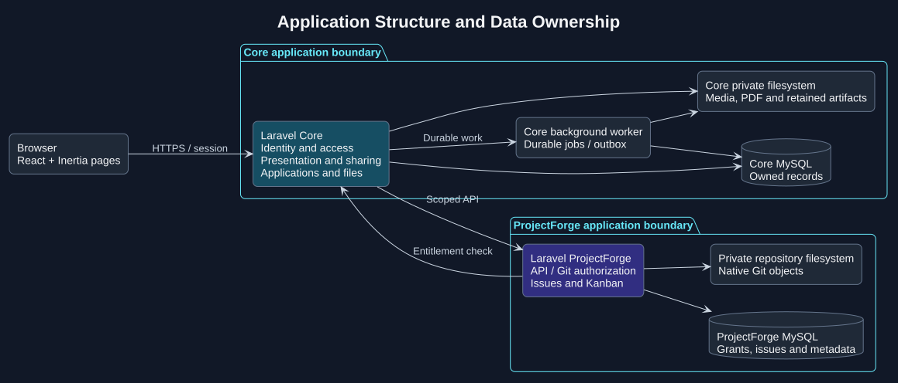
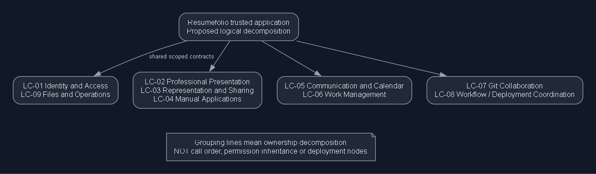

# ADR-001 — Modular Application Boundaries

[Decision index](Decision-Index.md) · [HLD](../01-High-Level-Design/01-Introduction.md) · [LLD module breakdown](../03-Low-Level-Design/02-Module-Breakdown.md)

## Current Disposition

**Historical proposal, superseded in part.** ADR-001's proposed common trusted application spanning all logical owners is superseded by [ADR-005](ADR-005-Owner-Mvp-System-Boundaries.md). Its internal ownership/encapsulation rationale remains useful within each selected system. This update clarifies the record; it does not reopen the accepted boundary or create a new architecture decision.

| Subject | Governing position |
| --- | --- |
| System allocation | Core and ProjectForge are independent applications connected by an authenticated user-scoped API; ADR-005 governs |
| Internal modules | Explicit ownership and contract-based collaboration remain applicable inside each application |
| Selected mechanisms | ADR-006 selects the MVP implementation baseline and evidence gates; those choices are not all still open |
| Frontend amendment | ADR-007 selects React/Inertia inside each Laravel application and retains trusted Blade PDF templates |
| Deferred scope | Personal mail/calendar, AI, advanced review/releases, general Sprints and user workflow/deployment execution remain outside MVP |
| Decision authority | Farhad; this document supplies no new approval, implementation result or deployment authorization |

## Current Boundary and Retained Rationale

[PlantUML source](../01-High-Level-Design/Diagrams/hld-containers.puml) · [PNG](../01-High-Level-Design/Diagrams/hld-containers.png)

This current view is distinct from the historical common-application option below. Core owns invited identity, professional presentation, private files/PDF, protected sharing and manual application history. ProjectForge owns repository grants/native Git, files/history, issues and basic Kanban. Logical modules do not require a separate service/database per module.

| Historical rationale | Current application |
| --- | --- |
| Cohesive responsibility and invariant ownership | Keep a named owner for every operation, record and private artifact |
| Explicit consumer contracts | Use permitted local contracts within an application; scoped API/status contracts across systems |
| No uncontrolled shared models/tables | Each application writes its own stores; consumers cannot bypass owner policy through SQL/filesystem shortcuts |
| Current resource authority | Identity establishes context; receiving owner still checks actor/resource/action, including direct delivery and Git |
| Independent content lifecycles | Selected draft updates, separate publication and exact submitted history remain distinct |
| Attributable effects | Local transactions do not make file/Git/mail/remote effects atomic; preserve durable outcomes and reconciliation |
| Practical operation | Initial shared hosting remains a shared failure/resource domain despite application separation |

A scoped Core credential does not grant unrestricted ProjectForge access. ProjectForge checks current Core entitlement and local resource/action grants; its reverse status credential reads no Core content. Shared UI/tooling cannot merge keys, sessions, database credentials or private storage authority.

## Consequences and Verification in the Selected Design

Independent systems add identity, API and native Git compatibility/failure obligations compared with the original common-application proposal. Current selected mechanisms remain governed by [ADR-006](ADR-006-Selected-Mvp-Implementation-Baseline.md), including the mandatory boundary verification before dependent enablement. Compatible package patches, target capacity, actor validation, SMTP and demonstrated restore are evidence/input gates rather than permission to silently substitute architecture.

| Guarantee | Required evidence |
| --- | --- |
| Internal ownership | Actual code/contract dependencies and absence of unauthorized cross-owner data shortcuts |
| Independent authority | Effective separate keys/sessions/credentials/private paths and current allowed/denied entry paths |
| Scoped repository integration | Wrong caller/actor/scope, revoked grants/entitlement, unavailable authority and real Git-client behavior |
| Publication/history integrity | Explicit selected update/publication and exact retained submitted materials after later changes |
| Truthful recovery | Lost responses, repeated commands, interrupted durable work and protected references remain attributable |
| Operational fit | Representative combined workload and isolated restore of records/private artifacts/Git state |

Use [LLD Traceability](../03-Low-Level-Design/11-Traceability.md) and the [RTM](../../02-Requirements-Engineering/03-Requirements-Traceability-Matrix.md) for exact criteria and candidate-specific results. No test pass, risk closure or capacity claim follows from completing this record.

## Revisit Rules

Revisit a specific module/process placement only with evidence of incompatible trust/runtime requirements, operating constraints, measured contention or independent release needs. Compare bounded extraction with stronger internal contracts. User-count growth or a preferred pattern alone is not a demonstrated need.

Any consequential change needs explicit data/authority ownership, compatibility, credential, pending-effect and recovery analysis, then a superseding ADR under the existing decision authority. Preserve prior rationale and exact trace links; do not rewrite a historical option as if it were the current accepted deployment.

## Historical Proposal and Alternatives

The retained record below preserves original anchors and comparison rationale. Statements about one common application or all nine owners describe the superseded proposal. Future provider/runner/target examples remain deferred, and implementation choices subsequently selected by ADR-006/ADR-007 must not be treated as unresolved merely because the earlier text says so.

ADR-001 — Modular Application Boundaries

### ADR-001 — Modular Application Boundaries

Current implementation choices and scope: [Baseline](https://github.com/Farhad-V/Web-Resumefolio/blob/1f2acaa351ac306cb57cbe4fe9742e8bd90720d9/docs/MVP/baseline/README.md). Runtime verification remains subject to its gates.

| Item | Position |
| --- | --- |
| Status | **Historical proposal — common-application allocation superseded by ADR-005** |
| Decision authority | Farhad |
| Record scope | Technical organization of trusted application responsibilities and external trust/integration boundaries |
| Implementation evidence | No module implementation, compatibility test or capacity result is supplied by this record |

[Context](#design-record-07-design-decisions-adr-001-modular-application-boundaries-md--heading-1-context-and-decision-drivers) · [Options](#design-record-07-design-decisions-adr-001-modular-application-boundaries-md--heading-2-options-considered) · [Proposal](#design-record-07-design-decisions-adr-001-modular-application-boundaries-md--heading-3-proposed-decision) · [Consequences](#design-record-07-design-decisions-adr-001-modular-application-boundaries-md--heading-4-consequences-and-limits) · [Validation](#design-record-07-design-decisions-adr-001-modular-application-boundaries-md--heading-5-validation-and-owner-disposition) · [Evolution](#design-record-07-design-decisions-adr-001-modular-application-boundaries-md--heading-6-revisit-and-evolution)

#### Superseding disposition

The proposed placement of all nine owners in one trusted application is superseded by [ADR-005](ADR-005-Owner-Mvp-System-Boundaries.md#design-record-07-design-decisions-adr-005-owner-mvp-system-boundaries-md). The alternatives and original rationale below are retained as historical proposal text, not the current boundary. Core and ProjectForge are separate systems; communications/execution are future. Explicit logical ownership remains useful within each system.

#### 1. Context and decision drivers

The product combines private professional presentation, controlled sharing, manual applications, communication/calendar, work/Sprints, real Git collaboration and conditionally safe workflow execution/deployment. It must preserve current resource-specific authority and independent source/draft/publication/actual-submission meaning.

Use [accepted scope](../../01-Project-Planning/01-Project-Charter.md#mvp-scope), [resource constraints](../../01-Project-Planning/03-Feasibility-And-Risk-Assessment.md#resource-constraints), [architecture drivers/options](../01-High-Level-Design/14-Appendices.md#design-record-01-software-architecture-01-design-drivers-and-solution-options-md), [analysis domain responsibilities](../../03-System-Analysis/02-Domain-And-Information-Analysis.md#analysis-domain-and-information-analysis--03-domain-model-and-object-oriented-view) and [source decisions](../../02-Requirements-Engineering/01-Software-Requirements-Specification.md#change-and-baseline-open-questions-and-decisions).

The recorded small-server observation is an infrastructure input, not a final deployment choice or measured capacity. Initial ten-user scope and possible growth do not define concurrency. Provider access, native Git facilities, untrusted-code containment and usable recovery remain dependent evidence gates.

Evaluate organization against coherent responsibility, local integrity, current authority, testability/evolution, solo operating cost, shared-resource effects and trust separation. The choice must not silently remove accepted Version 1 capability or add paid infrastructure.

#### 2. Options considered

These are qualitative comparisons against project constraints, not benchmarked scores or independently validated costs.

##### A — Single application without enforced domain boundaries

Can minimize initial packaging and deployment work. Without explicit ownership/contracts, shared ORM models/controllers can obscure authority, couple unrelated changes and let publication/history/provider effects leak across responsibilities. A single deployment is not inherently defective; the rejected aspect of this candidate is ungoverned cross-domain mutation rather than colocation itself.

##### B — Modular trusted application with explicit external boundaries

The historical common-application option preserved one release across all owners; ADR-005 now requires separate core and ProjectForge. Cohesive internal ownership remains useful. Local invariants can use evaluated relational transactions without introducing network calls between every module. Requires deliberate dependency/ownership enforcement and real adapters; shared runtime/host still creates contention and common failure exposure. **Historical starting proposal; its common-system extent is superseded by ADR-005.**

##### C — Early independently deployed domain services

Can provide independent release, scaling and process boundaries where demonstrated needs justify them. For this initial scope it adds deployment/observation/credential management and distributed consistency/recovery work before evidence shows those benefits outweigh the solo operating cost. Service separation alone does not establish privacy, execution isolation or HA. Retain as a future option, not the default starting architecture.

#### 3. Proposed decision

**Historical proposal; superseded in part by ADR-005.** The all-owner common application below is not the current system boundary.

Use a modular Laravel application for **trusted product coordination**, organized into the nine logical owners already specified by the [decomposition model](../01-High-Level-Design/14-Appendices.md#design-record-01-software-architecture-02-system-decomposition-and-boundaries-md):

1. Identity and Access.
2. Professional Presentation.
3. Representation and Sharing.
4. Manual Applications.
5. Communication and Calendar.
6. Work Management.
7. Git Collaboration.
8. Workflow and Deployment Coordination.
9. Files and Operations.

[Proposed logical component ownership](../01-High-Level-Design/Diagrams/Appendix/logical-component-ownership.svg)

[Owning architecture view](../01-High-Level-Design/14-Appendices.md#design-record-01-software-architecture-02-system-decomposition-and-boundaries-md) · [Editable Graphviz](../01-High-Level-Design/Diagrams/Appendix/logical-component-ownership.dot) · 

These are logical responsibility boundaries, not nine services, nine databases or a mandatory namespace/table tree. Keep the detailed model at its owning location rather than duplicating it in this ADR.

##### Boundary rules

- Resource owners enforce their operation/lifecycle invariants. Identity supplies current scoped context without replacing owner checks or creating a universal administrative bypass.
- Consumers use explicit language-level contracts, immutable identities/revisions and permitted projections. Do not mutate another owner's private tables/models or call HTTP solely to connect in-process components.
- Shared infrastructure provides bounded persistence/storage/dispatch capability without taking ownership of domain meaning. Shared SQL can support evaluated coherent local transactions; it does not authorize arbitrary cross-module writes.
- Preserve separate selected source application, owner-confirmed publication and actual-material capture. See [ADR-002](ADR-002-Explicit-Publication-And-History.md#design-record-07-design-decisions-adr-002-explicit-publication-and-history-md).
- Provider/native Git/storage/executor/target effects cross explicit adapter and authority boundaries. Local transactions do not make external effects atomic; see [ADR-003](ADR-003-Durable-External-Attempts.md#design-record-07-design-decisions-adr-003-durable-external-attempts-md).
- Untrusted workflow/code execution stays outside the trusted application's authority domain behind demonstrably evaluated containment. A worker class, module or colocated container label alone is not isolation. Production deployment uses separately approved target authority.

Actual package layout, signatures, data schema/constraints, runtime facilities and physical placement require [component](../03-Low-Level-Design/02-Module-Breakdown.md#design-record-03-component-and-module-design-component-and-module-design-md), [data](../03-Low-Level-Design/04-Database-Design.md#design-record-04-data-design-data-design-md), [interface](../03-Low-Level-Design/05-API-Specification.md#design-record-05-interface-and-api-design-interface-and-api-design-md) and [deployment](../01-High-Level-Design/14-Appendices.md#design-record-01-software-architecture-04-deployment-topology-nodes-and-networks-md) prescriptions. Use ADR-006 and ADR-007 for subsequent mechanism selections and remaining evidence gates; this historical ADR does not select them.

#### 4. Consequences and limits

**Expected benefits:** clear ownership and test seams; fewer initial distributed consistency obligations; a smaller principal release/operating surface; and explicit later extraction points based on actual contracts. These are rationale, not measured productivity/performance results.

**Costs and risks:** boundary erosion through shared models, circular dependencies, oversized shared helpers, accidental permission inheritance and shared-host resource/failure contention. Module contracts require review and implementation checks. Independent scaling/release remains limited until facilities are separated deliberately.

**Required mitigations:** review dependency direction and ownership, keep adapters scoped, validate coherent transactions/reference guards, reconstruct current authority in jobs, observe combined workloads and preserve isolated recovery. See [modularity guidance](../03-Low-Level-Design/02-Module-Breakdown.md#design-record-03-component-and-module-design-01-modularity-dependencies-and-encapsulation-md), [runtime](../01-High-Level-Design/14-Appendices.md#design-record-01-software-architecture-03-process-view-concurrency-and-runtime-behavior-md), [quality trade-offs](../01-High-Level-Design/14-Appendices.md#design-record-06-design-quality-and-security-analysis-01-quality-attributes-and-design-trade-offs-md) and [security](../01-High-Level-Design/14-Appendices.md#design-record-06-design-quality-and-security-analysis-02-security-threat-modeling-and-trust-boundaries-md).

This proposal establishes neither safe execution capacity, provider/native-client interoperability, redundant availability nor configured backups. The existing demo is not accepted as a compatible legacy foundation, and legacy migration remains outside the recorded Version 1 scope.

#### 5. Validation and owner disposition

Before accepting the affected design scope, identify exact source/design revisions and verify:

- Each claimed source criterion maps to an owner/operation with sufficient normal, denied, conflict, uncertain and recovery behavior.
- Cross-component interactions preserve current authority, publication/history independence, protected artifacts and coherent work/Sprint meaning.
- Physical transactions, native ref effects and remote attempts have explicit boundaries and recoverable observations.
- Dependencies/artifacts/runtime placement respect logical ownership and separate untrusted execution/target authority.
- Measured compatibility/resource/operating evidence supports the commitments being accepted; independent work may continue where a gate does not apply.
- Estimates/backlog and operating obligations fit actual capacity, with unresolved costs/risks and scoped conditions recorded.

Use [review and handoff](../01-High-Level-Design/14-Appendices.md#design-record-06-design-quality-and-security-analysis-05-design-review-traceability-and-handoff-md). No exact-criterion closure, product-test Pass, independent Advisor endorsement, coding authorization or owner acceptance is created by elaborating this ADR. Record actual reviewer, evidence and disposition only when performed.

#### 6. Revisit and evolution

Reassess if observed combined-load contention, independent release needs, incompatible runtime/trust requirements or operating evidence make a specific extraction worthwhile. Compare the bounded extraction with strengthening current module boundaries; user-count growth alone is not a sufficient trigger.

Any extraction needs explicit contract/authority, data ownership, consistency, credential, observation, recovery, compatibility and operating-cost plans. Moving a module into a process does not transfer permissions automatically. Preserve uncertain external attempts and historical identities through the transition.

If an accepted decision changes, add an identified superseding ADR and retain the original rationale/status history. Use [design evolution](../03-Low-Level-Design/12-Appendices.md#design-record-02-detailed-and-object-oriented-design-05-design-evolution-refactoring-and-technical-debt-md); no irreversible migration or rollback capability is presumed here.

[Decision index](Decision-Index.md#design-record-07-design-decisions-design-decisions-md) · [ADR template](Decision-Index.md#design-record-07-design-decisions-design-decisions-md) · [System Design home](../../01-Project-Planning/02-Project-Management-Plan.md#stage-4-system-design)

