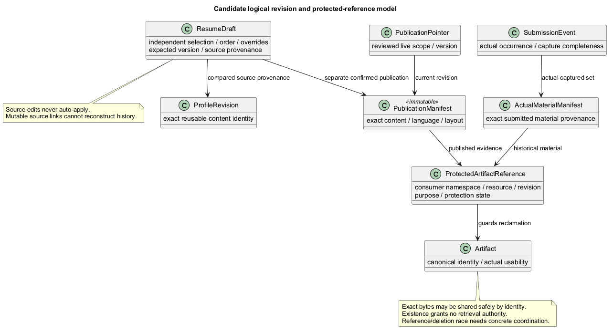

# ADR 002 Explicit Publication And History

ADR-002 — Explicit Publication and Historical Material Identity

### ADR-002 — Explicit Publication and Historical Material Identity

Current implementation choices and scope: [Baseline](https://github.com/Farhad-V/Web-Resumefolio/blob/1f2acaa351ac306cb57cbe4fe9742e8bd90720d9/docs/MVP/baseline/README.md). Runtime verification remains subject to its gates.

| Item | Position |
| --- | --- |
| Status | **Proposed technical realization — owner disposition pending** |
| Prepared / updated | November 2, 2026 |
| Decision authority | Farhad |
| Accepted product basis | Explicit selected source application, independent resumes, separately confirmed publication and preserved actual submitted documents |
| Evidence boundary | No implemented schema, artifact capture, publication, restore or product-test result is supplied here |

[Context](#design-record-07-design-decisions-adr-002-explicit-publication-and-history-md--heading-1-context-and-source-authority) · [Options](#design-record-07-design-decisions-adr-002-explicit-publication-and-history-md--heading-2-options-considered) · [Proposal](#design-record-07-design-decisions-adr-002-explicit-publication-and-history-md--heading-3-proposed-decision-and-consistency-rules) · [Consequences](#design-record-07-design-decisions-adr-002-explicit-publication-and-history-md--heading-4-consequences-and-open-mechanisms) · [Validation](#design-record-07-design-decisions-adr-002-explicit-publication-and-history-md--heading-5-validation-and-disposition) · [Evolution](#design-record-07-design-decisions-adr-002-explicit-publication-and-history-md--heading-6-revisit-and-evolution)

#### 1. Context and source authority

The [owner-accepted profile-update policy](../../02-Requirements-Engineering/01-Software-Requirements-Specification.md#change-and-baseline-open-questions-and-decisions--id-owner-accepted-profile-update-policy) establishes four product behaviors: source changes do not automatically alter existing resumes or published views; the owner previews/selects/applies intended changes while preserving independent content; apply/save and separately confirmed publication are different actions; actual submitted documents remain independent of later changes.

That behavior is accepted and is not reopened by this ADR. This record proposes the technical identities, manifests and consistency rules that realize it. See [Q-D07](../../02-Requirements-Engineering/01-Software-Requirements-Specification.md#requirements-specification-profiles-resumes-and-portfolio--id-resolution-q-d07), [profile requirements](../../02-Requirements-Engineering/01-Software-Requirements-Specification.md#requirements-specification-profiles-resumes-and-portfolio), [PDF/sharing requirements](../../02-Requirements-Engineering/01-Software-Requirements-Specification.md#requirements-specification-pdf-and-controlled-sharing), [application requirements](../../02-Requirements-Engineering/01-Software-Requirements-Specification.md#requirements-specification-manual-application-management) and [conceptual data analysis](../../03-System-Analysis/01-System-Analysis.md#analysis-domain-and-information-analysis--05-data-oriented-view).

Field granularity, deletion/reset/conflict details, language fallback, renderer, retention and capture/correction refinements retain their source status. An independent historical copy does not imply indefinite retention, new restoration powers or automatic receipt verification. Current resource-specific authority and actual storage capacity still apply.

#### 2. Options considered

##### A — Resolve every view and history record through current mutable source

Minimizes explicit revision storage but permits later edits to alter displayed/claimed past content. A current resume or live link cannot identify the document actually submitted earlier. This option cannot alone satisfy the accepted independence behavior.

##### B — Separate logical identities and immutable content/material manifests

Preserve reusable source, editable draft, publication revision and actual submitted material as distinct contexts. Manifest content can be an immutable snapshot or references to sufficient immutable versions/artifacts. Adds version/reference/accounting work while retaining exact provenance and controlled sharing. **This is the proposed direction.**

##### C — Physically duplicate every file/content object on every save

Can preserve individual snapshots but may create unnecessary storage and cleanup burden. Duplication alone does not establish actual-submission provenance, owner confirmation or current access. The accepted behavior requires independent meaning and sufficient preserved content, not a new physical copy of every intermediate edit.

These are qualitative assessments, not measured storage/performance comparisons. Physical snapshot, version-reference and deduplication choices remain evaluated implementation work.

#### 3. Proposed decision and consistency rules

Maintain four distinguishable contexts:

1. **Reusable source:** professional meaning and stable entry/revision identities, owned by Presentation.
2. **Independent draft:** selections/order/layout/overrides and source provenance; explicit selected application changes only the intended draft.
3. **Publication revision:** immutable confirmed content/selection/language/layout manifest with exact artifact identities, plus a guarded live pointer in the reviewed publication scope.
4. **Actual material set:** Applications-owned submission event/material provenance and completeness, backed by exact preserved content/artifact references independently of later draft/publication state.

[Candidate revision and protected-reference model](https://github.com/Farhad-V/Web-Resumefolio/blob/1f2acaa351ac306cb57cbe4fe9742e8bd90720d9/docs/MVP/SDLC/04-system-design/04-data-design/diagrams/data-logical-revisions-and-references.svg)

[Owning data model](../03-Low-Level-Design/04-Database-Design.md#design-record-04-data-design-01-analysis-to-logical-and-physical-data-models-md--heading-3-revision-and-reference-model) · [Editable PlantUML](https://github.com/Farhad-V/Web-Resumefolio/blob/1f2acaa351ac306cb57cbe4fe9742e8bd90720d9/docs/MVP/SDLC/04-system-design/04-data-design/diagrams/data-logical-revisions-and-references.puml) · 

The figure is a candidate logical relationship view, not final table cardinalities or accepted DDL.

##### Apply and publish

Compare an authorized consistent source/draft pair and bind selected differences to exact versions. Apply under current authority/version guards, preserving unrelated overrides, other resumes and current publication. Stale inputs require conflict/recomparison or an explicitly reviewed merge policy; no silent overwrite.

Publish through a separate attributable owner command tied to the intended reviewed candidate and expected live/draft versions. Preserve sufficient immutable content/render-input identity; a foreign key to mutable source text is insufficient. Coordinate exact artifact protection before committing manifest/live-pointer/result state. Reconcile uncertain protection/finalization against actual consumer commit evidence before releasing references.

See [Presentation protocol](../03-Low-Level-Design/03-Detailed-Module-Design.md#design-record-03-component-and-module-design-components-professional-presentation-md--heading-4-update-and-publication-protocol). The concrete transaction/lock/reference handshake remains a joint component/data design task; a diagram does not prove atomicity.

##### Renditions, viewing and actual capture

Sharing resolves current permitted publication/language/mode and exact available rendition. A publication record does not prove its generated PDF is ready; do not offer an older artifact as the new revision or silently substitute a different language. Current link/grant eligibility still governs each protected admission. See [Sharing](../03-Low-Level-Design/03-Detailed-Module-Design.md#design-record-03-component-and-module-design-components-representation-and-sharing-md).

Applications captures attributable actual submission/material intent separately from preparation, progress, publication or provider send. User-recorded event, material completeness and recipient receipt remain distinct claims. Preserve exact material rather than regenerate it later from current content; incomplete capture stays explicit. Corrections/new submissions follow reviewed provenance rules without silently rewriting earlier evidence. See [Applications](../03-Low-Level-Design/03-Detailed-Module-Design.md#design-record-03-component-and-module-design-components-applications-md).

Files owns artifact usability, protected references and physical accounting. Consumers may safely reference shared immutable bytes where the evaluated design permits, without merging their ownership/permissions. Retiring one source/draft/share does not delete protected publication or submitted materials automatically. Reclamation requires reviewed lifecycle eligibility and safe exclusion of all required/pending references.

#### 4. Consequences and open mechanisms

**Expected benefits:** explicit user control, reproducible content identity within its stated manifest contract, honest current-versus-historical views, and traceable actual-material completeness. These are design rationale, not proven implementation outcomes.

**Costs:** immutable content/manifests and protected artifacts consume storage; comparisons/version checks add application logic; replacement/cleanup and restoration must coordinate references. Snapshotting, deduplication, retention and renderer/layout versioning need measured resource/operating evaluation.

**Failure limits:** lost publication/capture responses cannot prove rollback; resolve the same command/result. SQL rollback does not remove external bytes. Missing historical artifacts must be reported, not replaced with today's content. Already downloaded copies cannot be recalled by link revocation. Immutable revision content does not make access authority immutable.

Final schema/types, override and source-deletion behavior, publication/language pointer scope, manifest rendering reproducibility, reference/deletion guards and retention/key recovery remain pending. Use [data design](../03-Low-Level-Design/04-Database-Design.md#design-record-04-data-design-data-design-md), [security](../01-High-Level-Design/14-Appendices.md#design-record-06-design-quality-and-security-analysis-02-security-threat-modeling-and-trust-boundaries-md) and [operations/recovery](../01-High-Level-Design/14-Appendices.md#design-record-06-design-quality-and-security-analysis-03-operations-backup-recovery-and-resilience-md). No event-sourcing architecture, unlimited history or specific renderer/storage product is selected here.

#### 5. Validation and disposition

Assess an identified candidate against exact source criteria and these focused cases:

- Two resumes with independent selections/overrides remain unchanged after source edits until selected apply; applying one preserves the other.
- Preview/apply/save never publishes; separate confirmation publishes only the intended current candidate and detects stale versions.
- Published content and actual submitted material retain their meaning after later source, draft, layout, publication and artifact changes.
- Rendition processing/failure/missing language and actual-material incompleteness remain truthful without silent fallback.
- Concurrent publication/capture/reference registration and cleanup preserve usable protected material, including lost commit/finalization acknowledgments.
- Current authority, reviewed retirement and isolated restoration preserve exact manifests/bytes without resurrected access or external replay.

Use actual persistence/storage/concurrency and authorized restore evidence alongside domain checks. Follow [review/handoff](../01-High-Level-Design/14-Appendices.md#design-record-06-design-quality-and-security-analysis-05-design-review-traceability-and-handoff-md); preserve the distinction between accepted product behavior and still-proposed technical prescriptions. Elaborating this record performs no product test and records no owner acceptance of its mechanisms.

#### 6. Revisit and evolution

Reassess representation if measured storage/rendering cost, new content types, source policy or reproducibility requirements justify a different snapshot/version-reference strategy. Any replacement must continue to preserve the accepted four-point behavior, current authority, actual capture provenance and protected references.

Migrate existing manifests/associations with compatibility and integrity checks before releasing old representations. Lossy conversion or byte deletion is not automatically reversible through schema/code rollback. Record a superseding ADR when an accepted decision changes, retaining original rationale and actual disposition history.

[Decision index](Decision-Index.md#design-record-07-design-decisions-design-decisions-md) · [ADR-001: Boundaries](ADR-001-Modular-Application-Boundaries.md#design-record-07-design-decisions-adr-001-modular-application-boundaries-md) · [ADR-003: External attempts](ADR-003-Durable-External-Attempts.md#design-record-07-design-decisions-adr-003-durable-external-attempts-md) · [ADR template](Decision-Index.md#design-record-07-design-decisions-design-decisions-md)

