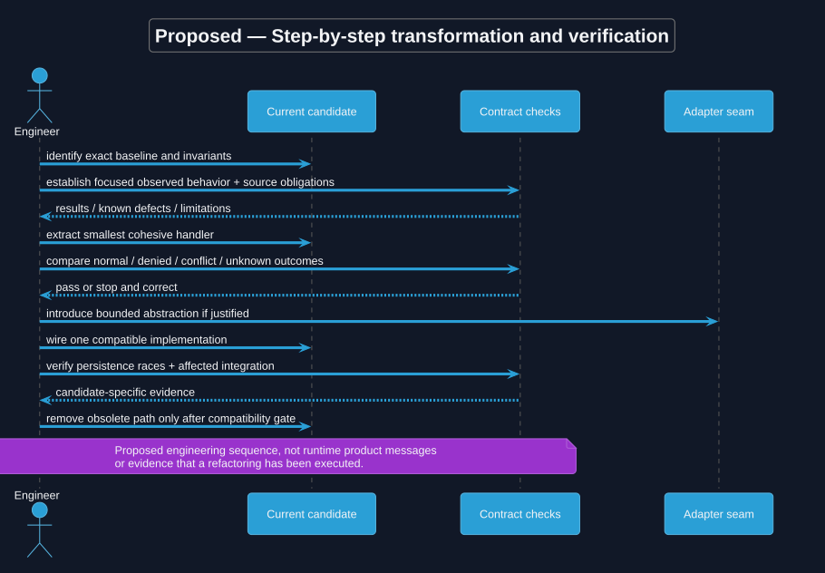

# ADR-004 — Compatible Incremental Design Evolution

[Decision index](Decision-Index.md) · [ADR-005 boundaries](ADR-005-Owner-Mvp-System-Boundaries.md) · [ADR-006 baseline](ADR-006-Selected-Mvp-Implementation-Baseline.md)

## Current Status

**Selected MVP compatibility and incremental evolution principles through ADR-006; execution still requires a concrete authorized work item.** Decision authority remains Farhad. No new approval or runtime evidence is recorded here.

## Decision and Scope

Prefer the smallest compatible change supported by a concrete requirement, observed defect or demonstrated design need. Identify the actual baseline, consumers, owned data, pending work and acceptance criteria before implementation. This record does not invent current code smells, measured technical debt or an accepted legacy migration.

| Phase | Obligation |
| --- | --- |
| Characterize | Record actual baseline behavior and governing invariants; do not legitimize known requirement violations |
| Refine | Change one cohesive responsibility or justified adapter seam within authorized scope |
| Verify | Check observable outcomes plus real persistence/concurrency/integration where required |
| Switch | Maintain one authoritative effect path and explicit consumer/version compatibility |
| Retire | Remove old paths only when consumers, data, pending effects and recovery permit |

Branch-by-abstraction or a strangler facade is conditional on an actual replacement need. Do not introduce dual writes or shadow dispatch of consequential mail/Git/remote effects just to compare implementations. Separate structural refactoring from intentional product behavior changes.

## Alternatives and Consequences

Leaving a sound design unchanged can be appropriate when no evidenced value exists. Incremental change limits the assessable step but incurs temporary adapters and compatibility work. A broad rewrite/extraction requires separate justification for migration, authority, operation and recovery costs; it is not the default conclusion of this ADR.

Code rollback, schema reversal, forward repair and restoring data are different choices. Reverting code cannot undo irreversible data conversion, deleted bytes or remote commits. Stop unsafe work, preserve evidence and follow the reviewed compatible recovery route.

## Verification and Revisit

Link exact candidate, affected criteria, planned/actual checks, full compatibility/recovery assessment and owner disposition. Recheck independent drafts/publication/history, current authority, protected artifacts and durable outcomes through the transition. A selected engineering principle does not itself authorize implementation, production migration or deployment.

## Supporting Dark Diagram

[PlantUML source](../03-Low-Level-Design/Diagrams/Appendix/evolution-refactoring-sequence.puml) · [PNG](../03-Low-Level-Design/Diagrams/Appendix/evolution-refactoring-sequence.png)

This canonical view illustrates the applicable current contracts; it does not convert retained proposal details or deferred features into MVP obligations.

## Sources, Evidence and Retained Rationale

Use [LLD contracts](../03-Low-Level-Design/03-Detailed-Module-Design.md), [Database Design](../03-Low-Level-Design/04-Database-Design.md), [API Specification](../03-Low-Level-Design/05-API-Specification.md) and the [RTM](../../02-Requirements-Engineering/03-Requirements-Traceability-Matrix/README.md) for exact implementation/criterion evidence. Preserve immutable baseline provenance links.

The record below retains original anchors, alternatives and context. Current status above and ADR-006/ADR-007 govern any older proposed/pending wording. Runtime setup, security, compatibility and recovery still require fresh evidence; documentation does not close those gates.

ADR-004 — Compatible Incremental Design Evolution

### ADR-004 — Compatible Incremental Design Evolution

Current implementation choices and scope: [Baseline](https://github.com/Farhad-V/Web-Resumefolio/blob/1f2acaa351ac306cb57cbe4fe9742e8bd90720d9/docs/MVP/baseline/README.md). Runtime verification remains subject to its gates.

- Status: **Selected MVP principles through ADR-006; retained proposal details remain scope-qualified**
- Decision authority: Farhad
- Scope: proposed engineering procedure; no migration or implementation authorized by this record

#### Context

The modular application proposal must preserve current private authority, explicit source application/publication, independent actual submission materials and attributable external effects during structural change. This documentation update establishes no inspected implementation deficiency or running legacy baseline.

#### Proposed decision

Prefer the smallest compatible, evidence-led change. Identify the exact baseline and affected contracts; establish focused checks; extract one responsibility or introduce a justified abstraction; verify behavior, real persistence/concurrency and affected adapters; switch one authoritative route; retire obsolete paths only when old consumers, pending work and recovery conditions permit.

Use branch by abstraction or a strangler facade only when an actual replacement need is established. Define per-operation/cohort authority, old/new contract compatibility, command/attempt identity, protected references, reconciliation and stop conditions. Avoid uncontrolled dual writes and shadow execution of sends, Git mutations, workflows or deployments.

#### Alternatives

| Option | Consequence |
| --- | --- |
| Leave unchanged | Reasonable when no evidenced deficiency/value exists; record actual implications if a finding exists |
| Incremental compatible change | Smaller assessable steps; requires temporary compatibility and disciplined retirement |
| Broad rewrite / immediate extraction | Potential structural freedom, with larger verification, migration, distributed-failure and operating burden; requires separate justification |

#### Consequences and limits

Refactoring preserves applicable behavior; source-policy or API behavior changes need separate disposition. Reverting code cannot undo irreversible data changes or remote effects. Stop, preserve evidence and select compatible rollback, reviewed forward repair or scoped recovery according to actual state.

#### Validation and disposition

Before applying to real work, identify the exact candidate, observed finding, alternatives, full effort, affected criteria, checks, compatibility/recovery route and authorized scope. Close only with actual candidate-specific results and owner disposition. This proposal has no live test, migration result or acceptance evidence.

[Owning evolution procedure](../03-Low-Level-Design/12-Appendices.md#design-record-02-detailed-and-object-oriented-design-05-design-evolution-refactoring-and-technical-debt-md) · [ADR index](Decision-Index.md#design-record-07-design-decisions-design-decisions-md) · [ADR-001 modular boundaries](ADR-001-Modular-Application-Boundaries.md#design-record-07-design-decisions-adr-001-modular-application-boundaries-md) · [ADR-002 publication/history](ADR-002-Explicit-Publication-And-History.md#design-record-07-design-decisions-adr-002-explicit-publication-and-history-md) · [ADR-003 external attempts](ADR-003-Durable-External-Attempts.md#design-record-07-design-decisions-adr-003-durable-external-attempts-md)

