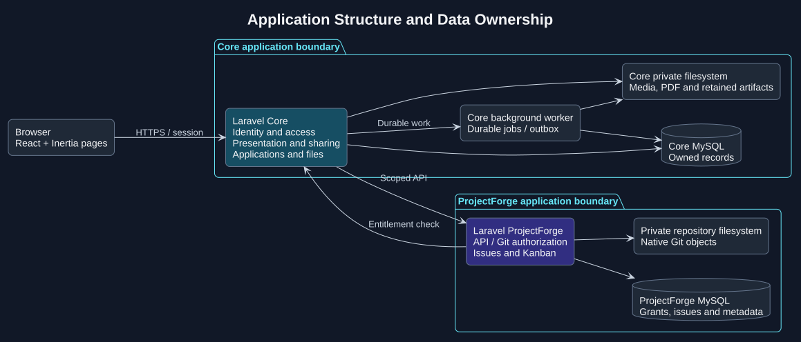

# ADR-005 — Owner MVP System Boundaries

[Decision index](Decision-Index.md) · [ADR-005 boundaries](#decision-and-allocation) · [ADR-006 baseline](ADR-006-Selected-Mvp-Implementation-Baseline.md)

## Current Status

**Accepted owner product/system boundary; ADR-006 selects subsequent mechanisms and ADR-007 amends the frontend.** Decision authority remains Farhad. No new approval or runtime evidence is recorded here.

## Decision and Allocation

Keep Resumefolio Core and ProjectForge independent, joined by an authenticated user-scoped API. This supersedes ADR-001's common-application allocation without rejecting explicit modular ownership within either system.

| System | MVP ownership |
| --- | --- |
| Core | Invited identity/dashboard, profiles and tailored materials, cover letters, private same-server media/PDF, protected sharing and manual application/exact submission history |
| ProjectForge | Real native Git repositories/transfers/permissions/file history, repository issues and simple Kanban |
| Deferred | Personal mail/calendar, AI, advanced review/merge/releases, general backlog/Sprints and user workflow/deployment execution |

Each application retains separate keys, sessions, database users/stores and private paths. Shared host placement does not merge authority or remove a common failure domain. No direct cross-database/filesystem mutation or distributed transaction is implied.

## Alternatives and Consequences

The earlier combined trusted application no longer matches the accepted owner boundary. A separate service/database for every logical module was not selected either. A coherent user experience must preserve separate receiving contexts, scoped identity/API contracts and local resource grants.

ProjectForge checks current Core entitlement plus local repository/action permission; its Core status credential reads no private content. Native Git credentials remain distinct from browser/issue authority. Current owner private media stays on the same server; additional media infrastructure requires a governing revised decision and evidence.

## Mechanisms and Evidence

Read ADR-006 for selected runtime/database/native Git and durable-effect mechanisms and ADR-007 for the frontend amendment. Earlier open-mechanism wording is historical. Compatible patches, actual actor/transport behavior, capacity, SMTP, backup destination and demonstrated restore remain verification/input gates.

Verify wrong-owner/scoped calls, revocation/unavailable authority, actual native transfers, selected direct media delivery, preserved submitted bytes and isolated consistent restore. Changing this boundary requires explicit ownership, authority, compatibility and recovery review under the existing decision authority; this record commits no hosting purchase or deployment.

## Supporting Dark Diagram

[PlantUML source](../01-High-Level-Design/Diagrams/hld-containers.puml) · [PNG](../01-High-Level-Design/Diagrams/hld-containers.png)

This canonical view illustrates the applicable current contracts; it does not convert retained proposal details or deferred features into MVP obligations.

## Sources, Evidence and Retained Rationale

Use [LLD contracts](../03-Low-Level-Design/03-Detailed-Module-Design.md), [Database Design](../03-Low-Level-Design/04-Database-Design.md), [API Specification](../03-Low-Level-Design/05-API-Specification.md) and the [RTM](../../02-Requirements-Engineering/03-Requirements-Traceability-Matrix/README.md) for exact implementation/criterion evidence. Preserve immutable baseline provenance links.

The record below retains original anchors, alternatives and context. Current status above and ADR-006/ADR-007 govern any older proposed/pending wording. Runtime setup, security, compatibility and recovery still require fresh evidence; documentation does not close those gates.

ADR-005 — Owner MVP System Boundaries

### ADR-005 — Owner MVP System Boundaries

Current implementation choices and scope: [Baseline](https://github.com/Farhad-V/Web-Resumefolio/blob/1f2acaa351ac306cb57cbe4fe9742e8bd90720d9/docs/MVP/baseline/README.md). Runtime verification remains subject to its gates.

Status: **Accepted owner product/system boundary; subsequent mechanisms selected by ADR-006/ADR-007**. Authority: Farhad through [OWNER-MVP-2026-11-04](../../01-Project-Planning/01-Project-Charter.md#release-decision).

#### Context and decision

The owner defined Version 1 as the MVP and required a unified experience across a Resumefolio core and a **separate ProjectForge system joined by an authenticated user-scoped API**. This replaces ADR-001's proposed common trusted application for all nine owners. It does not reject explicit modular ownership within each system.

Core owns dashboard, invited accounts, profile/resumes/portfolio/cover letters/manual applications, protected PDFs/sharing and private My Files & Media on the same server. ProjectForge MVP owns real Git repositories/transfers/permissions/file-history, issues/simple Kanban. Commits normally occur in clients. Advanced review/merge/releases, backlog/Sprints and YAML execution/deployment are future stages.

Future communications is an independent private API system with user-consented personal Gmail/Google Calendar accounts, potentially multiple. Owner/admin has no mail-reading authority. Other providers are undecided. AI is future/Version 2 discussion.

#### Alternatives and provenance

ADR-001 retains the original alternatives and rationale as a historical proposal. A single trusted application spanning all nine owners no longer matches the owner's selected boundary. A forced microservice/database split for every logical owner was not selected either. This record implements a settled owner choice; it is not a newly benchmarked architecture recommendation.

#### Consequences and open engineering decisions

Core/ProjectForge API contracts must enforce current subject/resource/action scope and revocation; internal references cannot grant authority. Do not assume a shared database, cross-system transaction or physical co-deployment. ADR-006 supplies subsequent selected mechanisms and ADR-007 the frontend amendment; actual setup, transport/configuration compatibility and recovery evidence remain gated. Same-server core media is settled; separate media infrastructure is future only with evidence. File policy, safe range serving, backup destination and recovery targets still need specification and verification.

#### Verification and acceptance limits

Documentation synchronization does not implement or demonstrate API interoperability, real Git transfer, private playback, capacity, least privilege or restoration. Future verification must cover allowed/denied cross-user API/Git calls, changed grants, client-created commits, selected protected media/direct/range retrieval, independent submitted history and isolated recovery. No new delivery deadline, spending, live configuration or whole-design acceptance is authorized.

