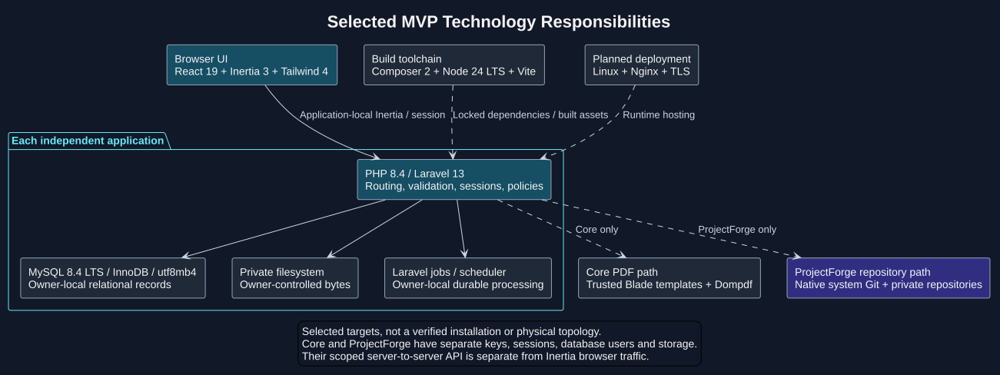

# ADR-006 — Selected MVP Implementation Baseline

[Decision index](Decision-Index.md) · [ADR-005 boundaries](ADR-005-Owner-Mvp-System-Boundaries.md) · [ADR-006 baseline]()

## Current Status

**Selected under existing delegated authority; preserves ADR-005 scope and incorporates ADR-007 as the frontend amendment.** Decision authority remains Farhad. No new approval or runtime evidence is recorded here.

## Decision and Precedence

The selected baseline resolves MVP mechanisms while preserving the owner's independent Core/ProjectForge/private-media boundary. ADR-002 publication/history, ADR-003 truthful durable effects and ADR-004 compatible evolution apply to their MVP portions under the T05 transaction/reference/idempotency/outbox rules. Provider/runner-specific portions remain deferred.

| Subject | Governing choice / boundary |
| --- | --- |
| Systems | ADR-005 independent Core and ProjectForge; scoped service/status contracts |
| Frontend | ADR-007 React/Inertia amendment; trusted Blade PDF templates retained |
| Persistence | Selected separate MySQL ownership, private artifacts and native Git storage |
| Effects | Owner-local transactions and durable attributable intent/outcomes; no implied distributed rollback |
| Historical meaning | Explicit selected apply, separate publication and exact preserved submitted materials |
| Evolution | Compatible bounded changes with affected-criterion and recovery review |

The linked baseline T01–T10 and Q-D01–28 dispositions retain detailed authority; this document does not fabricate their exact contents or replace their frozen provenance manifest. Local HLD/LLD refines their contracts for implementation.

## Alternatives and Consequences

SPA, database and Git-platform alternatives remain in the referenced technical decision record. The selected independent identity/API/native Git seam adds interoperability and failure-handling work; it must not be hidden by removing scope or bypassing current authority. Same-host operation carries shared outage/resource risk.

Mechanism selection is separate from runtime proof. Mandatory G2 boundary verification precedes dependent enablement. Setup/build compatibility, actor validation, capacity, actual SMTP, protected backup destination and demonstrated restoration remain evidence/input gates, not undecided stack choices.

## Verification and Change Rules

Record actual compatible versions/lockfiles, both isolated builds, real service/Git allowed/denied paths, protected bytes/history, concurrent/uncertain effects and isolated restore under exact RTM criteria. Resolve numeric/operational inputs where their gates require them instead of inventing defaults.

A mechanism change requires a revised ADR/baseline, affected consumer/criterion/test review and compatibility/recovery assessment. No current runtime pass, purchase, source implementation or deployment authority is created by this documentation update.

## Supporting Dark Diagram

[PlantUML source](../01-High-Level-Design/Diagrams/hld-technology-stack.puml) · [PNG](../01-High-Level-Design/Diagrams/hld-technology-stack.png)

This canonical view illustrates the applicable current contracts; it does not convert retained proposal details or deferred features into MVP obligations.

## Sources, Evidence and Retained Rationale

Use [LLD contracts](../03-Low-Level-Design/03-Detailed-Module-Design.md), [Database Design](../03-Low-Level-Design/04-Database-Design.md), [API Specification](../03-Low-Level-Design/05-API-Specification.md) and the [RTM](../../02-Requirements-Engineering/03-Requirements-Traceability-Matrix/README.md) for exact implementation/criterion evidence. Preserve immutable baseline provenance links.

The record below retains original anchors, alternatives and context. Current status above and ADR-006/ADR-007 govern any older proposed/pending wording. Runtime setup, security, compatibility and recovery still require fresh evidence; documentation does not close those gates.

ADR-006 — Selected MVP implementation baseline

### ADR-006 — Selected MVP implementation baseline

Status: Selected under delegated authority Supersedes open mechanism choices for the MVP; preserves OWNER-MVP-2026-11-04 system/scope decisions. [Baseline](https://github.com/Farhad-V/Web-Resumefolio/blob/1f2acaa351ac306cb57cbe4fe9742e8bd90720d9/docs/MVP/baseline/README.md).

#### Context and decision

Farhad explicitly delegated completion of technical decisions and the Baseline. Select [T01–T10](https://github.com/Farhad-V/Web-Resumefolio/blob/1f2acaa351ac306cb57cbe4fe9742e8bd90720d9/docs/MVP/baseline/technical-decisions.md) and [Q-D01–28 dispositions](https://github.com/Farhad-V/Web-Resumefolio/blob/1f2acaa351ac306cb57cbe4fe9742e8bd90720d9/docs/MVP/baseline/policy-decisions.md). The frozen manifest identifies exact documentary inputs. Core and ProjectForge remain independent systems; the future communications platform remains deferred.

ADR-002’s explicit publication/history realization, ADR-003’s durable/outcome-truthful effects and ADR-004’s compatible incremental evolution are selected for MVP implementation subject to T05’s concrete transactions, protected artifact references, idempotency and outbox rules. Provider/workflow-specific portions remain deferred. ADR-001 cannot override the separate-system boundary already selected by ADR-005.

Frontend amendment: [ADR-007 — React and Inertia](ADR-007-React-Inertia-Frontend.md#design-record-07-design-decisions-adr-007-react-inertia-frontend-md) records Farhad’s later selection for T01; other Baseline decisions remain in force.

#### Alternatives, consequences and validation

[Technical decisions](https://github.com/Farhad-V/Web-Resumefolio/blob/1f2acaa351ac306cb57cbe4fe9742e8bd90720d9/docs/MVP/baseline/technical-decisions.md) records the SPA/database/Git-platform alternatives, selected mechanisms and revisit triggers. The principal cost/risk is the independent identity/API/native Git boundary; G2 is mandatory before enabling it. Same-host operation remains a shared failure domain. No feature scope is removed to hide that risk.

Package patch resolution, target capacity, actor validation, SMTP, backup destination and demonstrated restore remain evidence/input gates, not undecided stack choices. No current runtime test is claimed. Changes require a revised ADR/Baseline, impacted criterion/test review, compatibility and recovery assessment. Documentation completion does not authorize deployment or implementation in this task.

