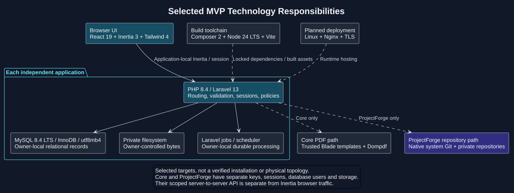

# ADR-007 — React and Inertia Frontend

[Decision index](Decision-Index.md) · [ADR-005 boundaries](ADR-005-Owner-Mvp-System-Boundaries.md) · [ADR-006 baseline](ADR-006-Selected-Mvp-Implementation-Baseline.md)

## Current Status

**Selected by Farhad; supersedes only interactive Blade/Alpine in T01 and retains trusted Blade PDF rendering.** Decision authority remains Farhad. No new approval or runtime evidence is recorded here.

## Decision and Boundaries

Use React 19 and Inertia 3 inside each Laravel 13 application, with Tailwind 4 and Vite. Retain trusted Blade/Dompdf templates for Core PDF output. No Alpine dependency is required for interactive application pages, and PDF rendering does not require browser rendering or frontend SSR.

| Responsibility | Owner |
| --- | --- |
| Routing/controllers | Receiving Laravel application |
| Authentication/sessions | Laravel/Fortify under selected independent application policy |
| Validation/resource authority | Server entry and owning policies/use cases, not React visibility/state |
| Interactive pages/forms | React/Inertia with reviewed reusable component contracts |
| Core/ProjectForge crossing | Scoped server-to-server API/status boundary; Inertia does not connect the backends |
| PDF content/output | Exact selected inputs and trusted Core templates with private artifact policy |

Do not add an independently deployed frontend or a separate browser REST-authentication layer through this amendment. Shared UI patterns do not merge sessions, credentials, databases or private resource authority.

## Rationale and Alternatives

The owner selected React/Inertia for dashboard interactions, resume forms and reusable components, with familiarity in both React and Blade. This replaces the earlier interactive Blade/Alpine choice only. A standalone SPA deployment or additional browser-auth layer is outside this amendment; other baseline choices and acceptance criteria remain unchanged.

Interactive components add build/adapter compatibility and state/focus/navigation verification. They cannot redefine draft conflicts, publication, protected delivery or exact history. A queued/optimistic frontend state is not proof of server or remote completion.

## Verification and Revisit

Resolve compatible maintained packages at setup and commit appropriate lockfiles during authorized implementation. Verify both builds and actual pages/forms, server validation, navigation/refresh, keyboard/focus, accessibility, responsive long English/German content and direct protected requests. Review trusted PDF output/accessibility separately from HTML.

Revisit only with demonstrated compatibility/requirement evidence and affected-contract/criterion review. Preserve current server authority and independent systems. This record installs no dependency, approves no visual palette and claims no running UI or test pass.

## Supporting Dark Diagram

[PlantUML source](../01-High-Level-Design/Diagrams/hld-technology-stack.puml) · [PNG](../01-High-Level-Design/Diagrams/hld-technology-stack.png)

This canonical view illustrates the applicable current contracts; it does not convert retained proposal details or deferred features into MVP obligations.

## Sources, Evidence and Retained Rationale

Use [LLD contracts](../03-Low-Level-Design/03-Detailed-Module-Design.md), [Database Design](../03-Low-Level-Design/04-Database-Design.md), [API Specification](../03-Low-Level-Design/05-API-Specification.md) and the [RTM](../../02-Requirements-Engineering/03-Requirements-Traceability-Matrix.md) for exact implementation/criterion evidence. Preserve immutable baseline provenance links.

The record below retains original anchors, alternatives and context. Current status above and ADR-006/ADR-007 govern any older proposed/pending wording. Runtime setup, security, compatibility and recovery still require fresh evidence; documentation does not close those gates.

ADR-007 — React and Inertia frontend

### ADR-007 — React and Inertia frontend

Status: Selected by Farhad Supersedes only the interactive Blade/Alpine choice in T01. Documentation revision 1.4; no Software Release or implementation is asserted.

#### Decision and reason

Use React 19 with Inertia 3 inside each Laravel 13 application, with Tailwind 4 and Vite. Farhad confirmed familiarity with both React and Blade and explicitly selected React/Inertia for dashboard interactions, resume forms and reusable components. Retain Blade for trusted Dompdf templates. No Alpine dependency is required for interactive application pages.

Laravel retains routing, controllers, server-side validation, sessions, Fortify authentication and policies. Do not add an independently deployed frontend or a separate browser REST authentication layer. Core and ProjectForge remain independent Laravel applications; Inertia does not connect them or replace their scoped API/SSO boundary.

#### Consequences and verification

Resolve compatible maintained adapter/package patches at Setup and commit lockfiles. Include React page/form behavior, validation errors, navigation, accessibility and protected direct requests in the existing requirement-linked verification. Preserve draft/conflict handling and authorization on every server entry point. React components do not replace server-side permission checks. PDF rendering continues to use trusted Blade templates and does not require browser rendering or frontend SSR.

No code or dependency is installed by this amendment. MVP scope, requirement IDs, acceptance criteria, storage, identity and release gates are unchanged. The [technical decisions](https://github.com/Farhad-V/Web-Resumefolio/blob/1f2acaa351ac306cb57cbe4fe9742e8bd90720d9/docs/MVP/baseline/technical-decisions.md#t01--runtime-frontend-and-persistence), [Setup](../../05-Agile-Iterative-Development/01-Project-Setup.md) and dark architecture diagram reflect this selection. The [Baseline manifest](https://github.com/Farhad-V/Web-Resumefolio/blob/1f2acaa351ac306cb57cbe4fe9742e8bd90720d9/docs/MVP/baseline/manifest.json) identifies the revised documentary inputs and links the previous immutable revision.

