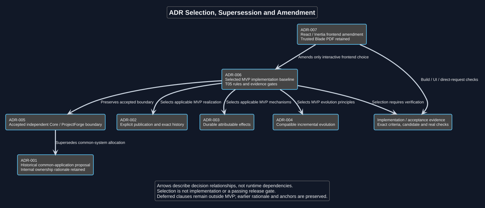

# Architecture Decision Records

[HLD](../01-High-Level-Design/01-Introduction.md) · [UI/UX](../02-UI-UX-Design/01-Introduction.md) · [LLD](../03-Low-Level-Design/01-Introduction.md)

This index identifies the current decision status and relationships of the seven architecture records. It is a navigation and interpretation guide, not a new decision, runtime acceptance result or deployment authorization. Farhad remains the decision authority.

## Current Decision Register

| Record | Current status | Scope and relationship |
| --- | --- | --- |
| [ADR-001 — Modular boundaries](ADR-001-Modular-Application-Boundaries.md) | Historical proposal, superseded in part | ADR-005 supersedes the common-application allocation; internal ownership/encapsulation rationale remains useful within each system |
| [ADR-002 — Publication and history](ADR-002-Explicit-Publication-And-History.md) | Selected MVP realization through ADR-006/T05 | Explicit selected apply, independent drafts, separate publication and exact preserved actual materials; deferred clauses excluded |
| [ADR-003 — Durable external attempts](ADR-003-Durable-External-Attempts.md) | Selected MVP mechanisms through ADR-006/T05 | Owner-local durable intent/outcomes, request identity/outbox and truthful reconciliation; provider/runner-specific details deferred |
| [ADR-004 — Compatible evolution](ADR-004-Compatible-Incremental-Design-Evolution.md) | Selected MVP principles through ADR-006 | Compatible bounded change and evidence-led retirement; actual work/migration still needs concrete authorized scope |
| [ADR-005 — Owner system boundaries](ADR-005-Owner-Mvp-System-Boundaries.md) | Accepted owner product/system boundary | Independent Core/ProjectForge, scoped integration and private same-server Core media; subsequent mechanisms selected by ADR-006/ADR-007 |
| [ADR-006 — Implementation baseline](ADR-006-Selected-Mvp-Implementation-Baseline.md) | Selected under existing delegated authority | Selects MVP mechanisms while preserving ADR-005; evidence/input gates remain open until demonstrated |
| [ADR-007 — React and Inertia frontend](ADR-007-React-Inertia-Frontend.md) | Selected by Farhad | Amends only interactive Blade/Alpine in T01; React/Inertia within each Laravel app, trusted Blade PDF retained |

The [frozen baseline reference](https://github.com/Farhad-V/Web-Resumefolio/blob/1f2acaa351ac306cb57cbe4fe9742e8bd90720d9/docs/MVP/baseline/README.md) and linked technical/policy dispositions retain provenance. This index does not reproduce or silently modify their contents.

## Decision Relationships

[PlantUML source](Diagrams/decision-relationships.puml) · [PNG](Diagrams/decision-relationships.png)

Read arrows as decision relationships, not runtime dependencies or permission inheritance. A later amendment changes only its stated subject: ADR-007 does not merge the systems, replace the scoped API, change private storage or remove release gates.

## Interpretation and Precedence

| Question | Interpretation |
| --- | --- |
| Can ADR-001 justify one application for all owners? | No. ADR-005 supersedes that allocation; explicit internal modules remain applicable |
| Are ADR-002–004 entirely awaiting selection? | No. ADR-006 selects their applicable MVP portions; older proposed wording is retained context, not the current whole-record status |
| Are all mechanisms in ADR-005 still open? | No. ADR-006 selects subsequent mechanisms and ADR-007 amends the frontend; actual compatibility and operations still require evidence |
| Does selected mean implemented or tested? | No. Require actual code/configuration and exact criterion-linked results |
| Do retained provider/runner/Sprint examples expand MVP? | No. Their deferred scope/disposition is preserved |
| Does a shared host or reusable UI merge authority? | No. Independent keys, sessions, databases, storage and current resource checks remain required |

Requirements and accepted scope define required behavior. Selected ADRs explain consequential choices and their stated supersession/amendment scope. HLD/LLD/UI/UX refine those choices; resolve conflicts through the relevant decision authority and affected records rather than silently treating an older paragraph as current policy.

## Evidence and Remaining Gates

Selected decisions do not establish compatible package builds, capacity, actor/transport behavior, SMTP delivery, protected backup placement or demonstrated restore. ADR-006 retains mandatory boundary verification before dependent enablement. Do not reopen settled stack choices merely because proof is pending, or bypass a gate to make the selected architecture appear operational.

Use [Project Setup](../../05-Agile-Iterative-Development/01-Project-Setup.md), [Test Strategy](../../05-Agile-Iterative-Development/02-Test-Strategy.md), [RTM](../../02-Requirements-Engineering/03-Requirements-Traceability-Matrix.md) and [Deployment Plan](../../06-Deployment-Release/01-Deployment-Plan.md) for actual implementation and acceptance evidence. Preserve failed, blocked and unexecuted results explicitly.

## ADR Template and Change Contract

When a consequential choice needs a new or superseding ADR, record:

1. Stable record identifier/title, scope and actual current status.
2. Governing requirement, accepted boundary and exact source context.
3. Alternatives, including retaining the existing design when reasonable.
4. Selected/proposed behavior, rationale and decision authority/disposition.
5. Effects on ownership, security, data/history, consistency, compatibility, resources and recovery.
6. Required verification, current evidence and unresolved inputs/gates.
7. Supersedes/amends relationships, affected documents/consumers and revisit triggers.

Do not fabricate approval, benchmark scores, observed defects or implementation results. A pending choice remains pending until disposition. A later material choice supersedes or amends explicitly rather than erasing earlier rationale. Preserve stable anchors used by other documents and add no documentary update dates.

## Maintenance and Handoff

For an accepted consequential change, update this register and the affected ADRs, HLD/LLD/UI/UX contracts, PlantUML source/renders and exact RTM traces together. Reassess code/configuration/schema consumers, pending effects, protected artifacts and recovery before relying on old evidence.

Use [HLD Risks and Key Decisions](../01-High-Level-Design/12-Risks-And-Key-Decisions.md), [LLD Traceability](../03-Low-Level-Design/11-Traceability.md) and the [design-evolution record](../03-Low-Level-Design/12-Appendices.md#design-record-02-detailed-and-object-oriented-design-05-design-evolution-refactoring-and-technical-debt-md) for review support. Diagram rendering and local-link validation confirm documentation consistency only.
