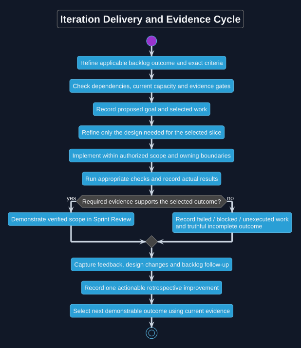

# Agile Iterative Development

[Project management plan](../01-Project-Planning/02-Project-Management-Plan.md#stage-5-agile-iterative-development) · [Project Setup](01-Project-Setup.md) · [Test Strategy](02-Test-Strategy.md)

## Purpose and Current Position

Deliver the selected MVP through small, demonstrable increments with exact acceptance checks and recorded outcomes. Refine analysis/design as the selected capability needs it, implement within its owning boundaries, verify behavior and use feedback to select the next work.

**Recorded position:** Sprint 01 planning is proposed, with scope/host/readiness as the candidate goal and isolated setup allocated to Sprint 02. The current review records product work as not started and tests as not executed. Sprint 02 is not started. Completing design documents or this overview does not change those implementation facts.

Use linked work items for detailed execution evidence and owning documents for authoritative requirements, contracts and procedures. Avoid conflicting status and fictional progress.

## Delivery Scope and Boundaries

| In scope | Delivery obligation |
| --- | --- |
| Core | Invited access, professional materials, explicit selected updates/publication, private files/PDF, protected sharing and manual application/exact submission history |
| ProjectForge | Independent scoped integration, actual Git permissions/transfers/history, issues and simple Kanban |
| Supporting operations | Isolated setup/builds, security, resource policy, diagnostics, protected backups and demonstrated restore |
| Deferred | Personal mail/calendar, AI, advanced review/releases, general Sprints and user workflow/deployment execution are not unfinished MVP features |

The development process may use sprint records and developer CI/CD without enabling those deferred product features. Preserve selected [architecture decisions](../04-System-Design/ADR/Decision-Index.md) and [accepted scope](../01-Project-Planning/01-Project-Charter.md#mvp-scope).

## Iteration Workflow

[PlantUML source](Diagrams/iteration-evidence-cycle.puml) · [PNG](Diagrams/iteration-evidence-cycle.png)

| Activity | Required output | Owning record |
| --- | --- | --- |
| Backlog refinement | Concrete user/technical outcome, exact criteria, dependencies and unresolved inputs | [Product backlog](../02-Requirements-Engineering/02-Product-Backlog/README.md) and linked issue |
| Planning | Demonstrable goal, selected work, prerequisites and planned checks | Sprint Planning |
| Detailed analysis/design | Affected operation/data/UI contracts, current authority and failure/recovery behavior | Owning SRS/HLD/UI/UX/LLD and work item |
| Implementation | Scoped code/configuration/migrations attributable to a revision | Actual repository/work item; no implied work from a document status |
| Verification | Relevant normal, denied, stale/concurrent/interrupted and operational checks | Test case/result and [RTM](../02-Requirements-Engineering/03-Requirements-Traceability-Matrix/README.md) |
| Review | Demonstrated result versus goal, evidence, limitations and feedback | Sprint Review |
| Retrospective | Actionable process improvement and follow-up | Sprint Retrospective |
| Next selection | Independently demonstrable outcome consistent with current evidence | Refined backlog and next planning record |

Keep failed, blocked and unexecuted work visible. Ending an iteration does not imply every selected item succeeded or every MVP gate passed. Do not silently convert carry-over into completed work.

## Selecting an Increment

Before selecting work, identify the exact applicable requirement/criterion and resource owner. Split several unrelated outcomes into reviewable slices. Include required contract, migration, test and documentation work rather than treating verification as optional cleanup.

Check setup/integration dependencies, operating obligations and unresolved decisions. The [delivery sequence](../01-Project-Planning/02-Project-Management-Plan.md#delivery-sequence) orders evidence-based outcomes. Independent settled work may proceed where an unmet gate does not apply; dependent capability must not assume a gate passed.

For each selected item, record goal/outcome, issue link, criterion, owner/module, prerequisites, expected demonstration and required checks. Product assumptions remain distinct from agreed obligations; capture consequential design changes through an ADR rather than silently altering scope.

## Dependency and Evidence Gates

| Area | Evidence required before relying on it |
| --- | --- |
| Initial setup | Repeatable clean locked install/build and isolated migration/basic checks for both applications |
| Core/ProjectForge boundary | Current actor/entitlement/local grants and actual allowed/denied native Git behavior at mandatory G2 before dependent enablement |
| Presentation/history | Explicit selected apply, separate publication and exact preserved actual materials |
| Private sharing/files | Current direct-delivery policy, selected language/artifacts and resource/retention controls |
| Integrated quality/recovery | Applicable workload, accessibility, operating and isolated restore evidence on an identified candidate |
| Stable release/deployment | Exact accepted scope, release gates, compatible rollout/rollback and smoke/recovery evidence under the deployment plan |

Exact gate definitions and criterion applicability remain in ADR-006, the selected baseline references and RTM. This summary does not redefine G1–G6 or promote a proposed check to accepted status. A working mock or a rendered flow cannot prove real transport, persistence, private bytes or restoration.

## Records and Status Rules

| Status / condition | Required evidence treatment |
| --- | --- |
| Proposed / not started | Candidate goal/work may be described; no implementation or execution result inferred |
| In progress | Link actual current work, known outcome and next required checks |
| Blocked | Name concrete dependency, responsible follow-up and exit condition |
| Implemented — verification pending | Code exists but required acceptance evidence remains incomplete |
| Verified | Link exact criterion result, revision, environment and relevant gate evidence |
| Deferred / out of scope | Preserve disposition; do not report as a failed or incomplete MVP feature |

Use the existing sprint review vocabulary consistently. Record actual checks/observations rather than copying expected results into pass fields. Keep a feature-level result separate from the integrated release gate and deployment record.

## Sprint 01

**Goal:** review scope, host and readiness evidence for selected issues #1, #2, #7, #8 and #9. Work has started on #1; I1-T01 is accepted and I1-T02 awaits review. Project Setup owns actual environment execution.

- [Sprint Planning and Sprint Backlog](Sprints/Sprint-01/01-Sprint-Planning.md#sprint-backlog)
- [Sprint Review](Sprints/Sprint-01/02-Sprint-Review.md)
- [Sprint Retrospective](Sprints/Sprint-01/03-Sprint-Retrospective.md)

Item evidence is linked from the Sprint Backlog and Review. Review and Retrospective are pending; product implementation and runtime tests have not started.

## Sprint 02

**Proposed; not started.** Candidate goal: isolated setup for both applications with transactional SMTP and backup prerequisites (#37, #5, #6). Confirm actual prerequisites after Sprint 01 review; the allocation is not a start or completion claim.

- [Sprint Planning](Sprints/Sprint-02/01-Sprint-Planning.md)
- [Sprint Review](Sprints/Sprint-02/02-Sprint-Review.md)
- [Sprint Retrospective](Sprints/Sprint-02/03-Sprint-Retrospective.md)

## Review and Retrospective

In Review, compare the intended goal with what actually ran. Record source/build, environment, criterion/case results, denied/failure paths, known limitations and feedback. Update affected requirements/design/work items where evidence changes understanding; keep failed/unexecuted checks explicit.

In Retrospective, identify an observed process problem or useful practice and one concrete improvement with follow-up. Do not fabricate team feedback, participant observations. The project owner retains delivery/operating responsibility; documentation does not imply a staffed team.

## Evidence Handoff

Each completed slice should connect requirement/criterion → owning design → actual implementation revision → executed checks → observed outcomes/limitations. Keep credentials, private content and sensitive payloads out of shared logs/screenshots. Synthetic fixtures and isolated stores protect review/test work from unintended live effects.

Use [LLD Traceability](../04-System-Design/03-Low-Level-Design/11-Traceability.md), [UI/UX handoff](../04-System-Design/02-UI-UX-Design/13-Handoff-To-Development.md) and the RTM for cross-stage mapping. Reassess prior evidence after material code, schema, dependency or environment changes.

## Release and Maintenance Boundary

An iteration increment does not itself publish a release or authorize production rollout. Follow the [Deployment Plan](../06-Deployment-Release/01-Deployment-Plan.md) and [Runbook](../06-Deployment-Release/02-Runbook.md) for the separately recorded release candidate, promotion, smoke checks and compatible recovery. Carry known issues and verified operating procedures into [Maintenance](../07-Maintenance-Evolution/01-Maintenance-Plan.md).

No source implementation, sprint execution, test pass, release or deployment is performed by completing this overview.

## Proposed Sprint Allocation

This is the same proposed allocation as the GitHub [Sprint Backlog](https://github.com/users/Farhad-V/projects/7/views/4). All 28 MVP issues are allocated once. These are proposed planning groups with no executed results. Confirm scope/responsibilities before each start.

| Sprint | Proposed goal | Candidate issues |
| --- | --- | --- |
| 01 | Scope, host and readiness | [#1](https://github.com/Farhad-V/Web-Resumefolio/issues/1), [#2](https://github.com/Farhad-V/Web-Resumefolio/issues/2), [#7](https://github.com/Farhad-V/Web-Resumefolio/issues/7), [#8](https://github.com/Farhad-V/Web-Resumefolio/issues/8), [#9](https://github.com/Farhad-V/Web-Resumefolio/issues/9) |
| 02 | Isolated setup, SMTP and backup prerequisites | [#37](https://github.com/Farhad-V/Web-Resumefolio/issues/37), [#5](https://github.com/Farhad-V/Web-Resumefolio/issues/5), [#6](https://github.com/Farhad-V/Web-Resumefolio/issues/6) |
| 03 | Invited identity and authentication | [#10](https://github.com/Farhad-V/Web-Resumefolio/issues/10) |
| 04 | Resource admission and early Git security spike | [#41](https://github.com/Farhad-V/Web-Resumefolio/issues/41), [#38](https://github.com/Farhad-V/Web-Resumefolio/issues/38) |
| 05 | Workspace, profile, resume and private media | [#11](https://github.com/Farhad-V/Web-Resumefolio/issues/11), [#12](https://github.com/Farhad-V/Web-Resumefolio/issues/12), [#13](https://github.com/Farhad-V/Web-Resumefolio/issues/13) |
| 06 | PDFs, atomic publication and history | [#14](https://github.com/Farhad-V/Web-Resumefolio/issues/14), [#40](https://github.com/Farhad-V/Web-Resumefolio/issues/40) |
| 07 | Protected sharing and manual applications | [#15](https://github.com/Farhad-V/Web-Resumefolio/issues/15), [#16](https://github.com/Farhad-V/Web-Resumefolio/issues/16) |
| 08 | Scoped integration and native Git | [#39](https://github.com/Farhad-V/Web-Resumefolio/issues/39), [#20](https://github.com/Farhad-V/Web-Resumefolio/issues/20) |
| 09 | Repository issues, fixed board and account lifecycle | [#22](https://github.com/Farhad-V/Web-Resumefolio/issues/22), [#19](https://github.com/Farhad-V/Web-Resumefolio/issues/19), [#24](https://github.com/Farhad-V/Web-Resumefolio/issues/24) |
| 10 | Integrated acceptance and restore | [#25](https://github.com/Farhad-V/Web-Resumefolio/issues/25), [#27](https://github.com/Farhad-V/Web-Resumefolio/issues/27) |
| 11 | Quality and operating guidance | [#26](https://github.com/Farhad-V/Web-Resumefolio/issues/26), [#28](https://github.com/Farhad-V/Web-Resumefolio/issues/28) |
| 12 | Release review and authorized deployment | [#29](https://github.com/Farhad-V/Web-Resumefolio/issues/29) |

## Detailed Execution Plan

Use the [Sprint Delivery Plan](03-Sprint-Delivery-Plan.md) for the exact within-group reading/start order, explicit prerequisites, item slices, demonstrations, planned checks . It expands this allocation without starting any iteration or changing the selected scope.
