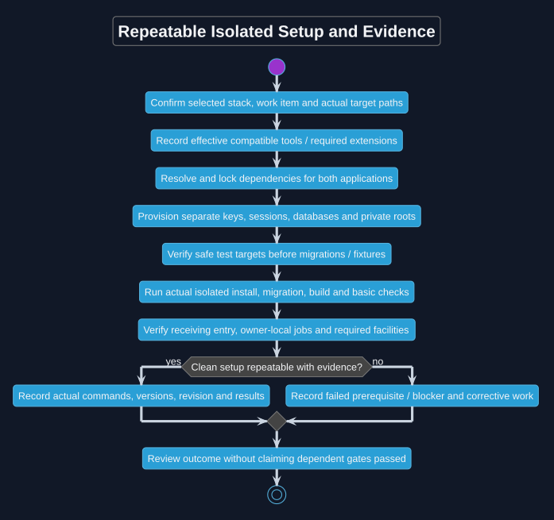

# Project Setup

[Development overview](00-Agile-Iterative-Development.md) · [Test Strategy](02-Test-Strategy.md)

## Setup Contract and Scope

**Not started / unverified.** Establish a reproducible isolated environment for Core and ProjectForge under a separately authorized implementation work item. This document is a setup/evidence procedure, not a verified runnable installation guide. It creates no application, schema, credential, service or runtime result.

Preserve the selected [ADR baseline](../04-System-Design/ADR/ADR-006-Selected-Mvp-Implementation-Baseline.md) and [frontend amendment](../04-System-Design/ADR/ADR-007-React-Inertia-Frontend.md). Compatible maintained patches and effective runtime values require actual verification. Do not silently substitute a different framework/database or treat installed workstation tools as a working project.

## Preparation and Target Safety

| Preparation | Required record / check |
| --- | --- |
| Work scope | Selected issue/outcome, exact applicable criteria and G1 prerequisites |
| Actual checkout | Repository/source revision, application locations and intended configuration |
| Existing material | Distinguish MVP work from any demo/legacy app, database or storage; no implicit migration/reuse |
| Tool inventory | OS, effective PHP/Composer/Node/MySQL/Git and chosen frontend package manager versions |
| Compatibility | Required PHP extensions and package/adapter compatibility from resolved dependencies |
| Environment targets | Separate development/test schema/users, private roots, keys and sessions for both apps |
| Sensitive values | Restricted provisioning method and safe examples containing names/non-secret explanations only |

Before any migration, seed, reset, cleanup or fixture command, verify the resolved target is the intended isolated store/path. A copied production/demo configuration is not a safe test environment. This document supplies no destructive shell commands or fabricated host-specific settings.

## Setup Sequence

[PlantUML source](Diagrams/setup-verification.puml) · [PNG](Diagrams/setup-verification.png)

1. Confirm current selected targets, actual work item, checkout and separate application paths.
2. Record compatible effective tools/extensions and resolve dependencies against the selected framework/frontend direction.
3. Produce appropriate lockfiles during authorized implementation and verify reproducible install behavior.
4. Provision independent app configuration/keys/sessions, database users/schemas and private storage roots; configure isolated test targets.
5. Execute actual reviewed migrations/fixtures and builds; record commands only after they run successfully in the identified environment.
6. Start receiving apps and owner-local workers/scheduler as needed; record actual startup/shutdown, ports and health behavior.
7. Verify isolated basic tests/lint/build and controlled mail/native Git facilities at their applicable gates.
8. Demonstrate that a clean checkout can follow the recorded guide, then review remaining gaps before dependent work.

Network services, package installation and credential provisioning require their actual authorized environment; document their results without secret output. Do not infer package commands, paths or successful installation from this sequence.

## Application and Facility Verification

| Facility | Setup obligation | Assurance limit |
| --- | --- | --- |
| Laravel / React / Inertia | Both locked installs/builds, correct receiving page/form behavior and compatible adapters | A compiled bundle does not prove authorization or all user journeys |
| Database | Isolated migrations/fixtures and correct owner/test credentials | Empty-schema success does not prove later concurrency/migration transitions |
| Private files/PDF | Effective private paths, permissions and controlled trusted-template output | Path existence alone does not prove protected direct delivery or retained history |
| Sessions/keys | Independent receiving context and intended cookie/domain configuration | Shared host/UI cannot merge application authority |
| Jobs/scheduler | Owner-local execution, durable work and actual start/stop/failure observation | Queue acceptance is not completed effect |
| Scoped API/status | Correct endpoint/credential scope and current-authority behavior | Mandatory real boundary/Git verification remains separate from a basic entry check |
| Native Git | Actual engine/transport and private test repositories with allowed/denied grants | Mock JSON/API success is not native client interoperability |
| SMTP | Controlled invitation/recovery delivery and failure behavior | Development log output is not delivery evidence |
| Diagnostics | Safe debug/error settings and bounded structured fields | No credentials/private payloads in samples, logs or shared evidence |
| Backup/restore preparation | Intended protected facility and isolated target documented | Setup alone does not pass demonstrated restore/release gates |

Use [Configuration and Environment](../04-System-Design/03-Low-Level-Design/09-Configuration-And-Environment.md), [Database Design](../04-System-Design/03-Low-Level-Design/04-Database-Design.md) and [Security Implementation](../04-System-Design/03-Low-Level-Design/08-Security-Implementation.md) for constraints. No new queue/cache provider, vault, host purchase or unsupported numerical limit is selected here.

## Setup Exit and Evidence Rules

G1 and applicable exact criteria govern acceptance. Record actual application revision, dependency locks/versions, safe configuration identity, isolated targets, commands/exit outcomes and basic checks for both applications. A missing required input or failed command remains explicit with follow-up; do not label setup verified from a documentation checklist.

When recording commands, include working directory, prerequisite and expected response as well as actual result. Exclude secret values. If an example depends on a selected package/path not yet established, keep it a pending input instead of an apparently runnable instruction.

Setup verification does not automatically pass scoped identity/native Git, full acceptance, accessibility, capacity or restore gates. Review the demonstrated outcome in Sprint Review and retain unexecuted dependent checks.

## Existing Setup Targets and Execution Record

The records below retain the selected target table and original evidence checklist. Their unverified values remain unchanged until actual execution supplies evidence.

Status: Not started. This is a checklist for recording verified Setup, not a runnable installation guide yet.

[Implementation index](../01-Project-Planning/02-Project-Management-Plan.md#stage-5-agile-iterative-development) · [Selected stack](https://github.com/Farhad-V/Web-Resumefolio/blob/1f2acaa351ac306cb57cbe4fe9742e8bd90720d9/docs/MVP/baseline/technical-decisions.md#t01--runtime-frontend-and-persistence) · [G1 requirements](https://github.com/Farhad-V/Web-Resumefolio/blob/1f2acaa351ac306cb57cbe4fe9742e8bd90720d9/docs/MVP/baseline/implementation-sequence.md#gate-register)

## Iteration outcome

The first iteration establishes a repeatable local environment for both applications. Start from the [setup work item](https://github.com/Farhad-V/Web-Resumefolio/issues/37), confirm its acceptance checks, then build and verify a clean setup. Review the results before selecting a dependent feature. Record the outcome and any follow-up in the [iteration review](Sprints/Sprint-01/02-Sprint-Review.md#iteration-review).

## Selected targets versus verified environment

| Item | Selected target | Verified project value |
| --- | --- | --- |
| Framework / runtime | Laravel 13 / maintained PHP 8.4 patch | Not recorded |
| Dependency management | Composer 2; compatible pinned dependencies | No project lockfile recorded |
| Database | Isolated MySQL 8.4 LTS / InnoDB / utf8mb4 | Not created or verified |
| Frontend | React 19 / Inertia 3 / Tailwind 4 / Vite; Blade for PDF templates | Not installed |
| Build runtime | Node 24 LTS | Project build not verified |
| Core / ProjectForge | Separate applications, DB users, keys, sessions and storage | No working application setup recorded |

## Complete during Project Setup

- Record OS, actual maintained versions and required PHP extensions from the resolved dependencies.
- Record the actual application paths and clean install/build commands after executing them successfully.
- Commit appropriate dependency lockfiles during the separately authorized implementation workflow.
- Create a safe example configuration containing names and non-secret examples only; document how local secrets are supplied.
- Record isolated database creation, migration and fixture/seed commands; never target the existing demo database implicitly.
- Record local app, queue and scheduler startup/shutdown commands, ports and expected health responses.
- Record test database isolation and actual test/lint/build commands with their results.
- Document SMTP test delivery separately from development log output; never put credentials into this guide.
- Verify a clean checkout can follow the guide before marking Setup complete.

## Execution record

No Setup commands have been executed for the MVP implementation. Replace this statement only with actual revision-specific evidence when Setup is authorized and completed. Local tools existing on a workstation do not establish a working project environment.

## Setup evidence checklist

For both applications record the source revision, environment, dependency versions, runtime configuration and isolated database and storage locations. Perform a repeatable install and build, then verify the local entry response and basic checks. Record the actual outcome under [Sprint 01 review](Sprints/Sprint-01/02-Sprint-Review.md). Setup has yet to be verified.
