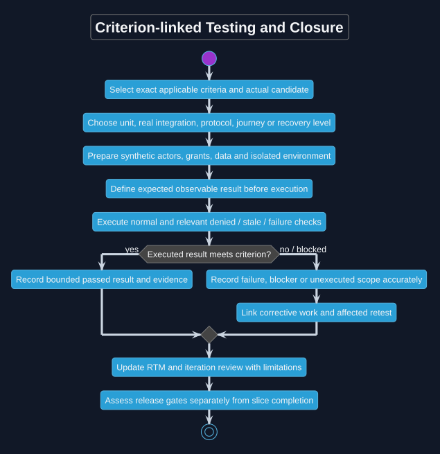

# Test Strategy

[Development overview](00-Agile-Iterative-Development.md) · [Project Setup](01-Project-Setup.md)

## Purpose, Scope and Execution Status

Verify selected MVP behavior on an identifiable candidate using the test level that can establish the required guarantee. Link exact criteria to planned cases and actual observations; keep implementation, verification and release readiness separate.

**Not executed:** this document defines strategy/cases and adds no runnable tests or product pass. Current implementation progress remains in [Sprint Review](Sprints/Sprint-01/02-Sprint-Review.md). Deferred personal mail/calendar, advanced review/releases, general Sprints, AI and user workflow execution are not unfinished MVP tests.

## Test Levels and Boundaries

| Level | Use | Cannot establish alone |
| --- | --- | --- |
| Unit | Deterministic domain/policy decisions, selection/version rules and outcome projection | Real database races, filesystem permissions or external interoperability |
| Persistence/concurrency integration | Actual MySQL constraints, transactions, competing admission/commands and durable work | Real browser/assistive behavior or native Git unless exercised |
| Service/transport contract | Actual caller/actor/scope, current entitlement/local grant, request/error/retry behavior | Permission merely from mock success or a prior session |
| Native Git / storage / mail | Evaluated actual facilities with controlled credentials/data | Full product acceptance or recovery without matching checks |
| End-to-end journey | Invited owner/recipient/collaborator task and meaningful normal/failure states | Every internal invariant or whole-standard conformance from one happy path |
| Accessibility/usability | Actual configured complete-path assessment and real observations where conducted | Fabricated findings, automated-only conformance or technical effect proof from a clickthrough |
| Operational/recovery | Candidate rollout, compatible rollback and isolated record/byte/Git restoration | Reliability solely from a successful backup job or process health signal |

Use [LLD Unit Test Design](../04-System-Design/03-Low-Level-Design/10-Unit-Test-Design.md) for planned UT-01–UT-16 and companion real-boundary checks. Local UT/QA case labels are not replacement acceptance requirement IDs.

## Risk-based Coverage

| Priority boundary | Include |
| --- | --- |
| Current authority | Wrong owner/scope, direct entry, changed/revoked context and unavailable authority |
| Explicit content/history | Subset apply, independent text, stale candidate, separate publication and exact submitted material after edits/withdrawal |
| Private sharing/files | Current selection/language/download eligibility, alternate paths, failed replacement and protected retention |
| Resource/concurrency | Simultaneous invitation use, stale writes, quota reservations, same-key writes and payload mismatch |
| Partial effects | Lost response after commit, worker interruption, pending references and truthful uncertain outcomes |
| Real repository work | Native allowed/denied transfers, exact file/history revision, issue/board grants and stable identity |
| Restore/change | Consistent records/digests/Git, intended access and safe pending work before replay/cleanup |

Choose cases from exact accepted/selected criteria and observed change impact. Do not invent workload, latency, RPO/RTO or coverage-percentage thresholds to declare success. Resolve missing inputs as named gaps.

## Test Evidence Lifecycle

[PlantUML source](Diagrams/test-evidence-lifecycle.puml) · [PNG](Diagrams/test-evidence-lifecycle.png)

Expected results are specified before execution. A failure, blocker or unexecuted case remains visible; retest after corrective work on the changed candidate. Passing a slice does not automatically pass full release gates.

## Environment and Fixture Rules

Use isolated databases/private roots/repositories and synthetic actors with distinct current grants. Verify test targets before reset/migration/fixture operations; never implicitly use demo/production data. Recipient context is link-scoped where selected and need not be a product account.

Use controllable clocks/identities for deterministic unit cases. Real concurrency tests need controlled competing operations and actual persisted outcomes, not only sequential fake calls. Preserve exact artifact fixtures/digests and identify revision/language/temporal context.

Control mail/external effects and restore isolation. Do not send unintended messages, mutate live repositories or replay production work to make a test appear realistic. Exclude credentials/private payloads from evidence. Record actual client/browser/assistive configuration rather than a timeless “current stable” label.

## Defect, Retest and Closure Rules

A defect record identifies exact criterion, candidate/environment, prerequisites, reproduction, expected/observed outcome, impact and evidence. Distinguish product failure, test defect, environment blocker and unsupported assumption without hiding the result. Link corrective work and affected regression checks.

After a fix/change, rerun the failed check and proportionate related coverage. Changes to schema, credentials, shared components, dependencies or environment can invalidate previous evidence. Do not mark a test passed because code exists, a mock returns success or a diagram renders.

Report passed, failed, blocked and not executed with actual evidence and limitations. Preserve deferred/conditional applicability separately from execution status. A result must support the exact criterion it claims; one case can cover several only when observations establish each outcome.

## Cross-stage Handoff

Use [LLD Traceability](../04-System-Design/03-Low-Level-Design/11-Traceability.md), [UI/UX accessibility](../04-System-Design/02-UI-UX-Design/10-Accessibility.md), [Usability Testing](../04-System-Design/02-UI-UX-Design/12-Usability-Testing.md) and [RTM](../02-Requirements-Engineering/03-Requirements-Traceability-Matrix/README.md) for actual criterion/evidence relationships. The [deployment plan](../06-Deployment-Release/01-Deployment-Plan.md) and runbook own separate release/operational acceptance.

## Existing Gate, STLC and Acceptance Records

The retained sections below supply the original gate references, lifecycle and QA-01–QA-08 planned examples. They remain unexecuted and are not an exhaustive acceptance suite.

The [implementation sequence](https://github.com/Farhad-V/Web-Resumefolio/blob/1f2acaa351ac306cb57cbe4fe9742e8bd90720d9/docs/MVP/baseline/implementation-sequence.md) defines the verification gates. The [criterion register](https://github.com/Farhad-V/Web-Resumefolio/blob/1f2acaa351ac306cb57cbe4fe9742e8bd90720d9/docs/MVP/baseline/criterion-dispositions.csv) and [supplemental acceptance criteria](https://github.com/Farhad-V/Web-Resumefolio/blob/1f2acaa351ac306cb57cbe4fe9742e8bd90720d9/docs/MVP/baseline/supplemental-acceptance.md) define the applicable outcomes. Record test cases alongside the feature or suite that implements them and link them to those criteria.

## Test within the iteration

Before building the slice, turn its acceptance criteria into concrete checks for the main user path and relevant denied or failure paths. Run the checks against the implemented slice and add regression checks for affected behavior. Bring the actual results to the [iteration review](Sprints/Sprint-01/02-Sprint-Review.md#iteration-review). Record further work against any failing or deferred check.

## Verification across iterations

- **Setup** Verify a clean dependency install, build, migrations and a basic automated check for each application, using isolated databases.
- **Integration** Verify the Core and ProjectForge identity boundary and real Git client behavior before dependent integration. Use distinct test accounts and verify access denial as well as success.
- **Acceptance** Exercise the invited user and employer journeys, private sharing and submitted-application history. Link successful, denied and interrupted paths to the applicable criteria.
- **Release verification** Record supported-browser, accessibility, operational and recovery checks against the release candidate. Use isolated test data and identify the environment and tested revision.

For each recorded case, include the criterion, prerequisites and test data, steps or automated test reference, and expected result. For each execution, include the tested revision, environment, observed result, evidence, and any unresolved failure. Record unexecuted cases as pending.

**Execution status** Product tests have yet to run. See [implementation progress](Sprints/Sprint-01/02-Sprint-Review.md) for package-level evidence.

## Software Testing Life Cycle (STLC)

| Step | Activity | Evidence or exit condition |
| --- | --- | --- |
| Requirements review | Identify the in-scope criteria, actor, allowed behavior and important denial or failure paths. | Each selected criterion links to a planned check or an open question in the [RTM](../02-Requirements-Engineering/03-Requirements-Traceability-Matrix/README.md). |
| Test planning | Select unit, integration, end-to-end, usability or operational checks based on risk. Identify fixtures, dependencies and the environment. | Planned checks have an expected result and a defined scope. |
| Test design | Specify the input, initial state, action and observable result. Include relevant denial, stale state and retry behavior. | Cases are reviewable in the owning issue or test suite. See [unit test design](../04-System-Design/03-Low-Level-Design/10-Unit-Test-Design.md) and [usability testing](../04-System-Design/02-UI-UX-Design/12-Usability-Testing.md). |
| Environment preparation | Set up isolated databases, stores, test accounts and controlled mail. Record the revision, dependency versions and build. | A clean build and basic checks run using synthetic fixtures in the identified environment. See [project setup](01-Project-Setup.md). |
| Execution and defect follow-up | Run selected checks, record observed results and link failures to an issue. Rerun the failed check and affected regression cases after a fix. | Executed cases include evidence. Blocked cases identify their dependency. |
| Test closure | Summarize passed, failed, blocked and unexecuted cases. Identify residual risk and update the RTM and review. | The sprint review or release record states what was verified and what is still open. |

### MVP acceptance cases

These are planned examples. The criterion register supplies the complete acceptance wording and applicability.

| Case | Criterion | Setup and action | Expected result |
| --- | --- | --- | --- |
| QA-01 | MVP-AC09 | Invite a synthetic account and complete sign-in. Compare with an expired invitation and an attempt to access another user's profile. | Valid admission succeeds. Expired admission and cross-user access are denied. |
| QA-02 | MVP-AC02 | Publish a test resume with one selected file. Open it as an authorized employer and separately check an unselected file and a revoked share. | Only the selected file is available through the current share. |
| QA-03 | MVP-AC01, MVP-AC06 | Capture a test application submission, then edit the resume used for that submission. | Follow-up and status remain available to the owner, and the original submitted artifact digest is unchanged. |
| QA-04 | MVP-AC03, MVP-AC04 | Exercise the planned Git operations using test repositories and personas with separate read and write grants. Then disable one test account. | Operations follow current entitlement and repository grants, including after disablement. |
| QA-05 | MVP-AC05 | Generate a representative English/German PDF and review text, fonts and page flow. | Accents, selected language, readable layout and page flow are preserved. |
| QA-06 | MVP-AC10 | Move a test issue through the board with an authorized actor. Repeat with an outdated version. | A valid move retains issue identity. The stale request reports a conflict and preserves the later state. |
| QA-07 | MVP-AC08 | Restore a test backup into an isolated environment. Compare selected record and file digests, repository references and access state. | The expected data and access rules are restored and external work does not replay. |
| QA-08 | MVP-AC07 | Exercise concurrent storage admission using synthetic data near the configured limits. | Reservations enforce the applicable ceilings and existing committed data remains intact. |

### Execution and release evidence

Record candidate revision, environment, case and criterion IDs, observed outcome, evidence link and follow-up issue. Use **passed**, **failed**, **blocked** or **not executed**. A defect report includes the expected and observed result, reproduction context, impact and the check to rerun. Keep credentials and personal data out of evidence.

Before stable release, review candidate test results, applicable security and authorization cases, restore and rollback evidence, and unresolved issues against the [deployment plan](../06-Deployment-Release/01-Deployment-Plan.md). A sprint review records its own conclusion separately from release readiness.
