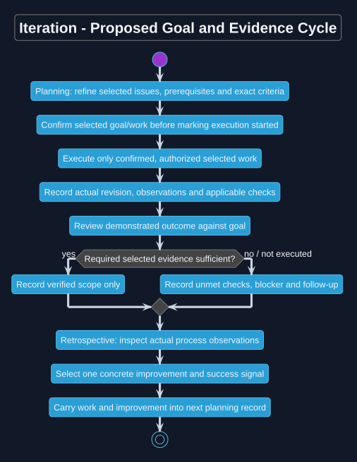

# Sprint 01 Review

Accountable owner: Farhad. All product work below is Not started; tests are Not executed. This page tracks implementation facts without replacing the product backlog.

[Implementation index](../../../01-Project-Planning/02-Project-Management-Plan.md#stage-5-agile-iterative-development) · [Baseline](https://github.com/Farhad-V/Web-Resumefolio/blob/1f2acaa351ac306cb57cbe4fe9742e8bd90720d9/docs/MVP/baseline/README.md) · [Criterion guide](https://github.com/Farhad-V/Web-Resumefolio/blob/1f2acaa351ac306cb57cbe4fe9742e8bd90720d9/docs/MVP/baseline/criterion-dispositions.md) · [Product backlog](https://github.com/Farhad-V/Web-Resumefolio/blob/1f2acaa351ac306cb57cbe4fe9742e8bd90720d9/docs/MVP/Project-Management/product-backlog.md)

## Review Readiness and Evidence Boundary

**Review not conducted; no setup increment demonstrated.** Sprint 01's candidate goal remains proposed in Planning. The capability table below is the broader MVP progress register; it is not a commitment to deliver all packages within Sprint 01. Keep implementation not started and checks not executed until actual evidence changes them.

Use the existing [setup issue](https://github.com/Farhad-V/Web-Resumefolio/issues/37), [Project Setup](../../01-Project-Setup.md) and [Planning](01-Sprint-Planning.md) for the selected slice. A documentation update or installed workstation tool is not product implementation or repeatable setup proof.

### Review Procedure

1. Identify the actual confirmed goal/issues, candidate/build and environment.
2. Demonstrate what ran and compare observed results to exact applicable criteria.
3. Inspect actual S01-T01–S01-T03 results and remaining setup obligations, including safe targets and reproducibility.
4. Preserve failures, blockers, unexecuted work and simulation/coverage limits.
5. Record actual feedback/decisions and link remaining work without inventing acceptance.
6. Review what can proceed next under its prerequisites; setup does not automatically pass G2 or release gates.
7. Hand observed process questions to the Retrospective, separately from product acceptance.

| Review field | Current position |
| --- | --- |
| Demonstrated candidate / environment | None recorded |
| Actual command/test results | None recorded; planned S01 checks remain not executed |
| Confirmed accepted setup outcome | None recorded |
| Participant/owner review feedback | None recorded |
| Newly agreed next increment | None recorded; select from actual evidence |

[PlantUML source](Diagrams/sprint01-evidence-cycle.puml) · [PNG](Diagrams/sprint01-evidence-cycle.png)

The shared flow describes planned work/review handoffs. It is not evidence of execution. Record actual results centrally in the RTM/work item and keep credentials/private material out of review artifacts.

## Iteration review

Use the linked work item to record the review once a slice has been built or an experiment has ended.

| Record | What to capture |
| --- | --- |
| Intended outcome | Work item, selected capability and acceptance criteria |
| Demonstrated result | What ran, on which revision, and where the test evidence is recorded |
| Feedback and decisions | What the review revealed and any change to the requirement or design |
| Follow-up | Remaining work or a blocker, with a link to the backlog item |

Demonstrate the increment and compare it with the Sprint Goal. Record feedback and update the work board through [Backlog Refinement](01-Sprint-Planning.md). Then capture one process improvement in the [Sprint Retrospective](03-Sprint-Retrospective.md).

## Capability progress

| Work package | Status | Required gate / criterion source | Code / test evidence |
| --- | --- | --- | --- |
| Isolated Setup and clean build | Not started | G1 | None recorded |
| Invites, Login, recovery, Admin TOTP and private Profile | Not started | G3/G4; ACC; MVP-AC09 | None recorded |
| ProjectForge SSO/API/native Git security spike | Not started | G2; GIT; MVP-AC03/04 | None recorded |
| Resume variants, source preview/select/apply and explicit publication | Not started | G3; PRP; MVP-AC06 | None recorded |
| Private media, PDFs and password-protected sharing | Not started | G3/G5; AFO/PDF; MVP-AC02/05/07 | None recorded |
| Manual applications and preserved submitted copies | Not started | G3; APP; MVP-AC01/06 | None recorded |
| ProjectForge repositories, permissions, file/history and issues/Kanban | Not started | G2/G3; GIT/PKS; MVP-AC04/10 | None recorded |
| Integrated actor validation, quality, operations and restore | Not started | G3–G6; QSR; MVP-AC08 | None recorded |

Resolve criterion prefixes to applicable individual rows in the [criterion register](https://github.com/Farhad-V/Web-Resumefolio/blob/1f2acaa351ac306cb57cbe4fe9742e8bd90720d9/docs/MVP/baseline/criterion-dispositions.csv), respecting each scope constraint. [Supplemental criterion definitions](https://github.com/Farhad-V/Web-Resumefolio/blob/1f2acaa351ac306cb57cbe4fe9742e8bd90720d9/docs/MVP/baseline/supplemental-acceptance.md) provide the MVP-AC checks. These references are planning links, not evidence of coverage.

## Status rules

- **Not started:** no implementation work recorded.
- **In progress:** link actual work and next required checks; do not imply acceptance.
- **Blocked:** record the concrete dependency, responsible person and exit condition.
- **Implemented — verification pending:** code exists but required acceptance evidence is incomplete.
- **Verified:** link exact criterion results, candidate/revision, environment and relevant gate evidence. A completed feature alone does not pass the full MVP Release gate.

Update the relevant row as work changes; record failed/unexecuted checks explicitly. Do not mark deferred future mail/calendar, advanced review/Sprints or user workflow execution as unfinished MVP implementation.

## Design deviation log

No implementation deviations are recorded. During implementation, add a dated entry with: affected requirement/criterion, original Design/ADR, actual code change and reason, alternatives/impact, authority and decision status, required Baseline change, and verification/recovery evidence. Record unresolved proposals as proposals, never as accepted changes. No fabricated sample deviation is included.

## Evidence entry format

When evidence exists, record work package, actual code candidate, criterion IDs, environment, command or walkthrough, expected/observed result, date, sanitized evidence path and remaining limitations. Evidence may support Testing/Release documentation later; this scaffold creates no test Pass.

## Detailed Analysis and Design

**Status:** pending. No implementation or result is recorded.

## Detailed Analysis & Design

Start with the selected issue and acceptance criteria. Clarify actors, business rules, states and failure paths that affect the slice. Refine the necessary screen flow, data changes, component behavior or API contract using the [System Design Guide](../../../01-Project-Planning/02-Project-Management-Plan.md#stage-4-system-design).

Record the decisions in the owning requirements or design document and link them from the issue. Identify the main and failure-path checks before starting [Implementation](01-Sprint-Planning.md) and [Testing](../../02-Test-Strategy.md).

## Implementation Notes

**Status:** pending. No implementation or result is recorded.

## Implementation

Status: Not started. The responsibilities below are selected Design, not claims that modules or endpoints exist.

[Implementation index](../../../01-Project-Planning/02-Project-Management-Plan.md#stage-5-agile-iterative-development) · [SDD](../../../01-Project-Planning/02-Project-Management-Plan.md#stage-4-system-design) · [Technical decisions](https://github.com/Farhad-V/Web-Resumefolio/blob/1f2acaa351ac306cb57cbe4fe9742e8bd90720d9/docs/MVP/baseline/technical-decisions.md)

## Build the selected capability

Start with the selected backlog item, its acceptance criteria and the relevant [analysis and design](01-Sprint-Planning.md). Build a usable slice through the affected layers. Link the actual code and interface changes to the work item and its [iteration tests](../../02-Test-Strategy.md#test-within-the-iteration). If the work changes an accepted design decision, record the reason and consequence in the [design deviation log](#design-deviation-log).

## Responsibilities to map to actual code

| System / responsibility | Actual source paths | Implementation status |
| --- | --- | --- |
| Core — invited accounts, authentication and policies | Not created | Not started |
| Core — profile, independent resume drafts and explicit publication | Not created | Not started |
| Core — private library, PDFs and protected employer sharing | Not created | Not started |
| Core — manual applications and actual submitted artifacts | Not created | Not started |
| Core — dashboard and user-scoped ProjectForge client | Not created | Not started |
| ProjectForge — SSO, grants, native Git, files/history and issues/board | Not created | Not started |
| Each system — local persistence, outbox, jobs and audit | Not created | Not started |

React pages and reusable components belong to each Laravel application through Inertia. Laravel routes/controllers and policies retain server-side authority; client-side visibility is not authorization. Keep trusted Blade PDF templates separate from interactive React pages. No source paths or installed adapters are asserted before scaffolding.

Map responsibilities to actual namespaces/directories after scaffolding. Keep Core and ProjectForge databases, keys, sessions and private storage separate; do not introduce a shared process/database to make this table easier to fill.

## Record database changes when implemented

For each migration record its real path, owning system, affected tables/indexes/constraints, requirement links, compatibility/data-loss implications, execution evidence and rollback or recovery procedure. No implemented schema or migration is recorded yet.

## Record API and UI entry points when implemented

For each real entry point record route/method, owning system, actor and resource authority, request/response/error contract, version/idempotency rules and contract-test evidence. Link handlers, application services and persistence responsibilities. Never publish tokens, private keys or actual user content. No implemented endpoint is recorded yet.

## Record operational code when implemented

Link real job handlers, scheduled tasks, immutable artifact lifecycle, quota enforcement, audit events and configuration examples. Record trust-boundary/failure behavior and verification alongside each implementation; the Design description alone is not execution evidence.

## Testing

**Status:** pending. Record the tested revision, environment, check and actual outcome.

Candidate checks: run a clean install, build, isolated migration and the basic automated checks for each application. Record failures and link each verified result to the setup work item.

See the [test strategy](../../02-Test-Strategy.md) for cross-sprint checks.

## Sprint 01 test execution record

The candidate sprint goal is a repeatable local setup. The checks below are planned for the authorized setup work and currently have no execution evidence.

| Check | Expected result | Status |
| --- | --- | --- |
| S01-T01 Clean install and build | Each application builds from its recorded dependency inputs. | Not executed |
| S01-T02 Isolated migrations and fixtures | Each application uses its own test database and synthetic data. | Not executed |
| S01-T03 Local smoke check | Each application starts and its designated health or entry response can be verified. | Not executed |

Record the tested revision, environment, observed results, evidence and follow-up in the setup work item. Use the [STLC workflow](../../02-Test-Strategy.md#software-testing-life-cycle-stlc) to close the checks.
