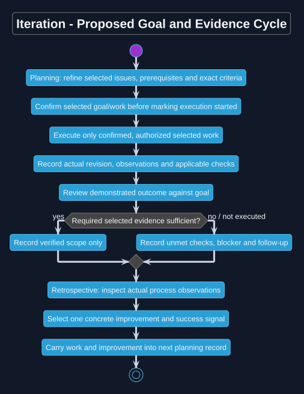

# Sprint 01 Retrospective

[Planning](01-Sprint-Planning.md) · [Review](02-Sprint-Review.md) · [Development overview](../../00-Agile-Iterative-Development.md)

**Not conducted.** No retrospective observations, agreed improvement or measured outcome are recorded. Complete this record after actual work/review provides evidence. Documentation preparation is not a completed sprint or participant feedback.

## Purpose and Boundary

Inspect how the selected work was planned, executed, verified and reviewed, then choose one concrete improvement to try. The Review records product/candidate outcomes; the Retrospective records process observations and the improvement experiment. Keep both distinct from requirement acceptance and release readiness.

The proposed Sprint 01 goal is scope, host and readiness for #1/#2/#7/#8/#9; isolated setup is allocated to Sprint 02. Use its actual evidence if/when executed; do not invent tool failures, team behavior, delays or success merely to populate this template. Farhad retains delivery responsibility; no staffed team or facilitation session is implied.

## Review Prompts

| Area | Neutral prompt | Evidence to consult |
| --- | --- | --- |
| Planning | Was the intended readiness outcome small and explicit enough to demonstrate? | Confirmed selection, criteria and actual changes to scope |
| Dependencies | Which required input was unclear or unavailable? | Recorded blocker, decision and exit condition |
| Reproducibility | Could the recorded commands/environment be repeated safely? | Actual scope/host/readiness evidence and identified blockers |
| Isolation | Were test targets/credentials/private roots clear before work? | Safe configuration/target checks, without secret values |
| Verification | Were expected results defined before execution and failures retained? | S01 checks, actual outcomes and limitations |
| Documentation | Did the owning documents avoid duplicated or misleading status? | Linked work item, setup guide, Review and RTM |
| Work process | What helped and what caused observed friction? | Specific observation, not assumed blame or fabricated metrics |
| Follow-up | What one change could improve the next increment? | Concrete action, owner and observable evaluation signal |

## Retrospective Procedure

1. Confirm the actual reviewed work, candidate and remaining gaps.
2. Gather factual observations of what helped or hindered the process.
3. Distinguish process issues from product defects, environment blockers and policy decisions; route each to its owning record.
4. Select a small actionable improvement within current scope/responsibilities.
5. Record its responsible follow-up, linked item if needed and how the next review will evaluate it.
6. Carry the improvement into [Sprint 02 Planning](../Sprint-02/01-Sprint-Planning.md) if applicable, without inventing a confirmed next goal.

Avoid arbitrary scores and fabricated participant observations. A suggestion is not an agreed action until actual disposition is recorded.

## Observation and Action Template

| Field | Record after actual inspection |
| --- | --- |
| Observation | Concrete event/practice and supporting work/evidence reference |
| Impact | Observed consequence for safe reproducibility, understanding, rework or verification |
| Interpretation | Hypothesis explaining the observation, clearly separate from fact |
| Action | One specific process change to try, preserving required quality/security gates |
| Owner/follow-up | Actual responsible person and tracked item where necessary |
| Evaluation signal | What can be observed next to judge whether the action helped |
| Result | Actual later observation and remaining limitations; pending until evaluated |

**Current action record: none.** These fields are a template, not findings or an assignment. Product defects keep their own requirement, reproduction, correction and retest evidence rather than being closed by a process discussion.

## Link to the Iteration Cycle

[PlantUML source](Diagrams/sprint01-evidence-cycle.puml) · [PNG](Diagrams/sprint01-evidence-cycle.png)

The shared view illustrates planned handoffs, not a conducted retrospective. Reuse the same canonical diagram rather than duplicating its source.

## Follow-up and Closure

At the next retrospective, inspect whether the agreed change was attempted and what evidence says about its effect. Keep not-attempted, inconclusive and ineffective outcomes explicit; revise the action when justified. Do not claim improvement from a completed checkbox alone.

Link actual follow-up through Planning/Review and the owning backlog item. Use [Test Strategy](../../02-Test-Strategy.md) for verification gaps and [Project Setup](../../01-Project-Setup.md) for environment/procedure corrections. This record authorizes no product change, remote message, issue creation or deployment by itself.
