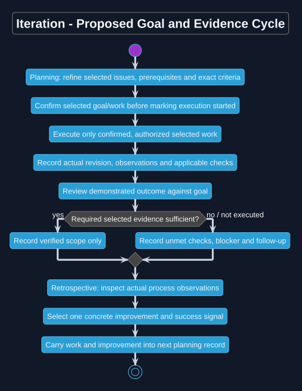

# Sprint 02 Planning

[Development overview](../../00-Agile-Iterative-Development.md) · [Review](02-Sprint-Review.md) · [Retrospective](03-Sprint-Retrospective.md)

**Status: proposed; execution not recorded.** Candidate goal: demonstrate repeatable isolated local setup for Resumefolio Core and ProjectForge. Candidate issues are #37 (setup), #5 (transactional SMTP) and #6 (backup prerequisites); refine their actual acceptance checks before commitment. The candidate issue and work breakdown below are not a confirmed sprint commitment or an implementation result.

## Sprint Planning

### Candidate Goal and Demonstration

A clean checkout can follow recorded setup instructions to install/build both independent applications, use isolated databases/private roots and run the designated basic checks. Demonstrate the actual candidate/environment and commands, not merely that tools exist or design documents are complete.

Use [Project Setup](../../01-Project-Setup.md), [Test Strategy](../../02-Test-Strategy.md) and the [setup work item](https://github.com/Farhad-V/Web-Resumefolio/issues/37) to refine exact scope before recording the selection as confirmed. Preserve the applicable G1 definition and exact RTM criteria; preserve the selected acceptance thresholds.

### Candidate Work Breakdown

| Work | Intended result | Dependency / evidence |
| --- | --- | --- |
| Confirm checkout and targets | Actual source revision and independent application locations identified | No implicit demo/production reuse |
| Resolve compatible tools/dependencies | Effective selected stack, required extensions and appropriate locks | Actual install/build evidence, not assumed version compatibility |
| Establish owner/environment isolation | Separate keys, sessions, database users/schemas and private roots; safe test stores | Verify effective targets/permissions before migrations/fixtures |
| Run migrations and build | Both apps build and migrate under reviewed isolated configuration | Record actual commands, working directories and results |
| Verify local operation | Designated entry/health and basic automated checks are repeatable | S02-T01–S02-T03 remain not executed until observed |
| Complete runnable setup record | Clean-checkout procedure includes actual startup/shutdown and safe configuration guidance | No secrets or unexecuted host-specific commands represented as verified |
| Review and follow-up | Demonstrated scope, failures/blockers and next required work linked | Separate setup success from G2 or full release readiness |

Confirm selected issue links and refine/split tasks in the owning work item; this table does not create issues or claim assignment. Farhad retains delivery/decision responsibility. Check operating obligations and prerequisites before selection.

## Backlog Refinement

**Pending.** Review the [product backlog](https://github.com/Farhad-V/Web-Resumefolio/issues) and existing [board](https://github.com/users/Farhad-V/projects/7/views/1). Keep the exact selected outcome, requirement/criterion, prerequisites, verification and unresolved inputs linked from the owning issue.

Split multi-outcome work into independently reviewable pieces. Resolve input questions needed by the selected slice without reopening settled architecture. If evidence requires a consequential choice change, use the [ADR index](../../../04-System-Design/ADR/Decision-Index.md) and update affected contracts/traces.

Refinement is not implementation or a remote board change. No issue/board mutation is performed by completing this record.

## Proposed Setup Backlog

The existing setup issue is the candidate source; confirm its acceptance checks and actual prerequisites before locking scope. Identify application paths, effective versions, secret-safe configuration, isolated data/storage targets and required commands/results.

| Ready-to-start check | Must be explicit |
| --- | --- |
| Scope | One demonstrable setup outcome and exact applicable criteria |
| Owner/targets | Core/Forge ownership and actual safe environment paths/stores |
| Dependencies | Available tools, compatible package resolution and any blocked input |
| Verification | Planned clean install/build, migrations/fixtures and entry/basic checks |
| Data safety | Synthetic data and no implicit production/demo effects |
| Evidence | Where actual revision, commands/results and limitations will be recorded |

## Scope and Exclusions

Preserve independent Laravel/React/Inertia applications, selected database/private storage and native Git direction. No common database/session is introduced to simplify setup. Personal mail/calendar, AI, advanced review/releases, general Sprints and user workflow/deployment execution remain outside MVP.

Actual scoped identity/native Git verification remains mandatory at its assigned boundary gate before dependent enablement. Basic setup alone does not demonstrate protected sharing/history, capacity, accessibility or isolated restoration.

## Planned Acceptance Checks

| Locator | Expected result | Current execution |
| --- | --- | --- |
| S02-T01 | Both applications install/build from recorded compatible dependency inputs | Not executed |
| S02-T02 | Reviewed migrations/fixtures use intended separate isolated databases/synthetic data | Not executed |
| S02-T03 | Both applications start and the designated entry/health/basic response is verified | Not executed |

These locators refer to the [Review execution record](02-Sprint-Review.md#sprint-02-test-execution-record), not new requirement IDs. Record exact criteria and all additional setup obligations from the authoritative work item/Project Setup. A planned expected result is not a pass.

## Planning-to-Review Flow

[PlantUML source](../Sprint-01/Diagrams/sprint01-evidence-cycle.puml) · [PNG](../Sprint-01/Diagrams/sprint01-evidence-cycle.png)

Record actual detailed design/implementation/testing in [Review](02-Sprint-Review.md#detailed-analysis-and-design) and linked owning documents. Preserve denied, failed, blocked and unexecuted scope. Finishing an iteration does not imply all work or release gates passed.

## Handoff

When planning is confirmed, record actual goal, selected issues, dependencies, exact checks and current status. Review any change to those facts rather than silently substituting another outcome. Feed observed results and follow-up back through refinement and carry a real process improvement from the retrospective into the next plan.

No execution, setup, test result, remote issue change or deployment is established by this planning document.

## Ordered Work, SMTP and Backup Acceptance

Follow **#37 → #5 → #6** as the reading/start sequence. SMTP and backup investigation may proceed independently where safe inputs exist; actual application checks depend on the required setup. See [Sprint 02 slices](../../03-Sprint-Delivery-Plan.md#sprint-02). Select a demonstrable slice and split or carry remaining work explicitly.

| Locator | Expected result | Current execution |
| --- | --- | --- |
| S02-T04 | Authorized synthetic SMTP test recipients receive the controlled test messages; transport acceptance and receipt are recorded separately without exposing credentials. | Not executed |
| S02-T05 | Connection failure/throttling/retry produce truthful outcomes without duplicate business actions or secret-bearing diagnostics. | Not executed |
| S02-T06 | Independent restic destination access/capacity, protected separate keys, selected retention and coherent capture inventory are checked or explicitly blocked. | Not executed |
| S02-T07 | An isolated restore target and safe procedure are recorded; preparation makes no actual restore-success claim (#27 owns integrated restore proof). | Not executed |

The exit demonstration includes both reproducible applications, actual controlled SMTP evidence and backup-prerequisite evidence, with exact applicable criteria. Missing service configuration, authorized recipient or independent destination remains an input blocker; no purchase, credential disclosure or live-data operation is authorized by this plan.
