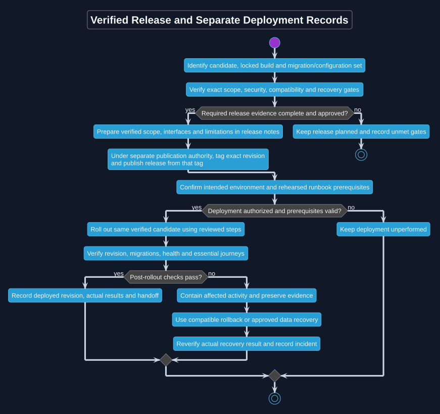

# Deployment Plan

[Runbook](02-Runbook.md) · [Release Notes](03-Release-Notes.md) · [Development overview](../05-Agile-Iterative-Development/00-Agile-Iterative-Development.md)

**Status:** version `1.0.0` is the planned first stable Resumefolio MVP release. No verified release candidate, tag/publication or production deployment is recorded here. This plan establishes required evidence and operating boundaries; it executes no rollout.

## Stable MVP Release

1. Identify the actual candidate and verify exact applicable MVP criteria, supported interfaces and known limitations.
2. Complete required security/operational gates, including isolated restoration and compatible rollback verification.
3. Under separate release-publication authority, tag the verified revision as `v1.0.0` and publish **Resumefolio MVP** from that tag.
4. Record deployment separately with intended environment, deployed revision and actual smoke/recovery results.

The publication step is a future gated action, not evidence that a tag/release exists or permission inferred from editing this document. Release notes must describe the exact verified tag, while operating evidence identifies what was actually deployed.

## Release Scope and Authority

| Area | Selected MVP boundary |
| --- | --- |
| Core | Invited accounts/dashboard; professional profiles/tailored materials; explicit selected apply and separate publication; private same-server files/PDF/protected sharing; manual applications and exact submitted history |
| ProjectForge | Independent scoped integration; real Git grants/transfers/file history; repository issues and simple Kanban |
| Operations | Verified setup/builds, current authorization, bounded resources/diagnostics, protected backups and consistent recovery |
| Deferred | Personal mail/calendar, AI, advanced review/releases, general Sprints and user workflow/deployment execution |

Farhad retains decision/delivery authority under the recorded project structure. Do not invent operators, release approvals, hosting purchases or accepted residual risks. A completed sprint/green build is not the full release gate. Use [ADR decisions](../04-System-Design/ADR/Decision-Index.md) and the [RTM](../02-Requirements-Engineering/03-Requirements-Traceability-Matrix.md) for governing scope and status.

## Release Evidence

| Required record | Acceptance evidence |
| --- | --- |
| Candidate identity | Exact source/build revision, appropriate lockfiles, compatible effective tools and migration set |
| Functional scope | Actual selected criterion results, including meaningful denied/stale/interrupted paths |
| Current authority | Distinct actors/grants, scoped API/status and real native Git behavior at mandatory boundary gates |
| Material integrity | Explicit update/publication and exact retained actual submitted bytes after changes |
| Private delivery | Selected content/language and direct/alternate protected access under current policy |
| Quality | Defined workloads, capacity/resource policy, supported-client/accessibility results and limitations |
| Environment | Independent keys/sessions/users/private paths, secret-safe configuration and effective permissions |
| Recovery | Protected usable backup, isolated consistent restore and migration/code rollback compatibility |
| Operating procedure | Rehearsed runbook steps/commands, smoke checks, stop triggers and responsible execution |
| Disposition | Actual approval/remaining issue record, supported interfaces and published limitations |

Use the [selected gate reference](https://github.com/Farhad-V/Web-Resumefolio/blob/1f2acaa351ac306cb57cbe4fe9742e8bd90720d9/docs/MVP/baseline/implementation-sequence.md), [Test Strategy](../05-Agile-Iterative-Development/02-Test-Strategy.md) and exact RTM criteria. Missing/failed/blocked/unexecuted evidence stays explicit. No numerical uptime, workload or RPO/RTO is invented by this plan.

## Environments and Promotion

| Environment | Purpose | Required separation / evidence |
| --- | --- | --- |
| Development/test | Isolated setup, migrations, fixtures and checks | Synthetic data and verified targets; no implicit demo/production access |
| Pre-production rehearsal | Candidate rollout, compatibility, smoke, rollback and recovery | Same candidate identity, reviewed configuration and controlled effects away from production |
| Production | Authorized promotion and live verification | Correct environment, secrets/permissions, protected backup and recorded actual results |
| Isolated restore | Demonstrate recovery safely | Independent target/connectivity, consistent records/bytes/Git and controlled pending effects |

Promote the same verified candidate; do not rebuild unrecorded dependencies between rehearsal and production. Record necessary environment-specific configuration identity without secrets. Initial shared hosting remains a shared failure domain, not automatic independent availability.

## Release and Deployment Decision Flow

[PlantUML source](Diagrams/release-deployment-gates.puml) · [PNG](Diagrams/release-deployment-gates.png)

The flow separates release acceptance/publication from operating rollout. Unmet gates stop the affected action. Recovery is chosen according to actual state and approved procedure, not automatically authorized by a diagram.

## Rollout Preconditions and Sequence

Before rollout, confirm candidate approval, intended environment, access, compatible schema/data/pending work and usable rollback/restore. Recheck private paths, service credentials and effective worker configuration. Agree the actual traffic/write/worker handling in rehearsal.

Apply reviewed migrations and rollout ordering from the [runbook](02-Runbook.md). Verify intended revision/assets, health/readiness and essential journeys after activation. Stop on unsafe migration, authority/private-delivery failure or uncertain data integrity. Do not continue merely because a process returns a healthy response.

## Recovery and Stop Rules

| Condition | Decision boundary |
| --- | --- |
| Unmet prerequisite | Do not start rollout; record the blocker |
| Migration failure/incompatible state | Stop promotion, preserve evidence and assess actual data/code compatibility |
| Essential smoke/security failure | Contain affected activity; use reviewed compatible recovery path |
| Previous code compatible with current data/work | Code rollback may be used under runbook authority, followed by fresh checks |
| Data recovery necessary | Pause affected writes and use the approved isolated-verified recovery procedure |
| Unknown file/Git/remote outcome | Reconcile owner-recorded identity/effects before replay or cleanup |

Code rollback does not undo delivered bytes, mail, changed Git refs or every schema/data change. Data restore can discard later writes and must not be treated as a generic automatic rollback. Preserve exact submitted materials, intended access and pending-effect protection through recovery.

## Handoff and Closure

Record actual revision/environment, rollout/migration outcomes, smoke/recovery evidence, unresolved issues and operator disposition. Keep release publication and deployment records separate in [Release Notes](03-Release-Notes.md) and operating evidence.

Use [Deployment Architecture](../04-System-Design/01-High-Level-Design/09-Deployment-Architecture.md) and retained [operations/recovery design](../04-System-Design/01-High-Level-Design/14-Appendices.md#design-record-06-design-quality-and-security-analysis-03-operations-backup-recovery-and-resilience-md) for constraints. Carry verified procedures/known issues into [Maintenance](../07-Maintenance-Evolution/01-Maintenance-Plan.md). Documentation completion changes no release/deployment status.
