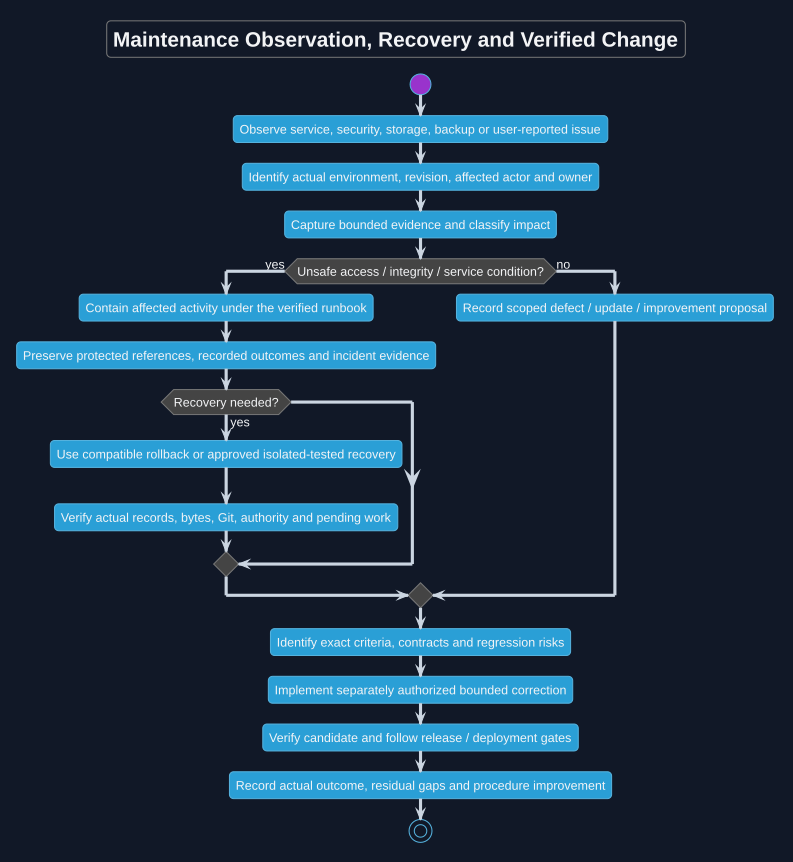

# Maintenance Plan

[Deployment Plan](../06-Deployment-Release/01-Deployment-Plan.md) · [Runbook](../06-Deployment-Release/02-Runbook.md) · [Release Notes](../06-Deployment-Release/03-Release-Notes.md)

**Status:** operating procedures are planned; production operations, incidents and maintenance outcomes have not been recorded. This plan defines responsibilities and evidence, not a live monitoring configuration, verified recovery procedure or completed maintenance action.

## Purpose and Scope

Keep the selected MVP secure, understandable, recoverable and compatible as real operating evidence and user needs emerge. Preserve independent Core/ProjectForge ownership, current actor/resource authority, exact submitted materials and truthful durable effects through incidents and changes.

| Area | Maintenance responsibility |
| --- | --- |
| Core | Invited identity/session, professional materials, explicit publication, private media/PDF/sharing and manual application history |
| ProjectForge | Current entitlement/local grants, actual Git operations/storage, repository issues and simple Kanban |
| Supporting infrastructure | Effective configuration, supervised jobs, storage/resources, restricted diagnostics, protected backups and recovery |
| Evolution | Scoped fixes, compatible dependency/schema/interface changes and requirement-linked improvement proposals |

Personal mail/calendar, AI, advanced review/releases, general Sprints and user workflow/deployment execution remain deferred. Operational developer CI/CD is not the deferred product execution capability.

## Ownership and Procedure Readiness

Farhad retains delivery/operating responsibility under the current project record. Do not infer a staffed support team, on-call rota, response-time commitment or paid monitoring service. Actual privileges, channels, review frequency and thresholds must be recorded against the verified environment and governing criteria.

For each operating procedure, record actual owner/authority, environment/revision, trigger, safe prerequisites, executable steps when rehearsed, expected result, observed verification, recovery/stop condition and evidence location. No procedure is verified merely because its checklist exists.

Use the [operations and recovery design](../04-System-Design/01-High-Level-Design/14-Appendices.md#design-record-06-design-quality-and-security-analysis-03-operations-backup-recovery-and-resilience-md), [Deployment Architecture](../04-System-Design/01-High-Level-Design/09-Deployment-Architecture.md) and runbook to refine actual facilities. Keep host-specific commands pending until authorized rehearsal demonstrates them.

## Operating Routine

| Area | Observe | Response / required evidence |
| --- | --- | --- |
| Availability/readiness | Intended revision, receiving entry paths, error categories and required dependencies | Triage affected owner/capability; process health alone does not prove protected journeys |
| Workers/durable effects | Failed work, backlog, pending age and unresolved outcomes | Reconcile same operation identity under owner control; no blind replay |
| Storage/resources | Artifact/repository growth, disk reserve and combined host pressure | Verify admission/reservation/retention policy before raising limits or reclaiming bytes |
| Current authority | Unexpected denial patterns, changed/revoked grants and private-delivery behavior | Investigate actual boundary without bypassing policy or exposing private content |
| Backup | Freshness, coverage, access/protection and failed copy work | Investigate gaps; isolated restore demonstrates recoverability separately |
| Dependencies | Applicable advisories and supported compatible updates | Review actual installed versions and affected tests before change/promotion |
| Configuration/secrets | Intended targets, privileges, session/service credential boundaries and required lifecycle actions | Follow reviewed change/revocation/recovery procedure; never log secret values |
| User reports | Reproducible task, expected/observed outcome and impact | Record scoped defect/improvement with criterion and actual candidate context |

Define actual alert/review policy during operations setup. Do not invent numerical thresholds, availability targets, retention durations or a calendar schedule here. Initial shared hosting remains a shared failure/resource domain despite logical separation.

## Incident Response and Recovery

[PlantUML source](Diagrams/maintenance-response-cycle.puml) · [PNG](Diagrams/maintenance-response-cycle.png)

### Triage and Containment

1. Identify actual environment, deployed revision/configuration and affected capability/actors.
2. Separate expected validation/denial, transient unavailability, product defect, unsafe access, integrity loss and uncertain effects.
3. Capture necessary restricted evidence without credentials/private payloads.
4. Contain unsafe activity using the verified runbook and actual authority; preserve durable outcomes, protected references and relevant incident evidence.
5. Choose correction or recovery based on actual state rather than assuming rollback from an exception or lost response.

Required authority unavailable fails safely; do not restore apparent availability through stale entitlement or broad service permission. A public incident message must be bounded and accurate. No external notification or disclosure is sent by this plan; actual communication requires the relevant instruction/authority and established procedure.

### Recovery Decisions

| Path | Preconditions and limits |
| --- | --- |
| Code rollback | Prior revision compatible with current schema/data/pending work; repeat essential checks afterward |
| Data restoration | Necessary recovery under approved isolated-verified procedure; pause affected writes and preserve evidence because later writes may be lost |
| Owner reconciliation | Resolve actual file/Git/remote outcome under stable identity and current authority before replay or cleanup |
| Scoped correction | Reviewed bounded fix with affected normal/failure/regression evidence and separate release/deployment gates |

Code rollback cannot recall emitted bytes/mail or undo every Git/remote effect. Do not rotate keys, remove accounts, delete artifacts or restore production data casually from a diagnostic suggestion. Follow the actual safe operating procedure and authority.

## Backup and Restore Assurance

Protect copies of Core records/private artifacts, ProjectForge metadata/native repositories and required durable outcomes/configuration under the selected procedure. Verify intended destination/access and failure coverage; an external-looking diagram box does not establish an independent backup facility.

An isolated restore must check record/reference integrity, exact file digests, Git objects/refs, intended current access and unfinished operations. Inspect pending request/outbox/reservation state before replay or cleanup. Restored state must not silently re-enable revoked access or duplicate already recorded effects under the recovery contract.

Record actual backup/restore set, candidate/schema compatibility, isolated target, observed results and gaps against governing recovery objectives. A successful backup job is not restore evidence. This plan creates no new RPO/RTO, copy count or retention commitment.

## Retention and Capacity Management

Keep mutable working content, immutable publication/submission history, current access policy and private bytes distinct. Withdrawal changes access without rewriting historical materials. Removing one reference or replacing an artifact cannot authorize deletion of bytes still protected by another consumer or pending effect.

Reservation expiry or low disk alone does not establish that cleanup is safe. Reconcile owner evidence and selected retention policy before release/reclamation. Review representative storage/workload and reserve enforcement before increasing limits, buying infrastructure or changing placement. Escalate actual cost/licensing decisions through the project owner rather than silently introducing services.

## Defects, Updates and Improvement Requests

Record defects, security updates and improvement proposals in the existing [GitHub Issues](https://github.com/Farhad-V/Web-Resumefolio/issues) workflow when authorized. This documentation task creates no issue. A useful record identifies source/criterion, actual revision/environment, reproduction, expected/observed result, impact, affected owner and verification to rerun.

| Change class | Review obligation |
| --- | --- |
| Corrective defect | Root cause, smallest scoped correction and meaningful regression evidence |
| Dependency/security update | Actual advisory/applicability, compatible locked build, affected sessions/API/PDF/Git/jobs and recovery impact |
| Schema/data change | Reviewed migration/backfill, history/reference integrity, pending work and prior-code compatibility |
| Interface/policy change | Affected consumers, current authority, data exposure, request identity and exact criteria |
| Product improvement | Accepted scope/priority and revised requirements/design before treating a proposal as committed |
| Structural refactoring | Compatible behavior, bounded extraction and evidence-led retirement under ADR-004 |

Use [ADR decisions](../04-System-Design/ADR/Decision-Index.md) for consequential changes. Deferred functionality requires its governing scope decision rather than being enabled as routine maintenance. Preserve original rationale and stable source/diagram anchors.

## Verification, Release and Procedure Updates

Use the [Test Strategy](../05-Agile-Iterative-Development/02-Test-Strategy.md) and matching real facilities for authority, concurrency, exact bytes/native Git and recovery guarantees. Unit fakes and process health cannot establish those boundaries. Check actual UI/accessibility paths when affected, with configured browser/input/assistive context.

Link candidate/build, safe configuration identity, fixtures, expected/observed results, failed/blocked/unexecuted checks and limitations to the owning work item and [RTM](../02-Requirements-Engineering/03-Requirements-Traceability-Matrix.md). Promote only through the deployment plan/runbook; maintenance urgency does not silently waive required authority or verification gates.

After actual recovery/change, record what happened, residual exposure, follow-up and any procedure improvement supported by evidence. Update runbook, release/operating records and affected design/traceability together. Reassess earlier evidence invalidated by code, dependency or environment changes.

## Maintenance Record Template

| Field | Required content when work occurs |
| --- | --- |
| Identity | Incident/change/work item and affected criterion/capability |
| Context | Actual revision/environment, owner/actor scope and safe configuration metadata |
| Observation | Trigger, expected/observed behavior, impact and bounded evidence |
| Action | Authorized containment, correction/recovery steps and attributable result |
| Validation | Executed checks, actual outcome, limitations and remaining gates |
| Follow-up | Corrective issue, procedure/design update, owner and evidence-based closure condition |

**Current execution record: none.** No production observation, maintenance completion, incident, purchase, automated schedule, notification or runtime pass is created by completing this plan. Add no documentary update dates or fictional operating history.
