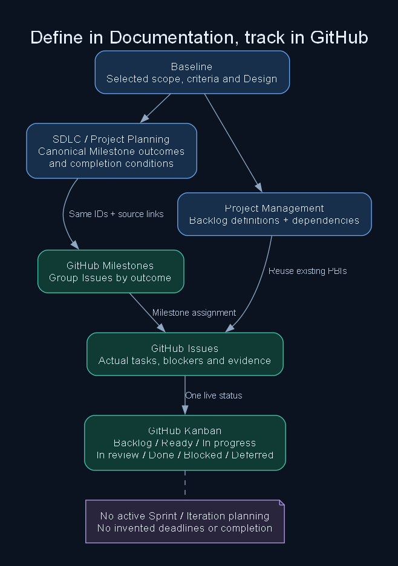

# MVP Project Management

Use [Product Backlog](product-backlog.md) for package scope/dependencies and [Delivery Workflow](version-1-delivery-plan.md) for tracking authority and Kanban rules. [Roadmap and Milestones](../SDLC/01-project-planning/08-roadmap-and-milestones.md#2-milestone-catalog) owns milestone definitions; [Baseline](../baseline/README.md) owns the selected implementation input.

Milestones and Backlog are defined in Documentation first, then mirrored into existing GitHub Milestones, Issues and the private Kanban board. No Sprint/Iteration planning is currently requested. Historical Sprint files remain for provenance and are not current commitments. Live state belongs in GitHub, not in a second documentation status table.

[Scalable SVG](diagrams/documentation-to-github.svg) · [Editable Graphviz](diagrams/documentation-to-github.dot)

[Private MVP Kanban](https://github.com/users/Farhad-V/projects/6/views/2) · [GitHub Milestones](https://github.com/Farhad-V/Web-Resumefolio/milestones)

[Dated tracking reconciliation and verification](tracking-reconciliation-2026-11-04.md)
