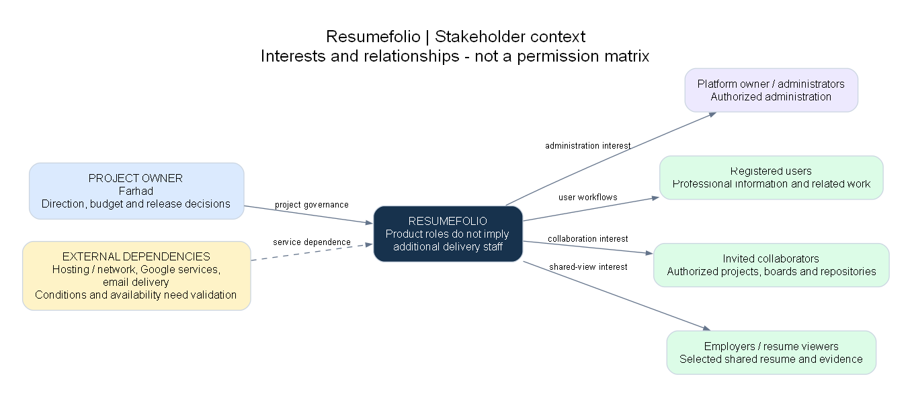
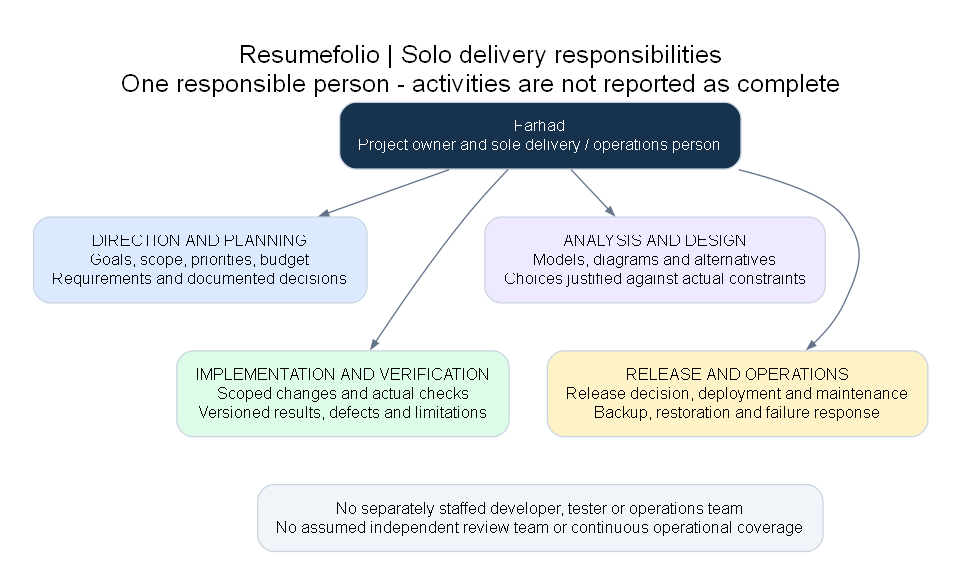

# Resumefolio — Stakeholders and Responsibilities

| Item | Current position |
| --- | --- |
| Project owner | Farhad |
| Delivery arrangement | One person carries planning, development, verification, deployment, and operations |
| Document status | Accepted planning-level direction; presentation revised October 31, 2026 |
| Original decisions | DEC-029 through DEC-032, accepted October 30, 2026 |
| Planning baseline | Accepted with tracked follow-up under [DEC-116](10-planning-completion-criteria.md#dec-116) |

**At a glance:** Product stakeholder groups describe who uses, administers, or
views Resumefolio. Delivery responsibilities describe who creates and operates
it. These are different perspectives: the current delivery arrangement is
**Farhad alone**, with no separately staffed development, test, or operations team.

[Role distinction](#1-two-perspectives) · [Stakeholders](#2-product-stakeholders-and-external-dependencies)
· [Responsibilities](#3-solo-delivery-responsibilities) · [Working agreement](#4-working-agreement)
· [Requirements boundary](#5-boundary-with-requirements-engineering) · [Decision records](#6-accepted-decisions-and-current-status)

## Current planning allocation — November 4, 2026

The owner/admin initially creates or invites users; there is no open self-registration. Private users own their professional/application/media data. Employer viewers use selected-resume authorization without owner login. ProjectForge permissions are user/resource scoped across a separate API system. Future communications accounts belong to each consenting user; owner/admin may not read their mail.

Authority: [OWNER-MVP-2026-11-04](owner-mvp-decision-2026-11-04.md).

## 1. Two Perspectives

| Perspective | Question answered | Important distinction |
| --- | --- | --- |
| Project ownership and delivery | Who decides, builds, verifies, releases, and operates the product? | Farhad carries all current delivery responsibilities |
| Product stakeholders and roles | Who has an interest in the product, or uses an authorized part of it? | A role name is not evidence of an additional staff member or an implemented permission |

The project owner decides product direction, scope, priorities, budget, and
release. The platform owner is an administrative role **inside the product**.
One person may hold both roles; detailed application permissions are specified
in Requirements Engineering, not inferred from project ownership.

## 2. Product Stakeholders and External Dependencies

| Stakeholder | Main interest | Planning boundary |
| --- | --- | --- |
| Project owner — Farhad | Product direction, delivery, budget, and long-term operation | Final project decision authority; [DEC-032](#dec-032) |
| Platform owner | Overall platform administration and operational control | Product administrative role; detailed permissions remain to be specified |
| Administrators | Account management and authorized content administration | Administrative actions remain subject to defined permissions |
| Registered users | Professional presentation, job applications, and related work | Access to authorized resources and operations |
| Invited collaborators | Collaboration on projects, boards, and repositories | An invitation does not grant unrelated private access |
| Employers and resume viewers | View the selected resume and evidence shared with them | Shared-view access is distinct from the private workspace |

Stakeholder groups do not imply that these roles are currently staffed by
separate people. No complete role hierarchy or permission matrix is defined here.

### Stakeholder context



[Open scalable diagram](diagrams/stakeholder-context.svg) ·
[Editable Graphviz source](diagrams/stakeholder-context.dot)

Lines identify relationships and interests, not authorization grants, network
routes, data flows, or an implementation architecture.

### External service dependencies

| External dependency | Why it matters | Existing reference |
| --- | --- | --- |
| Hosting provider and network | Application availability, resources, storage, and execution limits | DEP-01 |
| Google services | Agreed Gmail and Calendar access, provider conditions, quotas, and availability | DEP-03 |
| Email delivery service | Authentication/notification delivery, limits, and failure behavior | DEP-04 |

These are dependencies, not additional project team members. Current
arrangements and technical suitability still require evidence; use
[Assumptions and Dependencies](06-assumptions-and-dependencies.md) for validation
assignments rather than assuming availability from a provider's name.

## 3. Solo Delivery Responsibilities

**Responsible person for every row: Farhad, project owner.** The
rows divide work by activity; they do not create a multi-person team or assert
that the activities have been completed.

| Activity | Responsibility | Expected record or output |
| --- | --- | --- |
| Product goals and business decisions | Set product direction and intended value | Reviewed goals and decision rationale |
| Scope, priorities, and budget | Decide material commitments and assess proposed changes | Scope/change decision with effects and follow-up |
| Planning and requirements | Develop and review documentation step by step | Identified requirements, scenarios, and acceptance criteria |
| System analysis and design | Evaluate choices against requirements, resources, and constraints | Reviewed models, diagrams, alternatives, and rationale |
| Implementation | Build agreed scoped changes after the initial documentation and baseline agreement | Identifiable application/source revision |
| Verification | Review requirements, execute relevant checks, and retain actual evidence | Results linked to version/environment, defects, and limitations |
| Deployment and operation | Deploy, maintain, investigate failures, and manage recovery | Deployment, maintenance, and backup/recovery records |
| Release decisions | Decide whether evidence supports release | Recorded decision against identified release and readiness evidence |

Detailed deliverable criteria remain in [Deliverables](04-deliverables.md).
No independent test team, separate operations person, or continuous operational
coverage is assumed. Any staffing change must be explicitly reflected in
responsibility assignments, capacity estimates, and the operating plan.

### Responsibility map



[Open scalable diagram](diagrams/solo-delivery-responsibilities.svg) ·
[Editable Graphviz source](diagrams/solo-delivery-responsibilities.dot)

All branches lead back to the same person. This is a responsibility map,
not a staffed organization chart, delivery schedule, or completion report.

## 4. Working Agreement

<a id="73-working-agreement"></a>

The legacy anchor above preserves links from other project documents.

| Rule | How it is applied |
| --- | --- |
| Work through PowerShell step by step | Explain the purpose and expected result of commands; inspect actual output before dependent steps |
| Keep evidence honest | Distinguish decisions, proposals, assumptions, unresolved questions, and verified results |
| Record reasons | Document important choices, material alternatives, impacts, and reasons for later changes |
| Keep approvals focused | Do not repeat content approval already given; distinguish any system-required access permission |
| Keep visuals and text together | Include readable analysis/design diagrams with editable Graphviz or PlantUML sources and rendered images; update both when decisions change |
| Keep progress traceable | Review changes and preserve focused Git checkpoints; distinguish saved, committed, and pushed work |
| Make discussion manageable | Group related questions and discuss significant decisions |
| Reflect actual ownership | Keep project materials and responsibility assignments consistent with the current sole-owner arrangement |

### Initial SDLC sequence and later adaptation

Analyze and plan all eight SDLC phases at an appropriate initial level before
product implementation. Reconcile backlog, Sprints, and milestones with the
reviewed documentation and agree the pre-implementation baseline before coding.
Subsequent evidence can drive controlled revisions; a baseline does not prohibit
change. Planning-only acceptance does not itself authorize product coding.

Sprint methods, change assessment, and decision-record conventions are maintained
in [Working Method and Change Control](09-working-method-and-change-control.md).
This document states the shared working agreement and responsibility boundary.

## 5. Boundary with Requirements Engineering

| Keep here | Define in Requirements Engineering |
| --- | --- |
| Stakeholder groups and interests | Exact resource/action permissions and role restrictions |
| Current project staffing and delivery ownership | Invitation behavior and collaboration access |
| Project decision authority and working agreement | Account lifecycle and detailed authentication behavior |

**Why:** A single authoritative home for detailed access rules reduces duplicate
and contradictory specifications. This document identifies responsibility;
it does not grant product privileges by itself. See [DEC-029](#dec-029).

The project owner develops and reviews these rules during Requirements Engineering
before accepting the affected workflows and dependent design. Relevant follow-up
is recorded under GAP-D06 in [Planning Completion Criteria](10-planning-completion-criteria.md).

## 6. Accepted Decisions and Current Status

The four original records below preserve the October 30 decisions, rationale,
and limits without changing their content. Their statements about separate
baseline acceptance describe the review stage at that time. The later
planning-only acceptance is [DEC-116](10-planning-completion-criteria.md#dec-116).

<details>
<summary>Original stakeholder, staffing, working-agreement, and requirements-boundary decisions</summary>


> **Historical accepted decisions and dated review evidence:** preserved verbatim below. Current release allocation follows OWNER-MVP-2026-11-04; original acceptance/counts do not certify the revised MVP.

### Stakeholder Classification Review

Decision ID: DEC-032
<a id="dec-032"></a>

Status: Accepted by the project owner for this section
Review date: October 30, 2026

Decision: Identify the project owner, platform owner,
administrators, registered users, invited collaborators, and
employers or resume viewers as stakeholder groups.

Project ownership covers product direction, budget, and delivery
decisions. Platform ownership is an administrative role within
the application. One person may hold both roles.

Rationale: Distinguish responsibility for creating and delivering
the product from permissions for operating and using it. Clarifying
these perspectives supports subsequent responsibility assignments
and requirements without treating project ownership itself as a
complete application permission specification.

Detailed roles and access rules remain in Requirements Engineering.
This entry records the stakeholder decision. See the Document Review
Summary for current document status; overall baseline acceptance
requires a separate review.

### Current Solo Delivery Arrangement

Decision ID: DEC-031
<a id="dec-031"></a>

Status: Current arrangement confirmed by the project owner
Review date: October 30, 2026

The project owner is the sole person advancing the project.
There is currently no separate delivery team, developer, tester,
or operations person. Planning, requirements, analysis, design,
implementation, verification, deployment, and maintenance are
responsibilities carried by the same person.

Role names describe responsibilities, not additional staff.
Stakeholder and application-role groups do not imply that those
positions are currently staffed by other people.

Rationale: Keep responsibility assignments, workload planning,
and operational expectations aligned with actual staffing.
No independent review team or continuous operational coverage is assumed. Any future staffing change
must be reflected explicitly in these assignments.

### Working Agreement Review

Decision ID: DEC-030
<a id="dec-030"></a>

Status: Accepted by the project owner for this section
Review date: October 30, 2026

Decision: Work step by step through PowerShell and review actual
outputs. Keep confirmed decisions, proposals, assumptions, and
verified results distinct. Record the rationale for significant
decisions and revisions, keep related documents consistent, and
avoid asking again for content approval already provided.

Rationale: Support a traceable, understandable solo-development
process with reviewable evidence and less repetitive interruption.
System-required access approvals, if any, are separate from approval
of the document's content and must be explained as such.

Review all Project Planning documents in order. Analyze and plan
all eight SDLC phases before starting product implementation,
using appropriate initial detail for later phases. Reconcile the
backlog, Sprints, and milestones with the reviewed documentation
and agreed baseline before coding. Subsequent evidence can drive
controlled revisions; baseline acceptance does not prohibit change.

This entry records the working agreement. It does not approve
unreviewed documents, establish implementation, or accept the
overall planning baseline.

### Requirements Engineering Boundary Review

Decision ID: DEC-029
<a id="dec-029"></a>

Status: Accepted by the project owner for this section
Review date: October 30, 2026

Decision: Keep stakeholder identification and project delivery
responsibilities in this planning document. Maintain authoritative
detailed application permissions, role restrictions, invitations,
and account lifecycle behavior in Requirements Engineering.

Rationale: Avoid duplicating detailed authorization rules across
planning and requirements documents, reducing inconsistency while
preserving clear ownership and traceability.

</details>

### Current review summary

Stakeholder classification, solo delivery, the shared working agreement, and
the boundary with Requirements Engineering are accepted planning direction.
Current staffing remains one project owner; implementation, operational
readiness, and actual access-control behavior are separate outcomes.

**Editorial revision — October 31, 2026:** Introduced local numbering, a clear
stakeholder/responsibility distinction, reference tables, and two explanatory
diagrams. The four original decision records and identifiers are preserved
verbatim. The legacy working-agreement anchor remains valid. Historical hashes
and baseline evidence continue to identify their earlier document snapshots.

## 7. Diagram Sources and Regeneration

Both new diagrams use Graphviz. Keep editable `.dot` sources, scalable `.svg`
outputs, and `.png` previews together under `diagrams/`. Run from the repository
root in PowerShell:

```powershell
$diagramFolder = 'docs\SDLC\01-project-planning\diagrams'
$graphvizExe = 'C:\Program Files\Graphviz\bin\dot.exe'

foreach ($name in 'stakeholder-context', 'solo-delivery-responsibilities') {
    foreach ($format in 'svg', 'png') {
        & $graphvizExe "-T$format" -Gdpi=140 `
            "$diagramFolder\$name.dot" -o "$diagramFolder\$name.$format"
        if ($LASTEXITCODE -ne 0) {
            throw "Graphviz failed: $name ($format)"
        }
    }
}
```

Save DOT sources as UTF-8 without BOM. Review labels and responsibility claims
alongside the related text whenever the product roles or staffing change.
