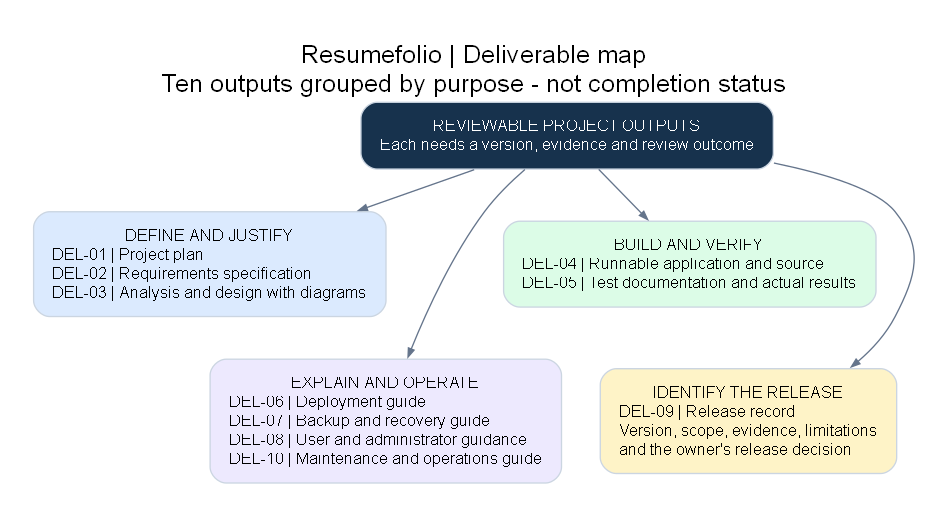
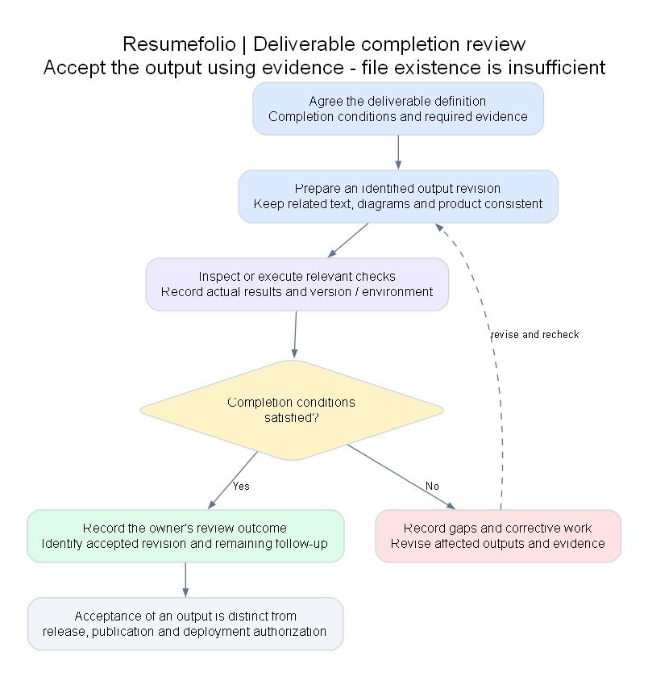

# Resumefolio — Project Deliverables

| Item | Current position |
| --- | --- |
| Project owner | Farhad; sole delivery and operations owner |
| Document status | Deliverable definitions and completion rules accepted |
| Original decisions | DEC-033 through DEC-044, accepted October 30, 2026 |
| Planning baseline | Accepted with tracked follow-up under [DEC-116](10-planning-completion-criteria.md#dec-116) |
| Presentation revision | October 31, 2026; original output definitions and decision records retained |

**At a glance:** Deliverables are the reviewable outputs of the project:
documents, the runnable application and source, actual verification evidence,
operating guidance, and an identified release record.

**Two different decisions:** Accepting a deliverable's definition specifies
what must eventually be produced. Accepting the completed deliverable requires
its agreed evidence. A file, commit, build, or backup copy alone is insufficient.

[Output map](#1-deliverable-map) · [Catalog](#2-deliverable-catalog)
· [Milestone checkpoints](#3-delivery-checkpoints) · [Completion rules](#4-shared-completion-and-review-rules)
· [Incremental updates](#5-incremental-delivery-and-change) · [Current status](#6-current-status-and-remaining-work)
· [Decision records](#7-accepted-deliverable-decision-records)

## Current planning allocation — November 4, 2026

DEL-01–DEL-10 remain the output/evidence catalog, scoped to Version 1 = MVP. DEL-04 covers core and basic ProjectForge integration; DEL-05–DEL-10 still require authorization, file safety, audit, backups, demonstrated recovery and actual release guidance. Mail/calendar, advanced Git review/releases, advanced backlog/Sprints and YAML execution/deployment outputs are future deliverables, not missing MVP deliverables.

Authority: [OWNER-MVP-2026-11-04](owner-mvp-decision-2026-11-04.md).

## 1. Deliverable Map



[Open scalable diagram](diagrams/deliverable-map.svg) ·
[Editable Graphviz source](diagrams/deliverable-map.dot)

This diagram groups outputs by purpose; it is not a delivery schedule or a
claim that the outputs already exist. Testing, guidance, and operating design
are developed alongside the work they support, not postponed until the end.

## 2. Deliverable Catalog

Each DEL identifier is retained from the accepted catalog. The linked decision
contains its detailed definition, rationale, conditions, and limitations.

| ID | Deliverable | Required completion evidence | Decision |
| --- | --- | --- | --- |
| DEL-01 | Project plan | Reviewed goals, scope, responsibilities, resources, assumptions, risks, and roadmap; tracked open matters; recorded review outcome against an identifiable revision | [DEC-044](#dec-044) |
| DEL-02 | Requirements specification | Stable requirement identifiers; reviewed scenarios and business rules; testable acceptance criteria; addressed or explicitly assigned ambiguities | [DEC-043](#dec-043) |
| DEL-03 | System analysis and design | Reviewed models, architecture/data/interface/security decisions; traceability to requirements; alternatives and rationale; consistent text and required diagrams | [DEC-042](#dec-042) |
| DEL-04 | Version 1 application and source code | Runnable, identifiable revision implementing agreed scope; demonstrated workflows and actual verification; corresponding source/configuration guidance; known limitations | [DEC-041](#dec-041) |
| DEL-05 | Test documentation and evidence | What was checked, why and how; expected and actual results; requirement/test-case references; tested version/environment; defects and remaining risks | [DEC-040](#dec-040) |
| DEL-06 | Deployment guide | Verified prerequisites, configuration, installation, updates, rollback/recovery procedures, and recorded constraints for the target version/environment | [DEC-039](#dec-039) |
| DEL-07 | Backup and recovery guide | Defined coverage, storage and frequency; demonstrated restoration in a separate environment; restored-data integrity/consistency checks and identified evidence | [DEC-038](#dec-038) |
| DEL-08 | User and administrator guidance | Instructions checked against actual authorized workflows; administrative operations distinguished; consistent explanatory images/diagrams where needed | [DEC-037](#dec-037) |
| DEL-09 | Release record | Identified source revision/release, delivered scope, limitations, actual verification summary, supporting evidence, and dated owner release decision | [DEC-036](#dec-036) |
| DEL-10 | Maintenance and operations guide | Reviewable health-check, troubleshooting, dependency-update and recurring-operation procedures, verified where relevant and feasible for the solo arrangement | [DEC-035](#dec-035) |

### Required visual explanation

For DEL-03, readable diagrams accompany written analysis and design. Retain
editable Graphviz or PlantUML sources and rendered images in version control.
Diagrams must explain relevant structure and behavior, match the text, and stay
traceable to requirements and decisions. Neither diagrams alone nor prose
without the required diagrams satisfies this deliverable.

DEL-08 uses images or diagrams where they help users understand the actual
workflow. Keep guidance visuals consistent with the application version.

## 3. Delivery Checkpoints

The table shows where deliverables support the existing milestone outcomes.
It adds no dates or effort commitments and does not replace the authoritative
[Roadmap and Milestones](08-roadmap-and-milestones.md).

| Deliverable | Relevant milestone review | What must be ready at that point |
| --- | --- | --- |
| DEL-01 | M-01 | Reviewed planning agreement and explicitly tracked follow-up |
| DEL-02 | M-02 | Identified, reviewed requirements and acceptance criteria |
| DEL-03 | M-03 | Justified analysis/design and relevant feasibility findings |
| DEL-04 | M-04–M-08, then M-09/M-10 | Verified capability increments, an integrated candidate, then identified deployed release |
| DEL-05 | Each affected increment; integrated M-09 and release review | Actual results for the scope, revision, and environment under review |
| DEL-06 | Deployment design in M-03; readiness before M-10 | Procedures developed early and verified for the candidate/target environment |
| DEL-07 | Recovery design in M-03; evidence before M-09 acceptance | Defined recovery approach, then demonstrated restoration and data checks |
| DEL-08 | M-09 candidate review | Guidance corresponding to the reviewed application |
| DEL-09 | Release decision and M-10 | Version-specific scope, evidence, limitations and recorded decision |
| DEL-10 | M-09 readiness and subsequent operation | Usable solo-operation guidance and relevant procedure evidence |

A deliverable may evolve across several milestones. A milestone may require
several deliverables. The existence of an earlier draft does not establish
completion of the final application, guidance, or release.

## 4. Shared Completion and Review Rules

Responsible person and decision-maker: **the project owner**. No separate review
team or operations team is assumed.

| Rule | What the review must establish |
| --- | --- |
| Identifiable output | The exact document revision, source version, or release is clear |
| Relevant evidence | Agreed completion conditions are assessed using actual inspection or executed checks, as appropriate |
| Reproducible context | Test/procedure evidence identifies the application version and environment; important inputs and limitations are recorded |
| Transparent results | Passed, failed, blocked, and unexecuted checks remain distinct; unexecuted checks are not reported as successful |
| Visible remaining work | Defects, limitations, unresolved questions, risks, and follow-up are recorded |
| Recorded decision | The review outcome, decision-maker, date, and basis for acceptance or further work are retained |
| Protected evidence | Repository documentation and shared evidence exclude credentials, private keys, tokens, and private operational data |

A failed check requires investigation; it does not by itself prove whether the
product, test, data, or environment caused the failure. A backup file does not
prove recoverability. A successful application-code rollback does not by itself
prove recovery of data affected by an update or migration.

### From prepared output to reviewed outcome



[Open scalable diagram](diagrams/deliverable-review-flow.svg) ·
[Editable Graphviz source](diagrams/deliverable-review-flow.dot)

This is the review logic, not a separate staffed approval chain. The owner
performs and records the appropriate activities. Open matters must be assessed
against the agreed completion criteria; documenting a limitation does not
automatically make a failed condition acceptable.

## 5. Incremental Delivery and Change

Develop and review outputs incrementally. For each affected change:
1. Identify the relevant requirement, decision, and deliverable revision.
2. Revise the affected content or product behavior and record the reason.
3. Update linked diagrams, verification plans/results, and operating guidance as needed.
4. Review consistency, evidence, limitations, and follow-up before recording completion.

For example, a storage-design change can affect its diagram, test scenarios,
deployment configuration, and recovery instructions. Updating one document alone
can leave the delivery package inconsistent.

The initial documentation-first agreement remains in effect: analyze and plan
all SDLC phases, reconcile delivery tracking, agree the pre-implementation
baseline, and then begin product coding. Iterative refinement does not remove
that agreed entry condition. Material scope, cost, or delivery changes follow
[Working Method and Change Control](09-working-method-and-change-control.md).

## 6. Current Status and Remaining Work

| Output / decision | Current planning position |
| --- | --- |
| Definitions of DEL-01 through DEL-10 | Accepted, including their completion evidence and rationale |
| DEL-01 planning baseline | The identified planning snapshot was accepted with tracked follow-up under DEC-116; current editorial revisions do not silently replace that accepted snapshot |
| DEL-02 through DEL-10 actual completion | Not established by this document; requires their own produced outputs, evidence, and review decisions |
| Technical validation, quality/recovery targets, and estimates | Still tracked at the assigned follow-up gates in Planning Completion Criteria |
| Application implementation, deployment, and release | Not authorized or reported as complete by acceptance of these definitions |

Use [Planning Completion Criteria](10-planning-completion-criteria.md) for the
M-01 acceptance record and tracked GAP follow-up. Future delivery records must
identify the actual versions and results instead of changing this planning
catalog into an unsupported completion claim.


> Historical decision record: original wording and acceptance date retained. Incompatible release allocation is superseded by OWNER-MVP-2026-11-04.

## 7. Accepted Deliverable Decision Records

The expandable record below preserves the original ten output decisions and
two shared-method decisions verbatim, including their IDs, dates and rationale.
Historical Pending statements describe their original review stage; current
planning acceptance is stated in Section 6 and DEC-116. Later deliverable
acceptance still requires its own evidence.

<details>
<summary>Original accepted definitions, completion rules, and incremental-delivery decisions</summary>


> **Historical accepted decisions and dated review evidence:** preserved verbatim below. Current release allocation follows OWNER-MVP-2026-11-04; original acceptance/counts do not certify the revised MVP.

### DEL-01 Project Plan Review

Decision ID: DEC-044
<a id="dec-044"></a>

Status: Deliverable definition and completion criterion accepted
by the project owner; deliverable completion remains pending
Review date: October 30, 2026

Decision: Deliver a reviewed Project Plan covering purpose,
objectives, scope, responsibilities, resources, assumptions,
dependencies, risks, and the delivery roadmap.

Completion evidence: Review the content, record decisions, and
identify unresolved matters with explicit follow-up. File existence
alone does not establish completion. Record the baseline review
outcome against an identifiable document revision.

Rationale: Establish a shared, traceable basis for directing work
and evaluating changes rather than relying on scattered assumptions.

This acceptance defines the expected output; it does not mark
DEL-01 or the overall planning baseline complete.

### DEL-02 Requirements Specification Review

Decision ID: DEC-043
<a id="dec-043"></a>

Status: Deliverable definition and completion criterion accepted
by the project owner; deliverable completion remains pending
Review date: October 30, 2026

Decision: Deliver an identified, reviewed set of requirements,
scenarios, business rules, and testable Acceptance Criteria.

Completion evidence: Requirements have stable identifiers and
clear expected behavior. Relevant success, alternative, and failure
scenarios are reviewed. Unresolved ambiguities are explicitly
recorded and addressed or assigned follow-up before dependent
commitments. Record the reviewed revision and review outcome.

Rationale: Give analysis, design, implementation, and verification
a clear, traceable basis for determining what the product must do
and how its behavior will be assessed.

This acceptance defines the expected output. It does not establish
that the requirements specification is complete or that any
acceptance tests have been executed successfully.

### DEL-03 System Analysis and Design Review

Decision ID: DEC-042
<a id="dec-042"></a>

Status: Deliverable definition and completion criterion accepted
by the project owner; deliverable completion remains pending
Review date: October 30, 2026

Decision: Deliver reviewed System Analysis and System Design
covering component responsibilities and interactions, information
relationships, workflows, states, architecture, data design,
interfaces, and security boundaries, as relevant to requirements.

Required presentation: Include readable diagrams alongside the
written explanations throughout the analysis and design documents.
Diagrams are required explanatory outputs, not optional decoration.
Use the established Graphviz and PlantUML tooling and retain both
editable sources and rendered images in version control.

Completion evidence: Models and decisions are traceable to relevant
requirements and reviewed with alternatives, selection rationale,
constraints, and material consequences recorded. Diagrams and text
must agree, with labels and explanations sufficient for a reader
to understand the represented system without reconstructing it
from prose alone. Update both when decisions change.

Rationale: Make the design defensible and traceable while helping
readers understand structure and behavior more quickly through
coordinated visual and textual explanations. Neither diagrams alone
nor prose without the required diagrams satisfies this deliverable.

This acceptance defines the future deliverable. It does not select
an architecture now or mark analysis and design complete.

### DEL-04 Version 1 Application and Source Code Review

Decision ID: DEC-041
<a id="dec-041"></a>

Status: Deliverable definition and completion criterion accepted
by the project owner; deliverable completion remains pending
Review date: October 30, 2026

Decision: Deliver the runnable Version 1 application and its
version-controlled source code implementing the agreed release
scope in an identifiable revision or release.

Completion evidence: Demonstrate the agreed workflows and record
relevant verification results against that specific version.
Source code, configuration guidance, and the executable application
must correspond. Record known limitations and unresolved defects;
code existence alone does not establish completion.

Rationale: Deliver a usable, traceable product whose implemented
behavior can be reviewed against agreed requirements rather than
presenting unverified source files as a finished application.

This decision defines a future implementation output. It does not
authorize starting product coding before the agreed documentation
review and baseline process, claim completed implementation, or
replace the separate release-readiness decision.

### DEL-05 Test Documentation and Evidence Review

Decision ID: DEC-040
<a id="dec-040"></a>

Status: Deliverable definition and completion criterion accepted
by the project owner; deliverable completion remains pending
Review date: October 30, 2026

Decision: Deliver test documentation and execution evidence stating
what was tested, why the checks were selected, how they were
performed, the expected result, the actual result, and remaining
defects, limitations, or risks.

Completion evidence: Identify the tested application revision,
environment, relevant requirements, scenarios, Test Cases, and
execution records. Retain sufficient evidence to review the results.
Distinguish passed, failed, blocked, and unexecuted checks; never
report an unexecuted test as successful. Record material test
selection decisions and their rationale.

Rationale: Make quality claims inspectable, traceable, and bounded
by actual evidence rather than a generic statement that testing
was completed. A failing check requires investigation and does not
by itself prove whether the product, test, data, or environment
caused the failure.

This acceptance defines the expected future deliverable. It does
not establish successful test execution or authorize release.

### DEL-06 Deployment Guide Review

Decision ID: DEC-039
<a id="dec-039"></a>

Status: Deliverable definition and completion criterion accepted
by the project owner; deliverable completion remains pending
Review date: October 30, 2026

Decision: Deliver a Deployment Guide describing target-server
prerequisites, required configuration, installation and deployment,
updates, and rollback or recovery to the preceding version when
an update fails.

Completion evidence: Verify the documented procedures against the
identified application version and target environment, recording
results, constraints, and any steps not yet demonstrated. Include
configuration instructions without placing passwords, private keys,
or other secrets in repository documentation.

Rationale: Make deployment and updates repeatable and reviewable
rather than dependent on personal memory, with a documented response
to an unsuccessful change.

This review defines a future deliverable. It does not execute a
deployment, prove a rollback has succeeded, or authorize changes
to the live server. Data migration and recovery implications must
be explicitly addressed in the later deployment design.

### DEL-07 Backup and Recovery Guide Review

Decision ID: DEC-038
<a id="dec-038"></a>

Status: Deliverable definition and completion criterion accepted
by the project owner; deliverable completion remains pending
Review date: October 30, 2026

Decision: Deliver a Backup and Recovery Guide defining which
information is backed up, the storage location, backup frequency,
and the procedure for restoring the application and its data.

Completion evidence: Demonstrate restoration in a separate, isolated
environment and verify the integrity and consistency of the restored
information. Identify the backup, application revision, environment,
actual results, and limitations. Backup-file existence alone does
not establish recoverability.

Rationale: Establish that backups are usable for recovery rather
than relying on an untested assumption that stored copies suffice.

Detailed scheduling, retention, storage separation, recovery-time
and recovery-point targets require later requirements and design
work. This acceptance does not claim that restoration has already
succeeded, guarantee zero data loss, or authorize restoring over
live production data.

### DEL-08 User and Administrator Guidance Review

Decision ID: DEC-037
<a id="dec-037"></a>

Status: Deliverable definition and completion criterion accepted
by the project owner; deliverable completion remains pending
Review date: October 30, 2026

Decision: Deliver guidance for agreed core user workflows, such as
creating a resume, controlling its sharing, and tracking job
applications. Document administrative operations separately and
according to the permissions required for each operation.

Completion evidence: Verify instructions against an identifiable
version of the actual application. Include clear images or diagrams
where needed to explain the workflow, keeping visual material and
written steps consistent with implemented behavior and access rules.

Rationale: Enable users and administrators to understand and perform
their authorized workflows without depending on the project owner's
verbal explanation. Application roles do not imply additional
members of the current solo delivery team.

This acceptance defines future guidance; it does not establish
that workflows have already been implemented or demonstrated.

### DEL-09 Release Record Review

Decision ID: DEC-036
<a id="dec-036"></a>

Status: Deliverable definition and completion criterion accepted
by the project owner; deliverable completion remains pending
Review date: October 30, 2026

Decision: Produce a Release Record for each release identifying
the application version, delivered scope, known limitations,
verification summary, supporting evidence, and release decision.

Completion evidence: Link the record to an identifiable source
revision or release and the relevant actual verification results.
Record the decision, decision-maker, and date, distinguishing
release authorization, publication, and deployment where relevant.

Rationale: Preserve a traceable explanation of what was released
and the evidence and decision on which that release was based.
A commit, tag, or successful build alone is not a release decision.

This acceptance defines a future deliverable. It does not publish
a release, authorize deployment, or claim verification success.

### DEL-10 Maintenance and Operations Guide Review

Decision ID: DEC-035
<a id="dec-035"></a>

Status: Deliverable definition and completion criterion accepted
by the project owner; deliverable completion remains pending
Review date: October 30, 2026

Decision: Deliver a Maintenance and Operations Guide covering
application health checks, troubleshooting, dependency updates,
and recurring operational activities after deployment.

Completion evidence: Provide clear, reviewable procedures and
responsibility assignments consistent with the current solo delivery
arrangement. Verify the relevant procedures against the identified
application and environment, recording evidence and limitations.

Rationale: Support maintainability after release without assuming
a separate operations team or continuous operational coverage.
The project owner carries operational responsibility.

This acceptance defines a future guide. It does not configure
monitoring, schedule unattended activity, or claim that maintenance
procedures have already been demonstrated successfully.

This entry records the last individual deliverable review. See the
Document Review Summary for current document status. Acceptance of
definitions does not mark the deliverables complete.

### Shared Completion Rules Review

Decision ID: DEC-034
<a id="dec-034"></a>

Status: Accepted by the project owner for this section
Review date: October 30, 2026

Decision: Require an identifiable version or revision, appropriate
completion evidence, and a recorded review and acceptance outcome
for each deliverable. Test evidence identifies the tested version
and environment. Record unresolved defects and limitations rather
than hiding them. Do not place passwords, private keys, tokens,
or other secrets in repository documentation or shared evidence.

Rationale: Make completion inspectable and traceable rather than
inferring it from file existence, and preserve trustworthy evidence
without exposing confidential operational information.

These rules define completion expectations; they do not mark any
future deliverable or the overall planning baseline complete.

### Incremental Delivery Review

Decision ID: DEC-033
<a id="dec-033"></a>

Status: Accepted by the project owner for this section
Review date: October 30, 2026

Decision: Develop and review deliverables incrementally. Keep
written explanations, diagrams, decisions, and related evidence
consistent as findings and the product evolve. Milestones group
deliverables into reviewable outcomes.

Rationale: Prevent documentation from becoming detached from the
current decisions and implemented behavior. For example, a storage
design change may require updates to diagrams, test planning, and
recovery guidance, with the reason for revision preserved.

Incremental delivery does not override the agreed documentation-first
sequence: analyze and plan all SDLC phases, reconcile delivery
tracking with the reviewed documentation, agree the baseline,
and then start product implementation.

</details>

## 8. Document Review and Revision Summary

The project owner accepted all ten output definitions, mandatory analysis/design
diagrams, shared completion rules, and incremental delivery on October 30, 2026.
The planning baseline was subsequently accepted with tracked follow-up under
[DEC-116](10-planning-completion-criteria.md#dec-116).

**Editorial revision — October 31, 2026:** Added a readable output/evidence
catalog, milestone checkpoint mapping, current-status distinctions, and two
Graphviz diagrams. The twelve original decisions remain unchanged. No new
product capability, delivery date, test result, staffing arrangement, or release
authorization is introduced. Earlier source hashes and baseline references
continue to describe their original snapshots.

## 9. Diagram Sources and Regeneration

Both diagrams use Graphviz. Retain `.dot` sources, scalable `.svg` outputs, and
`.png` previews together under `diagrams/`. Run from the repository root:

```powershell
$diagramFolder = 'docs\SDLC\01-project-planning\diagrams'
$graphvizExe = 'C:\Program Files\Graphviz\bin\dot.exe'

foreach ($name in 'deliverable-map', 'deliverable-review-flow') {
    foreach ($format in 'svg', 'png') {
        & $graphvizExe "-T$format" -Gdpi=140 `
            "$diagramFolder\$name.dot" -o "$diagramFolder\$name.$format"
        if ($LASTEXITCODE -ne 0) {
            throw "Graphviz failed: $name ($format)"
        }
    }
}
```

Save DOT sources as UTF-8 without BOM. Review the diagrams alongside their
source definitions whenever deliverable grouping or completion rules change.
