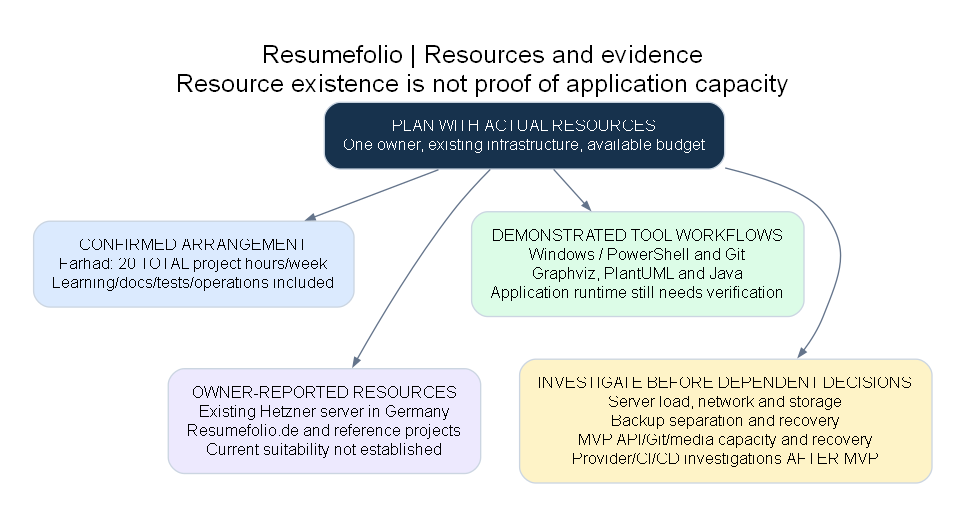
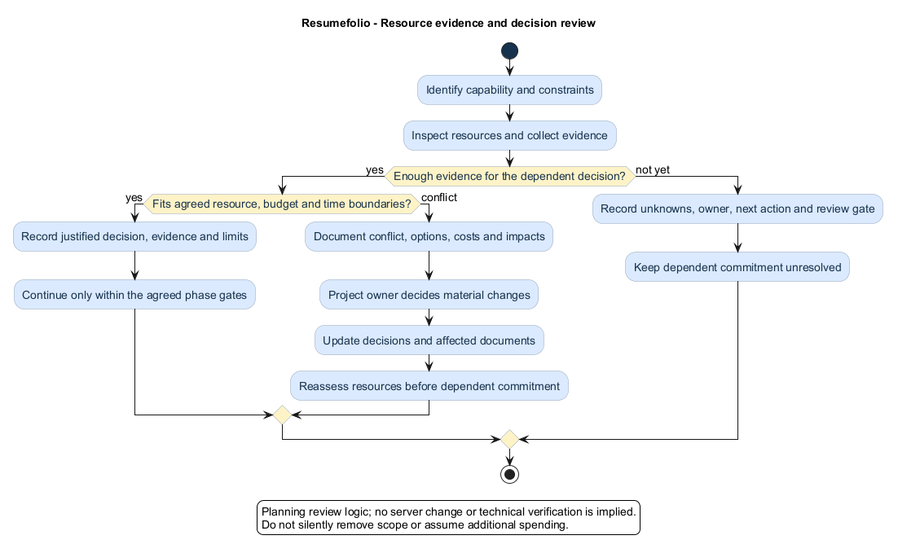

# Resumefolio — Resources and Constraints

| Item | Current position |
| --- | --- |
| Project owner | Farhad; sole delivery and operations owner |
| Document status | Resource treatment and constraints accepted; technical validation remains open |
| Original decisions | DEC-045 through DEC-048, accepted October 30, 2026 |
| Planning baseline | Accepted with tracked follow-up under [DEC-116](10-planning-completion-criteria.md#dec-116) |
| Presentation revision | October 31, 2026; no capacity, spending, or delivery estimate is added |

**At a glance:** Plan with one project owner at the currently confirmed 20 hours/week, the current development
tools, the existing server, and the available budget. Keep demonstrated tool
operation separate from reported resources and unverified technical capacity.

**Read this document for:** what is available, which constraints decisions must
respect, what is still unknown, and how resource conflicts are handled.
Detailed scope stays in [Scope](02-scope.md); investigation assignments stay in
[Assumptions and Dependencies](06-assumptions-and-dependencies.md).

[Resource map](#1-resource-and-evidence-map) · [Inventory](#2-resource-inventory)
· [Constraints](#3-confirmed-constraints) · [Time](#4-delivery-time-and-working-capacity)
· [Investigations](#5-resource-investigations-and-review-gates) · [Conflict handling](#6-using-evidence-in-planning-decisions)
· [Decision records](#7-accepted-resource-decision-records)

## Current planning allocation — November 4, 2026

The 20 total hours/week includes learning, documentation, testing and operations. MVP media stays in private directories on the same Resumefolio server; no separate media server/platform/object-storage purchase. Existing budget constraints remain. ProjectForge engine/physical deployment/database are unresolved, distinct from core. Provider/runner facilities are future concerns; core/Git/file capacity and recoverability still require evidence.

Authority: [OWNER-MVP-2026-11-04](owner-mvp-decision-2026-11-04.md).

## 1. Resource and Evidence Map



[Open scalable diagram](diagrams/resource-evidence-map.svg) ·
[Editable Graphviz source](diagrams/resource-evidence-map.dot)

The map classifies the basis of current planning knowledge. Arrows are grouping
relationships, not network connections or proof that the complete application
can run on the stated infrastructure.

| Evidence label | Meaning |
| --- | --- |
| Confirmed arrangement | The owner has explicitly confirmed a working arrangement, such as solo full-time delivery |
| Demonstrated operation | A specific tool workflow has been observed; this does not verify the application's runtime or deployment capacity |
| Owner-reported resource | The resource was stated as available; current specifications, access configuration, or suitability still need inspection |
| Unverified characteristic | No sufficient technical evidence has yet been recorded for the dependent decision |

These labels explain the inventory; assumption/dependency validation states
remain authoritative in the linked investigation document.

## 2. Resource Inventory

**Resource:** Project owner

**Available or reported position:** Farhad advances the project alone, full time

**Evidence boundary / remaining check:** Confirmed working arrangement; numerical hours and throughput are not established

**Resource:** Development environment

**Available or reported position:** Windows and PowerShell; repository under the local XAMPP directory

**Evidence boundary / remaining check:** Local file work is demonstrated; application runtime compatibility is not yet verified

**Resource:** Version control

**Available or reported position:** Git and private GitHub repository

**Evidence boundary / remaining check:** Commit/push workflow demonstrated; this does not establish product Git-hosting functionality

**Resource:** Diagram tools

**Available or reported position:** Graphviz, PlantUML, and Java

**Evidence boundary / remaining check:** Diagram generation has been demonstrated; package/application dependencies still need selection and compatibility checks

**Resource:** Hosting

**Available or reported position:** Existing Hetzner server in Germany

**Evidence boundary / remaining check:** Observed allocation and guest inventory from owner-supplied screenshots/SSH output on November 1, 2026: 2 vCPU, 4 GB RAM, 40 GB local disk, Ubuntu 24.04.4 LTS; Nginx, MySQL and PHP 8.3-FPM running with an existing Laravel deployment. Combined workload capacity remains unverified

**Resource:** Domain

**Available or reported position:** Resumefolio.de

**Evidence boundary / remaining check:** Owner-reported resource; DNS, TLS, routing, and renewal arrangements remain to be verified

**Resource:** Reference projects

**Available or reported position:** MultiResume Manager, Git Hosting Platform, OmniDesk, KanbanFlow

**Evidence boundary / remaining check:** Existing references from prior project work; this revision does not audit their code or authorize changes to them

Backup storage, provider integration access, and email delivery arrangements are
**open dependencies**, not newly confirmed resources. Record findings against
the existing ASM/DEP identifiers rather than adding unsupported availability claims.

## 3. Confirmed Constraints

| Area | Agreed constraint | Implication for later decisions |
| --- | --- | --- |
| Infrastructure | Use the existing server initially | Justify combined workloads and execution limits against actual resources |
| Budget | Work within available means; assume no extra server or paid service | Quantify needs and alternatives before requesting additional spending |
| Product AI | Paid AI APIs are not in the Version 1 plan; product AI is excluded by Scope | Do not make the release depend on unagreed AI capabilities or services |
| Development approach | Laravel and object-oriented development | These constraints do not select the database, frontend, final architecture, Git engine, or CI runner |
| Initial capacity | Target an initial deployment for 10 users | Define workload and concurrency, then verify capacity; a user count alone is not a load model |
| Growth | Consider future growth toward approximately 1,000 users | Growth is a design direction, not a verified capability of the initial server |
| File policy | Platform-owner-configurable upload/storage limits | Effective limits must respect actual storage and processing capacity |
| Existing work | Preserve reference projects | Prior features are not automatically accepted scope or approved for reuse |
| Information handling | Keep credentials and private operational data out of Git | Retain reviewable findings without exposing confidential configuration |

The monetary spending allowance, hosting costs, and numerical resource limits
are still to be verified. No budget amount or upload quota is invented here.

## 4. Delivery Time and Working Capacity

| Planning fact | Current position |
| --- | --- |
| Delivery staff | One project owner; no separate development, verification, or operations team |
| Availability | Current owner input November 1, 2026: 20 total project hours/week, including learning, documentation and testing; earlier full-time wording is historical |
| Historical unverified Version 1 target | November 8, 2026, Europe/Berlin |
| Forecast status | No validated effort estimate or sufficient-capacity conclusion yet |
| Estimation review point | After initial analysis/design and before accepting a delivery forecast; revise against actual progress |

Available time must cover analysis, learning, implementation, integration,
verification, documentation, rework, and operational preparation. “Full time”
does not establish throughput or prove that the requested date is achievable.

Use Agile iterations for feedback, learning, and revision; implementation
increments add integrated, verified capabilities. No additional staff, mandatory
set of Scrum ceremonies, or guaranteed release date follows from choosing Agile.

Preserve the agreed initial SDLC documentation and pre-implementation baseline
sequence before coding. Reconcile backlog, Sprint assignments, milestones, and
forecasts after analysis/design; current dates remain provisional.
See [Roadmap and Milestones](08-roadmap-and-milestones.md) and ASM-05.

## 5. Resource Investigations and Review Gates

**Responsible person for all rows: the project owner.** These entries summarize
existing follow-up; validation methods and status are maintained in
[Validation Assignments](06-assumptions-and-dependencies.md#5-validation-assignments).

| Investigation | Required evidence | Existing reference | Review gate |
| --- | --- | --- | --- |
| Server resources and competing workloads | CPU, memory, storage, OS, free capacity, current services, representative demand and combined-load findings | ASM-01, DEP-01; GAP-D01 | Before accepting deployment design in M-03; relevant verification before release |
| Network, uploads, and storage policy | Infrastructure limits, file processing demand, effective quotas, and failure behavior | ASM-01, DEP-01; GAP-D01/GAP-D10 | Requirements and resource design; verify enforcement before affected capability acceptance |
| Backup storage and recovery | Location, capacity, access, separation, retention, and actual restoration/data-integrity evidence | ASM-04, DEP-05; GAP-D04 | Recovery design in M-03; demonstrated restoration before M-09 acceptance |
| Costs and spending allowance | Current hosting costs, available allowance, option costs, and any explicit additional-spending decision | Resource constraints; GAP-D01 | Before a dependent cost or infrastructure commitment |
| Runtime and software tools | Required versions, compatibility, licenses, support/maintenance status, and environment checks | DEP-06; GAP-D08 | At technical selection and before dependent implementation |
| Google access | Required operations, permissions, conditions, quotas, costs, and operation checks | ASM-02, DEP-03; GAP-D02 | Before dependent requirements/design acceptance; verify access before development |
| Authentication/notification email | Configuration, actual delivery, limits, costs, retries/failures and recovery paths | ASM-03, DEP-04; GAP-D03 | Before dependent design acceptance and verified capability/release readiness |
| Safe CI/CD execution | Isolation options, secret/permission boundaries, cleanup and resource-limit evidence | DEP-01, RSK-03; GAP-D09 | Before accepting execution design or enabling jobs; controls verified before M-08 acceptance |
| Domain and secure access | Administrative control, DNS destination, TLS coverage/validity and renewal | DEP-02; GAP-D07 | Before accepting deployment configuration; live verification before M-10 |
| Time sufficiency | Decomposed effort ranges, usable capacity, dependencies and observed progress | ASM-05; GAP-D05 | After analysis/design, before accepting a delivery forecast |

GAP references point to the accepted follow-up in
[Planning Completion Criteria](10-planning-completion-criteria.md). Investigation
completion can confirm, invalidate, or leave a question unresolved; it does not
automatically establish availability or feasibility.


> Historical decision record: original wording and acceptance date retained. Incompatible release allocation is superseded by OWNER-MVP-2026-11-04.

## 6. Using Evidence in Planning Decisions



[Open scalable diagram](diagrams/resource-review-flow.svg) ·
[Editable PlantUML source](diagrams/resource-review-flow.puml)

1. Identify the capability and the constraints affecting its decision.
2. Inspect relevant resources and obtain appropriate evidence.
3. If evidence is insufficient, record the owner, next action, and review gate; do not accept the dependent commitment as proven feasible.
4. If a conflict exists, record the evidence, options, expected costs, scope/quality effects, and delivery implications.
5. The owner decides material scope, spending, or delivery changes; document the rationale and update related artifacts.

A capability is not silently removed to fit a date or server. An additional
purchase is not assumed. A documented response is not proof that its technical
controls have been implemented or verified.

The diagram describes review logic, not an executed investigation or authority
to change the live server. Revisit affected assumptions, risks, designs, and
tracking when new evidence changes the picture. See [DEC-045](#dec-045).

## 7. Accepted Resource Decision Records

The four original records below preserve the accepted treatment of resources,
time, Agile delivery, investigations, and conflicts. Their historical statements
about separate baseline review refer to that stage; later planning-only
acceptance is recorded under [DEC-116](10-planning-completion-criteria.md#dec-116).

<details>
<summary>Original resource, time, validation, and conflict-handling decisions</summary>


> **Historical accepted decisions and dated review evidence:** preserved verbatim below. Current release allocation follows OWNER-MVP-2026-11-04; original acceptance/counts do not certify the revised MVP.

### Known Resources and Confirmed Constraints Review

Decision ID: DEC-048
<a id="dec-048"></a>

Status: Planning treatment accepted by the project owner
Review date: October 30, 2026

Decision: Retain the recorded existing resources and constraints.
Separate demonstrated tool operation from owner-reported resources
and from technical characteristics that remain unverified. Existing
server and domain availability were already stated; capacity and
current configuration require inspection, not repeated confirmation
of the same ownership information.

Retain the agreed existing-server and budget boundaries, initial
10-user deployment target, preservation of reference projects, and
exclusion of secrets from Git. Do not assume additional purchases.

Laravel and object-oriented development are existing technical
constraints. They do not select the final architecture, database,
or frontend technology. Evaluate these choices in System Analysis
and System Design and document the alternatives and rationale.

Rationale: Bound subsequent decisions by actual resources and agreed
choices without treating declared resources or framework selection
as evidence that the complete scope is feasible. Avoid repeatedly
requesting approval of facts and boundaries already confirmed.

This entry records the available-resources and constraints review.
See the Document Review Summary for the current document status;
server validation and overall baseline acceptance remain separate.

### Delivery Time and Agile Approach Review

Decision ID: DEC-047
<a id="dec-047"></a>

Status: Accepted by the project owner as planning direction
Review date: October 30, 2026

Decision: Plan for the project owner advancing the work alone with
full-time availability. Available time must
cover analysis, learning, implementation, verification, documentation,
and rework. Do not infer numerical weekly hours or guaranteed
throughput from the phrase full time.

Retain November 8, 2026 as the requested Version 1 target, not a
validated duration estimate. Reconcile effort, backlog, Sprints,
and milestones with the reviewed analysis and design, recording
any conflict with the target instead of concealing it.

Use an Agile approach with iterative review and incremental delivery.
Iterations support feedback, learning, and refinement; implementation
increments add integrated, verified capabilities toward the product.
Review progress, dependencies, and risks and adjust the plan with
recorded reasons. Do not assume a specific team structure or every
Scrum practice merely from selecting Agile.

Rationale: Combine disciplined planning with adaptation to evidence,
while accounting honestly for solo capacity and the full range of
engineering work. Agile does not itself guarantee the requested date.

Preserve the agreed initial documentation-first sequence and baseline
review before product implementation. Planning and design artifacts
can be refined iteratively now; executable increments follow during
implementation. Material changes remain traceable and reviewed.

### Unverified Resource Details Review

Decision ID: DEC-046
<a id="dec-046"></a>

Status: Investigation approach accepted by the project owner;
resource characteristics remain unverified
Review date: October 30, 2026

Decision: Keep server capacity and current workloads, backup storage,
network and upload limits, development-tool versions, Google access,
email-delivery arrangements, and CI/CD execution resources open
until inspected or otherwise supported by relevant evidence.

Use the linked assumptions, dependencies, and backlog investigations
to record findings, limitations, ownership, and review points.
Review each finding before accepting a dependent technical decision.
Do not replace inspection with repeated approval of already stated
resource ownership, or present assumptions as verified capacity.

Rationale: Make technical choices against actual constraints and
reduce the chance of basing architecture or release commitments
on unsupported resource assumptions.

This acceptance records the investigation approach only. It does
not access the server, change configuration, validate provider
access, or claim that the investigations have been completed.

### Resource Conflicts and Planning Implications Review

Decision ID: DEC-045
<a id="dec-045"></a>

Status: Accepted by the project owner for this section
Review date: October 30, 2026

Decision: If investigation shows an agreed capability conflicts
with available server resources, budget, or development time,
record the conflict, evidence, alternatives, and expected effects.
The project owner decides on material changes to scope, spending,
or delivery expectations. Do not silently remove capabilities
or assume additional purchases.

Rationale: Keep delivery planning honest and changes controlled,
with technical decisions justified against actual resources and
explicitly recorded product priorities.

</details>

## 8. Current Status and Revision Summary

Planning principles and constraints are accepted. Server capacity, current
provider arrangements, recovery capability, runtime suitability, and effort
sufficiency remain open at their specified review gates. The target date and
future 1,000-user direction remain unverified planning expectations.

**Editorial revision — October 31, 2026:** Reorganized inventory and constraints,
made evidence boundaries and review gates explicit, and added a Graphviz resource
map and PlantUML review flow. The four original decision records remain unchanged.
No server inspection, account connection, purchase, load test, recovery exercise,
or product implementation is claimed. Earlier baseline hashes remain references
to their original snapshots rather than this editorial revision.

## 9. Diagram Sources and Regeneration

Keep editable sources, `.svg` outputs, and `.png` previews under `diagrams/`.
The resource map uses Graphviz; the review flow uses PlantUML. Run from the
repository root in PowerShell:

```powershell
$diagramFolder = 'docs\SDLC\01-project-planning\diagrams'
$graphvizExe = 'C:\Program Files\Graphviz\bin\dot.exe'
$plantUmlJar = Join-Path $env:LOCALAPPDATA 'Resumefolio\DiagramTools\plantuml.jar'

foreach ($format in 'svg', 'png') {
    & $graphvizExe "-T$format" -Gdpi=140 `
        "$diagramFolder\resource-evidence-map.dot" `
        -o "$diagramFolder\resource-evidence-map.$format"
    if ($LASTEXITCODE -ne 0) { throw "Graphviz failed: $format" }

    java -jar $plantUmlJar -charset UTF-8 "-t$format" `
        "$diagramFolder\resource-review-flow.puml"
    if ($LASTEXITCODE -ne 0) { throw "PlantUML failed: $format" }
}
```

The PlantUML path is the recorded per-user installation location. If running
under a different Windows account, point it to the installed JAR explicitly.
Save diagram sources as UTF-8 without BOM and review rendered labels alongside
the text when constraints, resource evidence, or review rules change.

## November 1, 2026 — Observed Hosting Inventory

The owner authorized recording the previously supplied server observations. See the [bounded observation record](../02-requirements-engineering/01-process-and-approach/02-feasibility-study.md#server-observation-2026-11-01) for provenance, exact observed quantities and remaining checks. This updates the current working-copy inventory; it does not alter the accepted historical M-01 snapshot or confirm ASM-01 capacity sufficiency.

The server is occupied by an existing deployment. Its available memory/disk at low load are a point-in-time observation, not a reserved allocation or application performance limit. No new server access or operational change was performed to prepare this documentation update. Domain configuration was observed in Nginx; actual DNS, TLS validity/renewal, account control and provider conditions remain separate checks.

## November 1, 2026 — Numerical Capacity Clarification

The owner answered 20 hours/week to the usable project-capacity question. Use this current input rather than an unspecified full-time capacity for new forecasts; preserve historical DEC records and accepted snapshot scope. [Preliminary sizing](11-capacity-and-preliminary-sizing.md) supplies a low-confidence scenario, not an accepted completion date. The [operating assessment](../02-requirements-engineering/06-validation-and-traceability/remaining-gate-assessment.md) adds bounded mail/OAuth declaration, worker/timer, certificate and tool findings; these do not establish full operating readiness.
