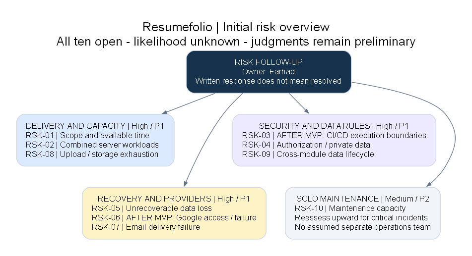
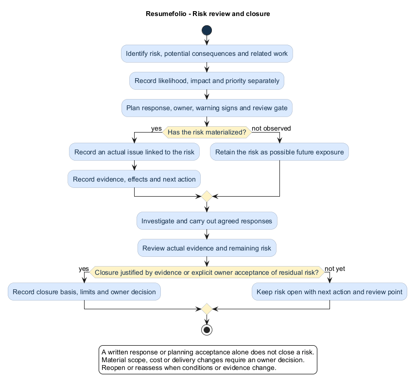

# Resumefolio — Risk Register

| Item | Current position |
| --- | --- |
| Risk owner | Farhad, project owner; responsible for every listed response and review |
| Register status | Definitions and management method accepted; all ten risks remain open |
| Likelihood | Unknown for all ten risks; no measured probability is claimed |
| Initial judgments | RSK-01–RSK-09: High potential impact / P1; RSK-10: Medium / P2, subject to reassessment |
| Original decisions | DEC-062 through DEC-074, accepted October 31, 2026 |
| Planning baseline | Accepted with tracked follow-up under [DEC-116](10-planning-completion-criteria.md#dec-116) |
| Presentation revision | October 31, 2026; no risk rating, control effectiveness, or closure is newly asserted |

**At a glance:** Risks are possible future problems. A written response is a
plan, not evidence that a control works. If a risk materializes, record the
actual problem as a linked issue while keeping the remaining exposure visible.

[Assessment terms](#1-assessment-terms) · [Risk map](#2-risk-overview)
· [Register](#3-initial-risk-register) · [Actions and reviews](#4-review-points-and-warning-signs)
· [Review and closure](#5-risk-review-issue-handling-and-closure) · [Decision records](#6-accepted-risk-decision-records)

## Current planning allocation — November 4, 2026

Apply the retained risks to the actual MVP paths. API cross-user authority, private media/direct-range access, real Git/storage contention, immutable submitted history and usable recovery remain MVP risks. Mail/provider consent and untrusted-runner/deployment risks are retained as future risks and must be revisited before enabling those features. Deferral does not count as evidence that a control passed.

Authority: [OWNER-MVP-2026-11-04](owner-mvp-decision-2026-11-04.md).

## 1. Assessment Terms

| Dimension | Meaning in this register |
| --- | --- |
| Likelihood | Chance of occurrence; Unknown until sufficient evidence supports an assessment |
| High impact | Could expose private data, cause unrecoverable loss, prevent essential workflows, or materially disrupt delivery |
| Medium impact | Could degrade service or increase maintenance effort without necessarily preventing the whole release |
| P1 | Investigate early because findings can affect feasibility, architecture, or major commitments |
| P2 | Address during the relevant design/implementation work before accepting the affected capability |

**Keep the dimensions separate.** High impact is not high likelihood. Priority
is urgency of investigation or response, not a probability or a numerical risk
score. Initial judgments are reasoned planning assessments, not security-test
or capacity-test findings.

RSK-10's Medium/P2 judgment is a general initial view. Reassess upward if a
specific maintenance failure threatens critical data, security, or availability.
Urgent incidents are prioritized by their actual consequences.

## 2. Risk Overview



[Open scalable diagram](diagrams/risk-overview.svg) ·
[Editable Graphviz source](diagrams/risk-overview.dot)

The map groups concerns for reading; arrows do not represent causation, a
technical architecture, or calculated exposure. No likelihood heat map is used
because the probability assessments remain unknown.

## 3. Initial Risk Register

**Common current state:** All rows are **Open**, with **Unknown likelihood**.
Potential impact and priority below are preliminary and evidence-dependent.
The project owner is responsible for every row.

**ID:** RSK-01

**Risk and potential consequence:** Agreed scope exceeds available time, delaying delivery or weakening verification

**Initial impact / priority:** High / P1

**Planned response:** Estimate the complete workload after analysis/design; compare capacity and actual progress; expose schedule conflicts

**Decision:** [DEC-074](#dec-074)

**ID:** RSK-02

**Risk and potential consequence:** Combined MVP application/media/basic Git workloads exceed server resources and interrupt essential workflows; assess future CI load separately before enabling it

**Initial impact / priority:** High / P1

**Planned response:** Inspect capacity and competing workloads; evaluate representative combined demand; establish limits before deployment design acceptance

**Decision:** [DEC-073](#dec-073)

**ID:** RSK-03

**Current release applicability:** after MVP; revisit before enabling the deferred capability. Not an MVP release prerequisite.

**Risk and potential consequence:** CI/CD execution crosses isolation boundaries and exposes host, secrets, or other users' data

**Initial impact / priority:** High / P1

**Planned response:** Define isolation, permissions, secret handling, cleanup and limits; verify relevant controls before enabling execution

**Decision:** [DEC-072](#dec-072)

**ID:** RSK-04

**Risk and potential consequence:** Authorization failures expose or modify private resumes, files, email, or collaboration resources

**Initial impact / priority:** High / P1

**Planned response:** Define resource/action permissions; verify allowed and denied paths, including direct files and cross-user requests

**Decision:** [DEC-071](#dec-071)

**ID:** RSK-05

**Risk and potential consequence:** Failure, deletion, or unsuccessful update causes unrecoverable data loss

**Initial impact / priority:** High / P1

**Planned response:** Define backup coverage, retention and update recovery; demonstrate restoration and restored-data integrity in a separate environment

**Decision:** [DEC-070](#dec-070)

**ID:** RSK-06

**Current release applicability:** after MVP; revisit before enabling the deferred capability. Not an MVP release prerequisite.

**Risk and potential consequence:** Google restrictions or interruptions prevent or corrupt agreed communication/scheduling workflows

**Initial impact / priority:** High / P1

**Planned response:** Verify access early; specify observable disconnect, retry and reconnection behavior without duplicate or inconsistent operations

**Decision:** [DEC-069](#dec-069)

**ID:** RSK-07

**Risk and potential consequence:** Delayed or failed email blocks email-dependent login or notifications

**Initial impact / priority:** High / P1

**Planned response:** Verify actual delivery; define resend/rate/validity and permitted recovery behavior without bypassing authentication

**Decision:** [DEC-068](#dec-068)

**ID:** RSK-08

**Risk and potential consequence:** Uploads and data growth exhaust shared storage or processing capacity

**Initial impact / priority:** High / P1

**Planned response:** Enforce configurable policy within real capacity; verify quotas, warnings and failed/interrupted-operation behavior

**Decision:** [DEC-067](#dec-067)

**ID:** RSK-09

**Risk and potential consequence:** Ambiguous ownership, synchronization, deletion or recovery rules cause cross-module inconsistency or loss

**Initial impact / priority:** High / P1

**Planned response:** Specify lifecycle rules; preserve submitted copies; verify related success, failure, deletion and recovery scenarios

**Decision:** [DEC-066](#dec-066)

**ID:** RSK-10

**Risk and potential consequence:** Solo maintenance capacity delays significant fixes, dependency updates, or operational response

**Initial impact / priority:** Medium / P2

**Planned response:** Define feasible recurring checks, troubleshooting and update procedures; prioritize actual consequences and record limits

**Decision:** [DEC-065](#dec-065)

## 4. Review Points and Warning Signs

Review these indicators at the relevant checkpoint and when material conditions
change. They describe what to watch for, not failures already observed. Numerical
thresholds must be defined against actual requirements and resource findings.

**Risk:** RSK-01

**Reason for initial emphasis:** Broad scope and unverified effort/capacity affect the whole release

**Review gate / next investigation:** Before accepting a forecast; revisit milestones and Sprints

**Warning signs:** Effort exceeds usable capacity; prerequisites unresolved; verification repeatedly postponed

**Related references:** ASM-05; GAP-D05

**Risk:** RSK-02

**Reason for initial emphasis:** Shared resource exhaustion can affect multiple capabilities

**Review gate / next investigation:** Before M-03 deployment design; relevant capacity checks before release

**Warning signs:** Sustained resource pressure, low free storage, queue buildup or operation failures

**Related references:** ASM-01, DEP-01; GAP-D01

**Risk:** RSK-03

**Reason for initial emphasis:** Execution isolation failure can compromise infrastructure and private data

**Review gate / next investigation:** M-03 security design; verify controls before execution and M-08 acceptance

**Warning signs:** Jobs access unrelated files/secrets, affect other workloads, or exceed privileges/limits

**Related references:** DEP-01; GAP-D09

**Risk:** RSK-04

**Reason for initial emphasis:** Private data spans multiple modules and sharing boundaries

**Review gate / next investigation:** M-02 permission rules; M-03 boundaries; each affected increment and integrated M-09

**Warning signs:** Unauthorized requests succeed; links expose unrelated content; checks rely only on hidden UI controls

**Related references:** Requirements; GAP-D06

**Risk:** RSK-05

**Reason for initial emphasis:** Recoverability is not yet demonstrated

**Review gate / next investigation:** Before recovery-design acceptance in M-03; actual restoration/update-recovery evidence before M-09

**Warning signs:** Missing/failed backups, inaccessible storage, failed restoration or inconsistent data

**Related references:** ASM-04, DEP-05; GAP-D04

**Risk:** RSK-06

**Reason for initial emphasis:** External access and availability are outside direct project control

**Review gate / next investigation:** Before dependent requirements/design; access before development; failure checks before acceptance

**Warning signs:** Operations unavailable, authorization revoked, persistent errors, duplicate/inconsistent retries

**Related references:** ASM-02, DEP-03; GAP-D02

**Risk:** RSK-07

**Reason for initial emphasis:** Authentication can depend on actual recipient receipt

**Review gate / next investigation:** M-03 delivery design; verify dependent capability and release behavior

**Warning signs:** Delivery errors, repeated delays or missing login messages

**Related references:** ASM-03, DEP-04; GAP-D03

**Risk:** RSK-08

**Reason for initial emphasis:** Storage/processing are shared across workflows

**Review gate / next investigation:** M-03 storage design; verify limits/failure behavior before capability acceptance

**Warning signs:** Declining free space, quota overruns, interrupted uploads or growing queues

**Related references:** ASM-01, DEP-01; GAP-D01/GAP-D10

**Risk:** RSK-09

**Reason for initial emphasis:** One data operation can affect several workflows and archived evidence

**Review gate / next investigation:** M-02 lifecycle requirements; M-03 data design; relevant integration checks

**Warning signs:** Unrelated records change/disappear; inconsistent sync; restoration violates relationships/access

**Related references:** Requirements; GAP-D06

**Risk:** RSK-10

**Reason for initial emphasis:** No additional maintenance staff or continuous coverage is assumed

**Review gate / next investigation:** Before M-09 and release; revisit during operation and capacity changes

**Warning signs:** Critical updates deferred; significant defects/failures unreviewed; recurring work exceeds time

**Related references:** DEP-06; GAP-D08

Use [Assumptions and Dependencies](06-assumptions-and-dependencies.md) for
investigation assignments and [Planning Completion Criteria](10-planning-completion-criteria.md)
for accepted GAP follow-up. This register does not duplicate their technical findings.

## 5. Risk Review, Issue Handling, and Closure

### Evidence-based review record

For every material review, record:
- Risk identifier, current status, evidence date and affected version/environment where relevant.
- Likelihood and impact with reasons, including Unknown where evidence is insufficient.
- Response priority, next action, responsible person, review gate, and warning signs.
- Actual response/control results and remaining risk after implementation.
- Any owner decision accepting residual risk, including its limits and implications.

Reassess at milestone checkpoints and when requirements, assumptions,
infrastructure, provider conditions, staffing or evidence change. Link actions
to affected requirements, designs, work items and verification records.

### Review and closure flow



[Open scalable diagram](diagrams/risk-review-flow.svg) ·
[Editable PlantUML source](diagrams/risk-review-flow.puml)

If a risk materializes, record an **issue** linked to it, with evidence, effects,
owner and next action. An issue is an actual problem; the risk record can still
retain future or residual exposure. The diagram describes the agreed method,
not performed investigations or implemented monitoring.

Do not close a risk because a response is written. Closure requires appropriate
evidence **or an explicit owner decision accepting the remaining risk**, with
limits and implications recorded. Reopen or reassess when relevant evidence or
conditions change. Acceptance of the planning baseline does not close risks.

Material changes to scope, spending or delivery commitments require a documented
owner decision under [Working Method and Change Control](09-working-method-and-change-control.md).
No additional personnel or continuous operational monitoring is assumed.


> Historical decision record: original wording and acceptance date retained. Incompatible release allocation is superseded by OWNER-MVP-2026-11-04.

## 6. Accepted Risk Decision Records

The thirteen records below preserve the original ten risk decisions and the
shared assessment, ownership and closure methods verbatim. Their historical
statements about separate baseline review refer to that review stage; later
planning-only acceptance is [DEC-116](10-planning-completion-criteria.md#dec-116).

<details>
<summary>Original risk definitions, response rationale, ownership, and closure decisions</summary>


> **Historical accepted decisions and dated review evidence:** preserved verbatim below. Current release allocation follows OWNER-MVP-2026-11-04; original acceptance/counts do not certify the revised MVP.

### RSK-01 Scope and Development Time Review

Decision ID: DEC-074
<a id="dec-074"></a>

Status: Risk definition and response approach accepted;
risk remains open and likelihood remains unassessed
Review date: October 31, 2026

Risk: The agreed scope may exceed available development time,
causing delayed delivery or reduced verification quality.
Potential impact: High, because the complete release can be affected.
Response priority: P1, to inform delivery commitments early.

Response: Break down and estimate work after initial analysis and
design, including dependencies, learning, testing, documentation,
integration, and rework. Review actual progress and revise forecasts.
Record scope/time conflicts explicitly for the project owner's
decision rather than silently omitting capabilities or bypassing
necessary verification to satisfy a target date.

Owner: Project owner.
Review point: Before accepting a delivery forecast and at subsequent
milestone and Sprint reviews. Link findings to ASM-05 and relevant
backlog and schedule records.
Warning signs: Estimated effort exceeds available capacity,
prerequisites remain unresolved at planned start points, or
verification work is repeatedly deferred to preserve target dates.

Rationale: Prevent schedule pressure from being hidden in incomplete
scope or unsupported quality claims. Full-time availability alone
is not evidence of sufficient capacity for the requested deadline.

This acceptance does not resolve the risk, revise live delivery
dates, or establish that the complete scope is feasible in the
requested period. Residual risk must be reassessed with evidence.

### RSK-02 Combined Server Workload Review

Decision ID: DEC-073
<a id="dec-073"></a>

Status: Risk definition and response approach accepted;
risk remains open and likelihood remains unassessed
Review date: October 31, 2026

Risk: Server resources may be insufficient for the combined
application, media storage and processing, Git hosting, background
jobs, and CI/CD execution workloads, degrading performance or
causing operations to fail.
Potential impact: High, because shared resource exhaustion can
affect multiple essential workflows.
Response priority: P1, before dependent deployment commitments.

Response: Inspect current capacity and existing workloads. Define
representative usage scenarios, evaluate resource demand for the
combined workload, and establish appropriate resource limits before
accepting deployment design. Assess concurrency and storage growth
rather than assuming low per-feature usage proves total capacity.

Owner: Project owner.
Review point: Before accepting the deployment design in M-03;
verify relevant capacity behavior before release acceptance.
Related items: ASM-01, DEP-01, and the server investigation backlog item.
Warning signs: Sustained resource pressure, insufficient free storage,
queue accumulation, or repeated operation failures in representative
checks. Define measurable thresholds in later requirements and design.

Rationale: Shared infrastructure must be evaluated as a combined
system, not as isolated features. If resources cannot support the
agreed scope, document evidence, alternatives, costs, and delivery
implications for the project owner's decision; do not assume new
spending or silently remove capabilities.

This review does not inspect the server, execute load tests,
choose infrastructure changes, or establish verified capacity.

### RSK-03 CI/CD Execution Security Review

Decision ID: DEC-072
<a id="dec-072"></a>

Status: Risk definition and response approach accepted;
risk remains open and likelihood remains unassessed
Review date: October 31, 2026

Risk: CI/CD job execution may gain unauthorized access to the host,
secrets, or other users' information if execution boundaries fail.
Repository content must not be assumed trustworthy merely because
it is stored in a project repository.
Potential impact: High, because a boundary failure can compromise
private information and shared infrastructure.
Response priority: P1, before accepting execution design or enabling jobs.

Response: Define isolated job execution, explicit permissions,
secret-handling boundaries, resource limits, and appropriate cleanup.
Evaluate and test relevant controls before enabling CI/CD execution.
Select the technical isolation approach during System Design,
documenting alternatives, rationale, constraints, and residual risks.

Owner: Project owner.
Review point: During M-03 security and execution design, with control
verification required before M-08 acceptance and release readiness.
Related items: DEP-01, the CI/CD feasibility investigation, and the
CI/CD implementation work package.
Warning signs: A job can access unrelated files or credentials,
affect other workloads, or exceed its intended privileges or limits
in controlled verification. Record failures and stop dependent
execution acceptance until addressed.

Rationale: Running project code introduces an execution trust boundary
that repository storage and ordinary Git checks do not provide.
Documented intentions alone are insufficient evidence of containment.

This review records the risk response, not a selected isolation
technology, completed security test, or permission to run arbitrary
workloads on the production server.

### RSK-04 Authorization and Private Data Exposure Review

Decision ID: DEC-071
<a id="dec-071"></a>

Status: Risk definition and response approach accepted;
risk remains open and likelihood remains unassessed
Review date: October 31, 2026

Risk: Authorization errors may allow a person to view or modify
another user's private resumes, files, email, or collaboration
resources outside the permissions granted to that person.
Potential impact: High, because private information and operations
across multiple product areas can be affected.
Response priority: P1, beginning with permission requirements.

Response: Define role, resource, and operation permissions explicitly.
Verify permitted and denied paths, including cross-user requests,
limited collaboration invitations, employer sharing, and direct
file retrieval. Enforce authorization at relevant request boundaries;
hidden interface controls or successful login alone are not proof
that the requested operation is authorized.

Owner: Project owner.
Review point: Define permission rules during M-02; review relevant
design boundaries in M-03; verify each affected increment and the
integrated release candidate before acceptance.
Warning signs: Requests succeed outside granted permissions,
shared links expose unrelated content, or authorization checks rely
only on navigation restrictions. Record findings and reassess related
workflows before accepting the affected capability.

Rationale: Private data protection requires enforced authorization
and actual evidence across retrieval and modification paths, rather
than assuming a login page or interface restriction is sufficient.

This review does not select the complete permission implementation,
claim that controls are implemented or tested, or resolve the risk.

### RSK-05 Data Loss and Unrecoverable Failure Review

Decision ID: DEC-070
<a id="dec-070"></a>

Status: Risk definition and response approach accepted;
risk remains open and likelihood remains unassessed
Review date: October 31, 2026

Risk: Server failure, accidental deletion, or an unsuccessful update
may cause data loss that cannot be recovered with the available
backup and recovery arrangements.
Potential impact: High, because professional information, application
history, repositories, and other important product data may be lost.
Response priority: P1, beginning with recovery requirements and feasibility.

Response: Define backup coverage, storage and retention, restoration,
and recovery from unsuccessful updates. Demonstrate restoration in
a separate environment and check restored data integrity and
consistency. Verify relevant rollback and migration recovery steps;
do not assume application-code rollback restores data automatically.

Owner: Project owner.
Review point: Review recovery requirements and design before M-03
acceptance; retain restoration and update-recovery evidence before
M-09 and the release decision. Link findings to ASM-04 and DEP-05.
Warning signs: Missing or failed backups, inaccessible backup storage,
failed restoration, or inconsistent restored data. Investigate findings
before accepting operational readiness.

Rationale: Backup existence alone does not demonstrate recoverability.
Define recovery-time and recovery-point targets against actual
resources and record achieved results and remaining limitations.
Do not imply that zero data loss or a particular recovery time has
been demonstrated before appropriate evidence exists.

This review does not create a backup, restore data, modify the server,
authorize destructive testing, or close the risk.

### RSK-06 Google Integration Restrictions and Failure Review

Decision ID: DEC-069
<a id="dec-069"></a>

Status: Risk definition and response approach accepted;
risk remains open and likelihood remains unassessed
Review date: October 31, 2026

Risk: Access restrictions, changed provider conditions, or service
interruption may prevent agreed Gmail and Google Calendar workflows
from operating correctly.
Potential impact: High, because required communication and scheduling
workflows may become unavailable or inconsistent.
Response priority: P1, beginning with integration feasibility.

Response: Investigate required operations, access conditions, and
limits early. Define and test behavior for disconnection, failures,
retry, and reconnection. Make failures visible and design safeguards
against inconsistent records and duplicated operations when retries
or synchronization resume.

Owner: Project owner.
Review point: Before accepting dependent integration requirements
and design; validate access before dependent development and verify
relevant failure scenarios before capability and release acceptance.
Related items: ASM-02, DEP-03, and the Google integration investigation.
Warning signs: Required operations are unavailable, authorization
is revoked, provider errors persist, or reconnection/retry produces
inconsistent or duplicate records. Record evidence and reassess the
affected workflow and delivery plan.

Rationale: External service behavior is outside the project's direct
control. Define bounded, observable failure and recovery behavior
rather than assuming provider availability or unchanged conditions.

This review does not check current provider policy, authorize new
account permissions, connect a Google account, execute integration
tests, or establish that a failure-handling mechanism is implemented.

### RSK-07 Email Delivery Delay and Failure Review

Decision ID: DEC-068
<a id="dec-068"></a>

Status: Risk definition and response approach accepted;
risk remains open and likelihood remains unassessed
Review date: October 31, 2026

Risk: Delayed or failed email delivery may prevent email-dependent
login or interrupt notifications and activity follow-up.
Potential impact: High, because essential authentication paths
can depend on successful receipt of an email.
Response priority: P1, before accepting email-dependent capabilities.

Response: Investigate and test actual delivery arrangements.
Define resend behavior, request limits, code validity, and permitted
recovery paths in the authentication requirements. Make relevant
failures observable without exposing credentials or login codes.
Delivery failure must not become a reason to bypass authentication.

Owner: Project owner.
Review point: During authentication and delivery design in M-03;
verify relevant delivery, failure, resend, and recovery behavior
before accepting dependent capabilities and release readiness.
Related items: ASM-03, DEP-04, and the email-delivery investigation.
Warning signs: Delivery errors, repeated delays, or reports of
missing login messages. Record evidence and distinguish application
submission to the delivery provider from actual recipient receipt.

Rationale: Application-side send success alone does not establish
that the user received a message. Maintain security boundaries while
providing explicit handling of unavailable or delayed delivery.

This review does not send email, select a provider, implement a
recovery mechanism, demonstrate delivery, or close the risk.

### RSK-08 Upload and Storage Exhaustion Review

Decision ID: DEC-067
<a id="dec-067"></a>

Status: Risk definition and response approach accepted;
risk remains open and likelihood remains unassessed
Review date: October 31, 2026

Risk: Large uploads or accumulated data may exhaust storage or
processing capacity and disrupt the application or other workloads
sharing the server.
Potential impact: High, because resource exhaustion can affect
multiple essential operations beyond the upload itself.
Response priority: P1, before accepting dependent storage capabilities.

Response: Define and verify owner-configurable upload limits and
storage quotas, capacity checks, and warnings as resource thresholds
are approached. Specify behavior during insufficient capacity,
interrupted uploads, and failed processing; do not treat a failed
operation as successfully stored content.

Owner: Project owner.
Review point: During storage and resource design in M-03; verify
limits, failure behavior, and relevant warnings before capability
acceptance and release readiness.
Related items: ASM-01, DEP-01, server resource investigation, and
media/storage implementation work.
Warning signs: Declining free capacity, quota overruns, interrupted
uploads, growing processing queues, or capacity-related failures.
Set measurable thresholds after inspecting actual infrastructure.

Rationale: Configurable policy limits do not create unlimited
physical storage or processing capacity. Enforce the intended
policy within real resource constraints and make capacity failures
visible and reviewable.

This review does not set numerical quotas, implement monitoring,
change server limits, or establish successful capacity testing.

### RSK-09 Cross-Module Data Lifecycle Review

Decision ID: DEC-066
<a id="dec-066"></a>

Status: Risk definition and response approach accepted;
risk remains open and likelihood remains unassessed
Review date: October 31, 2026

Risk: Unclear rules for modification, deletion, synchronization,
archival, and restoration across product areas may cause inconsistent
information or unintended data loss.
Potential impact: High, because one operation can affect records
and evidence used by multiple workflows.
Response priority: P1, before accepting dependent lifecycle design.

Response: Specify ownership and lifecycle rules in Requirements
Engineering, including the effects of each operation on related
resources and preserved submission records. Analyze the relationships
in System Analysis and System Design, then verify the relevant
cross-module success, failure, deletion, and restoration scenarios.

For example, deleting a source resume must not silently delete an
archived submitted copy. Keep live editable information distinct
from preserved application-history evidence under explicit rules.

Owner: Project owner.
Review point: During M-02 lifecycle requirements and M-03 data design;
verify affected behavior before capability and integrated release
acceptance. Link rules and scenarios to the relevant requirements,
data model, work items, and test evidence.
Warning signs: An operation changes or removes unrelated records,
reconnection produces contradictory data, or restoration does not
respect the agreed relationship and access rules.

Rationale: Make cross-module consequences deliberate and testable
rather than leaving hidden side effects to implementation assumptions.
Record material changes and their impact on dependent workflows.

This review does not define every lifecycle rule, modify stored data,
implement synchronization, or establish that scenario tests passed.

### RSK-10 Solo Maintenance Capacity Review

Decision ID: DEC-065
<a id="dec-065"></a>

Status: Risk definition and response approach accepted;
risk remains open and likelihood remains unassessed
Review date: October 31, 2026

Risk: Limited maintenance time in the current solo arrangement may
delay defect investigation, dependency updates, or responses to
operational problems after deployment.
Potential impact: Medium as an initial general assessment; reassess
upward where a specific incident affects critical data, security,
or essential availability.
Response priority: P2 for planning the operating approach; urgent
findings require priority based on their actual consequences.

Response: Define recurring maintenance, health checks,
troubleshooting, and update procedures against the project owner's
actual available time. Prioritize significant defects and operational
issues explicitly. Keep instructions, evidence, and remaining
limitations documented rather than assuming additional personnel
or continuous operational coverage.

Owner: Project owner.
Review point: Before M-09 acceptance and the release decision,
then during operation and when available capacity or incident
severity changes. Relate the response to DEP-06 and the Maintenance
and Operations Guide.
Warning signs: Repeatedly deferred critical updates, unresolved
significant defects, unreviewed operational failures, or recurring
checks exceeding available maintenance time.

Rationale: Keep the operating plan feasible for one person and
avoid depending on a team or monitoring arrangement that does not
exist. Record any staffing, spending, or service changes explicitly.

This review does not configure monitoring, schedule unattended
work, execute updates, demonstrate response coverage, or close
the risk. See the Document Review Summary for the current review
status; risk outcomes and technical evidence remain separate.

### Shared Risk Assessment Rules Review

Decision ID: DEC-064
<a id="dec-064"></a>

Status: Assessment method accepted by the project owner;
individual risk status and unassessed likelihood remain unchanged
Review date: October 31, 2026

Decision: Keep likelihood, potential impact, and response priority
separate. Likelihood remains unknown where evidence is insufficient.
Impact judgments describe possible consequences and require a
recorded reason. Priority identifies the urgency of investigation
or response and is not a measured probability.

Review preliminary judgments as evidence and circumstances change.
Record the rationale, evidence, and implications of reassessment.
High impact alone does not establish high likelihood. Acceptance
of a documented response does not close or resolve the risk.

Rationale: Make risk evaluation understandable and evidence-based
without presenting preliminary judgments as measured facts or
confusing planned controls with demonstrated effectiveness.

These rules apply across the register. They do not change a risk
rating, implement a control, execute a test, or accept residual risk
on the project owner's behalf.

### Risk Ownership and Review Method Acceptance

Decision ID: DEC-063
<a id="dec-063"></a>

Status: Ownership and review method accepted by the project owner;
actual response effectiveness remains unverified
Review date: October 31, 2026

Decision: The project owner coordinates each risk in the current
solo delivery arrangement. Maintain a next action, review point,
warning signs, current status with evidence, and remaining risk
after responses are implemented. Keep assessment reasons and
response responsibilities explicit.

Review relevant risks at milestone checkpoints and whenever material
requirements, infrastructure, assumptions, or provider conditions
change. Connect risk actions to the relevant work items and preserve
rationale when assessments or responses are revised.

Rationale: Make the register actionable and traceable rather than
a static list of concerns. Recorded ownership and checkpoints support
follow-up without assuming a separate team or continuous monitoring.

This review defines the management method. It does not perform
ongoing monitoring, demonstrate control effectiveness, change risk
status, or accept residual risks without a recorded owner decision.

### Issue Handling and Risk Closure Review

Decision ID: DEC-062
<a id="dec-062"></a>

Status: Handling and closure method accepted by the project owner;
individual risk status remains unchanged
Review date: October 31, 2026

Decision: When a risk materializes, record the actual problem as an
issue linked to its originating risk. Record the evidence, effects,
next action, and responsible person. Responses that materially change
scope, cost, or delivery commitments require a documented project-owner
decision.

Do not close a risk merely because a response has been written.
Closure requires appropriate evidence or an explicit, recorded
project-owner decision accepting the remaining risk, with its limits
and implications stated. Reopen or reassess when relevant conditions
or evidence change.

Rationale: Distinguish planned work from effective response and
actual issues from possible future events. Keep unresolved exposure
visible rather than reporting a documented intention as a resolution.

</details>

## 7. Current Status and Revision Summary

All ten risks remain Open. All likelihoods remain Unknown. Initial impact and
priority judgments are unchanged: nine High/P1 risks and one Medium/P2 risk,
with evidence-based reassessment required as conditions evolve.

**Editorial revision — October 31, 2026:** Added readable risk/action tables,
clarified assessment dimensions, and embedded a Graphviz overview and PlantUML
review flow. All thirteen original decisions and ten risk IDs are preserved.
No control effectiveness, security test, capacity result, recovery evidence,
residual-risk acceptance, or risk closure is introduced. Earlier baseline and
hash records continue to refer to their original snapshots.

## 8. Diagram Sources and Regeneration

The overview uses Graphviz; the review flow uses PlantUML. Retain editable
sources, scalable `.svg` outputs and `.png` previews under `diagrams/`.
Run from the repository root in PowerShell:

```powershell
$diagramFolder = 'docs\SDLC\01-project-planning\diagrams'
$graphvizExe = 'C:\Program Files\Graphviz\bin\dot.exe'
$plantUmlJar = Join-Path $env:LOCALAPPDATA 'Resumefolio\DiagramTools\plantuml.jar'

foreach ($format in 'svg', 'png') {
    & $graphvizExe "-T$format" -Gdpi=140 `
        "$diagramFolder\risk-overview.dot" -o "$diagramFolder\risk-overview.$format"
    if ($LASTEXITCODE -ne 0) { throw "Graphviz failed: $format" }

    java -jar $plantUmlJar -charset UTF-8 "-t$format" `
        "$diagramFolder\risk-review-flow.puml"
    if ($LASTEXITCODE -ne 0) { throw "PlantUML failed: $format" }
}
```

Use the installed user's PlantUML JAR path if working under another account.
Save diagram sources as UTF-8 without BOM. Keep summary labels consistent with
the register whenever evidence changes an assessment or response.
