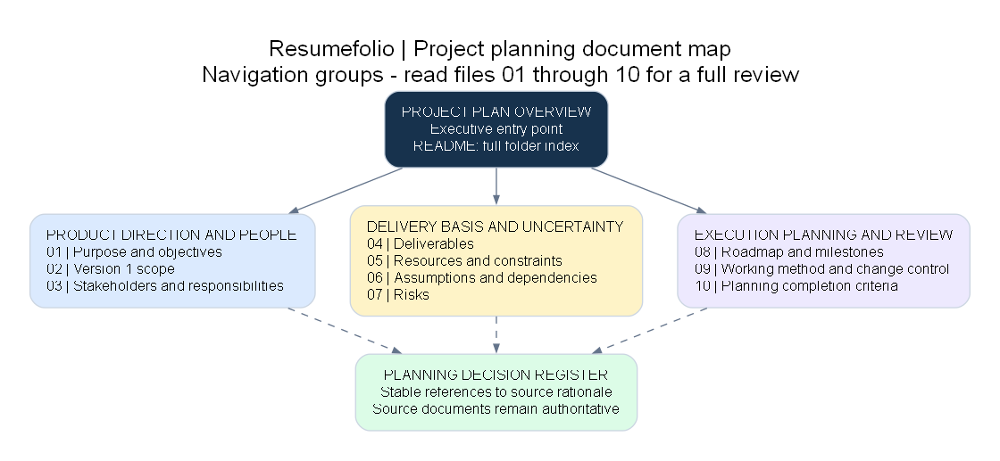

# Resumefolio — Project Planning

Current implementation choices and scope: [Baseline](../../baseline/README.md). Runtime verification remains subject to its gates.

| Item | Current position |
| --- | --- |
| Project owner | Farhad; sole delivery and operations owner |
| Folder purpose | Planning rationale, scope, delivery constraints, risks, working method and acceptance records |
| Recorded planning outcome | Accepted with tracked follow-up under [DEC-116](10-planning-completion-criteria.md#dec-116) for the identified baseline snapshot |
| Current document work | Owner-approved MVP allocation and system-boundary synchronization, November 4; historical planning acceptance remains identified separately |
| Historical unverified Version 1 target | November 8, 2026, Europe/Berlin; effort and schedule feasibility remain unverified |
| Index revision | October 31, 2026 |

**Start with [Project Plan Overview](project-plan.md)** for the executive summary.
For a complete review, read files **01 through 10 in order**. Use the
[Decision Register](decision-register.md) to find the reasoning behind a choice.

[Reading route](#1-reading-route) · [Documents](#2-planning-documents)
· [Diagrams](#3-diagram-catalog) · [Acceptance and follow-up](#4-acceptance-and-follow-up)
· [Tracking](#5-delivery-tracking) · [Maintenance](#6-maintaining-this-folder)

## Current planning allocation — November 4, 2026

Version 1 is the MVP described in the owner decision below. Read planning, requirements, analysis, design and delivery records within that allocation: core plus separate API-connected basic ProjectForge; mail/calendar, AI and advanced work/Git/execution deferred. Preserve 20 total weekly project hours, historical dates and actual evidence limits.

Authority: [OWNER-MVP-2026-11-04](owner-mvp-decision-2026-11-04.md).

## 1. Reading Route

[Open scalable map](diagrams/planning-document-map.svg) ·
[Editable Graphviz source](diagrams/planning-document-map.dot)

This map groups information for navigation. It is not a technical architecture,
an implementation schedule, or a claim that the product is complete. Each topic
has one authoritative document; related pages link to it rather than replacing
its decisions, rationale, evidence and limitations.

## 2. Planning Documents

| Order | Document | Main question answered |
| --- | --- | --- |
| Overview | [Project Plan Overview](project-plan.md) | What is the overall direction and where should I start? |
| 01 | [Purpose and Objectives](01-purpose-and-objectives.md) | Why does the product exist and what outcomes should it achieve? |
| 02 | [Version 1 Scope](02-scope.md) | What is included, excluded or still to be defined? |
| 03 | [Stakeholders and Responsibilities](03-stakeholders-and-responsibilities.md) | Who uses the product and who carries delivery responsibility? |
| 04 | [Deliverables](04-deliverables.md) | What outputs and evidence must be delivered? |
| 05 | [Resources and Constraints](05-resources-and-constraints.md) | Which resources and boundaries guide decisions? |
| 06 | [Assumptions and Dependencies](06-assumptions-and-dependencies.md) | What needs validation before dependent commitments? |
| 07 | [Risk Register](07-risks.md) | What could go wrong, who follows up, and when? |
| 08 | [Roadmap and Milestones](08-roadmap-and-milestones.md) | Which outcomes and prerequisites organize delivery? |
| 09 | [Working Method and Change Control](09-working-method-and-change-control.md) | How do we work, record decisions and assess changes? |
| 10 | [Planning Completion Criteria](10-planning-completion-criteria.md) | How was the planning snapshot assessed and accepted? |
| Reference | [Planning Decision Register](decision-register.md) | Where is the original accepted decision and its rationale? |

Some topic pages keep original decision/evidence records in expandable sections.
Open those sections to inspect complete historical reasoning and source hashes.
Stable DEC anchors continue to identify the original records.

## 3. Diagram Catalog

The catalog covers all **25 current diagram sources** in this folder.
**PNG** is the quick preview, **SVG** supports zooming, and **DOT/PlantUML** is
the editable source. The two original planning images have no SVG here; their
existing source and PNG are retained unchanged.

Read each diagram with its topic's explanation. Grouping arrows, prerequisite
arrows, state transitions and review flows have different meanings described
in the corresponding document. The visuals do not establish verified capacity,
implemented permissions, successful recovery or completed delivery.

| Topic | Diagram | Preview | Scalable | Editable source |
| --- | --- | --- | --- | --- |
| Overview | Planning document map | [PNG](diagrams/planning-document-map.png) | [SVG](diagrams/planning-document-map.svg) | [DOT](diagrams/planning-document-map.dot) |
| 01 — Purpose | Problem-to-objective alignment | [PNG](diagrams/purpose-objectives-alignment.png) | [SVG](diagrams/purpose-objectives-alignment.svg) | [DOT](diagrams/purpose-objectives-alignment.dot) |
| 01 — Purpose | Example application journey | [PNG](diagrams/purpose-application-journey.png) | [SVG](diagrams/purpose-application-journey.svg) | [DOT](diagrams/purpose-application-journey.dot) |
| 02 — Scope | Version 1 boundaries | [PNG](../04-system-design/01-software-architecture/diagrams/logical-component-ownership.png) | [SVG](../04-system-design/01-software-architecture/diagrams/logical-component-ownership.svg) | [DOT](../04-system-design/01-software-architecture/diagrams/logical-component-ownership.dot) |
| 02 — Scope | Scope-to-delivery review gates | [PNG](diagrams/scope-review-gates.png) | [SVG](diagrams/scope-review-gates.svg) | [DOT](diagrams/scope-review-gates.dot) |
| 03 — Stakeholders | Stakeholder context | [PNG](diagrams/stakeholder-context.png) | [SVG](diagrams/stakeholder-context.svg) | [DOT](diagrams/stakeholder-context.dot) |
| 03 — Stakeholders | Solo delivery responsibilities | [PNG](diagrams/solo-delivery-responsibilities.png) | [SVG](diagrams/solo-delivery-responsibilities.svg) | [DOT](diagrams/solo-delivery-responsibilities.dot) |
| 04 — Deliverables | Deliverable map | [PNG](diagrams/deliverable-map.png) | [SVG](diagrams/deliverable-map.svg) | [DOT](diagrams/deliverable-map.dot) |
| 04 — Deliverables | Deliverable completion review | [PNG](diagrams/deliverable-review-flow.png) | [SVG](diagrams/deliverable-review-flow.svg) | [DOT](diagrams/deliverable-review-flow.dot) |
| 05 — Resources | Resource and evidence map | [PNG](diagrams/resource-evidence-map.png) | [SVG](diagrams/resource-evidence-map.svg) | [DOT](diagrams/resource-evidence-map.dot) |
| 05 — Resources | Resource review flow | [PNG](diagrams/resource-review-flow.png) | [SVG](diagrams/resource-review-flow.svg) | [PlantUML](diagrams/resource-review-flow.puml) |
| 06 — Dependencies | Investigation-to-review-gate map | [PNG](diagrams/dependency-review-map.png) | [SVG](diagrams/dependency-review-map.svg) | [DOT](diagrams/dependency-review-map.dot) |
| 06 — Dependencies | Validation status model | [PNG](diagrams/validation-status-model.png) | [SVG](diagrams/validation-status-model.svg) | [PlantUML](diagrams/validation-status-model.puml) |
| 07 — Risks | Risk overview | [PNG](diagrams/risk-overview.png) | [SVG](diagrams/risk-overview.svg) | [DOT](diagrams/risk-overview.dot) |
| 07 — Risks | Risk review and closure | [PNG](diagrams/risk-review-flow.png) | [SVG](diagrams/risk-review-flow.svg) | [PlantUML](diagrams/risk-review-flow.puml) |
| 08 — Roadmap | Outcome roadmap | [PNG](diagrams/outcome-roadmap.png) | [SVG](diagrams/outcome-roadmap.svg) | [DOT](diagrams/outcome-roadmap.dot) |
| 08 — Roadmap | Schedule reconciliation | [PNG](diagrams/schedule-reconciliation.png) | [SVG](diagrams/schedule-reconciliation.svg) | [PlantUML](diagrams/schedule-reconciliation.puml) |
| 09 — Method | Main work-tracking path | [PNG](diagrams/work-tracking-flow.png) | [SVG](diagrams/work-tracking-flow.svg) | [DOT](diagrams/work-tracking-flow.dot) |
| 09 — Method | Change assessment | [PNG](diagrams/change-assessment-flow.png) | [SVG](diagrams/change-assessment-flow.svg) | [PlantUML](diagrams/change-assessment-flow.puml) |
| 10 — Completion | Planning acceptance criteria | [PNG](diagrams/planning-criteria-map.png) | [SVG](diagrams/planning-criteria-map.svg) | [DOT](diagrams/planning-criteria-map.dot) |
| 10 — Completion | Planning acceptance flow | [PNG](diagrams/planning-acceptance-flow.png) | [SVG](diagrams/planning-acceptance-flow.svg) | [PlantUML](diagrams/planning-acceptance-flow.puml) |
| Decision register | Decision source map | [PNG](diagrams/decision-source-map.png) | [SVG](diagrams/decision-source-map.svg) | [DOT](diagrams/decision-source-map.dot) |
| Decision register | Decision status lifecycle | [PNG](diagrams/decision-status-lifecycle.png) | [SVG](diagrams/decision-status-lifecycle.svg) | [PlantUML](diagrams/decision-status-lifecycle.puml) |
| Original planning view | Product vision | [PNG](../04-system-design/01-software-architecture/diagrams/logical-component-ownership.png) | — | [DOT](../04-system-design/01-software-architecture/diagrams/logical-component-ownership.dot) |
| Original planning view | Version 1 scope mind map | [PNG](../04-system-design/01-software-architecture/diagrams/mvp-system-boundaries.png) | — | [PlantUML](../04-system-design/01-software-architecture/diagrams/mvp-system-boundaries.puml) |

### Original planning diagrams

The original Product Vision groups capability areas; its arrows do not describe
data flow or execution order. The original Version 1 Scope mind map summarizes
planned scope, not completed functionality. Use the current Scope catalog for
explicit limits and conditions, including CI/CD feasibility and unresolved detail.

Manual job application management remains included; product AI is deferred. Initial deployment
targets 10 users on the existing server. Growth toward approximately 1,000 users
requires later resource and capacity evidence.

## 4. Acceptance and Follow-up

| Record | Meaning |
| --- | --- |
| Accepted planning candidate | Git revision `511093e788b32dd9b68fb86ff5fff2ac21140672` |
| Owner decision | DEC-116, recorded October 31, 2026 and preserved in commit `058866b` |
| Planning acceptance | Thirteen criteria assessed for the identified snapshot; accepted with tracked follow-up |
| Open work | GAP-D01 through GAP-D11 have recorded owners, actions and dependent review gates |

The [Planning Completion Criteria](10-planning-completion-criteria.md) document
holds the actual record and historical evidence. Current editorial revisions are
separate from that accepted snapshot. File existence or a diagram alone does
not establish acceptance of new content or technical outcomes.

Planning-only acceptance does not complete the remaining SDLC work. Continue
Requirements Engineering and the agreed initial analysis/design and later-phase
planning documentation. Reconcile backlog, Sprints, milestones and forecasts,
and agree the pre-implementation baseline before product coding.

## 5. Delivery Tracking

- [Product Backlog index](../../Project-Management/product-backlog.md)
- [Provisional Version 1 delivery plan](../../Project-Management/version-1-delivery-plan.md)
- [Private GitHub project — MVP Kanban](https://github.com/users/Farhad-V/projects/7)

GitHub issues and the delivery project hold live work status and assignments.
Local dates and Sprint selections preserve provisional historical plans until
the agreed reconciliation. This README does not query or change live tracking.
A Sprint assignment, target date, commit or successful build is not proof that
a milestone or release is complete.

## 6. Maintaining This Folder

| Change | Keep consistent |
| --- | --- |
| A planning decision changes | Authoritative topic, rationale, stable decision record and affected references |
| A diagram changes | Editable source, rendered image(s), explanatory text and catalog links |
| A topic is moved or renamed | Incoming file/section links and the decision register |
| New evidence appears | ASM/DEP/RSK status, affected design or estimate, and the relevant review record |
| A baseline is revised | Identified Git revision and actual owner decision; retain earlier history |

The numbered documents and register provide PowerShell regeneration commands
for their diagrams. Graphviz renders `.dot`; PlantUML renders `.puml` using Java.
Use the installed user's tool paths, keep sources in UTF-8 without BOM, and
inspect rendered images for legibility and agreement with the text.

Retain the source files and generated images in version control. Review links,
anchors, and diagram coverage before a focused Git checkpoint. Keep credentials
and private operational data out of repository documents and shared evidence.

**Editorial revision — October 31, 2026:** Updated this index to cover all
thirteen Markdown documents and twenty-five diagram sources, reused the document
navigation map, and preserved original diagram references. No source decision,
product scope, historical target date or remote board configuration was changed.

## Current Capacity Follow-up

[Confirmed capacity and preliminary sizing](11-capacity-and-preliminary-sizing.md) records the owner's 20-hour/week answer, an unaccepted estimate scenario and the historical target conflict. It supplements the current working plan without altering the accepted historical snapshot.
