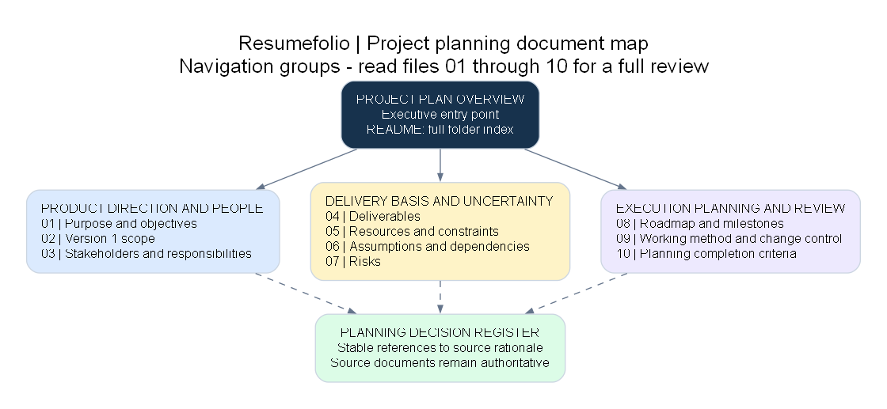

# Resumefolio — Project Plan Overview

| Item | Planning position |
| --- | --- |
| Project owner | Farhad; sole delivery and operations owner |
| Document role | Executive entry point to the separate planning documents |
| Planning agreement | Identified baseline accepted with tracked follow-up under [DEC-116](10-planning-completion-criteria.md#dec-116) |
| Historical unverified Version 1 target | November 8, 2026, Europe/Berlin; effort and feasibility remain unverified |
| Presentation revision | October 31, 2026; navigation and overview only |

**Start here for the overview.** Use the [Planning Index](README.md) for the
folder's full document and diagram navigation. Each numbered topic document
remains authoritative for its own decisions, rationale, limits and follow-up.

[Project direction](#1-project-direction) · [Document map](#2-planning-document-map)
· [Acceptance and follow-up](#3-planning-acceptance-and-follow-up)
· [Working sequence](#4-next-engineering-activities) · [Tracking](#5-delivery-tracking)

## Current planning allocation — November 4, 2026

Version 1 is the MVP described in the owner decision below. Read planning, requirements, analysis, design and delivery records within that allocation: core plus separate API-connected basic ProjectForge; mail/calendar, AI and advanced work/Git/execution deferred. Preserve 20 total weekly project hours, historical dates and actual evidence limits.

Authority: [OWNER-MVP-2026-11-04](owner-mvp-decision-2026-11-04.md).

## 1. Project Direction

Resumefolio is a unified web application for reusable professional information,
tailored resumes and evidence, controlled employer sharing, and organized
job-application work. Version 1 is the MVP: private core dashboard/presentation/files/manual applications plus separate API-connected basic ProjectForge. Mail/calendar and advanced work/Git/execution are deferred.

Initial planning used one full-time project owner. The current owner-stated
capacity is 20 total project hours/week (November 1, 2026). Laravel and
object-oriented development, the existing server and available resources remain the basis. The initial target is
10 users; growth toward approximately 1,000 is a design direction, not verified
capacity. Product AI and automatic translation are outside Version 1.

Read [Purpose and Objectives](01-purpose-and-objectives.md) for the problem and
intended value, [Scope](02-scope.md) for exact inclusions/exclusions, and
[Resources and Constraints](05-resources-and-constraints.md) for evidence boundaries.

## 2. Planning Document Map



[Open scalable diagram](diagrams/planning-document-map.svg) ·
[Editable Graphviz source](diagrams/planning-document-map.dot)

The diagram shows where to find information, not a technical architecture or
permission to start implementation. For a full review, read the numbered files
from 01 through 10 in order.

| Planning question | Authoritative documents |
| --- | --- |
| Why build the product, and what belongs in Version 1? | [01 — Purpose and Objectives](01-purpose-and-objectives.md); [02 — Scope](02-scope.md) |
| Who uses the product and who carries delivery responsibility? | [03 — Stakeholders and Responsibilities](03-stakeholders-and-responsibilities.md) |
| What must be delivered and within which limits? | [04 — Deliverables](04-deliverables.md); [05 — Resources and Constraints](05-resources-and-constraints.md) |
| Which expectations and risks need evidence or follow-up? | [06 — Assumptions and Dependencies](06-assumptions-and-dependencies.md); [07 — Risks](07-risks.md) |
| How are outcomes, working methods and changes organized? | [08 — Roadmap and Milestones](08-roadmap-and-milestones.md); [09 — Working Method and Change Control](09-working-method-and-change-control.md) |
| How was planning assessed and accepted? | [10 — Planning Completion Criteria](10-planning-completion-criteria.md) |

Use the [Planning Decision Register](decision-register.md) to locate the original
reasoning and acceptance record for a particular DEC identifier.

## 3. Planning Acceptance and Follow-up

| Record | Meaning |
| --- | --- |
| Accepted planning candidate | Git revision `511093e788b32dd9b68fb86ff5fff2ac21140672` |
| Owner acceptance | DEC-116, recorded October 31, 2026 and preserved in commit `058866b` |
| Recorded outcome | Accepted with tracked follow-up; the thirteen planning criteria were assessed for that snapshot |
| Remaining work | GAP-D01 through GAP-D11 retain their owner, actions and dependent review gates |

The acceptance refers to an identifiable snapshot. Later editorial changes to
these files do not silently replace it. The recorded follow-up includes resource
and provider investigation, recovery and execution controls, detailed behavior,
quality targets, estimates and tracking reconciliation.

Open technical work is not presented as finished: assumptions remain to be
validated and the ten risks remain open. See the current record and complete
evidence in [Planning Completion Criteria](10-planning-completion-criteria.md).

## 4. Next Engineering Activities

Continue Requirements Engineering, then the remaining agreed initial system
analysis/design and later-phase planning documentation. Investigate decisive
feasibility questions before the commitments that depend on them.

Before product coding, reconcile the backlog, Sprints, milestones and forecast
with the reviewed work and agree the pre-implementation baseline. During
implementation, refine decisions iteratively and deliver verified increments
with matching documentation. Planning-only acceptance does not itself authorize
product coding, deployment or release.

The [Roadmap](08-roadmap-and-milestones.md) defines outcome checkpoints and
prerequisites. Its existing dates are provisional; the requested deadline is
not a validated forecast.

## 5. Delivery Tracking

- [Product Backlog index](../../Project-Management/product-backlog.md)
- [Provisional Version 1 delivery plan](../../Project-Management/version-1-delivery-plan.md)
- [Private GitHub project — Kanban and Sprint views](https://github.com/users/Farhad-Valizadegan/projects/6)

GitHub issues and the delivery project own live work status and assignments.
Local dated tables preserve provisional planning snapshots. This overview does
not inspect or change remote tracking and does not duplicate live status here.

## 6. Diagram Source and Maintenance

The document map uses Graphviz. Keep its `.dot` source, scalable `.svg`, and
`.png` preview together in `diagrams/`. Run from the repository root:

```powershell
$diagramFolder = 'docs\SDLC\01-project-planning\diagrams'
$graphvizExe = 'C:\Program Files\Graphviz\bin\dot.exe'

foreach ($format in 'svg', 'png') {
    & $graphvizExe "-T$format" -Gdpi=140 `
        "$diagramFolder\planning-document-map.dot" -o "$diagramFolder\planning-document-map.$format"
    if ($LASTEXITCODE -ne 0) { throw "Graphviz failed: $format" }
}
```

Save DOT as UTF-8 without BOM. Update navigation when a source moves; revise
product or planning decisions in their authoritative topic documents, recording
material changes through the agreed change-control process.

## Current Capacity and Sizing Follow-up

See [confirmed weekly capacity and preliminary sizing](11-capacity-and-preliminary-sizing.md). Current 20-hour capacity is an actual owner input; the range is an unaccepted estimate scenario. M-01 historical acceptance and all later review gates remain unchanged.
