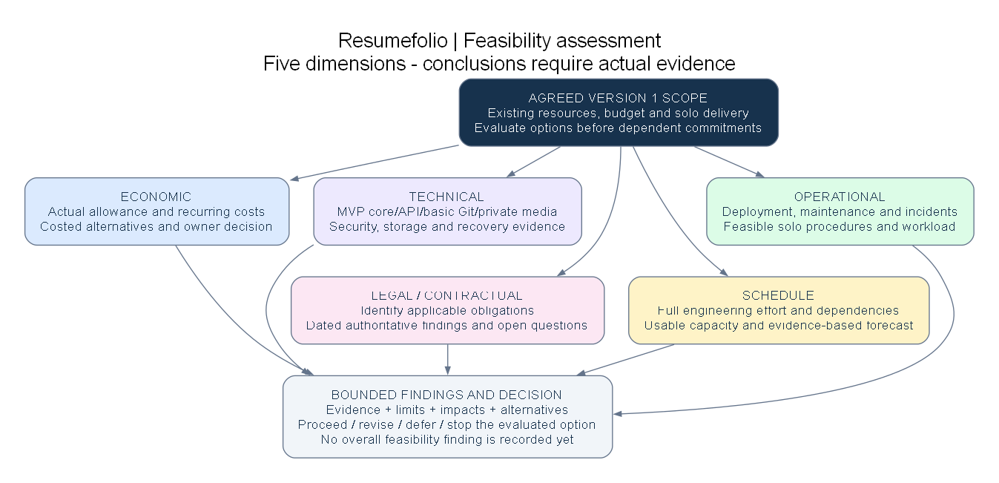
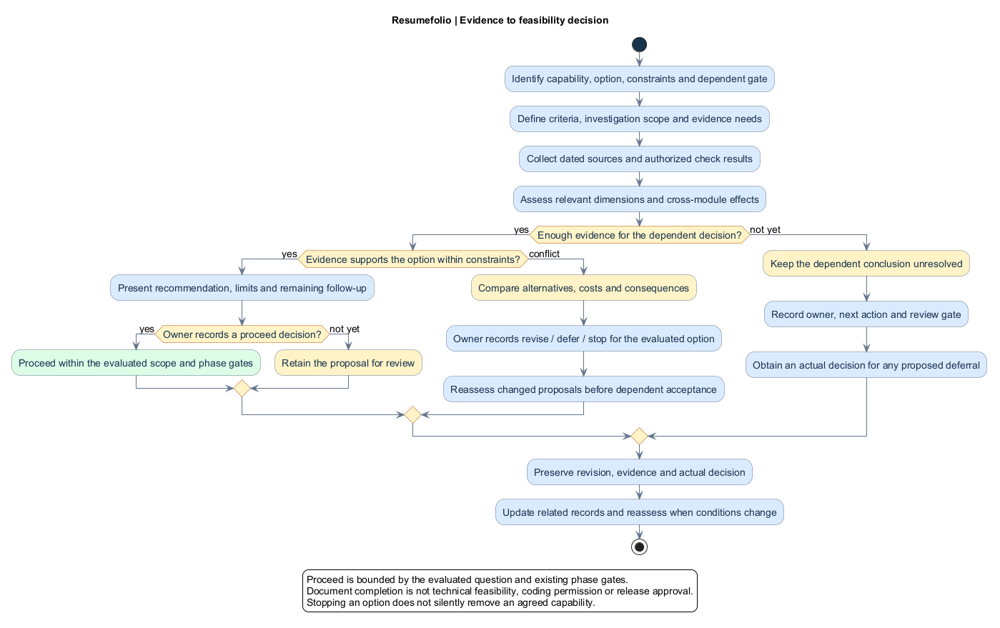

# Resumefolio — Feasibility Study

| Item | Current position |
| --- | --- |
| Purpose | Assess whether the agreed Version 1 scope can be delivered and operated within actual constraints |
| Responsible person / decision-maker | Farhad; sole delivery and operations owner |
| Document status | Assessment framework with bounded server-inventory observations; full feasibility review pending |
| Feasibility conclusion | Not established; the investigations below remain open |
| Planning basis | M-01 accepted with tracked follow-up under DEC-116; GAP-D01–GAP-D11 retain their review gates |
| Revision | October 31, 2026 |

**At a glance:** Evaluate economic, technical, operational, legal and schedule
feasibility using traceable evidence. Investigate decisive constraints early,
compare realistic options, and review findings before accepting the commitments
that depend on them. This document organizes that work; completing the document
does not complete the investigations.

**Read this document for:** assessment questions, required evidence, investigation
sequence and decision rules. Detailed product behavior belongs in requirements;
architecture selections belong in analysis/design. This study links those decisions
to the evidence needed to justify them.

[Basis](#1-assessment-basis-and-boundaries) · [Dimensions](#2-assessment-dimensions)
· [Investigations](#3-investigation-plan-and-dependent-gates) · [Sequence](#4-investigation-sequence)
· [Evidence](#5-evidence-and-finding-records) · [Options](#6-options-and-trade-offs)
· [Decision](#7-review-and-decision-process) · [Completion](#8-completion-checklist-and-current-position)
· [References](#9-authoritative-project-references) · [Diagrams](#10-diagram-maintenance)

Current MVP scope and selected mechanisms: [Baseline](../../../baseline/README.md). Deferred provider, advanced collaboration and workflow-execution designs are not MVP prerequisites.

## 1. Assessment Basis and Boundaries

**Historical broader-product scope, superseded for release allocation:** Assess the **complete agreed Version 1 scope**: professional profiles, tailored
resumes and evidence, PDFs and controlled sharing, manual job application management, Gmail and
calendar integration, work management, real Git hosting/collaboration, conditional
YAML/CI/CD execution, administration and operational readiness. Use the
[Scope catalog](../../01-project-planning/02-scope.md) for exact boundaries. Current MVP inclusion follows the candidate release register; provider/advanced work/Git/execution requirements are retained for later stages.

| Planning basis | Implication for the study |
| --- | --- |
| Existing server and available budget | Inspect actual capacity, competing workloads and spending constraints; additional infrastructure or services cannot be assumed |
| One project owner; current input 20 total project hours/week | Include learning, integration, verification, documentation, maintenance and rework within those hours; capacity does not establish throughput |
| Laravel and object-oriented development | Evaluate compatibility and suitable components within these constraints; final architecture, frontend, database, Git engine and runner remain design choices |
| Initial target of 10 users | Define workload and concurrency before assessing capacity; account count alone is insufficient |
| Growth direction toward roughly 1,000 users | Identify bottlenecks and possible growth paths; larger operational capacity remains unproven |
| November 8, 2026 requested delivery target | Compare with an evidence-based forecast after analysis/design; retain the date as a request rather than a verified estimate |
| Product AI, automatic translation and automatic old-demo migration excluded | Do not introduce these as required feasibility work for Version 1; preserve the existing demo and reference projects |

These are documented planning constraints and intentions, not newly inspected
infrastructure or tested capabilities. The accepted planning candidate remains
the snapshot identified by [DEC-116](../../01-project-planning/10-planning-completion-criteria.md#dec-116).
Review material conflicts with the owner; do not silently reduce agreed scope to
fit resources or dates.

## 2. Assessment Dimensions



[Scalable SVG](../diagrams/feasibility-assessment-map.svg) ·
[Editable Graphviz](../diagrams/feasibility-assessment-map.dot)

Colors distinguish assessment dimensions; every dimension still needs evidence.
Branches group questions and do not represent independent services, parallel
staffing, scores or positive findings.

| Dimension | Questions to answer | Evidence required | Basis for a favorable finding |
| --- | --- | --- | --- |
| Economic | What are existing and additional costs, recurring obligations and resource alternatives? | Actual spending allowance; hosting/service/storage costs; option costs with source/date; expected maintenance effort | The evaluated option fits the owner's explicit budget decision, with recurring costs and uncertainty visible |
| Technical | Can the required combined workflows run with suitable integrations, security, storage and recovery? | Server inventory and workloads; provider access findings; package/runtime compatibility; representative checks against defined criteria | Required operations and critical controls are supported within the evaluated environment and limits; unresolved blockers are identified |
| Operational | Can one person deploy, administer, update, troubleshoot and recover the product? | Proposed runbooks, recurring workload estimates, responsibility assignments and later procedure demonstrations | Essential operations and recovery have a credible, reviewable approach that fits actual available time |
| Legal and contractual | Which privacy, hosting, provider, licensing and content-use obligations apply to the proposed operation? | Documented applicability questions; current authoritative terms/licenses and relevant obligations; specialist clarification where needed | Applicable obligations and unresolved questions are understood sufficiently for the dependent decision; legal blockers require resolution |
| Schedule | Can the full engineering workload fit usable solo capacity and dependencies? | Decomposed work and effort ranges; learning/rework allowance; dependency findings; actual progress where available | A forecast has a defensible basis and conflicts with the requested target have an explicit owner response |

Assess dimensions together. An affordable option may exceed maintenance capacity;
a technically plausible integration may still have unresolved provider access;
a working prototype may leave recovery or combined-load behavior unverified.
Do not average these concerns into a numerical score that hides a blocking issue.

The legal row defines investigation questions only. No jurisdiction-specific
legal conclusion, compliance certification or current provider-policy finding is
made here. Record the applicable source and date when investigating actual use.

## 3. Investigation Plan and Dependent Gates

**Owner for every row: the project owner. Current finding for every row: open.**
These workstreams reuse existing references; they introduce no new milestone or
accepted requirement. The linked planning records remain authoritative for status.

**Workstream:** Server and combined workload

**Investigation and required evidence:** Inspect CPU, memory, disk/free space, OS, runtime limits, network and existing services. Define representative concurrent application, media, Git and background demand; evaluate against explicit criteria

**Existing references / tracking:** ASM-01, DEP-01; RSK-02/RSK-08; GAP-D01/D10; PBI-002

**Dependent gate:** Before accepting dependent resource/deployment design in M-03; actual capacity evidence before release

**Workstream:** Google integrations

**Investigation and required evidence:** Specify required Gmail/Calendar operations, consent, synchronization and failure/reconnect behavior. Check current official access conditions, permissions, quotas/costs and actual required operations

**Existing references / tracking:** ASM-02, DEP-03; RSK-06; GAP-D02; PBI-004

**Dependent gate:** Before accepting dependent M-02 requirements/M-03 design; validate access before dependent development

**Workstream:** Authentication and notification delivery

**Investigation and required evidence:** Inspect available delivery arrangements, access, cost, limits and actual receipt; define delays, retries and recovery without bypassing authentication

**Existing references / tracking:** ASM-03, DEP-04; RSK-07; GAP-D03; PBI-005

**Dependent gate:** Before dependent M-03 design; verify relevant behavior before capability/release acceptance

**Workstream:** Backup and recovery

**Investigation and required evidence:** Establish backup coverage across database, repositories, files and required configuration/keys. Inspect storage separation, capacity, access, retention and cost; define recovery targets and later restoration/data-integrity checks

**Existing references / tracking:** ASM-04, DEP-05; RSK-05; GAP-D04; PBI-006

**Dependent gate:** Targets during M-02; recovery design before M-03 acceptance; demonstrated restoration before M-09

**Workstream:** Git and isolated CI/CD

**Investigation and required evidence:** Evaluate actual Git transport/collaboration needs and execution options. Investigate isolation, permissions, secrets, resource limits, cleanup, logs and controlled deployment; use bounded checks only in an agreed environment

**Existing references / tracking:** DEP-01; RSK-03; GAP-D09; PBI-003, PBI-020–PBI-023

**Dependent gate:** Findings before accepting dependent M-03 execution design or enabling jobs; verified controls before M-08

**Workstream:** Domain and software suitability

**Investigation and required evidence:** Verify domain control, DNS/TLS and renewal arrangements. Evaluate selected packages/runtimes, compatibility, licensing, support and operational burden using current primary sources

**Existing references / tracking:** DEP-02/DEP-06; RSK-10; GAP-D07/D08; PBI-009

**Dependent gate:** At dependent M-03 selection/deployment design; compatibility before implementation; live domain checks before M-10

**Workstream:** Required inputs and data boundaries

**Investigation and required evidence:** Identify required user inputs, incomplete-input behavior, ownership, permissions, deletion, archives and synchronization effects. Walk through representative cross-module scenarios

**Existing references / tracking:** ASM-06; RSK-04/RSK-09; GAP-D06; PBI-008

**Dependent gate:** Before accepting affected M-02 requirements and M-03 data/security design

**Workstream:** Costs, solo operation and delivery forecast

**Investigation and required evidence:** Establish actual costs and usable capacity; evaluate maintenance/recovery work; decompose scope and estimate full engineering effort after analysis/design; compare forecast with target and options

**Existing references / tracking:** ASM-05; RSK-01/RSK-10; GAP-D01/D05/D08/D11; linked backlog

**Dependent gate:** Before spending/resource commitments and an accepted forecast; reconcile tracking before product coding

**Workstream:** Applicable obligations

**Investigation and required evidence:** Identify actual data/service/content flows and relevant provider, license, privacy and hosting questions; retain dated authoritative findings and affected requirement/design references

**Existing references / tracking:** Resources constraints; DEP-03/DEP-06; related interface/domain requirements

**Dependent gate:** Before accepting the affected integration/component/operating decision; resolve release blockers before release

Use the [Product Backlog](../../../Project-Management/product-backlog.md) to locate
PBI work items. Its dates are provisional snapshots; GitHub issues and the delivery
project hold live assignments. This document does not report their current remote
completion states or change their assignments.

## 4. Investigation Sequence

The sequence below prioritizes uncertainty, not product implementation. Work is
planned for one person; independent clarification may proceed while a dependent
commitment waits for evidence. Revisit earlier findings when requirements change.

| Order | Work | Output that enables the next decision |
| --- | --- | --- |
| 1 — Bound the question | Identify affected capability, source decision, constraint, unknown and review gate | A bounded investigation with an owner and explicit evidence needs |
| 2 — Inspect decisive constraints early | Prioritize shared-server resources, Google access, email delivery, recovery and CI/CD isolation | Findings that can invalidate or reshape major technical commitments |
| 3 — Refine requirements and criteria | Define workload, required operations, permission/lifecycle rules and measurable quality/recovery criteria | Observable conditions against which candidate options can be assessed |
| 4 — Compare and check options | Use evidence-based analysis and appropriately scoped demonstrations/tests where authorized | Supported conclusions, alternatives, limitations and unresolved blockers |
| 5 — Review dependent baselines | Feed findings into M-02/M-03 and resolve relevant blockers before acceptance | Identified owner decisions and traceable follow-up |
| 6 — Reconcile and revisit | Reconcile effort/backlog/Sprints/milestones after analysis/design; later verify candidate operation and recovery | Credible forecast before coding; actual capability/release evidence at later gates |

No fixed investigation duration is assigned here. A proof-of-concept, capacity
check or failure/recovery exercise needs defined scope, environment, inputs,
stop conditions and cleanup. Plan checks to protect existing services and data;
do not infer permission to run arbitrary repository code or restore over live data.

## 5. Evidence and Finding Records

### Record each bounded investigation

| Field | Required content |
| --- | --- |
| Question and reference | Capability, relevant ASM/DEP/RSK/GAP and affected requirement/design |
| Scope and criteria | What is evaluated, environment/workload and observable conditions; record proposed criteria separately from agreed ones |
| Source and timing | Exact official source, inspected configuration or identified component/version; actual inspection date and responsible person |
| Method | Inspection, analysis, demonstration or test, with rationale |
| Actual finding | Evidence, result and what it supports or contradicts; distinguish planned checks from executed checks |
| Limits | Missing access, assumptions, untested paths and conditions under which evidence may no longer apply |
| Impact and options | Affected commitments, costs, security, quality, schedule and operational consequences |
| Outcome and follow-up | Recommendation, actual owner decision when made, revision, next action and dependent review gate |

Protect credentials and private operational information. Summarize relevant
configuration findings without placing tokens, passwords or private keys in Git.
Link suitable evidence rather than copying sensitive raw output.

### Findings register

No technical investigation result has been entered in this register. The rows in
Section 3 are an investigation plan, not results. Populate this table only when
actual evidence is available; retain earlier findings when conditions change.

| Finding reference | Question / existing references | Evidence and actual date | Conclusion and limits | Affected decision / gate | Owner action and outcome |
| --- | --- | --- | --- | --- | --- |

### Interpret evidence without overstating it

- A server inventory establishes inspected resources, not supported application capacity.
- Successful provider access for one operation does not verify every required operation or failure path.
- An isolated job check does not establish all execution boundaries or combined-load behavior.
- A backup file does not establish successful restoration; code rollback does not automatically recover changed data.
- A source-code or document review does not constitute a running-product test.

Reflect findings in the authoritative registers: assumptions remain
Unverified/Confirmed/Invalidated and dependencies Unverified/Available/Blocked
under the existing planning vocabulary. Partial findings must not promote an
entire dependency to Available. Risk closure requires its own evidence or an
explicit owner decision accepting remaining risk.

## 6. Options and Trade-offs

Compare options only after defining the question and relevant criteria. Options
may include alternative technical designs or execution arrangements within scope.
Extra spending, scope reduction or a changed delivery commitment requires an
explicit owner decision. No option is selected by this document.

| Option record field | Comparison needed |
| --- | --- |
| Required outcome | Which agreed capability and criteria must be preserved? |
| Technical support | Which findings demonstrate required operations, security and capacity? |
| Economic effect | Existing/additional and recurring costs; uncertainty and spending decision |
| Operational effect | Setup, updates, incident response, recovery and solo maintenance effort |
| Contractual or legal questions | Applicable obligations, supporting sources and unresolved restrictions |
| Schedule effect | Dependencies, learning, implementation, verification, documentation and rework |
| Remaining exposure | Known limitations, unverified claims, mitigations and decision implications |

If evidence shows a conflict, record it directly with meaningful alternatives.
Do not label an option feasible merely because it is familiar or uses fewer
components. A chosen design still needs verification during implementation and
release preparation.

## 7. Review and Decision Process



[Scalable SVG](../diagrams/feasibility-review-flow.svg) ·
[Editable PlantUML](../diagrams/feasibility-review-flow.puml)

Blue activities collect and assess evidence; amber highlights unresolved questions
and owner choices; green marks a bounded proceed outcome. The diagram describes a
method, not completed investigations or a current permission to start coding.

| Outcome | Meaning and required record |
| --- | --- |
| Proceed within evaluated scope | Evidence supports the specific dependent decision under stated conditions; record scope, limits, revision and follow-up |
| Revise and reassess | A conflict requires an alternative or changed proposal; record impacts and the actual owner decision before changing commitments |
| Defer the dependent decision | Evidence is insufficient; record owner, next action and gate. Continue only work that does not rely on the unresolved conclusion |
| Stop the evaluated option | The owner rejects further pursuit of that option with reasons; abandoning an option does not silently remove an agreed capability |

Farhad records actual material decisions against an identified revision. A general
acceptance of this method is not acceptance of an unspecified option or deferral.
The overall release conclusion must account for all critical dimensions and
cross-module effects; unresolved critical issues remain visible.

Reassess affected findings when scope, workload, infrastructure, provider access or
terms, component versions, costs, staffing/capacity or recovery arrangements change.
Update requirements, design, risks and tracking through the agreed change process.

## 8. Completion Checklist and Current Position

### For a bounded feasibility decision

- [ ] The question, evaluated option, scope and dependent decision are identified.
- [ ] Relevant economic, technical, operational, legal/contractual and schedule dimensions are assessed.
- [ ] Criteria, workload and environment are explicit; proposed targets are distinguishable from agreed ones.
- [ ] Findings have dated sources or actual check evidence and documented limitations.
- [ ] Critical conflicts and missing evidence have been resolved before the affected commitment.
- [ ] Alternatives, costs, operational burden and schedule effects are reviewable.
- [ ] Remaining follow-up has an owner, next action and gate; specific deferrals have an actual owner decision.
- [ ] The actual decision and revision are recorded; affected ASM/DEP/RSK, requirements/design and tracking are updated.

### Current position

| Item | Position |
| --- | --- |
| Study organization and investigation plan | Expanded draft ready for owner review |
| Documented planning constraints | Available as inputs; referenced here without re-approving or technically validating them |
| Economic / technical / operational / legal / schedule conclusions | Not established |
| New technical evidence | None produced by this document revision |
| Feasibility decision / accepted study revision | Not recorded |
| Immediate useful work | Bound the first high-impact investigations in Section 3; obtain actual resource/access evidence while refining affected requirements |

The document can be reviewed as an investigation plan now. Completion of the
actual study requires findings and decisions for its evaluated scope. Requirements,
design, the pre-implementation baseline and release each retain their separate
review conditions.

**Revision note — October 31, 2026:** Expanded the original five-dimension outline
into an evidence-based investigation plan, with existing references, dependent
gates, records, option assessment and review outcomes. Added two explanatory
diagrams. No server access, provider-policy investigation, purchase, prototype,
test, restoration, forecast validation or feasibility approval is claimed.

## 9. Authoritative Project References

- [Requirements Approach](01-requirements-approach.md) — iterative method and pre-implementation boundary.
- [Resources and Constraints](../../01-project-planning/05-resources-and-constraints.md) — existing resources, Laravel/OOP and budget boundaries.
- [Assumptions and Dependencies](../../01-project-planning/06-assumptions-and-dependencies.md) — validation methods, states, ownership and gates.
- [Risk Register](../../01-project-planning/07-risks.md) — open risks, response priorities and closure rules.
- [Planning Completion Criteria](../../01-project-planning/10-planning-completion-criteria.md) — DEC-116 and GAP-D01–GAP-D11.
- [Roadmap and Milestones](../../01-project-planning/08-roadmap-and-milestones.md) — M-02/M-03 and later outcome definitions.
- [Requirements Specification](../03-requirements-specification/requirements-specification.md) — product behavior, quality, interfaces and domain constraints.
- [Working Method and Change Control](../../01-project-planning/09-working-method-and-change-control.md) — material decisions and tracking authority.

## 10. Diagram Maintenance

| Diagram | Editable source | Scalable view | Preview |
| --- | --- | --- | --- |
| Five assessment dimensions | [Graphviz](../diagrams/feasibility-assessment-map.dot) | [SVG](../diagrams/feasibility-assessment-map.svg) | [PNG](../diagrams/feasibility-assessment-map.png) |
| Finding-to-decision workflow | [PlantUML](../diagrams/feasibility-review-flow.puml) | [SVG](../diagrams/feasibility-review-flow.svg) | [PNG](../diagrams/feasibility-review-flow.png) |

Keep the editable sources, renders, captions and related text synchronized. Color
supports the labels; it is not the only carrier of meaning. Inspect rendered
images and verify links after changes. Run from the repository root in PowerShell:

```powershell
$diagramFolder = 'docs\SDLC\02-requirements-engineering\diagrams'
$graphvizExe = 'C:\Program Files\Graphviz\bin\dot.exe'
$plantUmlJar = 'C:\Users\fvali\AppData\Local\Resumefolio\DiagramTools\plantuml.jar'

foreach ($format in 'svg', 'png') {
    & $graphvizExe "-T$format" -Gdpi=140 `
        "$diagramFolder\feasibility-assessment-map.dot" `
        -o "$diagramFolder\feasibility-assessment-map.$format"
    if ($LASTEXITCODE -ne 0) { throw "Graphviz failed: $format" }

    java '-Djava.awt.headless=true' -jar $plantUmlJar -charset UTF-8 "-t$format" `
        "$diagramFolder\feasibility-review-flow.puml"
    if ($LASTEXITCODE -ne 0) { throw "PlantUML failed: $format" }
}
```

Save as UTF-8 without BOM. Under another account, use the actual installed JAR
path. Retain diagram sources and SVG/PNG outputs in version control.

[Process index](README.md) · [Requirements index](../README.md)

<a id="server-observation-2026-11-01"></a>
## November 1, 2026 — Bounded Server Observation

**Provenance:** The owner supplied Hetzner panel screenshots and output from commands they executed in an SSH session on November 1, 2026. The login banner reports 08:37:57 UTC for the earlier session. Codex is recording those supplied observations, not claiming a fresh server connection, independent load test or new inspection of credentials. The owner subsequently instructed recording/fixing the infrastructure-related documentation.

| Observed subject | Supplied evidence / result | Interpretation and limit |
| --- | --- | --- |
| Provider/allocation | Hetzner; panel showed CX23, x86, Falkenstein; 2 vCPU, 4 GB RAM, 40 GB local disk | Allocation at the observation time; no guaranteed workload throughput, current price or extra resource purchase inferred |
| Guest OS/kernel | Login banner: Ubuntu 24.04.4 LTS; Linux 6.8.0-124-generic x86_64 | Observed guest software; update/support/compatibility assessment is not completed by the banner |
| Memory | `free -h`: total 3.7 GiB, used 924 MiB, free 404 MiB, buff/cache 2.7 GiB, available 2.8 GiB; swap 0 B | Available differs from free because reclaimable cache is relevant; rounded low-load snapshot, not a peak-load capacity result |
| Root filesystem | `df -h /`: 38 G total, 6.5 G used, 30 G available, 19% used | Rounded guest filesystem figures, distinct from panel allocation; not proof of backup storage or complete mount inventory |
| Active services | `systemctl list-units --type=service --state=running --no-pager`: nginx, mysql and php8.3-fpm among the running units | Services were running; full application health, exact DB/framework versions and background processing were not established |
| Existing web deployment | Active Nginx site maps resumefolio.de / www.resumefolio.de to `/var/www/web-resume-management-system/public`; `artisan` found in its parent | Existing Laravel deployment identified; server is not empty. Configuration is not a live DNS/TLS/health or source-code audit |

Machine-readable sanitized evidence: [server observation](../06-validation-and-traceability/evidence/server-observation-2026-11-01.json). No passwords, private/public key contents, fingerprint comments, tokens or personal login addresses are included.

### Questions answered and remaining work

- Basic allocated CPU/RAM/disk, guest OS and observed services/application location are answered for this snapshot. Do not ask the owner to recall these facts again without a reason to suspect a change.
- ASM-01 / DEP-01 / GAP-D01: evaluate representative combined web/database/media/Git/background workloads and limits; include existing deployment demand. Inventory alone is not a suitability finding.
- Q-D24: derive proposed file formats, per-file/aggregate limits, accounting and reserve policy from product needs and measured processing/storage demand. Thirty G available is not an agreed upload quota.
- Q-D25: define operations, workload, concurrency, client conditions and measurement; propose realistic performance/capacity/availability targets. None is accepted here.
- Q-D26: inspect independent backup destination, coverage, keys, retention and restore procedure; define business loss tolerance and RPO/RTO. Free space on this machine does not establish independent recovery.
- Q-D27 / GAP-D07/D08: verify Laravel/MySQL/dependency versions, queue/scheduler, current domain/TLS and renewal, update/restart procedures and ongoing maintenance. Running components are not automatically selected architecture for the new product.
- Google operations, notification delivery and untrusted CI/CD execution retain their own investigations. Permissions, source propagation, language fallback and sharing revocation retain their product-policy questions.

**Disposition:** Partial infrastructure inventory recorded. Overall feasibility, M-02/M-03 acceptance, numerical quality targets and release readiness remain pending. No production changes or tests were performed by this documentation revision.

## November 1, 2026 — Fresh Read-only Findings for Answer Proposals

An authorized SSH inspection confirmed current resource availability, active Nginx/MySQL/PHP services, PHP CLI 8.3.6, Nginx 1.24.0, MySQL server/client 8.0.46 and laravel/framework v12.61.0 in composer.lock. A corrected HTTPS login request returned HTTP 200 with successful TLS verification. The bounded timer/root-cron/named-unit queries did not establish application backup or scheduler/queue operation. See [exact sanitized observations](../06-validation-and-traceability/evidence/server-readonly-check-2026-11-01.json) for command limitations and errors/retries. No production setting or data was changed.

This narrows DEP-01 and Q-D27 inventory work. It does not verify combined capacity, OAuth, untrusted execution or recovery. The [answer package](../07-change-and-baseline/requirements-answer-review.md) supplies concrete proposed behavior/targets for all questions while retaining six external/review gates. No overall feasibility conclusion or additional paid resource is inferred.

## November 1, 2026 — Follow-up Feasibility Findings

[RV-D06 operating/gate assessment](../06-validation-and-traceability/remaining-gate-assessment.md) records the narrower observations and separates requirements/design/release evidence. Nested KVM/microVM execution is not supported as a candidate on the current Cloud VPS; a userspace-isolation mechanism is only a research option pending compatibility/control/resource checks. The owner supplied 20 project hours/week; [preliminary sizing](../../01-project-planning/11-capacity-and-preliminary-sizing.md) exposes the target conflict. Overall feasibility remains unaccepted; Google account configuration and independent backup availability await actual facts.
