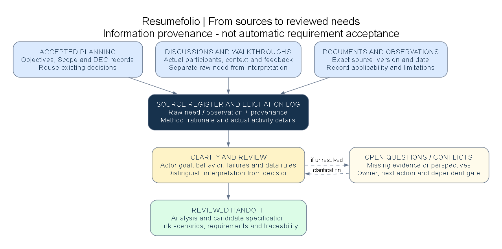
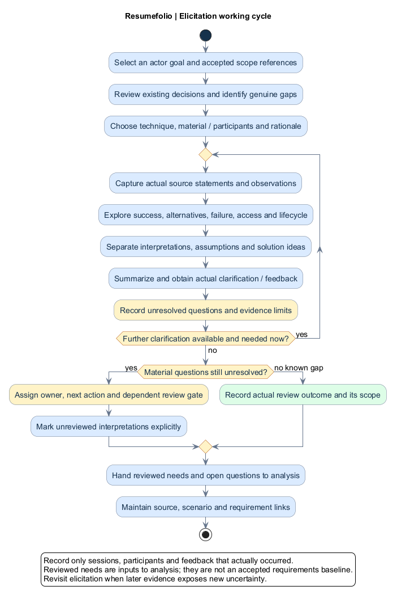

# Resumefolio — Requirements Elicitation

| Item | Current position |
| --- | --- |
| Purpose | Discover and clarify stakeholder needs, operating context and constraints with traceable sources |
| Responsible person | Farhad; sole delivery and operations owner |
| Document status | Proposed elicitation method and working plan — ready for review |
| Activity evidence | Source register and LOG-001 document extraction recorded in the shared log; no interview sessions recorded |
| Baseline boundary | Capturing a need does not accept a requirement or complete M-02 |
| Revision | October 31, 2026 |

**At a glance:** Begin with the accepted planning documents and existing project
discussions. Identify what is already decided, what still needs clarification and
whose perspective is missing. Choose a suitable technique for each question,
retain the source and context, then review the interpretation before handing it
to analysis and specification.

**Read this document for:** how to prepare, conduct and record elicitation. The
[technique plan](../02-stakeholders-and-elicitation/elicitation-plan-and-techniques.md)
maintains the technique-selection catalog, and the
[elicitation log](../02-stakeholders-and-elicitation/elicitation-log.md) owns actual
source/session records. Keep those records there rather than creating a competing
log in this process document.

[Purpose](#1-purpose-and-boundaries) · [Sources](#2-inputs-and-source-authority)
· [Coverage](#3-actors-and-question-coverage) · [Techniques](#4-selecting-the-technique)
· [Workflow](#5-elicitation-workflow) · [Questions](#6-question-guide-and-worked-example)
· [Records](#7-recording-and-handoff) · [Review](#8-quality-and-completion-checklist)
· [Next work](#9-current-position-and-next-work) · [Diagrams](#10-diagram-maintenance)

Current MVP scope and selected mechanisms: [Baseline](../../../baseline/README.md). Deferred provider, advanced collaboration and workflow-execution designs are not MVP prerequisites.

## 1. Purpose and Boundaries

Elicitation discovers goals, current practices, pain points, information needs,
constraints and expected outcomes. It also exposes missing perspectives,
conflicting statements and assumptions. It is repeated as understanding improves;
it is not a single interview before writing requirements.

| Keep distinct | Meaning in this project |
| --- | --- |
| Raw need or observation | What a source actually says or what was actually observed, with context |
| Interpretation | The analyst's explanation of the need; identify uncertainty and seek clarification where material |
| Proposed solution | A possible way to address a need; investigate the underlying goal before treating it as required design |
| Candidate requirement | A statement prepared for analysis/specification, with source and open questions |
| Accepted decision | An actual owner decision within its recorded scope and revision; preserve existing DEC references |
| Verified result | Evidence from an actual inspection, analysis, demonstration or test; do not infer it from a suggestion |

Detailed classification, conflict negotiation and prioritization belong in
[Analysis and Negotiation](04-analysis-and-negotiation.md). Required behavior and
acceptance criteria are developed through [Specification](05-requirements-specification.md).
[Verification and Validation](06-requirements-verification-and-validation.md)
reviews specification quality and fitness for intended use. Elicitation supplies
their evidence and can resume when those activities uncover gaps.

Preserve accepted Version 1 scope. Manual job application management remains included; product AI,
automatic translation and automatic old-demo migration remain excluded. Keep later
ideas visible as proposals outside the current baseline rather than silently adding
them. Existing reference projects remain unchanged and are not automatic specifications.

## 2. Inputs and Source Authority



[Scalable SVG](../diagrams/elicitation-source-map.svg) ·
[Editable Graphviz](../diagrams/elicitation-source-map.dot)

Blue groups existing inputs, amber identifies clarification and evidence gaps,
and green shows the reviewed handoff. Arrows describe information provenance,
not runtime data flow, implementation or automatic acceptance.

| Input | Use | Source handling |
| --- | --- | --- |
| [Purpose and objectives](../../01-project-planning/01-purpose-and-objectives.md) and [Scope](../../01-project-planning/02-scope.md) | Establish goals, inclusions, exclusions and already accepted boundaries | Link the exact objective/DEC section; do not repeatedly ask the owner to approve the same decision |
| [Stakeholders](../../01-project-planning/03-stakeholders-and-responsibilities.md) and [actor document](../02-stakeholders-and-elicitation/actors-and-system-context.md) | Identify goals, interests and missing perspectives | Product roles are distinct from delivery staffing and do not establish complete permissions |
| [Source register](../02-stakeholders-and-elicitation/elicitation-log.md) and earlier discussions | Recover raw requests, examples and rationale | Retain exact chat/turn or document/revision; identify suggestions that may have been superseded |
| [Assumptions/dependencies](../../01-project-planning/06-assumptions-and-dependencies.md), [risks](../../01-project-planning/07-risks.md) and [feasibility plan](02-feasibility-study.md) | Identify unknown resources, access and failure behavior | Stakeholder expectations do not prove server capacity, provider permissions or recoverability |
| Reference-product observations | Understand existing workflows and limitations | Record the repository/file/revision or observed version; distinguish observed behavior from desired future behavior |
| Current provider or component documentation, when needed | Identify external constraints on a required operation | Consult current primary sources and record date/applicability; a vendor feature list does not establish access for this project |

Use SRC-01–SRC-06 in the existing source register as navigation references. They
are not accepted requirements. Record the specific section, decision or turn behind
each derived statement; a link to an entire chat or repository is usually insufficient.

When sources conflict, retain both statements, their context and the affected
decision. Check the current authoritative record and supersession history. If the
conflict remains unresolved, create a linked open question for analysis/owner
resolution; do not silently choose whichever statement is easier to implement.

## 3. Actors and Question Coverage

The following coverage guide organizes questions; it does not claim interviews
have occurred or assign new application privileges. Farhad currently carries the
delivery activities alone. A perspective represented by the owner is not evidence
of research with actual employers, collaborators or other users.

| Perspective | Questions to explore | Relevant boundaries |
| --- | --- | --- |
| Registered user / job applicant | How is professional information maintained, tailored and reused? What materials were actually submitted? How are applications followed up? | Independent resume customization, manual job application management and preserved submitted copies |
| Employer viewer | What information must be accessible, in which language and format? What happens with a wrong password, disabled link or unavailable download? | Only intended shared content; no private workspace or direct-file bypass |
| Invited collaborator | Which project/board/repository actions are needed? What happens when membership or ownership changes? | Invitations do not expose unrelated private resumes, email or repositories |
| Platform owner / administrator | Which configuration, account and content actions are needed? Which actions require reasons, additional checks or audit records? | Administrative role names do not grant unspecified powers |
| Operator / maintainer | How are failures detected and handled? What must be backed up, restored or updated? What can one person realistically maintain? | Existing server/budget, actual workload and separate recovery evidence |
| External-system interaction | Which Gmail/Calendar/Git/email-delivery operations are required? How should denial, outage, retry and reconnection appear to users? | Required interfaces and actual provider access need separate clarification/verification |

For each goal, explore the main path, alternatives, invalid or missing inputs,
unauthorized attempts, interrupted operations, recovery and cross-module effects.
Also ask about measurable quality needs: workload, responsiveness, accessibility,
compatibility, availability and acceptable recovery outcomes. Proposed numbers
need a rationale and review; do not present them as established limits.

## 4. Selecting the Technique

Start with **document analysis and focused owner discussions**, suited to the
existing solo project and extensive prior decisions. Select other techniques
only when they answer a concrete uncertainty. The linked
[technique-selection plan](../02-stakeholders-and-elicitation/elicitation-plan-and-techniques.md)
remains the catalog; the table below explains the working choice.

| Uncertainty | Suitable technique | Preparation and output | Limitation to record |
| --- | --- | --- | --- |
| What has already been agreed? | Document and discussion analysis | Inspect exact sources; extract decisions, raw needs and open questions | Historical or reference content may be superseded or outside scope |
| What does the owner mean by a workflow or rule? | Structured interview / focused discussion | Group related questions; record answers, examples, interpretation and remaining ambiguity | One person's account does not prove other users share the need |
| What actually happens in a current workflow? | Observation / workflow walkthrough | Define permission and scope; capture observed steps, obstacles and version | A staged walkthrough is not necessarily representative field observation |
| How should an interaction behave? | Low-fidelity prototype and scenario walkthrough | Label proposed screens/flows; record actual feedback and resulting questions | A mockup does not prove technical feasibility or completed implementation |
| Do different perspectives conflict? | Workshop or facilitated discussion, if suitable participants exist | Record real participants, competing needs, options and unresolved matters | Do not invent stakeholder attendance, agreement or consensus |
| Is a wider user group's pattern relevant? | Survey, if there is a real population and a suitable question | Record questions, recruitment, actual responses and interpretation | Sample limits and nonresponse constrain conclusions; a survey is not mandatory |

Choose the lightest method that supplies adequate evidence. Record why it was
selected. A prototype that resolves a terminology question may be enough for that
question; security, performance and provider-access claims need their own evidence.

## 5. Elicitation Workflow



[Scalable SVG](../diagrams/elicitation-working-cycle.svg) ·
[Editable PlantUML](../diagrams/elicitation-working-cycle.puml)

The loop revisits unclear or conflicting interpretations. Amber identifies gaps;
green marks a reviewed handoff to analysis. That handoff does not accept a
requirements baseline or authorize product coding.

1. **Select a bounded goal.** Identify the actor, intended outcome, relevant scope/DEC sources and affected modules.
2. **Review existing information.** Extract what is already agreed, locate remaining gaps and avoid repetitive confirmation of accepted decisions.
3. **Prepare the activity.** Define its question, method/rationale, intended participants or material, examples and expected record. Use realistic fictional or sanitized data.
4. **Capture the source faithfully.** Record actual date, participant roles and source locator; distinguish quotations, paraphrases, observations and interpretations.
5. **Explore behavior and exceptions.** Walk through the goal, data, permissions, failure paths, quality expectations and cross-module consequences.
6. **Clarify and summarize.** Reflect the interpretation back to the relevant participant or owner. Identify conflicting statements, unsupported assumptions and missing perspectives explicitly.
7. **Review the record.** Record actual feedback and outcome. If a question remains, assign an owner, next action and review point before dependent commitments.
8. **Hand off and maintain links.** Send reviewed needs and unresolved questions to analysis/specification; update source, scenario and requirement links as records are allocated.

Conduct discussion in manageable groups. Ask about genuine new uncertainties and
material choices; routine record cleanup does not need repeated content approval.
Follow the agreed [working method](../../01-project-planning/09-working-method-and-change-control.md).

## 6. Question Guide and Worked Example

### Reusable prompts

| Topic | Useful prompt |
| --- | --- |
| Goal and value | What are you trying to achieve, and what problem does the current process create? |
| Context and trigger | When does this need arise, and what must already be true? |
| Information | What do you enter, retrieve or share? Which inputs are required or may be missing? |
| Success | What observable result would show the goal was achieved? |
| Alternatives and failure | What happens if the input is wrong, the service is unavailable or the operation is interrupted? |
| Permission | Who may perform this operation on which resource? Who must be denied? |
| Lifecycle | What should change, remain preserved or stop after edit, deletion, disconnect or restore? |
| Quality and constraints | Under what load, device or recovery conditions must this remain usable? What evidence supports the target? |
| Priority and rationale | What is the consequence if this need is delayed or unmet? What depends on it? |

Use open, neutral questions before narrowing choices. For example, ask how
revocation should affect existing viewers before proposing a session mechanism.
Avoid turning a preferred library or architecture into a user need without a
source that genuinely mandates it.

### Example: protected resume viewing

This is an **elicitation preparation example**, derived from DEC-024/DEC-025,
not a new interview, accepted policy or product test.

| Element | Preparation example |
| --- | --- |
| Known direction | Password-protected employer link exposes only the selected resume/content; the owner can change the password or disable the link; direct file/PDF access must respect authorization |
| Existing source | [Scope](../../01-project-planning/02-scope.md#dec-024), [PDF decision](../../01-project-planning/02-scope.md#dec-025) and [draft use case](../04-scenarios-and-models/user-stories-and-scenarios.md#9-draft-walkthrough-view-a-protected-resume) |
| Question needing clarification | What should an already authorized viewer experience when the password changes or the link is disabled? |
| Candidate technique | Focused owner discussion using the current-session and new-request scenarios |
| Paths to explore | Open page, refresh, later navigation and PDF/file request after the change; distinguish future retrieval from copies already downloaded |
| Expected record | Actual answer, exact source/date, interpretation, resulting-state rule, remaining questions and links to affected requirements/scenarios |
| Handoff | Analysis resolves consistency and dependencies; specification writes observable criteria; technical session design follows later |

The example demonstrates how to extend an accepted boundary without asking again
whether protected sharing belongs in Version 1. No response to the open question
is invented here.

## 7. Recording and Handoff

### Minimum record

Use the existing [elicitation log](../02-stakeholders-and-elicitation/elicitation-log.md).
For each session or document extraction, retain:

- Actual date, participant roles when applicable, method and selection rationale.
- Exact source locator and inspected revision/version; identify existing SRC/DEC references where relevant.
- Raw need, observation or source paraphrase, including the relevant context and intended outcome.
- Separate interpretation, assumptions, proposed solutions and unresolved conflicts.
- Actual review feedback/outcome and the limits of the evidence.
- Links to candidate requirements, scenarios, decisions and open questions as they are created.
- Owner, next action and review gate for remaining gaps.

Document extraction does not require fictional interview participants. Record it
as document analysis and identify the material inspected. Do not retroactively
invent a meeting date or quote from an approximate recollection.

| Output | Authoritative destination | Handoff purpose |
| --- | --- | --- |
| Sources, raw needs and actual session/extraction records | [Elicitation log](../02-stakeholders-and-elicitation/elicitation-log.md) | Preserve provenance and context |
| Actor goals and system boundary | [Actors and System Context](../02-stakeholders-and-elicitation/actors-and-system-context.md) | Clarify perspectives and interactions |
| Scenarios, user stories and use cases | [Scenarios and Models](../04-scenarios-and-models/user-stories-and-scenarios.md) | Expose normal, alternative and failure behavior |
| Candidate requirements and rules | [Distributed SRS](../03-requirements-specification/requirements-specification.md) | Develop precise behavior, quality and acceptance criteria |
| Terminology and data meaning | [Glossary](../05-data-definitions/glossary.md) / [Data Dictionary](../05-data-definitions/data-dictionary.md) | Resolve inconsistent vocabulary and information definitions |
| Conflicts, missing evidence and material changes | [Open Questions](../07-change-and-baseline/open-questions-and-decisions.md) / [Change Control](../07-change-and-baseline/change-control.md) | Assign resolution and preserve actual decisions |
| Source-to-need-to-requirement links | [Traceability](../06-validation-and-traceability/requirements-traceability.md) | Maintain bidirectional coverage as records mature |

Keep private emails, real application documents, tokens and sensitive operational
details out of shared records. Obtain appropriate permission before recording
people or accessing private workflows. Store only information needed to understand
the need and its evidence; use sanitized examples in repository documentation.

## 8. Quality and Completion Checklist

For each coherent elicitation group:

- [ ] The actor, goal, scope source and purpose of the activity are clear.
- [ ] Existing accepted decisions have been reused without silently changing them.
- [ ] Technique selection has a reason; actual participants/material and evidence limits are recorded.
- [ ] Raw statements/observations are distinguishable from interpretations, solutions and accepted decisions.
- [ ] Normal, alternative, failure and unauthorized paths have been explored where relevant.
- [ ] Required inputs, data ownership/lifecycle, cross-module effects and quality expectations have been considered.
- [ ] Interpretations have actual review feedback, or their unreviewed status is explicit.
- [ ] Conflicts and missing perspectives have an owner, next action and dependent review point.
- [ ] Reviewed needs and open questions link to the appropriate analysis/specification records.
- [ ] Records exclude unnecessary secrets and private data.

Completion for a group means its elicitation record is usable for the next
activity and remaining gaps are explicit. It does not mean all future needs have
been discovered. Reopen elicitation when analysis, validation, prototype feedback,
feasibility findings or operational experience exposes new uncertainty.

The document itself is ready for review when the method, roles, records, technique
choices and handoff are clear and its diagrams/links agree. Acceptance of the method
does not validate every captured need or complete the requirements baseline.

## 9. Current Position and Next Work

| Item | Current position / next action |
| --- | --- |
| Elicitation method | Expanded proposed draft ready for owner review |
| Source register | Existing SRC-01–SRC-06 entries provide a starting index; record precise source details when extracting needs |
| Session/extraction table | LOG-001 records actual document analysis with EXT-001–EXT-003; interpretations await owner review and no interview session is claimed |
| Actor and scenario coverage | Develop actual records using Section 3 and the existing actor/use-case documents |
| Immediate next activity | Select one coherent scope area, extract its accepted decisions, identify genuine gaps and prepare a focused clarification group |
| Downstream work | Analyze reviewed needs, specify candidate requirements and criteria, and maintain the source chain |
| M-02 and product coding | Separate baseline and pre-implementation gates remain pending |

**Revision note — October 31, 2026:** Expanded the original elicitation outline
with source authority, actor coverage, technique guidance, workflow, neutral prompts,
an explicitly labeled preparation example, record ownership and completion criteria.
Added two diagrams. No new interview, observation, survey, workshop, stakeholder
agreement, product test or requirement acceptance is claimed.

## 10. Diagram Maintenance

| Diagram | Editable source | Scalable view | Preview |
| --- | --- | --- | --- |
| Source-to-handoff map | [Graphviz](../diagrams/elicitation-source-map.dot) | [SVG](../diagrams/elicitation-source-map.svg) | [PNG](../diagrams/elicitation-source-map.png) |
| Elicitation working cycle | [PlantUML](../diagrams/elicitation-working-cycle.puml) | [SVG](../diagrams/elicitation-working-cycle.svg) | [PNG](../diagrams/elicitation-working-cycle.png) |

Keep sources, rendered images, captions and related text synchronized. Labels carry
the meaning as well as colors. Inspect every render for readability and clipped
labels; verify local file/section links after changes. Run from the repository root:

```powershell
$diagramFolder = 'docs\SDLC\02-requirements-engineering\diagrams'
$graphvizExe = 'C:\Program Files\Graphviz\bin\dot.exe'
$plantUmlJar = 'C:\Users\fvali\AppData\Local\Resumefolio\DiagramTools\plantuml.jar'

foreach ($format in 'svg', 'png') {
    & $graphvizExe "-T$format" -Gdpi=140 `
        "$diagramFolder\elicitation-source-map.dot" `
        -o "$diagramFolder\elicitation-source-map.$format"
    if ($LASTEXITCODE -ne 0) { throw "Graphviz failed: $format" }

    java '-Djava.awt.headless=true' -jar $plantUmlJar -charset UTF-8 "-t$format" `
        "$diagramFolder\elicitation-working-cycle.puml"
    if ($LASTEXITCODE -ne 0) { throw "PlantUML failed: $format" }
}
```

Save sources as UTF-8 without BOM. Under another account, substitute the actual
installed JAR path. Retain sources and SVG/PNG outputs in version control.

[Requirements Approach](01-requirements-approach.md) · [Process index](README.md)
· [Requirements index](../README.md)

Register alignment — October 31, 2026: Updated activity-status references after LOG-001 document extraction; the process method and original preparation example remain unchanged.
