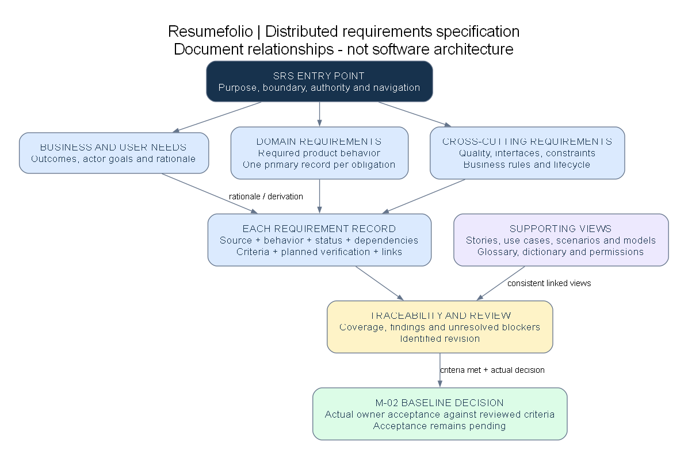
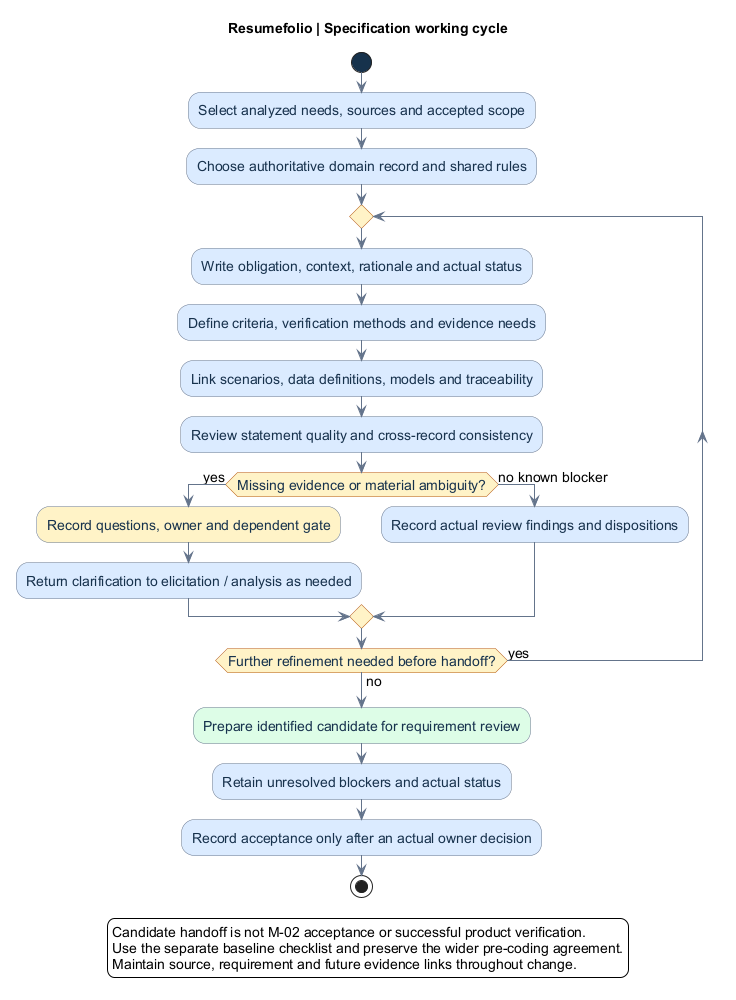

# Resumefolio — Requirements Specification Process

| Item | Current position |
| --- | --- |
| Purpose | Describe how analyzed needs become precise, linked and reviewable requirement records |
| Responsible person | Farhad; sole delivery and operations owner |
| Document status | Proposed specification method — ready for review |
| Product specification | [Distributed Software Requirements Specification](../03-requirements-specification/requirements-specification.md); detailed records remain under development |
| Baseline boundary | M-02 acceptance pending; this method does not accept individual requirements |
| Revision | October 31, 2026 |

**At a glance:** Write what the product must do, under which conditions and with
what observable result. Give each requirement its source, rationale, status,
acceptance criteria and planned verification method. Keep domain records,
scenarios, data definitions and models connected through one specification index.

**Read this document for:** writing rules, record structure, acceptance criteria,
supporting views and the specification workflow. This is the **process document**;
the product's actual requirement records belong in the linked SRS domain files.

[Purpose](#1-purpose-inputs-and-boundaries) · [Organization](#2-distributed-specification-structure)
· [Records](#3-requirement-record-content) · [Writing](#4-writing-clear-requirements)
· [Acceptance](#5-acceptance-criteria-and-planned-verification) · [Views](#6-supporting-models-data-and-interfaces)
· [Workflow](#7-specification-workflow) · [Examples](#8-worked-writing-examples)
· [Review](#9-review-and-baseline-readiness) · [Next work](#10-current-position-and-next-work)
· [Diagrams](#11-diagram-maintenance)

Current MVP scope and selected mechanisms: [Baseline](../../../baseline/README.md). Deferred provider, advanced collaboration and workflow-execution designs are not MVP prerequisites.

## 1. Purpose, Inputs and Boundaries

Specification turns analyzed needs into an inspectable agreement about behavior,
quality and imposed constraints. It supports later analysis/design, implementation,
verification and controlled change. The amount of detail should resolve relevant
ambiguity without prescribing a technical solution that has not been mandated.

| Input | Use when writing | Boundary to preserve |
| --- | --- | --- |
| [Purpose/objectives](../../01-project-planning/01-purpose-and-objectives.md) and [Scope](../../01-project-planning/02-scope.md) | Explain why the requirement exists and which agreed capability it supports | Do not silently add/remove Version 1 scope |
| [Elicitation records](../02-stakeholders-and-elicitation/elicitation-log.md) | Retain exact sources, contexts and reviewed interpretations | A raw statement, example or suggestion is not automatically accepted |
| [Analysis and Negotiation](04-analysis-and-negotiation.md) outputs | Use clarified obligations, terminology, dependencies and actual trade-off decisions | Unresolved conflicts remain visible and block affected acceptance |
| [Feasibility findings](02-feasibility-study.md), assumptions/dependencies and risks | Identify supported constraints and evidence still needed | Planned checks and expected resources do not establish feasibility |
| [Actors](../02-stakeholders-and-elicitation/actors-and-system-context.md), [scenarios](../04-scenarios-and-models/user-stories-and-scenarios.md) and [data definitions](../05-data-definitions/README.md) | Express behavior consistently across roles, paths and information subjects | Models and definitions remain aligned with their actual review status |

Describe observable outcomes, permission boundaries and necessary constraints.
Architecture, database schemas, internal class layouts and concrete runner
technology belong in later design unless a genuine source imposes the choice.
Laravel/OOP and existing-resource boundaries are already recorded in planning;
reference them instead of inventing further technical mandates.

Keep manual job application management and all other agreed Version 1 capabilities visible.
Product AI, automatic translation and automatic demo migration remain excluded.
Provider integrations and YAML/CI/CD retain their relevant feasibility/security
gates. Recording a requirement does not demonstrate its implementation.

## 2. Distributed Specification Structure



[Scalable SVG](../diagrams/requirements-specification-map.svg) ·
[Editable Graphviz](../diagrams/requirements-specification-map.dot)

Blue groups requirement content; purple groups supporting views; amber marks
traceability/review and green identifies the later baseline decision. Arrows are
document relationships, not software architecture, hierarchy of user permissions
or a claim that all linked records are complete.

| Content | Authoritative home | How it connects |
| --- | --- | --- |
| Introduction, product boundary and navigation | [SRS entry point](../03-requirements-specification/requirements-specification.md) | Links to accepted planning and detailed records |
| Business outcomes and user goals | [Business](../03-requirements-specification/business-requirements.md) and [User Requirements](../03-requirements-specification/user-requirements.md) | Explain value and lead to detailed behavior/quality |
| Functional behavior | Relevant domain file under the SRS | Accounts, professional presentation, sharing/PDFs, manual applications, email/calendar, work management, Git/CI and administration |
| Quality, interfaces and imposed constraints | [Quality](../03-requirements-specification/quality-security-and-recovery-requirements.md), [Interfaces](../03-requirements-specification/external-interface-requirements.md), [Domain/Constraints](../03-requirements-specification/domain-requirements-and-constraints.md) | Link cross-cutting conditions to affected domain requirements |
| Business rules and lifecycle | [Business Rules and Data Lifecycle](../03-requirements-specification/business-rules-and-data-lifecycle.md) | Centralize applicable ownership, state, preservation and change rules |
| Scenarios, terms and conceptual data | [Scenarios](../04-scenarios-and-models/user-stories-and-scenarios.md), [Glossary](../05-data-definitions/glossary.md), [Dictionary](../05-data-definitions/data-dictionary.md) | Complement the primary requirement records without duplicating their authority |
| Review, links and baseline | [Findings](../06-validation-and-traceability/review-plan-and-findings.md), [Traceability](../06-validation-and-traceability/requirements-traceability.md), [Baseline Criteria](../07-change-and-baseline/requirements-review-and-baseline-criteria.md) | Identify coverage, unresolved blockers and actual acceptance |

The organization includes requirement levels and cross-cutting aspects; they are
not mutually exclusive classifications. A user goal can lead to several functional,
quality and interface requirements governed by a shared business rule. Keep one
primary record for each obligation and reference it from other views.

## 3. Requirement Record Content

Use the existing [Requirement Record Template](../03-requirements-specification/requirements-specification.md).
The table below explains its fields rather than defining a competing template.
Use sufficient detail for the obligation and its risks; do not fill unknown fields
with invented values simply to make the record look finished.

| Field group | What the record needs |
| --- | --- |
| Identity and source | Stable identifier/title, module, source objective/scope/DEC or exact elicitation reference |
| Rationale and value | Why the need exists and the actor outcome or constraint it supports |
| Actor and conditions | Relevant role, resource, granted permission, trigger, preconditions and current state |
| Required behavior | Individually reviewable obligation, observable response and resulting state |
| Data and lifecycle | Relevant dictionary/rule references, ownership, change/preservation effects and relationships |
| Alternatives and failures | Invalid/missing input, denied access, interruption, dependency failure and recovery where relevant |
| Priority and status | Proposed priority with reason, actual requirement state and review outcome |
| Dependencies and gaps | Related needs, feasibility findings, questions, owner, next action and dependent gate |
| Acceptance and verification | Observable criteria, planned method(s), conditions, pass conditions and evidence needed |
| Review and links | Actual reviewer/decision/date/revision when available; scenario, backlog, design and future verification references |

Proposed identifier families and states are described in
[Requirements Management](07-requirements-management.md). Review the final notation
before allocation; never reuse retired IDs. A template or illustrative record has
no allocated requirement ID. Status reflects actual events, not how polished the
wording looks. Preserve rejected/superseded choices and their rationale through
the agreed management process.

## 4. Writing Clear Requirements

### A practical statement pattern

Use the following pattern when it improves clarity:

> Under **[conditions]**, the system shall **[observable behavior]** for
> **[authorized actor/resource]**, producing **[result or state]**.

This is writing guidance, not an allocated requirement or a mandatory sentence
format for every record. If using **shall**, use it consistently for a required
obligation in the record's stated status; it does not mean the owner has already
accepted a proposed statement. Put rationale, examples and design suggestions in
clearly separate fields.

| Writing principle | Apply it by |
| --- | --- |
| One reviewable obligation | Split behaviors or quality conditions that can be accepted independently while retaining the shared goal and links |
| Explicit subject and scope | Name the actor/resource/context instead of relying on an ambiguous “user” or “it” |
| Observable result | Describe what must be returned, changed, preserved or denied |
| Defined terms | Reuse the glossary; explain specialized terms before relying on them |
| Clear conditions | State relevant eligibility, trigger, state and failure conditions |
| Measurable quality | Define workload, environment, metric, threshold and assessment conditions; unresolved values remain open |
| Appropriate design freedom | Specify externally required outcomes and genuine imposed choices; leave other solution choices to design |
| Consistent obligations | Distinguish required behavior from optional capability, example and proposal |

Avoid unqualified words such as fast, secure, easy, appropriate, normally and
automatic. Explain their meaning in this context. Avoid “and/or” when it obscures
which combinations are permitted. A negative requirement can be useful—for
example, denying unauthorized retrieval—but define the prohibited outcome clearly.

Use absolute statements only when their scope is clear and supportable. A promise
of “no data loss” or “works for all users” cannot replace defined conditions,
recovery targets and verification evidence.

## 5. Acceptance Criteria and Planned Verification

Acceptance criteria state observable conditions for assessing the obligation.
They may use Given/When/Then or plain language with equivalent precision. They
complement the requirement and must agree with it. A full test case later adds
specific data, steps and expected results; actual execution results are separate.

| Criterion component | Clarify |
| --- | --- |
| Context | Actor, resource, state, permissions, relevant data and environment |
| Stimulus | Action, request or event under assessment |
| Expected result | Observable response, state change, preservation or denial |
| Boundaries and exceptions | Relevant limits, invalid inputs, unauthorized paths and failures |
| Quality measurement | Metric, units, workload/environment and threshold when applicable |
| Evidence | Planned verification method and the record needed to assess the condition |

Include relevant success, alternative, negative and failure cases. A happy-path
criterion alone is not adequate for a protected sharing boundary. Link shared
cross-cutting criteria rather than copying a divergent version into every record.

The [template](../03-requirements-specification/requirements-specification.md)
supports inspection, analysis, demonstration and test. Choose one or more methods
with a reason and record their preconditions, pass condition and future evidence
reference. For quality claims, distinguish modeled estimates from measurements
of the implemented system. Planned verification is not a successful result.

An unresolved placeholder may be useful during drafting, but a value that
determines acceptance must be resolved before accepting the affected requirement,
or handled through an explicit, appropriately gated decision. Never quietly
replace an unknown threshold with a sample number.

## 6. Supporting Models, Data and Interfaces

| Supporting view | What it should make explicit | Check against the text |
| --- | --- | --- |
| User story / use case / scenario | Actor value, interaction paths, preconditions and resulting state | Same permission boundaries, errors and outcomes as the requirement |
| Context / activity / state model | Interactions, decisions, states and permitted transitions | No hidden behavior or contradictory state changes |
| Glossary / conceptual dictionary | Meaning, ownership, data subjects and unresolved validation/lifecycle rules | Same terms and source boundaries; no accidental schema design |
| Permission matrix | Actor/resource/action/state combinations | Include both permitted and denied requests, not only hidden UI controls |
| Interface requirement | Required input/output meaning, operations, error behavior and applicable external constraints | Provider/local authority, retry/conflict/disconnect effects and access findings agree |
| Quality requirement | Measurable security, performance, accessibility, reliability/recovery or other relevant condition | Defined scope, assessment conditions and evidence needs |

Keep live presentation separate from preserved submitted materials. Maintain
resource-specific permissions across collaboration, email, files and repositories.
Do not assume synchronization direction, overwrite policy, retention periods,
session lifetime or numerical quotas from a diagram or an example.

Use Graphviz or PlantUML models where they answer a real specification question.
Retain editable sources and rendered images together. Label grouping, relationship
and flow arrows accurately; a document map must not be mistaken for a runtime
architecture. Model review and textual review are performed together.

## 7. Specification Workflow



[Scalable SVG](../diagrams/requirements-specification-cycle.svg) ·
[Editable PlantUML](../diagrams/requirements-specification-cycle.puml)

Blue represents record development, amber identifies gaps and review needs, and
green identifies a candidate handoff. The loop is iterative; it does not approve
the SRS or report successful product verification.

1. **Select the analyzed group.** Confirm its sources, goal, accepted scope and known decisions; inspect unresolved analysis/feasibility questions.
2. **Choose the authoritative home.** Locate the appropriate domain record and related shared rules; avoid duplicate requirements.
3. **Draft the obligation and metadata.** Apply the record fields and writing guidance; keep source facts and proposed details distinguishable.
4. **Define acceptance and verification.** Cover relevant normal, alternative, denied and failure behavior; identify required measurable criteria and evidence.
5. **Link supporting views.** Update scenarios, dictionary/glossary, models, permissions and source-to-requirement traceability.
6. **Review the group.** Check individual statement quality, cross-record consistency, scope coverage and unresolved blockers; record actual findings.
7. **Refine or hand off.** Correct the draft, return genuine uncertainty to elicitation/analysis, or prepare a candidate for formal requirement review.
8. **Record actual acceptance separately.** Only an actual owner decision against an identified revision changes acceptance; M-02 and the later pre-coding gate retain their own criteria.

Manage changes throughout using [Change Control](../07-change-and-baseline/change-control.md).
GitHub issues/board own live work tracking; the repository requirement records own
expected product behavior. Link design and verification as those artifacts are
actually produced; leave missing future evidence explicit.

## 8. Worked Writing Examples

These examples demonstrate wording based on existing scope. They are **proposed
illustrations**, not allocated/accepted detailed requirements, complete test cases
or executed tests. No requirement identifiers are assigned here.

### Example A: protecting shared PDF/file retrieval

| Element | Illustration |
| --- | --- |
| Weak wording | “The resume files must be secure.” |
| Source | [Scope DEC-024](../../01-project-planning/02-scope.md#dec-024) and [DEC-025](../../01-project-planning/02-scope.md#dec-025) |
| Candidate obligation | When a request lacks valid authorization for a protected resume file or PDF, the system shall deny retrieval of that protected content, including requests made through a direct file URL. |
| Rationale | Protect the underlying files as well as the shared page. |
| Criterion illustration | Given a protected PDF and no valid authorization for it, when a viewer requests its direct URL, then the response does not disclose the protected PDF content. |
| Planned verification | Test unauthorized direct retrieval and related authorization cases against an identified candidate; record environment, expected/actual results and evidence later. |
| Open detail | Exact response/feedback, valid-authorization lifetime and revocation behavior require corresponding requirements; this example does not choose them. |

The obligation addresses a defined access boundary. It does not prescribe a
middleware class, file-store technology or response status code without a source.

### Example B: preserving actual submitted material

| Element | Illustration |
| --- | --- |
| Weak wording | “Resumes update everywhere and applications always keep the old version.” |
| Source | [Scope DEC-023](../../01-project-planning/02-scope.md#dec-023) and the live/submitted distinction |
| Candidate obligation | After submitted resume and cover-letter materials have been captured for an application record, later edits to their source content shall not overwrite those preserved submitted copies. |
| Criterion illustration | Given captured submitted materials, when the editable source resume or cover letter is changed, then the corresponding preserved submitted material remains unchanged by that source edit. |
| Planned verification | Test the source-edit and preserved-copy relationship using identified controlled data and compare the relevant content before/after the edit. |
| Open detail | Capture trigger, included artifacts, correction, access, deletion and restoration rules need their own records; no storage-copying mechanism is selected. |

### Example C: making a quality statement measurable

“The system must be fast for 1,000 users” lacks a workload, concurrency, environment,
metric and threshold. Instead, prepare a quality record that identifies the
operation, representative data, concurrent usage pattern, deployment environment,
response-time metric/percentile, agreed threshold and measurement method. Until
these values are justified and reviewed, retain them as explicit open questions.

The initial 10-user target and future growth direction do not establish measured
capacity. Do not assign a response-time promise or claim support for 1,000
concurrent users from that planning direction.

## 9. Review and Baseline Readiness

### Individual requirement and group checks

- [ ] Source, scope, actor outcome and rationale are traceable.
- [ ] The obligation is necessary, clear, individually reviewable and expressed with consistent terms.
- [ ] Conditions, permissions, observable results and relevant lifecycle effects are explicit.
- [ ] Alternatives, invalid inputs, denied paths and failures are covered where applicable.
- [ ] Acceptance criteria agree with the obligation and can distinguish success from failure.
- [ ] Planned verification methods, conditions and evidence needs are recorded.
- [ ] Numerical quality criteria and imposed constraints have sources/rationale and actual review status.
- [ ] Dependencies, missing evidence and blockers have an owner, next action and gate before dependent commitments.
- [ ] Text, models, glossary, dictionary, shared rules and related requirements are consistent.
- [ ] No duplicate authority, invented acceptance, unresolved critical placeholder or hidden scope change remains.
- [ ] Actual review findings and dispositions are recorded against an identified revision.

These checks prepare the records for
[Requirements Verification and Validation](06-requirements-verification-and-validation.md).
Requirement verification examines statement/set quality; validation checks that
the specified outcomes address actual needs. Later product verification provides
evidence of implemented behavior. Keep their records distinct.

M-02 requires the [baseline review checklist](../07-change-and-baseline/requirements-review-and-baseline-criteria.md)
and an actual owner decision for an identified revision. A polished document,
complete template or diagram render is not that decision. The initial SDLC
documentation, delivery-plan reconciliation and wider pre-implementation agreement
remain required before product coding.

## 10. Current Position and Next Work

| Item | Current position / next action |
| --- | --- |
| Specification method | Expanded proposed draft ready for review |
| SRS organization and template | Existing linked records provide the authoritative structure; this method explains their use |
| Detailed product requirements | Develop actual sourced records group by group; examples here do not allocate them |
| Acceptance/verification | Define criteria and planned methods per actual record; no running-product result is reported |
| Immediate next activity | Take a coherent analyzed group, draft its authoritative records and criteria, link supporting views and review gaps |
| Baseline | M-02 and wider pre-implementation acceptance remain separate and pending |

**Revision note — October 31, 2026:** Expanded the original outline with SRS
organization, record guidance, writing rules, acceptance/verification planning,
supporting views, workflow, worked examples and review checks. Added two diagrams.
No new scope decision, requirement ID, technical feasibility finding, product test
result or baseline acceptance is introduced.

## 11. Diagram Maintenance

| Diagram | Editable source | Scalable view | Preview |
| --- | --- | --- | --- |
| Distributed specification map | [Graphviz](../diagrams/requirements-specification-map.dot) | [SVG](../diagrams/requirements-specification-map.svg) | [PNG](../diagrams/requirements-specification-map.png) |
| Specification working cycle | [PlantUML](../diagrams/requirements-specification-cycle.puml) | [SVG](../diagrams/requirements-specification-cycle.svg) | [PNG](../diagrams/requirements-specification-cycle.png) |

Keep sources, rendered outputs, captions and text synchronized. Colors supplement
labels/shapes. Inspect readability, arrows and clipping after rendering; check
file/section links after changes. Run from the repository root:

```powershell
$diagramFolder = 'docs\SDLC\02-requirements-engineering\diagrams'
$graphvizExe = 'C:\Program Files\Graphviz\bin\dot.exe'
$plantUmlJar = 'C:\Users\fvali\AppData\Local\Resumefolio\DiagramTools\plantuml.jar'

foreach ($format in 'svg', 'png') {
    & $graphvizExe "-T$format" -Gdpi=140 `
        "$diagramFolder\requirements-specification-map.dot" `
        -o "$diagramFolder\requirements-specification-map.$format"
    if ($LASTEXITCODE -ne 0) { throw "Graphviz failed: $format" }

    java '-Djava.awt.headless=true' -jar $plantUmlJar -charset UTF-8 "-t$format" `
        "$diagramFolder\requirements-specification-cycle.puml"
    if ($LASTEXITCODE -ne 0) { throw "PlantUML failed: $format" }
}
```

Save sources as UTF-8 without BOM. Under another account, use the actual installed
JAR path. Retain source and SVG/PNG outputs in version control.

[Requirements Approach](01-requirements-approach.md) · [Analysis and Negotiation](04-analysis-and-negotiation.md)
· [Process index](README.md) · [Requirements index](../README.md)
