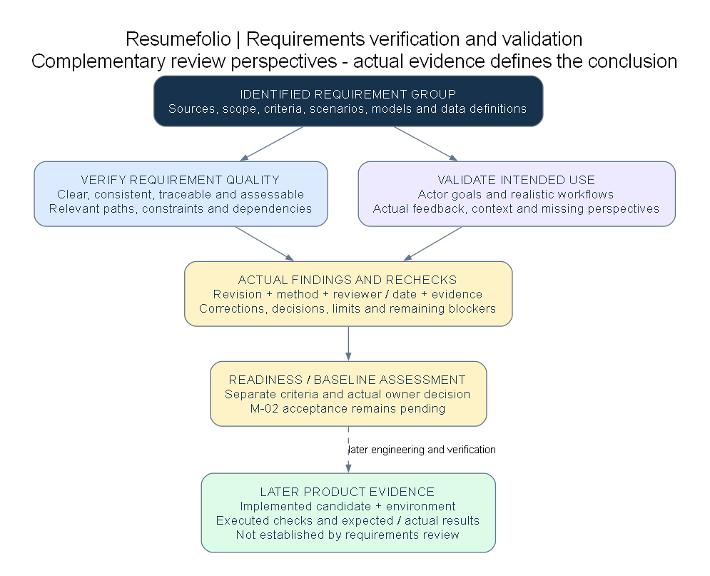
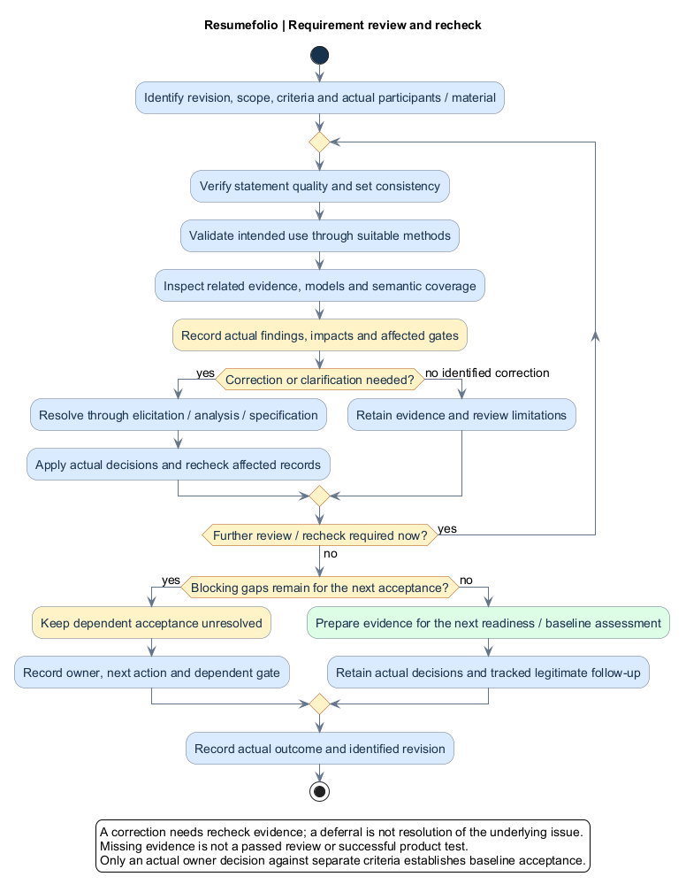

# Resumefolio — Requirements Verification and Validation

| Item | Current position |
| --- | --- |
| Purpose | Assess requirement quality and whether specified outcomes address intended user needs |
| Responsible person / decision-maker | Farhad; sole delivery and operations owner |
| Document status | Proposed review method — ready for owner review |
| Product requirement review evidence | No completed requirement-group review is recorded by this process document |
| Requirements baseline | M-02 acceptance pending; use the separate baseline criteria and actual owner decision |
| Revision | October 31, 2026 |

**At a glance:** Apply two complementary review perspectives. **Verification**
checks that requirements are precise, consistent, traceable and objectively
assessable. **Validation** checks that the specified behavior and quality serve
the intended actors, goals and operating context. Record actual findings and
their resolution against an identified revision before claiming readiness.

**Read this document for:** how to prepare and perform reviews, select methods,
record findings, recheck corrections and assess the next review gate. Actual
review plans/results belong in [Review Plan and Findings](../06-validation-and-traceability/review-plan-and-findings.md),
not in a duplicate execution log here.

[Meaning](#1-verification-validation-and-product-testing) · [Inputs](#2-review-scope-and-preparation)
· [Verification](#3-requirements-verification-checks) · [Validation](#4-requirements-validation-checks)
· [Methods](#5-method-selection-and-evidence) · [Workflow](#6-review-workflow)
· [Findings](#7-finding-disposition-and-recheck) · [Examples](#8-worked-review-examples)
· [Readiness](#9-readiness-and-baseline-gates) · [Next work](#10-current-position-and-next-work)
· [Diagrams](#11-diagram-maintenance)

Current MVP scope and selected mechanisms: [Baseline](../../../baseline/README.md). Deferred provider, advanced collaboration and workflow-execution designs are not MVP prerequisites.

## 1. Verification, Validation and Product Testing



[Scalable SVG](../diagrams/requirements-vv-perspectives.svg) ·
[Editable Graphviz](../diagrams/requirements-vv-perspectives.dot)

Blue describes specification-quality review; purple describes intended-use review.
Amber identifies the actual findings and readiness assessment. Green marks a
separate later product-evidence context. Arrows connect review information, not
an executed test sequence or automatic acceptance.

| Perspective | Main question | Evidence and limit |
| --- | --- | --- |
| Requirements verification | Is the requirement or set well formed, coherent, sufficiently complete for the reviewed scope and assessable? | Inspected records/models, explicit checks and actual findings; this does not prove implemented behavior |
| Requirements validation | Are the specified outcomes appropriate for the real actor goals and intended use? | Source reconciliation, scenario/prototype feedback and actual participant/owner review; do not infer broad user agreement from one perspective |
| Later product verification/validation | Does the implemented candidate satisfy specified conditions and support intended use in the evaluated context? | Actual candidate/environment, checks, expected/actual results and limitations; planned tests are not executed results |

Verification and validation can expose each other's gaps and lead back to
elicitation, analysis or specification. A precisely written requirement can
describe the wrong outcome; an important user need can still be written too
ambiguously to assess. Neither perspective substitutes for the other.

The planned inspection/analysis/demonstration/test methods in each requirement
describe future assessment of that obligation. Reviewing whether those methods
are suitable is a requirements-review activity; successfully executing them
against the eventual product is separate evidence.

## 2. Review Scope and Preparation

Review one coherent requirement group and its relevant cross-module relationships.
Before starting, identify the exact content, criteria and participants/material
available. If detailed records do not yet exist, prepare the review rather than
inventing successful findings about empty scaffolds.

| Preparation item | What to establish |
| --- | --- |
| Revision and scope | Exact file/revision or candidate commit; requirement IDs when allocated; included/excluded topics and why |
| Authority | Related [Scope/DEC records](../../01-project-planning/02-scope.md), objectives, actual decisions and source needs |
| Review package | Requirement records/criteria, scenarios/use cases, permissions, shared rules, models, glossary and dictionary |
| Review purpose and criteria | Verification checks, validation questions, relevant risk/feasibility gates and expected evidence |
| Method and participants | Selected techniques with rationale; actual participants/roles, or planned participation clearly labeled |
| Open matters | Existing findings, unresolved questions, dependencies and decisions required before dependent acceptance |
| Evidence handling | Sanitized examples and relevant source references; no credentials or unnecessary private information |

Farhad currently writes, reviews and decides within the solo project arrangement.
These are distinct activities performed by the same person; do not claim an
independent review team or external user study. Where another participant actually
contributes, record their role, contribution and limitations. Missing employer or
collaborator input should remain visible rather than being replaced with invented
consensus.

Use [Elicitation](03-requirements-elicitation.md),
[Analysis and Negotiation](04-analysis-and-negotiation.md) and
[Specification](05-requirements-specification.md) for upstream work. The review
must preserve manual job application management and all other agreed Version 1 boundaries, including
the exclusions of product AI, automatic translation and automatic demo migration.

## 3. Requirements Verification Checks

Check individual requirements and the related set. Completeness is always scoped:
name the actor group, capability and exceptions assessed rather than claiming
every possible future behavior has been covered.

| Quality area | Review questions | Expected evidence or follow-up |
| --- | --- | --- |
| Identity and provenance | Is the record identifiable, with an exact source, rationale, scope link and actual status? | Stable IDs where allocated, source/DEC links, revision and review state |
| Clarity and terminology | Are actor, resource, conditions, operation and result unambiguous? Are terms consistent? | Clarified wording or a linked question; glossary/dictionary agreement |
| Individual obligation | Can the requirement be assessed without hiding several independently reviewable commitments? | Appropriate decomposition with parent/source links preserved |
| Necessity and scope | Does it serve an agreed goal or genuine imposed constraint? Is any added scope explicit? | Source rationale or change proposal; no silent inclusion/exclusion |
| Consistency and duplication | Can related rules hold in the same actor/resource/state context? Is one record authoritative for each obligation? | Cross-record/model comparison and conflict/duplicate disposition |
| Scoped completeness | Are relevant success, alternative, invalid-input, denied-access, failure and recovery paths addressed? | Scenario coverage and visible gaps with owners/gates |
| Data and permissions | Are ownership, access, preserved materials, states and cross-module effects clear? | Permission/lifecycle records consistent with scenarios and dictionary |
| Feasibility and dependencies | Are constraints and decisive findings supported before their dependent gate? | Actual ASM/DEP/RSK/GAP evidence or unresolved dependent commitment |
| Measurability and testability | Are criteria observable with sufficient conditions, metrics/units and planned methods? | Assessable criteria and evidence needs; unresolved critical values block affected acceptance |
| Design boundary | Are architecture choices prescribed only where genuinely mandated? | Actual constraint source or restored design freedom |
| Traceability and change | Do links work and connect the correct source/behavior/criteria? Are replacements and changes recorded? | Both link integrity and semantic coverage review, not counts alone |

Check text and diagrams together. A diagram can reveal an omitted state or denied
path, but a visually attractive model does not establish consistent behavior.
Automated link/identifier/format checks support inspection; they cannot decide
whether the need, permission rule or acceptance condition is correct.

## 4. Requirements Validation Checks

Use actor goals and realistic situations to assess fitness for intended use.
Challenge interpretations where context is uncertain, while reusing already
accepted decisions without repetitive confirmation.

| Validation area | Questions to explore | Useful evidence |
| --- | --- | --- |
| Goal and value | Would the outcome address the actor's actual problem? Is the benefit distinct from an implementation preference? | Source need and reviewed scenario outcome |
| Intended workflow | Can the actor complete the relevant end-to-end journey with expected information and permissions? | Actual scenario walkthrough and recorded feedback |
| Exceptional use | What happens when inputs are missing, access changes, a provider fails or the operation is interrupted? | Reviewed alternatives, failure/recovery expectations and open questions |
| Cross-module consequences | Are live views, preserved submission records, collaboration and private communication treated as intended? | Walkthroughs across affected ownership/lifecycle boundaries |
| Usability and accessibility needs | Does the proposed interaction suit relevant devices, abilities, language and context? | Actual prototype/walkthrough feedback where appropriate; assumptions explicit |
| Quality and operational expectations | Are performance/recovery targets meaningful to intended use and supported by actual constraints? | Agreed scenario/target rationale and linked feasibility findings |
| Missing perspectives and disagreement | Whose needs are unrepresented? Are conflicting goals or interpretations explicit? | Actual participant/context record, limitations and resolution plan |

An owner walkthrough can provide valid owner feedback, but it does not prove
representativeness of all future users. A prototype can clarify an interaction
without proving performance, data protection or actual integration access. Record
the scope of each conclusion and any further validation needed.

## 5. Method Selection and Evidence

Choose methods that answer the review question and fit the available material.
Not every method is mandatory for every requirement group.

| Method | Suitable question | Record and limitation |
| --- | --- | --- |
| Structured document/model review | Are statements precise, consistent, sourced and aligned? | Inspected revision, checklist, actual findings and reviewer; self-review remains self-review |
| Scenario/use-case walkthrough | Does the intended actor journey make sense, including denied/failure paths? | Scenario/data context, actual feedback, unresolved rules and outcome |
| Low-fidelity prototype review | Is an uncertain interaction understood and suitable for the intended context? | Prototype revision, actual participant roles, observations and limitations; no claim of implemented behavior |
| Acceptance-test design review | Can the criterion be evaluated with defined inputs/actions and expected results? | Draft cases/conditions and gaps; designing a test does not execute it |
| Traceability/coverage inspection | Do sources, scope, rules, scenarios and criteria connect meaningfully? | Reviewed relationships, missing coverage and rationale; a nonempty cell alone is insufficient |
| Automated document checks | Are IDs, local links, simple structural conventions and source files mechanically sound? | Actual tool/scope/output and limitations; no claim of semantic correctness |
| Feasibility evidence review | Does existing evidence support the dependent requirement/constraint? | Actual dated source/check result and applicability; request investigation if evidence is missing |

For each performed review, record the actual date, revision, scope, reviewer or
participants, method/rationale, evidence, findings, dispositions and limits in
[Review Plan and Findings](../06-validation-and-traceability/review-plan-and-findings.md).
Keep plans separate from performed work. Record excluded or unreviewed areas and
why; sampled inspection cannot establish full coverage of omitted records.

## 6. Review Workflow



[Scalable SVG](../diagrams/requirements-vv-review-cycle.svg) ·
[Editable PlantUML](../diagrams/requirements-vv-review-cycle.puml)

Blue develops review evidence; amber marks findings and blocking gaps; green marks
readiness for the next assessment. The flow does not issue automatic acceptance.

1. **Identify the review package.** Freeze the inspected revision for this review; define coverage, criteria, methods and actual/planned participation.
2. **Inspect requirement quality.** Apply the relevant verification checks and record concrete findings with affected records.
3. **Walk intended use.** Apply validation questions with the available owner/participants/material, recording actual feedback and missing perspectives.
4. **Check related evidence and coverage.** Inspect permissions, lifecycle rules, criteria, models, source links and decisive feasibility findings together.
5. **Classify and assign findings.** Record impact, affected gate, responsible person, next action and whether dependent acceptance is blocked.
6. **Correct or resolve.** Return to elicitation/analysis/specification as needed; material changes follow the existing decision/change process.
7. **Recheck the revision.** Inspect the actual correction and affected relationships; preserve the original finding and new evidence rather than overwriting history.
8. **Assess readiness and record the outcome.** Keep unresolved blockers explicit. Prepare the actual next-gate decision only when its criteria can be assessed.

Requirements management applies throughout. Changes after a review can invalidate
parts of its evidence; identify affected records and repeat the relevant checks.
A later editorial change need not imply complete revalidation, but its impact
must be assessed rather than automatically reusing old conclusions.

## 7. Finding Disposition and Recheck

Use the shared findings register instead of allocating findings in this method
document. The following fields explain what a useful record contains; they do
not impose a new application workflow or priority scale.

| Finding field | Required content |
| --- | --- |
| Identity and location | Actual finding reference, inspected revision, affected requirement/scenario/rule or exact section |
| Review evidence | Method, context, actual reviewer/date and evidence supporting the observation |
| Problem and effect | Ambiguity, conflict, omission, unsuitable outcome or unsupported claim; effect on user/quality and dependent decisions |
| Responsibility and next action | Owner, correction or investigation needed, relevant question/change references and gate |
| Proposed disposition | Correction, justified rejection/duplicate linkage, or specific proposed deferral with reasons and impacts |
| Actual outcome and recheck | What was decided/performed, by whom and when; revised record and evidence that addresses the original finding |
| Remaining limits | Unresolved questions, accepted conditions and work not covered by the recheck |

Separate **severity/impact**, **response priority** and **blocking effect on a
particular gate**. A broken link and an unresolved disclosure policy do not have
the same consequences. Use the agreed project conventions with recorded reasons;
do not invent numerical scores or close a finding merely because an edit was made.

A corrected finding is resolved only when the relevant correction is checked and
its evidence recorded. A specific owner-approved deferral remains tracked work;
it does not prove the underlying issue is resolved. A blocker for a dependent
acceptance cannot be bypassed by relabeling it “follow-up.” Rejected findings need
a reason and source/evidence; duplicates link to the retained record.

Actual review records may describe unfinished review, required rework, readiness
for a next assessment or an appropriately scoped accepted outcome. Requirements
and baseline states remain governed by
[Requirements Management](07-requirements-management.md) and the
[baseline criteria](../07-change-and-baseline/requirements-review-and-baseline-criteria.md).
Do not infer acceptance from silence, a successful link check or a Git commit.

## 8. Worked Review Examples

These are **illustrative review preparations** grounded in existing scope. They
are not actual findings, allocated review IDs, completed walkthroughs or executed
tests. No accepted policy is changed by these examples.

### Example A: protected file retrieval

| Review element | Illustration |
| --- | --- |
| Source | [Scope DEC-024](../../01-project-planning/02-scope.md#dec-024) / [DEC-025](../../01-project-planning/02-scope.md#dec-025) |
| Candidate text to challenge | “The resume files are secure.” |
| Verification concern | Actor, protected content, authorization condition and observable denied result are unclear |
| Validation question | Does the intended employer workflow protect selected content while keeping unrelated information private? |
| Useful review paths | Correct/wrong password, disabled link, direct PDF/file request and unselected content; active-session revocation remains an explicit policy question |
| Required follow-up | Write precise obligations/criteria and reviewed scenarios; retain unresolved policy details with owner and gate |
| Evidence boundary | Reviewing the denial criterion does not prove that a real endpoint denies unauthorized retrieval |

### Example B: source edits and submitted copies

| Review element | Illustration |
| --- | --- |
| Source | [Scope DEC-023](../../01-project-planning/02-scope.md#dec-023) and the live/submitted distinction |
| Verification concern | Check that “resume” distinguishes editable/live content from preserved materials, and that criteria cover later source edits |
| Validation question | Can the user understand what was actually sent for a particular application after continuing to edit the source? |
| Useful walkthrough | Record a submission context, describe a later edit and compare intended live view with intended preserved history |
| Open detail | Capture trigger, included artifacts, correction/deletion/access and restoration behavior still require specification |
| Evidence boundary | A conceptual walkthrough is not a successful data-integrity test of an implemented application |

### Example C: unsupported quality target

A draft promising “fast response for 1,000 users” needs a defined operation,
workload/concurrency, environment, metric/units, threshold and measurement plan.
Validation also checks whether those conditions address the intended use. The
planning growth direction alone supports neither the threshold nor measured
capacity. Record missing information and request the relevant feasibility work;
do not invent numbers or mark the criterion satisfied.

## 9. Readiness and Baseline Gates

### Requirement-group review completion

- [ ] The actual revision, scope, methods and participants/material are identified.
- [ ] Relevant verification checks were performed with findings and limitations recorded.
- [ ] Intended-use validation was performed to the stated scope, with actual feedback and missing perspectives explicit.
- [ ] Permission, lifecycle, interface, quality and cross-module implications were assessed where relevant.
- [ ] Traceability was checked for meaning and coverage as well as mechanical link integrity.
- [ ] Corrections have recheck evidence; rejected/duplicate findings retain reasons/links.
- [ ] Blocking issues for the next acceptance are resolved; specific legitimate deferrals retain actual decisions and dependent gates.
- [ ] Text, models, definitions, criteria and linked records agree for the reviewed revision.
- [ ] The actual outcome, remaining limits and next action are recorded without claiming unperformed product tests.

### M-02 and subsequent work

Use [Requirements Review and Baseline Criteria](../07-change-and-baseline/requirements-review-and-baseline-criteria.md)
to assess M-02 scope coverage, consistency, testability, traceability and remaining
blockers. The owner records the actual outcome against an identified revision.
Completing a group review or accepting this process document does not itself
establish the full requirements baseline.

Not every external investigation must finish before all useful review can begin.
However, findings required for an affected requirement/design decision must be
available before that commitment. Apply the accepted
[GAP follow-up gates](../../01-project-planning/10-planning-completion-criteria.md)
and [feasibility plan](02-feasibility-study.md), preserving remaining risks explicitly.

The wider initial SDLC documentation, analysis/design, delivery-plan reconciliation
and pre-implementation baseline remain separate requirements before product coding.
Deployment and release later need their own implemented-candidate evidence and
actual decisions.

## 10. Current Position and Next Work

| Item | Current position / next action |
| --- | --- |
| V&V method | Expanded proposed draft ready for owner review |
| Shared review register | Existing table available for real review records; this revision populates no fictional findings |
| Detailed requirement review | Prepare a coherent candidate group and run the stated checks/walkthroughs against its actual revision |
| Mechanical documentation checks | Useful supporting checks; do not establish product-requirement validity or running-product behavior |
| Immediate next activity | Identify candidate records, sources/scenarios, criteria and methods; record actual findings and rechecks in the shared register |
| Baseline | M-02 and wider pre-implementation acceptance remain pending |

**Revision note — October 31, 2026:** Expanded the original outline with review
perspectives, preparation, quality/fitness checks, method selection, workflow,
finding disposition/recheck rules, examples and readiness gates. Added two
diagrams. No completed product-requirement review, user study, product test,
resolved finding or baseline decision is claimed.

## 11. Diagram Maintenance

| Diagram | Editable source | Scalable view | Preview |
| --- | --- | --- | --- |
| Verification and validation perspectives | [Graphviz](../diagrams/requirements-vv-perspectives.dot) | [SVG](../diagrams/requirements-vv-perspectives.svg) | [PNG](../diagrams/requirements-vv-perspectives.png) |
| Review and recheck cycle | [PlantUML](../diagrams/requirements-vv-review-cycle.puml) | [SVG](../diagrams/requirements-vv-review-cycle.svg) | [PNG](../diagrams/requirements-vv-review-cycle.png) |

Keep sources, captions, text and rendered outputs synchronized. Labels and shapes
carry meaning as well as colors. Inspect every render for readable content and
correct arrows, and verify local file/section links after edits. Run from the
repository root:

```powershell
$diagramFolder = 'docs\SDLC\02-requirements-engineering\diagrams'
$graphvizExe = 'C:\Program Files\Graphviz\bin\dot.exe'
$plantUmlJar = 'C:\Users\fvali\AppData\Local\Resumefolio\DiagramTools\plantuml.jar'

foreach ($format in 'svg', 'png') {
    & $graphvizExe "-T$format" -Gdpi=140 `
        "$diagramFolder\requirements-vv-perspectives.dot" `
        -o "$diagramFolder\requirements-vv-perspectives.$format"
    if ($LASTEXITCODE -ne 0) { throw "Graphviz failed: $format" }

    java '-Djava.awt.headless=true' -jar $plantUmlJar -charset UTF-8 "-t$format" `
        "$diagramFolder\requirements-vv-review-cycle.puml"
    if ($LASTEXITCODE -ne 0) { throw "PlantUML failed: $format" }
}
```

Save sources as UTF-8 without BOM. Under another account, use the actual installed
JAR path. Retain sources and SVG/PNG outputs in version control.

[Requirements Approach](01-requirements-approach.md) · [Specification Process](05-requirements-specification.md)
· [Process index](README.md) · [Requirements index](../README.md)
