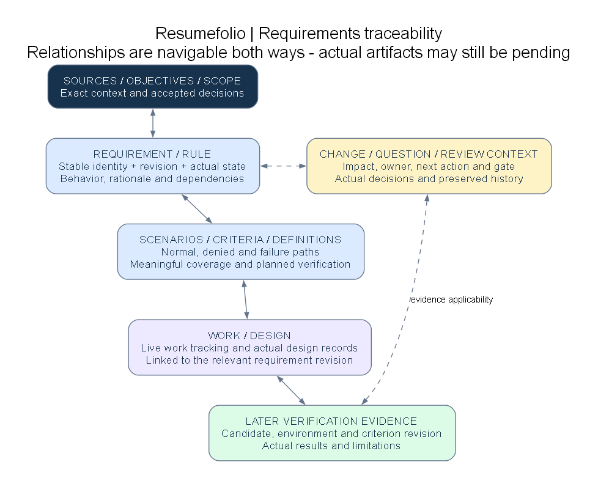
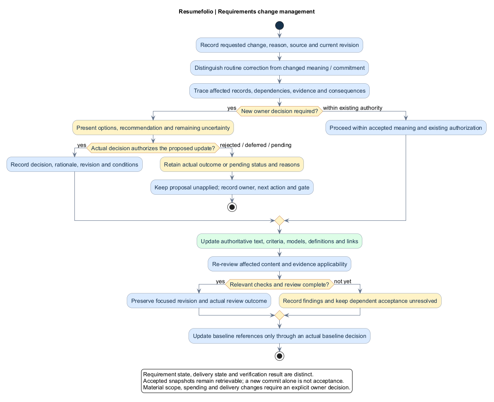

# Resumefolio — Requirements Management

| Item | Current position |
| --- | --- |
| Purpose | Maintain requirement identity, status, relationships and controlled change throughout the product life cycle |
| Responsible person / decision-maker | Farhad; sole delivery and operations owner |
| Document status | Proposed management method — ready for owner review |
| Identifier convention | Existing proposed families retained; final notation needs review before allocation |
| Baseline position | M-01 planning acceptance recorded under DEC-116; M-02 requirements acceptance pending |
| Revision | October 31, 2026 |

**At a glance:** Keep each requirement identifiable, sourced and connected to its
scenarios, criteria, work and evidence. Assess changes before changing commitments,
preserve earlier accepted revisions and record actual decisions. Management runs
through elicitation, analysis, specification, review, implementation and operation;
it is not a final administrative step.

**Read this document for:** identifier and status guidance, authoritative records,
traceability, change impact, baselines and recurring review. The linked registers
own actual records; this process document does not create a competing live tracker.

[Authority](#1-information-ownership-and-responsibilities) · [Identity](#2-identification-and-record-attributes)
· [Status](#3-status-and-revision-history) · [Traceability](#4-bidirectional-traceability-and-coverage)
· [Changes](#5-change-intake-and-impact-analysis) · [Workflow](#6-change-decision-and-update-workflow)
· [Baselines](#7-baselines-and-configuration-history) · [Routine](#8-ongoing-review-and-delivery-alignment)
· [Examples](#9-worked-management-examples) · [Readiness](#10-completion-checklist-and-current-position)
· [Diagrams](#11-diagram-maintenance)

Current MVP scope and selected mechanisms: [Baseline](../../../baseline/README.md). Deferred provider, advanced collaboration and workflow-execution designs are not MVP prerequisites.

## 1. Information Ownership and Responsibilities

Farhad currently performs writing, review, implementation follow-up and operations,
and makes material project decisions. Distinguish those activities without
inventing independent staff or approval bodies. Application roles such as platform
owner and administrator do not automatically define project decision authority.

| Information | Authoritative home | Management rule |
| --- | --- | --- |
| Required behavior, quality, criteria and actual requirement state | [Distributed SRS](../03-requirements-specification/requirements-specification.md) and its domain records | One primary record for each obligation; reference shared rules |
| Source material and actual elicitation records | [Elicitation Log](../02-stakeholders-and-elicitation/elicitation-log.md) | Retain exact locator, context, actual date and interpretation |
| Stories, use cases and scenarios | [Scenarios and Models](../04-scenarios-and-models/user-stories-and-scenarios.md) | Link to detailed requirements and preserve alternative/denied/failure paths |
| Terms and conceptual information meaning | [Glossary](../05-data-definitions/glossary.md) / [Data Dictionary](../05-data-definitions/data-dictionary.md) | Keep definitions and related models consistent |
| Cross-artifact relationships and coverage gaps | [Traceability Matrix](../06-validation-and-traceability/requirements-traceability.md) | Maintain meaningful links and explicit missing evidence |
| Actual review findings and dispositions | [Review Plan and Findings](../06-validation-and-traceability/review-plan-and-findings.md) | Identify inspected revision and actual evidence/recheck |
| Unresolved questions and material changes | [Open Questions](../07-change-and-baseline/open-questions-and-decisions.md) / [Change Control](../07-change-and-baseline/change-control.md) | Retain owner, action, gate, impacts and actual decision |
| Significant decision rationale | Affected authoritative source and [Planning Decision Register](../../01-project-planning/decision-register.md) where applicable | Preserve stable DEC references, scope, alternatives and replacement history |
| Live work state, priority, target dates and Sprint assignments | GitHub issues and delivery project, indexed by the [Product Backlog](../../../Project-Management/product-backlog.md) | Do not duplicate live state in local historical schedule tables |
| Requirements baseline outcome | [Requirements Review and Baseline Criteria](../07-change-and-baseline/requirements-review-and-baseline-criteria.md) | Actual owner decision against an identified revision |

The repository and Git preserve documentation/model history. GitHub supports
delivery tracking. Graphviz/PlantUML provide editable explanatory models. No paid
ALM tool, automatic synchronization or unattended monitoring is introduced here.

## 2. Identification and Record Attributes

### Proposed identifier families

The original proposal below is retained for review. It does not allocate records,
settle final numbering syntax or require every type to have a separate registry.
Inspect existing records before allocation; never collide with OBJ/SCP/DEC,
ASM/DEP/RSK/GAP, PBI or other established references.

| Proposed family | Intended record type |
| --- | --- |
| BIZ | Business requirement |
| UR | User requirement |
| FR | Functional requirement |
| NFR | Quality / non-functional requirement |
| DOM | Domain requirement |
| CON | Imposed constraint |
| IF | Interface requirement |
| BR | Business rule |
| SCN | Scenario |
| US | User story |

Use-case, acceptance-criterion, review-finding and change references also need
unambiguous locators as actual records are created; their final notation remains
to be settled consistently with the existing templates/registers. Dictionary
navigation keys and illustrative examples are not allocated requirement IDs.

### Identity and evolution rules

- Keep an identifier attached to its original meaning; do not renumber for display order or recycle a retired reference.
- Keep title, module, exact source, rationale, actor/context, obligation, criteria, status and revision identifiable through the [requirement template](../03-requirements-specification/requirements-specification.md).
- When a record is split, merged or replaced, preserve its source and history, identify successor/predecessor links and review affected traceability.
- A wording correction that preserves meaning need not create a new requirement ID; record material revisions and their rationale.
- A substantively revised proposal must remain distinguishable from the earlier accepted revision, even when the logical requirement keeps the same ID.
- Link actual decisions, dependencies, questions and future design/verification records rather than inventing references to make a template look complete.

Stable identity is different from version identity. The same requirement can have
several revisions; acceptance applies to the revision and scope actually reviewed.

## 3. Status and Revision History

The existing proposed states are explained below. The status model remains
proposed until reviewed; record real events only. A complete-looking draft or a
successful commit does not establish owner acceptance.

| Requirement state | Meaning | Record needed |
| --- | --- | --- |
| Proposed | Candidate need/obligation recorded for development | Source, rationale, current wording and known gaps |
| In review | Identified candidate is being assessed | Review scope/revision, findings and next action |
| Accepted | Actual owner decision accepts the stated revision within its limits | Decision-maker/date, revision, rationale and any legitimate conditions/follow-up |
| Rejected | Proposal was not accepted | Actual decision, reason and any alternative/reference |
| Superseded | Another identified record/revision replaces the former accepted meaning | Replacement link, reason, decision and preserved prior history |

Candidate refinement normally moves from Proposed to In review, then to an actual
Accepted or Rejected outcome; findings may return a candidate for revision.
Supersession needs an identified replacement and actual decision. These descriptions
do not move any current record or overwrite an earlier accepted snapshot.

Keep three kinds of progress separate:

| Progress dimension | What it answers | What it does not establish |
| --- | --- | --- |
| Requirement state | Was this expectation reviewed/accepted? | Whether implementation is complete |
| Delivery state | Is the linked work selected, active, blocked, in review or Done? | Whether the requirement itself was accepted or all its criteria have evidence |
| Verification result | What happened in a specific check on a specific candidate/environment? | Universal correctness, unrelated coverage or release approval |

Do not create an “Implemented” or “Passed” requirement state merely to mirror
delivery tracking. Link the actual work and verification records while retaining
requirement decision status and its revision.

## 4. Bidirectional Traceability and Coverage



[Scalable SVG](../diagrams/requirements-management-traceability.svg) ·
[Editable Graphviz](../diagrams/requirements-management-traceability.dot)

Blue groups requirements and supporting views; purple identifies delivery/design;
green identifies later evidence. Amber marks change/question/review context.
Two-headed arrows mean the relationship should be navigable both ways; they do
not imply equal cardinality, automatic synchronization or existing test results.

Maintain the chain **source / objective / scope ↔ requirement / rule ↔ scenario
and criterion ↔ work / design ↔ later verification evidence**. Not every relation
is one-to-one: a scenario may cover several requirements and a requirement may
need multiple criteria, work items or checks.

| Coverage question | Management action |
| --- | --- |
| Does each agreed scope area lead to requirement records or an explicit tracked gap? | Inspect source-to-requirement coverage; expose missing detail rather than inventing records |
| Does each requirement have a legitimate source and purpose? | Investigate unexplained scope or design prescriptions |
| Do relevant scenarios and criteria cover the behavior, including denial/failure/lifecycle paths? | Inspect the meaning of links, not just whether a cell is populated |
| Does each selected work item refer to the expectations it delivers? | Refine work packages and reconcile tracking at the agreed gate |
| Do design and later checks address the actual accepted revision? | Assess impact when requirements or implementation change |
| Are unverified criteria and missing artifacts visible? | Record evidence gaps; a planned method is not an executed result |
| Are retired/replaced records still referenced? | Preserve history and redirect current links deliberately to the appropriate successor |

Use the shared matrix as the relationship index. Check file/section links and
identifier uniqueness mechanically where useful, then inspect semantic coverage.
Do not claim a coverage percentage without defining the population, counting rule,
revision and limitations. No numerical coverage target is introduced here.

## 5. Change Intake and Impact Analysis

New evidence, scenario feedback, provider changes, feasibility findings, defects
or operational experience can trigger a change. Identify the request and reason
before editing an accepted expectation. Distinguish a question, a proposal and an
actual decision.

| Change situation | Handling |
| --- | --- |
| Routine spelling, formatting or broken navigation with no meaning change | Correct within existing authorization, inspect affected references and preserve a focused revision |
| Clarification or candidate refinement | Check consistency with accepted direction; retain source, rationale, actual status and related findings |
| Material behavior, criteria, permission, lifecycle or interface change | Assess impacts and obtain the actual required decision before treating the new meaning as accepted |
| Scope, spending or delivery commitment change | Explicit owner decision with alternatives and consequences; do not silently reduce scope or assume purchases |
| New evidence invalidates a prior assumption/design basis | Update affected investigation/risk records with actual evidence, then reassess dependent requirements and decisions |

Significant technical choices need documented reasoning even when they remain
within scope. Routine authorized corrections do not need repeated content approval.
System-required filesystem/execution permissions remain separate from content
approval under the existing working agreement.

### Impact checklist

For each material proposal, assess the affected:

- Sources, objectives, scope decisions and requirement/criterion revisions.
- Actors, resource permissions, privacy/security boundaries and sensitive operations.
- Ownership, live/shared/submitted information, synchronization, deletion and restoration rules.
- Interfaces, provider access, components, infrastructure limits and feasibility findings.
- Scenarios, glossary/dictionary, models, dependencies, design and existing implementation where present.
- Planned verification, actual evidence applicability, regression/recheck needs and operational guidance.
- Work packages, estimates, budget, recurring operations, milestone sequencing and delivery forecasts.

Record meaningful alternatives, uncertainty and remaining risk. An impact marked
Unknown is an investigation need; it is not zero cost or proof of compatibility.

## 6. Change Decision and Update Workflow



[Scalable SVG](../diagrams/requirements-management-change-cycle.svg) ·
[Editable PlantUML](../diagrams/requirements-management-change-cycle.puml)

Blue shows assessment/update work; amber shows proposals and unresolved decisions;
green shows an update within actual authority. The diagram changes no existing
requirement state, date, scope or baseline by itself.

1. **Record the request.** State what changes, why, its source and the affected current revision.
2. **Classify the effect.** Distinguish routine correction, candidate refinement and material commitment changes without hiding changed meaning behind an editorial label.
3. **Trace impact.** Follow source, rule, scenario, data, work, design and evidence links; identify dependencies, costs and unanswered questions.
4. **Recommend an outcome.** Present options, consequences and limits; do not record the recommendation as accepted.
5. **Record the actual decision where required.** Identify decision-maker/date/revision, selected option or rejection, and any specific deferral with owner/action/gate.
6. **Update authorized content.** Keep text, criteria, models, dictionary, traceability and linked work consistent; preserve replaced records and rationale.
7. **Re-review affected areas.** Check actual changes and evidence applicability; resolve findings before dependent acceptance.
8. **Preserve history.** Record a focused Git revision and update baseline references only through the actual baseline/change decision process.

Use [Requirements Change Control](../07-change-and-baseline/change-control.md) for
actual change records and [Open Questions](../07-change-and-baseline/open-questions-and-decisions.md)
for unresolved matters. A rejected proposal retains its rationale. A deferred
proposal remains unaccepted at its dependent gate; elapsed time or silence is
not consent. Accepted follow-up does not establish the underlying technical fact.

## 7. Baselines and Configuration History

A baseline identifies the exact reviewed set and actual acceptance decision.
Git history preserves file changes; it does not replace the decision's reason,
scope, evidence or owner authority. Record the candidate revision separately
from a later commit that stores the acceptance decision, avoiding self-referential
commit hashes.

| Baseline record | Information to preserve |
| --- | --- |
| Identity and scope | Milestone/baseline name, exact candidate revision and included requirement/document/model set |
| Review basis | Criteria, actual review findings/rechecks, supporting sources/evidence and known limits |
| Actual outcome | Decision-maker/date, accepted scope, conditions or required rework |
| Remaining matters | Resolved blockers versus legitimate specific deferrals, with owners/actions/gates |
| Later change | Revised/replacement record, reason, impact, decision and links to the preserved earlier snapshot |

Current planning acceptance remains [DEC-116](../../01-project-planning/10-planning-completion-criteria.md#dec-116)
for candidate `511093e788b32dd9b68fb86ff5fff2ac21140672`, with tracked GAP follow-up.
Later document improvements do not automatically replace that accepted planning
snapshot. M-02 uses the separate
[requirements baseline criteria](../07-change-and-baseline/requirements-review-and-baseline-criteria.md)
and remains pending.

Baseline acceptance allows controlled evolution; it does not freeze learning.
Keep proposed new wording distinguishable from accepted revisions and reconsider
affected evidence when meaning changes. Do not relabel historical assessments or
test results to make them appear to apply to a new revision.

Requirements acceptance is also separate from the wider initial SDLC documentation,
analysis/design, delivery-plan reconciliation and pre-implementation agreement
required before product coding. Release/deployment later require their own
readiness evidence and actual decisions.

## 8. Ongoing Review and Delivery Alignment

Use existing working-session and milestone/Sprint reviews rather than assuming a
new fixed meeting cadence or background automation. The owner performs feasible
solo maintenance of these records.

| Review point | Inspect and update |
| --- | --- |
| When selecting work | Accepted/candidate requirement revision, priority rationale, dependencies, criteria and unresolved gates |
| After elicitation or analysis | Sources, clarified meanings, duplicates/conflicts, affected terms and candidate status |
| After a requirement/model change | Traceability, shared rules, criteria, data definitions, related work/design and evidence applicability |
| After a review/recheck | Actual findings, decisions, corrected revision, remaining blockers and next action |
| After a feasibility/provider/resource finding | ASM/DEP/RSK/GAP evidence and affected requirement/design commitments |
| Before baseline or milestone assessment | Exact revision, agreed criteria, coverage, blockers and specific deferrals |
| During implementation and operation | Actual candidate/check results, defects, changed needs and guidance aligned to the relevant version |

The [Product Backlog](../../../Project-Management/product-backlog.md) and
[delivery plan](../../../Project-Management/version-1-delivery-plan.md) retain
provisional historical scheduling snapshots. Reconcile actual scope, dependencies,
effort and usable capacity after analysis/design before accepting a forecast or
starting product coding. November 8, 2026 remains a requested target, not a
validated forecast. This document does not change live GitHub assignments.

Useful status reporting names the reviewed revision, actual coverage/findings,
remaining blockers, decisions needed and next action. Task counts, link counts,
green builds and polished documents cannot substitute for those conclusions.

## 9. Worked Management Examples

These examples illustrate handling of existing scope. They allocate no requirement,
change or decision IDs and record no new owner acceptance.

### Example A: clarifying employer-link revocation

Existing [DEC-024](../../01-project-planning/02-scope.md#dec-024) includes password
changes and disabling a protected link, while detailed active-session behavior
needs specification. If elicitation proposes a session rule:

1. Retain the exact source and mark the new detail as proposed.
2. Link affected sharing, direct-file/PDF, scenario, permission and verification records.
3. Assess behavior for an open page, later request, download and password/link changes.
4. Resolve material choices through an actual owner decision; do not infer a session lifetime.
5. Update accepted wording and all affected views only within the recorded decision, retaining prior revision history.

Clarifying this detail does not require asking again whether protected sharing is
included in Version 1. It also does not prove that revocation has been implemented.

### Example B: proposed AI drafting

Product AI is excluded from Version 1 under
[DEC-016](../../01-project-planning/02-scope.md#dec-016). A new request for automatic
cover-letter drafting must therefore remain a separate scope-change proposal or
future idea. Record value, costs, privacy/integration/resource implications and
delivery effects before any material owner decision. Do not silently insert it
into a current requirement or treat a backlog entry as scope approval.

### Example C: a changed criterion after test execution

If an accepted criterion changes after a product test has actually been executed,
preserve that old result with its original criterion/candidate/environment.
Assess which checks and scenarios remain relevant and what needs revision or
re-execution. Record new evidence separately; do not transfer an earlier Pass
label to the new criterion without supporting assessment. This is a hypothetical
management example, not a claim that product tests have run.

## 10. Completion Checklist and Current Position

### For a managed requirement group or material change

- [ ] Record identities, exact sources, current revisions and actual states are clear.
- [ ] The identifier convention is reviewed before allocation; no IDs are reused or invented acceptance recorded.
- [ ] Requirements, rules, scenarios, criteria, data definitions and relevant work/evidence have meaningful links.
- [ ] Coverage gaps, unknowns and dependent gates are visible with owner/action.
- [ ] Material impact analysis includes behavior, permissions, lifecycle, interfaces, resources, costs and delivery effects.
- [ ] Actual decisions and specific deferrals are distinguishable from recommendations and pending proposals.
- [ ] Authorized updates preserve predecessor/successor relationships and earlier accepted snapshots.
- [ ] Affected text, diagrams, dictionary, traceability and linked work are consistent after re-review.
- [ ] Existing evidence is assessed for applicability to the changed revision; new results are not fabricated.
- [ ] Baseline records identify their exact scope/revision and actual owner decision.

| Item | Current position / next action |
| --- | --- |
| Management method | Expanded proposed draft ready for owner review |
| IDs and states | Existing proposed families/states retained; settle final notation before detailed allocation |
| Actual requirement/change records | Develop in the linked authoritative registers; no new records or transitions are allocated here |
| Traceability | Populate with real sources, records and later artifacts; empty future-evidence links remain gaps |
| Immediate next activity | Agree the practical notation, then manage a coherent sourced requirement group through drafting, review and linked follow-up |
| Baseline and coding | M-02 and wider pre-implementation agreement remain pending |

**Revision note — October 31, 2026:** Expanded the original outline with information
ownership, proposed identity/status conventions, traceability/coverage, impact
analysis, change workflow, baselines, recurring review and examples. Added two
diagrams. No new DEC/requirement IDs, requirement acceptance, live tracking change,
test result, replacement baseline or implementation is introduced.

## 11. Diagram Maintenance

| Diagram | Editable source | Scalable view | Preview |
| --- | --- | --- | --- |
| Traceability relationships | [Graphviz](../diagrams/requirements-management-traceability.dot) | [SVG](../diagrams/requirements-management-traceability.svg) | [PNG](../diagrams/requirements-management-traceability.png) |
| Change assessment and update cycle | [PlantUML](../diagrams/requirements-management-change-cycle.puml) | [SVG](../diagrams/requirements-management-change-cycle.svg) | [PNG](../diagrams/requirements-management-change-cycle.png) |

Keep sources, text, captions and rendered outputs synchronized. Colors supplement
labels/shapes. Inspect renders for readable labels and correct arrows, and verify
local file/section links after updates. Run from the repository root:

```powershell
$diagramFolder = 'docs\SDLC\02-requirements-engineering\diagrams'
$graphvizExe = 'C:\Program Files\Graphviz\bin\dot.exe'
$plantUmlJar = 'C:\Users\fvali\AppData\Local\Resumefolio\DiagramTools\plantuml.jar'

foreach ($format in 'svg', 'png') {
    & $graphvizExe "-T$format" -Gdpi=140 `
        "$diagramFolder\requirements-management-traceability.dot" `
        -o "$diagramFolder\requirements-management-traceability.$format"
    if ($LASTEXITCODE -ne 0) { throw "Graphviz failed: $format" }

    java '-Djava.awt.headless=true' -jar $plantUmlJar -charset UTF-8 "-t$format" `
        "$diagramFolder\requirements-management-change-cycle.puml"
    if ($LASTEXITCODE -ne 0) { throw "PlantUML failed: $format" }
}
```

Save sources as UTF-8 without BOM. Under another account, use the actual installed
JAR path. Retain source and SVG/PNG outputs in version control.

[Requirements Approach](01-requirements-approach.md) · [Verification and Validation](06-requirements-verification-and-validation.md)
· [Process index](README.md) · [Requirements index](../README.md)

## Course-Aligned Identity and Priority Clarification

Existing 157 local candidate identifiers are unique and remain stable references. They need not be discarded merely because a final global convention is undecided. Use the [proposed priority/readiness register](../03-requirements-specification/requirements-priority-and-readiness.md) for per-candidate scope-priority proposals and course SMART checks. Actual owner priorities remain unassigned. Supporting proposals and readable child use-case locators do not allocate new product requirements or change accepted scope.
