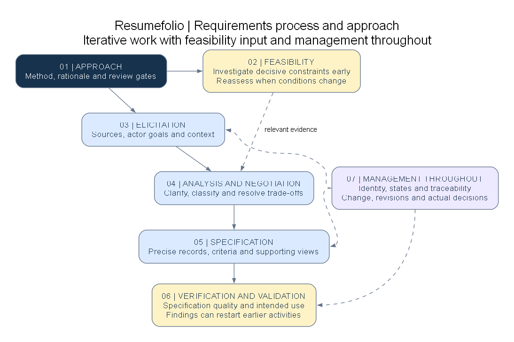

# Resumefolio — Requirements Process and Approach

## Current implementation baseline — November 4, 2026

[BL-MVP-2026-11-04.1](../../../baseline/README.md) selects the MVP technical mechanisms, numerical policies, priorities and requirement/criterion dispositions under Farhad’s explicit delegation. It supersedes earlier Proposed/pending mechanism and whole-baseline statements below for MVP design input. Future clauses and dated evidence remain separate. Runtime/actor validation, credentials, Git isolation, capacity and backup/restore still require the named implementation/Release gates; this update reports no product test Pass.

### Prior source material and rationale (superseded where this Baseline selects a different MVP choice)

| Item | Current position |
| --- | --- |
| Folder purpose | Explain how requirements are investigated, elicited, analyzed, specified, reviewed and maintained |
| Responsible person | Farhad; sole delivery and operations owner |
| Document coverage | Seven expanded process drafts with editable diagrams and rendered previews |
| Acceptance status | Process choices remain proposed; M-02 requirements baseline acceptance pending |
| Planning starting point | M-01 accepted with tracked follow-up under DEC-116 |
| Index revision | October 31, 2026 |

**Start with [01 — Requirements Approach](01-requirements-approach.md).** Read the
seven documents in order for a full understanding, or use the question-based route
below. These are working-method documents. Actual product requirements, source
records, findings and decisions have separate authoritative homes.

[Overview](#1-process-overview) · [Documents](#documents) · [Reading routes](#3-find-the-right-document)
· [Artifact locations](#4-where-actual-records-belong) · [Diagrams](#5-diagram-catalog)
· [Status and next work](#6-current-position-and-next-work) · [Maintenance](#7-maintaining-this-index)

## MVP requirement applicability and remaining review

Apply the current candidate release register: retain core presentation/sharing/manual applications/private files and basic ProjectForge; defer mail/calendar, advanced Git review/releases, advanced backlog/Sprints and YAML execution/deployment. Candidate IDs and planned verification stay intact. Mixed criteria must be scoped individually; allocation does not approve proposed numbers, priority or a complete baseline. Older 157-candidate/470-criterion evidence is historical larger-product coverage, not an MVP pass. Keep source, independent resume draft, explicit publication and actual submitted material identities distinct. Profile changes require preview/select/apply and cannot mutate publication or submitted history. Manual applications include status, next action and follow-up date without mail/calendar dependencies.

Authority: [OWNER-MVP-2026-11-04](../../01-project-planning/owner-mvp-decision-2026-11-04.md). [Candidate allocation](../03-requirements-specification/mvp-release-allocation.md).

## 1. Process Overview



[Scalable SVG](../diagrams/requirements-process-overview.svg) ·
[Editable Graphviz](../diagrams/requirements-process-overview.dot)

Blue shows development activities, amber shows feasibility/review and purple shows
management throughout. Solid arrows show the main working relationship; dashed
arrows show evidence input or continuing support. Review findings can restart
earlier activities. This is a process navigation map,
not a dated delivery plan, separate staffing model or completed requirements baseline.

Activities overlap and repeat. Feasibility findings can change the question being
asked; analysis can send unclear needs back to elicitation; review can return a
candidate for refinement. Requirements management maintains identity, links,
versions and actual decisions across every activity.

## Documents

| Order | Document | Main question | Useful output |
| --- | --- | --- | --- |
| 01 | [Requirements Approach](01-requirements-approach.md) | How will we combine the activities and respect review gates? | Method, rationale, responsibilities, working cycle and undated roadmap |
| 02 | [Feasibility Study](02-feasibility-study.md) | What evidence is needed to justify delivery and operation within actual constraints? | Assessment dimensions, prioritized investigations, evidence records and option/decision criteria |
| 03 | [Requirements Elicitation](03-requirements-elicitation.md) | Whose needs must be understood, using which sources and techniques? | Actor/question coverage, source handling, prompts, workflow and handoff guidance |
| 04 | [Analysis and Negotiation](04-analysis-and-negotiation.md) | Are needs clear, compatible, feasible and appropriately ordered? | Classification, decomposition, consistency/dependency checks and conflict-resolution method |
| 05 | [Specification Process](05-requirements-specification.md) | How do we write precise and assessable requirement records? | Record fields, writing guidance, criteria, planned verification and SRS organization |
| 06 | [Requirements Verification and Validation](06-requirements-verification-and-validation.md) | Are the requirements well formed and suitable for intended use? | Review checks/methods, actual evidence expectations, finding disposition, recheck and readiness rules |
| 07 | [Requirements Management](07-requirements-management.md) | How do identities, status, links, changes and baselines remain trustworthy? | Proposed identifier/state guidance, traceability, impact analysis and versioned decision practices |

The seven drafts explain the work and include preparation examples. They do not
claim completed investigations, interviews, requirement-group reviews, executed
product tests or new owner acceptance decisions.

## 3. Find the Right Document

| If you need to… | Start here | Continue with |
| --- | --- | --- |
| Understand the whole method | [01 — Approach](01-requirements-approach.md) | The seven-document reading order above |
| Investigate server, Google, email, recovery or CI/CD constraints | [02 — Feasibility](02-feasibility-study.md) | Related ASM/DEP/RSK/GAP and domain records |
| Clarify a real user goal or missing policy | [03 — Elicitation](03-requirements-elicitation.md) | [04 — Analysis](04-analysis-and-negotiation.md) |
| Resolve contradictory wording or competing needs | [04 — Analysis](04-analysis-and-negotiation.md) | [07 — Management](07-requirements-management.md) for actual material changes |
| Write a requirement and its acceptance criteria | [05 — Specification](05-requirements-specification.md) | [Requirement template](../templates/requirement-template.md) and the relevant domain file |
| Review a candidate or recheck a finding | [06 — Verification and Validation](06-requirements-verification-and-validation.md) | Shared findings register and baseline criteria |
| Change an accepted expectation or preserve a baseline | [07 — Management](07-requirements-management.md) | Shared change/question records and affected source decisions |

For a practical group: select a sourced goal, investigate decisive unknowns,
clarify/analyze it, write linked candidate records, then review them. Manage the
sources, states and changes throughout. Independent clarification can continue
while dependent commitments wait for their required findings.

## 4. Where Actual Records Belong

Use this folder to understand the method. Keep its products in the following
locations, with links rather than competing copies of authoritative content.

| Record | Authoritative location |
| --- | --- |
| Accepted product scope and significant planning decisions | [Planning Scope](../../01-project-planning/02-scope.md), [Decision Register](../../01-project-planning/decision-register.md) and their source sections |
| Sources and actual elicitation/extraction records | [Elicitation Log](../02-stakeholders-and-elicitation/elicitation-log.md) |
| Actors, goals and system context | [Actors and System Context](../02-stakeholders-and-elicitation/actors-and-system-context.md) |
| Business/user/domain requirements, criteria and detailed rules | [Distributed SRS](../03-requirements-specification/requirements-specification.md) and its linked domain documents |
| Use cases, stories, scenarios and related models | [Scenarios and Models](../04-scenarios-and-models/user-stories-and-scenarios.md) |
| Terminology and conceptual information meaning | [Data Definitions](../05-data-definitions/README.md) |
| Coverage links and actual review findings | [Traceability](../06-validation-and-traceability/requirements-traceability.md) / [Review Plan and Findings](../06-validation-and-traceability/review-plan-and-findings.md) |
| Open questions, material changes and actual requirements baseline outcome | [Questions](../07-change-and-baseline/open-questions-and-decisions.md), [Change Control](../07-change-and-baseline/change-control.md), [Baseline Criteria](../07-change-and-baseline/requirements-review-and-baseline-criteria.md) |
| Live delivery state, priority and assignments | GitHub issues and delivery project, indexed by the [Product Backlog](../../../Project-Management/product-backlog.md) |

Planned verification is distinct from actual execution evidence. Requirement
acceptance, delivery progress and verification results also have distinct meanings.
The references above preserve those distinctions while keeping related work connected.

## 5. Diagram Catalog

The catalog covers the **15 diagram sources supporting this process folder**:
one overview and two diagrams for each of the seven documents. Sources and renders
live in the shared `diagrams` folder. The wider phase has additional diagrams in
the [Requirements Diagram Index](../diagrams/README.md).

**PNG** provides a preview, **SVG** supports zooming, and **DOT/PlantUML** is the
editable source. Read diagrams with their document's captions and limitations.

| Document / diagram | Preview | Scalable | Editable source |
| --- | --- | --- | --- |
| This index — process overview | [PNG](../diagrams/requirements-process-overview.png) | [SVG](../diagrams/requirements-process-overview.svg) | [DOT](../diagrams/requirements-process-overview.dot) |
| 01 — working cycle | [PNG](../diagrams/requirements-approach-cycle.png) | [SVG](../diagrams/requirements-approach-cycle.svg) | [PlantUML](../diagrams/requirements-approach-cycle.puml) |
| 01 — roadmap and gates | [PNG](../diagrams/requirements-approach-roadmap.png) | [SVG](../diagrams/requirements-approach-roadmap.svg) | [DOT](../diagrams/requirements-approach-roadmap.dot) |
| 02 — assessment dimensions | [PNG](../diagrams/feasibility-assessment-map.png) | [SVG](../diagrams/feasibility-assessment-map.svg) | [DOT](../diagrams/feasibility-assessment-map.dot) |
| 02 — evidence to decision | [PNG](../diagrams/feasibility-review-flow.png) | [SVG](../diagrams/feasibility-review-flow.svg) | [PlantUML](../diagrams/feasibility-review-flow.puml) |
| 03 — source-to-handoff map | [PNG](../diagrams/elicitation-source-map.png) | [SVG](../diagrams/elicitation-source-map.svg) | [DOT](../diagrams/elicitation-source-map.dot) |
| 03 — elicitation cycle | [PNG](../diagrams/elicitation-working-cycle.png) | [SVG](../diagrams/elicitation-working-cycle.svg) | [PlantUML](../diagrams/elicitation-working-cycle.puml) |
| 04 — analysis map | [PNG](../diagrams/requirements-analysis-map.png) | [SVG](../diagrams/requirements-analysis-map.svg) | [DOT](../diagrams/requirements-analysis-map.dot) |
| 04 — negotiation flow | [PNG](../diagrams/requirements-negotiation-flow.png) | [SVG](../diagrams/requirements-negotiation-flow.svg) | [PlantUML](../diagrams/requirements-negotiation-flow.puml) |
| 05 — specification map | [PNG](../diagrams/requirements-specification-map.png) | [SVG](../diagrams/requirements-specification-map.svg) | [DOT](../diagrams/requirements-specification-map.dot) |
| 05 — specification cycle | [PNG](../diagrams/requirements-specification-cycle.png) | [SVG](../diagrams/requirements-specification-cycle.svg) | [PlantUML](../diagrams/requirements-specification-cycle.puml) |
| 06 — V&V perspectives | [PNG](../diagrams/requirements-vv-perspectives.png) | [SVG](../diagrams/requirements-vv-perspectives.svg) | [DOT](../diagrams/requirements-vv-perspectives.dot) |
| 06 — review/recheck cycle | [PNG](../diagrams/requirements-vv-review-cycle.png) | [SVG](../diagrams/requirements-vv-review-cycle.svg) | [PlantUML](../diagrams/requirements-vv-review-cycle.puml) |
| 07 — traceability | [PNG](../diagrams/requirements-management-traceability.png) | [SVG](../diagrams/requirements-management-traceability.svg) | [DOT](../diagrams/requirements-management-traceability.dot) |
| 07 — change cycle | [PNG](../diagrams/requirements-management-change-cycle.png) | [SVG](../diagrams/requirements-management-change-cycle.svg) | [PlantUML](../diagrams/requirements-management-change-cycle.puml) |

## 6. Current Position and Next Work

| Area | Current documented position |
| --- | --- |
| Process documents | Seven expanded drafts available; actual method acceptance remains to be recorded |
| Planning | Identified M-01 baseline accepted with tracked follow-up under [DEC-116](../../01-project-planning/10-planning-completion-criteria.md#dec-116) |
| Feasibility | Investigation plan available; technical/economic/operating/provider and schedule conclusions remain open |
| Detailed requirements | Candidate records, scenarios and criteria still need sourced development and review |
| IDs and states | Proposed conventions retained; final notation needs review before allocation |
| Reviews and M-02 | Actual requirement-group review evidence and baseline acceptance remain pending |
| Delivery dates | Historical schedule snapshots remain provisional; the requested November 8, 2026 target is not a validated forecast |

**Next practical work:** Review the proposed process choices, settle the practical
record notation, then develop a coherent sourced requirement group while pursuing
decisive feasibility investigations. Write real records and criteria, perform
actual reviews, and preserve questions/decisions at their relevant gates.

Preserve the current MVP scope and separately deferred manual communications,
Kanban, real Git hosting and conditional YAML/CI/CD execution. Product AI,
automatic translation and automatic demo migration remain excluded. Numerical
quality/capacity/recovery promises require evidence and review.

Complete the agreed initial SDLC documentation, analysis/design and delivery-plan
reconciliation, then reach the pre-implementation baseline before product coding.
Planning-only acceptance and process-document completion do not satisfy that gate.

## 7. Maintaining This Index

| Change | Keep consistent |
| --- | --- |
| Rename or move a document | Reading table, routes, incoming links and section references |
| Revise a process | Its text, diagram sources/renders, captions, status and related process guidance |
| Add or retire a diagram | This catalog, the shared diagram index and source/render files |
| Record an actual decision or review | Authoritative record first, then summarize here with the correct revision and limits |
| Change a requirement or baseline | Follow management/change control; do not silently replace accepted history |

Regeneration commands for each document's diagrams are included in that document.
For this overview, run from the repository root in PowerShell:

```powershell
$diagramFolder = 'docs\SDLC\02-requirements-engineering\diagrams'
$graphvizExe = 'C:\Program Files\Graphviz\bin\dot.exe'
foreach ($format in 'svg', 'png') {
    & $graphvizExe "-T$format" -Gdpi=140 `
        "$diagramFolder\requirements-process-overview.dot" `
        -o "$diagramFolder\requirements-process-overview.$format"
    if ($LASTEXITCODE -ne 0) { throw "Graphviz failed: $format" }
}
```

Retain UTF-8 editable sources and SVG/PNG outputs together in version control.
Inspect rendered labels/arrows and verify file/section links after edits. Labels
carry meaning as well as color. Keep secrets and private operational data out of
repository examples and evidence.

**Revision note — October 31, 2026:** Consolidated accumulated navigation paragraphs
into document and question-based routes, added actual-record locations, a complete
process diagram catalog and a new overview. No scope decision, live tracking
assignment, method acceptance, requirements baseline or product test result changed.

[Requirements Engineering index](../README.md) · [Planning index](../../01-project-planning/README.md)
