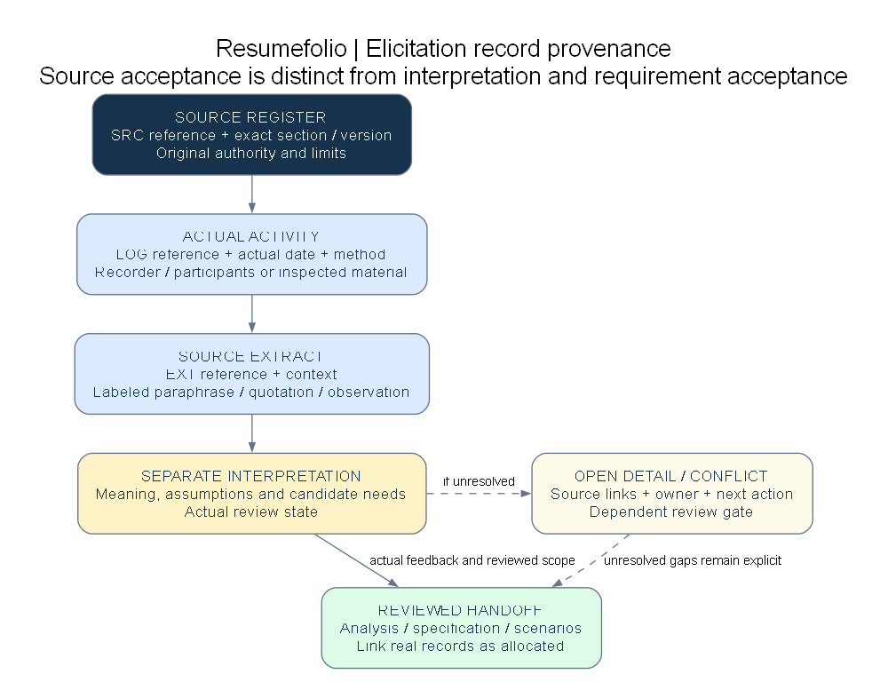
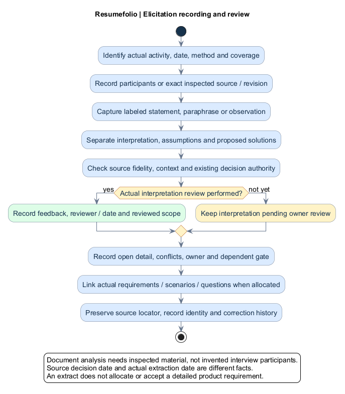

# Resumefolio — Elicitation Log

| Item | Current position |
| --- | --- |
| Purpose | Preserve source provenance, actual elicitation activities, extracted needs and review follow-up |
| Responsible person | Farhad; current document extraction prepared by Codex |
| Document status | Working register — extracted interpretations pending owner review |
| Recorded activity | Original document-analysis activity with three extracts, plus LOG-002 recording owner-supplied operational observations; no new interview, workshop or independently executed server inspection claimed |
| Baseline boundary | Source decision acceptance does not automatically accept an extracted detailed requirement |
| Revision | October 31, 2026 |

**At a glance:** Start from the source register, inspect the actual activity record,
then follow each extract to its source, interpretation and unresolved detail.
Separate what a source states, what the recorder infers and what the owner has
actually accepted. Planned activities and illustrative examples are not performed
sessions.

[Source register](#source-register) · [Provenance](#1-record-relationships-and-identity)
· [Activity register](#elicitation-sessions-and-extraction-records) · [Extracts](#3-extracted-needs-and-open-detail)
· [Review/follow-up](#4-review-and-follow-up) · [Recording guide](#5-recording-new-activities)
· [Quality](#6-quality-and-maintenance-checklist) · [Diagrams](#7-diagram-maintenance)

## MVP requirement applicability and remaining review

Apply the current candidate release register: retain core presentation/sharing/manual applications/private files and basic ProjectForge; defer mail/calendar, advanced Git review/releases, advanced backlog/Sprints and YAML execution/deployment. Candidate IDs and planned verification stay intact. Mixed criteria must be scoped individually; allocation does not approve proposed numbers, priority or a complete baseline. Older 157-candidate/470-criterion evidence is historical larger-product coverage, not an MVP pass. Keep source, independent resume draft, explicit publication and actual submitted material identities distinct. Profile changes require preview/select/apply and cannot mutate publication or submitted history. Manual applications include status, next action and follow-up date without mail/calendar dependencies.

Authority: [OWNER-MVP-2026-11-04](../../01-project-planning/owner-mvp-decision-2026-11-04.md). [Candidate allocation](../03-requirements-specification/mvp-release-allocation.md).

## Source register

These source references identify existing material for document analysis; they
do not claim that a new interview or validation session has occurred. SRC labels
are local navigation references, not requirement or acceptance identifiers.

| Source reference | Material and locator | Authority and use | Date / limitations |
| --- | --- | --- | --- |
| SRC-01 | [Purpose and Objectives](../../01-project-planning/01-purpose-and-objectives.md), OBJ-01 through OBJ-05 / DEC-001 through DEC-008 | Source of business outcomes and rationale | Accepted planning direction October 29, 2026; current presentation is a later revision |
| SRC-02 | [Version 1 Scope](../../01-project-planning/02-scope.md), DEC-009 through DEC-028 | Source of inclusions, exclusions, boundaries and unresolved feature detail | Decisions October 29–30, 2026; detailed behavior is not fully specified |
| SRC-03 | [Stakeholders and Responsibilities](../../01-project-planning/03-stakeholders-and-responsibilities.md), DEC-029 through DEC-032 | Source of actor groups, solo ownership and working agreement | Decisions October 30, 2026; not a complete permission matrix |
| SRC-04 | [Planning Decision Register](../../01-project-planning/decision-register.md) and [planning acceptance](../../01-project-planning/10-planning-completion-criteria.md#dec-116) | Locate exact source decisions, accepted snapshot and GAP-D01–GAP-D11 gates | DEC-116 records October 31, 2026 acceptance of candidate 511093e; later edits are not automatically rebaselined |
| SRC-05 | Earlier project chats: Conversation 1–5 and 1 - SE Analysis - Project Planning | Recover raw needs and rationale where the authoritative documents lack detail | For each extracted statement record the exact chat/turn locator and actual date when retrieved; not every historical suggestion is an accepted current requirement |
| SRC-06 | MultiResume Manager, Git Hosting Platform, OmniDesk and KanbanFlow reference projects, under [DEC-011](../../01-project-planning/02-scope.md#dec-011) | Compare observed workflows and prior implementation experience | Record exact repository/file/revision when used; preserve these projects and distinguish observed behavior from proposals |

For each derived requirement, retain the precise source section, decision or
chat turn, the interpretation, and any conflict with current scope. Record the
revision/date actually inspected. Resolve conflicting or superseded statements
through [Open Questions and Decisions](../07-change-and-baseline/open-questions-and-decisions.md)
before treating them as an accepted requirement. Public standards can guide the
method; they do not supply Resumefolio-specific product decisions.

SRC-05/SRC-06 are discovery pointers until an extraction records the precise
chat turn or repository/file/revision. Their inclusion is not evidence that all
historic chats or reference code have been reviewed in this activity.

## 1. Record Relationships and Identity



[Scalable SVG](../diagrams/elicitation-log-provenance.svg) ·
[Editable Graphviz](../diagrams/elicitation-log-provenance.dot)

Blue represents source/activity/extract records, amber represents interpretation
and questions, and green identifies the later reviewed handoff. Arrows express
provenance and follow-up, not automatic acceptance or implementation.

| Record | Meaning | Identity convention in this register |
| --- | --- | --- |
| Source | Existing material or evidence location | Preserve SRC-01–SRC-06; add precise section/version when used |
| Activity | One actual session or bounded document-analysis activity | LOG-001 is allocated below to the activity performed for this revision |
| Extract | One sourced paraphrase/observation with separate interpretation | EXT-001–EXT-003 are allocated below; these are log references, not product requirement IDs |
| Question / candidate requirement / finding | Downstream record developed from evidence | Link actual records when allocated; do not invent IDs or acceptance to fill the table |

Keep these log identifiers stable and do not reuse them. Preserve original
sources, wording context and actual dates when correcting an entry. Requirement
notation remains governed by the proposed
[Requirements Management](../01-process-and-approach/07-requirements-management.md)
convention and must be reviewed before product requirement allocation.

## Elicitation sessions and extraction records

The following activity is actual **document analysis performed for this revision**.
It is not a retrospective claim that an interview took place on a source decision's
acceptance date. Source decisions retain their original authority; interpretations
and detailed follow-up remain pending.

**Activity:** [LOG-001](#log-001-scope-decision-extraction)

**Actual date / recorder:** October 31, 2026, Europe/Berlin; Codex document analysis; no interview participants

**Method and rationale:** Inspect accepted scope wording to initialize a usable source-to-need register without inventing new policy

**Inspected material:** SRC-02, DEC-024, DEC-023 and DEC-028 in the current Scope working copy

**Output / review state:** EXT-001–EXT-003 recorded; source paraphrases checked against inspected sections; interpretations not owner-reviewed

### LOG-001: Scope Decision Extraction

| Field | Actual record |
| --- | --- |
| Goal | Extract three existing planning boundaries and identify the detailed questions still needed for requirements |
| Source file | [Version 1 Scope](../../01-project-planning/02-scope.md) |
| Exact inspected sections | [DEC-024](../../01-project-planning/02-scope.md#dec-024), [DEC-023](../../01-project-planning/02-scope.md#dec-023), [DEC-028](../../01-project-planning/02-scope.md#dec-028) |
| Inspected revision locator | Current working-copy SHA-256 recorded below; no committed source revision was verified in this activity |
| Recorder / participants | Codex performed document analysis; no new human interview, workshop, observation or survey participation is recorded |
| Actual method | Read the three decision sections and compare their stated boundaries, limitations and remaining detail with the extracted paraphrases |
| Coverage | Protected sharing, manual application/submission history and resource-specific permissions only |
| Limits | No provider/server checks, product execution, complete scope extraction, exhaustive chat review or stakeholder validation |
| Review outcome | Documentary paraphrases checked; interpretations and detailed follow-up pending owner review |

Inspected Scope working-copy SHA-256:

`33b218141cef0799afe61adc098b7c42e6eb3ee9b1826c1b3d03f926b332dd82`

The hash identifies the bytes inspected for LOG-001. It is a historical locator,
not a promise that future working copies retain that hash or a replacement for the
accepted planning candidate. Preserve the recorded hash if the source later changes.

## 3. Extracted Needs and Open Detail

All three source statements below are **paraphrases**, not direct quotations or
new stakeholder answers. Their source decisions are already accepted for scope
inclusion. The separate interpretations are inputs to requirements analysis;
they do not approve detailed policies or allocate requirements.

### EXT-001: Controlled Employer Access

**Field:** Activity / exact source

**Recorded content:** LOG-001; SRC-02 / [DEC-024](../../01-project-planning/02-scope.md#dec-024)

**Field:** Source paraphrase

**Recorded content:** Provide password-protected access to the tailored resume and selected content without requiring an employer account. The owner can change the password or disable the link. Shared files/PDFs follow the same access boundary; unrelated private resources remain outside it. Previously downloaded copies are not revoked.

**Field:** Context and rationale

**Recorded content:** Straightforward employer viewing with deliberate control over professional information disclosure

**Field:** Interpretation for analysis

**Recorded content:** Develop linked rules/scenarios for viewer access, selected content, denied access, direct file retrieval and owner revocation actions

**Field:** Explicitly unresolved

**Recorded content:** Password-change effects, active-session revocation and link lifecycle require detailed specification; retry/feedback and related acceptance details also need clarification

**Field:** Intended record homes

**Recorded content:** [PDF and Controlled Sharing](../03-requirements-specification/pdf-and-controlled-sharing.md), [Accounts/Permissions](../03-requirements-specification/accounts-authentication-and-permissions.md), [Scenarios](../04-scenarios-and-models/user-stories-and-scenarios.md)

**Field:** Review / next action

**Recorded content:** Interpretation pending owner review; project owner coordinates clarification before accepting affected sharing/permission requirements

**Field:** Requirement / question IDs

**Recorded content:** Not allocated; link actual records when created

### EXT-002: Manual Applications and Preserved Submissions

**Field:** Activity / exact source

**Recorded content:** LOG-001; SRC-02 / [DEC-023](../../01-project-planning/02-scope.md#dec-023)

**Field:** Source paraphrase

**Recorded content:** Users record company/position, associate a resume, write the cover letter manually and track application progress. Preserve the resume and cover letter actually submitted so later source edits do not overwrite that history. Product AI is outside Version 1; recording submission does not establish automatic external submission.

**Field:** Context and rationale

**Recorded content:** A traceable application history while preparation and decisions remain user-directed

**Field:** Interpretation for analysis

**Recorded content:** Distinguish editable/live material from submitted copies; define capture and progress workflows with related data/lifecycle criteria

**Field:** Explicitly unresolved

**Recorded content:** Detailed fields, status transitions, submission recording and archive behavior remain to be specified; allowed statuses are not finalized by the examples in the scope decision

**Field:** Intended record homes

**Recorded content:** [Manual Applications](../03-requirements-specification/manual-application-management.md), [Business Rules/Lifecycle](../03-requirements-specification/business-rules-and-data-lifecycle.md), [Data Dictionary](../05-data-definitions/data-dictionary.md)

**Field:** Review / next action

**Recorded content:** Interpretation pending owner review; project owner coordinates clarification before accepting affected application/lifecycle requirements

**Field:** Requirement / question IDs

**Recorded content:** Not allocated; link actual records when created

### EXT-003: Unified Sign-in and Resource Permissions

**Field:** Activity / exact source

**Recorded content:** LOG-001; SRC-02 / [DEC-028](../../01-project-planning/02-scope.md#dec-028)

**Field:** Source paraphrase

**Recorded content:** Include individual accounts, roles, resource/operation permissions and unified sign-in across authorized sections. A collaborator invited to a Kanban board must not gain access to the owner's private email or resumes through that invitation.

**Field:** Context and rationale

**Recorded content:** Identifiable private workflows with controlled access and less repeated authentication

**Field:** Interpretation for analysis

**Recorded content:** Define explicit actor/resource/action/state rules and scenarios that separate successful sign-in from authority over each resource

**Field:** Explicitly unresolved

**Recorded content:** Detailed role rules, account lifecycle, authentication flows and acceptance criteria remain to be defined; no complete role hierarchy is inferred

**Field:** Intended record homes

**Recorded content:** [Accounts/Permissions](../03-requirements-specification/accounts-authentication-and-permissions.md), [Actors and Context](actors-and-system-context.md), [Scenarios](../04-scenarios-and-models/user-stories-and-scenarios.md)

**Field:** Review / next action

**Recorded content:** Interpretation pending owner review; project owner coordinates clarification before accepting affected identity/collaboration requirements

**Field:** Requirement / question IDs

**Recorded content:** Not allocated; link actual records when created

## 4. Review and Follow-up

Review the interpretation and genuine missing detail, not whether these three
capabilities belong in Version 1; their accepted scope decisions already answer
that question. Keep actual feedback distinct from the recorder's recommendation.

| Record | Checked in LOG-001 | Still needed |
| --- | --- | --- |
| EXT-001 | Source inclusion, disclosure boundary, direct file protection and explicitly open revocation/lifecycle detail | Owner review of interpretation, detailed policies, scenarios and criteria |
| EXT-002 | Manual workflow, preserved submitted materials and limits on AI/automatic submission claims | Owner review of interpretation, detailed capture/progress/lifecycle records |
| EXT-003 | Individual account/unified sign-in direction and resource-specific access boundary | Owner review of interpretation, complete permission/account/authentication records |

No contradiction between these selected source sections was identified in this
bounded extraction. That statement is not an exhaustive consistency review of
the project. None of these extracts proves technical feasibility, a working
permission check or successful stakeholder validation.

Route material questions to [Open Questions and Decisions](../07-change-and-baseline/open-questions-and-decisions.md)
and actual requirement review findings to
[Review Plan and Findings](../06-validation-and-traceability/review-plan-and-findings.md).
Maintain source/extract-to-requirement links in
[Traceability](../06-validation-and-traceability/requirements-traceability.md)
as actual records are allocated. Do not record these proposed follow-ups as
completed actions or accepted detailed requirements.

## 5. Recording New Activities



[Scalable SVG](../diagrams/elicitation-log-recording-cycle.svg) ·
[Editable PlantUML](../diagrams/elicitation-log-recording-cycle.puml)

Record only work that actually occurred. Blue identifies capture/provenance;
amber identifies questions and pending review; green identifies a reviewed
interpretation. Neither color nor table completion establishes requirement acceptance.

### Activity record fields

| Field | What to record |
| --- | --- |
| Activity identity / actual date | Stable local reference and date of the activity; distinguish it from the source's original decision date |
| Method and purpose | Document analysis, interview, observation, prototype feedback or another justified technique; actual question/coverage |
| Participants or inspected material | Real roles/contributions for sessions; exact document/file/turn/version for source analysis |
| Provenance | Source references and sufficient locator: section/anchor, chat turn, repository revision or working-copy hash as appropriate |
| Raw statement or observation | Label direct quotation, paraphrase or observation; preserve relevant context and evidence limits |
| Interpretation and candidate links | Separate explanation, assumptions and solution suggestions; link actual requirement/scenario records when created |
| Feedback and outcome | Actual reviewer/participant feedback, date and reviewed revision; pending where review has not occurred |
| Follow-up | Unresolved question/conflict, responsible person, next action and dependent gate |

### Blank activity template — not an actual session

- Activity reference and actual date:
- Method, rationale, goal and coverage:
- Recorder and actual participants / inspected material:
- Exact source/version locator:
- Raw statement/observation and representation type:
- Separate interpretation, assumptions and solution suggestions:
- Actual review feedback/outcome, date and revision:
- Linked extracts, requirements, scenarios and questions when allocated:
- Remaining gaps, owner, next action and review gate:

Use fictional or sanitized examples. Do not copy real private emails, application
documents, passwords, access tokens or sensitive server output into the register.
Obtain appropriate permission before recording people or accessing private
workflows. Public-source method guidance is not a new product requirement.

## 6. Quality and Maintenance Checklist

- [ ] Every actual activity has a truthful date, method, purpose and recorder/participant or source context.
- [ ] Source references resolve to the precise inspected section/version, not only a broad repository/chat name.
- [ ] Source paraphrase/quotation, observation, interpretation and accepted decision are distinguishable.
- [ ] Source authority and supersession have been checked before relying on a historical statement.
- [ ] Open details, conflicting sources and missing perspectives have an owner, action and dependent gate.
- [ ] Review outcomes are based on actual feedback/evidence; unreviewed interpretations stay pending.
- [ ] Requirement/scenario/question links name real allocated records, or their absence is explicit.
- [ ] Corrections preserve previous evidence, source locators and reasons; IDs are not reused.
- [ ] Records exclude unnecessary private data and secrets.

Review the register when sources change or analysis exposes a gap. Preserve the
historic source locator; add a new extraction/review record rather than silently
claiming an old observation was made against new content. Scope, acceptance and
material changes follow the existing decision/change process.

**Current review state:** LOG-001 is a performed document-analysis record; its
three paraphrases were checked against the inspected source. Detailed
interpretations await owner review. No interviews or product tests are recorded.

**Revision note — October 31, 2026:** Preserved SRC-01–SRC-06, organized recording
guidance and added LOG-001 / EXT-001–EXT-003 from actual inspection of DEC-024,
DEC-023 and DEC-028. Added provenance and recording-cycle diagrams. No new scope,
requirement acceptance or fictional stakeholder session is introduced.

## 7. Diagram Maintenance

| Diagram | Editable source | Scalable view | Preview |
| --- | --- | --- | --- |
| Source/activity/extract provenance | [Graphviz](../diagrams/elicitation-log-provenance.dot) | [SVG](../diagrams/elicitation-log-provenance.svg) | [PNG](../diagrams/elicitation-log-provenance.png) |
| Recording and review cycle | [PlantUML](../diagrams/elicitation-log-recording-cycle.puml) | [SVG](../diagrams/elicitation-log-recording-cycle.svg) | [PNG](../diagrams/elicitation-log-recording-cycle.png) |

Keep diagrams, captions and records consistent. Colors supplement labels/shapes.
Inspect rendered labels/arrows and verify file/section links after changes. Run
from the repository root:

```powershell
$diagramFolder = 'docs\SDLC\02-requirements-engineering\diagrams'
$graphvizExe = 'C:\Program Files\Graphviz\bin\dot.exe'
$plantUmlJar = 'C:\Users\fvali\AppData\Local\Resumefolio\DiagramTools\plantuml.jar'

foreach ($format in 'svg', 'png') {
    & $graphvizExe "-T$format" -Gdpi=140 `
        "$diagramFolder\elicitation-log-provenance.dot" `
        -o "$diagramFolder\elicitation-log-provenance.$format"
    if ($LASTEXITCODE -ne 0) { throw "Graphviz failed: $format" }
    java '-Djava.awt.headless=true' -jar $plantUmlJar -charset UTF-8 "-t$format" `
        "$diagramFolder\elicitation-log-recording-cycle.puml"
    if ($LASTEXITCODE -ne 0) { throw "PlantUML failed: $format" }
}
```

Save sources as UTF-8 without BOM. Under another account, use the actual installed
JAR path. Retain source and SVG/PNG outputs in version control.

[Stakeholders and Elicitation index](README.md) · [Technique Plan](elicitation-plan-and-techniques.md)
· [Elicitation Process](../01-process-and-approach/03-requirements-elicitation.md)
· [Requirements index](../README.md)

<a id="log-002-owner-supplied-server-observation-record"></a>
## LOG-002 — Owner-supplied Server Observation Record

Recorded November 1, 2026 by Codex after the owner's instruction to fix the infrastructure-related documentation. Source: panel screenshots and SSH command output supplied by the owner in this conversation, including `free -h`, `df -h /`, running-service enumeration, Nginx domain/root directives and discovery of `artisan`. This is extraction of supplied operational evidence, not a fresh SSH connection or invented stakeholder interview.

The [feasibility observation](../01-process-and-approach/02-feasibility-study.md#server-observation-2026-11-01) owns interpretation and remaining work; [sanitized evidence](../06-validation-and-traceability/evidence/server-observation-2026-11-01.json) records selected observed quantities. Scope: resource allocation, guest OS, low-load memory/disk and observed web stack/deployment only. No capacity, application-health, provider-access, backup/restore or security-audit conclusion is established. Linked work: DEP-01/ASM-01, Q-D24–Q-D27, QSR-D01/D02/D10–D12 and GAP-D01/D04/D07/D08/D10. No new numerical target or baseline decision is recorded.

<a id="log-003"></a>
## LOG-003 — Request to Complete Question Answers and Bounded Investigation

Date: November 1, 2026. Source: the owner instructed “fix them and complete them” after discussion of remaining requirements questions. Codex drafted concrete proposals and performed authorized read-only SSH inspection plus official-source research. No new stakeholder interview or owner acceptance of the individual policy/number proposals is claimed. Output: [answer package](../07-change-and-baseline/requirements-answer-review.md), source answers, planned checks and [fresh observations](../06-validation-and-traceability/evidence/server-readonly-check-2026-11-01.json). Existing LOG-001/LOG-002 remain historical source activities.

## LOG-004 — Capacity Answer and Follow-up Observation

Date: November 1, 2026. The owner answered **20 hours/week** to the question explicitly including learning, documentation and testing. This is an actual capacity answer, not a guessed full-time estimate. Codex also completed bounded read-only operating queries and official-source research; [RV-D06](../06-validation-and-traceability/remaining-gate-assessment.md) records method/results/limits. Questions about intended Google OAuth project/audience and independent backup storage were submitted but had no answer at preparation time. No interview, owner policy acceptance or external integration/restore result is invented.

## LOG-005 — Actual OAuth Status Answer

November 1, 2026. Source: the owner replied “I have not created OAuth” after the explicit question about an existing OAuth project. Record: no intended OAuth project has been created; no client ID/secret was supplied. Outcome: existence input answered; setup/audience/provider access and controlled checks remain Q-D15 work. [Question register](../07-change-and-baseline/open-questions-and-decisions.md#q-d15) and the primary Google specification were synchronized. No stakeholder acceptance of the proposed scope/audience or actual external setup is inferred.

## LOG-006 — Actual Backup Setup Answer

November 1, 2026. Source: owner stated “No, I haven’t set up backups.” Outcome: existing backup-setup input answered; independent destination/suitability, coverage, keys, schedule and tested restoration remain Q-D26/DEP-05/GAP-D04 work. No service was selected or purchased, no backup created, no restore performed and no provider backup settings independently inspected. The latest OAuth and weekly-capacity answers remain recorded separately; no repeated request for these known facts is needed.
