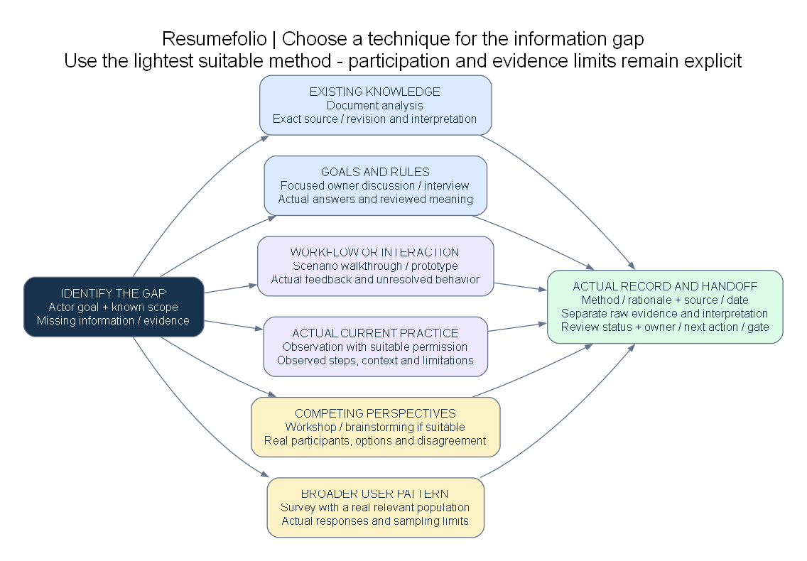
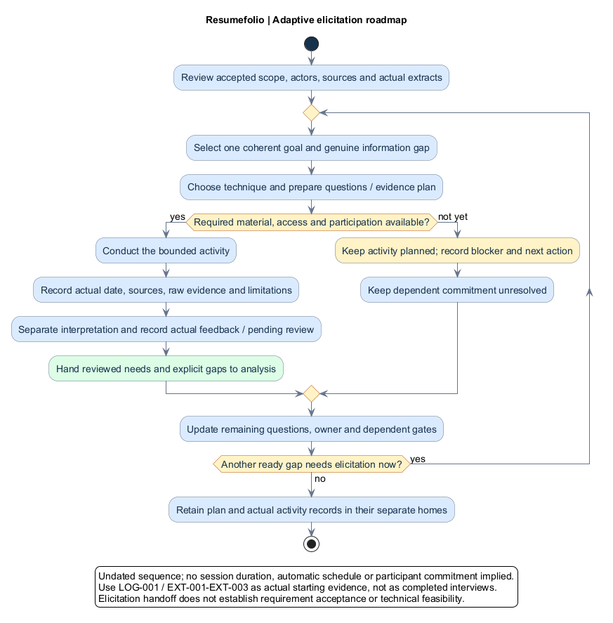

# Resumefolio — Elicitation Plan and Techniques

| Item | Current position |
| --- | --- |
| Purpose | Plan focused elicitation activities and choose techniques that resolve specific uncertainties |
| Responsible person | Farhad; sole delivery and operations owner |
| Document status | Proposed work plan and technique guide — pending owner review |
| Existing evidence | LOG-001 contains actual document analysis and EXT-001–EXT-003; their interpretations await owner review |
| Planned participation | Owner discussions first; other participants only when available and relevant; no new sessions scheduled or performed here |
| Revision | October 31, 2026 |

**At a glance:** Reuse accepted scope and existing sources before asking new
questions. Select one coherent actor goal, identify the genuine information gap,
choose the lightest suitable technique and prepare a bounded activity. Record what
actually happens, separate interpretation from source evidence and hand the result
to analysis/specification with unresolved questions clearly assigned.

**Read this document for:** planned coverage, technique selection, preparation,
question groups and readiness criteria. The [Elicitation Process](../01-process-and-approach/03-requirements-elicitation.md)
explains the overall method; the [Elicitation Log](elicitation-log.md) owns actual
activity/extract records. A planned activity below is not a performed session.

[Basis](#1-planning-basis-and-boundaries) · [Work plan](#2-proposed-elicitation-work-plan)
· [Techniques](#technique-selection) · [Preparation](#4-activity-preparation-and-conduct)
· [Questions](#5-focused-question-groups) · [Sequence](#6-adaptive-sequence-and-handoff)
· [Review](#7-readiness-completion-and-follow-up) · [Status](#8-current-position-and-maintenance)
· [Diagrams](#9-diagram-maintenance)

## MVP requirement applicability and remaining review

Apply the current candidate release register: retain core presentation/sharing/manual applications/private files and basic ProjectForge; defer mail/calendar, advanced Git review/releases, advanced backlog/Sprints and YAML execution/deployment. Candidate IDs and planned verification stay intact. Mixed criteria must be scoped individually; allocation does not approve proposed numbers, priority or a complete baseline. Older 157-candidate/470-criterion evidence is historical larger-product coverage, not an MVP pass. Keep source, independent resume draft, explicit publication and actual submitted material identities distinct. Profile changes require preview/select/apply and cannot mutate publication or submitted history. Manual applications include status, next action and follow-up date without mail/calendar dependencies.

Authority: [OWNER-MVP-2026-11-04](../../01-project-planning/owner-mvp-decision-2026-11-04.md). [Candidate allocation](../03-requirements-specification/mvp-release-allocation.md).

## 1. Planning Basis and Boundaries

Use the [Scope](../../01-project-planning/02-scope.md),
[Objectives](../../01-project-planning/01-purpose-and-objectives.md),
[Actors and Context](actors-and-system-context.md), source register and existing
ASM/DEP/RSK/GAP follow-up as inputs. Sources identify accepted direction and
remaining uncertainty; they do not prove technical feasibility or complete user
research.

| Planning rule | Application |
| --- | --- |
| Reuse existing decisions | Ask about missing detail and material choices, not repeatedly whether an accepted capability belongs in Version 1 |
| Keep agreed scope visible | Cover professional presentation/sharing, manual applications, communication/calendar, work management, real Git/conditional CI/CD and administration/operations |
| Preserve exclusions | Product AI, automatic translation and automatic demo migration remain outside Version 1; manual English/German content remains included |
| Reflect actual staffing | Farhad coordinates the work alone; stakeholder roles are not a separate delivery team |
| Investigate decisive constraints early | Provider, server, email, recovery and isolation evidence feed dependent requirements/design at their assigned gates |
| Avoid assumed dates or capacity | No session duration, participant availability, delivery forecast or numerical workload is invented by this plan |

The first documentary evidence is [LOG-001](elicitation-log.md#log-001-scope-decision-extraction).
It records an actual inspection of scope decisions DEC-024, DEC-023 and DEC-028,
with a source hash and three paraphrased extracts. It does not record interviews
or owner acceptance of the detailed interpretations. Start follow-up from those
real records rather than recapturing their accepted scope boundaries.

## 2. Proposed Elicitation Work Plan

The topics below are **planned coverage**, not allocated activity IDs, scheduled
meetings or completed work. Farhad coordinates every topic. Select manageable
groups according to dependencies and uncertainty; revise the sequence when evidence
changes. Initial owner representation does not substitute for actual feedback from
other users/collaborators/employers where that evidence is needed.

| Topic / source basis | Goal and detail to clarify | Initial technique and perspective | Expected output / dependent gate |
| --- | --- | --- | --- |
| Accounts, actors and permissions — EXT-003 / DEC-028 | Account lifecycle, actor/resource/action/state rules, invitations and denied paths | Source analysis and focused owner discussion; collaborator perspective when actually available | Actor/permission scenarios and open rules before affected M-02 requirements |
| Protected sharing and PDF — EXT-001 / DEC-024/DEC-025 | Selected content, wrong password, link/session revocation, language/download availability and direct-file requests | Source analysis and scenario walkthrough; low-fidelity mockup if interaction is unclear | Sharing/PDF rules, scenarios and observable candidate criteria before affected acceptance |
| Manual applications/history — EXT-002 / DEC-023 | Required inputs, progress transitions, capture of actual submitted material and later edit/deletion effects | Owner workflow walkthrough using fictional application data | Application/lifecycle candidates and genuinely missing policies before affected acceptance |
| Profiles, tailoring and evidence — DEC-027/DEC-026/DEC-015 | Shared-data reuse, overrides, evidence selection, English/German content and missing-input behavior | Document analysis and focused editing/presentation walkthrough | Conceptual data definitions and profile/resume scenarios with open propagation rules |
| Gmail, calendar and reminders — DEC-022 / GAP-D02/D03 | Required operations, account selection, consent, synchronization/conflicts, disconnect/failure and activity/reminder behavior | Owner discussion plus current official-source investigation; prototype only for interaction uncertainty | Interface/lifecycle needs and provider questions; access findings before dependent commitments |
| Work management and collaboration — DEC-021 | Projects/boards, backlog items versus tasks, Sprint Goal/backlog, membership and workflow/notification effects | Scenario walkthrough; observation of a relevant existing workflow if useful and permitted | Work-management goals, conceptual relationships and allowed/denied paths |
| Real Git and workflow execution — DEC-020/DEC-019 / GAP-D09 | Transport/collaboration goals, fork/review/merge, supported workflows, execution rights, secrets and deployment controls | Source analysis and focused owner scenarios, with bounded feasibility investigations separately planned | Git/interface/execution candidates; decisive isolation/resource evidence before accepting dependent design or enabling jobs |
| Administration, files and operations — DEC-018/DEC-017 / GAP-D01/D04/D08/D10 | Administrative powers, quotas/format policy, audit needs, solo procedures, backup coverage and recovery expectations | Owner/operator discussion and document/feasibility evidence review | Operational/quality needs and open numerical targets; actual recovery/capacity evidence later at assigned gates |

Cross-cutting questions—ownership, authorization, missing inputs, failure,
language, accessibility, synchronization and recovery—apply where relevant across
the topics. Do not defer decisive feasibility questions until a feature's coding
slot. See [Feasibility Study](../01-process-and-approach/02-feasibility-study.md)
and the [planning follow-up gates](../../01-project-planning/10-planning-completion-criteria.md).

## Technique selection



[Scalable SVG](../diagrams/elicitation-technique-selection.svg) ·
[Editable Graphviz](../diagrams/elicitation-technique-selection.dot)

Blue techniques reuse or clarify existing knowledge; purple explores workflows and
interaction; amber marks methods needing suitable participants/population. Colors
do not rank method quality. Choose by question and evidence need, not by the number
of techniques used.

| Technique | Use when | Preparation and expected artifact | Limitation / applicability |
| --- | --- | --- | --- |
| Document analysis | Existing scope, decisions, discussions or reference material can answer the question | Exact source/version, extraction purpose, labeled paraphrases, interpretation and open questions | Historical suggestions may be superseded; a broad chat/repository reference is not a precise source |
| Structured interview / focused owner discussion | Goals, rules or preferences need clarification | Group neutral questions, identify actual participant/role, retain answers/examples and reviewed interpretation | Owner feedback is not proof that all future users have the same needs |
| Scenario walkthrough | An actor journey needs normal/alternative/denied/failure paths | Trigger, fictional data, pre/postconditions, decision points and actual feedback | A walkthrough is not an implemented-product test |
| Observation | Actual existing practice differs from its description or contains hidden steps | Agreed access/scope, observed version/context, steps and pain points | Do not claim field observation from a scripted hypothetical exercise; protect private data |
| Prototype review | Interaction, presentation or feedback is difficult to settle in prose | Labeled low-fidelity candidate, scenario/task, actual participant feedback and remaining questions | Does not prove provider access, performance, storage correctness or completed implementation |
| Workshop / brainstorming | Several real perspectives need joint exploration or competing needs/options need discussion | Suitable actual participants, goal, source context, alternatives and recorded differences/decisions | Brainstormed ideas are proposals, not consensus or scope approval; do not invent attendance |
| Survey | A real user population and a suitable broader question justify collecting responses | Defined question, recruitment context, actual responses and analysis limits | Avoid claims of representativeness without evidence; no mandatory sample size is set here |

**Default for this project:** document analysis and focused owner discussion,
supported by scenario walkthroughs. Observation, prototypes, workshops and surveys
are selected only for a justified gap and feasible participation. A single activity
may combine techniques; record each contribution and its limits.

Technical/provider questions may require current primary-source investigation or
a separately bounded demonstration/check. Those findings support feasibility;
they should not be replaced by a stakeholder's expectation that an operation works.
Acceptance-test design can expose ambiguity during review, but designing a test
does not produce an execution result.

## 4. Activity Preparation and Conduct

### Prepare a bounded activity

| Preparation field | What to decide before conducting it |
| --- | --- |
| Question and intended outcome | Which concrete uncertainty should this activity resolve? |
| Source/context | Relevant SRC/DEC/EXT records, actor goal and accepted boundary |
| Method/rationale | Why is this technique suitable and sufficient for this question? |
| Participants/material | Who or what is actually available; whose perspective remains missing? |
| Examples and paths | Fictional/sanitized data, main path, alternatives, denied/failure/lifecycle cases |
| Evidence plan | How to record statements, observations, interpretation, feedback and limitations |
| Decision boundary | What can be clarified within existing authority and what needs an actual material owner decision? |
| Follow-up | Intended record home, responsible person and next dependent review gate |

Do not create a future activity row in the performed-activity log as though it has
already happened. A planned topic here receives an actual activity reference only
when conducted and recorded. Record actual date/participants at that time; do not
reuse a source decision date as the date of a new extraction or interview.

### Conduct and capture

1. Explain the bounded goal and known scope so discussion concentrates on genuine gaps.
2. Ask about the outcome and context before suggesting a technical solution.
3. Explore examples, alternatives, incomplete inputs, permissions and lifecycle effects where relevant.
4. Label direct quotations, paraphrases, observations, assumptions and solution ideas distinctly.
5. Summarize the interpretation and record actual feedback; do not infer agreement from silence.
6. Identify remaining questions, conflicts and missing perspectives with owner/action/gate.
7. Record the actual activity and extracts in the log, then hand off the reviewed scope and explicit gaps.

Keep discussions manageable and group related questions. Avoid repeated content
approval for accepted scope or routine authorized cleanup. New material choices
follow [Analysis and Negotiation](../01-process-and-approach/04-analysis-and-negotiation.md)
and [Change Control](../07-change-and-baseline/change-control.md).

## 5. Focused Question Groups

These prompts are a **preparation guide**, not recorded stakeholder answers or a
new list of accepted requirements. Tailor them to the selected topic and the
source's actual unresolved detail.

| Group | Neutral prompts |
| --- | --- |
| Goal and context | What outcome are you trying to achieve? When does the need arise, and what information is available? |
| Required input | Which information is essential? What should happen when it is missing, incomplete, duplicated or invalid? |
| Permission | Who may perform this action on which resource? Who must be denied, and what changes when access is revoked? |
| Content and language | What must be shown or downloadable? How should missing language-specific content be handled? |
| History and lifecycle | What should remain unchanged after editing, deletion, disconnect or restore? What needs a preserved submitted version? |
| External services | What operation is needed? How should consent loss, outage, retry, conflict and reconnection appear to the user? |
| Quality and operation | Under which actual workload/device/recovery conditions must the outcome remain usable? What supports a proposed limit or target? |
| Trade-off and priority | What is the consequence if this outcome is unmet or delayed? Which other needs depend on it? |

### Next clarification candidates from the actual log

| Existing extract | Candidate question group | Expected handoff |
| --- | --- | --- |
| [EXT-001](elicitation-log.md#ext-001-controlled-employer-access) | Explore an already authorized viewer's page, refresh/navigation and PDF/file request after password change or link disablement | Proposed session/revocation outcomes, exceptions and open choices; no lifetime selected in advance |
| [EXT-002](elicitation-log.md#ext-002-manual-applications-and-preserved-submissions) | Clarify when actual submitted material is captured, which artifacts it includes, and how later edits/corrections/deletion should affect it | Capture/lifecycle scenarios and precise candidate criteria; no storage mechanism selected |
| [EXT-003](elicitation-log.md#ext-003-unified-sign-in-and-resource-permissions) | Explore account states and permitted resource actions for owners, invited participants and administrators | Actor/resource/action/state rules and denied-path scenarios; no unrestricted role inferred |

These are proposed follow-ups to actual source extracts. No clarification session,
participant agreement or detailed policy decision is recorded by listing them.

## 6. Adaptive Sequence and Handoff



[Scalable SVG](../diagrams/elicitation-plan-roadmap.svg) ·
[Editable PlantUML](../diagrams/elicitation-plan-roadmap.puml)

The roadmap has no assigned dates or durations. Blue shows planning/conduct,
amber shows unavailable evidence or pending interpretation, and green identifies
the handoff. Activities repeat as analysis/review discovers gaps; this is not
automatic scheduling or authority to perform unrelated work.

| Sequence | Work | Readiness for next step |
| --- | --- | --- |
| Establish known context | Inspect actual sources, actors and earlier extracts | The genuine gap and accepted boundary are identifiable |
| Select and prepare | Choose a coherent topic, method, material/participants and evidence plan | Scope, privacy/access and decision boundaries are clear |
| Conduct when appropriate | Perform the bounded activity with actually available material/participants | Actual evidence exists; if access/participation is missing, keep the activity planned |
| Record and clarify | Log exact sources, actual date, raw evidence, interpretation, feedback and limitations | Review state and unresolved questions are explicit |
| Analyze and specify | Link reviewed needs and outstanding gaps to the relevant domain/scenario/data records | No unsupported acceptance, hidden conflict or invented requirement ID |
| Revisit as needed | Use feasibility, analysis, prototype or validation findings to identify new gaps | Plan the next bounded activity and respect dependent gates |

The handoff should identify actor/goal, provenance, interpreted need, behavior and
exception examples, quality expectations, actual feedback and gaps. Put detailed
requirements in the [SRS](../03-requirements-specification/requirements-specification.md),
scenarios in their [shared document](../04-scenarios-and-models/user-stories-and-scenarios.md),
meaning in [Data Definitions](../05-data-definitions/README.md) and unresolved
questions in the [question register](../07-change-and-baseline/open-questions-and-decisions.md).
Maintain [traceability](../06-validation-and-traceability/requirements-traceability.md)
as real records are allocated.

## 7. Readiness, Completion and Follow-up

### Before conducting an activity

- [ ] Actor goal, exact source context and genuine uncertainty are identified.
- [ ] Method has a rationale; actual material/participants and missing perspectives are known.
- [ ] Questions/examples are neutral, bounded and consistent with accepted scope.
- [ ] Needed access/permission and privacy protection are in place for the activity.
- [ ] Expected output, responsible person and dependent gate are clear.

### After conducting an activity

- [ ] Actual date, recorder, participants or inspected material, method and coverage are logged.
- [ ] Exact source/version and labeled statements/paraphrases/observations are retained.
- [ ] Interpretation, assumptions and solution suggestions are separate from raw evidence and decisions.
- [ ] Actual feedback/review status and limitations are recorded; unreviewed interpretation remains pending.
- [ ] Gaps/conflicts have an owner, next action and gate before dependent commitments.
- [ ] Handoff links identify real analysis/specification/scenario records, or explicitly note pending allocation.
- [ ] No planned session, stakeholder consensus, numerical target or product test is reported as completed without evidence.

Use fictional/sanitized data. Obtain appropriate permission before recording
people or observing private workflows; keep secrets, private emails and real
application documents out of repository examples. Record only the evidence needed
to understand the need and its limitations.

Elicitation is complete **for the stated activity/group**, not for all future user
needs. Reopen it when new evidence reveals uncertainty. M-02 acceptance and the
wider pre-implementation agreement remain separate gates; a completed activity
does not establish either.

## 8. Current Position and Maintenance

| Item | Current position |
| --- | --- |
| Work plan and technique guide | Expanded proposed draft ready for owner review |
| Actual activity evidence | LOG-001 and EXT-001–EXT-003 exist in the shared log; documentary paraphrases checked, interpretations pending owner review |
| Other activities | Proposed coverage only; no new interview, observation, workshop, prototype session or survey conducted here |
| Dates, participant commitments and durations | Not scheduled or estimated by this document |
| Immediate next work | Review the extracted interpretations and select a genuine missing-detail group using the proposed plan |
| Requirement/baseline decisions | No new requirement allocation, accepted detailed policy or M-02 decision introduced |

Update the plan when actor goals, sources, feasibility constraints or evidence
change. Record performed activities in the log and keep this plan focused on
remaining work/technique rationale. Preserve historical log dates and source
locators; a plan update does not alter past evidence.

**Revision note — October 31, 2026:** Expanded the original technique table into a
scoped coverage plan, selection guidance, activity preparation, question groups,
adaptive roadmap and readiness/completion checks. Retained the original techniques
and linked actual LOG-001 extracts. No new session, schedule, participant agreement
or product requirement acceptance is claimed.

## 9. Diagram Maintenance

| Diagram | Editable source | Scalable view | Preview |
| --- | --- | --- | --- |
| Technique-selection guide | [Graphviz](../diagrams/elicitation-technique-selection.dot) | [SVG](../diagrams/elicitation-technique-selection.svg) | [PNG](../diagrams/elicitation-technique-selection.png) |
| Adaptive elicitation roadmap | [PlantUML](../diagrams/elicitation-plan-roadmap.puml) | [SVG](../diagrams/elicitation-plan-roadmap.svg) | [PNG](../diagrams/elicitation-plan-roadmap.png) |

Keep diagrams, captions and text consistent. Colors supplement labels/shapes.
Inspect rendered readability/arrows and verify local file/section links after
updates. Run from the repository root:

```powershell
$diagramFolder = 'docs\SDLC\02-requirements-engineering\diagrams'
$graphvizExe = 'C:\Program Files\Graphviz\bin\dot.exe'
$plantUmlJar = 'C:\Users\fvali\AppData\Local\Resumefolio\DiagramTools\plantuml.jar'

foreach ($format in 'svg', 'png') {
    & $graphvizExe "-T$format" -Gdpi=140 `
        "$diagramFolder\elicitation-technique-selection.dot" `
        -o "$diagramFolder\elicitation-technique-selection.$format"
    if ($LASTEXITCODE -ne 0) { throw "Graphviz failed: $format" }
    java '-Djava.awt.headless=true' -jar $plantUmlJar -charset UTF-8 "-t$format" `
        "$diagramFolder\elicitation-plan-roadmap.puml"
    if ($LASTEXITCODE -ne 0) { throw "PlantUML failed: $format" }
}
```

Save sources as UTF-8 without BOM. Under another account, use the actual installed
JAR path. Retain sources and SVG/PNG outputs in version control.

[Stakeholders and Elicitation index](README.md) · [Actors and Context](actors-and-system-context.md)
· [Elicitation Log](elicitation-log.md) · [Requirements index](../README.md)
