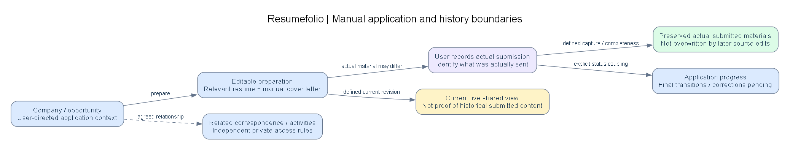
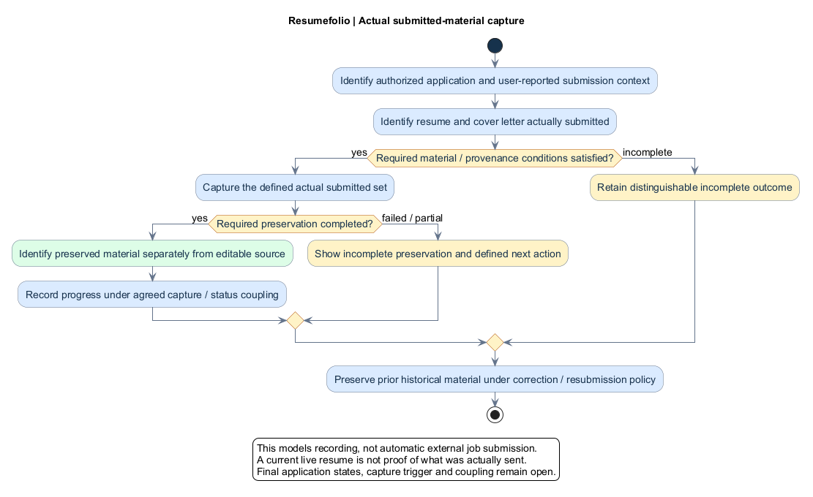

# Resumefolio — Manual Application Management

Current implementation choices and scope: [Baseline](../../../baseline/README.md). Runtime verification remains subject to its gates.

| Item | Current position |
| --- | --- |
| Owner | Farhad; sole delivery and operations owner |
| Status | Proposed product specification — detailed policy and acceptance pending |
| Planning basis | DEC-023/027/022/028; submitted-copy source EXT-002 |
| Candidate references | APP-D01–APP-D09 are provisional document-local references, not allocated global requirement IDs |
| Priority | Unassigned; document order is not delivery priority |
| Revision | October 31, 2026 |

**At a glance:** Record companies, opportunities, manually written cover letters and progress. Preserve the resume and cover letter actually submitted so later edits do not rewrite history. A live sharing link, current source, recorded status and preserved submitted copy are different things.

[Basis](#1-purpose-and-accepted-boundary) · [Inventory](#2-capability-and-information-inventory)
· [Requirements](#3-proposed-requirements) · [Models](#4-behavior-and-boundary-models)
· [Scenarios](#5-planned-verification) · [Decisions](#6-open-decisions-and-gates)
· [Review](#7-traceability-and-review-readiness)

## MVP integrated job applications

Manual job application management belongs to the Resumefolio core; ApplyFlow is its former name, not a separate branded platform. Each application preserves actual submitted materials, status, next action and follow-up date, together with its company/opportunity and selected resume/cover letter. Later source edits cannot change the recorded submitted set. Recording a submission is manual. APP-D08 requires manual follow-up fields in MVP; correspondence/calendar/provider links are deferred and cannot be required for tracking.

Authority: [OWNER-MVP-2026-11-04](../../01-project-planning/owner-mvp-decision-2026-11-04.md). [Candidate allocation](mvp-release-allocation.md).

## 1. Purpose and Accepted Boundary

[Scope DEC-023](../../01-project-planning/02-scope.md#dec-023) includes manual
ApplyFlow: company/position, relevant resume, user-written cover letter, progress
and preservation of actual submitted resume/cover-letter material. AI-assisted
analysis/drafting is excluded. Recording submission is not an integration that
automatically submits applications to external job platforms.

[EXT-002](../02-stakeholders-and-elicitation/elicitation-log.md#ext-002-manual-applications-and-preserved-submissions)
is a documentary source extraction, not a new interview or detailed policy approval.
Use [Business Lifecycle](business-rules-and-data-lifecycle.md),
[PDF and Sharing](pdf-and-controlled-sharing.md),
[Google Integration](email-calendar-and-google-integration.md) and the
[Data Dictionary](../05-data-definitions/data-dictionary.md) to reconcile boundaries.

## 2. Capability and Information Inventory

| Subject | Meaning | Definition still needed |
| --- | --- | --- |
| Company/opportunity | Context for the user's application | Fields, validation, reuse and duplicates |
| Editable preparation | Relevant resume association and manually authored cover letter | Save/revision behavior, formats and independence |
| Progress | User-recorded application stage/events | Final state/transition table, corrections and time semantics |
| Submission recording | User identifies what was actually sent and relevant context | Capture trigger, required set, provenance and incomplete outcomes |
| Preserved submitted set | Actual historical resume/cover-letter material | Artifact boundaries, resubmissions, retention and access |
| Correspondence/activity | Related authorized Gmail/calendar information | Link/copy, provider lifecycle and reminders |
| Archive/recovery | Deliberate retention/removal and restored relationships | Permissions, reference policy, coverage and actual evidence |

## 3. Proposed Requirements

All records are **Proposed**, owner **Farhad**, priority **Unassigned**. The final
status set, capture mechanism and retention policy remain undecided.

### APP-D01: Company and Opportunity Context

**Release allocation (owner decision, November 4):** MVP — Resumefolio core.

**Source / rationale:** DEC-023; application records need an identifiable company and position.

**Actor / conditions:** Authorized user creates or updates a manual application context.

**Proposed obligation:** Users shall record the company and job position associated with an application under reviewed field and validation rules.

**Acceptance criteria**
- A valid application identifies the intended company/position without silently substituting another opportunity.
- Missing or invalid required information produces the agreed incomplete/rejected outcome rather than false completion.
- Editing one application context does not silently change unrelated applications contrary to the reviewed reuse policy.

**Planned verification:** Later valid/incomplete/duplicate/reused-company cases.

**Open detail:** Fields, identifiers, required inputs, source URLs/attachments, company reuse, duplicate applications and opportunities without a structured job advertisement.

### APP-D02: Relevant Resume Association

**Release allocation (owner decision, November 4):** MVP — Resumefolio core.

**Source / rationale:** DEC-023/027; users choose opportunity-specific material while retaining independent tailoring.

**Actor / conditions:** Authorized user selects or changes the resume for a preparation-stage application.

**Proposed obligation:** The product shall associate the intended authorized resume with the application and distinguish that editable source from preserved submitted material.

**Acceptance criteria**
- The selected resume belongs to an allowed resource context and is identifiable from the application.
- Cross-user or invalid resume references cannot associate or disclose unrelated protected content.
- Changing the current association does not overwrite material already preserved as actually submitted.

**Planned verification:** Later authorized/denied association and post-submission source-change cases.

**Open detail:** Association cardinality, source-revision display, replacement/removal behavior, independently supplied files and source deletion.

### APP-D03: Manually Authored Cover Letter

**Release allocation (owner decision, November 4):** MVP — Resumefolio core.

**Source / rationale:** DEC-023/016; preparation remains user-authored without product AI.

**Actor / conditions:** Authorized user writes or edits application-specific cover-letter content.

**Proposed obligation:** Users shall manually prepare and save cover-letter content with explicit editing, validation and save-result rules.

**Acceptance criteria**
- Agreed valid manually entered content is retained for the intended application.
- Failed/incomplete save does not appear as successfully saved content.
- Later source edits do not overwrite a cover-letter copy already preserved as submitted.

**Planned verification:** Later edit/save/interruption and preserved-copy comparison cases.

**Open detail:** Required/optional content, format/language, draft recovery, duplication/reuse, export and independently prepared submitted letters; no AI drafting or automatic translation.

### APP-D04: Explicit Progress States and Transitions

**Owner-scope acceptance additions (MVP; planned, not executed):**

- The user can save status, a manual next action and follow-up date without any email/calendar connection; later edits do not change actual submitted materials.

**Release allocation (owner decision, November 4):** MVP — Resumefolio core.

**Source / rationale:** DEC-023; preparation, submission, interview and outcome are examples, not a finalized universal state machine.

**Actor / conditions:** Authorized user records or corrects application progress.

**Proposed obligation:** Application progress shall follow a reviewed set of states, allowed transitions and correction rules with explicit observable outcomes.

**Acceptance criteria**
- A permitted transition yields the intended current state and reviewed history information.
- An invalid or unauthorized transition produces defined feedback without false state completion.
- Examples such as withdrawal, rejection, repeated interviews or correction are handled according to explicitly chosen rules rather than an assumed one-way sequence.

**Planned verification:** Later transition-table walkthrough and valid/invalid/correction tests.

**Open detail:** Final values, backward transitions, timestamps, event versus recorded time, reason fields, history editability and concurrent changes.

### APP-D05: User-directed Submission Recording

**Release allocation (owner decision, November 4):** MVP — Resumefolio core.

**Source / rationale:** DEC-023; marking submitted records a user-reported action, not automated external submission.

**Actor / conditions:** User records materials actually sent through an external/manual channel.

**Proposed obligation:** Submission recording shall identify the intended application and actual material context under an explicit capture/validation workflow.

**Acceptance criteria**
- The user can distinguish source selection, recorded submission progress and successfully preserved actual materials.
- A saved status alone is not represented as evidence of an external platform submission, employer receipt or message read.
- If required capture is missing/failed, preservation remains distinguishably incomplete; progress/capture atomicity follows a reviewed rule.

**Planned verification:** Later external-channel examples, missing-material and capture-failure walkthroughs.

**Open detail:** Capture trigger, channel/time/provenance, material completeness, status coupling and later supply/correction; no actual applications are submitted here.

### APP-D06: Preserved Actual Submitted Copies

**Release allocation (owner decision, November 4):** MVP — Resumefolio core.

**Source / rationale:** DEC-023 and elicitation EXT-002; later editable-source changes must not rewrite application history.

**Actor / conditions:** The reviewed submission-recording process captures the resume and cover letter actually submitted.

**Proposed obligation:** The product shall preserve the actual submitted resume and cover-letter material in an identifiable historical context independent of subsequent source edits.

**Acceptance criteria**
- After capture, profile/resume/cover-letter/source-PDF edits do not overwrite preserved material.
- The preserved set corresponds to the actual user-identified submitted materials/revision under the reviewed capture policy, not an assumed latest live resume.
- Retrieval distinguishes historical material from editable source and follows applicable access rules.

**Planned verification:** Later capture comparison, source edits/replacement/deletion and authorized retrieval cases.

**Open detail:** Exact artifact boundaries, generated/uploaded/external resume variants, attachment set, manual attestation/provenance, storage/format and failed capture; no indefinite retention or immutable legal record is promised.

### APP-D07: Correction and Repeated Submissions

**Release allocation (owner decision, November 4):** MVP — Resumefolio core.

**Source / rationale:** Proposed history refinement of DEC-023; genuine corrections and resubmissions must not silently rewrite prior actual materials.

**Actor / conditions:** Authorized user corrects a record or records another submitted set for an application.

**Proposed obligation:** Corrections and resubmissions shall follow explicit history policies that keep relevant prior versus new material distinguishable.

**Acceptance criteria**
- Defined correction examples identify the affected record and produce the reviewed history/result.
- A newly submitted set is not silently substituted for a previously preserved set as though it were the original.
- Failed/repeated capture attempts yield the defined outcome without falsely claiming a complete new set.

**Planned verification:** Later correction/resubmission/duplicate/failure cases after policy review.

**Open detail:** Whether/how multiple sets are supported, provenance, correction versus replacement, permissions, retained versions and explicit deletion; no append-only architecture is selected.

### APP-D08: Correspondence, Calendar and Follow-up Links

**MVP obligation:** Store a manually maintained next action and follow-up date with the application status. No provider connection is required; mail/calendar link criteria below are deferred.

**Release allocation (owner decision, November 4):** Split — MVP manual next action/follow-up date; mail/calendar association deferred.

**Source / rationale:** DEC-022/023/028; application work can relate to relevant communications without leaking private data.

**Actor / conditions:** Authorized user associates an application with agreed correspondence or activity.

**Proposed obligation:** Agreed relationships shall identify the correct application and authorized message/activity while preserving independent access and lifecycle boundaries.

**Acceptance criteria**
- A related message/activity resolves to the intended account/application context.
- A collaborator or employer viewer gains no private correspondence access merely from an application relationship.
- Provider changes/removal do not silently overwrite preserved actual submitted copies.

**Planned verification:** Later association/permission/provider-removal scenarios.

**Open detail:** Link versus copy, displayed fields, reminders, relationship count, availability after disconnect and whether sent correspondence contributes to capture; EGC-D rules retain provider gates.

### APP-D09: Private Access, Archive and Recovery

**Release allocation (owner decision, November 4):** MVP — Resumefolio core.

**Source / rationale:** DEC-028/023/017 and proposed lifecycle refinement; application information and historical copies require deliberate retirement/recovery rules.

**Actor / conditions:** User/operator requests a protected read, archive, deletion or restoration operation.

**Proposed obligation:** Application lifecycle operations shall follow explicit authority, reference, retention and restoration policies without an implicit cascade from source removal.

**Acceptance criteria**
- Direct/cross-user requests cannot read or mutate unrelated protected application/history material.
- Source unlink/replacement does not implicitly erase preserved submissions; deliberate archive/delete follows the reviewed consequences.
- Later isolated restoration checks the application, preserved artifacts and access consistency; partial recovery is not a complete Pass.

**Planned verification:** Later denial/archive/delete/reference and isolated restore checks.

**Open detail:** Archive visibility, deletion authority/retention, account closure, recovery targets and deleted-data reappearance; no period or administrator power is invented.

## 4. Behavior and Boundary Models



[Scalable SVG](../diagrams/manual-application-history-map.svg) · [Graphviz source](../diagrams/manual-application-history-map.dot)

Arrows express conceptual relationships, not copying implementation or automatic
submission. A current generated PDF is not proof it was the file actually sent.



[Scalable SVG](../diagrams/application-submission-capture.svg) · [PlantUML source](../diagrams/application-submission-capture.puml)

This flow describes capture review, not the final application state machine.
Capture completeness and progress status need an explicit coupling/failure rule.
No external sending step is performed or authorized by the model.

## 5. Planned Verification

| Family | Candidates | Cases to develop |
| --- | --- | --- |
| Preparation | APP-D01–D03 | Required fields, duplicates, allowed/denied resume association, cover-letter save failures |
| Progress | APP-D04/D05 | Final valid/invalid transitions, correction, recorded versus actual event time |
| Actual history | APP-D05/D06 | Correct actual material, incomplete capture, source edits/replacement/deletion afterward |
| Repeated work | APP-D07 | Corrections, resubmission sets, failed/repeated capture and prior-set distinction |
| Cross-module | APP-D08 | Message/activity relationships, access isolation and provider source removal |
| Lifecycle | APP-D09 | Direct denial, archive/delete/reference policy and isolated consistent recovery |

Later evidence identifies candidate/policy revision, actor, application, source and
preserved artifact versions, initial state, expected/actual result and limits.
Use synthetic applications/materials; no real job submission is needed for
documentation verification and no product tests are recorded here.

## 6. Open Decisions and Gates

| Topic | Decisions/evidence needed | Gate |
| --- | --- | --- |
| Input/workflow | Fields, incomplete records, duplicates, source associations and draft behavior | Affected M-02 acceptance |
| Progress history | Final states/transitions, corrections, times and concurrency | Before accepting progress criteria/design |
| Actual-material capture | Trigger, file/revision set, user provenance, status coupling and failures | Before accepting capture/history requirements |
| Resubmission/correction | Prior/new sets, permitted changes, access and deletion | Affected history/lifecycle acceptance |
| Communication | Relationships, sent content versus history, reminders and provider data availability | EGC-D requirements; GAP-D02 before provider-dependent development |
| Privacy/retention/recovery | Exact grants, archive/delete, source references, coverage and actual restore | Domain/lifecycle design; GAP-D04 and later M-09 evidence |

Farhad coordinates all topics. Record actual findings in
[Questions and Decisions](../07-change-and-baseline/open-questions-and-decisions.md)
and retain [Planning Gates](../../01-project-planning/10-planning-completion-criteria.md).
Material scope/cost/delivery changes follow [Change Control](../07-change-and-baseline/change-control.md).
No local topic is claimed as an allocated shared question or accepted policy.

## 7. Traceability and Review Readiness

APP-D01–D06 derive from DEC-023 with DEC-027 source independence and EXT-002.
APP-D07/D09 include proposed correction/lifecycle detail; APP-D08 links DEC-022/028.
Reconcile BRL-D05 history, EGC-D09 communication relationships, ACC-D permissions
and AFO-D replacement/cleanup without treating those drafts as approved policies.

Use the [requirement template](requirements-specification.md) when allocating
final IDs. Link allocated records/scenarios and actual evidence in
[Traceability](../06-validation-and-traceability/requirements-traceability.md).
Record actual inspection outcomes in [Review Findings](../06-validation-and-traceability/review-plan-and-findings.md).

- [ ] Reconcile provisional APP-D references and assign justified priorities.
- [ ] Review source-derived boundaries separately from proposed supporting detail.
- [ ] Resolve policy/state/permission questions blocking affected acceptance.
- [ ] Reconcile dictionary, lifecycle, interface and related domain specifications.
- [ ] Complete normal, denied, failure, concurrent and recovery scenarios where applicable.
- [ ] Record actual owner decision, reviewed revision, evidence and remaining blockers.

**Current outcome:** Proposed specification; no candidate is accepted and no product
test result is recorded. Conditional criteria are not acceptance-ready until their
referenced policies are decided. M-02 and the wider pre-implementation agreement
remain pending. This revision changes no accepted scope and performs no live
repository, application-submission, sharing, file or provider operation.

## 8. Diagram Maintenance

| Diagram | Source | SVG | PNG |
| --- | --- | --- | --- |
| Application history boundaries | [Graphviz](../diagrams/manual-application-history-map.dot) | [SVG](../diagrams/manual-application-history-map.svg) | [PNG](../diagrams/manual-application-history-map.png) |
| Submitted-material capture | [PlantUML](../diagrams/application-submission-capture.puml) | [SVG](../diagrams/application-submission-capture.svg) | [PNG](../diagrams/application-submission-capture.png) |

Keep sources, captions and renders synchronized. Colors supplement labels. Follow
the [diagram guide](../diagrams/README.md); inspect readable arrows/labels and check
file/section links after changes. From repository root:

```powershell
$diagramFolder = 'docs\SDLC\02-requirements-engineering\diagrams'
$graphvizExe = 'C:\Program Files\Graphviz\bin\dot.exe'
$plantUmlJar = 'C:\Users\fvali\AppData\Local\Resumefolio\DiagramTools\plantuml.jar'
foreach ($format in 'svg', 'png') {
    & $graphvizExe "-T$format" -Gdpi=140 "$diagramFolder\manual-application-history-map.dot" -o "$diagramFolder\manual-application-history-map.$format"
    if ($LASTEXITCODE -ne 0) { throw "Graphviz failed: $format" }
    java '-Djava.awt.headless=true' -jar $plantUmlJar -charset UTF-8 "-t$format" "$diagramFolder\application-submission-capture.puml"
    if ($LASTEXITCODE -ne 0) { throw "PlantUML failed: $format" }
}
```

Use actual tool paths on other machines; save UTF-8 without BOM.

[Specification index](README.md) · [SRS entry point](requirements-specification.md)
· [Requirements index](../README.md)

## Course-Aligned Priority Review

Actual approved priority remains unassigned. See the [per-candidate proposed priority and readiness register](requirements-priority-and-readiness.md) for a sourced proposal, its limits and the course's SMART checks. A proposed Must is not acceptance of unresolved detail. Primary obligations, candidate IDs and criterion wording are unchanged by that register.

## Proposed Answers for Detailed Requirements Review — November 1, 2026

The owner requested completion of the outstanding questions. The sections below supply concrete **proposed** answers rather than infer approval of previously unspecified policy. They supersede the absence of a proposal in earlier open-detail paragraphs, not accepted scope or historical decisions. Their fields, limits and behavior require review before affected requirement acceptance; no implementation or product-test Pass is reported. Existing candidate IDs and primary obligations are retained. See the [review package](../07-change-and-baseline/requirements-answer-review.md) for authority, evidence gates and cross-document navigation.

<a id="resolution-q-d12"></a>
### Proposed answer Q-D12: Application fields and progress

**Affected records:** APP-D01–APP-D05; BRL-D06/D10. **Disposition:** Answer proposed; owner acceptance pending.

1. Require private application title, company name and opportunity/role label for a usable application record; opportunity URL, contact, location, description, source, notes and deadline are optional. Support a manually authored cover letter and relevant resume association; neither implies an external send.

2. Propose states Preparing, Ready, Submitted, Interview, Offer, Rejected and Withdrawn. Preparing may move to Ready after owner review of intended materials; owner records actual submission separately before Submitted. Submitted may move to Interview/Offer/Rejected/Withdrawn; Interview may move to Offer/Rejected/Withdrawn; an Offer may be accepted/declined as a recorded outcome without rewriting the original submission.

3. Record actor, effective date/time and reason for progress correction; allow owner correction with history. Do not infer application status from a calendar invite or email subject automatically. A manual external portal submission may be recorded even when no send was performed by this product.

4. Warn about same company/role/date duplicates but permit confirmed distinct applications; use separate identities. Deadline comparisons use stored time-zone/precision. Incomplete drafts remain private and savable with missing required publication/submission details displayed.

**Assessable review cases:** [RC-Q12-01 through RC-Q12-03](../04-scenarios-and-models/user-stories-and-scenarios.md#review-q-d12). These are planned checks, not executed results.

**Remaining evidence / acceptance condition:** Owner review of the proposed rule and its affected criteria is required; no product test is reported.

<a id="resolution-q-d13"></a>
### Proposed answer Q-D13: Actual submitted materials

**Affected records:** APP-D05/APP-D06; BRL-D05; PDF-D08. **Disposition:** Answer proposed; owner acceptance pending.

1. Each recorded submission event identifies application, actual submission time with zone/precision, channel, owner assertion and material completeness. Current editable resume/cover letter is not evidence of the actual submitted bytes.

2. For each claimed preserved document, capture the actual supplied/uploaded artifact or the exact identified generated rendition the owner confirms was submitted; record filename, category, language, checksum, provenance and captured time. Validate/preserve before reporting a complete captured set. Do not automatically claim the employer received/read the document.

3. Permit truthful submission recording when actual files are missing, but label the event materials incomplete/unavailable; it cannot satisfy preserved-copy acceptance. A link-only portal submission records the exact link/revision/time asserted and its limitation, not a fabricated local PDF.

4. Keep the captured set separate from live profile/resume/evidence changes. Conflicting/concurrent capture requires explicit reconciliation; a failed file capture retains the event's incomplete state and a retry/correction action. A sent mail association may supply exact attachments after owner confirmation, not guessed equivalents.

**Assessable review cases:** [RC-Q13-01 through RC-Q13-03](../04-scenarios-and-models/user-stories-and-scenarios.md#review-q-d13). These are planned checks, not executed results.

**Remaining evidence / acceptance condition:** Owner review of the proposed rule and its affected criteria is required; no product test is reported.

<a id="resolution-q-d14"></a>
### Proposed answer Q-D14: Corrections, repeated submissions and retirement

**Affected records:** APP-D07/APP-D09; BRL-D08/D09; QSR-D09/D12. **Disposition:** Answer proposed; owner acceptance pending.

1. A new submission is a new event/set, even for the same application. Correcting metadata records previous value, new value, actor/time and reason. Replacing an erroneously captured artifact creates a correction/version relationship; do not silently rewrite what was previously recorded.

2. Archive removes an application from active lists but preserves authorized history. Propose an explicit trash/restore period of 30 days after owner deletion, followed by eligible purge; referenced material is not silently purged while a retained submission needs it. Account suspension does not delete data. Hard erasure/retention conflicts require applicability review before enabling purge.

3. Default to retaining submission history until owner-directed deletion under the reviewed policy; this is not a claim of lawful indefinite retention. Backup expiry is distinct from live trash; explain that a backup may retain deleted data until its agreed expiry and that restore must reapply current deletion/access decisions.

4. Restore returns an authorized archived/trashed item to its defined state without reopening disabled sharing links, reactivating revoked collaborators or resending communication. Missing/expired material is reported explicitly, not reconstructed from a different current resume.

**Assessable review cases:** [RC-Q14-01 through RC-Q14-03](../04-scenarios-and-models/user-stories-and-scenarios.md#review-q-d14). These are planned checks, not executed results.

**Remaining evidence / acceptance condition:** Retention periods are operational proposals, not legal conclusions. Applicable privacy/retention obligations and actual backup-expiry behavior remain Q-D27/Q-D26 gates.
